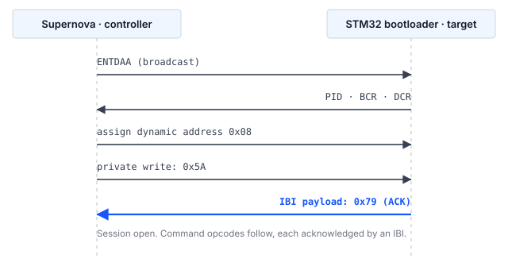

## 1 はじめに

すべての STM32 マイクロコントローラの ROM に書き込まれているシステムブートローダは、
デバッグプローブを使用せず、デバイス上にユーザコードが存在しない状態でも、シリアル
インタフェースを介して内部フラッシュメモリをプログラミングする手段を提供します。
ブートローダが提供するインタフェースはデバイスによって異なり、AN2606 に型番ごとに
記載されています。

STM32H5 シリーズのデバイスでは、この一覧に I3C が含まれます。これは 2 つの状況で有用です。
1 つ目は、センサやその他の周辺機器に接続するために I3C バスがすでにボード上に配線されて
いる場合で、同じ 2 本の信号線でファームウェア更新を行えるため、専用のプログラミング用
ヘッダが不要になります。2 つ目は、複数のターゲットが 1 本のバスを共有している場合で、
ボードごとにストラップ抵抗や治具の再構成を行うことなく、ダイナミックアドレス割り当て
（DAA）によって各ターゲットを個別にアドレス指定できます。

### 1.1 適用範囲

本資料では、以下について説明します。

- コマンドステータスの通知に使用されるメカニズムを含む、I3C システムブートローダ
  プロトコルの構造
- Binho Supernova と STM32 ターゲットの間に必要な接続
- デバイスの識別、消去、プログラミング、ベリファイの手順
- この手順を実装した、本資料に付属するリファレンスホストユーティリティ

Open Bootloader アプリケーションによるプログラミング、インアプリケーション
プログラミング、およびセキュアファームウェア更新のメカニズムは、本資料の範囲外です。

### 1.2 対象デバイス

デバイスで利用可能なブートローダインタフェースはデバイス固有です。I3C 周辺機能を
備えていても、I3C ブートローダを備えているとは限りません。表 1 に、ブートローダが I3C を
提供すると文書化されている STM32 ファミリと、Get ID コマンドが返すデバイス識別子を
示します。

Table: システムブートローダが I3C インタフェースを提供する STM32 ファミリ

| ファミリ | 型番の例 | デバイス ID | 根拠 |
|---|---|---|---|
| STM32H5 | STM32H503 | `0x474` | 本資料のためにハードウェアで検証済み |
| STM32H5 | STM32H523, STM32H533 | `0x478` | RM0481 |
| STM32H5 | STM32H562, STM32H563, STM32H573 | `0x484` | STMicroelectronics Open Bootloader の構成 |
| STM32H7R, STM32H7S | STM32H7S78 | `0x485` | STMicroelectronics Open Bootloader の構成 |
| STM32U3 | STM32U385 | `0x454` | STMicroelectronics Open Bootloader の構成 |

STM32N6 シリーズのデバイスは I3C 周辺機能を備えていますが、STMicroelectronics Open
Bootloader の配布物は、このファミリ向けの I3C インタフェースを提供していません。

> **重要：** 本資料の作成中にハードウェアで動作確認を行ったのは STM32H503 のみです。
表 1 のその他のエントリはリファレンスユーティリティで認識されますが、テストされていません。
特定の型番で利用可能なブートローダインタフェースについては AN2606 が正式な情報源であり、
この方式を製品に採用する前に必ず参照してください。

### 1.3 関連資料

Table: 関連資料

| 資料 | タイトル |
|---|---|
| AN2606 | STM32 microcontroller system memory boot mode |
| AN5927 | I3C protocol used in the STM32 bootloader |
| AN5879 | Introduction to I3C for STM32 MCUs |
| RM0481 | STM32H523/H533, STM32H562/H563/H573 line reference manual |
| RM0492 | STM32H503 line Arm-based 32-bit MCUs reference manual |
| MIPI I3C | MIPI Alliance Specification for I3C Basic |

## 2 システム概要

### 2.1 バス上の役割

Supernova は I3C コントローラとして動作します。STM32 ブートローダは I3C ターゲットとして
動作します。コントローラはすべてのデータ転送を開始し、クロックを駆動します。唯一の例外は
インバンド割り込み（IBI）で、ターゲットはこれを発行してコントローラに対応を要求します。
2.2 節で説明するとおり、ブートローダはこれをステータスの通知に使用します。

ターゲットはアドレスを持つ前にダイナミックアドレス割り当てに参加し、自身のプロビジョンド
識別子を用いて調停を行います。アドレスが割り当てられるまでは、アドレス指定された
トラフィックに応答せず、同期バイトを受信してアクノリッジするまではブートローダコマンドを
受け付けません。

### 2.2 インバンド割り込みによるステータス通知

I3C ブートローダは、I2C および USART ブートローダとある 1 点で異なっており、その点が
あらゆるホスト実装の構造を決定します。

I2C および USART ブートローダは、ホストが同じインタフェースを介して読み返す
アクノリッジバイトを返します。I3C ブートローダは、そのような読み出し可能なステータスを
公開していません。代わりに、ターゲットは **1 バイトのペイロードを持つインバンド割り込み
（IBI）** を発行し、そのバイトがアクノリッジとなります。ブートローダは初期化時に、
1 バイトの追加データを伴う IBI 用に I3C 周辺機能を設定し、それ以降のセッション中に
発行するすべてのアクノリッジをこの方法で通知します。

表 3 に、STM32H503 で観測されたペイロード値を示します。

Table: アクノリッジ IBI で伝送されるステータス値

| 値 | 意味 |
|---|---|
| `0x79` | ACK。ステップが受け付けられました。 |
| `0x1F` | NACK。ステップが拒否されました。 |

> **注：** ブートローダは、I3C インタフェースでは使用されない値をさらに 2 つ定義しています。
ビジーを表す `0x76` と、`0xEC` です。`0xEC` は、STMicroelectronics Open Bootloader の
ソースにおいて、送信される値ではなく、オペコードの整合性チェック失敗を示す内部マーカとして
使用されています。いずれも I3C インタフェース上では観測されませんでした。本資料の作成中に
遭遇したすべての拒否は、不正な形式のオペコードを含め、
`0x1F` として通知されました。実施したケースは 5.8 節に示します。

したがって、すべてのコマンドのすべてのステップは同じパターンに従います。コントローラが
所定のバイト数を書き込み、その後 IBI を待ってそのペイロードを読み取ります。IBI ペイロードを
アプリケーションに渡せないホスト I3C スタックや、待機できない非同期イベントとしてのみ IBI を
通知するホスト I3C スタックでは、このプロトコルを実装するには不十分です。

> **注：** この要件は、開発を開始する前に、使用予定のホストアダプタおよびドライバに
ついて確認してください。

## 3 ハードウェアのセットアップ

### 3.1 必要な機器

Table: 必要な機器

| 品目 | 説明 |
|---|---|
| Binho Supernova | USB ホストアダプタ。I3C コントローラとして動作します |
| STM32 ターゲット | 表 1 のデバイス。本資料では NUCLEO-H503RB を使用しました。 |
| ホストコンピュータ | Python 3.8 以降を搭載した Windows、macOS または Linux。本資料の測定には Python 3.12 を使用しました。 |
| シリアルターミナル | 任意のターミナルエミュレータ。7 章のベリファイ手順に使用します。プログラミング自体には不要です。 |

### 3.2 接続

表 5 に、Supernova とターゲットの間の接続を示します。3 本のバス信号は必須です。2 本の
汎用ピンはオプションで、ターゲットを自動的にブートローダモードにするために使用します。
これらがない場合は、オペレータがその操作を手動で行います。

Supernova はターゲットに電源を供給しません。ソフトウェアで設定された電圧で I3C バスを
駆動しますが、ターゲットボードには別途電源を供給する必要があります。Nucleo ボードでは、
オンボードの ST-LINK への USB 接続がこれを担い、同じ接続が 7 章で使用する仮想 COM ポートも
伝送します。

Table: Supernova とターゲットの間の接続

| Supernova | ターゲット | 必須 |
|---|---|---|
| I3C SCL | `PB6` | はい |
| I3C SDA | `PB7` | はい |
| GND | GND | はい |
| GPIO 1 | `NRST` | いいえ |
| GPIO 2 | `BOOT0` | いいえ |

`PB6` と `PB7` は、AN2606 が STM32H503xx のブートローダ構成において `I3C1_SCL` と
`I3C1_SDA` に割り当てているピンです。これらのピンは ROM で固定されており、型番ごとに
異なるため、ボードのシルク印刷や、ボードの I3C コネクタがたまたま配線しているピンから
推測するのではなく、手元のデバイスについて AN2606 で確認する必要があります。同じ型番は
I2C ブートローダには別のピンペア `PB3` と `PB4` で応答します。これは AN0002 の主題です。

### 3.3 バスに関する考慮事項

I3C バス電圧はターゲットの I/O 電源と一致している必要があります。Supernova のバス電圧は
ホストソフトウェアで設定します。本資料の測定では、NUCLEO-H503RB の I/O 電源に合わせて
3300 mV を使用しました。

バスのプルアップ要件は MIPI I3C 仕様に従い、バス容量と使用するオープンドレインの
データレートに依存します。ターゲットボードの I3C 信号に適切なプルアップが実装されて
いない場合は、追加する必要があります。

> **注意：** NRST は決して High に駆動しないでください。ターゲットをリセットするには、
NRST を Low に駆動し、その後ピンを入力に再設定して解放し、ターゲットボード上のプルアップに
よって High レベルに戻します。NRST を High に駆動すると、ターゲットボード上のリセット回路と、
Nucleo ボードではオンボードのデバッガとも競合します。

## 4 ソフトウェアのセットアップ

### 4.1 ホストパッケージのインストール

リファレンスユーティリティは、Binho Supernova Python パッケージを介して I3C バスを駆動します。

```
pip install binhosupernova
```

本資料にはバージョン 4.2.0 を使用しました。その他のパッケージは不要です。Intel HEX の
解析はユーティリティ内に実装されています。

同じユーティリティは、Supernova または Binho Pulsar のいずれかから I2C 経由でターゲットを
プログラミングすることもでき、Pulsar の場合は代わりに `binhopulsar` が必要です。ここでは
I3C の経路のみを説明します。I2C については AN0002 で扱います。

### 4.2 リファレンスユーティリティの入手

ユーティリティ `stm32_flash.py` は、本資料に付属するアセットアーカイブで提供されています。
これは AN0002 に付属するファイルと同一であるため、1 つのコピーで両方のバスに対応します。

```
https://cdn.binho.io/application-notes/AN0001/AN0001-assets.zip
```

同じファイルは、本資料の Markdown ソースとともに
`https://github.com/binhollc/application-notes` で公開されています。アーカイブの内容は
12 章に記載しています。

アーカイブを展開すると、ユーティリティを格納した `assets` ディレクトリと、7 章の
ベリファイ用イメージを格納した `firmware` サブディレクトリが作成されます。本資料の
すべてのコマンドは、その `assets` ディレクトリ内から実行する場合の形で示しています。

## 5 ブートローダプロトコル

### 5.1 システムブートローダモードへの移行

ユーザフラッシュではなくシステムブートローダを実行させるには、BOOT0 を High に保持した
状態でデバイスをリセットする必要があります。3.2 節の説明どおりに GPIO 1 と GPIO 2 が
接続されている場合、ホストはこれを自動的に行います。

1. BOOT0 を High に駆動します。
2. NRST を Low に駆動し、50 ms の間 Low に保持します。
3. ピンを入力に再設定して NRST を解放します。
4. バスアクセスを開始する前に、ブートローダの初期化のために 250 ms 待ちます。

上記の保持時間と安定待ち時間はリファレンスユーティリティが使用するデフォルト値で、
`--reset-hold` と `--boot-delay` で調整できます。デバイスをアプリケーションに戻すには、
BOOT0 のレベルを反転し、リセットパルスを繰り返します。

> **注：** 一部のデバイスでは、オプションバイト `nBOOT0` と `nSWBOOT0` によって、BOOT0
ピンがそもそもサンプリングされるかどうかが決まります。BOOT0 を High に保持しても
デバイスがブートローダに移行しない場合は、オプションバイトの設定を確認してください。

### 5.2 バスの初期化とダイナミックアドレス割り当て

コントローラはブロードキャスト ENTDAA を発行します。ブートローダはダイナミックアドレス
割り当てに参加し、ダイナミックアドレスを割り当てられます。ターゲットは、48 ビットの
プロビジョンド識別子、バス特性レジスタ、デバイス特性レジスタからなる標準の 8 バイトの
ペイロードを返します。

STM32H503 で観測された値を表 6 に示します。

Table: ダイナミックアドレス割り当て中に STM32H503 が返す識別情報

| フィールド | 値 |
|---|---|
| ダイナミックアドレス | `0x08`（単一ターゲットのバスにおける最初の空きアドレス） |
| プロビジョンド ID | `02 08 13 81 B0 00` |
| BCR | `0x2E` |
| DCR | `0x01` |

続いて、このターゲットからの IBI 要求を受け付けるようにコントローラを設定する必要が
あります。コントローラが IBI を拒否すると、以降のすべてのコマンドがタイムアウトした
ように見えます。

### 5.3 セッションの同期

コントローラは、ターゲットのダイナミックアドレスに対して 1 バイト `0x5A` のプライベート
ライトを行います。ブートローダはこの値をセッションの開始として認識し、`0x79` を伴う IBI で
応答します。これでセッションが開かれ、ブートローダはコマンドオペコードを待ちます。



### 5.4 コマンドのフレーミング

各コマンドは 2 バイトで送信されます。オペコードと、それに続くそのビット単位の補数です。
ターゲットは、2 つのバイトの排他的論理和が `0xFF` になることを検証します。

メモリを操作するコマンドは、最上位バイトを先頭とする 4 バイトのアドレスと、それに続く
その 4 バイトの排他的論理和を格納した 1 バイトを受け取ります。

データペイロードの後には、ペイロードの排他的論理和を格納した 1 バイトが続きます。

2.2 節で説明したとおり、これらのステップはいずれも IBI によってアクノリッジされます。
個々のコマンドのバイトレベルのシーケンスは、アセットアーカイブ内の `PROTOCOL.md` に
記載しています。

### 5.5 転送サイズフィールド

Read Memory コマンドと Write Memory コマンドは、データの各ブロックの前に 3 バイトの
転送ヘッダを受け取ります。

Table: 転送ヘッダ

| バイト | 内容 |
|---|---|
| 0 | サイズフィールド、最上位バイト |
| 1 | サイズフィールド、最下位バイト |
| 2 | バイト 0 と 1 の排他的論理和 |

サイズフィールドはブロック長を 1 ビット左シフトしたもので、最下位ビットは継続フラグとして
使用されます。継続フラグがセットされている場合、ターゲットは転送ループ内にとどまり、
アドレスを自ら進めます。そのため、アドレスはブロックごとに 1 回ではなく、一連のブロックに
対して 1 回だけ送信されます。

最大ブロック長は、サイズが公開されていないブートローダ内部のバッファによって制限されます。
STMicroelectronics のリファレンス実装では、読み出し経路はバッファサイズまでのブロックを
受け付け、書き込み経路はそれより 1 バイト少ないブロックを受け付けます。したがって、読み出しで
確認された長さが書き込みでも自動的に有効になるわけではありません。

STM32H503 ではより大きなブロックも試し、正しいデータが返されました。読み出しは 512 バイトと
1024 バイトでバイト単位で比較し、書き込みは 512 バイトで行いました。それを超えると、アダプタ
パッケージが要求をターゲットに届く前に拒否するため、ブートローダ自身の上限には到達しておらず、
ここでは確定していません。ただし、2 つの経路の非対称性は実際に存在します。読み出し経路は
1024 を受け付けましたが、書き込み経路は受け付けませんでした。

ユーティリティは 256 バイトのブロックを使用しており、これは関係するすべての制限の範囲内に
収まります。9 章の測定はこのサイズで行いました。

> **重要：** 転送ループ内にとどまることは、単に高速化のためではなく、信頼性の高い動作の
ために必要です。ブロックごとに個別のコマンドを発行すると、次の書き込みが到着した時点で
ターゲットがまだコマンドディスパッチャを経由して戻る途中であるため、コマンドオペコードが
断続的に失われます。測定結果は 9.3 節に示します。

### 5.6 サポートされるコマンド

表 8 に、ブートローダプロトコルバージョン 1.0 の STM32H503 において Get コマンドが
通知したコマンドを示します。

Table: STM32H503 で I3C 経由でサポートされるコマンド

| オペコード | コマンド |
|---|---|
| `0x00` | Get |
| `0x01` | Get Version |
| `0x02` | Get ID |
| `0x11` | Read Memory |
| `0x21` | Go |
| `0x31` | Write Memory |
| `0x44` | Extended Erase |
| `0x50` | Special Command |
| `0x63` | Write Protect |
| `0x73` | Write Unprotect |

Readout Protect（`0x82`）と Readout Unprotect（`0x92`）は I3C 経由では提供されません。
このインタフェースを介して読み出し保護（RDP）を設定または解除することはできず、これを
必要とする量産フローでは、そのステップを別のインタフェースで行う必要があります。

### 5.7 消去

Extended Erase は、最上位バイトを先頭とする 2 バイトのカウントと、それに続く排他的論理和
バイトを受け取ります。`0xFFF0` から `0xFFFF` の範囲の値は、特殊な消去操作のために予約
されています。

Table: Extended Erase の特殊値

| 値 | 操作 |
|---|---|
| `0xFFFF` | マスイレース |
| `0xFFFE` | バンク 1 の消去 |
| `0xFFFD` | バンク 2 の消去 |

それ以外の値はページ数であり、その後にその数だけの 2 バイトのページ番号（それぞれ最上位
バイトが先頭）と、それらすべてをカバーする 1 バイトの排他的論理和が続きます。このデバイスの
フラッシュページは 8 KB で、`--erase pages` はデバイス全体ではなく、イメージがカバーする
ページのみを消去します。

> **注：** カウントフィールドのエンコーディングは、この型番の 2 つのバスで同じでは
ありません。I3C インタフェースはページ数を受け取り、I2C インタフェースはページ数から 1 を
引いた値を受け取ります。いずれも、隣接する 2 つのページに異なるパターンを書き込み、最初の
ページだけを消去し、どのページが消去された状態で返されるかを確認することで確定しました。
I2C の場合については AN0002 で扱います。誤ったエンコーディングを送信すると、意図より
1 ページ多く、または少なく消去されるため、使用するインタフェースについてこのフィールドを
確認してください。

### 5.8 拒否されたコマンド

ブートローダが拒否をどのように通知するかを確認するため、不正な形式または範囲外の 3 つの
ケースを STM32H503 に発行しました。

Table: STM32H503 で観測された拒否時の動作

| 送信したケース | 応答 |
|---|---|
| 補数が一致しないオペコード | IBI、ペイロード `0x1F` |
| 形式は正しいがサポートされていないオペコード（`0x82`） | IBI、ペイロード `0x1F` |
| 無効なアドレス（`0x00000000`）に対する Read Memory | IBI、ペイロード `0x1F` |

拒否によってセッションが終了することはありません。上記 3 つの各ケースの後、直ちに発行した
Get Version はアクノリッジされ、通常どおり `0x10` を返しました。したがって、いずれの
ケースでもブートローダはコマンドオペコードの待機状態に戻っていました。ホストは NACK から
回復するためにターゲットをリセットする必要はありません。

> **注：** 4 つ目のケースである、ブートローダのバッファを超える長さを要求する転送ヘッダは、
発生させることができませんでした。5.5 節で説明したとおり、アダプタパッケージがサイズ超過の
要求をターゲットに届く前に拒否するため、ブートローダがそれにどう応答するかはテストされて
いません。

## 6 プログラミング手順

### 6.1 ターゲットの識別

`info` コマンドは、ターゲットをリセットしてブートローダに移行させ、バスを初期化し、
ダイナミックアドレス割り当てを行い、セッションを開いて、応答した内容を報告します。

```
python stm32_flash.py --bus i3c info

  Adapter: supernova  fw 4.4.0
  Bus: I3C
  Resetting target into bootloader (NRST=GPIO1, BOOT0=GPIO2)
  I3C: 3300 mV, push-pull PUSH_PULL_2_5_MHZ_25_DC, open-drain OPEN_DRAIN_1_MHZ
  Assigning dynamic addresses (ENTDAA)
  Target at 0x08  PID 02 08 13 81 B0 00  BCR 0x2E  DCR 0x01
  Bootloader session established

  Protocol version : 1.0
  Device ID        : 0x474  (STM32H503)
  Commands         : 10
      0x00  Get
      ...
      0x73  Write Unprotect
```

サポートされる 10 個のコマンドは、これらの行の間にすべて列挙されます。これらは表 8 に
示したものです。アダプタのシリアル番号は最初の行に表示されますが、ここでは省略しています。
ユーティリティは 3 つのバスを駆動し、Supernova はそのすべてを提供するため、どのバスが
配線されているかを推定できません。そのため `--bus i3c` が必要です。

これは、破壊的な操作を行う前に配線、バス設定、ブートローダへの移行を確認できるため、
新しいボードでは最初に行うことを推奨する手順です。

### 6.2 既存の内容の読み出し

消去の前にフラッシュの内容を保存しておく必要があります。次のコマンドは、STM32H503RB の
128 KB のフラッシュ全体を読み出します。

```
python stm32_flash.py --bus i3c read backup.bin --address 0x08000000 --length 0x20000
```

### 6.3 イメージのプログラミング

`flash` コマンドは、マスイレース、プログラミング、読み返しと比較、そしてアプリケーション
へのリセットという一連の処理をすべて実行します。コマンドを記載どおりにそのまま実行できる
よう、ここでは 7 章のベリファイ用イメージを例として使用します。

RAW バイナリには、明示的なベースアドレスが必要です。

```
python stm32_flash.py --bus i3c flash firmware/an0001_image_a.bin --address 0x08000000
```

Intel HEX ファイルは自身のアドレスを持っているため、このオプションは省略します。
`firmware` ディレクトリで `make hex` を実行すると生成されます。

```
python stm32_flash.py --bus i3c flash firmware/build/an0001_image_a.hex
```

### 6.4 ベリファイ

ベリファイはデフォルトで実行されます。プログラミングした範囲を同じインタフェースで
読み返し、ソースイメージとバイト単位で比較します。プログラミング時間が重要で、イメージを
別の方法でベリファイする場合は、`--no-verify` で無効にできます。

### 6.5 デバイスをアプリケーションに戻す

GPIO 1 と GPIO 2 が接続されている場合、ユーティリティはプログラミング後に BOOT0 を Low に
駆動して NRST にパルスを与えるため、デバイスは新たにプログラミングされたアプリケーションを
開始します。これらのピンが接続されていない場合は、代わりに Go コマンドが発行され、
ブートローダはリセットせずにイメージへジャンプします。`--no-run` を指定すると、デバイスは
ブートローダにとどまります。

## 7 ターゲット上での更新の確認

`flash` コマンドはプログラミングした範囲を読み返してバイト単位で比較するため、フラッシュの
内容が与えたイメージと一致することは証明されます。しかし、デバイスが新しいファームウェアを
実行していることは証明されません。ブートローダにとどまったままのターゲットや、リセットが
解除されなかったターゲットは、このチェックに合格しても、アプリケーションを実行していない
可能性があります。

このギャップを埋めるため、本資料には 2 つの小さなファームウェアイメージが付属しています。
これらは、報告する文字とユーザ LED の点滅レートを除いて同一であるため、プログラミング
ツールの外部から変化を確認できます。

### 7.1 ベリファイ用イメージ

Table: 本資料に付属するベリファイ用イメージ

| イメージ | ファイル | 報告内容 | LED |
|---|---|---|---|
| A | `firmware/an0001_image_a.bin` | `IMAGE A` | 1 Hz |
| B | `firmware/an0001_image_b.bin` | `IMAGE B` | 5 Hz |

イメージのサイズは 868 バイトと 864 バイトで、`0x08000000` から実行されるようにリンク
されています。ソース、リンカスクリプト、メイクファイルが併せて提供されているため、
イメージをそのまま信用するのではなく、内容を確認して再ビルドできます。

どちらも USART3 に **115200 baud、データ 8 ビット、パリティなし、ストップビット 1** で
出力します。NUCLEO-H503RB では USART3 が ST-LINK の仮想 COM ポートに接続されています。
追加の配線は不要で、ST-LINK にすでに接続されている USB ケーブルが出力を伝送します。

> **注：** 付属のバイナリは NUCLEO-H503RB 用にビルドされています。PA4 を USART3_TX、PA5 を
ユーザ LED として駆動しますが、これはこのボードの配線に合わせたものです。その他のボードでは、
ピンと仮想 COM ポートへの接続が異なるため、シリアル出力は表示されません。イメージは小さく、
ソースも提供されているため、`firmware/main.c` の先頭にあるピンと周辺機能の定義を変更して
再ビルドすることで、別のボードに対応させてください。

リセット時にバナーが 1 回表示され、その後 1 秒ごとにハートビート行が 1 行表示されます。

```
========================================
  Binho  |  AN0001
  Programming STM32 microcontrollers
  over I3C with the Binho Supernova
========================================
  Running: IMAGE A
  Kernel clock: 32 MHz
  LED blink: 1 Hz
========================================
  IMAGE A  alive, 1 s
  IMAGE A  alive, 2 s
```

ハートビートがあるのは、リセット時にのみ表示されるバナーは、ターミナルを後から開くと
見逃してしまうためです。ハートビートがあれば、実行中のイメージをいつでも識別できます。

> **注：** 報告されるカーネルクロックは 32 MHz で、HSI 自体の 64 MHz ではありません。
このデバイスでは `HSIDIV` のリセット値は 2 です。イメージは周波数を仮定するのではなく、
実行時にこの分周比を読み取り、そこからボーレートの除数を算出します。64 MHz を仮定すると
ボーレートが 2 倍ずれ、出力が表示されないのではなく、単に文字化けするだけになるためです。

### 7.2 手順

1. ST-LINK の仮想 COM ポートで、115200 8N1 でシリアルターミナルを開きます。
2. Image A をプログラミングし、ユーティリティにアプリケーションを開始させます。

```
python stm32_flash.py --bus i3c flash firmware/an0001_image_a.bin --address 0x08000000
```

```
  ...
  Device ID        : 0x474  (STM32H503)
  Mass erasing
    done in 0.03 s
  Writing
    wrote 868 bytes in 0.06 s (13.5 KiB/s)
  Verifying
    all 868 bytes match (0.05 s)
  Resetting into application
  Success.
```

上記の出力は抜粋です。6.1 節のバスおよびセッションの行が最初に表示され、正確な時間は
実行ごとに多少異なります。

3. ターミナルに `IMAGE A` と表示され、LED が 1 Hz で点滅することを確認します。
4. Image B をプログラミングします。

```
python stm32_flash.py --bus i3c flash firmware/an0001_image_b.bin --address 0x08000000
```

5. ターミナルに今度は `IMAGE B` と表示され、LED が 5 Hz で点滅することを確認します。

`IMAGE A` から `IMAGE B` への切り替わりが、エンドツーエンドの結果です。イメージは I3C 経由で
消去、プログラミング、ベリファイされ、デバイスはプログラミングされたものを実行しています。

> **重要：** これらのイメージをプログラミングすると、デバイス上の既存のアプリケーションは
消去されます。6.2 節の説明に従って、先に既存の内容を保存してください。

## 8 リファレンスユーティリティ

### 8.1 コマンド

Table: ユーティリティのコマンド

| コマンド | 機能 |
|---|---|
| `list` | 接続されている Binho アダプタを一覧表示します |
| `info` | ターゲットを識別し、ブートローダの機能を報告します |
| `flash <file>` | イメージの消去、プログラミング、ベリファイ、実行を行います |
| `read <file>` | メモリをファイルに読み出します |
| `erase` | マスイレースを行います |
| `reset` | ブートローダまたはアプリケーションへリセットします |

### 8.2 オプション

表 13 のオプションは、アダプタ、バス、ブートローダへの移行を指定するもので、すべての
コマンドに適用されます。コマンド名の前後どちらにも指定できます。

Table: セッションオプション

| オプション | 機能 |
|---|---|
| `--adapter <name>` | `supernova` または `pulsar` を強制指定します。1 台のみ接続されている場合は自動検出されます |
| `--bus <name>` | `i3c` または `i2c` を強制指定します。1 つのみ可能な場合は自動検出されます |
| `--serial <sn>` | 特定のアダプタを選択します |
| `--voltage <mV>` | I3C バス電圧。デフォルトは 3300 |
| `--push-pull <name>` | プッシュプルのレート定数。デフォルトは `PUSH_PULL_2_5_MHZ_25_DC` |
| `--open-drain <name>` | オープンドレインのレート定数。デフォルトは `OPEN_DRAIN_1_MHZ` |
| `--target-address <addr>` | 複数ターゲットのバス上で 1 つのターゲットを選択します |
| `--manual` | GPIO を駆動する代わりに、手動でのブートローダ移行を促すプロンプトを表示します |
| `--nrst-pin <n>`, `--boot0-pin <n>` | リセット制御に使用する GPIO ピンを選択します |
| `--reset-hold <s>` | NRST を Low に保持する時間。デフォルトは 0.05 |
| `--boot-delay <s>` | リセット後の安定待ち時間。デフォルトは 0.25 |
| `-v` | すべての転送をログに記録します |
| `-q` | 進捗出力を抑制します |

レートオプションは、周波数ではなく、アダプタパッケージで使用される定数名を受け取ります。
プッシュプルの定数は `PUSH_PULL_5_MHZ_40_DC` のように周波数とデューティ比を表します。
オープンドレインの定数は `OPEN_DRAIN_100_KHZ`、`OPEN_DRAIN_400_KHZ`、
`OPEN_DRAIN_1_MHZ` です。

ユーティリティは I2C および SPI のオプション群も受け付けますが、これらは I3C バスでは
効果がありません。これらは AN0002 と AN0003 に記載しています。

表 14 のオプションは、対応して記載されたコマンドに適用されます。

Table: コマンドごとのオプション

| コマンド | オプション | 機能 |
|---|---|---|
| `flash` | `--address <addr>` | RAW バイナリイメージのベースアドレス |
| `flash` | `--erase <mode>` | `mass`、`pages` または `none` |
| `flash` | `--page-size <n>` | `--erase pages` 用のフラッシュページサイズ。デフォルトは 8192 |
| `flash` | `--no-verify` | 読み返しによるベリファイをスキップします |
| `flash` | `--no-run` | デバイスをブートローダにとどめます |
| `flash`, `read` | `--chunk-size <n>` | 転送あたりのバイト数。デフォルトは 256 で、このデバイスで検証済みの最大値です |
| `flash`, `erase` | `--erase-timeout <s>` | 消去を待つ秒数。デフォルトは 30 |
| `read` | `--address <addr>` | 開始アドレス |
| `read` | `--length <n>` | 読み出すバイト数。必須です。 |
| `read`, `erase`, `info` | `--run` | 実行後にアプリケーションへリセットします |
| `reset` | `--bootloader` | アプリケーションではなくブートローダへリセットします |

## 9 測定結果

### 9.1 テスト構成

Table: テスト構成

| 項目 | 値 |
|---|---|
| ターゲット | NUCLEO-H503RB、STM32H503RB、デバイス ID `0x474` |
| アダプタ | Binho Supernova、ハードウェアリビジョン B、ファームウェア 4.4.0 |
| ホストパッケージ | `binhosupernova` 4.2.0、Python 3.12 |
| ユーティリティ | `stm32_flash.py`（アセットアーカイブで提供されているもの） |
| バス | 3300 mV、プッシュプル 2.5 MHz、オープンドレイン 1 MHz |
| 転送サイズ | 256 バイト |

### 9.2 タイミング

122,912 バイトのイメージで測定しました。

Table: 122,912 バイトのイメージにおけるタイミングの測定値

| 操作 | 時間 | スループット |
|---|---|---|
| マスイレース | 0.03 s | 該当なし |
| プログラミング | 5.92 s | 20.3 KiB/s |
| ベリファイ | 5.16 s | 23.3 KiB/s |
| 128 KB の読み出し | 5.72 s | 22.4 KiB/s |

このうち消去、プログラミング、ベリファイの合計は 11.1 s で、これがこのサイズのイメージの
完全な更新にかかる時間です。

各数値は代表的な 1 回の実行の結果です。時間は実行ごとに数パーセント変動します。繰り返し
実行したところ、プログラミングは 5.62 s から 5.92 s、ベリファイは 5.03 s から 5.44 s の
範囲に収まり、128 KB の読み出しを 3 回連続で行ったところ、いずれも 5.70 s で、バイト単位で
同一のデータが返されました。この表は仕様としてではなく、想定される規模の目安として
読んでください。

プッシュプル 2.5 MHz、256 バイトの転送ブロックで測定しました。この型番の I3C 周辺機能は
シングルデータレート（SDR）のみで、ハイデータレートモードはなく、SDR の上限は 12.5 MHz で
あるため、スループットが重要な場合はより高いプッシュプルレートを使用できます。ターゲットの
バッファが許す場合は、より大きな転送ブロックも使用できます。

### 9.3 転送ループの動作

表 17 の測定では、32 KB の読み出しについて、ブロックごとに個別の Read Memory コマンドを
発行する方法と、転送ループ内にとどまる方法を、構成ごとに 3 回ずつ実行して比較しています。

Table: Read Memory、ブロックごとの個別コマンドと転送ループの比較

| 方法 | コマンド間の遅延 | 成功した実行 | 平均時間 |
|---|---|---|---|
| ブロックごとに 1 コマンド | 0 ms | 3 回中 1 回 | 2.17 s |
| ブロックごとに 1 コマンド | 1 ms | 3 回中 2 回 | 2.38 s |
| ブロックごとに 1 コマンド | 2 ms | 3 回中 0 回 | 該当なし |
| ブロックごとに 1 コマンド | 5 ms | 3 回中 3 回 | 2.91 s |
| 転送ループ | 0 ms | 3 回中 3 回 | 1.39 s |
| 転送ループ | 1 ms | 3 回中 3 回 | 1.57 s |

失敗は実行ごとに異なるオフセットで発生し、常に新たに発行したコマンドオペコードに対する
アクノリッジを待っている間に発生しました。遅延を挿入すると失敗率は変化しますが、危険性は
なくなりません。転送ループ内で 128 KB の読み出しを 6 回連続で行ったところ、バイト単位で
同一のデータが返されました。

## 10 トラブルシューティング

Table: トラブルシューティング

| 症状 | 考えられる原因と対処 |
|---|---|
| ENTDAA に応答するターゲットがない | デバイスがブートローダモードに移行していません。リセット時に BOOT0 が High であったことを確認し、`nBOOT0` と `nSWBOOT0` のオプションバイトを確認してください。グランド、バスのプルアップ、バス電圧を確認してください。 |
| ステータス IBI を受信しない | コントローラが IBI を拒否しているか、書き込みが失われてターゲットがまだそれを待っています。ターゲットアドレスに対して IBI の受け付けが有効になっていることを確認し、ターゲットをリセットしてセッションを開き直してください。 |
| アドレスの後にアクノリッジ `0x1F` | アドレスが有効なメモリ領域の外にあるか、アドレスの整合性バイトが誤っています。 |
| 転送ヘッダに対してアクノリッジ `0x1F` | 要求したブロックがターゲットのバッファを超えています。`--chunk-size` で転送サイズを小さくしてください。 |
| オペコードに対してアクノリッジ `0x1F` | オペコードとその補数の排他的論理和が `0xFF` にならないか、このデバイスでサポートされていないコマンドです。表 8 と照合してください。 |
| Write Memory でアクノリッジ `0x1F` | フラッシュが書き込み保護されているか、読み出し保護が有効になっています。 |
| コマンドが断続的に失われる | ブロックごとに個別のコマンドが発行されています。5.5 節の説明に従って転送ループを使用してください。 |

## 11 略語

Table: 略語

| 用語 | 意味 |
|---|---|
| BCR | バス特性レジスタ（Bus characteristics register） |
| DCR | デバイス特性レジスタ（Device characteristics register） |
| ENTDAA | ダイナミックアドレス割り当ての開始（Enter dynamic address assignment）。I3C の共通コマンドコード |
| IBI | インバンド割り込み（In-band interrupt） |
| PID | プロビジョンド識別子（Provisioned identifier） |
| RDP | 読み出し保護（Readout protection） |
| SDR | シングルデータレート（Single data rate） |

## 12 本資料中のソースコードに関する注意

本資料に示し、付属のアーカイブで提供しているサンプルコードは、評価および参考用として
提供されています。これらは MIT ライセンスの下で公開されており、ライセンス本文は
アーカイブに含まれています。

アーカイブ `AN0001-assets.zip` は
`https://cdn.binho.io/application-notes/AN0001/AN0001-assets.zip` で公開されており、
以下を含みます。

Table: アセットアーカイブの内容

| ファイル | 説明 |
|---|---|
| `AN0001.md` | 本資料の Markdown ソース |
| `assets/stm32_flash.py` | リファレンスユーティリティ（AN0002 と共通） |
| `assets/test_hex_parser.py` | ユーティリティ内の Intel HEX パーサのテスト |
| `assets/PROTOCOL.md` | ワイヤレベルのプロトコルリファレンス |
| `assets/firmware/` | 2 つのベリファイ用イメージのソース、メイクファイル、ビルド済みバイナリ |
| `assets/LICENSE` | サンプルコードに適用される MIT ライセンス |

## 13 改訂履歴

Table: 改訂履歴

| リビジョン | 日付 | 説明 |
|---|---|---|
| 1.0 | 29 August 2026 | 初版リリース。 |
