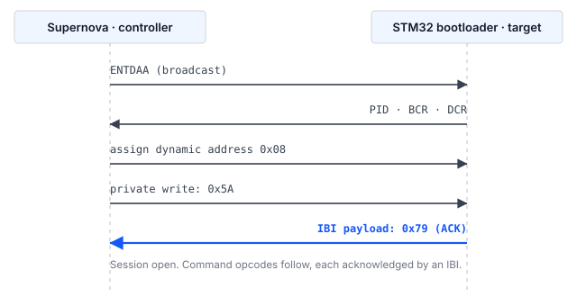

## 1 소개

모든 STM32 마이크로컨트롤러의 ROM에 프로그래밍된 시스템 부트로더는 디버그 프로브 없이,
그리고 디바이스에 사용자 코드가 전혀 없는 상태에서도 시리얼 인터페이스를 통해 내부 플래시
메모리를 프로그래밍하는 수단을 제공합니다. 부트로더가 제공하는 인터페이스는 디바이스마다
다르며, AN2606에 부품 번호별로 나열되어 있습니다.

STM32H5 시리즈 디바이스에서는 이 목록에 I3C가 포함됩니다. 이는 두 가지 상황에서 유용합니다.
첫째, 센서나 기타 주변 장치에 연결하기 위해 보드에 이미 I3C 버스가 배선되어 있는 경우, 같은
두 선으로 펌웨어 업데이트를 전달할 수 있으므로 전용 프로그래밍 헤더가 필요 없습니다. 둘째,
여러 타깃이 하나의 버스를 공유하는 경우, 보드 간에 스트래핑 저항이나 픽스처 재구성 없이
동적 주소 할당(dynamic address assignment)을 통해 각 타깃을 개별적으로 주소 지정할 수 있습니다.

### 1.1 범위

이 문서는 다음 내용을 설명합니다.

- 명령 상태를 보고하는 데 사용되는 메커니즘을 포함한 I3C 시스템 부트로더 프로토콜의 구조
- Binho Supernova와 STM32 타깃 사이에 필요한 연결
- 디바이스를 식별, 소거, 프로그래밍 및 검증하는 절차
- 이 문서와 함께 제공되며 해당 절차를 구현한 레퍼런스 호스트 유틸리티

Open Bootloader 애플리케이션을 통한 프로그래밍, 인애플리케이션 프로그래밍 및 보안 펌웨어
업데이트 메커니즘은 이 문서의 범위에 포함되지 않습니다.

### 1.2 적용 디바이스

디바이스에서 사용할 수 있는 부트로더 인터페이스는 디바이스마다 다릅니다. I3C 주변 장치가
있다고 해서 I3C 부트로더가 있는 것은 아닙니다. 표 1은 부트로더가 I3C를 제공하는 것으로
문서화된 STM32 제품군과 Get ID 명령이 반환하는 디바이스 식별자를 나열합니다.

Table: 시스템 부트로더가 I3C 인터페이스를 제공하는 STM32 제품군

| 제품군 | 부품 예 | 디바이스 ID | 근거 |
|---|---|---|---|
| STM32H5 | STM32H503 | `0x474` | 이 문서를 위해 하드웨어에서 검증함 |
| STM32H5 | STM32H523, STM32H533 | `0x478` | RM0481 |
| STM32H5 | STM32H562, STM32H563, STM32H573 | `0x484` | STMicroelectronics Open Bootloader 구성 |
| STM32H7R, STM32H7S | STM32H7S78 | `0x485` | STMicroelectronics Open Bootloader 구성 |
| STM32U3 | STM32U385 | `0x454` | STMicroelectronics Open Bootloader 구성 |

STM32N6 시리즈 디바이스에는 I3C 주변 장치가 있지만, STMicroelectronics Open Bootloader
배포판은 이 제품군에 대해 I3C 인터페이스를 제공하지 않습니다.

> **중요:** 이 문서를 준비하는 동안 하드웨어에서 시험한 것은 STM32H503뿐입니다. 표 1의
나머지 항목은 레퍼런스 유틸리티가 인식하지만 테스트되지 않았습니다. 특정 부품 번호에서
사용할 수 있는 부트로더 인터페이스에 대해서는 AN2606이 권위 있는 자료이며, 이 방법을
제품 설계에 적용하기 전에 반드시 참조해야 합니다.

### 1.3 관련 문서

Table: 관련 문서

| 문서 | 제목 |
|---|---|
| AN2606 | STM32 microcontroller system memory boot mode |
| AN5927 | I3C protocol used in the STM32 bootloader |
| AN5879 | Introduction to I3C for STM32 MCUs |
| RM0481 | STM32H523/H533, STM32H562/H563/H573 line reference manual |
| RM0492 | STM32H503 line Arm-based 32-bit MCUs reference manual |
| MIPI I3C | MIPI Alliance Specification for I3C Basic |

## 2 시스템 개요

### 2.1 버스상의 역할

Supernova는 I3C 컨트롤러로 동작합니다. STM32 부트로더는 I3C 타깃으로 동작합니다.
컨트롤러는 모든 데이터 전송을 시작하고 클록을 구동합니다. 유일한 예외는 인밴드 인터럽트이며,
타깃은 컨트롤러의 주의를 요청하기 위해 이를 발생시킵니다. 부트로더는 2.2절에서 설명하는
것처럼 이를 사용하여 상태를 보고합니다.

타깃은 주소를 보유하기 전에 동적 주소 할당에 참여하며, 자신의 프로비저닝된 식별자로
중재합니다. 주소가 할당될 때까지 타깃은 주소 지정된 트래픽에 응답하지 않으며, 동기화
바이트를 수신하고 확인 응답하기 전까지는 부트로더 명령을 받아들이지 않습니다.

### 2.2 인밴드 인터럽트를 통한 상태 보고

I3C 부트로더는 I2C 및 USART 부트로더와 한 가지 점에서 다르며, 이 차이가 모든 호스트 구현의
구조를 결정합니다.

I2C 및 USART 부트로더는 호스트가 같은 인터페이스를 통해 다시 읽는 확인 응답(acknowledgement)
바이트를 반환합니다. I3C 부트로더는 그러한 읽기 가능한 상태를 제공하지 않습니다. 대신 타깃은
**단일 페이로드 바이트를 담은 인밴드 인터럽트(IBI)**를 발생시키며, 그 바이트가 확인 응답입니다.
부트로더는 초기화 중에 추가 데이터 바이트 1개를 포함하는 IBI를 사용하도록 I3C 주변 장치를
구성하며, 세션의 나머지 기간 동안 발행하는 모든 확인 응답은 이 방식으로 전달됩니다.

표 3은 STM32H503에서 관찰된 페이로드 값을 나열합니다.

Table: 확인 응답 IBI에 담긴 상태 값

| 값 | 의미 |
|---|---|
| `0x79` | ACK. 해당 단계가 수락되었습니다. |
| `0x1F` | NACK. 해당 단계가 거부되었습니다. |

> **참고:** 부트로더는 I3C 인터페이스에서 사용하지 않는 두 가지 값을 추가로 정의합니다.
`0x76`은 busy이며, `0xEC`는 STMicroelectronics Open Bootloader 소스에서 전송하는 값이 아니라
opcode 무결성 검사 실패를 나타내는 내부 마커로 사용됩니다. 두 값 모두 I3C 인터페이스에서
관찰되지 않았습니다. 이 문서를 준비하는 동안 발생한 모든 거부는 잘못된 형식의 opcode를
포함하여 `0x1F`로 보고되었습니다. 시험한 사례는 5.8절에 제시합니다.

따라서 모든 명령의 모든 단계는 같은 패턴을 따릅니다. 컨트롤러가 몇 바이트를 쓴 다음, IBI를
기다리고 그 페이로드를 읽습니다. IBI 페이로드를 애플리케이션에 전달할 수 없거나, 대기할 수
없는 비동기 이벤트로만 IBI를 노출하는 호스트 I3C 스택으로는 이 프로토콜을 구현하기에
충분하지 않습니다.

> **참고:** 개발을 시작하기 전에 사용하려는 호스트 어댑터와 드라이버에 대해 이 요구 사항을
확인해야 합니다.

## 3 하드웨어 설정

### 3.1 필요한 장비

Table: 필요한 장비

| 항목 | 설명 |
|---|---|
| Binho Supernova | USB 호스트 어댑터, I3C 컨트롤러로 동작 |
| STM32 타깃 | 표 1의 디바이스. 이 문서에서는 NUCLEO-H503RB를 사용했습니다. |
| 호스트 컴퓨터 | Python 3.8 이상이 설치된 Windows, macOS 또는 Linux. 이 문서의 측정에는 Python 3.12를 사용했습니다. |
| 시리얼 터미널 | 7절의 검증 절차를 위한 임의의 터미널 에뮬레이터. 프로그래밍 자체에는 필요하지 않습니다. |

### 3.2 연결

표 5는 Supernova와 타깃 사이의 연결을 나열합니다. 세 개의 버스 신호는 필수입니다. 두 개의
범용 핀은 선택 사항이며, 타깃을 자동으로 부트로더 모드로 전환하는 데 사용됩니다. 이 핀이
없으면 작업자가 해당 단계를 수동으로 수행합니다.

Supernova는 타깃에 전원을 공급하지 않습니다. Supernova는 소프트웨어에서 설정한 전압으로 I3C
버스를 구동하지만, 타깃 보드에는 별도로 전원을 공급해야 합니다. Nucleo 보드에서는 온보드
ST-LINK에 대한 USB 연결이 이 역할을 하며, 같은 연결이 7절에서 사용하는 가상 COM 포트도
전달합니다.

Table: Supernova와 타깃 사이의 연결

| Supernova | 타깃 | 필수 여부 |
|---|---|---|
| I3C SCL | `PB6` | 예 |
| I3C SDA | `PB7` | 예 |
| GND | GND | 예 |
| GPIO 1 | `NRST` | 아니요 |
| GPIO 2 | `BOOT0` | 아니요 |

`PB6`과 `PB7`은 AN2606이 STM32H503xx 부트로더 구성에서 `I3C1_SCL`과 `I3C1_SDA`에 할당한
핀입니다. 이 핀은 ROM에 고정되어 있고 부품마다 다르므로, 보드 실크스크린이나 보드의 I3C
커넥터가 우연히 배선한 핀에서 추론하지 말고 사용 중인 디바이스에 대해 AN2606에서 확인해야
합니다. 같은 부품은 다른 핀 쌍인 `PB3`과 `PB4`에서 I2C 부트로더로 응답하며, 이는 AN0002의
주제입니다.

### 3.3 버스 고려 사항

I3C 버스 전압은 타깃 I/O 전원과 일치해야 합니다. Supernova 버스 전압은 호스트 소프트웨어에서
설정합니다. 이 문서의 측정에는 NUCLEO-H503RB I/O 전원에 맞춰 3300 mV를 사용했습니다.

버스 풀업 요구 사항은 MIPI I3C 사양을 따르며, 버스 정전 용량과 사용 중인 오픈 드레인 데이터
속도에 따라 달라집니다. 타깃 보드의 I3C 신호에 적절한 풀업이 실장되어 있지 않은 경우에는
추가해야 합니다.

> **주의:** NRST를 절대 high로 구동해서는 안 됩니다. 타깃을 리셋하려면 NRST를 low로 구동한
다음, 핀을 입력으로 재구성하여 해제하고 타깃 보드의 풀업이 high 레벨을 복원하도록 해야
합니다. NRST를 high로 구동하면 타깃 보드의 리셋 회로와 충돌하며, Nucleo 보드에서는 온보드
디버거와도 충돌합니다.

## 4 소프트웨어 설정

### 4.1 호스트 패키지 설치

레퍼런스 유틸리티는 Binho Supernova Python 패키지를 통해 I3C 버스를 구동합니다.

```
pip install binhosupernova
```

이 문서에는 버전 4.2.0을 사용했습니다. 다른 패키지는 필요하지 않습니다. Intel HEX 파싱은
유틸리티 내부에 구현되어 있습니다.

같은 유틸리티는 Supernova 또는 Binho Pulsar를 사용하여 I2C를 통해서도 타깃을 프로그래밍하며,
Pulsar의 경우 대신 `binhopulsar`가 필요합니다. 여기서는 I3C 경로만 설명하며, I2C는 AN0002에서
다룹니다.

### 4.2 레퍼런스 유틸리티 받기

유틸리티 `stm32_flash.py`는 이 문서와 함께 제공되는 에셋 아카이브에 포함되어 있습니다.
AN0002와 함께 제공되는 파일과 동일하므로, 하나의 사본으로 두 버스를 모두 다룰 수 있습니다.

```
https://cdn.binho.io/application-notes/AN0001/AN0001-assets.zip
```

같은 파일이 이 문서의 Markdown 소스와 함께 `https://github.com/binhollc/application-notes`에
게시되어 있습니다. 아카이브 내용은 12절에 나열되어 있습니다.

아카이브를 풀면 유틸리티가 들어 있는 `assets` 디렉터리와, 7절의 검증 이미지가 들어 있는
`firmware` 하위 디렉터리가 생성됩니다. 이 문서의 모든 명령은 해당 `assets` 디렉터리 안에서
실행하는 것으로 표시되어 있습니다.

## 5 부트로더 프로토콜

### 5.1 시스템 부트로더 모드 진입

사용자 플래시 대신 시스템 부트로더를 실행하려면 BOOT0을 high로 유지한 상태에서 디바이스를
리셋해야 합니다. 3.2절에서 설명한 대로 GPIO 1과 GPIO 2가 연결되어 있으면 호스트가 이를
자동으로 수행합니다.

1. BOOT0을 high로 구동합니다.
2. NRST를 low로 구동하고 50 ms 동안 low로 유지합니다.
3. 핀을 입력으로 재구성하여 NRST를 해제합니다.
4. 버스 동작을 시작하기 전에 부트로더가 초기화될 때까지 250 ms를 기다립니다.

위의 유지 시간과 안정화 시간은 레퍼런스 유틸리티가 사용하는 기본값이며, `--reset-hold`와
`--boot-delay`로 조정할 수 있습니다. 디바이스를 애플리케이션으로 되돌리려면 BOOT0의 레벨을
반대로 하고 리셋 펄스를 반복합니다.

> **참고:** 일부 디바이스에서는 옵션 바이트 `nBOOT0`과 `nSWBOOT0`이 BOOT0 핀을 샘플링할지
여부 자체를 결정합니다. BOOT0을 high로 유지했는데도 디바이스가 부트로더에 진입하지 않으면
옵션 바이트 구성을 확인해야 합니다.

### 5.2 버스 초기화 및 동적 주소 할당

컨트롤러가 브로드캐스트 ENTDAA를 발행합니다. 부트로더는 동적 주소 할당에 참여하여 동적
주소를 할당받습니다. 타깃은 48비트 프로비저닝된 식별자, 버스 특성 레지스터 및 디바이스 특성
레지스터로 구성된 표준 8바이트 페이로드를 반환합니다.

STM32H503에서 관찰된 값은 표 6에 제시되어 있습니다.

Table: 동적 주소 할당 중 STM32H503이 반환한 식별 정보

| 필드 | 값 |
|---|---|
| 동적 주소 | `0x08` (단일 타깃 버스에서 첫 번째 사용 가능한 주소) |
| Provisioned ID | `02 08 13 81 B0 00` |
| BCR | `0x2E` |
| DCR | `0x01` |

그런 다음 이 타깃의 IBI 요청을 수락하도록 컨트롤러를 구성해야 합니다. 컨트롤러가 IBI를
거부하면 이후의 모든 명령이 타임아웃되는 것처럼 보입니다.

### 5.3 세션 동기화

컨트롤러는 타깃의 동적 주소로 단일 바이트 `0x5A`를 프라이빗 쓰기합니다. 부트로더는 이 값을
세션의 시작으로 인식하고 `0x79`를 담은 IBI로 응답합니다. 이로써 세션이 열리고 부트로더는 명령
opcode를 기다립니다.



### 5.4 명령 프레이밍

각 명령은 2바이트로 전송됩니다. opcode 다음에 그 비트 단위 보수가 옵니다. 타깃은 두 바이트의
배타적 논리합(exclusive-OR)이 `0xFF`인지 검증합니다.

메모리에 대해 동작하는 명령은 최상위 바이트가 먼저 오는 4바이트 주소를 받으며, 그 뒤에 이 네
바이트의 배타적 논리합을 담은 1바이트가 옵니다.

데이터 페이로드 뒤에는 페이로드의 배타적 논리합을 담은 1바이트가 옵니다.

2.2절에서 설명한 것처럼 이러한 각 단계는 IBI로 확인 응답됩니다. 각 개별 명령의 바이트 수준
시퀀스는 에셋 아카이브의 `PROTOCOL.md`에 제시되어 있습니다.

### 5.5 전송 크기 필드

Read Memory 및 Write Memory 명령은 각 데이터 블록 앞에 3바이트 전송 헤더를 받습니다.

Table: 전송 헤더

| 바이트 | 내용 |
|---|---|
| 0 | 크기 필드, 최상위 바이트 |
| 1 | 크기 필드, 최하위 바이트 |
| 2 | 바이트 0과 1의 배타적 논리합 |

크기 필드는 블록 길이를 왼쪽으로 1비트 시프트한 값이며, 최하위 비트는 연속 플래그로
사용됩니다. 연속 플래그가 설정되면 타깃은 전송 루프에 머무르면서 주소를 스스로 증가시키므로,
주소는 블록마다 한 번이 아니라 일련의 블록에 대해 한 번만 전송됩니다.

최대 블록 길이는 크기가 공개되지 않은 부트로더 내부 버퍼에 의해 제한됩니다.
STMicroelectronics 레퍼런스 구현에서 읽기 경로는 버퍼 크기까지의 블록을 받아들이고 쓰기
경로는 그보다 1바이트 적은 블록을 받아들이므로, 읽기로 확인된 길이가 쓰기에도 자동으로
유효한 것은 아닙니다.

STM32H503에서 더 큰 블록을 시험했으며 올바른 데이터가 반환되었습니다. 읽기는 512바이트와
1024바이트에서 바이트 단위로 비교했고, 쓰기는 512바이트에서 확인했습니다. 그보다 큰 경우에는
어댑터 패키지가 요청이 타깃에 도달하기 전에 거부하므로, 부트로더 자체의 상한에는 도달하지
못했으며 여기서 확정되지 않았습니다. 다만 두 경로 사이의 비대칭은 실제로 존재합니다. 읽기
경로는 1024를 받아들였지만 쓰기 경로는 그렇지 않았습니다.

유틸리티는 관련된 모든 한계 안에 있는 256바이트 블록을 사용하며, 9절의 측정도 이 크기에서
수행했습니다.

> **중요:** 전송 루프 안에 머무르는 것은 단지 더 빠르기 때문이 아니라 안정적인 동작을 위해
필요합니다. 블록마다 별도의 명령을 발행하면 다음 쓰기가 도착했을 때 타깃이 아직 명령
디스패처를 통해 복귀하는 중이므로, 간헐적으로 명령 opcode가 손실됩니다. 측정 결과는 9.3절에
제시합니다.

### 5.6 지원되는 명령

표 8은 부트로더 프로토콜 버전 1.0인 STM32H503에서 Get 명령이 보고한 명령을 나열합니다.

Table: STM32H503에서 I3C를 통해 지원되는 명령

| Opcode | 명령 |
|---|---|
| `0x00` | Get |
| `0x01` | Get Version |
| `0x02` | Get ID |
| `0x11` | Read Memory |
| `0x21` | Go |
| `0x31` | Write Memory |
| `0x44` | Extended Erase |
| `0x50` | Special Command |
| `0x63` | Write Protect |
| `0x73` | Write Unprotect |

Readout Protect(`0x82`)와 Readout Unprotect(`0x92`)는 I3C를 통해 제공되지 않습니다. 읽기 보호
(RDP)는 이 인터페이스를 통해 설정하거나 해제할 수 없으며, 이를 필요로 하는 양산 흐름에서는
해당 단계를 다른 인터페이스를 통해 수행해야 합니다.

### 5.7 소거

Extended Erase는 최상위 바이트가 먼저 오는 2바이트 카운트와 그 뒤의 배타적 논리합 바이트를
받습니다. `0xFFF0`부터 `0xFFFF`까지의 값은 특수 소거 동작용으로 예약되어 있습니다.

Table: Extended Erase 특수 값

| 값 | 동작 |
|---|---|
| `0xFFFF` | 대량 소거(mass erase) |
| `0xFFFE` | 뱅크 1 소거 |
| `0xFFFD` | 뱅크 2 소거 |

그 밖의 값은 페이지 수이며, 그 뒤에 해당 개수만큼의 2바이트 페이지 번호(각각 최상위 바이트
먼저)와 이들 전체에 대한 단일 배타적 논리합 바이트가 옵니다. 이 디바이스에서 플래시 페이지는
8 KB이며, `--erase pages`는 디바이스 전체가 아니라 이미지가 차지하는 페이지만 소거합니다.

> **참고:** 이 부품의 두 버스에서 카운트 필드의 인코딩은 서로 다릅니다. I3C 인터페이스는
페이지 수를 받고, I2C 인터페이스는 페이지 수에서 1을 뺀 값을 받습니다. 두 가지 모두 인접한
두 페이지에 서로 다른 패턴을 쓰고, 첫 번째 페이지만 소거한 다음, 어느 페이지가 소거된
상태로 돌아오는지 확인하는 방법으로 확정했습니다. I2C의 경우는 AN0002에서 다룹니다. 잘못된
인코딩을 보내면 의도보다 한 페이지 더 많거나 적게 소거되므로, 사용 중인 인터페이스에 대해 이
필드를 확인해야 합니다.

### 5.8 거부된 명령

부트로더가 거부를 어떻게 보고하는지 확인하기 위해 형식이 잘못되었거나 범위를 벗어난 세 가지
사례를 STM32H503에 발행했습니다.

Table: STM32H503에서 관찰된 거부 동작

| 전송한 사례 | 응답 |
|---|---|
| 보수가 일치하지 않는 opcode | IBI, 페이로드 `0x1F` |
| 형식은 올바르지만 지원되지 않는 opcode(`0x82`) | IBI, 페이로드 `0x1F` |
| 유효하지 않은 주소(`0x00000000`)에 대한 Read Memory | IBI, 페이로드 `0x1F` |

거부가 세션을 종료하지는 않습니다. 위의 세 가지 사례 각각의 직후에 발행한 Get Version은
확인 응답되었고 정상적으로 `0x10`을 반환했으므로, 모든 경우에 부트로더는 명령 opcode를
기다리는 상태로 돌아가 있었습니다. 호스트는 NACK에서 복구하기 위해 타깃을 리셋할 필요가
없습니다.

> **참고:** 네 번째 사례인 부트로더 버퍼보다 큰 크기를 요청하는 전송 헤더는 만들어낼 수
없었습니다. 5.5절에서 설명한 것처럼 어댑터 패키지가 크기를 초과한 요청을 타깃에 도달하기
전에 거부하므로, 부트로더가 이에 어떻게 응답할지는 테스트되지 않았습니다.

## 6 프로그래밍 절차

### 6.1 타깃 식별

`info` 명령은 타깃을 부트로더로 리셋하고, 버스를 초기화하고, 동적 주소 할당을 수행하고,
세션을 연 다음, 응답한 내용을 보고합니다.

```
python stm32_flash.py --bus i3c info

  Adapter: supernova  fw 4.4.0
  Bus: I3C
  Resetting target into bootloader (NRST=GPIO1, BOOT0=GPIO2)
  I3C: 3300 mV, push-pull PUSH_PULL_2_5_MHZ_25_DC, open-drain OPEN_DRAIN_1_MHZ
  Assigning dynamic addresses (ENTDAA)
  Target at 0x08  PID 02 08 13 81 B0 00  BCR 0x2E  DCR 0x01
  Bootloader session established

  Protocol version : 1.0
  Device ID        : 0x474  (STM32H503)
  Commands         : 10
      0x00  Get
      ...
      0x73  Write Unprotect
```

지원되는 10개의 명령은 위 두 줄 사이에 모두 나열되며, 표 8에 제시된 명령과 같습니다. 어댑터의
시리얼 번호는 첫 줄에 출력되며 여기서는 생략했습니다. 유틸리티는 세 가지 버스를 구동하고
Supernova는 그 모두를 제공하므로 어느 버스가 배선되었는지 추론할 수 없기 때문에 `--bus i3c`가
필요합니다.

이 명령은 파괴적인 작업을 시도하기 전에 배선, 버스 구성 및 부트로더 진입을 확인해 주므로,
새 보드에서 권장하는 첫 단계입니다.

### 6.2 기존 내용 읽기

소거하기 전에 플래시 내용을 보관해야 합니다. 다음 명령은 STM32H503RB의 128 KB 플래시 전체를
읽습니다.

```
python stm32_flash.py --bus i3c read backup.bin --address 0x08000000 --length 0x20000
```

### 6.3 이미지 프로그래밍

`flash` 명령은 대량 소거, 프로그래밍, 읽기 및 비교, 그리고 애플리케이션으로의 리셋까지 전체
시퀀스를 수행합니다. 명령을 표시된 그대로 실행할 수 있도록 여기서는 7절의 검증 이미지를
예로 사용합니다.

raw 바이너리에는 명시적인 기준 주소가 필요합니다.

```
python stm32_flash.py --bus i3c flash firmware/an0001_image_a.bin --address 0x08000000
```

Intel HEX 파일은 자체 주소를 포함하므로 이 옵션을 생략합니다. `firmware` 디렉터리에서
`make hex`를 실행하면 HEX 파일이 생성됩니다.

```
python stm32_flash.py --bus i3c flash firmware/build/an0001_image_a.hex
```

### 6.4 검증

검증은 기본적으로 수행됩니다. 프로그래밍된 범위를 같은 인터페이스를 통해 다시 읽어 원본
이미지와 바이트 단위로 비교합니다. 프로그래밍 시간이 중요하고 이미지를 다른 방법으로
검증하는 경우에는 `--no-verify`로 비활성화할 수 있습니다.

### 6.5 디바이스를 애플리케이션으로 되돌리기

GPIO 1과 GPIO 2가 연결되어 있으면 유틸리티는 프로그래밍 후 BOOT0을 low로 구동하고 NRST에
펄스를 인가하여, 디바이스가 새로 프로그래밍된 애플리케이션을 시작하도록 합니다. 이 핀들이
연결되어 있지 않으면 대신 Go 명령을 발행하며, 이 명령은 부트로더가 리셋 없이 이미지로
점프하도록 합니다. `--no-run`은 디바이스를 부트로더에 남겨 둡니다.

## 7 타깃에서 업데이트 확인

`flash` 명령은 프로그래밍된 범위를 다시 읽어 바이트 단위로 비교하며, 이는 플래시 내용이
제공된 이미지와 일치함을 입증합니다. 그러나 디바이스가 새 펌웨어를 실행하고 있음을 입증하지는
않습니다. 부트로더에 남아 있는 타깃이나 리셋이 해제되지 않은 타깃도 그 검사를 통과하면서
여전히 애플리케이션을 실행하지 않을 수 있습니다.

이 공백을 메우기 위해 이 문서와 함께 두 개의 작은 펌웨어 이미지가 제공됩니다. 두 이미지는
보고하는 문자와 사용자 LED의 점멸 속도만 다르고 나머지는 동일하므로, 프로그래밍 도구 밖에서도
변화를 확인할 수 있습니다.

### 7.1 검증 이미지

Table: 이 문서와 함께 제공되는 검증 이미지

| 이미지 | 파일 | 보고 내용 | LED |
|---|---|---|---|
| A | `firmware/an0001_image_a.bin` | `IMAGE A` | 1 Hz |
| B | `firmware/an0001_image_b.bin` | `IMAGE B` | 5 Hz |

이미지 크기는 868바이트와 864바이트이며 `0x08000000`에서 실행되도록 링크되어 있습니다. 소스,
링커 스크립트 및 makefile이 함께 제공되므로, 이미지를 그대로 믿지 않고 직접 검사하고 다시
빌드할 수 있습니다.

두 이미지 모두 USART3에서 **115200 baud, 데이터 비트 8, 패리티 없음, 정지 비트 1**로 출력하며,
NUCLEO-H503RB는 USART3를 ST-LINK 가상 COM 포트로 라우팅합니다. 추가 배선은 필요 없습니다.
ST-LINK에 이미 연결된 USB 케이블이 출력을 전달합니다.

> **참고:** 제공된 바이너리는 NUCLEO-H503RB용으로 빌드되었습니다. 이 바이너리는 PA4를
USART3_TX로, PA5를 사용자 LED로 구동하며, 이는 해당 보드의 배선 방식입니다. 다른 보드에서는
핀과 가상 COM 포트로의 라우팅이 다르므로 시리얼 출력이 나타나지 않습니다. 이미지는 작고 소스가
제공되므로, `firmware/main.c` 상단의 핀 및 주변 장치 정의를 변경하고 다시 빌드하여 다른
보드에 맞게 조정할 수 있습니다.

리셋 시 배너가 한 번 출력되고, 그 뒤에 1초마다 하트비트 줄이 하나씩 출력됩니다.

```
========================================
  Binho  |  AN0001
  Programming STM32 microcontrollers
  over I3C with the Binho Supernova
========================================
  Running: IMAGE A
  Kernel clock: 32 MHz
  LED blink: 1 Hz
========================================
  IMAGE A  alive, 1 s
  IMAGE A  alive, 2 s
```

리셋 시에만 출력되는 배너는 터미널을 나중에 열면 놓치게 되므로 하트비트가 있습니다.
하트비트가 있으면 언제든지 실행 중인 이미지를 식별할 수 있습니다.

> **참고:** 보고되는 커널 클록은 HSI 자체의 64 MHz가 아니라 32 MHz입니다. 이 디바이스에서
`HSIDIV`의 리셋 값은 2입니다. 이미지는 주파수를 가정하지 않고 런타임에 이 분주기를 읽어
보율 제수를 유도합니다. 64 MHz를 가정하면 보율이 2배 틀리게 되고, 출력이 아예 없는 것이
아니라 단지 깨져서 나타나기 때문입니다.

### 7.2 절차

1. ST-LINK 가상 COM 포트에서 115200 8N1로 시리얼 터미널을 엽니다.
2. Image A를 프로그래밍하고 유틸리티가 애플리케이션을 시작하도록 합니다.

```
python stm32_flash.py --bus i3c flash firmware/an0001_image_a.bin --address 0x08000000
```

```
  ...
  Device ID        : 0x474  (STM32H503)
  Mass erasing
    done in 0.03 s
  Writing
    wrote 868 bytes in 0.06 s (13.5 KiB/s)
  Verifying
    all 868 bytes match (0.05 s)
  Resetting into application
  Success.
```

위 출력은 일부를 생략한 것입니다. 6.1절의 버스 및 세션 줄이 먼저 나타나며, 정확한 시간은
실행할 때마다 조금씩 다릅니다.

3. 터미널에 `IMAGE A`가 표시되고 LED가 1 Hz로 점멸하는지 확인합니다.
4. Image B를 프로그래밍합니다.

```
python stm32_flash.py --bus i3c flash firmware/an0001_image_b.bin --address 0x08000000
```

5. 터미널에 이제 `IMAGE B`가 표시되고 LED가 5 Hz로 점멸하는지 확인합니다.

`IMAGE A`에서 `IMAGE B`로의 전환이 엔드투엔드 결과입니다. 이미지가 I3C를 통해 소거, 프로그래밍
및 검증되었고, 디바이스가 프로그래밍된 내용을 실행하고 있습니다.

> **중요:** 이 이미지를 프로그래밍하면 디바이스에 이미 있는 애플리케이션이 소거됩니다.
6.2절에서 설명한 대로 먼저 기존 내용을 보관하십시오.

## 8 레퍼런스 유틸리티

### 8.1 명령

Table: 유틸리티 명령

| 명령 | 기능 |
|---|---|
| `list` | 연결된 Binho 어댑터 나열 |
| `info` | 타깃 식별 및 부트로더 기능 보고 |
| `flash <file>` | 이미지 소거, 프로그래밍, 검증 및 실행 |
| `read <file>` | 메모리를 파일로 읽기 |
| `erase` | 대량 소거 |
| `reset` | 부트로더 또는 애플리케이션으로 리셋 |

### 8.2 옵션

표 13의 옵션은 어댑터, 버스 및 부트로더 진입을 지정하며 모든 명령에 적용됩니다. 명령 이름의
앞이나 뒤 어디에나 지정할 수 있습니다.

Table: 세션 옵션

| 옵션 | 기능 |
|---|---|
| `--adapter <name>` | `supernova` 또는 `pulsar`를 강제 지정. 하나만 연결된 경우 자동 감지 |
| `--bus <name>` | `i3c` 또는 `i2c`를 강제 지정. 가능한 버스가 하나뿐인 경우 자동 감지 |
| `--serial <sn>` | 특정 어댑터 선택 |
| `--voltage <mV>` | I3C 버스 전압, 기본값 3300 |
| `--push-pull <name>` | 푸시풀 속도 상수, 기본값 `PUSH_PULL_2_5_MHZ_25_DC` |
| `--open-drain <name>` | 오픈 드레인 속도 상수, 기본값 `OPEN_DRAIN_1_MHZ` |
| `--target-address <addr>` | 다중 타깃 버스에서 하나의 타깃 선택 |
| `--manual` | GPIO를 구동하는 대신 수동 부트로더 진입을 요청하는 프롬프트 표시 |
| `--nrst-pin <n>`, `--boot0-pin <n>` | 리셋 제어에 사용할 GPIO 핀 선택 |
| `--reset-hold <s>` | NRST를 low로 유지하는 시간, 기본값 0.05 |
| `--boot-delay <s>` | 리셋 후 안정화 시간, 기본값 0.25 |
| `-v` | 모든 전송을 로그로 기록 |
| `-q` | 진행 상황 출력 억제 |

속도 옵션은 주파수가 아니라 어댑터 패키지에서 사용하는 상수 이름을 받습니다. 푸시풀 상수는
`PUSH_PULL_5_MHZ_40_DC`처럼 주파수와 듀티 사이클을 나타내며, 오픈 드레인 상수는
`OPEN_DRAIN_100_KHZ`, `OPEN_DRAIN_400_KHZ` 및 `OPEN_DRAIN_1_MHZ`입니다.

유틸리티는 I2C 및 SPI 옵션 그룹도 받지만, 이 옵션은 I3C 버스에는 영향을 주지 않습니다. 해당
옵션은 AN0002와 AN0003에 나열되어 있습니다.

표 14의 옵션은 해당 행에 지정된 명령에 적용됩니다.

Table: 명령별 옵션

| 명령 | 옵션 | 기능 |
|---|---|---|
| `flash` | `--address <addr>` | raw 바이너리 이미지의 기준 주소 |
| `flash` | `--erase <mode>` | `mass`, `pages` 또는 `none` |
| `flash` | `--page-size <n>` | `--erase pages`에 사용할 플래시 페이지 크기, 기본값 8192 |
| `flash` | `--no-verify` | 읽기 검증 생략 |
| `flash` | `--no-run` | 디바이스를 부트로더에 남겨 둠 |
| `flash`, `read` | `--chunk-size <n>` | 전송당 바이트 수. 기본값 256, 이 디바이스에서 검증된 최대값 |
| `flash`, `erase` | `--erase-timeout <s>` | 소거를 기다리는 시간(초), 기본값 30 |
| `read` | `--address <addr>` | 시작 주소 |
| `read` | `--length <n>` | 읽을 바이트 수. 필수. |
| `read`, `erase`, `info` | `--run` | 이후 애플리케이션으로 리셋 |
| `reset` | `--bootloader` | 애플리케이션 대신 부트로더로 리셋 |

## 9 측정 결과

### 9.1 테스트 구성

Table: 테스트 구성

| 항목 | 값 |
|---|---|
| 타깃 | NUCLEO-H503RB, STM32H503RB, 디바이스 ID `0x474` |
| 어댑터 | Binho Supernova, 하드웨어 리비전 B, 펌웨어 4.4.0 |
| 호스트 패키지 | `binhosupernova` 4.2.0, Python 3.12 |
| 유틸리티 | 에셋 아카이브에 제공된 `stm32_flash.py` |
| 버스 | 3300 mV, 2.5 MHz 푸시풀, 1 MHz 오픈 드레인 |
| 전송 크기 | 256바이트 |

### 9.2 타이밍

122,912바이트 이미지에 대해 측정했습니다.

Table: 122,912바이트 이미지에 대한 측정 타이밍

| 동작 | 시간 | 처리량 |
|---|---|---|
| 대량 소거 | 0.03 s | 해당 없음 |
| 프로그래밍 | 5.92 s | 20.3 KiB/s |
| 검증 | 5.16 s | 23.3 KiB/s |
| 128 KB 읽기 | 5.72 s | 22.4 KiB/s |

이 중 소거, 프로그래밍 및 검증을 합하면 11.1 s이며, 이것이 이 크기의 이미지를 완전히
업데이트하는 데 드는 시간입니다.

각 수치는 대표적인 1회 실행의 결과입니다. 시간은 실행마다 몇 퍼센트씩 달라집니다. 반복
실행에서 프로그래밍은 5.62 s에서 5.92 s 사이, 검증은 5.03 s에서 5.44 s 사이였으며, 연속 세 번의
128 KB 읽기는 각각 5.70 s가 걸렸고 바이트 단위로 동일한 데이터를 반환했습니다. 이 표는 사양이
아니라 예상되는 크기 수준으로 읽어야 합니다.

2.5 MHz 푸시풀과 256바이트 전송 블록에서 측정했습니다. 이 부품의 I3C 주변 장치는 고속 데이터
레이트(HDR) 모드 없이 단일 데이터 레이트(SDR) 전용이며 SDR 상한은 12.5 MHz이므로, 처리량이
중요한 경우 더 높은 푸시풀 속도를 사용할 수 있습니다. 타깃 버퍼가 허용하는 경우 더 큰 전송
블록도 사용할 수 있습니다.

### 9.3 전송 루프 동작

표 17의 측정은 32 KB 읽기에서 블록마다 별도의 Read Memory 명령을 사용하는 방식과 전송 루프
안에 머무르는 방식을 구성당 3회 실행하여 비교한 것입니다.

Table: Read Memory, 블록당 별도 명령 방식과 전송 루프 방식 비교

| 방식 | 명령 간 지연 | 성공한 실행 | 평균 시간 |
|---|---|---|---|
| 블록당 명령 1개 | 0 ms | 3회 중 1회 | 2.17 s |
| 블록당 명령 1개 | 1 ms | 3회 중 2회 | 2.38 s |
| 블록당 명령 1개 | 2 ms | 3회 중 0회 | 해당 없음 |
| 블록당 명령 1개 | 5 ms | 3회 중 3회 | 2.91 s |
| 전송 루프 | 0 ms | 3회 중 3회 | 1.39 s |
| 전송 루프 | 1 ms | 3회 중 3회 | 1.57 s |

실패는 실행마다 다른 오프셋에서 발생했으며, 항상 새로 발행한 명령 opcode에 대한 확인 응답을
기다리는 동안 발생했습니다. 지연을 삽입하면 실패율은 달라지지만 위험 요인은 제거되지
않습니다. 전송 루프 안에서 수행한 연속 여섯 번의 128 KB 읽기는 바이트 단위로 동일한 데이터를
반환했습니다.

## 10 문제 해결

Table: 문제 해결

| 증상 | 예상 원인 및 조치 |
|---|---|
| ENTDAA에 응답하는 타깃이 없음 | 디바이스가 부트로더 모드에 진입하지 않았습니다. 리셋 시 BOOT0이 high였는지 확인하고 `nBOOT0` 및 `nSWBOOT0` 옵션 바이트를 점검합니다. 접지, 버스 풀업 및 버스 전압을 점검합니다. |
| 상태 IBI가 수신되지 않음 | 컨트롤러가 IBI를 거부하고 있거나, 쓰기가 손실되어 타깃이 아직 그 쓰기를 기다리고 있습니다. 타깃 주소에 대해 IBI 수락이 활성화되어 있는지 확인한 다음, 타깃을 리셋하고 세션을 다시 엽니다. |
| 주소 전송 후 확인 응답 `0x1F` | 주소가 유효한 메모리 영역을 벗어났거나 주소 무결성 바이트가 잘못되었습니다. |
| 전송 헤더에 대한 확인 응답 `0x1F` | 요청한 블록이 타깃 버퍼를 초과합니다. `--chunk-size`로 전송 크기를 줄입니다. |
| opcode에 대한 확인 응답 `0x1F` | opcode와 그 보수의 배타적 논리합이 `0xFF`가 아니거나, 이 디바이스에서 지원되지 않는 명령입니다. 표 8과 비교합니다. |
| Write Memory에 대한 확인 응답 `0x1F` | 플래시가 쓰기 보호되어 있거나 읽기 보호가 활성화되어 있습니다. |
| 간헐적인 명령 손실 | 블록마다 별도의 명령을 발행하고 있습니다. 5.5절에서 설명한 대로 전송 루프를 사용합니다. |

## 11 약어

Table: 약어

| 용어 | 의미 |
|---|---|
| BCR | 버스 특성 레지스터(Bus characteristics register) |
| DCR | 디바이스 특성 레지스터(Device characteristics register) |
| ENTDAA | 동적 주소 할당 진입(Enter dynamic address assignment), I3C 공통 명령 코드 |
| IBI | 인밴드 인터럽트(In-band interrupt) |
| PID | 프로비저닝된 식별자(Provisioned identifier) |
| RDP | 읽기 보호(Readout protection) |
| SDR | 단일 데이터 레이트(Single data rate) |

## 12 문서 내 소스 코드에 관한 참고 사항

이 문서에 표시되고 함께 제공되는 아카이브에 포함된 예제 코드는 평가 및 참고용으로
제공됩니다. 이 코드는 MIT 라이선스로 배포되며, 라이선스 전문은 아카이브에 포함되어 있습니다.

아카이브 `AN0001-assets.zip`은
`https://cdn.binho.io/application-notes/AN0001/AN0001-assets.zip`에 게시되어 있으며 다음
파일을 포함합니다.

Table: 에셋 아카이브의 내용

| 파일 | 설명 |
|---|---|
| `AN0001.md` | 이 문서의 Markdown 소스 |
| `assets/stm32_flash.py` | 레퍼런스 유틸리티, AN0002와 공유 |
| `assets/test_hex_parser.py` | 유틸리티의 Intel HEX 파서에 대한 테스트 |
| `assets/PROTOCOL.md` | 와이어 수준 프로토콜 레퍼런스 |
| `assets/firmware/` | 두 검증 이미지의 소스, makefile 및 사전 빌드된 바이너리 |
| `assets/LICENSE` | 예제 코드에 적용되는 MIT 라이선스 |

## 13 개정 이력

Table: 개정 이력

| 리비전 | 날짜 | 설명 |
|---|---|---|
| 1.0 | 29 August 2026 | 최초 릴리스. |
