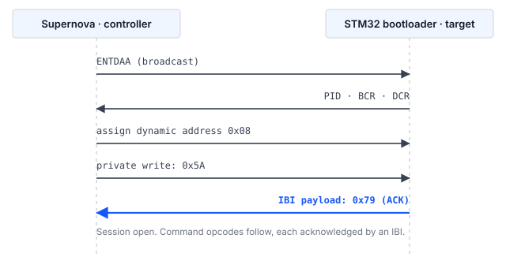

## 1 简介

每个 STM32 微控制器的 ROM 中都固化有系统引导加载程序，它提供了一种通过串行接口对内部闪存进行编程的方法，
既不需要调试探头，也不需要器件上存在任何用户代码。引导加载程序提供的接口因器件而异，
AN2606 按器件型号列出了这些接口。

在 STM32H5 系列器件上，该列表包含 I3C。这在两种情况下很有用。第一种情况是，
板上已经布有 I3C 总线用于连接传感器或其他外设，同样的两根线可以承载固件更新，
从而无需专用的编程接口。第二种情况是，多个目标器件共享一条总线，并通过动态地址分配（DAA）单独寻址，
在不同电路板之间无需设置配置电阻，也无需重新配置测试夹具。

### 1.1 范围

本文档介绍：

- I3C 系统引导加载程序协议的结构，包括用于报告命令状态的机制
- Binho Supernova 与 STM32 目标器件之间所需的连接
- 识别、擦除、编程和校验器件的步骤
- 随本文档提供的、实现上述步骤的参考主机工具

通过 Open Bootloader 应用程序进行编程、在应用中编程（in-application programming）以及安全固件更新机制
不在本文档的范围之内。

### 1.2 适用器件

器件上可用的引导加载程序接口因器件而异。具有 I3C 外设并不意味着具有 I3C 引导加载程序。
表 1 列出了其引导加载程序有文档记载提供 I3C 的 STM32 系列，以及 Get ID 命令返回的器件标识符。

Table: 系统引导加载程序提供 I3C 接口的 STM32 系列

| 系列 | 示例型号 | 器件 ID | 依据 |
|---|---|---|---|
| STM32H5 | STM32H503 | `0x474` | 为本文档在硬件上验证 |
| STM32H5 | STM32H523, STM32H533 | `0x478` | RM0481 |
| STM32H5 | STM32H562, STM32H563, STM32H573 | `0x484` | STMicroelectronics Open Bootloader 配置 |
| STM32H7R, STM32H7S | STM32H7S78 | `0x485` | STMicroelectronics Open Bootloader 配置 |
| STM32U3 | STM32U385 | `0x454` | STMicroelectronics Open Bootloader 配置 |

STM32N6 系列器件包含 I3C 外设，但 STMicroelectronics Open Bootloader 发行版
没有为该系列提供 I3C 接口。

> **重要：** 在编写本文档期间，只有 STM32H503 在硬件上进行了测试。表 1 中的其余条目
可被参考工具识别，但尚未经过测试。AN2606 是关于特定器件型号可用引导加载程序接口的权威来源，
在将本方法设计到产品中之前必须查阅该文档。

### 1.3 相关文档

Table: 相关文档

| 文档 | 标题 |
|---|---|
| AN2606 | STM32 microcontroller system memory boot mode |
| AN5927 | I3C protocol used in the STM32 bootloader |
| AN5879 | Introduction to I3C for STM32 MCUs |
| RM0481 | STM32H523/H533, STM32H562/H563/H573 line reference manual |
| RM0492 | STM32H503 line Arm-based 32-bit MCUs reference manual |
| MIPI I3C | MIPI Alliance Specification for I3C Basic |

## 2 系统概述

### 2.1 总线上的角色

Supernova 作为 I3C 控制器（controller）工作。STM32 引导加载程序作为 I3C 目标器件（target）工作。
控制器发起每一次数据传输并驱动时钟。唯一的例外是带内中断（IBI），目标器件通过它请求控制器的关注；
引导加载程序用它来报告状态，如第 2.2 节所述。

目标器件在获得地址之前参与动态地址分配，使用其预置标识符进行仲裁。在被分配地址之前，
它不响应寻址通信；在收到并应答同步字节之前，它不接受引导加载程序命令。

### 2.2 通过带内中断报告状态

I3C 引导加载程序与 I2C 和 USART 引导加载程序在一个方面存在差异，而这一差异决定了任何主机实现的结构。

I2C 和 USART 引导加载程序会返回一个应答字节，由主机通过同一接口读回。I3C 引导加载程序
不提供此类可读取的状态。取而代之的是，目标器件发出一个**携带单个负载字节的带内中断（IBI）**，
该字节即为应答。引导加载程序在初始化期间将其 I3C 外设配置为带一个附加数据字节的 IBI，
在会话的其余部分，它发出的每个应答都通过这种方式传送。

表 3 列出了在 STM32H503 上观察到的负载值。

Table: 应答 IBI 中携带的状态值

| 值 | 含义 |
|---|---|
| `0x79` | ACK。该步骤被接受。 |
| `0x1F` | NACK。该步骤被拒绝。 |

> **注意：** 引导加载程序还定义了另外两个 I3C 接口不使用的值：
`0x76` 表示忙，`0xEC` 则被 STMicroelectronics Open Bootloader 源代码用作
操作码完整性检查失败的内部标记，而不会被发送。两者均未在 I3C 接口上观察到。
在编写本文档期间遇到的每一次拒绝，包括格式错误的操作码，都以
`0x1F` 报告。第 5.8 节给出了已测试的情况。

因此，每条命令的每个步骤都遵循相同的模式：控制器写入若干字节，然后等待 IBI 并读取其负载。
如果主机 I3C 协议栈无法将 IBI 负载传递给应用程序，或者只将 IBI 作为无法等待的异步事件呈现，
则不足以实现该协议。

> **注意：** 在开始开发之前，应针对预期使用的主机适配器和驱动程序确认这一要求。

## 3 硬件设置

### 3.1 所需设备

Table: 所需设备

| 项目 | 说明 |
|---|---|
| Binho Supernova | USB 主机适配器，作为 I3C 控制器工作 |
| STM32 目标器件 | 表 1 中的器件。本文档使用的是 NUCLEO-H503RB。 |
| 主机 | Windows、macOS 或 Linux，Python 3.8 或更高版本。本文档中的测量使用 Python 3.12。 |
| 串口终端 | 任意终端仿真程序，用于第 7 节的验证步骤。编程本身不需要。 |

### 3.2 连接

表 5 列出了 Supernova 与目标器件之间的连接。三根总线信号为必需。两个通用引脚为可选，
用于自动将目标器件置于引导加载程序模式；没有它们时，由操作人员手动完成该步骤。

Supernova 不为目标器件供电。它以软件中配置的电压驱动 I3C 总线，但目标板必须独立供电。
在 Nucleo 板上，与板载 ST-LINK 的 USB 连接负责供电，同一连接还承载第 7 节中使用的虚拟 COM 端口。

Table: Supernova 与目标器件之间的连接

| Supernova | 目标器件 | 必需 |
|---|---|---|
| I3C SCL | `PB6` | 是 |
| I3C SDA | `PB7` | 是 |
| GND | GND | 是 |
| GPIO 1 | `NRST` | 否 |
| GPIO 2 | `BOOT0` | 否 |

`PB6` 和 `PB7` 是 AN2606 在其 STM32H503xx 引导加载程序配置中分配给 `I3C1_SCL` 和 `I3C1_SDA` 的引脚。
这些引脚固化在 ROM 中且因型号而异，因此必须根据所用器件从 AN2606 中查得，
而不能根据电路板丝印或电路板 I3C 连接器恰好引出的引脚来推断。同一器件在另一对引脚 `PB3` 和 `PB4` 上
响应其 I2C 引导加载程序，这是 AN0002 的主题。

### 3.3 总线注意事项

I3C 总线电压必须与目标器件的 I/O 电源一致。Supernova 的总线电压由主机软件设置；
本文档中的测量使用 3300 mV，与 NUCLEO-H503RB 的 I/O 电源一致。

总线上拉电阻要求遵循 MIPI I3C 规范，并取决于总线电容和所用的开漏数据速率。
如果目标板未在 I3C 信号上安装合适的上拉电阻，则必须加装。

> **小心：** 切勿将 NRST 驱动为高电平。要复位目标器件，应将 NRST 驱动为低电平，然后将该引脚
重新配置为输入以释放它，由目标板上的上拉电阻恢复高电平。将 NRST 驱动为高电平会与目标板上的
复位电路相冲突，在 Nucleo 板上还会与板载调试器相冲突。

## 4 软件设置

### 4.1 安装主机软件包

参考工具通过 Binho Supernova Python 软件包驱动 I3C 总线：

```
pip install binhosupernova
```

本文档使用 4.2.0 版。不需要其他软件包；Intel HEX 解析在工具内部实现。

同一工具还可以通过 Supernova 或 Binho Pulsar 以 I2C 对目标器件编程，后者需要 `binhopulsar`。
此处仅介绍 I3C 路径；AN0002 介绍 I2C。

### 4.2 获取参考工具

工具 `stm32_flash.py` 包含在本文档随附的资源压缩包中。它与 AN0002 随附的是同一个文件，
因此一份副本即可覆盖两种总线：

```
https://cdn.binho.io/application-notes/AN0001/AN0001-assets.zip
```

相同的文件以及本文档的 Markdown 源文件发布在 `https://github.com/binhollc/application-notes`。
第 12 节列出了压缩包的内容。

压缩包解压后得到一个 `assets` 目录，其中包含该工具，以及一个 `firmware` 子目录，其中包含第 7 节的验证镜像。
本文档中的每条命令都以在该 `assets` 目录内运行的形式给出。

## 5 引导加载程序协议

### 5.1 进入系统引导加载程序模式

必须在 BOOT0 保持高电平的情况下复位器件，才能执行系统引导加载程序而非用户闪存中的程序。
如果 GPIO 1 和 GPIO 2 按第 3.2 节所述连接，主机会自动执行以下操作：

1. 将 BOOT0 驱动为高电平。
2. 将 NRST 驱动为低电平并保持 50 ms。
3. 将该引脚重新配置为输入以释放 NRST。
4. 在开始总线活动之前，留出 250 ms 供引导加载程序初始化。

上述保持时间和稳定时间是参考工具使用的默认值，可通过 `--reset-hold` 和 `--boot-delay` 调整。
要使器件返回应用程序，需反转 BOOT0 上的电平并重复复位脉冲。

> **注意：** 在某些器件上，选项字节 `nBOOT0` 和 `nSWBOOT0` 决定是否对 BOOT0 引脚进行采样。
如果器件在 BOOT0 保持高电平的情况下仍未进入引导加载程序，应检查选项字节配置。

### 5.2 总线初始化与动态地址分配

控制器发出广播 ENTDAA。引导加载程序参与动态地址分配并被分配一个动态地址。
目标器件返回标准的八字节负载，包括 48 位预置标识符、总线特性寄存器和器件特性寄存器。

在 STM32H503 上观察到的值见表 6。

Table: STM32H503 在动态地址分配期间返回的标识信息

| 字段 | 值 |
|---|---|
| 动态地址 | `0x08`（单目标器件总线上第一个空闲地址） |
| 预置 ID | `02 08 13 81 B0 00` |
| BCR | `0x2E` |
| DCR | `0x01` |

随后必须将控制器配置为接受来自该目标器件的 IBI 请求。如果控制器拒绝 IBI，
所有后续命令都会表现为超时。

### 5.3 会话同步

控制器向目标器件的动态地址私有写入单个字节 `0x5A`。引导加载程序将该值识别为会话的开始，
并以携带 `0x79` 的 IBI 作为回复。此后会话即打开，引导加载程序等待命令操作码。



### 5.4 命令帧格式

每条命令以两个字节发送：操作码及其按位取反值。目标器件校验这两个字节的异或结果是否为 `0xFF`。

对存储器进行操作的命令采用四字节地址，最高有效字节在前，后跟一个字节，其值为这四个字节的异或。

数据负载之后跟一个字节，其值为该负载的异或。

如第 2.2 节所述，这些步骤中的每一步都通过 IBI 应答。每条命令的字节级时序见资源压缩包中的 `PROTOCOL.md`。

### 5.5 传输长度字段

Read Memory 和 Write Memory 命令在每个数据块之前采用三字节的传输头：

Table: 传输头

| 字节 | 内容 |
|---|---|
| 0 | 长度字段，最高有效字节 |
| 1 | 长度字段，最低有效字节 |
| 2 | 字节 0 和 1 的异或 |

长度字段为块长度左移一位，最低有效位用作继续标志。当继续标志置位时，目标器件保持在其传输循环中
并自行递增地址，因此对于一系列数据块，地址只发送一次，而不是每个块发送一次。

最大块长度受引导加载程序内部一个缓冲区的限制，该缓冲区的大小未公开。在 STMicroelectronics 参考实现中，
读路径接受最多为缓冲区大小的块，写路径接受的则少一个字节，因此通过读取验证过的长度并不自动适用于写入。

在 STM32H503 上测试了更大的块，并返回了正确的数据：读取在 512 和 1024 字节时逐字节比对一致，
写入在 512 字节时一致。超过这些值后，适配器软件包会在请求到达目标器件之前将其拒绝，
因此从未达到引导加载程序自身的上限，本文也未确定该上限。不过，两条路径之间的不对称在实际中确实存在：
读路径接受了 1024，而写路径没有。

该工具使用 256 字节的块，处于所有相关限制之内，第 9 节的测量也是在该长度下进行的。

> **重要：** 保持在传输循环内是可靠运行所必需的，而不仅仅是为了更快。
为每个块单独发出一条命令会间歇性地丢失命令操作码，因为当下一次写入到达时，
目标器件仍在经由其命令分发器返回。第 9.3 节给出了测量结果。

### 5.6 支持的命令

表 8 列出了在 STM32H503（引导加载程序协议版本 1.0）上由 Get 命令报告的命令。

Table: STM32H503 上通过 I3C 支持的命令

| 操作码 | 命令 |
|---|---|
| `0x00` | Get |
| `0x01` | Get Version |
| `0x02` | Get ID |
| `0x11` | Read Memory |
| `0x21` | Go |
| `0x31` | Write Memory |
| `0x44` | Extended Erase |
| `0x50` | Special Command |
| `0x63` | Write Protect |
| `0x73` | Write Unprotect |

Readout Protect（`0x82`）和 Readout Unprotect（`0x92`）不通过 I3C 提供。
读保护（RDP）无法通过此接口设置或清除，需要该功能的生产流程必须通过其他接口完成这一步骤。

### 5.7 擦除

Extended Erase 采用两字节的计数值，最高有效字节在前，后跟其异或字节。
`0xFFF0` 到 `0xFFFF` 范围内的值保留用于特殊擦除操作。

Table: Extended Erase 特殊值

| 值 | 操作 |
|---|---|
| `0xFFFF` | 整片擦除 |
| `0xFFFE` | Bank 1 擦除 |
| `0xFFFD` | Bank 2 擦除 |

任何其他值均为页数，其后跟随该数量的两字节页号（每个页号最高有效字节在前），
以及一个覆盖所有页号的异或字节。在该器件上，闪存页为 8 KB，`--erase pages` 仅擦除镜像覆盖的页，
而不是整个器件。

> **注意：** 在该器件的两种总线上，计数字段的编码并不相同。I3C 接口采用页数；
I2C 接口采用页数减一。两者都是通过以下方法确定的：在两个相邻页中写入不同的图案，
仅擦除第一页，然后确认哪些页读回时为已擦除状态。AN0002 介绍 I2C 的情况。
发送错误的编码会比预期多擦除或少擦除一页，因此应针对所用接口确认该字段。

### 5.8 被拒绝的命令

我们向 STM32H503 发出了三种格式错误或超出范围的情况，以确定引导加载程序如何报告拒绝。

Table: 在 STM32H503 上观察到的拒绝行为

| 发送的情况 | 响应 |
|---|---|
| 操作码与其取反值不匹配 | IBI，负载 `0x1F` |
| 格式正确但不支持的操作码（`0x82`） | IBI，负载 `0x1F` |
| 在无效地址（`0x00000000`）执行 Read Memory | IBI，负载 `0x1F` |

拒绝不会结束会话。在上述三种情况的每一种之后，紧接着发出的 Get Version 均得到应答并正常返回 `0x10`，
因此在每种情况下引导加载程序都已返回到等待命令操作码的状态。主机无需复位目标器件即可从 NACK 中恢复。

> **注意：** 第四种情况，即请求超过引导加载程序缓冲区大小的传输头，无法产生。
如第 5.5 节所述，适配器软件包会在超大请求到达目标器件之前将其拒绝，因此引导加载程序对此会如何响应未经测试。

## 6 编程步骤

### 6.1 识别目标器件

`info` 命令将目标器件复位进入引导加载程序，初始化总线，执行动态地址分配，打开会话并报告响应的内容：

```
python stm32_flash.py --bus i3c info

  Adapter: supernova  fw 4.4.0
  Bus: I3C
  Resetting target into bootloader (NRST=GPIO1, BOOT0=GPIO2)
  I3C: 3300 mV, push-pull PUSH_PULL_2_5_MHZ_25_DC, open-drain OPEN_DRAIN_1_MHZ
  Assigning dynamic addresses (ENTDAA)
  Target at 0x08  PID 02 08 13 81 B0 00  BCR 0x2E  DCR 0x01
  Bootloader session established

  Protocol version : 1.0
  Device ID        : 0x474  (STM32H503)
  Commands         : 10
      0x00  Get
      ...
      0x73  Write Unprotect
```

所支持的十条命令完整列在这两行之间；它们就是表 8 中给出的命令。适配器的序列号打印在第一行，此处省略。
`--bus i3c` 是必需的，因为该工具可驱动三种总线，而 Supernova 全部支持，所以工具无法推断接的是哪一种。

这是在任何新电路板上推荐的第一步，因为它可以在尝试任何破坏性操作之前确认接线、总线配置和引导加载程序的进入。

### 6.2 读取现有内容

在擦除之前应先存档闪存内容。以下命令读取 STM32H503RB 的全部 128 KB 闪存：

```
python stm32_flash.py --bus i3c read backup.bin --address 0x08000000 --length 0x20000
```

### 6.3 编程镜像

`flash` 命令执行完整的流程：整片擦除、编程、回读并比对，然后复位进入应用程序。
此处以第 7 节的验证镜像为例，以便命令可以完全按所示内容运行。

原始二进制文件需要显式指定基地址：

```
python stm32_flash.py --bus i3c flash firmware/an0001_image_a.bin --address 0x08000000
```

Intel HEX 文件自带地址，因此省略该选项。在 `firmware` 目录中运行 `make hex` 即可生成一个：

```
python stm32_flash.py --bus i3c flash firmware/build/an0001_image_a.hex
```

### 6.4 校验

默认执行校验。通过同一接口读回已编程的范围，并与源镜像逐字节比对。
在编程时间要求严格且镜像通过其他方式校验的情况下，可以使用 `--no-verify` 禁用校验。

### 6.5 使器件返回应用程序

如果连接了 GPIO 1 和 GPIO 2，工具在编程后将 BOOT0 驱动为低电平并对 NRST 施加脉冲，
从而使器件启动新编程的应用程序。如果未连接这些引脚，则改为发出 Go 命令，
使引导加载程序在不复位的情况下跳转到镜像。`--no-run` 使器件保持在引导加载程序中。

## 7 在目标器件上确认更新

`flash` 命令会回读已编程的范围并逐字节比对，这证明闪存内容与所提供的镜像一致。
但它并不能证明器件正在执行新固件：停留在引导加载程序中的目标器件，或复位始终未释放的目标器件，
都会通过该检查，却仍未运行应用程序。

本文档随附两个小型固件镜像来弥补这一不足。它们除了报告的字母和用户 LED 的闪烁频率之外完全相同，
因此可以在编程工具之外看到变化。

### 7.1 验证镜像

Table: 本文档随附的验证镜像

| 镜像 | 文件 | 报告内容 | LED |
|---|---|---|---|
| A | `firmware/an0001_image_a.bin` | `IMAGE A` | 1 Hz |
| B | `firmware/an0001_image_b.bin` | `IMAGE B` | 5 Hz |

两个镜像分别为 868 和 864 字节，链接为从 `0x08000000` 运行。随镜像一同提供源代码、链接脚本和 makefile，
因此可以检查并重新构建镜像，而不必仅凭信任使用。

两个镜像均在 USART3 上以 **115200 波特、8 个数据位、无校验、1 个停止位** 输出，
NUCLEO-H503RB 将 USART3 连接到 ST-LINK 虚拟 COM 端口。无需额外接线；已连接到 ST-LINK 的 USB 电缆即可承载输出。

> **注意：** 所提供的二进制文件是为 NUCLEO-H503RB 构建的。它们将 PA4 用作
USART3_TX，将 PA5 用作用户 LED，这与该板的接线方式一致。在任何其他电路板上，
串口输出都不会出现，因为引脚以及到虚拟 COM 端口的连接不同。镜像很小且提供了源代码，
因此可以修改 `firmware/main.c` 开头的引脚和外设定义并重新构建，使其适配其他电路板。

复位时打印一次横幅，随后每秒打印一行心跳信息：

```
========================================
  Binho  |  AN0001
  Programming STM32 microcontrollers
  over I3C with the Binho Supernova
========================================
  Running: IMAGE A
  Kernel clock: 32 MHz
  LED blink: 1 Hz
========================================
  IMAGE A  alive, 1 s
  IMAGE A  alive, 2 s
```

之所以有心跳信息，是因为仅在复位时打印的横幅在之后才打开终端时会被错过。有了心跳信息，任何时候都可以识别正在运行的镜像。

> **注意：** 报告的内核时钟为 32 MHz，而不是 HSI 本身的 64 MHz。在该器件上，
`HSIDIV` 的复位值为 2。镜像在运行时读取该分频器并据此推导波特率除数，而不是假定一个频率，
因为假定为 64 MHz 会得到相差两倍的波特率，此时输出只是乱码而不是完全没有输出。

### 7.2 步骤

1. 在 ST-LINK 虚拟 COM 端口上以 115200 8N1 打开串口终端。
2. 编程镜像 A，并让工具启动应用程序：

```
python stm32_flash.py --bus i3c flash firmware/an0001_image_a.bin --address 0x08000000
```

```
  ...
  Device ID        : 0x474  (STM32H503)
  Mass erasing
    done in 0.03 s
  Writing
    wrote 868 bytes in 0.06 s (13.5 KiB/s)
  Verifying
    all 868 bytes match (0.05 s)
  Resetting into application
  Success.
```

以上输出有删节；第 6.1 节中的总线和会话信息行先出现，且确切时间在每次运行之间略有不同。

3. 确认终端报告 `IMAGE A`，且 LED 以 1 Hz 闪烁。
4. 编程镜像 B：

```
python stm32_flash.py --bus i3c flash firmware/an0001_image_b.bin --address 0x08000000
```

5. 确认终端此时报告 `IMAGE B`，且 LED 以 5 Hz 闪烁。

从 `IMAGE A` 到 `IMAGE B` 的转变就是端到端的结果：镜像已通过 I3C 擦除、编程和校验，
并且器件正在运行所编程的内容。

> **重要：** 编程这些镜像会擦除器件上已有的应用程序。请先按第 6.2 节所述存档现有内容。

## 8 参考工具

### 8.1 命令

Table: 工具命令

| 命令 | 功能 |
|---|---|
| `list` | 列出已连接的 Binho 适配器 |
| `info` | 识别目标器件并报告引导加载程序功能 |
| `flash <file>` | 擦除、编程、校验并运行镜像 |
| `read <file>` | 将存储器内容读取到文件 |
| `erase` | 整片擦除 |
| `reset` | 复位进入引导加载程序或应用程序 |

### 8.2 选项

表 13 中的选项描述适配器、总线和引导加载程序的进入方式，适用于每条命令。它们可以放在命令名之前或之后。

Table: 会话选项

| 选项 | 功能 |
|---|---|
| `--adapter <name>` | 强制使用 `supernova` 或 `pulsar`；仅连接一个时自动检测 |
| `--bus <name>` | 强制使用 `i3c` 或 `i2c`；仅有一种可能时自动检测 |
| `--serial <sn>` | 选择特定的适配器 |
| `--voltage <mV>` | I3C 总线电压，默认 3300 |
| `--push-pull <name>` | 推挽速率常量，默认 `PUSH_PULL_2_5_MHZ_25_DC` |
| `--open-drain <name>` | 开漏速率常量，默认 `OPEN_DRAIN_1_MHZ` |
| `--target-address <addr>` | 在多目标器件总线上选择一个目标器件 |
| `--manual` | 提示手动进入引导加载程序，而不是驱动 GPIO |
| `--nrst-pin <n>`, `--boot0-pin <n>` | 选择用于复位控制的 GPIO 引脚 |
| `--reset-hold <s>` | NRST 保持低电平的时间，默认 0.05 |
| `--boot-delay <s>` | 复位后的稳定时间，默认 0.25 |
| `-v` | 记录每次传输 |
| `-q` | 不输出进度信息 |

速率选项采用适配器软件包使用的常量名称，而不是频率值。推挽常量名称包含频率和占空比，
例如 `PUSH_PULL_5_MHZ_40_DC`；开漏常量为 `OPEN_DRAIN_100_KHZ`、`OPEN_DRAIN_400_KHZ` 和
`OPEN_DRAIN_1_MHZ`。

该工具还接受若干组 I2C 和 SPI 选项，它们对 I3C 总线不起作用。这些选项列在 AN0002 和 AN0003 中。

表 14 中的选项适用于对应列出的命令。

Table: 各命令的选项

| 命令 | 选项 | 功能 |
|---|---|---|
| `flash` | `--address <addr>` | 原始二进制镜像的基地址 |
| `flash` | `--erase <mode>` | `mass`、`pages` 或 `none` |
| `flash` | `--page-size <n>` | 用于 `--erase pages` 的闪存页大小，默认 8192 |
| `flash` | `--no-verify` | 跳过回读校验 |
| `flash` | `--no-run` | 使器件保持在引导加载程序中 |
| `flash`, `read` | `--chunk-size <n>` | 每次传输的字节数。默认 256，即在该器件上验证过的最大值 |
| `flash`, `erase` | `--erase-timeout <s>` | 等待擦除完成的秒数，默认 30 |
| `read` | `--address <addr>` | 起始地址 |
| `read` | `--length <n>` | 要读取的字节数。必需。 |
| `read`, `erase`, `info` | `--run` | 之后复位进入应用程序 |
| `reset` | `--bootloader` | 复位进入引导加载程序而不是应用程序 |

## 9 实测结果

### 9.1 测试配置

Table: 测试配置

| 项目 | 值 |
|---|---|
| 目标器件 | NUCLEO-H503RB，STM32H503RB，器件 ID `0x474` |
| 适配器 | Binho Supernova，硬件版本 B，固件 4.4.0 |
| 主机软件包 | `binhosupernova` 4.2.0，Python 3.12 |
| 工具 | `stm32_flash.py`，即资源压缩包中提供的版本 |
| 总线 | 3300 mV，2.5 MHz 推挽，1 MHz 开漏 |
| 传输长度 | 256 字节 |

### 9.2 时间

针对一个 122,912 字节的镜像测得。

Table: 122,912 字节镜像的实测时间

| 操作 | 时间 | 吞吐量 |
|---|---|---|
| 整片擦除 | 0.03 s | 不适用 |
| 编程 | 5.92 s | 20.3 KiB/s |
| 校验 | 5.16 s | 23.3 KiB/s |
| 读取 128 KB | 5.72 s | 22.4 KiB/s |

其中擦除、编程和校验合计 11.1 s，这就是完整更新该大小镜像所需的时间。

每个数值均为一次具有代表性的运行结果。各次运行之间时间相差几个百分点：在重复测试中，
编程时间介于 5.62 s 与 5.92 s 之间，校验时间介于 5.03 s 与 5.44 s 之间，
而连续三次 128 KB 读取每次耗时 5.70 s，且返回的数据逐字节一致。该表应理解为预期的数量级，而不是规格指标。

测量条件为 2.5 MHz 推挽和 256 字节传输块。该器件上的 I3C 外设仅支持单倍数据速率（SDR），
没有高数据速率模式，其 SDR 上限为 12.5 MHz，因此在吞吐量重要时可以使用更高的推挽速率。
在目标器件缓冲区允许的情况下，也可以使用更大的传输块。

### 9.3 传输循环行为

表 17 中的测量对比了为每个块单独发出 Read Memory 命令与保持在传输循环内两种方式，
读取量为 32 KB，每种配置运行三次。

Table: Read Memory：每块单独命令与传输循环的对比

| 方法 | 命令间延迟 | 成功次数 | 平均时间 |
|---|---|---|---|
| 每块一条命令 | 0 ms | 3 次中 1 次 | 2.17 s |
| 每块一条命令 | 1 ms | 3 次中 2 次 | 2.38 s |
| 每块一条命令 | 2 ms | 3 次中 0 次 | 不适用 |
| 每块一条命令 | 5 ms | 3 次中 3 次 | 2.91 s |
| 传输循环 | 0 ms | 3 次中 3 次 | 1.39 s |
| 传输循环 | 1 ms | 3 次中 3 次 | 1.57 s |

每次运行的失败都发生在不同的偏移处，并且总是在等待新发出的命令操作码的应答时发生。
插入延迟会改变失败率，但不能消除隐患。在传输循环内连续执行的六次 128 KB 读取返回了逐字节一致的数据。

## 10 故障排除

Table: 故障排除

| 现象 | 可能原因及处理措施 |
|---|---|
| 没有目标器件响应 ENTDAA | 器件未进入引导加载程序模式。确认复位时 BOOT0 为高电平，并检查 `nBOOT0` 和 `nSWBOOT0` 选项字节。检查地线、总线上拉电阻和总线电压。 |
| 未收到状态 IBI | 控制器拒绝了 IBI，或者某次写入丢失而目标器件仍在等待它。确认已为该目标器件地址启用 IBI 接受，然后复位目标器件并重新打开会话。 |
| 地址之后收到应答 `0x1F` | 该地址位于有效存储区域之外，或者地址完整性字节错误。 |
| 传输头之后收到应答 `0x1F` | 请求的块超过了目标器件的缓冲区。使用 `--chunk-size` 减小传输长度。 |
| 操作码之后收到应答 `0x1F` | 操作码与其取反值的异或结果不是 `0xFF`，或者该器件不支持此命令。请与表 8 对照。 |
| Write Memory 时收到应答 `0x1F` | 闪存处于写保护状态，或者读保护已激活。 |
| 命令间歇性丢失 | 正在为每个块单独发出命令。请按第 5.5 节所述使用传输循环。 |

## 11 缩略语

Table: 缩略语

| 术语 | 含义 |
|---|---|
| BCR | 总线特性寄存器（Bus characteristics register） |
| DCR | 器件特性寄存器（Device characteristics register） |
| ENTDAA | 进入动态地址分配（Enter dynamic address assignment），一种 I3C 通用命令代码 |
| IBI | 带内中断（In-band interrupt） |
| PID | 预置标识符（Provisioned identifier） |
| RDP | 读保护（Readout protection） |
| SDR | 单倍数据速率（Single data rate） |

## 12 关于文档中源代码的说明

本文档中展示的以及随附压缩包中提供的示例代码仅供评估和参考。它依据 MIT 许可证发布，
许可证文本包含在压缩包中。

压缩包 `AN0001-assets.zip` 发布在
`https://cdn.binho.io/application-notes/AN0001/AN0001-assets.zip`，包含以下内容：

Table: 资源压缩包内容

| 文件 | 说明 |
|---|---|
| `AN0001.md` | 本文档的 Markdown 源文件 |
| `assets/stm32_flash.py` | 参考工具，与 AN0002 共用 |
| `assets/test_hex_parser.py` | 工具中 Intel HEX 解析器的测试 |
| `assets/PROTOCOL.md` | 线路级协议参考 |
| `assets/firmware/` | 两个验证镜像的源代码、makefile 和预构建二进制文件 |
| `assets/LICENSE` | 涵盖示例代码的 MIT 许可证 |

## 13 修订历史

Table: 修订历史

| 修订版本 | 日期 | 说明 |
|---|---|---|
| 1.0 | 29 August 2026 | 首次发布。 |
