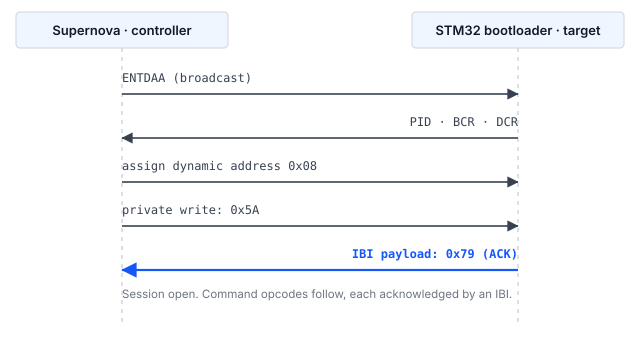

## 1 簡介

每顆 STM32 微控制器的 ROM 中都燒錄了系統開機載入程式，可透過序列介面燒錄內部快閃記憶體，
既不需要除錯探針，裝置上也不需要存在任何使用者程式碼。開機載入程式提供的介面因裝置而異，
AN2606 依料號逐一列出。

在 STM32H5 系列裝置上，此清單包含 I3C。這在兩種情況下很有用。第一種情況是，電路板上已佈有
I3C 匯流排以連接感測器或其他周邊，同樣的兩條線即可承載韌體更新，因而不再需要專用的燒錄排針。
第二種情況是，多個目標裝置共用一條匯流排，並透過動態位址分配（DAA）個別定址，
不需要在電路板之間更換設定電阻或重新配置治具。

### 1.1 範圍

本文件說明：

- I3C 系統開機載入程式協定的結構，包括用於回報命令狀態的機制
- Binho Supernova 與 STM32 目標裝置之間所需的連接
- 識別、抹除、燒錄及驗證裝置的程序
- 隨本文件提供、實作上述程序的參考主機工具程式

透過 Open Bootloader 應用程式燒錄、應用程式內燒錄（in-application programming），以及安全韌體更新機制，
均不在本文件範圍內。

### 1.2 適用裝置

裝置上可用的開機載入程式介面依裝置而定。具備 I3C 周邊並不代表具備 I3C 開機載入程式。
表 1 列出其開機載入程式經文件記載提供 I3C 的 STM32 系列，以及 Get ID 命令傳回的裝置識別碼。

Table: 系統開機載入程式提供 I3C 介面的 STM32 系列

| 系列 | 料號範例 | 裝置 ID | 依據 |
|---|---|---|---|
| STM32H5 | STM32H503 | `0x474` | 已為本文件在硬體上驗證 |
| STM32H5 | STM32H523, STM32H533 | `0x478` | RM0481 |
| STM32H5 | STM32H562, STM32H563, STM32H573 | `0x484` | STMicroelectronics Open Bootloader 設定 |
| STM32H7R, STM32H7S | STM32H7S78 | `0x485` | STMicroelectronics Open Bootloader 設定 |
| STM32U3 | STM32U385 | `0x454` | STMicroelectronics Open Bootloader 設定 |

STM32N6 系列裝置具備 I3C 周邊，但 STMicroelectronics Open Bootloader 發行版本並未為該系列提供 I3C 介面。

> **重要：** 撰寫本文件期間，僅 STM32H503 在硬體上實際測試過。表 1 中其餘項目可被參考工具程式辨識，
但尚未經過測試。AN2606 是特定料號可用開機載入程式介面的權威來源，在產品設計中採用此方法之前必須查閱。

### 1.3 相關文件

Table: 相關文件

| 文件 | 標題 |
|---|---|
| AN2606 | STM32 microcontroller system memory boot mode |
| AN5927 | I3C protocol used in the STM32 bootloader |
| AN5879 | Introduction to I3C for STM32 MCUs |
| RM0481 | STM32H523/H533, STM32H562/H563/H573 line reference manual |
| RM0492 | STM32H503 line Arm-based 32-bit MCUs reference manual |
| MIPI I3C | MIPI Alliance Specification for I3C Basic |

## 2 系統概觀

### 2.1 匯流排上的角色

Supernova 作為 I3C 控制器運作。STM32 開機載入程式作為 I3C 目標裝置運作。控制器發起每一次資料傳輸並驅動時脈。
唯一的例外是帶內中斷（IBI），由目標裝置發出以請求控制器注意；開機載入程式利用它回報狀態，詳見第 2.2 節。

目標裝置在取得位址之前參與動態位址分配，並以其預設識別碼（provisioned identifier）進行仲裁。
在被分配位址之前，它不會回應定址傳輸；在收到並確認同步位元組之前，它也不會接受開機載入程式命令。

### 2.2 透過帶內中斷回報狀態

I3C 開機載入程式與 I2C 及 USART 開機載入程式有一項差異，而這項差異決定了任何主機端實作的結構。

I2C 與 USART 開機載入程式會傳回一個確認位元組，由主機透過同一介面讀回。I3C 開機載入程式不提供這類可讀取的狀態。
取而代之的是，目標裝置發出一個**攜帶單一酬載位元組的帶內中斷（IBI）**，該位元組即為確認。
開機載入程式在初始化期間將其 I3C 周邊設定為 IBI 附帶一個額外資料位元組，在該工作階段其餘期間發出的每一個確認，
都以這種方式傳送。

表 3 列出在 STM32H503 上觀察到的酬載值。

Table: 確認 IBI 所攜帶的狀態值

| 值 | 意義 |
|---|---|
| `0x79` | ACK。該步驟已被接受。 |
| `0x1F` | NACK。該步驟遭到拒絕。 |

> **注意：** 開機載入程式另外定義了兩個 I3C 介面未使用的值：`0x76` 表示忙碌；`0xEC` 則是
STMicroelectronics Open Bootloader 原始碼中用來標記操作碼完整性檢查失敗的內部標記，並不會實際傳送。
兩者皆未在 I3C 介面上觀察到。撰寫本文件期間遇到的每一次拒絕，包括格式錯誤的操作碼，都是以
`0x1F` 回報。第 5.8 節列出實際測試過的情況。

因此，每個命令的每個步驟都遵循相同模式：控制器寫入若干位元組，接著等待一個 IBI 並讀取其酬載。
若主機端 I3C 堆疊無法將 IBI 酬載交付給應用程式，或僅將 IBI 以無法等待的非同步事件形式呈現，
則不足以實作此協定。

> **注意：** 開始開發之前，應先針對預定使用的主機轉接器與驅動程式確認此需求。

## 3 硬體設定

### 3.1 所需設備

Table: 所需設備

| 項目 | 說明 |
|---|---|
| Binho Supernova | USB 主機轉接器，作為 I3C 控制器運作 |
| STM32 目標裝置 | 表 1 中的裝置。本文件使用 NUCLEO-H503RB。 |
| 主機電腦 | Windows、macOS 或 Linux，搭配 Python 3.8 或更新版本。本文件的量測使用 Python 3.12。 |
| 序列終端機 | 任何終端機模擬程式，用於第 7 節的驗證程序。燒錄本身不需要。 |

### 3.2 連接

表 5 列出 Supernova 與目標裝置之間的連接。三條匯流排訊號為必要連接。兩支通用接腳為選用，
用於自動將目標裝置置入開機載入程式模式；若未連接，則由操作人員手動執行該步驟。

Supernova 不為目標裝置供電。它以軟體設定的電壓驅動 I3C 匯流排，但目標電路板必須獨立供電。
在 Nucleo 開發板上，連接板載 ST-LINK 的 USB 即負責供電，同一條連線也承載第 7 節使用的虛擬 COM 埠。

Table: Supernova 與目標裝置之間的連接

| Supernova | 目標裝置 | 必要 |
|---|---|---|
| I3C SCL | `PB6` | 是 |
| I3C SDA | `PB7` | 是 |
| GND | GND | 是 |
| GPIO 1 | `NRST` | 否 |
| GPIO 2 | `BOOT0` | 否 |

`PB6` 與 `PB7` 是 AN2606 在其 STM32H503xx 開機載入程式設定中指派給 `I3C1_SCL` 與 `I3C1_SDA` 的接腳。
這些接腳固定於 ROM 中且因料號而異，因此必須依手邊裝置查閱 AN2606 取得，而不能從電路板絲印推斷，
也不能依電路板 I3C 連接器恰好佈線到哪些接腳來推斷。同一料號的 I2C 開機載入程式則在另一組接腳
`PB3` 與 `PB4` 上回應，此為 AN0002 的主題。

### 3.3 匯流排注意事項

I3C 匯流排電壓必須與目標裝置的 I/O 電源相符。Supernova 的匯流排電壓由主機軟體設定；
本文件的量測使用 3300 mV，與 NUCLEO-H503RB 的 I/O 電源相符。

匯流排上拉電阻需求依循 MIPI I3C 規格，並取決於匯流排電容與所使用的開汲極資料速率。
若目標電路板未在 I3C 訊號上配置合適的上拉電阻，則必須自行加上。

> **小心：** 絕不可將 NRST 驅動為高電位。要重設目標裝置時，將 NRST 驅動為低電位，
然後將該接腳重新設定為輸入以釋放它，讓目標電路板上的上拉電阻恢復高電位。
將 NRST 驅動為高電位會與目標電路板上的重設電路相抗衡，在 Nucleo 開發板上還會與板載除錯器相抗衡。

## 4 軟體設定

### 4.1 安裝主機套件

參考工具程式透過 Binho Supernova Python 套件驅動 I3C 匯流排：

```
pip install binhosupernova
```

本文件使用 4.2.0 版。不需要其他套件；Intel HEX 解析已在工具程式內實作。

同一工具程式也能透過 I2C 燒錄目標裝置，可使用 Supernova 或 Binho Pulsar，後者需改用 `binhopulsar`。
本文僅說明 I3C 路徑；I2C 請參閱 AN0002。

### 4.2 取得參考工具程式

工具程式 `stm32_flash.py` 收錄於本文件隨附的資源壓縮檔中。它與 AN0002 隨附的檔案相同，
因此一份即可涵蓋兩種匯流排：

```
https://cdn.binho.io/application-notes/AN0001/AN0001-assets.zip
```

相同的檔案連同本文件的 Markdown 原始檔，也發佈於
`https://github.com/binhollc/application-notes`。第 12 節列出壓縮檔內容。

壓縮檔解開後為一個 `assets` 目錄，內含工具程式，以及一個 `firmware`
子目錄，內含第 7 節的驗證映像檔。本文件中的每個命令，皆以在該 `assets` 目錄內執行的形式呈現。

## 5 開機載入程式協定

### 5.1 進入系統開機載入程式模式

裝置必須在 BOOT0 保持高電位的情況下重設，才會執行系統開機載入程式而非使用者快閃記憶體中的程式。
若 GPIO 1 與 GPIO 2 已如第 3.2 節所述連接，主機會自動執行此程序：

1. 將 BOOT0 驅動為高電位。
2. 將 NRST 驅動為低電位並保持 50 ms。
3. 將該接腳重新設定為輸入以釋放 NRST。
4. 在開始匯流排活動之前，預留 250 ms 讓開機載入程式完成初始化。

上述保持時間與穩定時間是參考工具程式的預設值，可透過 `--reset-hold` 與 `--boot-delay` 調整。
要讓裝置回到應用程式，則反轉 BOOT0 的電位並重複重設脈衝。

> **注意：** 在某些裝置上，選項位元組 `nBOOT0` 與 `nSWBOOT0` 決定是否取樣 BOOT0 接腳。
若裝置在 BOOT0 保持高電位的情況下仍未進入開機載入程式，應檢查選項位元組的設定。

### 5.2 匯流排初始化與動態位址分配

控制器發出廣播 ENTDAA。開機載入程式參與動態位址分配並獲配一個動態位址。目標裝置傳回標準的八位元組酬載，
包含 48 位元預設識別碼、匯流排特性暫存器與裝置特性暫存器。

在 STM32H503 上觀察到的值列於表 6。

Table: STM32H503 在動態位址分配期間傳回的識別資訊

| 欄位 | 值 |
|---|---|
| 動態位址 | `0x08`（單一目標裝置匯流排上第一個可用位址） |
| Provisioned ID | `02 08 13 81 B0 00` |
| BCR | `0x2E` |
| DCR | `0x01` |

接著必須設定控制器接受來自此目標裝置的 IBI 請求。若控制器拒絕 IBI，後續所有命令都會呈現逾時。

### 5.3 工作階段同步

控制器對目標裝置的動態位址進行私有寫入，寫入單一位元組 `0x5A`。開機載入程式將此值識別為工作階段的開始，
並以攜帶 `0x79` 的 IBI 回覆。此時工作階段即已開啟，開機載入程式等待命令操作碼。



### 5.4 命令格式

每個命令以兩個位元組傳送：操作碼，接著是其位元補數。目標裝置會驗證這兩個位元組的互斥或（exclusive-OR）結果為 `0xFF`。

操作記憶體的命令接受一個四位元組位址，最高有效位元組在前，其後接一個位元組，內容為這四個位元組的互斥或。

資料酬載之後接一個位元組，內容為該酬載的互斥或。

如第 2.2 節所述，每一個步驟都以一個 IBI 確認。各個命令的位元組層級順序，列於資源壓縮檔中的 `PROTOCOL.md`。

### 5.5 傳輸大小欄位

Read Memory 與 Write Memory 命令在每個資料區塊之前接受一個三位元組的傳輸標頭：

Table: 傳輸標頭

| 位元組 | 內容 |
|---|---|
| 0 | 大小欄位，最高有效位元組 |
| 1 | 大小欄位，最低有效位元組 |
| 2 | 位元組 0 與 1 的互斥或 |

大小欄位是區塊長度左移一位元的值，最低有效位元用作接續旗標。當接續旗標被設定時，
目標裝置會停留在其傳輸迴圈內並自行遞增位址，因此對一連串區塊只需傳送一次位址，而非每個區塊各傳送一次。

最大區塊長度受限於開機載入程式內部的一個緩衝區，其大小未經公開。在 STMicroelectronics 參考實作中，
讀取路徑可接受最多等於緩衝區大小的區塊，寫入路徑則少一個位元組，因此經讀取驗證可行的長度，
並不自動適用於寫入。

在 STM32H503 上測試過較大的區塊，皆傳回正確資料：讀取在 512 與 1024 位元組時逐位元組比對無誤，
寫入則在 512 位元組時無誤。超過這些大小時，轉接器套件會在請求到達目標裝置之前即予以拒絕，
因此從未觸及開機載入程式本身的上限，本文亦未確立該上限。不過兩條路徑之間的不對稱在實務上確實存在：
讀取路徑接受了 1024，而寫入路徑則否。

工具程式使用 256 位元組的區塊，落在所有相關限制之內，第 9 節的量測也是以此大小進行。

> **重要：** 停留在傳輸迴圈內是可靠運作的必要條件，而不只是為了更快。為每個區塊分別發出一個命令，
會間歇性地遺失命令操作碼，因為下一筆寫入到達時，目標裝置仍在經由其命令分派器返回。第 9.3 節提供量測結果。

### 5.6 支援的命令

表 8 列出在 STM32H503（開機載入程式協定版本 1.0）上由 Get 命令回報的命令。

Table: STM32H503 透過 I3C 支援的命令

| 操作碼 | 命令 |
|---|---|
| `0x00` | Get |
| `0x01` | Get Version |
| `0x02` | Get ID |
| `0x11` | Read Memory |
| `0x21` | Go |
| `0x31` | Write Memory |
| `0x44` | Extended Erase |
| `0x50` | Special Command |
| `0x63` | Write Protect |
| `0x73` | Write Unprotect |

Readout Protect（`0x82`）與 Readout Unprotect（`0x92`）不透過 I3C 提供。讀出保護（RDP）
無法經由此介面設定或清除，需要此功能的量產流程必須透過其他介面執行該步驟。

### 5.7 抹除

Extended Erase 接受一個兩位元組的計數值，最高有效位元組在前，其後接其互斥或位元組。
範圍 `0xFFF0` 至 `0xFFFF` 的值保留給特殊抹除操作。

Table: Extended Erase 特殊值

| 值 | 操作 |
|---|---|
| `0xFFFF` | 全片抹除 |
| `0xFFFE` | Bank 1 抹除 |
| `0xFFFD` | Bank 2 抹除 |

其他任何值皆為頁數，其後接相同數量的兩位元組頁碼（每個皆最高有效位元組在前），
以及一個涵蓋全部頁碼的互斥或位元組。在此裝置上，一個快閃記憶體頁為 8 KB，
`--erase pages` 只抹除映像檔涵蓋的頁，而非整個裝置。

> **注意：** 在此料號上，計數欄位的編碼在兩種匯流排上並不相同。I3C 介面接受頁數；
I2C 介面接受頁數減一。兩者皆經由以下方式確立：在相鄰兩頁寫入不同的資料樣式，僅抹除第一頁，
再確認哪些頁讀回時為已抹除狀態。I2C 的情況請參閱 AN0002。送出錯誤的編碼會多抹除或少抹除一頁，
因此應針對所使用的介面確認此欄位。

### 5.8 遭拒絕的命令

我們對 STM32H503 發出三種格式錯誤或超出範圍的情況，以確立開機載入程式如何回報拒絕。

Table: 在 STM32H503 上觀察到的拒絕行為

| 送出的情況 | 回應 |
|---|---|
| 補數不相符的操作碼 | IBI，酬載 `0x1F` |
| 格式正確但不支援的操作碼（`0x82`） | IBI，酬載 `0x1F` |
| 在無效位址（`0x00000000`）執行 Read Memory | IBI，酬載 `0x1F` |

拒絕並不會結束工作階段。在上述三種情況的每一種之後，緊接著發出的 Get Version 都獲得確認，
並正常傳回 `0x10`，因此在每種情況下開機載入程式都已回到等待命令操作碼的狀態。
主機不需要重設目標裝置即可從 NACK 中復原。

> **注意：** 第四種情況，即傳輸標頭請求的大小超過開機載入程式的緩衝區，無法產生。
如第 5.5 節所述，轉接器套件會在過大的請求到達目標裝置之前即予以拒絕，因此開機載入程式會如何回應此情況，
尚未經過測試。

## 6 燒錄程序

### 6.1 識別目標裝置

`info` 命令會將目標裝置重設進入開機載入程式、初始化匯流排、執行動態位址分配、開啟工作階段，
並回報回應的內容：

```
python stm32_flash.py --bus i3c info

  Adapter: supernova  fw 4.4.0
  Bus: I3C
  Resetting target into bootloader (NRST=GPIO1, BOOT0=GPIO2)
  I3C: 3300 mV, push-pull PUSH_PULL_2_5_MHZ_25_DC, open-drain OPEN_DRAIN_1_MHZ
  Assigning dynamic addresses (ENTDAA)
  Target at 0x08  PID 02 08 13 81 B0 00  BCR 0x2E  DCR 0x01
  Bootloader session established

  Protocol version : 1.0
  Device ID        : 0x474  (STM32H503)
  Commands         : 10
      0x00  Get
      ...
      0x73  Write Unprotect
```

十個支援的命令完整列於上述兩行之間；即表 8 所列的命令。轉接器的序號印在第一行，此處省略。
必須指定 `--bus i3c`，因為工具程式可驅動三種匯流排，而 Supernova 全部都提供，
因此無法推斷實際接線的是哪一種。

這是在任何新電路板上建議的第一步，因為它能在嘗試任何破壞性操作之前，
確認接線、匯流排設定與開機載入程式的進入。

### 6.2 讀取現有內容

抹除之前應先備份快閃記憶體內容。以下命令讀取 STM32H503RB 的完整 128 KB 快閃記憶體：

```
python stm32_flash.py --bus i3c read backup.bin --address 0x08000000 --length 0x20000
```

### 6.3 燒錄映像檔

`flash` 命令執行完整的流程：全片抹除、燒錄、讀回並比對，然後重設進入應用程式。
此處以第 7 節的驗證映像檔為例，讓命令可完全照所印的內容執行。

原始二進位檔需要明確指定基底位址：

```
python stm32_flash.py --bus i3c flash firmware/an0001_image_a.bin --address 0x08000000
```

Intel HEX 檔案本身帶有位址，因此省略該選項。在 `firmware` 目錄中執行 `make hex` 即可產生：

```
python stm32_flash.py --bus i3c flash firmware/build/an0001_image_a.hex
```

### 6.4 驗證

預設會執行驗證。透過同一介面讀回已燒錄的範圍，並與來源映像檔逐位元組比對。
若燒錄時間至關重要且映像檔已透過其他方式驗證，可使用 `--no-verify` 停用驗證。

### 6.5 使裝置回到應用程式

若 GPIO 1 與 GPIO 2 已連接，工具程式會在燒錄後將 BOOT0 驅動為低電位並對 NRST 送出脈衝，
讓裝置啟動新燒錄的應用程式。若未連接這些接腳，則改為發出 Go 命令，使開機載入程式不經重設直接跳至映像檔。
`--no-run` 會讓裝置停留在開機載入程式中。

## 7 在目標裝置上確認更新

`flash` 命令會讀回已燒錄的範圍並逐位元組比對，這證明快閃記憶體的內容與所提供的映像檔相符。
但這並不證明裝置正在執行新韌體：停留在開機載入程式中的目標裝置，或重設從未被釋放的目標裝置，
都能通過該檢查，卻仍未執行應用程式。

本文件隨附兩個小型韌體映像檔以彌補此缺口。兩者除了回報的字母以及使用者 LED 的閃爍頻率之外完全相同，
因此從燒錄工具之外即可看出變化。

### 7.1 驗證映像檔

Table: 本文件隨附的驗證映像檔

| 映像檔 | 檔案 | 回報 | LED |
|---|---|---|---|
| A | `firmware/an0001_image_a.bin` | `IMAGE A` | 1 Hz |
| B | `firmware/an0001_image_b.bin` | `IMAGE B` | 5 Hz |

這兩個映像檔分別為 868 與 864 位元組，連結為從 `0x08000000` 執行。原始碼、連結器指令碼與
makefile 一併提供，因此可以檢視並重新建置映像檔，而不必僅憑信任使用。

兩者皆以 **115200 baud、8 資料位元、無同位元、1 停止位元** 在 USART3 上輸出，
NUCLEO-H503RB 將其路由至 ST-LINK 虛擬 COM 埠。不需要額外接線；已連接至 ST-LINK 的 USB 線即可承載輸出。

> **注意：** 隨附的二進位檔是為 NUCLEO-H503RB 建置的。它們將 PA4 驅動為
USART3_TX，PA5 驅動為使用者 LED，這是該開發板的接線方式。在其他任何電路板上，序列輸出都不會出現，
因為接腳以及通往虛擬 COM 埠的路由不同。映像檔很小且提供原始碼，因此可修改
`firmware/main.c` 開頭的接腳與周邊定義並重新建置，以移植到其他電路板。

重設時會印出一次橫幅，之後每秒印出一行心跳訊息：

```
========================================
  Binho  |  AN0001
  Programming STM32 microcontrollers
  over I3C with the Binho Supernova
========================================
  Running: IMAGE A
  Kernel clock: 32 MHz
  LED blink: 1 Hz
========================================
  IMAGE A  alive, 1 s
  IMAGE A  alive, 2 s
```

之所以加入心跳訊息，是因為只在重設時印出的橫幅，若在之後才開啟終端機就會錯過。
有了心跳訊息，隨時都能識別正在執行的映像檔。

> **注意：** 回報的核心時脈為 32 MHz，而非 HSI 本身的 64 MHz。在此裝置上，`HSIDIV` 的重設值為 2。
映像檔在執行時讀取該除頻值，並據此推導鮑率除數，而非假設某個頻率，因為假設為 64 MHz
會產生相差兩倍的錯誤鮑率，使輸出只是變成亂碼而非完全沒有輸出。

### 7.2 程序

1. 在 ST-LINK 虛擬 COM 埠上以 115200 8N1 開啟序列終端機。
2. 燒錄 Image A，並讓工具程式啟動應用程式：

```
python stm32_flash.py --bus i3c flash firmware/an0001_image_a.bin --address 0x08000000
```

```
  ...
  Device ID        : 0x474  (STM32H503)
  Mass erasing
    done in 0.03 s
  Writing
    wrote 868 bytes in 0.06 s (13.5 KiB/s)
  Verifying
    all 868 bytes match (0.05 s)
  Resetting into application
  Success.
```

以上輸出經過節略；第 6.1 節的匯流排與工作階段相關行會先出現，且確切時間在每次執行之間略有差異。

3. 確認終端機回報 `IMAGE A`，且 LED 以 1 Hz 閃爍。
4. 燒錄 Image B：

```
python stm32_flash.py --bus i3c flash firmware/an0001_image_b.bin --address 0x08000000
```

5. 確認終端機現在回報 `IMAGE B`，且 LED 以 5 Hz 閃爍。

從 `IMAGE A` 轉變為 `IMAGE B` 即為端對端的結果：映像檔已透過 I3C 抹除、燒錄及驗證，
且裝置正在執行所燒錄的內容。

> **重要：** 燒錄這些映像檔會抹除裝置上原有的應用程式。請先依第 6.2 節所述備份現有內容。

## 8 參考工具程式

### 8.1 命令

Table: 工具程式命令

| 命令 | 功能 |
|---|---|
| `list` | 列出已連接的 Binho 轉接器 |
| `info` | 識別目標裝置並回報開機載入程式功能 |
| `flash <file>` | 抹除、燒錄、驗證並執行映像檔 |
| `read <file>` | 將記憶體讀取至檔案 |
| `erase` | 全片抹除 |
| `reset` | 重設進入開機載入程式或應用程式 |

### 8.2 選項

表 13 中的選項描述轉接器、匯流排與開機載入程式的進入方式，適用於所有命令。
這些選項可放在命令名稱之前或之後。

Table: 工作階段選項

| 選項 | 功能 |
|---|---|
| `--adapter <name>` | 強制指定 `supernova` 或 `pulsar`；僅連接一個時自動偵測 |
| `--bus <name>` | 強制指定 `i3c` 或 `i2c`；僅有一種可能時自動偵測 |
| `--serial <sn>` | 選擇特定的轉接器 |
| `--voltage <mV>` | I3C 匯流排電壓，預設 3300 |
| `--push-pull <name>` | 推挽速率常數，預設 `PUSH_PULL_2_5_MHZ_25_DC` |
| `--open-drain <name>` | 開汲極速率常數，預設 `OPEN_DRAIN_1_MHZ` |
| `--target-address <addr>` | 在多目標裝置匯流排上選擇一個目標裝置 |
| `--manual` | 提示手動進入開機載入程式，而非驅動 GPIO |
| `--nrst-pin <n>`, `--boot0-pin <n>` | 選擇用於重設控制的 GPIO 接腳 |
| `--reset-hold <s>` | NRST 保持低電位的時間，預設 0.05 |
| `--boot-delay <s>` | 重設後的穩定時間，預設 0.25 |
| `-v` | 記錄每一筆傳輸 |
| `-q` | 抑制進度輸出 |

速率選項接受轉接器套件所使用的常數名稱，而非頻率。推挽常數以頻率與工作週期命名，例如
`PUSH_PULL_5_MHZ_40_DC`；開汲極常數為 `OPEN_DRAIN_100_KHZ`、`OPEN_DRAIN_400_KHZ` 與
`OPEN_DRAIN_1_MHZ`。

工具程式也接受多組 I2C 與 SPI 選項，這些選項對 I3C 匯流排沒有作用。它們列於 AN0002 與 AN0003。

表 14 中的選項適用於其所對應的命令。

Table: 個別命令選項

| 命令 | 選項 | 功能 |
|---|---|---|
| `flash` | `--address <addr>` | 原始二進位映像檔的基底位址 |
| `flash` | `--erase <mode>` | `mass`、`pages` 或 `none` |
| `flash` | `--page-size <n>` | `--erase pages` 使用的快閃記憶體頁大小，預設 8192 |
| `flash` | `--no-verify` | 略過讀回驗證 |
| `flash` | `--no-run` | 讓裝置停留在開機載入程式中 |
| `flash`, `read` | `--chunk-size <n>` | 每次傳輸的位元組數。預設 256，為此裝置上驗證過的最大值 |
| `flash`, `erase` | `--erase-timeout <s>` | 等待抹除完成的秒數，預設 30 |
| `read` | `--address <addr>` | 起始位址 |
| `read` | `--length <n>` | 要讀取的位元組數。必要。 |
| `read`, `erase`, `info` | `--run` | 完成後重設進入應用程式 |
| `reset` | `--bootloader` | 重設進入開機載入程式，而非應用程式 |

## 9 實測結果

### 9.1 測試配置

Table: 測試配置

| 項目 | 值 |
|---|---|
| 目標裝置 | NUCLEO-H503RB，STM32H503RB，裝置 ID `0x474` |
| 轉接器 | Binho Supernova，硬體版本 B，韌體 4.4.0 |
| 主機套件 | `binhosupernova` 4.2.0，Python 3.12 |
| 工具程式 | `stm32_flash.py`，即資源壓縮檔中所提供者 |
| 匯流排 | 3300 mV，2.5 MHz 推挽，1 MHz 開汲極 |
| 傳輸大小 | 256 位元組 |

### 9.2 時間

以 122,912 位元組的映像檔量測。

Table: 122,912 位元組映像檔的實測時間

| 操作 | 時間 | 傳輸率 |
|---|---|---|
| 全片抹除 | 0.03 s | 不適用 |
| 燒錄 | 5.92 s | 20.3 KiB/s |
| 驗證 | 5.16 s | 23.3 KiB/s |
| 讀取 128 KB | 5.72 s | 22.4 KiB/s |

其中抹除、燒錄與驗證合計 11.1 s，即完整更新此大小映像檔所需的時間。

每個數值皆為一次具代表性的執行結果。每次執行的時間會有數個百分點的差異：在多次重複中，
燒錄介於 5.62 s 至 5.92 s 之間，驗證介於 5.03 s 至 5.44 s 之間，而連續三次 128 KB 讀取各耗時 5.70 s，
且傳回逐位元組相同的資料。此表應視為預期的數量級，而非規格。

以上量測使用 2.5 MHz 推挽與 256 位元組傳輸區塊。此料號上的 I3C 周邊僅支援單倍資料速率（SDR），
不具高資料速率模式，其 SDR 上限為 12.5 MHz，因此在重視傳輸率時可採用更高的推挽速率。
在目標裝置緩衝區允許的情況下，也可採用更大的傳輸區塊。

### 9.3 傳輸迴圈行為

表 17 中的量測比較了每個區塊分別發出一個 Read Memory 命令與停留在傳輸迴圈內兩種方式，
讀取 32 KB，每種配置執行三次。

Table: Read Memory，每區塊分別發出命令與傳輸迴圈之比較

| 方法 | 命令之間的延遲 | 成功次數 | 平均時間 |
|---|---|---|---|
| 每區塊一個命令 | 0 ms | 3 次中 1 次 | 2.17 s |
| 每區塊一個命令 | 1 ms | 3 次中 2 次 | 2.38 s |
| 每區塊一個命令 | 2 ms | 3 次中 0 次 | 不適用 |
| 每區塊一個命令 | 5 ms | 3 次中 3 次 | 2.91 s |
| 傳輸迴圈 | 0 ms | 3 次中 3 次 | 1.39 s |
| 傳輸迴圈 | 1 ms | 3 次中 3 次 | 1.57 s |

每次執行的失敗都發生在不同的偏移位置，且一律發生在等待新發出之命令操作碼的確認時。
插入延遲會改變失敗率，但無法消除此風險。在傳輸迴圈內連續執行六次 128 KB 讀取，傳回的資料逐位元組相同。

## 10 疑難排解

Table: 疑難排解

| 症狀 | 可能原因與處置 |
|---|---|
| 沒有目標裝置回應 ENTDAA | 裝置未進入開機載入程式模式。確認重設時 BOOT0 為高電位，並檢查 `nBOOT0` 與 `nSWBOOT0` 選項位元組。檢查接地、匯流排上拉電阻與匯流排電壓。 |
| 未收到狀態 IBI | 控制器拒絕了 IBI，或某筆寫入遺失而目標裝置仍在等待。確認已針對該目標位址啟用 IBI 接受，然後重設目標裝置並重新開啟工作階段。 |
| 位址之後收到確認 `0x1F` | 該位址位於有效記憶體區域之外，或位址完整性位元組錯誤。 |
| 傳輸標頭收到確認 `0x1F` | 請求的區塊超過目標裝置的緩衝區。以 `--chunk-size` 縮小傳輸大小。 |
| 操作碼收到確認 `0x1F` | 操作碼與其補數的互斥或結果不是 `0xFF`，或此裝置不支援該命令。請與表 8 比對。 |
| Write Memory 收到確認 `0x1F` | 快閃記憶體受到寫入保護，或讀出保護已啟用。 |
| 命令間歇性遺失 | 每個區塊分別發出一個命令。請依第 5.5 節所述使用傳輸迴圈。 |

## 11 縮寫

Table: 縮寫

| 術語 | 意義 |
|---|---|
| BCR | 匯流排特性暫存器（Bus characteristics register） |
| DCR | 裝置特性暫存器（Device characteristics register） |
| ENTDAA | 進入動態位址分配（Enter dynamic address assignment），一種 I3C 通用命令碼 |
| IBI | 帶內中斷（In-band interrupt） |
| PID | 預設識別碼（Provisioned identifier） |
| RDP | 讀出保護（Readout protection） |
| SDR | 單倍資料速率（Single data rate） |

## 12 關於本文件中原始碼的說明

本文件中所示以及隨附壓縮檔中提供的範例程式碼，僅供評估與參考之用。這些程式碼以 MIT 授權條款發佈，
授權條款全文收錄於壓縮檔中。

壓縮檔 `AN0001-assets.zip` 發佈於
`https://cdn.binho.io/application-notes/AN0001/AN0001-assets.zip`，內容如下：

Table: 資源壓縮檔內容

| 檔案 | 說明 |
|---|---|
| `AN0001.md` | 本文件的 Markdown 原始檔 |
| `assets/stm32_flash.py` | 參考工具程式，與 AN0002 共用 |
| `assets/test_hex_parser.py` | 工具程式中 Intel HEX 解析器的測試 |
| `assets/PROTOCOL.md` | 線路層級協定參考 |
| `assets/firmware/` | 兩個驗證映像檔的原始碼、makefile 與預先建置的二進位檔 |
| `assets/LICENSE` | 涵蓋範例程式碼的 MIT 授權條款 |

## 13 修訂歷史

Table: 修訂歷史

| 修訂版本 | 日期 | 說明 |
|---|---|---|
| 1.0 | 29 August 2026 | 初始發行。 |
