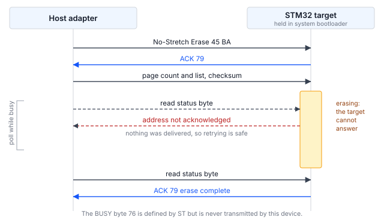

## 1 はじめに

すべての STM32 マイクロコントローラの ROM に書き込まれているシステムブートローダは、
デバッグプローブを使わず、デバイス上にユーザコードが存在しなくても、シリアルインタフェース
経由で内蔵フラッシュメモリをプログラミングする手段を提供します。ブートローダが提供する
インタフェースはデバイスによって異なり、部品番号ごとに AN2606 に記載されています。

I2C はほとんどの STM32 ファミリでこのリストに含まれており、インシステムプログラミングの
選択肢の中で最も適用範囲の広いものです。ボードがすでにセンサ、EEPROM、電源管理デバイスに
接続するために I2C バスを配線している場合、同じ 2 本の信号線でファームウェア更新を
行うことができ、専用のプログラミングヘッダは不要です。製品がすでに量産されている場合、
プログラミング用に計画されていたかどうかにかかわらず、通常は I2C バスがボード上の
どこかに存在します。

本書は、STM32H5 シリーズの I3C インタフェースを扱う AN0001 の I2C 版です。コマンドセットは
両者でほぼ同じです。異なるのは、ターゲットがステータスを報告する方法と、ビジー状態を
伝える方法であり、こうした違いはコマンドリストよりもホストコードの構成に大きく影響します。

### 1.1 適用範囲

本書では以下について説明します。

- I2C システムブートローダプロトコルの構造。コマンドステータスを報告する仕組みと、
  ターゲットがビジーであることを通知する仕組みを含みます
- Binho Pulsar と STM32 ターゲットの間に必要な接続
- デバイスの識別、消去、プログラミング、検証の手順
- 新たにプログラミングしたイメージをターゲットが実行していることを、プログラミングツールの
  外部から確認する方法
- Pulsar と Supernova のどちらでも駆動できる付属のリファレンスユーティリティ

UART、USB、SPI、CAN、I3C 経由のプログラミング、オプションバイトのプログラミング、
読み出し保護（テストした部品の ROM ブートローダはこのインタフェースでは提供していません）、
および量産用プログラミング治具は対象外です。STM32H5 シリーズでの I3C については AN0001 を
参照してください。

### 1.2 対象デバイス

I2C システムブートローダは特定のファミリに限定されたものではありません。使用するピンと
応答するアドレスは部品ごとに異なり、このインタフェースを提供するすべてのデバイスについて
両方が AN2606 に記載されています。どちらも推測できるものではなく、ファミリ間で一貫しても
いません。

Table: 対象デバイス

| ファミリ | 部品例 | ブートローダの I2C インタフェース | 根拠 |
|---|---|---|---|
| STM32H5 | STM32H503 | I2C2、`PB3`/`PB4`、アドレス `0x67` | 本書のためにテスト済み |
| STM32H5 | STM32H563 | AN2606 による | AN2606、未テスト |
| STM32G0, G4 | なし | AN2606 による | AN2606、未テスト |
| STM32L4, L5 | なし | AN2606 による | AN2606、未テスト |
| STM32U5 | なし | AN2606 による | AN2606、未テスト |

ハードウェアで検証したのは STM32H503 の行だけです。その他の行は、AN2606 がそれらの
ファミリについて I2C インタフェースを記載していることを示すにすぎません。本書のコマンドを
発行する前に、手元の部品についてピン、アドレス、およびサポートされるコマンドリストを
AN2606 で確認する必要があります。

### 1.3 関連資料

Table: 関連資料

| 資料 | タイトル |
|---|---|
| AN2606 | STM32 microcontroller system memory boot mode |
| AN4221 | I2C protocol used in the STM32 bootloader |
| RM0492 | STM32H503 reference manual |
| AN0001 | Programming STM32 microcontrollers over I3C with the Binho Supernova |

## 2 システム概要

### 2.1 バス上の役割

ホストアダプタが I2C コントローラ（controller）です。システムブートローダモードに保持された
ターゲット（target）は、AN2606 に記載された固定アドレスの I2C ターゲットです。STM32H503 では
このアドレスは `0x67` で、AN2606 では `0b1100111x`（`x` はリード／ライトビット）と記載されて
います。

アドレスは ROM に固定されており変更できないため、計画時に考慮すべき帰結が 1 つあります。
同じ部品番号の STM32 を 2 個、同じバス上で同時にブートローダに保持することはできません。
これが AN0001 の I3C インタフェースとの実用上の違いです。I3C では、ダイナミックアドレス
割り当て（DAA）によって実行時に各ターゲットに個別のアドレスが与えられ、複数のターゲットが
1 本のバスを共有できます。

### 2.2 ステータス報告

すべてのコマンドは、書き込みの後に 1 バイトの読み出しを行う形をとります。ターゲットは
ACK の場合は `0x79`、NACK の場合は `0x1F` で応答します。これは多くの読者が想定する
要求と応答の形であり、ステータスがインバンド割り込み（IBI）として非同期に届く I3C
インタフェースに比べて、I2C インタフェースの駆動が容易である主な理由です。

Table: ブートローダが返すステータス値

| 値 | 意味 | 観測 |
|---|---|---|
| `0x79` | ACK、コマンド受理 | あり |
| `0x1F` | NACK、コマンド拒否 | あり |
| `0x76` | BUSY | なし、送信されない |

ST は BUSY バイト `0x76` を定義しています。テストした部品では、これが送信されることは
ありません。観測された拒否はすべて `0x1F` で返され、ビジー状態のターゲットはステータス
バイトでまったく応答しません。`0x76` を待つように書かれたホストコードは永久に待ち続けます。

### 2.3 ターゲットがビジーであることを伝える方法

これはホストコードの構成を左右する唯一の仕組みであり、コードを書く前に理解しておく価値が
あります。

消去や書き込みは、バストランザクションよりもはるかに長い時間がかかります。ブートローダは
その時間差を埋める 2 つの方法を提供しており、どちらを使うかはホストが選択します。

- **通常のコマンド**は、処理が完了するまで SCL を Low に保持します。これは通常の I2C
  クロックストレッチです。
- **ノンストレッチコマンド**は別のオペコードセットで、ストレッチを行いません。代わりに、
  ビジー状態のターゲットは**自身のアドレスに対して ACK を返さなくなり**、ホストは
  アドレスが再び ACK されるまでトランザクションを再試行してポーリングします。

アドレスが NACK された場合は何も届いていないため、再試行は常に安全です。

ユーティリティがどちらのセットを使うかはアダプタによって決まります。専用 I2C ポートを
使用する Pulsar はクロックストレッチを許容するため、通常のコマンドを使用し、それ以上の
対応は不要です。I3C ポートからバスを駆動する Supernova はこれを許容しないため、その経路では
ユーティリティが自動的にノンストレッチ版に切り替えます。理由はセクション 5.7 で説明します。
`--no-stretch` を指定すると、どのアダプタでもノンストレッチ版を強制的に使用します。



### 2.4 ホストアダプタの選択肢

本書では 2 つの構成を扱い、どちらもハードウェアで検証済みです。

Table: 対象とするホストアダプタ構成

| アダプタ | ポート | 状態 |
|---|---|---|
| Binho Pulsar | 専用 I2C ポート | 検証済み、すべての測定に使用 |
| Binho Supernova | I3C ポート、I2C モードで駆動 | 機能面で検証済み |

Supernova は I3C ポートからレガシー I2C ターゲットを駆動し、このポートがバスのプルアップを
供給します。ユーティリティでは `--i2c-port i3c` でこれを選択します。Supernova の専用 I2C
ポートからのプログラミングは、本改訂の対象外です。

## 3 ハードウェアのセットアップ

### 3.1 必要な機器

Table: 必要な機器

| 項目 | 本書で使用したもの |
|---|---|
| ホストアダプタ | Binho Pulsar、ファームウェア 4.4.0 |
| ターゲットボード | NUCLEO-H503RB |
| 配線 | 5 本：バス用 3 本、リセット制御用 2 本 |
| ホスト | Python 3.12 |

全体を通して Pulsar の代わりに Binho Supernova を使用できます。接続の違いはセクション 3.3
に記載します。

### 3.2 接続

Table: Pulsar とターゲット間の接続

| Pulsar | ターゲット | 必須 |
|---|---|---|
| SCL | `PB3` | はい |
| SDA | `PB4` | はい |
| GND | GND | はい |
| GPIO 1 | `NRST` | 任意、ブートローダへの自動移行用 |
| GPIO 2 | `BOOT0` | 任意、ブートローダへの自動移行用 |

`PB3` と `PB4` は、この部品で AN2606 がブートローダの I2C インタフェースに割り当てている
ピンです。これらは読者が推測するピンではありません。多くの STM32 ボードでは、ユーザ
マニュアルで I2C 用と表記されたピンは別のペリフェラルインスタンスに属しており、`PB3` と
`PB4` はリセット時のデフォルトでは `JTDO`/`TRACESWO` と `NJTRST` になっています。ボードの
シルク印刷ではなく、手元の部品について AN2606 で確認してください。

2 本の GPIO 配線がない場合、ユーティリティはブートローダへの移行を手動で行うよう求めます。
配線がある場合はサイクル全体が無人で実行され、セクション 6 の手順はこれを前提としています。

### 3.3 Supernova を代わりに接続する場合

SCL、SDA、GND を Supernova の **I3C ポート**に配線し、すべてのコマンドに `--i2c-port i3c` を
追加します。GPIO の接続は変わらず、セクション 6 の手順は記載どおりに適用できます。

この経路を選ぶ前に知っておくべき違いが 2 つあります。

I3C コントローラは任意のクロックではなく、固定されたレガシー I2C レートのセットを提供する
ため、`--i2c-speed` はその中の最も近い値に丸められます。ユーティリティは実際に設定した
レートを報告し、要求したレートと異なる場合はその旨を表示します。

ここで説明した構成では、100 kHz ではセッションが確実に開始しましたが、400 kHz と 1 MHz では
まったく開始しませんでした。これらのレートでは、ターゲットが自身のアドレスに ACK を返さなく
なるか、最初のコマンドを拒否しました。セクション 9 の測定は、3 つのレートすべてが動作した
専用 I2C ポート上の Pulsar で行ったものであり、この経路にもそのまま当てはまると想定すべき
ではありません。バス速度が重要な場合は専用ポートを使用してください。

### 3.4 バスに関する考慮事項

バスにはプルアップ抵抗が必要です。Pulsar の専用 I2C ポートと Supernova の I3C ポートは
いずれも独自のプルアップを備えており、ソフトウェアで選択できます。ユーティリティは
デフォルトで 1 kΩ を要求し、`--pullup` で変更できます。プルアップのないバスはアイドル時の
High 状態に到達できず、そのようなバス上のコントローラは、ターゲットが存在しないことでは
なく、スタートコンディションを生成できなかったことを報告します。

> **注意。** 接続する前に、バス電圧をターゲットに合わせて設定してください。ユーティリティは
> 3.3 V を設定し、これは NUCLEO-H503RB に適しています。より低い電源電圧で動作している
> ターゲットに 3.3 V を加えると、ターゲットが損傷する可能性があります。

もう 1 つの考慮事項は、Supernova が I3C ポートからバスを駆動する場合にのみ適用されます。
I3C ターゲットはクロックストレッチを行わないため、I3C コントローラには SCL を保持する
ターゲットを許容する義務がなく、待機せずに転送を中止する場合があります。リファレンス
ユーティリティはこれを自動的に処理します。仕組みはセクション 5.7 で説明しており、
ユーザ側の操作は不要です。

## 4 ソフトウェアのセットアップ

### 4.1 ホストパッケージのインストール

ユーティリティはベンダパッケージを通じてアダプタと通信します。使用するアダプタに対応する
パッケージをインストールしてください。

```
pip install binhopulsar        # for a Pulsar
pip install binhosupernova     # for a Supernova
```

本書で使用したバージョン：`binhopulsar` 1.2.0、`binhosupernova` 4.2.0、Python 3.12。
その他のパッケージは不要です。ユーティリティは Intel HEX を自身で解析します。

### 4.2 リファレンスユーティリティの入手

`stm32_flash.py` は、本書に付属するアセットアーカイブに含まれています。

```
https://cdn.binho.io/application-notes/AN0002/AN0002-assets.zip
```

同じファイルは、本書の Markdown ソースとともに
`https://github.com/binhollc/application-notes` で公開されています。アーカイブの内容は
セクション 12 に記載しています。

アーカイブを展開すると、ユーティリティを含む `assets` ディレクトリと、セクション 7 の
検証用イメージを含む `firmware` サブディレクトリが作成されます。本書のすべてのコマンドは、
その `assets` ディレクトリ内から実行する形で示しています。

ユーティリティは標準ライブラリと 1 つのアダプタパッケージ以外をインポートしない単一の
ファイルであるため、任意の場所にコピーしてそのまま実行できます。接続されているアダプタは
自動検出しますが、どちらのアダプタも複数のバスを備えているため、使用するバスを
`--bus i2c` で指定します。

## 5 ブートローダプロトコル

### 5.1 システムブートローダモードへの移行

`BOOT0` を High に保持したまま、`NRST` を Low にパルスして解放します。デバイスは
アプリケーションではなくシステムメモリから起動します。

`NRST` は、オンボードのリセット回路と競合しないよう、High に駆動するのではなくホスト側の
ピンを入力に切り替えることで解放します。ユーティリティはこのように動作します。

アプリケーションに戻るには、`BOOT0` を Low に駆動し、再度 `NRST` をパルスします。これらの
ピンが配線されていない場合は、Go コマンドによってリセットせずにプログラミング済みの
イメージにジャンプします。

### 5.2 セッションの開始

セッション開始の手順はありません。セッションを開始するために同期バイトを必要とする I3C
インタフェースとは異なり、I2C インタフェースは最初のコマンドから始まります。その前には
何も送信しません。

### 5.3 コマンドのフレーミング

すべてのコマンドは、オペコードとその補数の 2 バイト書き込みと、それに続くステータスの
1 バイト読み出しで構成されます。

```
write 0x67  [op, op ^ 0xFF]
read  0x67  1 byte              -> 0x79 ACK, or 0x1F NACK
```

アドレスを伴うコマンドは、ビッグエンディアンの 4 バイトとそれに続く 4 バイトの 1 バイト
XOR チェックサムを送信し、ペイロードの前にもう一度 ACK を受け取ります。

### 5.4 Get 応答の読み出し

Get は `2 + N` バイトのフレームを 1 つ返します。内容はカウント、プロトコルバージョン、
そして `N` 個のオペコードです。ホストは `N` を事前に知ることができず、フレームの終端を
越えて読み出すとバスがタイムアウトします。

ユーティリティは Get を 2 回発行します。1 回目は 2 バイトを読み出して `N` を取得し、2 回目は
Get を再発行してフレーム全体を読み出します。短く読み出すことは無害です。ターゲットは
フレームの残りを破棄して最後の ACK に進むからです。長く読み出すことは無害ではありません。

### 5.5 サポートされるコマンド

Table: STM32H503 で I2C 経由でサポートされるコマンド

| オペコード | コマンド |
|---|---|
| `0x00` | Get |
| `0x01` | Get Version |
| `0x02` | Get ID |
| `0x11` | Read Memory |
| `0x21` | Go |
| `0x31` | Write Memory |
| `0x44` | Extended Erase |
| `0x50` | Special Command |
| `0x63` | Write Protect |
| `0x73` | Write Unprotect |
| `0x32` | No-Stretch Write Memory |
| `0x45` | No-Stretch Erase |
| `0x64` | No-Stretch Write Protect |
| `0x74` | No-Stretch Write Unprotect |
| `0xA1` | Checksum |

15 個のコマンドがあり、同じ部品が I3C 経由で提供するものより 5 個多くなっています。存在
しないものに注意してください。Readout Protect（`0x82`）と Readout Unprotect（`0x92`）です。
ST の Open Bootloader リファレンス実装にはこれらが含まれていますが、この部品の ROM
ブートローダは I2C 経由ではこれらを提供しておらず、判断の基準は ROM です。リファレンス実装と
ROM は別のプログラムであり、両者が食い違う場合に正しいのはデバイスのほうです。

### 5.6 消去

Extended Erase は、ページ数とそれに続くページ番号のリスト、または特殊値を受け取ります。

Table: Extended Erase の特殊値と STM32H503 が受理するもの

| 値 | 意味 | Pulsar、専用 I2C ポート | Supernova、I3C ポート経由 |
|---|---|---|---|
| `0xFFFF` | 一括消去 | 受理、0.05 s | 拒否 |
| `0xFFFE` | バンク 1 消去 | 受理 | 受理、128 KB 全体を 0.02 s で消去 |
| `0xFFFD` | バンク 2 消去 | 受理 | 拒否 |

この 2 つの列の違いこそが要点です。どちらの場合も、ブートローダは同じフラッシュと通信する
同じプログラムであり、変わったのはコントローラだけです。専用 I2C ポート上の Pulsar は
ブートローダが提供するすべての機能を利用できますが、レガシーモードの Supernova の I3C
ポートから送信した同じコマンドは拒否されます。

本書でこの区別が必要になったのはこれが 2 回目であり、根本的な理由はセクション 5.7 と同じ
です。レガシーバスを駆動する I3C コントローラは I2C コントローラのそのままの代替品ではなく、
その違いは、別のホストからであれば問題なく受理されるものをターゲットが拒否しているように
見える形で現れます。

一括消去が拒否された場合、シングルバンクの部品ではバンク 1 の値で同じ範囲を消去できます。
リファレンスユーティリティはまず一括消去を試み、拒否された場合はフォールバックして、その旨を
報告します。マルチバンクの部品ではこのフォールバックは最初のバンクしか消去しないため、
実行していない一括消去を報告するのではなく、実際に行った処理を表示します。

ページリストの場合、カウントフィールドはページ数ではなく**ページ数から 1 を引いた値**です。
ページ 0 を 1 ページだけ消去する場合は、カウントとして `00 00`、ページとして `00 00` を送信
します。ページ数をそのまま送信すると、意図より 1 ページ多く消去されます。

この部品の 2 つのインタフェースは一致していません。I2C がカウントから 1 を引いた値を取るのに
対し、I3C インタフェースはカウントそのものを取ります。どちらのエンコーディングも、隣接する
2 ページに異なるパターンを書き込み、1 ページ目だけを消去し、どのページが消去された状態で
読み出されるかを確認することで確定しました。I3C の場合については AN0001 で扱っています。

1 つのコマンドで指定できるページ数も、同様にコントローラによって異なります。専用 I2C
ポート上の Pulsar では 4 ページのリストが受理されました。I3C ポートからバスを駆動する
Supernova では **2 ページ**を超えるものはすべて拒否され、1 ページまたは 2 ページであれば
受理されて、指定したページだけが正確に消去されました。AN4221 にも AN2606 にもそのような
制限を記載した箇所は見つかっていません。この制限は、長さを順に変えて試し、ページごとに
消去範囲を確認することで確定しました。

そのためリファレンスユーティリティは、使用するコントローラが必要とする場合にのみページ
リストを分割します。Supernova の I3C ポートからの 128 KB の消去は 8 個のコマンドとなり約
0.19 s かかりますが、Pulsar からは 1 個のコマンドのままです。制約のある経路で長いリストを
1 つ送信したホストはそれを拒否され、その失敗はサイズ超過ではなく不正な形式の要求のように
見えます。

STM32H503 のフラッシュページは 8 KB です。ユーティリティの `--page-size` オプションで、
`--erase pages` 用にこの値を設定します。

### 5.7 クロックストレッチと、ユーティリティが待機する理由

コマンドの直後、自身のアドレスに NACK を返す状態に落ち着く前に、ターゲットは短時間 SCL を
Low に保持します。一般的な I2C コントローラはこれを問題なく乗り切り、専用 I2C ポート上の
Pulsar ではそれ以上の対応は不要です。

レガシー I2C モードの I3C コントローラには、そうする義務がありません。I3C ターゲットは
クロックストレッチを行わないため、I3C ペリフェラルはバスタイムアウトを適用し、待機せずに
転送を中止する場合があります。I3C ポートからバスを駆動する Supernova では、これは消去の
ページリスト書き込みに続くステータス読み出しでのバスタイムアウトとして、試行のおよそ 4 分の
1 で現れました。すべての転送を直前の転送からの間隔とともにトレースしたところ、失敗した
読み出しは常に間隔をまったく空けずに発行されたものでした。これにより、原因がバスではなく
ストレッチ期間であると特定できます。

対策はタイムアウトを延ばすことではありません。ステータス読み出しの前に約 2 ms 待機すると
ストレッチ期間を完全に回避でき、ターゲットはクリーンな NACK を返します。これは通常の
ビジーポーリングですでに処理されます。この待機（settle）を入れると、タイムアウトはまったく
発生しません。

Table: I3C ポートから I2C を駆動する Supernova での待機の効果

| 方式 | 完了したサイクル | 吸収したタイムアウト |
|---|---|---|
| 待機なし | 12 回中 9 回 | 該当なし |
| ステータス読み出し前に 2 ms 待機 | 12 回中 12 回 | 0 |
| 2 ms 待機とタイムアウト時の再試行 | 12 回中 12 回 | 0 |

3 行目は、待機が問題を覆い隠しているのではなく原因に対処していることの証拠です。待機を
入れた状態では、再試行は一度も発生しません。ユーティリティはこの待機を自動的に、かつその
経路でのみ適用するため、これを制御するオプションはありません。

## 6 プログラミング手順

### 6.1 ターゲットの識別

`info` コマンドはターゲットをリセットしてブートローダに移行させ、バスを初期化し、応答した
内容を報告します。

```
python stm32_flash.py --bus i2c info

  Adapter: pulsar  fw 4.4.0
  Bus: I2C
  Resetting target into bootloader (NRST=GPIO1, BOOT0=GPIO2)
  I2C: 100 kHz, target 0x67
  Bootloader session established

  Protocol version : 2.0
  Device ID        : 0x474  (STM32H503)
  Commands         : 15
      0x00  Get
      ...
      0xA1  Checksum
```

これらの行の間には、サポートされる 15 個のコマンドがすべて列挙されます。これらは表 7 に
示したものです。アダプタのシリアル番号は最初の行に表示されますが、ここでは省略しています。

これは新しいボードでの最初の手順として推奨されます。破壊的な操作を試みる前に、配線、バス
設定、ブートローダへの移行を確認できるためです。

### 6.2 既存の内容の読み出し

消去の前にフラッシュの内容を保存しておく必要があります。次のコマンドは、STM32H503RB の
128 KB のフラッシュ全体を読み出します。

```
python stm32_flash.py --bus i2c read backup.bin --address 0x08000000 --length 0x20000
```

### 6.3 イメージのプログラミング

`flash` コマンドは、消去、書き込み、読み戻しと比較、そしてアプリケーションへのリセットという
一連の処理をすべて実行します。ここでは、記載どおりにコマンドを実行できるよう、セクション 7
の検証用イメージを使用します。

生のバイナリには、ベースアドレスを明示的に指定する必要があります。

```
python stm32_flash.py --bus i2c flash firmware/an0002_image_a.bin --address 0x08000000
```

Intel HEX ファイルは自身のアドレスを含んでいるため、このオプションは省略します。`firmware`
ディレクトリで `make hex` を実行すると HEX ファイルが生成されます。

```
python stm32_flash.py --bus i2c flash firmware/build/an0002_image_a.hex
```

デフォルトではデバイス全体を一括消去します。`--erase pages` を指定すると、イメージが占める
ページだけを消去し、小さなイメージではこちらのほうが高速です。

```
python stm32_flash.py --bus i2c flash firmware/an0002_image_a.bin --address 0x08000000 --erase pages
```

代わりに Supernova を I3C ポートから駆動するには、`--i2c-port i3c` を追加します。セッション
オプションはサブコマンドの前後どちらにも指定できます。

```
python stm32_flash.py --bus i2c --i2c-port i3c flash firmware/an0002_image_a.bin --address 0x08000000
python stm32_flash.py --bus i2c flash firmware/an0002_image_a.bin --address 0x08000000 --i2c-port i3c
```

### 6.4 検証

検証はデフォルトで実行されます。プログラミングした範囲を同じインタフェースで読み戻し、
ソースイメージと 1 バイトずつ比較します。プログラミング時間が重要で、イメージを別の手段で
検証する場合は、`--no-verify` で無効にできます。

### 6.5 デバイスをアプリケーションに戻す

GPIO 1 と GPIO 2 が接続されている場合、ユーティリティはプログラミング後に `BOOT0` を Low に
駆動して `NRST` をパルスするため、デバイスは新たにプログラミングしたアプリケーションを
起動します。これらのピンが接続されていない場合は、代わりに Go コマンドを発行します。
`--no-run` を指定すると、デバイスはブートローダにとどまります。

## 7 ターゲット上での更新の確認

`flash` コマンドはプログラミングした範囲を読み戻して 1 バイトずつ比較し、フラッシュの内容が
提供したイメージと一致することを証明します。しかし、デバイスが新しいファームウェアを実行して
いることは証明しません。ブートローダにとどまったままのターゲットや、リセットが解放されな
かったターゲットは、このチェックに合格してもアプリケーションを実行していない可能性が
あります。

このギャップを埋めるため、本書には 2 つの小さなファームウェアイメージが付属しています。
両者は報告する文字とユーザ LED の点滅速度だけが異なり、変化をプログラミングツールの外部から
確認できます。

### 7.1 検証用イメージ

Table: 本書に付属する検証用イメージ

| イメージ | ファイル | 報告 | LED |
|---|---|---|---|
| A | `firmware/an0002_image_a.bin` | `IMAGE A` | 1 Hz |
| B | `firmware/an0002_image_b.bin` | `IMAGE B` | 5 Hz |

イメージのサイズは 864 バイトと 860 バイトで、`0x08000000` から実行するようにリンクされて
います。ソース、リンカスクリプト、makefile が同梱されているため、イメージをそのまま信用する
のではなく、内容を確認して再ビルドできます。

どちらのイメージも `PB3` と `PB4` を使用しないため、プログラミング用の接続に影響を与えずに
ロードして動作を観察できます。

### 7.2 手順

ST-LINK 仮想 COM ポートで 115200 8N1 のシリアルターミナルを開き、イメージ A を
プログラミングします。

```
python stm32_flash.py --bus i2c flash firmware/an0002_image_a.bin --address 0x08000000
```

ユーティリティは各段階を進行に合わせて報告します。以下の出力は抜粋です。セクション 6.1 の
アダプタとセッションの行が最初に表示され、正確な時間は実行ごとに異なります。

```
  ...
  Erasing 1 page
    done in 0.02 s

  Writing
    segment at 0x08000000
    wrote 864 bytes in 0.11 s (7.7 KiB/s)

  Verifying
    all 864 bytes match (0.12 s)

  Resetting into application

  Success.
```

ターミナルにはバナーが表示され、その後 1 秒ごとに 1 行のハートビートが表示されます。

```
========================================
  Binho  |  AN0002
  Programming STM32 microcontrollers
  over I2C with the Binho Pulsar
========================================
  Running: IMAGE A
  Kernel clock: 32 MHz
  LED blink: 1 Hz
========================================
  IMAGE A  alive, 1 s
  IMAGE A  alive, 2 s
```

イメージ B をプログラミングすると、報告される文字が変わり、LED の点滅が 5 倍速くなります。
ハートビートは重要です。リセット時にだけ表示されるバナーは、ターミナルを後から開くと見逃して
しまいます。これらのイメージの目的は、どちらが実行されているかを一目で判別することです。

`IMAGE A` から `IMAGE B` への遷移がエンドツーエンドの結果です。イメージは I2C 経由で消去、
プログラミング、検証され、デバイスはプログラミングした内容を実行しています。

> **重要：** これらのイメージをプログラミングすると、デバイス上にすでにあるアプリケーションが
消去されます。セクション 6.2 の説明に従って、まず既存の内容を保存してください。

> **注記：** 付属のバイナリは NUCLEO-H503RB 用にビルドされています。`PA4` を USART3_TX、
`PA5` をユーザ LED として駆動しており、これはこのボードの配線に合わせたものです。他のボードでは、
ピンと仮想 COM ポートへの経路が異なるため、シリアル出力は表示されません。イメージは小さく
ソースも付属しているため、`firmware/main.c` の先頭にあるピンとペリフェラルの定義を変更して
再ビルドすることで、別のボードに対応させてください。

## 8 リファレンスユーティリティ

### 8.1 コマンド

Table: ユーティリティのコマンド

| コマンド | 動作 |
|---|---|
| `list` | 接続されている Binho アダプタを一覧表示 |
| `info` | ターゲットを識別し、その機能を報告 |
| `flash` | イメージの消去、書き込み、検証、実行 |
| `read` | メモリを読み出してファイルに保存 |
| `erase` | ユーザフラッシュを一括消去 |
| `reset` | GPIO によりターゲットをリセット |

### 8.2 オプション

セッションオプションは、アダプタ、バス、ブートローダへの移行を指定します。サブコマンドの
前後どちらにも指定できます。ユーティリティは I3C と SPI のオプション群も受け付けますが、
I2C バスでは効果がありません。それらは AN0001 と AN0003 に記載しています。

Table: セッションオプション

| オプション | デフォルト | 意味 |
|---|---|---|
| `--adapter` | auto | `pulsar` または `supernova` を強制 |
| `--bus` | auto | `i2c` または `i3c` を強制 |
| `--serial` | auto | シリアル番号でアダプタを選択 |
| `--i2c-address` | `0x67` | ブートローダのアドレス（AN2606 による） |
| `--i2c-speed` | 100000 | バスクロック（Hz） |
| `--i2c-bus` | `A` | Pulsar で使用する I2C バス |
| `--i2c-port` | `dedicated` | I2C を通す Supernova のコネクタ |
| `--pullup` | 1000 | バスのプルアップ値（Ω） |
| `--nrst-pin` | 1 | `NRST` を駆動する GPIO |
| `--boot0-pin` | 2 | `BOOT0` を駆動する GPIO |
| `--manual` | off | GPIO を使わず、ブートローダへの移行を手動で行うよう求める |
| `--reset-hold` | 0.05 | `NRST` を Low に保持する秒数 |
| `--boot-delay` | 0.25 | ブートローダの起動に確保する秒数 |
| `--no-stretch` | off | ノンストレッチ版のコマンドを強制。セクション 2.3 を参照 |
| `-v`, `-q` | off | すべての転送をログに記録、または進行状況の出力を抑制 |

Table: コマンドごとのオプション

| オプション | 適用対象 | 意味 |
|---|---|---|
| `--address` | `flash`, `read` | 生のバイナリのベースアドレス |
| `--length` | `read` | 読み出すバイト数 |
| `--erase` | `flash` | `mass`、`pages` または `none`。一括消去が拒否された場合、`mass` はバンク 1 消去にフォールバックし、その旨を表示 |
| `--page-size` | `flash` | `--erase pages` 用のフラッシュページサイズ。デフォルトは 8192 |
| `--erase-timeout` | `flash`, `erase` | 消去に許容する秒数 |
| `--chunk-size` | `flash`, `read` | 1 回の転送あたりのバイト数。デフォルトは 256 で、ブートローダが受け付ける最大値 |
| `--no-verify` | `flash` | 読み戻しによる比較を省略 |
| `--no-run` | `flash` | デバイスをブートローダにとどめる |
| `--run` | `info`, `read`, `erase` | 処理後にアプリケーションへリセット |
| `--bootloader` | `reset` | アプリケーションではなくブートローダへリセット |

## 9 測定結果

### 9.1 テスト構成

Table: テスト構成

| 項目 | 値 |
|---|---|
| ターゲット | STM32H503RB、NUCLEO-H503RB |
| アダプタ | Binho Pulsar、ハードウェアリビジョン C、ファームウェア 4.4.0 |
| ホストパッケージ | `binhopulsar` 1.2.0 |
| Python | 3.12 |
| バス電圧 | 3.3 V |
| プルアップ | 1 kΩ |

### 9.2 読み出しスループット

3 つのバス速度で 128 KiB の読み出し時間を測定しました。列挙、ブートローダへのリセット、
最初のハンドシェイクを含むセッションのセットアップは 0.81 s で、バス速度によって変化しません
でした。転送の数値がバスのみを表すよう、セットアップ時間は別に記載しています。

Table: 128 KiB 読み出しの測定値

| バス速度 | 読み出しフェーズ | スループット |
|---|---|---|
| 100 kHz | 17.47 s | 7.3 KiB/s |
| 400 kHz | 7.59 s | 16.9 KiB/s |
| 1 MHz | 5.44 s | 23.5 KiB/s |

3 回の読み出しはすべてバイト単位で同一のデータを返しました。

### 9.3 信頼性

Table: 完了した消去、書き込み、検証、実行のサイクル

| 構成 | 完了したサイクル |
|---|---|
| Pulsar、専用 I2C ポート、100 kHz | 29 回中 29 回 |
| Supernova、I2C モードの I3C ポート、100 kHz | 12 回中 12 回 |

サイクルはイメージ A とイメージ B を交互に使用したため、各サイクルでは直前のサイクルとは
異なる内容を消去、書き込み、検証しました。Supernova の数値はセクション 5.7 の待機を適用した
ものです。待機なしでは 12 回中 9 回が完了しました。

これらの数値は、1 つのターゲットと 1 つのホストで数十回のサイクルを行った結果です。手順に
再現性があることの証拠であり、信頼性の仕様ではありません。

## 10 トラブルシューティング

Table: トラブルシューティング

| 症状 | 考えられる原因と対処 |
|---|---|
| コントローラがスタートコンディションを生成できなかったと報告する | バスにプルアップがないか、SDA または SCL が Low に保持されています。使用しているポートがプルアップを供給していること、および配線が正しいピンに届いていることを確認してください。 |
| ブートローダのアドレスで応答がない | アドレスまたはピンが誤っています。部品について AN2606 で両方を確認してください。デバイスごとに異なります。 |
| ターゲットがブートローダモードでのみ応答する | 想定どおりの動作です。このアドレスは、デバイスがシステムメモリブートモードに保持されている間だけ存在します。 |
| 消去後のステータス読み出しでバスタイムアウトが発生する | コントローラが、ターゲットによる SCL の保持を許容していません。専用 I2C ポート上の Pulsar を使用するか、ユーティリティがセクション 5.7 の待機を適用する `--i2c-port i3c` 付きの Supernova を使用してください。 |
| 消去で想定より 1 ページ多く消去される | カウントフィールドはページ数から 1 を引いた値です。セクション 5.6 を参照してください。 |
| 書き込みが成功したように見えた後で検証に失敗する | 消去がプログラミング範囲全体をカバーしていませんでした。`--page-size` を部品の実際のページサイズに広げるか、プログラミングの前に明示的に消去してください。 |
| 一括消去が拒否される | Supernova の I3C ポートから I2C を駆動した場合に見られ、Pulsar の専用ポートからでは見られません。バンク 1 消去で同じ範囲を消去でき、ユーティリティは自動的にフォールバックします。セクション 5.6 を参照してください。 |
| 複数ページを指定した消去が拒否される | 同じ経路です。その経路では 1 つのコマンドで 2 ページを超えると拒否され、専用 I2C ポートからは受理されます。ユーティリティは必要に応じてリストを分割します。セクション 5.6 を参照してください。 |
| 読み出しではデータが返るが、デバイスが動作しない | デバイスがブートローダにとどまっています。`BOOT0` が Low に戻り、`NRST` が解放されていることを確認するか、`--no-run` を外してください。 |
| 検証用イメージのシリアル出力が文字化けする | ターミナルのボーレートが一致していません。イメージは 115200 8N1 を使用します。 |

## 11 略語

Table: 略語

| 用語 | 意味 |
|---|---|
| ACK | Acknowledge（確認応答） |
| HSI | High-speed internal oscillator（高速内部発振器） |
| I2C | Inter-Integrated Circuit |
| I3C | Improved Inter-Integrated Circuit |
| NACK | Not acknowledged（否定応答） |
| ROM | Read-only memory（読み出し専用メモリ） |
| SCL | Serial clock line（シリアルクロックライン） |
| SDA | Serial data line（シリアルデータライン） |
| VCP | Virtual COM port（仮想 COM ポート） |

## 12 本書のソースコードに関する注記

本書に示し、付属のアーカイブで提供するサンプルコードは、評価および参考用に提供するもの
です。MIT ライセンスの下で公開しており、ライセンス文はアーカイブに含まれています。

アーカイブ `AN0002-assets.zip` は
`https://cdn.binho.io/application-notes/AN0002/AN0002-assets.zip` で公開されており、
以下を含みます。

Table: アセットアーカイブの内容

| パス | 説明 |
|---|---|
| `AN0002.md` | Markdown 形式の本書 |
| `assets/stm32_flash.py` | リファレンスユーティリティ（I2C、I3C、SPI、Pulsar と Supernova に対応） |
| `assets/PROTOCOL.md` | I2C ブートローダプロトコルの信号レベルに関する注記 |
| `assets/test_hex_parser.py` | Intel HEX パーサのテスト |
| `assets/LICENSE` | MIT ライセンス |
| `assets/firmware/main.c` | 両方の検証用イメージのソース |
| `assets/firmware/link.ld` | リンカスクリプト |
| `assets/firmware/Makefile` | 両方のイメージをビルド |
| `assets/firmware/README.md` | 検証用イメージに関する注記 |
| `assets/firmware/an0002_image_a.bin` | ビルド済みのイメージ A |
| `assets/firmware/an0002_image_b.bin` | ビルド済みのイメージ B |

## 13 改訂履歴

Table: 改訂履歴

| リビジョン | 日付 | 説明 |
|---|---|---|
| 1.0 | 29 August 2026 | 初版リリース。 |
| 1.1 | 3 September 2026 | 存在しない値に対してエムダッシュを記載していた 4 つの表のセルを、文字で書き表しました。部品例の記載がないファミリは `none`（なし）とし、吸収できるタイムアウトがなかった行は `not applicable`（該当なし）としました。測定結果に変更はありません。 |
