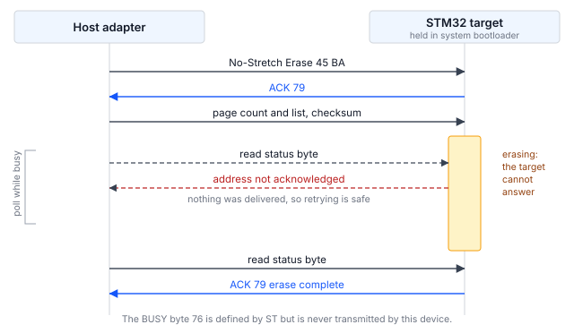

## 1 소개

모든 STM32 마이크로컨트롤러의 ROM에 프로그래밍된 시스템 부트로더는 디버그 프로브 없이,
그리고 디바이스에 사용자 코드가 전혀 없는 상태에서도 시리얼 인터페이스를 통해 내부 플래시
메모리를 프로그래밍하는 수단을 제공합니다. 부트로더가 제공하는 인터페이스는 디바이스마다
다르며, 부품 번호별로 AN2606에 정리되어 있습니다.

I2C는 대부분의 STM32 제품군에서 이 목록에 포함되어 있으므로, 인시스템 프로그래밍 옵션 중
가장 폭넓게 사용할 수 있는 방식입니다. 보드에 이미 센서, EEPROM 또는 전원 관리 디바이스에
연결하기 위한 I2C 버스가 배선되어 있다면, 같은 두 개의 선으로 펌웨어 업데이트를 전달할 수
있으며 전용 프로그래밍 헤더가 필요하지 않습니다. 이미 대량 생산 중인 제품이라면, 프로그래밍
용도로 계획했는지 여부와 관계없이 보드 어딘가에 대개 I2C 버스가 존재합니다.

이 노트는 STM32H5 시리즈의 I3C 인터페이스를 다루는 AN0001의 I2C 버전입니다. 명령어 세트는
두 인터페이스에서 거의 같습니다. 다른 점은 타깃이 상태를 보고하는 방식과 바쁨(busy) 상태를
알리는 방식이며, 이러한 차이는 명령어 목록보다 호스트 코드의 구조에 더 큰 영향을 줍니다.

### 1.1 범위

이 문서에서는 다음 내용을 설명합니다.

- I2C 시스템 부트로더 프로토콜의 구조. 명령 상태를 보고하는 메커니즘과 타깃이 바쁨 상태임을
  알리는 메커니즘을 포함합니다
- Binho Pulsar와 STM32 타깃 간에 필요한 연결
- 디바이스를 식별, 소거, 프로그래밍 및 검증하는 절차
- 타깃이 새로 프로그래밍된 이미지를 실행하고 있음을 프로그래밍 도구 외부에서 확인하는 방법
- Pulsar 또는 Supernova 중 하나를 구동하는 함께 제공되는 레퍼런스 유틸리티

UART, USB, SPI, CAN 또는 I3C를 통한 프로그래밍, 옵션 바이트 프로그래밍, 리드아웃 보호(시험한
부품의 ROM 부트로더는 이 인터페이스에서 이를 제공하지 않음), 양산용 프로그래밍 지그는 다루지
않습니다. STM32H5 시리즈의 I3C에 대해서는 AN0001을 참조하십시오.

### 1.2 적용 디바이스

I2C 시스템 부트로더는 특정 제품군에 한정되지 않습니다. 부트로더가 사용하는 핀과 응답하는
주소는 부품마다 다르며, 이 인터페이스를 제공하는 모든 디바이스에 대해 두 정보 모두 AN2606에
나와 있습니다. 어느 것도 추측할 수 없으며, 어느 것도 제품군 간에 일관되지 않습니다.

Table: 적용 디바이스

| 제품군 | 예시 부품 | 부트로더 I2C 인터페이스 | 근거 |
|---|---|---|---|
| STM32H5 | STM32H503 | I2C2, `PB3`/`PB4`, 주소 `0x67` | 이 문서를 위해 시험함 |
| STM32H5 | STM32H563 | AN2606 참조 | AN2606, 시험하지 않음 |
| STM32G0, G4 | 없음 | AN2606 참조 | AN2606, 시험하지 않음 |
| STM32L4, L5 | 없음 | AN2606 참조 | AN2606, 시험하지 않음 |
| STM32U5 | 없음 | AN2606 참조 | AN2606, 시험하지 않음 |

하드웨어에서 실제로 시험한 것은 STM32H503 행뿐입니다. 나머지 행은 AN2606이 해당 제품군에
대해 I2C 인터페이스를 명시하고 있다는 사실을 기록한 것입니다. 이 문서의 명령을 실행하기 전에
사용하는 부품의 핀, 주소 및 지원 명령어 목록을 AN2606에서 확인해야 합니다.

### 1.3 관련 문서

Table: 관련 문서

| 문서 | 제목 |
|---|---|
| AN2606 | STM32 microcontroller system memory boot mode |
| AN4221 | I2C protocol used in the STM32 bootloader |
| RM0492 | STM32H503 reference manual |
| AN0001 | Binho Supernova를 사용한 I3C 기반 STM32 마이크로컨트롤러 프로그래밍 |

## 2 시스템 개요

### 2.1 버스상의 역할

호스트 어댑터는 I2C 컨트롤러입니다. 시스템 부트로더 모드로 유지되는 타깃은 AN2606에 명시된
고정 주소의 I2C 타깃입니다. STM32H503에서 이 주소는 `0x67`이며, AN2606에는 `0b1100111x`로
표기되어 있습니다. 여기서 `x`는 읽기/쓰기 비트입니다.

주소는 ROM에 고정되어 있어 변경할 수 없으며, 이로 인해 미리 고려해야 할 결과가 하나 있습니다.
동일한 부품 번호의 STM32 두 개를 한 버스에서 동시에 부트로더 상태로 유지할 수 없다는
점입니다. 이것이 AN0001의 I3C 인터페이스와의 실질적인 차이입니다. I3C에서는 동적 주소
할당(DAA)이 런타임에 각 타깃에 고유한 주소를 부여하므로 여러 타깃이 하나의 버스를 공유할 수
있습니다.

### 2.2 상태 보고

모든 명령은 쓰기 후 1바이트 읽기로 구성됩니다. 타깃은 ACK이면 `0x79`, NACK이면 `0x1F`로
응답합니다. 이는 대부분의 독자가 예상하는 요청-응답 형태이며, 상태가 인밴드 인터럽트(IBI)로
비동기적으로 도착하는 I3C 인터페이스에 비해 I2C 인터페이스를 더 쉽게 구동할 수 있는 주된
이유입니다.

Table: 부트로더가 반환하는 상태 값

| 값 | 의미 | 관찰 여부 |
|---|---|---|
| `0x79` | ACK, 명령 수락 | 예 |
| `0x1F` | NACK, 명령 거부 | 예 |
| `0x76` | BUSY | 아니요, 전송되지 않음 |

ST는 BUSY 바이트 `0x76`을 정의하고 있습니다. 시험한 부품에서는 이 바이트가 전송되지
않습니다. 관찰된 모든 거부는 `0x1F`로 돌아왔으며, 바쁨 상태의 타깃은 상태 바이트로 전혀
응답하지 않습니다. `0x76`을 기다리도록 작성된 호스트 코드는 영원히 기다리게 됩니다.

### 2.3 타깃이 바쁨 상태를 알리는 방법

이것은 호스트 코드의 구조를 결정하는 유일한 메커니즘이므로, 코드를 작성하기 전에 이해해 둘
가치가 있습니다.

소거나 프로그래밍은 버스 트랜잭션보다 훨씬 오래 걸립니다. 부트로더는 이 시간 차이를 처리하는
두 가지 방법을 제공하며, 어느 쪽을 사용할지는 호스트가 선택합니다.

- **일반 명령**은 작업이 완료될 때까지 SCL을 Low로 유지합니다. 이는 일반적인 I2C 클록
  스트레칭입니다.
- **No-stretch 명령**은 별도의 옵코드 세트로, 스트레칭을 하지 않습니다. 대신 바쁨 상태의
  타깃은 **자신의 주소에 대한 ACK를 중단**하며, 호스트는 주소가 다시 ACK될 때까지
  트랜잭션을 재시도하는 방식으로 폴링합니다.

주소가 NACK되었다는 것은 아무것도 전달되지 않았다는 의미이므로, 재시도는 항상 안전합니다.

유틸리티가 어느 세트를 사용할지는 어댑터에 따라 달라집니다. 전용 I2C 포트를 사용하는
Pulsar는 클록 스트레칭을 허용하므로 일반 명령을 사용하며 추가 조치가 필요하지 않습니다.
I3C 포트로 버스를 구동하는 Supernova는 이를 허용하지 않으므로, 유틸리티는 해당 경로에서
자동으로 no-stretch 변형으로 전환합니다. 그 이유는 섹션 5.7에서 설명합니다. `--no-stretch`는
어떤 어댑터에서든 이 변형을 강제로 사용합니다.



### 2.4 호스트 어댑터 옵션

이 문서에서는 두 가지 구성을 다루며, 둘 다 하드웨어에서 검증했습니다.

Table: 다루는 호스트 어댑터 구성

| 어댑터 | 포트 | 상태 |
|---|---|---|
| Binho Pulsar | 전용 I2C 포트 | 검증됨, 모든 측정에 사용 |
| Binho Supernova | I3C 포트, I2C 모드로 구동 | 기능 검증됨 |

Supernova는 I3C 포트로 레거시 I2C 타깃을 구동하며, 이 포트가 버스 풀업을 제공합니다.
유틸리티에서는 `--i2c-port i3c`로 이를 선택합니다. Supernova의 전용 I2C 포트를 사용한
프로그래밍은 이번 개정판의 범위에 포함되지 않습니다.

## 3 하드웨어 설정

### 3.1 필요한 장비

Table: 필요한 장비

| 항목 | 이 문서에서 사용한 것 |
|---|---|
| 호스트 어댑터 | Binho Pulsar, 펌웨어 4.4.0 |
| 타깃 보드 | NUCLEO-H503RB |
| 배선 | 5개 선: 버스용 3개, 리셋 제어용 2개 |
| 호스트 | Python 3.12 |

전 과정에서 Pulsar 대신 Binho Supernova를 사용할 수 있으며, 연결상의 차이는 섹션 3.3에
기술되어 있습니다.

### 3.2 연결

Table: Pulsar와 타깃 간의 연결

| Pulsar | 타깃 | 필수 여부 |
|---|---|---|
| SCL | `PB3` | 예 |
| SDA | `PB4` | 예 |
| GND | GND | 예 |
| GPIO 1 | `NRST` | 선택 사항, 자동 부트로더 진입용 |
| GPIO 2 | `BOOT0` | 선택 사항, 자동 부트로더 진입용 |

`PB3`와 `PB4`는 이 부품에서 AN2606이 부트로더의 I2C 인터페이스에 할당한 핀입니다. 이 핀들은
독자가 추측할 만한 핀이 아닙니다. 많은 STM32 보드에서 사용자 매뉴얼에 I2C로 표시된 핀은 다른
주변장치 인스턴스에 속하며, `PB3`와 `PB4`는 리셋 기본 상태에서 `JTDO`/`TRACESWO`와
`NJTRST`를 담당합니다. 보드 실크스크린이 아니라 사용하는 부품의 AN2606을 기준으로
확인하십시오.

두 GPIO 선이 없으면 유틸리티는 부트로더 진입을 수동으로 수행하라는 메시지를 표시합니다. 두
선이 있으면 전체 사이클이 무인으로 실행되며, 섹션 6의 절차는 이 경우를 전제로 합니다.

### 3.3 Supernova를 대신 연결하는 경우

SCL, SDA 및 GND를 Supernova의 **I3C 포트**에 배선하고, 모든 명령에 `--i2c-port i3c`를
추가합니다. GPIO 연결은 동일하며, 섹션 6의 절차가 그대로 적용됩니다.

이 경로를 선택하기 전에 알아 두어야 할 차이가 두 가지 있습니다.

I3C 컨트롤러는 임의의 클록이 아닌 고정된 레거시 I2C 속도 세트를 제공하므로, `--i2c-speed`는
그중 가장 가까운 값으로 맞춰집니다. 유틸리티는 실제로 설정한 속도를 보고하며, 요청한 속도와
다를 경우 그 사실을 알립니다.

여기서 설명한 구성에서 세션은 100 kHz에서 안정적으로 열렸으며, 400 kHz 또는 1 MHz에서는
전혀 열리지 않았습니다. 이 속도에서는 타깃이 자신의 주소에 대한 ACK를 중단하거나 첫 번째
명령을 거부했습니다. 섹션 9의 측정은 세 가지 속도가 모두 동작한 전용 I2C 포트의 Pulsar로
수행한 것이므로, 이 구성에도 그대로 적용된다고 가정해서는 안 됩니다. 버스 속도가 중요한
경우에는 전용 포트를 사용하십시오.

### 3.4 버스 고려 사항

버스에는 풀업 저항이 있어야 합니다. Pulsar의 전용 I2C 포트와 Supernova의 I3C 포트는 모두
소프트웨어로 선택 가능한 자체 풀업을 제공합니다. 유틸리티는 기본적으로 1 kΩ을 요청하며
`--pullup`으로 이를 변경할 수 있습니다. 풀업이 없는 버스는 유휴 High 상태에 도달할 수 없으며,
이러한 버스의 컨트롤러는 타깃이 없다고 보고하는 대신 시작 조건을 생성할 수 없다고 보고합니다.

> **주의.** 연결하기 전에 버스 전압을 타깃에 맞게 설정하십시오. 유틸리티는 3.3 V로 설정하며,
> 이는 NUCLEO-H503RB에 적합합니다. 더 낮은 전원 전압으로 동작하는 타깃에 3.3 V를 인가하면
> 타깃이 손상될 수 있습니다.

Supernova가 I3C 포트로 버스를 구동하는 경우에만 적용되는 고려 사항이 하나 더 있습니다. I3C
타깃은 클록을 스트레칭하지 않으므로, I3C 컨트롤러는 SCL을 붙잡고 있는 타깃을 허용할 의무가
없으며, 기다리는 대신 전송을 중단할 수 있습니다. 레퍼런스 유틸리티는 이를 자동으로
처리합니다. 메커니즘은 섹션 5.7에서 설명하며, 사용자가 취할 조치는 없습니다.

## 4 소프트웨어 설정

### 4.1 호스트 패키지 설치

유틸리티는 벤더 패키지를 통해 어댑터와 통신합니다. 사용하는 어댑터에 맞는 패키지를
설치하십시오.

```
pip install binhopulsar        # for a Pulsar
pip install binhosupernova     # for a Supernova
```

이 문서에 사용한 버전: `binhopulsar` 1.2.0, `binhosupernova` 4.2.0, Python 3.12.
다른 패키지는 필요하지 않습니다. 유틸리티가 Intel HEX를 직접 파싱합니다.

### 4.2 레퍼런스 유틸리티 받기

`stm32_flash.py`는 이 문서와 함께 제공되는 에셋 아카이브에 포함되어 있습니다.

```
https://cdn.binho.io/application-notes/AN0002/AN0002-assets.zip
```

동일한 파일과 이 문서의 Markdown 소스는 `https://github.com/binhollc/application-notes`에도
공개되어 있습니다. 섹션 12에 아카이브 내용이 나와 있습니다.

아카이브를 풀면 유틸리티가 들어 있는 `assets` 디렉터리와, 섹션 7의 검증 이미지가 들어 있는
`firmware` 하위 디렉터리가 생성됩니다. 이 문서의 모든 명령은 해당 `assets` 디렉터리 안에서
실행하는 것을 기준으로 표시되어 있습니다.

유틸리티는 표준 라이브러리와 어댑터 패키지 하나 외에는 아무것도 임포트하지 않는 단일
파일이므로, 어디에든 복사하여 바로 실행할 수 있습니다. 유틸리티는 연결된 어댑터를 감지하지만,
두 어댑터 모두 둘 이상의 버스를 제공하므로 `--bus i2c`로 사용할 버스를 지정합니다.

## 5 부트로더 프로토콜

### 5.1 시스템 부트로더 모드 진입

`BOOT0`을 High로 유지한 상태에서 `NRST`에 Low 펄스를 인가한 후 해제합니다. 디바이스는
애플리케이션이 아닌 시스템 메모리에서 시작합니다.

`NRST`는 High로 구동하는 대신 호스트 핀을 입력으로 전환하여 해제하므로, 보드상의 리셋 회로와
충돌하지 않습니다. 유틸리티가 이 동작을 수행합니다.

애플리케이션으로 돌아가려면 `BOOT0`을 Low로 구동하고 `NRST`에 다시 펄스를 인가합니다. 이
핀들이 배선되어 있지 않은 경우, Go 명령으로 리셋 없이 프로그래밍된 이미지로 점프합니다.

### 5.2 세션 시작

세션 시작 절차는 없습니다. 세션을 열기 위해 동기화 바이트가 필요한 I3C 인터페이스와 달리,
I2C 인터페이스는 첫 번째 명령으로 시작합니다. 그 전에는 아무것도 전송하지 않습니다.

### 5.3 명령 프레이밍

모든 명령은 옵코드와 그 보수로 이루어진 2바이트 쓰기 후, 상태를 읽는 1바이트 읽기로
구성됩니다.

```
write 0x67  [op, op ^ 0xFF]
read  0x67  1 byte              -> 0x79 ACK, or 0x1F NACK
```

주소를 받는 명령은 빅 엔디언 4바이트와 그 4바이트의 1바이트 XOR 체크섬을 전송하며, 페이로드
전에 ACK를 한 번 더 받습니다.

### 5.4 Get 응답 읽기

Get은 `2 + N` 바이트로 이루어진 프레임 하나를 반환합니다. 개수, 프로토콜 버전, 그리고 `N`개의
옵코드입니다. 호스트는 `N`을 미리 알 수 없으며, 프레임의 끝을 넘어 읽으면 버스가 타임아웃됩니다.

유틸리티는 Get을 두 번 실행합니다. 첫 번째에는 2바이트를 읽어 `N`을 알아내고, 두 번째에는
Get을 다시 실행하여 프레임 전체를 읽습니다. 짧게 읽는 것은 무해합니다. 타깃이 프레임의 나머지를
버리고 마지막 ACK로 넘어가기 때문입니다. 길게 읽는 것은 그렇지 않습니다.

### 5.5 지원 명령

Table: STM32H503에서 I2C로 지원되는 명령

| 옵코드 | 명령 |
|---|---|
| `0x00` | Get |
| `0x01` | Get Version |
| `0x02` | Get ID |
| `0x11` | Read Memory |
| `0x21` | Go |
| `0x31` | Write Memory |
| `0x44` | Extended Erase |
| `0x50` | Special Command |
| `0x63` | Write Protect |
| `0x73` | Write Unprotect |
| `0x32` | No-Stretch Write Memory |
| `0x45` | No-Stretch Erase |
| `0x64` | No-Stretch Write Protect |
| `0x74` | No-Stretch Write Unprotect |
| `0xA1` | Checksum |

15개 명령으로, 같은 부품이 I3C에서 제공하는 것보다 5개 많습니다. 빠진 것에 주목하십시오.
Readout Protect(`0x82`)와 Readout Unprotect(`0x92`)입니다. ST의 Open Bootloader 레퍼런스
구현에는 이 명령들이 포함되어 있지만, 이 부품의 ROM 부트로더는 I2C에서 이를 제공하지 않으며,
기준이 되는 것은 ROM입니다. 레퍼런스 구현과 ROM은 서로 다른 프로그램이며, 둘이 일치하지 않을
때 옳은 것은 디바이스입니다.

### 5.6 소거

Extended Erase는 페이지 개수와 그 뒤에 오는 페이지 번호 목록, 또는 특수 값을 받습니다.

Table: Extended Erase 특수 값과 STM32H503의 수락 여부

| 값 | 의미 | Pulsar, 전용 I2C 포트 | Supernova, I3C 포트 경유 |
|---|---|---|---|
| `0xFFFF` | 대량 소거 | 수락, 0.05 s | 거부 |
| `0xFFFE` | 뱅크 1 소거 | 수락 | 수락, 128 KB 전체를 0.02 s에 소거 |
| `0xFFFD` | 뱅크 2 소거 | 수락 | 거부 |

핵심은 이 두 열의 차이입니다. 두 경우 모두 같은 플래시와 통신하는 같은 부트로더 프로그램이며,
바뀐 것은 컨트롤러뿐입니다. 전용 I2C 포트의 Pulsar는 부트로더가 제공하는 모든 것을 사용할 수
있는 반면, Supernova의 I3C 포트에서 레거시 모드로 보낸 같은 명령은 거부됩니다.

이 문서에서 이러한 구분을 해야 하는 것은 이번이 두 번째이며, 근본적인 이유는 섹션 5.7과
같습니다. 레거시 버스를 구동하는 I3C 컨트롤러는 I2C 컨트롤러를 그대로 대체할 수 없으며, 그
차이는 다른 호스트에서는 문제없이 수락하는 것을 타깃이 거부하는 것처럼 보이는 형태로
나타납니다.

대량 소거가 거부되는 경우, 단일 뱅크 부품에서는 뱅크 1 값으로 같은 영역을 소거할 수 있습니다.
레퍼런스 유틸리티는 먼저 대량 소거를 시도한 후 폴백하며, 폴백했다는 사실을 보고합니다. 다중
뱅크 부품에서는 이 폴백이 첫 번째 뱅크만 소거하게 되므로, 유틸리티는 수행하지 않은 대량
소거를 보고하는 대신 실제로 수행한 동작을 알립니다.

페이지 목록의 경우 개수 필드는 페이지 수가 아니라 **페이지 수에서 1을 뺀 값**입니다. 페이지
0 하나를 소거하려면 개수로 `00 00`, 페이지로 `00 00`을 전송합니다. 페이지 수를 그대로 보내면
의도보다 한 페이지 더 소거됩니다.

이 부품의 두 인터페이스는 일치하지 않습니다. I2C는 개수에서 1을 뺀 값을 받는 반면, I3C
인터페이스는 개수 자체를 받습니다. 두 인코딩 모두 인접한 두 페이지에 서로 다른 패턴을 쓰고,
첫 번째 페이지만 소거한 다음, 어느 페이지가 소거된 상태로 돌아오는지 확인하는 방법으로
확인했습니다. I3C의 경우는 AN0001에서 다룹니다.

명령 하나에 담을 수 있는 페이지 수도 같은 방식으로 컨트롤러에 따라 달라집니다. 전용 I2C
포트의 Pulsar에서는 4페이지 목록이 수락되었고, I3C 포트로 버스를 구동하는 Supernova에서는
**2페이지**를 초과하면 거부되었으며, 1페이지나 2페이지는 수락되어 지정한 페이지만 정확히
소거되었습니다. AN4221이나 AN2606에서 이러한 제한을 명시한 내용은 찾을 수 없었으며, 이 제한은
길이를 차례로 늘려 시도하고 페이지별로 소거 범위를 확인하여 밝혀낸 것입니다.

따라서 레퍼런스 유틸리티는 사용 중인 컨트롤러가 요구하는 경우에만 페이지 목록을 분할합니다.
그 결과 Supernova의 I3C 포트에서 128 KB를 소거하면 약 0.19 s가 걸리는 8개의 명령이 되고,
Pulsar에서는 단일 명령으로 유지됩니다. 제약이 있는 경로에서 긴 목록 하나를 보내는 호스트는
거부를 받게 되며, 이 실패는 크기 초과 요청이 아니라 형식이 잘못된 요청처럼 보입니다.

STM32H503의 플래시 페이지는 8 KB입니다. 유틸리티의 `--page-size` 옵션으로 `--erase pages`에
사용할 이 값을 설정합니다.

### 5.7 클록 스트레칭과 유틸리티가 대기하는 이유

명령 직후, 그리고 자신의 주소에 NACK하는 상태로 안정되기 전에, 타깃은 잠시 SCL을 Low로
유지합니다. 일반적인 I2C 컨트롤러는 이를 문제없이 넘기며, 전용 I2C 포트의 Pulsar는 추가 조치가
필요하지 않습니다.

레거시 I2C 모드의 I3C 컨트롤러는 그럴 의무가 없습니다. I3C 타깃은 클록을 스트레칭하지
않으므로, I3C 주변장치는 기다리는 대신 버스 타임아웃을 적용하여 전송을 중단할 수 있습니다.
I3C 포트로 버스를 구동하는 Supernova에서는 이 현상이 소거 페이지 목록 쓰기 다음의 상태
읽기에서 버스 타임아웃으로 나타났으며, 시도의 약 4분의 1에서 발생했습니다. 모든 전송을 이전
전송과의 간격과 함께 추적한 결과, 실패한 읽기는 항상 간격 없이 바로 실행된 읽기였으며, 이를
통해 원인이 버스가 아니라 스트레치 구간임을 확인했습니다.

해결책은 더 긴 타임아웃이 아닙니다. 상태 읽기 전에 약 2 ms를 대기하면 스트레치 구간을 완전히
건너뛰므로, 타깃은 깨끗한 NACK를 보이고 이는 일반적인 바쁨 폴링이 이미 처리합니다. 이 대기
시간을 두면 타임아웃이 전혀 발생하지 않습니다.

Table: I3C 포트로 I2C를 구동하는 Supernova에서 대기 시간의 효과

| 전략 | 완료된 사이클 | 흡수된 타임아웃 |
|---|---|---|
| 대기 없음 | 12회 중 9회 | 해당 없음 |
| 상태 읽기 전 2 ms 대기 | 12회 중 12회 | 0 |
| 2 ms 대기 및 타임아웃 시 재시도 | 12회 중 12회 | 0 |

세 번째 행은 대기 시간이 원인을 가리는 것이 아니라 원인을 해결한다는 증거입니다. 대기 시간을
적용하면 재시도가 한 번도 실행되지 않습니다. 유틸리티는 해당 경로에서만 자동으로 대기 시간을
적용하므로, 이를 제어하는 옵션은 없습니다.

## 6 프로그래밍 절차

### 6.1 타깃 식별

`info` 명령은 타깃을 부트로더로 리셋하고, 버스를 초기화한 다음, 응답한 내용을 보고합니다.

```
python stm32_flash.py --bus i2c info

  Adapter: pulsar  fw 4.4.0
  Bus: I2C
  Resetting target into bootloader (NRST=GPIO1, BOOT0=GPIO2)
  I2C: 100 kHz, target 0x67
  Bootloader session established

  Protocol version : 2.0
  Device ID        : 0x474  (STM32H503)
  Commands         : 15
      0x00  Get
      ...
      0xA1  Checksum
```

지원되는 15개 명령은 이 두 줄 사이에 모두 나열되며, 표 7에 나온 명령과 같습니다. 어댑터의
시리얼 번호는 첫 번째 줄에 출력되며 여기서는 생략했습니다.

이 단계는 파괴적인 작업을 시도하기 전에 배선, 버스 구성 및 부트로더 진입을 확인하므로, 새
보드에서는 항상 첫 단계로 수행할 것을 권장합니다.

### 6.2 기존 내용 읽기

소거하기 전에 플래시 내용을 보관해 두어야 합니다. 다음 명령은 STM32H503RB의 128 KB 플래시
전체를 읽습니다.

```
python stm32_flash.py --bus i2c read backup.bin --address 0x08000000 --length 0x20000
```

### 6.3 이미지 프로그래밍

`flash` 명령은 소거, 프로그래밍, 리드백 및 비교, 그리고 애플리케이션으로의 리셋까지 전체
시퀀스를 수행합니다. 명령을 표시된 그대로 실행할 수 있도록 여기서는 섹션 7의 검증 이미지를
사용합니다.

로 바이너리(raw binary)에는 명시적인 베이스 주소가 필요합니다.

```
python stm32_flash.py --bus i2c flash firmware/an0002_image_a.bin --address 0x08000000
```

Intel HEX 파일은 자체 주소를 포함하므로 이 옵션을 생략합니다. `firmware` 디렉터리에서
`make hex`를 실행하면 HEX 파일이 생성됩니다.

```
python stm32_flash.py --bus i2c flash firmware/build/an0002_image_a.hex
```

기본적으로 디바이스 전체가 대량 소거됩니다. `--erase pages`는 이미지가 차지하는 페이지만
소거하므로, 작은 이미지에서는 더 빠릅니다.

```
python stm32_flash.py --bus i2c flash firmware/an0002_image_a.bin --address 0x08000000 --erase pages
```

대신 Supernova를 I3C 포트로 구동하려면 `--i2c-port i3c`를 추가합니다. 세션 옵션은 하위
명령의 앞이나 뒤 어디에든 지정할 수 있습니다.

```
python stm32_flash.py --bus i2c --i2c-port i3c flash firmware/an0002_image_a.bin --address 0x08000000
python stm32_flash.py --bus i2c flash firmware/an0002_image_a.bin --address 0x08000000 --i2c-port i3c
```

### 6.4 검증

검증은 기본적으로 수행됩니다. 프로그래밍된 범위를 같은 인터페이스로 다시 읽어 소스 이미지와
바이트 단위로 비교합니다. 프로그래밍 시간이 중요하고 이미지를 다른 방법으로 검증하는 경우에는
`--no-verify`로 검증을 비활성화합니다.

### 6.5 디바이스를 애플리케이션으로 복귀

GPIO 1과 GPIO 2가 연결되어 있으면, 유틸리티는 프로그래밍 후 `BOOT0`을 Low로 구동하고
`NRST`에 펄스를 인가하므로, 디바이스는 새로 프로그래밍된 애플리케이션을 시작합니다. 이 핀들이
연결되어 있지 않으면 대신 Go 명령을 실행합니다. `--no-run`을 사용하면 디바이스를 부트로더
상태로 둡니다.

## 7 타깃에서 업데이트 확인

`flash` 명령은 프로그래밍된 범위를 다시 읽어 바이트 단위로 비교하며, 이는 플래시 내용이 제공된
이미지와 일치함을 증명합니다. 그러나 디바이스가 새 펌웨어를 실행하고 있음을 증명하지는
않습니다. 부트로더 상태로 남아 있는 타깃이나 리셋이 해제되지 않은 타깃은 이 검사를 통과하면서도
애플리케이션을 실행하지 않을 수 있습니다.

이 공백을 메우기 위해 이 문서에는 두 개의 작은 펌웨어 이미지가 함께 제공됩니다. 두 이미지는
보고하는 문자와 사용자 LED의 점멸 속도만 다르고 나머지는 동일하므로, 변경 사항을 프로그래밍
도구 외부에서 눈으로 확인할 수 있습니다.

### 7.1 검증 이미지

Table: 이 문서와 함께 제공되는 검증 이미지

| 이미지 | 파일 | 보고 내용 | LED |
|---|---|---|---|
| A | `firmware/an0002_image_a.bin` | `IMAGE A` | 1 Hz |
| B | `firmware/an0002_image_b.bin` | `IMAGE B` | 5 Hz |

이미지 크기는 864바이트와 860바이트이며, `0x08000000`에서 실행되도록 링크되어 있습니다.
소스, 링커 스크립트 및 makefile이 함께 제공되므로, 이미지를 그대로 신뢰하지 않고 검사하고 다시
빌드할 수 있습니다.

두 이미지 모두 `PB3`나 `PB4`를 사용하지 않으므로, 프로그래밍 연결을 방해하지 않고 이미지를
로드하고 관찰할 수 있습니다.

### 7.2 절차

ST-LINK 가상 COM 포트에서 115200 8N1로 시리얼 터미널을 연 다음, 이미지 A를 프로그래밍합니다.

```
python stm32_flash.py --bus i2c flash firmware/an0002_image_a.bin --address 0x08000000
```

유틸리티는 진행하면서 각 단계를 보고합니다. 아래 출력은 일부를 생략한 것이며, 섹션 6.1의
어댑터 및 세션 줄이 먼저 표시되고, 정확한 시간은 실행할 때마다 다릅니다.

```
  ...
  Erasing 1 page
    done in 0.02 s

  Writing
    segment at 0x08000000
    wrote 864 bytes in 0.11 s (7.7 KiB/s)

  Verifying
    all 864 bytes match (0.12 s)

  Resetting into application

  Success.
```

터미널에는 배너가 표시된 후 1초마다 하트비트 줄이 하나씩 표시됩니다.

```
========================================
  Binho  |  AN0002
  Programming STM32 microcontrollers
  over I2C with the Binho Pulsar
========================================
  Running: IMAGE A
  Kernel clock: 32 MHz
  LED blink: 1 Hz
========================================
  IMAGE A  alive, 1 s
  IMAGE A  alive, 2 s
```

이미지 B를 프로그래밍하면 보고되는 문자가 바뀌고 LED가 5배 빠르게 점멸합니다. 하트비트가
중요한 이유는, 리셋 시에만 출력되는 배너는 터미널을 나중에 열면 놓치게 되며, 이 이미지들의
목적은 어느 이미지가 실행 중인지 한눈에 알 수 있게 하는 것이기 때문입니다.

`IMAGE A`에서 `IMAGE B`로의 전환이 엔드 투 엔드 결과입니다. 즉, 이미지가 I2C를 통해 소거,
프로그래밍 및 검증되었고, 디바이스가 프로그래밍된 내용을 실행하고 있다는 의미입니다.

> **중요:** 이 이미지들을 프로그래밍하면 디바이스에 이미 있는 애플리케이션이 소거됩니다.
섹션 6.2에 설명된 대로 기존 내용을 먼저 보관하십시오.

> **참고:** 제공된 바이너리는 NUCLEO-H503RB용으로 빌드되었습니다. 이 바이너리는 `PA4`를
USART3_TX로, `PA5`를 사용자 LED로 구동하며, 이는 해당 보드의 배선 방식입니다. 다른 보드에서는
핀과 가상 COM 포트로의 라우팅이 다르기 때문에 시리얼 출력이 나타나지 않습니다. 이미지는 작고
소스가 제공되므로, `firmware/main.c` 상단의 핀 및 주변장치 정의를 변경하고 다시 빌드하여 다른
보드에 맞게 수정하십시오.

## 8 레퍼런스 유틸리티

### 8.1 명령

Table: 유틸리티 명령

| 명령 | 동작 |
|---|---|
| `list` | 연결된 Binho 어댑터 나열 |
| `info` | 타깃을 식별하고 기능을 보고 |
| `flash` | 이미지 소거, 프로그래밍, 검증 및 실행 |
| `read` | 메모리를 파일로 읽기 |
| `erase` | 사용자 플래시 대량 소거 |
| `reset` | GPIO로 타깃 리셋 |

### 8.2 옵션

세션 옵션은 어댑터, 버스 및 부트로더 진입 방식을 지정합니다. 하위 명령의 앞이나 뒤 어디에든
지정할 수 있습니다. 유틸리티는 I3C 및 SPI 옵션 그룹도 받지만, 이는 I2C 버스에는 영향을 주지
않으며 AN0001과 AN0003에 나와 있습니다.

Table: 세션 옵션

| 옵션 | 기본값 | 의미 |
|---|---|---|
| `--adapter` | auto | `pulsar` 또는 `supernova`를 강제 지정 |
| `--bus` | auto | `i2c` 또는 `i3c`를 강제 지정 |
| `--serial` | auto | 시리얼 번호로 어댑터 선택 |
| `--i2c-address` | `0x67` | 부트로더 주소, AN2606 참조 |
| `--i2c-speed` | 100000 | 버스 클록(Hz) |
| `--i2c-bus` | `A` | Pulsar에서 사용할 I2C 버스 |
| `--i2c-port` | `dedicated` | I2C를 전달하는 Supernova 커넥터 |
| `--pullup` | 1000 | 버스 풀업 값(옴) |
| `--nrst-pin` | 1 | `NRST`를 구동하는 GPIO |
| `--boot0-pin` | 2 | `BOOT0`을 구동하는 GPIO |
| `--manual` | off | GPIO를 사용하는 대신 부트로더 진입을 수동으로 하도록 안내 |
| `--reset-hold` | 0.05 | `NRST`를 Low로 유지하는 시간(초) |
| `--boot-delay` | 0.25 | 부트로더 시작에 허용하는 시간(초) |
| `--no-stretch` | off | No-stretch 명령 변형을 강제 사용. 섹션 2.3 참조 |
| `-v`, `-q` | off | 모든 전송을 로그로 기록하거나, 진행 상황 출력을 억제 |

Table: 명령별 옵션

| 옵션 | 적용 대상 | 의미 |
|---|---|---|
| `--address` | `flash`, `read` | 로 바이너리의 베이스 주소 |
| `--length` | `read` | 읽을 바이트 수 |
| `--erase` | `flash` | `mass`, `pages` 또는 `none`. 대량 소거가 거부되면 `mass`는 뱅크 1 소거로 폴백하고 그 사실을 알림 |
| `--page-size` | `flash` | `--erase pages`에 사용할 플래시 페이지 크기, 기본값 8192 |
| `--erase-timeout` | `flash`, `erase` | 소거에 허용하는 시간(초) |
| `--chunk-size` | `flash`, `read` | 전송당 바이트 수. 기본값 256으로, 부트로더가 받을 수 있는 최댓값 |
| `--no-verify` | `flash` | 리드백 비교 생략 |
| `--no-run` | `flash` | 디바이스를 부트로더 상태로 둠 |
| `--run` | `info`, `read`, `erase` | 완료 후 애플리케이션으로 리셋 |
| `--bootloader` | `reset` | 애플리케이션이 아닌 부트로더로 리셋 |

## 9 측정 결과

### 9.1 시험 구성

Table: 시험 구성

| 항목 | 값 |
|---|---|
| 타깃 | STM32H503RB, NUCLEO-H503RB |
| 어댑터 | Binho Pulsar, 하드웨어 리비전 C, 펌웨어 4.4.0 |
| 호스트 패키지 | `binhopulsar` 1.2.0 |
| Python | 3.12 |
| 버스 전압 | 3.3 V |
| 풀업 | 1 kΩ |

### 9.2 읽기 처리량

128 KiB 읽기 시간을 세 가지 버스 속도에서 측정했습니다. 열거, 부트로더로의 리셋 및 초기
핸드셰이크를 포함하는 세션 설정 시간은 0.81 s였으며 버스 속도에 따라 달라지지 않았습니다.
전송 수치가 버스만을 나타내도록 세션 설정 시간은 별도로 보고합니다.

Table: 128 KiB 읽기 측정 결과

| 버스 속도 | 읽기 단계 | 처리량 |
|---|---|---|
| 100 kHz | 17.47 s | 7.3 KiB/s |
| 400 kHz | 7.59 s | 16.9 KiB/s |
| 1 MHz | 5.44 s | 23.5 KiB/s |

세 번의 읽기 모두 바이트 단위로 동일한 데이터를 반환했습니다.

### 9.3 신뢰성

Table: 완료된 소거, 프로그래밍, 검증 및 실행 사이클

| 구성 | 완료된 사이클 |
|---|---|
| Pulsar, 전용 I2C 포트, 100 kHz | 29회 중 29회 |
| Supernova, I2C 모드의 I3C 포트, 100 kHz | 12회 중 12회 |

사이클은 이미지 A와 이미지 B를 번갈아 사용했으므로, 각 사이클은 이전 사이클과 다른 내용을
소거, 프로그래밍 및 검증했습니다. Supernova 수치는 섹션 5.7의 대기 시간을 적용한 결과이며,
적용하지 않았을 때는 12회 중 9회가 완료되었습니다.

이 수치는 하나의 타깃과 하나의 호스트로 수십 회의 사이클을 수행한 결과입니다. 이는 절차가
반복 가능하다는 증거이며, 신뢰성 사양이 아닙니다.

## 10 문제 해결

Table: 문제 해결

| 증상 | 예상 원인 및 조치 |
|---|---|
| 컨트롤러가 시작 조건을 생성할 수 없다고 보고함 | 버스에 풀업이 없거나 SDA 또는 SCL이 Low로 유지되고 있습니다. 사용 중인 포트가 풀업을 제공하는지, 배선이 올바른 핀에 연결되어 있는지 확인하십시오. |
| 부트로더 주소에서 응답이 없음 | 주소 또는 핀이 잘못되었습니다. 디바이스마다 다르므로 해당 부품의 AN2606에서 둘 다 확인하십시오. |
| 타깃이 부트로더 모드에서만 응답함 | 정상입니다. 이 주소는 디바이스가 시스템 메모리 부트 모드로 유지되는 동안에만 존재합니다. |
| 소거 후 상태 읽기에서 버스 타임아웃 발생 | 컨트롤러가 타깃이 SCL을 붙잡고 있는 것을 허용하지 않습니다. 전용 I2C 포트의 Pulsar를 사용하거나, 유틸리티가 섹션 5.7의 대기 시간을 적용하는 `--i2c-port i3c` 설정의 Supernova를 사용하십시오. |
| 예상보다 한 페이지 더 소거됨 | 개수 필드는 페이지 수에서 1을 뺀 값을 담습니다. 섹션 5.6을 참조하십시오. |
| 프로그래밍이 성공한 것처럼 보였으나 검증이 실패함 | 소거가 프로그래밍된 범위 전체를 포함하지 않았습니다. `--page-size`를 해당 부품의 실제 페이지 크기로 넓히거나, 프로그래밍 전에 명시적으로 소거하십시오. |
| 대량 소거가 거부됨 | Pulsar의 전용 포트가 아닌 Supernova의 I3C 포트로 I2C를 구동할 때 발생합니다. 뱅크 1 소거로 같은 영역을 소거할 수 있으며, 유틸리티가 자동으로 폴백합니다. 섹션 5.6을 참조하십시오. |
| 여러 페이지를 지정한 소거가 거부됨 | 같은 경로입니다. 해당 경로에서는 명령 하나에 2페이지를 초과하면 거부되며, 전용 I2C 포트에서는 수락됩니다. 유틸리티가 필요한 경우 목록을 분할합니다. 섹션 5.6을 참조하십시오. |
| 읽기는 데이터를 반환하지만 디바이스가 실행되지 않음 | 디바이스가 부트로더 상태로 남아 있습니다. `BOOT0`이 Low로 돌아오고 `NRST`가 해제되는지 확인하거나, `--no-run`을 생략하십시오. |
| 검증 이미지의 시리얼 출력이 깨짐 | 터미널 보드레이트가 일치하지 않습니다. 이미지는 115200 8N1을 사용합니다. |

## 11 약어

Table: 약어

| 용어 | 의미 |
|---|---|
| ACK | Acknowledge(응답 확인) |
| HSI | High-speed internal oscillator(고속 내부 발진기) |
| I2C | Inter-Integrated Circuit |
| I3C | Improved Inter-Integrated Circuit |
| NACK | Not acknowledged(응답 없음) |
| ROM | Read-only memory(읽기 전용 메모리) |
| SCL | Serial clock line(시리얼 클록 라인) |
| SDA | Serial data line(시리얼 데이터 라인) |
| VCP | Virtual COM port(가상 COM 포트) |

## 12 문서 내 소스 코드에 관한 참고 사항

이 문서에 표시되고 함께 제공되는 아카이브에 포함된 예제 코드는 평가 및 참조용으로
제공됩니다. 이 코드는 MIT 라이선스로 배포되며, 라이선스 전문은 아카이브에 포함되어 있습니다.

아카이브 `AN0002-assets.zip`은
`https://cdn.binho.io/application-notes/AN0002/AN0002-assets.zip`에 공개되어 있으며, 다음
파일을 포함합니다.

Table: 에셋 아카이브 내용

| 경로 | 설명 |
|---|---|
| `AN0002.md` | Markdown 형식의 이 문서 |
| `assets/stm32_flash.py` | 레퍼런스 유틸리티, I2C, I3C 및 SPI, Pulsar 및 Supernova |
| `assets/PROTOCOL.md` | I2C 부트로더 프로토콜에 대한 와이어 레벨 노트 |
| `assets/test_hex_parser.py` | Intel HEX 파서 테스트 |
| `assets/LICENSE` | MIT 라이선스 |
| `assets/firmware/main.c` | 두 검증 이미지의 소스 |
| `assets/firmware/link.ld` | 링커 스크립트 |
| `assets/firmware/Makefile` | 두 이미지를 빌드 |
| `assets/firmware/README.md` | 검증 이미지에 대한 참고 사항 |
| `assets/firmware/an0002_image_a.bin` | 사전 빌드된 이미지 A |
| `assets/firmware/an0002_image_b.bin` | 사전 빌드된 이미지 B |

## 13 개정 이력

Table: 개정 이력

| 개정판 | 날짜 | 설명 |
|---|---|---|
| 1.0 | 29 August 2026 | 최초 릴리스. |
| 1.1 | 3 September 2026 | 존재하지 않는 값에 엠 대시를 사용했던 네 개의 표 셀을 문자로 풀어 썼습니다. 예시 부품이 지정되지 않은 제품군은 `none`(없음)으로, 흡수할 수 있는 타임아웃이 없었던 행은 `not applicable`(해당 없음)로 표기합니다. 측정 결과는 변경되지 않았습니다. |
