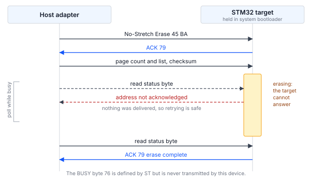

## 1 简介

每一款 STM32 微控制器的 ROM 中都固化了系统引导加载程序，它提供了一种通过串行接口对内部闪存进行编程的方法，
既不需要调试探针，也不需要器件上存在任何用户代码。引导加载程序提供的接口因器件而异，
AN2606 按器件型号逐一列出。

大多数 STM32 系列都在该列表中包含 I2C，这使其成为覆盖面最广的在系统编程方式。
如果电路板上已经布有用于连接传感器、EEPROM 或电源管理器件的 I2C 总线，
那么同样的两根线就可以承载固件更新，无需专用的编程接口。对于已经批量生产的产品，
无论设计时是否考虑过编程用途，板上通常都会在某处存在 I2C 总线。

本笔记是 AN0001 的 I2C 对应版本，AN0001 介绍的是 STM32H5 系列上的 I3C 接口。
两者的命令集几乎相同。不同之处在于目标器件如何报告状态，以及如何表明自己处于忙碌状态；
对主机代码的影响而言，这些差异比命令列表更大。

### 1.1 范围

本文档介绍：

- I2C 系统引导加载程序协议的结构，包括用于报告命令状态的机制，以及用于表明目标器件
  处于忙碌状态的机制
- Binho Pulsar 与 STM32 目标器件之间所需的连接
- 识别、擦除、编程和校验器件的步骤
- 一种在编程工具之外确认目标器件正在运行新编程映像的方法
- 随附的参考工具，它可以驱动 Pulsar 或 Supernova

本文档不涉及通过 UART、USB、SPI、CAN 或 I3C 进行编程；选项字节编程；
读保护（被测器件的 ROM 引导加载程序不通过该接口提供此功能）；以及量产编程夹具。
关于 STM32H5 系列上的 I3C，请参阅 AN0001。

### 1.2 适用器件

I2C 系统引导加载程序并非某一个系列所特有。它使用的引脚和响应的地址因器件而异，
对于每一款提供该接口的器件，AN2606 都给出了这两项信息。两者都无法凭猜测得出，
在不同系列之间也不一致。

Table: 适用器件

| 系列 | 示例器件 | 引导加载程序 I2C 接口 | 依据 |
|---|---|---|---|
| STM32H5 | STM32H503 | I2C2，`PB3`/`PB4`，地址 `0x67` | 已为本文档测试 |
| STM32H5 | STM32H563 | 见 AN2606 | AN2606，未测试 |
| STM32G0, G4 | 无 | 见 AN2606 | AN2606，未测试 |
| STM32L4, L5 | 无 | 见 AN2606 | AN2606，未测试 |
| STM32U5 | 无 | 见 AN2606 | AN2606，未测试 |

只有 STM32H503 这一行在硬件上进行了验证。其他各行仅记录了 AN2606 为这些系列列出了
I2C 接口；在发出本文档中的任何命令之前，必须从 AN2606 中查明手头器件的引脚、地址和所支持的命令列表。

### 1.3 相关文档

Table: 相关文档

| 文档 | 标题 |
|---|---|
| AN2606 | STM32 microcontroller system memory boot mode |
| AN4221 | I2C protocol used in the STM32 bootloader |
| RM0492 | STM32H503 reference manual |
| AN0001 | Programming STM32 microcontrollers over I3C with the Binho Supernova |

## 2 系统概述

### 2.1 总线上的角色

主机适配器是 I2C 控制器。处于系统引导加载程序模式的目标器件是一个 I2C 目标器件，
其固定地址由 AN2606 给出。在 STM32H503 上该地址为 `0x67`，
AN2606 中表示为 `0b1100111x`，其中 `x` 为读/写位。

该地址固化在 ROM 中，无法更改，这带来一个值得提前规划的后果：
同一型号的两片 STM32 无法同时在同一条总线上处于引导加载程序模式。
这是与 AN0001 的 I3C 接口在实际使用上的区别；在 I3C 中，动态地址分配（DAA）会在运行时为每个目标器件
分配不同的地址，因此多个目标器件可以共享一条总线。

### 2.2 状态报告

每条命令都是一次写操作，随后是一次单字节读操作。目标器件以 `0x79` 表示 ACK，
以 `0x1F` 表示 NACK。这是大多数读者所预期的请求与响应形式，
也是 I2C 接口比 I3C 接口更易于驱动的主要原因；在 I3C 接口中，状态以带内中断（IBI）的形式异步到达。

Table: 引导加载程序返回的状态值

| 值 | 含义 | 是否观察到 |
|---|---|---|
| `0x79` | ACK，命令被接受 | 是 |
| `0x1F` | NACK，命令被拒绝 | 是 |
| `0x76` | BUSY | 否，从未发送 |

ST 定义了一个 BUSY 字节 `0x76`。在被测器件上，它从未被发送。观察到的每一次拒绝都以
`0x1F` 返回，而处于忙碌状态的目标器件根本不会以状态字节应答。
编写为等待 `0x76` 的主机代码将永远等待下去。

### 2.3 目标器件如何表明忙碌

这是唯一一个决定主机代码结构的机制，值得在编写任何代码之前先理解它。

擦除或编程所需的时间远远长于一次总线事务。引导加载程序提供两种方式来弥补这段时间差，
选择哪一种由主机决定：

- **普通命令**会将 SCL 保持为低电平（即常规的 I2C 时钟延展），直到操作完成。
- **无延展命令**是一组独立的操作码，不进行时钟延展。处于忙碌状态的目标器件转而
  **停止应答自己的地址**，主机通过重试事务进行轮询，直到地址再次得到应答。

地址被 NACK 意味着没有任何数据被送达，因此重试始终是安全的。

工具使用哪一组命令取决于适配器。Pulsar 在其专用 I2C 端口上能够容忍时钟延展，
因此使用普通命令，无需其他处理。Supernova 从其 I3C 端口驱动总线时无法容忍时钟延展，
因此工具在该路径上会自动切换为无延展变体；原因见第 5.7 节。`--no-stretch`
可在任何适配器上强制使用无延展变体。



### 2.4 主机适配器选项

本文档涵盖两种配置，两者均已在硬件上验证。

Table: 涵盖的主机适配器配置

| 适配器 | 端口 | 状态 |
|---|---|---|
| Binho Pulsar | 专用 I2C 端口 | 已验证，所有测量均使用此配置 |
| Binho Supernova | I3C 端口，以 I2C 模式驱动 | 功能已验证 |

Supernova 从其 I3C 端口驱动传统 I2C 目标器件，该端口提供总线上拉电阻。
工具通过 `--i2c-port i3c` 选择此方式。从 Supernova 的专用 I2C 端口进行编程
不在本修订版的范围之内。

## 3 硬件设置

### 3.1 所需设备

Table: 所需设备

| 项目 | 本文所用 |
|---|---|
| 主机适配器 | Binho Pulsar，固件 4.4.0 |
| 目标板 | NUCLEO-H503RB |
| 接线 | 五根线：三根用于总线，两根用于复位控制 |
| 主机 | Python 3.12 |

在全文中都可以用 Binho Supernova 代替 Pulsar，连接上的差异见第 3.3 节。

### 3.2 连接

Table: Pulsar 与目标器件之间的连接

| Pulsar | 目标器件 | 是否必需 |
|---|---|---|
| SCL | `PB3` | 是 |
| SDA | `PB4` | 是 |
| GND | GND | 是 |
| GPIO 1 | `NRST` | 可选，用于自动进入引导加载程序 |
| GPIO 2 | `BOOT0` | 可选，用于自动进入引导加载程序 |

`PB3` 和 `PB4` 是 AN2606 为该器件的引导加载程序 I2C 接口指定的引脚。
它们并不是读者容易猜到的引脚：在许多 STM32 开发板上，用户手册中标为 I2C 的引脚
属于另一个外设实例，而 `PB3` 和 `PB4` 在复位默认状态下承载的是
`JTDO`/`TRACESWO` 和 `NJTRST`。请以 AN2606 中手头器件的信息为准进行确认，
而不要依据电路板丝印。

如果没有这两根 GPIO 线，工具会提示用户手动进入引导加载程序。
有了这两根线，整个流程即可无人值守地运行，第 6 节中的步骤即以此为前提。

### 3.3 改用 Supernova 连接

将 SCL、SDA 和 GND 连接到 Supernova 的 **I3C 端口**，并在每条命令中添加
`--i2c-port i3c`。GPIO 连接不变，第 6 节的步骤可按原文执行。

在选择此路径之前，有两点差异值得了解。

I3C 控制器提供的是一组固定的传统 I2C 速率，而非任意时钟，因此
`--i2c-speed` 会对齐到其中最接近的速率。工具会报告实际设置的速率，
并在其与所请求的速率不同时予以说明。

在本文所述配置下，会话在 100 kHz 时可以可靠地建立，而在 400 kHz 或 1 MHz 时完全无法建立，
此时目标器件要么停止应答其地址，要么拒绝第一条命令。第 9 节的测量是使用 Pulsar
在其专用 I2C 端口上进行的，三种速率在该端口上均可正常工作，不应假定这些结果同样适用于此路径。
如果总线速度很重要，请使用专用端口。

### 3.4 总线注意事项

总线必须有上拉电阻。Pulsar 的专用 I2C 端口和 Supernova 的 I3C 端口
都自带上拉电阻，可通过软件选择；工具默认请求 1 kΩ，可通过
`--pullup` 更改。没有上拉电阻的总线无法达到空闲高电平状态，
此类总线上的控制器会报告无法产生起始条件，而不是报告目标器件缺失。

> **注意。** 连接之前，请将总线电压设置为与目标器件匹配。工具设置为
> 3.3 V，适用于 NUCLEO-H503RB。向以较低电源电压运行的目标器件施加 3.3 V
> 可能会损坏该器件。

另有一项注意事项仅适用于 Supernova 从其 I3C 端口驱动总线的情况。
由于 I3C 目标器件从不延展时钟，I3C 控制器没有义务容忍保持 SCL 的目标器件，
它可能会中止传输而不是等待。参考工具会自动处理这种情况；机制见第 5.7 节，
用户无需采取任何操作。

## 4 软件设置

### 4.1 安装主机软件包

工具通过适配器的厂商软件包与适配器通信。请安装与所用适配器对应的软件包：

```
pip install binhopulsar        # for a Pulsar
pip install binhosupernova     # for a Supernova
```

本文档所用版本：`binhopulsar` 1.2.0、`binhosupernova` 4.2.0、Python 3.12。
不需要其他软件包；工具自行解析 Intel HEX。

### 4.2 获取参考工具

`stm32_flash.py` 包含在本文档随附的资源压缩包中：

```
https://cdn.binho.io/application-notes/AN0002/AN0002-assets.zip
```

相同的文件以及本文档的 Markdown 源文件也发布在
`https://github.com/binhollc/application-notes`。第 12 节列出了压缩包的内容。

压缩包解压后得到一个 `assets` 目录，其中包含该工具，以及一个 `firmware`
子目录，其中包含第 7 节的验证映像。本文档中的每条命令都按照在该 `assets` 目录内运行的方式给出。

该工具是单个文件，除标准库和一个适配器软件包外不导入任何其他内容，
因此可以复制到任何位置直接运行。它会检测所连接的适配器，
但两种适配器都提供不止一条总线，因此需要用 `--bus i2c` 指明所用的总线。

## 5 引导加载程序协议

### 5.1 进入系统引导加载程序模式

在 `BOOT0` 保持高电平的同时，将 `NRST` 拉低一个脉冲后释放。器件将从系统存储器
而不是应用程序启动。

释放 `NRST` 的方式是将主机引脚切换为输入，而不是将其驱动为高电平，
以免与板载复位电路冲突。工具即按此方式操作。

要返回应用程序，将 `BOOT0` 驱动为低电平，并再次对 `NRST` 施加脉冲。如果这些引脚
未连接，Go 命令会在不复位的情况下跳转到已编程的映像。

### 5.2 会话开始

没有会话开始步骤。I3C 接口需要一个同步字节来打开会话，而 I2C 接口则不同，
它从第一条命令开始。在此之前不发送任何内容。

### 5.3 命令帧格式

每条命令都是一次两字节写操作（操作码及其补码），随后是一次单字节的状态读操作：

```
write 0x67  [op, op ^ 0xFF]
read  0x67  1 byte              -> 0x79 ACK, or 0x1F NACK
```

带地址的命令以大端序发送四个字节，随后发送这四个字节的单字节 XOR 校验和，
并在发送其有效载荷之前再接收一次 ACK。

### 5.4 读取 Get 响应

Get 返回一个 `2 + N` 字节的帧：一个计数、一个协议版本，然后是 `N` 个操作码。
主机无法预先知道 `N`，而读取超出帧末尾的数据会导致总线超时。

工具会发出两次 Get。第一次读取两个字节以获知 `N`；第二次重新发出
Get 并读取整个帧。少读是无害的，因为目标器件会放弃帧的剩余部分，
继续发送其结束 ACK。多读则不然。

### 5.5 支持的命令

Table: STM32H503 通过 I2C 支持的命令

| 操作码 | 命令 |
|---|---|
| `0x00` | Get |
| `0x01` | Get Version |
| `0x02` | Get ID |
| `0x11` | Read Memory |
| `0x21` | Go |
| `0x31` | Write Memory |
| `0x44` | Extended Erase |
| `0x50` | Special Command |
| `0x63` | Write Protect |
| `0x73` | Write Unprotect |
| `0x32` | No-Stretch Write Memory |
| `0x45` | No-Stretch Erase |
| `0x64` | No-Stretch Write Protect |
| `0x74` | No-Stretch Write Unprotect |
| `0xA1` | Checksum |

共十五条命令，比同一器件通过 I3C 提供的命令多五条。请注意缺少的命令：
Readout Protect（`0x82`）和 Readout Unprotect（`0x92`）。ST 的 Open Bootloader 参考
实现包含这两条命令，但该器件的 ROM 引导加载程序并不通过 I2C 提供它们，
而 ROM 才是权威。参考实现和 ROM 是不同的程序，两者不一致时，以器件为准。

### 5.6 擦除

Extended Erase 接受一个页数，后跟一个页号列表，或者接受一个特殊值。

Table: Extended Erase 特殊值，以及 STM32H503 是否接受

| 值 | 含义 | Pulsar，专用 I2C 端口 | Supernova，经由其 I3C 端口 |
|---|---|---|---|
| `0xFFFF` | 全片擦除 | 接受，0.05 s | 拒绝 |
| `0xFFFE` | Bank 1 擦除 | 接受 | 接受，在 0.02 s 内清除全部 128 KB |
| `0xFFFD` | Bank 2 擦除 | 接受 | 拒绝 |

这两列之间的差异正是关键所在。在两种情况下，引导加载程序都是同一个程序，
操作的也是同一块闪存；唯一改变的是控制器。Pulsar 在其专用 I2C 端口上可以使用引导加载程序
提供的全部功能，而同样的命令从 Supernova 的 I3C 端口以传统模式发送时却被拒绝。

这是本文档第二次不得不做出这种区分，其根本原因与第 5.7 节相同：
驱动传统总线的 I3C 控制器并不能直接替代 I2C 控制器，而两者的差异表现为
目标器件似乎拒绝了它从另一台主机那里完全可以接受的操作。

当全片擦除被拒绝时，在单 bank 器件上，Bank 1 擦除值可以覆盖相同的范围。
参考工具会先尝试全片擦除，失败后回退，并报告已执行回退。在多 bank 器件上，
该回退只会清除第一个 bank，这就是工具如实说明其所做操作、而不报告一次并未执行的全片擦除的原因。

对于页列表，计数字段是**页数减一**，而不是页数本身。擦除单个第 0 页时，
计数发送 `00 00`，页号发送 `00 00`。如果直接发送页数，将会比预期多擦除一页。

该器件上的两种接口在这一点上并不一致：I3C 接口接受页数本身，而
I2C 接受页数减一。两种编码均通过以下方式确定：向两个相邻页写入不同的数据模式，
仅擦除第一页，然后确认哪些页被擦除。I3C 的情况见 AN0001。

一条命令可以携带多少页，同样取决于控制器。Pulsar 在其专用 I2C 端口上
发送的四页列表被接受；Supernova 从其 I3C 端口驱动总线时，超过**两页**的列表会被拒绝，
而一页或两页的列表会被接受，并且恰好清除所指定的页。在 AN4221 或 AN2606 中
均未找到关于此限制的说明；该限制是通过逐次尝试不同长度并逐页确认覆盖范围而确定的。

因此，参考工具仅在所用控制器需要时才拆分页列表，这样从 Supernova 的 I3C 端口进行 128 KB 擦除
会变为八条命令，耗时约 0.19 s，而从 Pulsar 发送时仍为一条命令。
在受限路径上发送一个长列表的主机会遭到拒绝，而且该故障看起来像是请求格式错误，
而不是请求过大。

STM32H503 上的一个闪存页为 8 KB。工具的 `--page-size` 选项为
`--erase pages` 设置该值。

### 5.7 时钟延展，以及工具为何等待

在一条命令之后，在开始稳定地 NACK 其地址之前，目标器件会短暂地将 SCL 保持为低电平。
常规的 I2C 控制器可以安然度过这段时间，Pulsar 在其专用 I2C 端口上无需任何额外处理。

处于传统 I2C 模式的 I3C 控制器则没有这样的义务。I3C 目标器件从不延展时钟，
因此 I3C 外设可能会强制执行总线超时并中止传输，而不是等待。在
Supernova 从其 I3C 端口驱动总线时，这表现为擦除页列表写操作之后的状态读操作出现总线超时，
大约四分之一的尝试会出现这种情况。对每一次传输记录其与上一次传输的时间间隔后发现，
失败的读操作总是那个完全没有间隔就发出的读操作，由此确定原因在于时钟延展窗口，
而不在于总线。

解决办法并不是延长超时时间。在状态读操作之前等待约 2 ms，即可完全跳过
时钟延展窗口，使目标器件呈现一个干净的 NACK，而常规的忙碌轮询已经能够处理这种情况。
加入这段稳定等待后，超时根本不会出现。

Table: 稳定等待对 Supernova 从其 I3C 端口驱动 I2C 的影响

| 策略 | 完成的周期 | 被吸收的超时 |
|---|---|---|
| 无稳定等待 | 12 次中 9 次 | 不适用 |
| 状态读操作前 2 ms 稳定等待 | 12 次中 12 次 | 0 |
| 2 ms 稳定等待加超时重试 | 12 次中 12 次 | 0 |

第三行证明稳定等待解决的是根本原因，而不是掩盖问题：
加入稳定等待后，重试从未触发。工具会自动应用稳定等待，并且仅在该路径上应用，
因此没有选项控制它。

## 6 编程步骤

### 6.1 识别目标器件

`info` 命令会将目标器件复位进入引导加载程序，初始化总线，并报告响应的内容：

```
python stm32_flash.py --bus i2c info

  Adapter: pulsar  fw 4.4.0
  Bus: I2C
  Resetting target into bootloader (NRST=GPIO1, BOOT0=GPIO2)
  I2C: 100 kHz, target 0x67
  Bootloader session established

  Protocol version : 2.0
  Device ID        : 0x474  (STM32H503)
  Commands         : 15
      0x00  Get
      ...
      0xA1  Checksum
```

这两行之间会完整列出十五条支持的命令，即表 7 中给出的命令。适配器的序列号
打印在第一行，此处已省略。

这是在任何新电路板上推荐的第一步，因为它可以在尝试任何破坏性操作之前确认接线、
总线配置以及进入引导加载程序是否正常。

### 6.2 读取现有内容

擦除之前应先备份闪存内容。以下命令读取 STM32H503RB 的全部 128 KB
闪存：

```
python stm32_flash.py --bus i2c read backup.bin --address 0x08000000 --length 0x20000
```

### 6.3 编程映像

`flash` 命令执行完整的流程：擦除、编程、回读并比较，然后复位进入应用程序。
此处使用第 7 节的验证映像，以便命令可以完全按照所示方式运行。

原始二进制文件需要显式指定基地址：

```
python stm32_flash.py --bus i2c flash firmware/an0002_image_a.bin --address 0x08000000
```

Intel HEX 文件自带地址，因此可以省略该选项。在 `firmware` 目录中运行 `make hex`
即可生成一个：

```
python stm32_flash.py --bus i2c flash firmware/build/an0002_image_a.hex
```

默认情况下会对整个器件进行全片擦除。`--erase pages` 仅擦除映像所覆盖的页，
对于较小的映像速度更快：

```
python stm32_flash.py --bus i2c flash firmware/an0002_image_a.bin --address 0x08000000 --erase pages
```

如果要改为从 Supernova 的 I3C 端口驱动，请添加 `--i2c-port i3c`。会话选项可以
放在子命令之前或之后：

```
python stm32_flash.py --bus i2c --i2c-port i3c flash firmware/an0002_image_a.bin --address 0x08000000
python stm32_flash.py --bus i2c flash firmware/an0002_image_a.bin --address 0x08000000 --i2c-port i3c
```

### 6.4 校验

默认执行校验。通过同一接口回读已编程的范围，并与源映像逐字节比较。
如果编程时间至关重要且映像通过其他方式校验，可使用 `--no-verify` 禁用校验。

### 6.5 使器件返回应用程序

如果连接了 GPIO 1 和 GPIO 2，工具会在编程后将 `BOOT0` 驱动为低电平并对 `NRST` 施加脉冲，
使器件启动新编程的应用程序。如果这些引脚未连接，则改为发出 Go 命令。
`--no-run` 会使器件停留在引导加载程序中。

## 7 在目标器件上确认更新

`flash` 命令会回读已编程的范围并逐字节比较，这证明闪存内容与所提供的映像一致。
但它并不能证明器件正在执行新固件：停留在引导加载程序中的目标器件，
或复位从未被释放的目标器件，都能通过该检查，却仍然没有运行应用程序。

本文档随附两个小型固件映像来弥补这一缺口。除了所报告的字母以及用户 LED 的闪烁频率之外，
两者完全相同，因此可以在编程工具之外看到变化。

### 7.1 验证映像

Table: 本文档随附的验证映像

| 映像 | 文件 | 报告内容 | LED |
|---|---|---|---|
| A | `firmware/an0002_image_a.bin` | `IMAGE A` | 1 Hz |
| B | `firmware/an0002_image_b.bin` | `IMAGE B` | 5 Hz |

这两个映像分别为 864 和 860 字节，链接为从 `0x08000000` 运行。随映像一同提供了源代码、
链接脚本和 makefile，因此可以检查和重新构建映像，而无需盲目信任。

两个映像都不使用 `PB3` 或 `PB4`，因此可以在不干扰编程连接的情况下加载和观察。

### 7.2 步骤

在 ST-LINK 虚拟 COM 端口上以 115200 8N1 打开串口终端，然后编程映像 A：

```
python stm32_flash.py --bus i2c flash firmware/an0002_image_a.bin --address 0x08000000
```

工具会在执行过程中报告每个阶段。以下输出有所删节；第 6.1 节中的适配器和会话
信息行会首先出现，具体时间在每次运行之间会有所不同：

```
  ...
  Erasing 1 page
    done in 0.02 s

  Writing
    segment at 0x08000000
    wrote 864 bytes in 0.11 s (7.7 KiB/s)

  Verifying
    all 864 bytes match (0.12 s)

  Resetting into application

  Success.
```

终端会显示横幅，然后每秒显示一行心跳信息：

```
========================================
  Binho  |  AN0002
  Programming STM32 microcontrollers
  over I2C with the Binho Pulsar
========================================
  Running: IMAGE A
  Kernel clock: 32 MHz
  LED blink: 1 Hz
========================================
  IMAGE A  alive, 1 s
  IMAGE A  alive, 2 s
```

编程映像 B 后，所报告的字母会改变，LED 的闪烁速度也会快五倍。心跳信息很重要：
仅在复位时打印的横幅，如果在之后才打开终端就会错过，而这些映像的目的就是让人一眼看出正在运行的是哪一个。

从 `IMAGE A` 到 `IMAGE B` 的转变就是端到端的结果：映像已通过 I2C 擦除、
编程和校验，并且器件正在运行所编程的内容。

> **重要：** 编程这些映像会擦除器件上现有的应用程序。
请先按照第 6.2 节所述备份现有内容。

> **注：** 所提供的二进制文件是为 NUCLEO-H503RB 构建的。它们将 `PA4` 驱动为
USART3_TX，将 `PA5` 驱动为用户 LED，这与该开发板的接线方式一致。在其他任何电路板上，
串口输出都不会出现，因为引脚以及到虚拟 COM 端口的路由不同。这些映像很小且提供了源代码，
因此可以通过修改 `firmware/main.c` 顶部的引脚和外设定义并重新构建来移植它们。

## 8 参考工具

### 8.1 命令

Table: 工具命令

| 命令 | 操作 |
|---|---|
| `list` | 列出已连接的 Binho 适配器 |
| `info` | 识别目标器件并报告其功能 |
| `flash` | 擦除、编程、校验并运行映像 |
| `read` | 将存储器内容读入文件 |
| `erase` | 全片擦除用户闪存 |
| `reset` | 通过 GPIO 复位目标器件 |

### 8.2 选项

会话选项描述适配器、总线以及进入引导加载程序的方式。它们可以放在子命令之前或之后。
工具还接受多组 I3C 和 SPI 选项，这些选项对 I2C 总线没有作用；它们在 AN0001 和 AN0003 中列出。

Table: 会话选项

| 选项 | 默认值 | 含义 |
|---|---|---|
| `--adapter` | auto | 强制使用 `pulsar` 或 `supernova` |
| `--bus` | auto | 强制使用 `i2c` 或 `i3c` |
| `--serial` | auto | 按序列号选择适配器 |
| `--i2c-address` | `0x67` | 引导加载程序地址，见 AN2606 |
| `--i2c-speed` | 100000 | 总线时钟，单位 Hz |
| `--i2c-bus` | `A` | Pulsar 上使用哪条 I2C 总线 |
| `--i2c-port` | `dedicated` | Supernova 上由哪个连接器承载 I2C |
| `--pullup` | 1000 | 总线上拉电阻值，单位 ohms |
| `--nrst-pin` | 1 | 驱动 `NRST` 的 GPIO |
| `--boot0-pin` | 2 | 驱动 `BOOT0` 的 GPIO |
| `--manual` | off | 提示手动进入引导加载程序，而不使用 GPIO |
| `--reset-hold` | 0.05 | `NRST` 保持低电平的秒数 |
| `--boot-delay` | 0.25 | 留给引导加载程序启动的秒数 |
| `--no-stretch` | off | 强制使用无延展命令变体。见第 2.3 节 |
| `-v`, `-q` | off | 记录每一次传输，或者抑制进度输出 |

Table: 各命令选项

| 选项 | 适用于 | 含义 |
|---|---|---|
| `--address` | `flash`, `read` | 原始二进制文件的基地址 |
| `--length` | `read` | 要读取的字节数 |
| `--erase` | `flash` | `mass`、`pages` 或 `none`。如果全片擦除被拒绝，`mass` 会回退为 Bank 1 擦除并予以说明 |
| `--page-size` | `flash` | `--erase pages` 使用的闪存页大小，默认 8192 |
| `--erase-timeout` | `flash`, `erase` | 允许擦除所用的秒数 |
| `--chunk-size` | `flash`, `read` | 每次传输的字节数。默认 256，这是引导加载程序可接受的最大值 |
| `--no-verify` | `flash` | 跳过回读比较 |
| `--no-run` | `flash` | 使器件停留在引导加载程序中 |
| `--run` | `info`, `read`, `erase` | 完成后复位进入应用程序 |
| `--bootloader` | `reset` | 复位进入引导加载程序而不是应用程序 |

## 9 实测结果

### 9.1 测试配置

Table: 测试配置

| 项目 | 值 |
|---|---|
| 目标器件 | STM32H503RB，NUCLEO-H503RB |
| 适配器 | Binho Pulsar，硬件版本 C，固件 4.4.0 |
| 主机软件包 | `binhopulsar` 1.2.0 |
| Python | 3.12 |
| 总线电压 | 3.3 V |
| 上拉电阻 | 1 kΩ |

### 9.2 读取吞吐量

在三种总线速度下对 128 KiB 的读取进行了计时。会话建立（包括枚举、复位进入引导加载程序
以及初始握手）耗时 0.81 s，且不随总线速度变化；
该时间单独列出，以便传输数据仅反映总线本身。

Table: 128 KiB 读取实测结果

| 总线速度 | 读取阶段 | 吞吐量 |
|---|---|---|
| 100 kHz | 17.47 s | 7.3 KiB/s |
| 400 kHz | 7.59 s | 16.9 KiB/s |
| 1 MHz | 5.44 s | 23.5 KiB/s |

三次读取返回的数据逐字节一致。

### 9.3 可靠性

Table: 完成的擦除、编程、校验和运行周期

| 配置 | 完成的周期 |
|---|---|
| Pulsar，专用 I2C 端口，100 kHz | 29 次中 29 次 |
| Supernova，I3C 端口以 I2C 模式工作，100 kHz | 12 次中 12 次 |

各周期在映像 A 和映像 B 之间交替，因此每个周期擦除、编程和校验的内容都与上一个周期不同。
Supernova 的数据是在应用第 5.7 节的稳定等待后得到的；未应用时，12 次中完成 9 次。

这些数据描述的是一个目标器件和一台主机在几十个周期内的表现。它们证明该步骤是可重复的，
但并不是可靠性规格。

## 10 故障排除

Table: 故障排除

| 现象 | 可能原因及处理措施 |
|---|---|
| 控制器报告无法产生起始条件 | 总线没有上拉电阻，或者 SDA 或 SCL 被保持为低电平。检查所用端口是否提供上拉电阻，以及接线是否连接到正确的引脚。 |
| 引导加载程序地址无响应 | 地址错误或引脚错误。根据 AN2606 中该器件的信息确认两者；它们因器件而异。 |
| 目标器件仅在引导加载程序模式下应答 | 属于预期行为。只有当器件保持在系统存储器启动模式时，该地址才存在。 |
| 擦除后的状态读操作出现总线超时 | 控制器无法容忍目标器件保持 SCL。请使用 Pulsar 的专用 I2C 端口，或者使用带 `--i2c-port i3c` 的 Supernova，工具会在该路径上应用第 5.7 节的稳定等待。 |
| 擦除比预期多删除了一页 | 计数字段携带的是页数减一。见第 5.6 节。 |
| 编程看似成功后校验失败 | 擦除未覆盖整个编程范围。将 `--page-size` 增大到该器件的实际页大小，或者在编程前显式擦除。 |
| 全片擦除被拒绝 | 在从 Supernova 的 I3C 端口驱动 I2C 时出现，从 Pulsar 的专用端口驱动时不会出现。Bank 1 擦除可以覆盖相同的范围；工具会自动回退。见第 5.6 节。 |
| 指定多个页的擦除被拒绝 | 同一路径：在该路径上，一条命令中超过两页会被拒绝，而从专用 I2C 端口发送则会被接受。工具会在需要时拆分列表。见第 5.6 节。 |
| 读取能返回数据，但器件不运行 | 器件停留在引导加载程序中。检查 `BOOT0` 是否恢复为低电平以及 `NRST` 是否已释放，或者去掉 `--no-run`。 |
| 验证映像的串口输出出现乱码 | 终端波特率不匹配。这些映像使用 115200 8N1。 |

## 11 缩略语

Table: 缩略语

| 术语 | 含义 |
|---|---|
| ACK | 应答（Acknowledge） |
| HSI | 高速内部振荡器（High-speed internal oscillator） |
| I2C | Inter-Integrated Circuit |
| I3C | Improved Inter-Integrated Circuit |
| NACK | 非应答（Not acknowledged） |
| ROM | 只读存储器（Read-only memory） |
| SCL | 串行时钟线（Serial clock line） |
| SDA | 串行数据线（Serial data line） |
| VCP | 虚拟 COM 端口（Virtual COM port） |

## 12 关于本文档中源代码的说明

本文档中展示的以及随附压缩包中提供的示例代码仅供评估和参考。
这些代码根据 MIT 许可证发布，许可证文本包含在压缩包中。

压缩包 `AN0002-assets.zip` 发布在
`https://cdn.binho.io/application-notes/AN0002/AN0002-assets.zip`，包含以下内容。

Table: 资源压缩包的内容

| 路径 | 说明 |
|---|---|
| `AN0002.md` | 本文档的 Markdown 版本 |
| `assets/stm32_flash.py` | 参考工具，支持 I2C、I3C 和 SPI，以及 Pulsar 和 Supernova |
| `assets/PROTOCOL.md` | I2C 引导加载程序协议的线路级说明 |
| `assets/test_hex_parser.py` | Intel HEX 解析器的测试 |
| `assets/LICENSE` | MIT 许可证 |
| `assets/firmware/main.c` | 两个验证映像的源代码 |
| `assets/firmware/link.ld` | 链接脚本 |
| `assets/firmware/Makefile` | 构建两个映像 |
| `assets/firmware/README.md` | 验证映像的说明 |
| `assets/firmware/an0002_image_a.bin` | 预构建的映像 A |
| `assets/firmware/an0002_image_b.bin` | 预构建的映像 B |

## 13 修订历史

Table: 修订历史

| 修订版 | 日期 | 说明 |
|---|---|---|
| 1.0 | 29 August 2026 | 初始版本。 |
| 1.1 | 3 September 2026 | 四个表格单元格原先使用破折号表示不存在的值，现改为文字表述：未列出示例器件的系列写为“无”（`none`），无法吸收超时的那一行写为“不适用”（`not applicable`）。所有实测结果均未改变。 |
