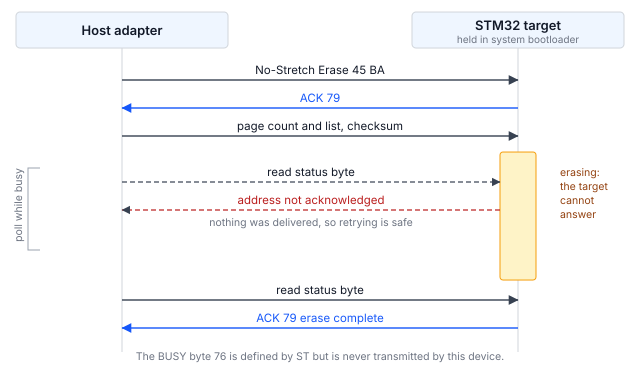

## 1 簡介

每顆 STM32 微控制器的 ROM 中都內建系統開機載入程式，它提供了一種透過序列介面燒錄內部
快閃記憶體的方式，不需要除錯器，裝置上也不需要存在任何使用者程式碼。開機載入程式所提供
的介面因裝置而異，AN2606 依料號逐一列出。

大多數 STM32 系列都在該清單中列有 I2C，使其成為涵蓋範圍最廣的線上燒錄選項。若電路板
已經佈有連接感測器、EEPROM 或電源管理元件的 I2C 匯流排，同樣這兩條線即可用來傳送韌體
更新，不需要專用的燒錄接頭。對於已經大量生產的產品，無論當初是否為燒錄而規劃，電路板上
通常都存在某條 I2C 匯流排。

本文件是 AN0001 的 I2C 對應版本，AN0001 涵蓋 STM32H5 系列的 I3C 介面。兩者的命令集
幾乎相同。差異在於目標裝置回報狀態的方式，以及表示自己忙碌中的方式；這些差異對主機端程式
碼的影響，比命令清單本身更大。

### 1.1 範圍

本文件說明：

- I2C 系統開機載入程式協定的結構，包括用於回報命令狀態的機制，以及用於表示目標裝置忙碌
  的機制
- Binho Pulsar 與 STM32 目標裝置之間所需的連接
- 識別、抹除、燒錄與驗證裝置的程序
- 一種從燒錄工具外部確認目標裝置正在執行新燒錄映像檔的方法
- 隨附的參考工具程式，可驅動 Pulsar 或 Supernova

本文件不涵蓋透過 UART、USB、SPI、CAN 或 I3C 的燒錄；選項位元組（option byte）燒錄；
讀出保護（readout protection），受測料號的 ROM 開機載入程式並未透過此介面提供此功能；
也不涵蓋量產燒錄治具。關於 STM32H5 系列的 I3C，請參閱 AN0001。

### 1.2 適用裝置

I2C 系統開機載入程式並非某一系列所專有。它使用的接腳與回應的位址因料號而異，AN2606 針對
每個提供此介面的裝置都列出了這兩項資訊。兩者都無法猜測，在各系列之間也不一致。

Table: 適用裝置

| 系列 | 範例料號 | 開機載入程式 I2C 介面 | 依據 |
|---|---|---|---|
| STM32H5 | STM32H503 | I2C2，`PB3`/`PB4`，位址 `0x67` | 已針對本文件測試 |
| STM32H5 | STM32H563 | 依 AN2606 | AN2606，未測試 |
| STM32G0, G4 | 無 | 依 AN2606 | AN2606，未測試 |
| STM32L4, L5 | 無 | 依 AN2606 | AN2606，未測試 |
| STM32U5 | 無 | 依 AN2606 | AN2606，未測試 |

只有 STM32H503 這一列在硬體上實際驗證過。其他各列僅記錄 AN2606 為這些系列列出了 I2C
介面；在發出本文件中的任何命令之前，必須先從 AN2606 查明手邊料號的接腳、位址與所支援的
命令清單。

### 1.3 相關文件

Table: 相關文件

| 文件 | 標題 |
|---|---|
| AN2606 | STM32 microcontroller system memory boot mode |
| AN4221 | I2C protocol used in the STM32 bootloader |
| RM0492 | STM32H503 reference manual |
| AN0001 | 使用 Binho Supernova 透過 I3C 燒錄 STM32 微控制器 |

## 2 系統概觀

### 2.1 匯流排上的角色

主機轉接器是 I2C 控制器。處於系統開機載入程式模式的目標裝置，是位於 AN2606 所指定固定
位址的 I2C 目標裝置。在 STM32H503 上該位址為 `0x67`，AN2606 中記為 `0b1100111x`，
其中 `x` 是讀／寫位元。

該位址固定在 ROM 中且無法變更，這帶來一個值得事先規劃的後果：兩顆相同料號的 STM32 無法
同時在同一條匯流排上處於開機載入程式模式。這是與 AN0001 的 I3C 介面在實務上的差異；在
I3C 中，動態位址分配（DAA）會在執行時為每個目標裝置指定不同的位址，因此多個目標裝置可以
共用一條匯流排。

### 2.2 狀態回報

每個命令都是一次寫入，後接一次單位元組讀取。目標裝置以 `0x79` 表示 ACK，或以 `0x1F`
表示 NACK。這是多數讀者預期的請求與回應形式，也是 I2C 介面比 I3C 介面更容易驅動的主要
原因；在 I3C 介面中，狀態是以帶內中斷（IBI）的形式非同步送達。

Table: 開機載入程式回傳的狀態值

| 值 | 意義 | 是否觀察到 |
|---|---|---|
| `0x79` | ACK，命令已接受 | 是 |
| `0x1F` | NACK，命令遭拒絕 | 是 |
| `0x76` | BUSY | 否，從未傳送 |

ST 定義了一個 BUSY 位元組 `0x76`。在受測料號上，它從未被傳送。觀察到的每一次拒絕都以
`0x1F` 回傳，而忙碌中的目標裝置根本不會回應狀態位元組。為等待 `0x76` 而撰寫的主機程式
碼將永遠等待下去。

### 2.3 目標裝置如何表示忙碌

這是唯一會影響主機端程式碼形態的機制，值得在撰寫任何程式碼之前先理解。

抹除或燒錄所需的時間遠比一次匯流排交易長得多。開機載入程式提供兩種方式來填補這段空檔，
使用哪一種由主機決定：

- **一般命令**會將 SCL 拉低，也就是一般的 I2C 時脈延展（clock stretching），直到操作
  完成為止。
- **No-stretch 命令**是另一組獨立的操作碼，不會進行時脈延展。忙碌中的目標裝置改為
  **停止回應自己位址的 ACK**，主機則透過重試交易來輪詢，直到位址再度獲得 ACK 為止。

位址遭 NACK 表示沒有任何資料被送達，因此重試永遠是安全的。

工具程式使用哪一組命令取決於轉接器。使用專用 I2C 連接埠的 Pulsar 可容忍時脈延展，因此
使用一般命令，不需要其他處理。從 I3C 連接埠驅動匯流排的 Supernova 無法容忍時脈延展，
因此工具程式在該路徑上會自動切換為 no-stretch 變體；第 5.7 節說明原因。`--no-stretch`
可在任何轉接器上強制使用這些變體。



### 2.4 主機轉接器選項

本文件涵蓋兩種配置，兩者皆已在硬體上驗證。

Table: 涵蓋的主機轉接器配置

| 轉接器 | 連接埠 | 狀態 |
|---|---|---|
| Binho Pulsar | 專用 I2C 連接埠 | 已驗證，用於所有量測 |
| Binho Supernova | I3C 連接埠，以 I2C 模式驅動 | 已驗證功能 |

Supernova 從其 I3C 連接埠驅動傳統（legacy）I2C 目標裝置，該連接埠會提供匯流排的上拉電阻。
工具程式以 `--i2c-port i3c` 選擇此配置。從 Supernova 的專用 I2C 連接埠進行燒錄不在本
修訂版的範圍內。

## 3 硬體設定

### 3.1 所需設備

Table: 所需設備

| 項目 | 本文使用 |
|---|---|
| 主機轉接器 | Binho Pulsar，韌體 4.4.0 |
| 目標板 | NUCLEO-H503RB |
| 配線 | 五條線：三條用於匯流排，兩條用於重置控制 |
| 主機 | Python 3.12 |

Binho Supernova 在全文中皆可取代 Pulsar，連接上的差異記載於第 3.3 節。

### 3.2 連接

Table: Pulsar 與目標裝置之間的連接

| Pulsar | 目標裝置 | 是否必要 |
|---|---|---|
| SCL | `PB3` | 是 |
| SDA | `PB4` | 是 |
| GND | GND | 是 |
| GPIO 1 | `NRST` | 選用，用於自動進入開機載入程式 |
| GPIO 2 | `BOOT0` | 選用，用於自動進入開機載入程式 |

`PB3` 與 `PB4` 是 AN2606 在此料號上分配給開機載入程式 I2C 介面的接腳。它們並非讀者會猜到
的接腳：在許多 STM32 開發板上，使用手冊中標示為 I2C 的接腳屬於另一個周邊實例，而 `PB3`
與 `PB4` 在重置預設狀態下承載 `JTDO`/`TRACESWO` 與 `NJTRST`。請依手邊料號的 AN2606
確認，而非依電路板絲印確認。

若沒有這兩條 GPIO 線，工具程式會提示以手動方式進入開機載入程式。有了這兩條線，整個流程
即可無人值守地執行，這也是第 6 節程序所假設的情況。

### 3.3 改為連接 Supernova

將 SCL、SDA 與 GND 接到 Supernova 的 **I3C 連接埠**，並在每個命令中加上
`--i2c-port i3c`。GPIO 連接維持不變，第 6 節的程序照原樣適用。

選擇此路徑之前，有兩項差異值得了解。

I3C 控制器提供的是一組固定的傳統 I2C 速率，而非任意時脈，因此 `--i2c-speed` 會對齊到
其中最接近的一個。工具程式會回報實際設定的速率，若與所要求的速率不同也會加以說明。

在此處所述的配置下，工作階段在 100 kHz 時可穩定開啟，而在 400 kHz 或 1 MHz 時完全無法
開啟，此時目標裝置不是停止回應自己位址的 ACK，就是拒絕第一個命令。第 9 節的量測是以
Pulsar 的專用 I2C 連接埠進行的，該連接埠三種速率皆可運作，不應假設這些結果可套用到此
路徑。若匯流排速度很重要，請使用專用連接埠。

### 3.4 匯流排注意事項

匯流排必須有上拉電阻。Pulsar 的專用 I2C 連接埠與 Supernova 的 I3C 連接埠都會提供自己的
上拉電阻，可透過軟體選擇；工具程式預設要求 1 kΩ，可用 `--pullup` 變更。沒有上拉電阻的
匯流排無法達到閒置時的高電位狀態，此類匯流排上的控制器會回報無法產生起始條件，而非回報
找不到目標裝置。

> **注意。** 連接前請先將匯流排電壓設定為與目標裝置相符。工具程式設定為
> 3.3 V，適用於 NUCLEO-H503RB。將 3.3 V 驅動至以較低電源電壓運作的目標裝置
> 可能會造成損壞。

另有一項注意事項，僅在 Supernova 從其 I3C 連接埠驅動匯流排時適用。I3C 控制器沒有義務
容忍將 SCL 拉住的目標裝置，因為 I3C 目標裝置從不進行時脈延展，控制器可能會中止傳輸而非
等待。參考工具程式會自動處理這種情況；第 5.7 節說明其機制，使用者不需要採取任何動作。

## 4 軟體設定

### 4.1 安裝主機套件

工具程式透過轉接器的廠商套件與轉接器通訊。請安裝與所使用轉接器相符的套件：

```
pip install binhopulsar        # for a Pulsar
pip install binhosupernova     # for a Supernova
```

本文件使用的版本：`binhopulsar` 1.2.0、`binhosupernova` 4.2.0、Python 3.12。不需要其他
套件；工具程式自行解析 Intel HEX。

### 4.2 取得參考工具程式

`stm32_flash.py` 包含在本文件隨附的資產壓縮檔中：

```
https://cdn.binho.io/application-notes/AN0002/AN0002-assets.zip
```

相同的檔案連同本文件的 Markdown 原始檔，也發布於
`https://github.com/binhollc/application-notes`。第 12 節列出壓縮檔的內容。

壓縮檔解開後為一個 `assets` 目錄，其中包含工具程式，以及一個 `firmware` 子目錄，其中
包含第 7 節的驗證映像檔。本文件中的每個命令都以在該 `assets` 目錄內執行的形式呈現。

工具程式是單一檔案，除標準函式庫與一個轉接器套件外沒有其他匯入，因此可以複製到任何位置
直接執行。它會偵測所連接的轉接器，但兩種轉接器都提供不止一條匯流排，因此以 `--bus i2c`
指定所使用的匯流排。

## 5 開機載入程式協定

### 5.1 進入系統開機載入程式模式

將 `BOOT0` 保持在高電位，同時將 `NRST` 拉低一個脈衝後釋放。裝置便會從系統記憶體而非
應用程式啟動。

`NRST` 的釋放方式是將主機接腳切換為輸入，而非驅動為高電位，以免與板上的重置電路衝突。
工具程式即是如此處理。

若要返回應用程式，將 `BOOT0` 驅動為低電位，再次對 `NRST` 送出脈衝。若這些接腳未接線，
Go 命令會在不重置的情況下跳至已燒錄的映像檔。

### 5.2 工作階段開始

沒有這個步驟。I3C 介面需要一個同步位元組來開啟工作階段，而 I2C 介面則從第一個命令開始。
在第一個命令之前不傳送任何資料。

### 5.3 命令框架

每個命令都是寫入操作碼及其補數共兩個位元組，後接一次讀取狀態的單位元組讀取：

```
write 0x67  [op, op ^ 0xFF]
read  0x67  1 byte              -> 0x79 ACK, or 0x1F NACK
```

需要位址的命令會以大端序（big-endian）傳送四個位元組，後接這四個位元組的單位元組 XOR
檢查碼，並在其酬載之前再接收一次 ACK。

### 5.4 讀取 Get 的回應

Get 回傳一個 `2 + N` 位元組的框架：一個計數、一個協定版本，接著是 `N` 個操作碼。主機
無法事先得知 `N`，而讀取超過框架結尾會導致匯流排逾時。

工具程式會發出兩次 Get。第一次讀取兩個位元組以得知 `N`；第二次重新發出 Get 並讀取整個
框架。讀取不足是無害的，因為目標裝置會放棄框架的其餘部分，接著進行結尾的 ACK。讀取過多
則不然。

### 5.5 支援的命令

Table: STM32H503 透過 I2C 支援的命令

| 操作碼 | 命令 |
|---|---|
| `0x00` | Get |
| `0x01` | Get Version |
| `0x02` | Get ID |
| `0x11` | Read Memory |
| `0x21` | Go |
| `0x31` | Write Memory |
| `0x44` | Extended Erase |
| `0x50` | Special Command |
| `0x63` | Write Protect |
| `0x73` | Write Unprotect |
| `0x32` | No-Stretch Write Memory |
| `0x45` | No-Stretch Erase |
| `0x64` | No-Stretch Write Protect |
| `0x74` | No-Stretch Write Unprotect |
| `0xA1` | Checksum |

共十五個命令，比同一料號透過 I3C 提供的多五個。請注意缺少的命令：Readout Protect
（`0x82`）與 Readout Unprotect（`0x92`）。ST 的 Open Bootloader 參考實作包含這兩個命令，
但此料號的 ROM 開機載入程式並未透過 I2C 提供它們，而 ROM 才是權威依據。參考實作與 ROM
是不同的程式，兩者不一致時，以裝置為準。

### 5.6 抹除

Extended Erase 接受一個頁數，後接頁碼清單，或是一個特殊值。

Table: Extended Erase 特殊值，以及 STM32H503 接受的情況

| 值 | 意義 | Pulsar，專用 I2C 連接埠 | Supernova，經由其 I3C 連接埠 |
|---|---|---|---|
| `0xFFFF` | 整體抹除（mass erase） | 接受，0.05 s | 拒絕 |
| `0xFFFE` | Bank 1 抹除 | 接受 | 接受，0.02 s 內清除全部 128 KB |
| `0xFFFD` | Bank 2 抹除 | 接受 | 拒絕 |

這兩欄之間的差異正是重點所在。兩種情況下，開機載入程式都是同一個程式，存取的也是同一塊
快閃記憶體；改變的只有控制器。使用專用 I2C 連接埠的 Pulsar 能取得開機載入程式提供的所有
功能，而從 Supernova 的 I3C 連接埠以傳統模式送出的相同命令卻遭到拒絕。

這是本文件第二次必須做出這種區分，其根本原因與第 5.7 節相同：驅動傳統匯流排的 I3C 控制器
並不能直接取代 I2C 控制器，而兩者的差異會表現為目標裝置看似拒絕了它從另一個主機完全正常
接受的操作。

若整體抹除遭拒絕，在單一 bank 的料號上，bank 1 的值可涵蓋相同範圍。參考工具程式會先嘗試
整體抹除，再退而使用 bank 1 抹除，並回報它已這麼做。在多 bank 的料號上，這種退回處理只會
清除第一個 bank，這就是為什麼它會說明實際做了什麼，而不是回報一個並未執行的整體抹除。

對於頁面清單，計數欄位是**頁數減一**，而非頁數本身。抹除單一頁 0 時，計數送出 `00 00`，
頁碼送出 `00 00`。若送出未減一的計數，會比預期多抹除一頁。

此料號上的兩種介面並不一致：I3C 介面接受計數本身，而 I2C 接受計數減一。兩種編碼都是透過
以下方式確立的：在兩個相鄰頁面寫入不同的資料樣式，只抹除第一頁，再確認哪些頁面被抹除。
I3C 的情況請參閱 AN0001。

單一命令可攜帶的頁數，也同樣取決於控制器。使用專用 I2C 連接埠的 Pulsar 可接受四頁的
清單；從 I3C 連接埠驅動匯流排的 Supernova，超過**兩頁**的清單會遭拒絕，而一或兩頁則會被
接受，並且恰好清除所指定的頁面。在 AN4221 或 AN2606 中都找不到有關此限制的說明；它是透過
逐次嘗試不同長度、並逐頁確認涵蓋範圍而確立的。

因此，參考工具程式只在所使用的控制器需要時才分割頁面清單，所以從 Supernova 的 I3C 連接埠
進行 128 KB 抹除會變成八個命令，約需 0.19 s，而從 Pulsar 則維持單一命令。在受限路徑上送出
一個長清單的主機會遭到拒絕，且此失敗看起來像是格式錯誤的請求，而非超出大小的請求。

STM32H503 的快閃記憶體頁面大小為 8 KB。工具程式的 `--page-size` 選項為 `--erase pages`
設定此值。

### 5.7 時脈延展，以及工具程式為何等待

在命令剛結束後、進入對自己位址回應 NACK 的狀態之前，目標裝置會短暫將 SCL 拉低。一般的
I2C 控制器可以撐過這段時間，使用專用 I2C 連接埠的 Pulsar 不需要其他處理。

處於傳統 I2C 模式的 I3C 控制器則沒有這個義務。I3C 目標裝置從不進行時脈延展，因此 I3C
周邊可能會強制執行匯流排逾時並中止傳輸，而非等待。在從 I3C 連接埠驅動匯流排的 Supernova
上，這表現為在抹除頁面清單寫入之後的狀態讀取發生匯流排逾時，約佔嘗試次數的四分之一。追蹤
每次傳輸並記錄與前一次傳輸的間隔後發現，失敗的讀取總是完全沒有間隔就發出的那一次，這也
確認了原因在於延展時間窗，而非匯流排本身。

解決方法並不是延長逾時時間。在狀態讀取之前等待約 2 ms，即可完全避開延展時間窗，使目標
裝置呈現乾淨的 NACK，而一般的忙碌輪詢本來就能處理這種情況。加入這段穩定等待後，逾時根本
不會發生。

Table: 在從 I3C 連接埠驅動 I2C 的 Supernova 上，穩定等待的效果

| 策略 | 完成的循環 | 吸收的逾時 |
|---|---|---|
| 無穩定等待 | 12 次中 9 次 | 不適用 |
| 狀態讀取前 2 ms 穩定等待 | 12 次中 12 次 | 0 |
| 2 ms 穩定等待加上逾時重試 | 12 次中 12 次 | 0 |

第三列證明了穩定等待解決的是根本原因而非掩蓋問題：加入它之後，重試從未被觸發。工具程式
會自動套用此穩定等待，且僅在該路徑上套用，因此沒有選項可控制它。

## 6 燒錄程序

### 6.1 識別目標裝置

`info` 命令會將目標裝置重置進入開機載入程式、初始化匯流排，並回報回應的內容：

```
python stm32_flash.py --bus i2c info

  Adapter: pulsar  fw 4.4.0
  Bus: I2C
  Resetting target into bootloader (NRST=GPIO1, BOOT0=GPIO2)
  I2C: 100 kHz, target 0x67
  Bootloader session established

  Protocol version : 2.0
  Device ID        : 0x474  (STM32H503)
  Commands         : 15
      0x00  Get
      ...
      0xA1  Checksum
```

所支援的十五個命令會完整列在上述兩行之間；即表 7 所列的命令。轉接器的序號印在第一行，
此處予以省略。

這是在任何新電路板上建議的第一步，因為它能在嘗試任何破壞性操作之前，確認配線、匯流排
配置以及進入開機載入程式皆正確。

### 6.2 讀取既有內容

在抹除之前，應先封存快閃記憶體的內容。以下命令讀取 STM32H503RB 的全部 128 KB 快閃記憶體：

```
python stm32_flash.py --bus i2c read backup.bin --address 0x08000000 --length 0x20000
```

### 6.3 燒錄映像檔

`flash` 命令會執行完整的流程：抹除、燒錄、讀回並比對，然後重置進入應用程式。此處使用
第 7 節的驗證映像檔，讓命令可以完全照所列內容執行。

原始二進位檔需要明確指定基底位址：

```
python stm32_flash.py --bus i2c flash firmware/an0002_image_a.bin --address 0x08000000
```

Intel HEX 檔案本身帶有位址，因此省略此選項。在 `firmware` 目錄中執行 `make hex` 即可
產生一個：

```
python stm32_flash.py --bus i2c flash firmware/build/an0002_image_a.hex
```

預設會對整個裝置進行整體抹除。`--erase pages` 只抹除映像檔所涵蓋的頁面，對小型映像檔
而言速度較快：

```
python stm32_flash.py --bus i2c flash firmware/an0002_image_a.bin --address 0x08000000 --erase pages
```

若要改從 Supernova 的 I3C 連接埠驅動，請加上 `--i2c-port i3c`。工作階段選項可放在子命令
之前或之後：

```
python stm32_flash.py --bus i2c --i2c-port i3c flash firmware/an0002_image_a.bin --address 0x08000000
python stm32_flash.py --bus i2c flash firmware/an0002_image_a.bin --address 0x08000000 --i2c-port i3c
```

### 6.4 驗證

預設會執行驗證。透過同一介面讀回已燒錄的範圍，並與來源映像檔逐位元組比對。若燒錄時間
至關重要且映像檔已透過其他方式驗證，可使用 `--no-verify` 停用驗證。

### 6.5 讓裝置返回應用程式

若已連接 GPIO 1 與 GPIO 2，工具程式會在燒錄後將 `BOOT0` 驅動為低電位並對 `NRST` 送出
脈衝，使裝置啟動新燒錄的應用程式。若這些接腳未連接，則改為發出 Go 命令。`--no-run` 會讓
裝置停留在開機載入程式中。

## 7 在目標裝置上確認更新

`flash` 命令會讀回已燒錄的範圍並逐位元組比對，這證明了快閃記憶體的內容與所提供的映像檔
相符。但它無法證明裝置正在執行新韌體：停留在開機載入程式中的目標裝置，或重置從未釋放的
目標裝置，都能通過該檢查，卻仍未執行應用程式。

本文件隨附兩個小型韌體映像檔來彌補這個缺口。兩者除了回報的字母以及使用者 LED 的閃爍頻率
之外完全相同，因此可以從燒錄工具外部看到變化。

### 7.1 驗證映像檔

Table: 本文件隨附的驗證映像檔

| 映像檔 | 檔案 | 回報內容 | LED |
|---|---|---|---|
| A | `firmware/an0002_image_a.bin` | `IMAGE A` | 1 Hz |
| B | `firmware/an0002_image_b.bin` | `IMAGE B` | 5 Hz |

這兩個映像檔分別為 864 與 860 位元組，連結為從 `0x08000000` 執行。原始碼、連結器腳本與
makefile 一併提供，因此映像檔可以檢視並重新建置，而不必單純信任。

兩個映像檔都不使用 `PB3` 或 `PB4`，因此可以在不干擾燒錄連接的情況下載入並觀察。

### 7.2 程序

在 ST-LINK 虛擬 COM 埠上以 115200 8N1 開啟序列終端機，然後燒錄映像檔 A：

```
python stm32_flash.py --bus i2c flash firmware/an0002_image_a.bin --address 0x08000000
```

工具程式會逐一回報各個階段。以下輸出經過節錄；第 6.1 節的轉接器與工作階段相關行會先出現，
且確切時間每次執行都不同：

```
  ...
  Erasing 1 page
    done in 0.02 s

  Writing
    segment at 0x08000000
    wrote 864 bytes in 0.11 s (7.7 KiB/s)

  Verifying
    all 864 bytes match (0.12 s)

  Resetting into application

  Success.
```

終端機會顯示標題橫幅，接著每秒顯示一行心跳訊息：

```
========================================
  Binho  |  AN0002
  Programming STM32 microcontrollers
  over I2C with the Binho Pulsar
========================================
  Running: IMAGE A
  Kernel clock: 32 MHz
  LED blink: 1 Hz
========================================
  IMAGE A  alive, 1 s
  IMAGE A  alive, 2 s
```

燒錄映像檔 B 後，回報的字母會改變，LED 的閃爍速度會快五倍。心跳訊息很重要：只在重置時
印出的橫幅，若終端機是之後才開啟就會錯過，而這些映像檔的目的就是讓人一眼看出正在執行的是
哪一個。

從 `IMAGE A` 轉換為 `IMAGE B` 就是端對端的結果：映像檔已透過 I2C 完成抹除、燒錄與驗證，
且裝置正在執行所燒錄的內容。

> **重要：** 燒錄這些映像檔會抹除裝置上既有的應用程式。
請先依第 6.2 節所述封存既有內容。

> **備註：** 所提供的二進位檔是針對 NUCLEO-H503RB 建置的。它們將 `PA4` 驅動為
USART3_TX，將 `PA5` 驅動為使用者 LED，這是該電路板的接線方式。在任何其他電路板上，序列
輸出都不會出現，因為接腳以及通往虛擬 COM 埠的路由不同。這些映像檔很小且提供原始碼，因此
可以修改 `firmware/main.c` 開頭的接腳與周邊定義並重新建置，以移植到其他電路板。

## 8 參考工具程式

### 8.1 命令

Table: 工具程式命令

| 命令 | 動作 |
|---|---|
| `list` | 列出已連接的 Binho 轉接器 |
| `info` | 識別目標裝置並回報其功能 |
| `flash` | 抹除、燒錄、驗證並執行映像檔 |
| `read` | 將記憶體讀取至檔案 |
| `erase` | 整體抹除使用者快閃記憶體 |
| `reset` | 透過 GPIO 重置目標裝置 |

### 8.2 選項

工作階段選項描述轉接器、匯流排以及進入開機載入程式的方式。它們可以放在子命令之前或之後。
工具程式也接受 I3C 與 SPI 選項群組，這些選項在 I2C 匯流排上沒有作用；它們列於 AN0001 與
AN0003。

Table: 工作階段選項

| 選項 | 預設值 | 意義 |
|---|---|---|
| `--adapter` | auto | 強制指定 `pulsar` 或 `supernova` |
| `--bus` | auto | 強制指定 `i2c` 或 `i3c` |
| `--serial` | auto | 依序號選擇轉接器 |
| `--i2c-address` | `0x67` | 開機載入程式位址，依 AN2606 |
| `--i2c-speed` | 100000 | 匯流排時脈，單位 Hz |
| `--i2c-bus` | `A` | Pulsar 上的哪一條 I2C 匯流排 |
| `--i2c-port` | `dedicated` | Supernova 上哪個連接器承載 I2C |
| `--pullup` | 1000 | 匯流排上拉電阻值，單位 ohm |
| `--nrst-pin` | 1 | 驅動 `NRST` 的 GPIO |
| `--boot0-pin` | 2 | 驅動 `BOOT0` 的 GPIO |
| `--manual` | off | 提示手動進入開機載入程式，而非使用 GPIO |
| `--reset-hold` | 0.05 | `NRST` 保持低電位的秒數 |
| `--boot-delay` | 0.25 | 允許開機載入程式啟動的秒數 |
| `--no-stretch` | off | 強制使用 no-stretch 命令變體。請參閱第 2.3 節 |
| `-v`, `-q` | off | 記錄每次傳輸，或隱藏進度輸出 |

Table: 各命令專用選項

| 選項 | 適用於 | 意義 |
|---|---|---|
| `--address` | `flash`, `read` | 原始二進位檔的基底位址 |
| `--length` | `read` | 要讀取的位元組數 |
| `--erase` | `flash` | `mass`、`pages` 或 `none`。若整體抹除遭拒絕，`mass` 會退而使用 bank 1 抹除並加以說明 |
| `--page-size` | `flash` | `--erase pages` 使用的快閃記憶體頁面大小，預設 8192 |
| `--erase-timeout` | `flash`, `erase` | 允許抹除所需的秒數 |
| `--chunk-size` | `flash`, `read` | 每次傳輸的位元組數。預設 256，這是開機載入程式可接受的最大值 |
| `--no-verify` | `flash` | 略過讀回比對 |
| `--no-run` | `flash` | 讓裝置停留在開機載入程式中 |
| `--run` | `info`, `read`, `erase` | 之後重置進入應用程式 |
| `--bootloader` | `reset` | 重置進入開機載入程式，而非應用程式 |

## 9 實測結果

### 9.1 測試配置

Table: 測試配置

| 項目 | 值 |
|---|---|
| 目標裝置 | STM32H503RB，NUCLEO-H503RB |
| 轉接器 | Binho Pulsar，硬體修訂版 C，韌體 4.4.0 |
| 主機套件 | `binhopulsar` 1.2.0 |
| Python | 3.12 |
| 匯流排電壓 | 3.3 V |
| 上拉電阻 | 1 kΩ |

### 9.2 讀取傳輸率

在三種匯流排速度下對 128 KiB 讀取進行計時。工作階段建立（包括列舉、重置進入開機載入程式
以及初始交握）耗時 0.81 s，且不隨匯流排速度變化；此時間另行列出，使傳輸數據僅反映匯流排
本身。

Table: 128 KiB 讀取實測

| 匯流排速度 | 讀取階段 | 傳輸率 |
|---|---|---|
| 100 kHz | 17.47 s | 7.3 KiB/s |
| 400 kHz | 7.59 s | 16.9 KiB/s |
| 1 MHz | 5.44 s | 23.5 KiB/s |

三次讀取皆回傳逐位元組完全相同的資料。

### 9.3 可靠性

Table: 完成的抹除、燒錄、驗證與執行循環

| 配置 | 完成的循環 |
|---|---|
| Pulsar，專用 I2C 連接埠，100 kHz | 29 次中 29 次 |
| Supernova，I3C 連接埠以 I2C 模式運作，100 kHz | 12 次中 12 次 |

循環在映像檔 A 與映像檔 B 之間交替，因此每次循環所抹除、燒錄與驗證的內容都與前一次不同。
Supernova 的數據是套用第 5.7 節穩定等待後的結果；未套用時，12 次中完成 9 次。

這些數據描述的是一個目標裝置與一台主機在數十次循環中的表現。它們證明此程序具有可重複性，
而非可靠性規格。

## 10 疑難排解

Table: 疑難排解

| 症狀 | 可能原因與處理方式 |
|---|---|
| 控制器回報無法產生起始條件 | 匯流排沒有上拉電阻，或 SDA 或 SCL 被拉低。請確認所使用的連接埠有提供上拉電阻，且配線接到正確的接腳。 |
| 開機載入程式位址沒有回應 | 位址錯誤或接腳錯誤。請依該料號的 AN2606 確認兩者；它們因裝置而異。 |
| 目標裝置僅在開機載入程式模式下回應 | 屬預期行為。只有在裝置保持於系統記憶體開機模式時，該位址才會存在。 |
| 抹除後的狀態讀取發生匯流排逾時 | 控制器無法容忍目標裝置拉住 SCL。請使用專用 I2C 連接埠的 Pulsar，或搭配 `--i2c-port i3c` 的 Supernova，此時工具程式會套用第 5.7 節的穩定等待。 |
| 抹除比預期多一頁 | 計數欄位攜帶的是頁數減一。請參閱第 5.6 節。 |
| 看似燒錄成功後驗證失敗 | 抹除未涵蓋整個燒錄範圍。請將 `--page-size` 加大至該料號的實際頁面大小，或在燒錄前明確執行抹除。 |
| 整體抹除遭拒絕 | 從 Supernova 的 I3C 連接埠驅動 I2C 時會出現，從 Pulsar 的專用連接埠則不會。bank 1 抹除可涵蓋相同範圍；工具程式會自動退而使用。請參閱第 5.6 節。 |
| 指定多頁的抹除遭拒絕 | 同一路徑：在該路徑上，單一命令超過兩頁會遭拒絕，而從專用 I2C 連接埠則會被接受。工具程式會在需要時分割清單。請參閱第 5.6 節。 |
| 讀取可回傳資料，但裝置不執行 | 裝置停留在開機載入程式中。請確認 `BOOT0` 回到低電位且 `NRST` 已釋放，或省略 `--no-run`。 |
| 驗證映像檔的序列輸出亂碼 | 終端機鮑率不符。映像檔使用 115200 8N1。 |

## 11 縮寫

Table: 縮寫

| 術語 | 意義 |
|---|---|
| ACK | 確認（Acknowledge） |
| HSI | 高速內部振盪器（High-speed internal oscillator） |
| I2C | Inter-Integrated Circuit |
| I3C | Improved Inter-Integrated Circuit |
| NACK | 未確認（Not acknowledged） |
| ROM | 唯讀記憶體（Read-only memory） |
| SCL | 序列時脈線（Serial clock line） |
| SDA | 序列資料線（Serial data line） |
| VCP | 虛擬 COM 埠（Virtual COM port） |

## 12 關於文件中原始碼的說明

本文件中所示以及隨附壓縮檔中提供的範例程式碼，僅供評估與參考之用。這些程式碼依 MIT
授權條款發布，授權條款全文包含於壓縮檔中。

壓縮檔 `AN0002-assets.zip` 發布於
`https://cdn.binho.io/application-notes/AN0002/AN0002-assets.zip`，內容如下。

Table: 資產壓縮檔的內容

| 路徑 | 說明 |
|---|---|
| `AN0002.md` | 本文件的 Markdown 版本 |
| `assets/stm32_flash.py` | 參考工具程式，支援 I2C、I3C 與 SPI，以及 Pulsar 與 Supernova |
| `assets/PROTOCOL.md` | I2C 開機載入程式協定的線路層級說明 |
| `assets/test_hex_parser.py` | Intel HEX 解析器的測試 |
| `assets/LICENSE` | MIT 授權條款 |
| `assets/firmware/main.c` | 兩個驗證映像檔的原始碼 |
| `assets/firmware/link.ld` | 連結器腳本 |
| `assets/firmware/Makefile` | 建置兩個映像檔 |
| `assets/firmware/README.md` | 驗證映像檔的說明 |
| `assets/firmware/an0002_image_a.bin` | 預先建置的映像檔 A |
| `assets/firmware/an0002_image_b.bin` | 預先建置的映像檔 B |

## 13 修訂歷史

Table: 修訂歷史

| 修訂版 | 日期 | 說明 |
|---|---|---|
| 1.0 | 29 August 2026 | 初始發布。 |
| 1.1 | 3 September 2026 | 原本以 em-dash 表示不存在之值的四個表格儲存格，改以文字寫出：未列出範例料號的系列記為「無」（`none`），而沒有可吸收之逾時的那一列記為「不適用」（`not applicable`）。實測結果均未變更。 |
