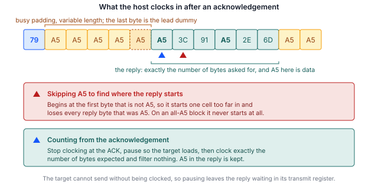

## 1 はじめに

すべての STM32 マイクロコントローラの ROM に書き込まれているシステムブートローダは、デバッグ
プローブを使わず、デバイス上にユーザーコードが一切なくても、シリアルインタフェース経由で内蔵
フラッシュメモリをプログラミングする手段を提供します。ブートローダが提供するインタフェースは
デバイスによって異なり、AN2606 に型番ごとに記載されています。

SPI は多くのファミリでその一覧に含まれています。本シリーズでこれまで扱った 3 つのインタフェース
の中で書き込みが最も速く、同時にホスト実装を気づかないうちに誤りやすいインタフェースでもあります。
その原因はひとつの設計上の判断にあります。ターゲットが送るものがないときに送出する値は、予約値
ではなく通常のデータ値なのです。この値をパディングとして扱うホストは、すべての識別コマンドには
合格したうえで、フラッシュの読み出しデータを破損させます。

本ノートは、I3C を扱う AN0001、I2C を扱う AN0002 に対応する SPI 版です。コマンドセットは 3 つ
すべてでほぼ同じです。異なるのはフレーミングであり、このバスではフレーミングこそが重要です。

### 1.1 対象範囲

本書では次の内容を説明します。

- SPI システムブートローダプロトコルの構造。アクノリッジのハンドシェイクと、応答の読み方を
  規定する規則を含みます
- Binho Pulsar と STM32 ターゲットの間に必要な接続。未使用のチップセレクトから NRST と BOOT0
  を駆動する方法を含みます
- デバイスの識別、消去、プログラミング、検証の手順
- 新しくプログラミングしたイメージをターゲットが実行していることを、プログラミングツールの外部
  から確認する方法
- 付属のリファレンスユーティリティ。Pulsar と Supernova のどちらでも駆動できます

UART、USB、CAN、I2C、I3C によるプログラミング、オプションバイトのプログラミング、読み出し保護
（試験したデバイスの ROM ブートローダはこのインタフェースでは提供していません）、量産用の
プログラミング治具は対象外です。I3C については AN0001、I2C については AN0002 を参照してください。

### 1.2 対象デバイス

SPI システムブートローダは特定のファミリに固有のものではありません。使用するピンは型番ごと、
SPI インスタンスごとに異なり、そのすべてが AN2606 に記載されています。これらは、ボードが
Arduino 形式の SPI ヘッダに配線しているピンではありません。そちらは同じペリフェラルの
アプリケーション側のマッピングです。

Table: 対象デバイス

| ファミリ | 型番の例 | ブートローダの SPI インタフェース | 根拠 |
|---|---|---|---|
| STM32H5 | STM32H503 | SPI1, SPI2, SPI3 | 本書のために試験済み |
| STM32H5 | STM32H563 | AN2606 による | AN2606、未試験 |
| STM32G0, G4 | なし | AN2606 による | AN2606、未試験 |
| STM32L4, L5 | なし | AN2606 による | AN2606、未試験 |
| STM32U5 | なし | AN2606 による | AN2606、未試験 |

ハードウェアで動作を確認したのは STM32H503 のみであり、そのうち SPI2 インスタンスのみです。
本書のコマンドを発行する前に、手元のデバイスについてピンとサポートされるコマンドの一覧を
AN2606 で確認する必要があります。

### 1.3 関連資料

Table: 関連資料

| 資料 | タイトル |
|---|---|
| AN2606 | STM32 microcontroller system memory boot mode |
| AN4286 | SPI protocol used in the STM32 bootloader |
| RM0492 | STM32H503 reference manual |
| AN0001 | Binho Supernova を用いた I3C による STM32 マイクロコントローラのプログラミング |
| AN0002 | Binho Pulsar を用いた I2C による STM32 マイクロコントローラのプログラミング |

## 2 システム概要

### 2.1 バス上の役割

ホストアダプタは SPI コントローラであり、クロックとチップセレクトを駆動します。システム
ブートローダモードに保持されたターゲットは SPI ターゲットであり、**モード 0**（クロックのアイドル
は Low、データは先行エッジでサンプリング）、MSB ファースト、8 ビットワードに設定されています。

I2C と異なりアドレスがないため、1 つのチップセレクトでプログラミングできるターゲットは厳密に
1 つです。また I3C と異なりダイナミックアドレス指定もありません。その代わり SPI ではホストが
クロックを完全に支配するため、クロックストレッチの問題がなくなり、5.7 節で示すように、性能上の
課題はまったく別のところに移ります。

### 2.2 ステータスの通知

すべてのコマンドにはアクノリッジが返されます。ホストは、ターゲットが ACK を表す `0x79` または
NACK を表す `0x1F` を返すまでダミーバイトをクロックします。

Table: ターゲットが送出する値

| 値 | 意味 |
|---|---|
| `0x79` | ACK、ステップが受理された |
| `0x1F` | NACK、ステップが拒否された |
| `0xA5` | ビジー。SPI ペリフェラルのアンダーランパターンで、キューに何もないときに常に送出される |
| `0x5A` | 同期。セッション開始時に 1 回送出される |

重要なのはビジー値の行であり、その理由を 2.3 節で説明します。

### 2.3 ビジー値はデータ値でもある

`0xA5` は、ブートローダが意図して送るステータスではありません。ターゲットの送信レジスタに何も
ロードされていないときに SPI ペリフェラルが送出するアンダーランパターンです。たまたま `0xA5`
を保持しているフラッシュのバイトと区別する手段は何もありません。

このため、多くの読者が最初に書くであろう実装は使えません。応答の先頭を探す際に `0xA5` を読み
飛ばす実装は、すべての識別コマンドで動作します。それらの応答はいずれもこの値で始まらないから
です。しかしその後、先頭バイトが `0xA5` であるフラッシュ読み出しはすべて破損し、全体が `0xA5`
のページでは処理がまったく戻りません。本書の作成にあたり、この 2 つの不具合はいずれも意図的に
再現しました。

正しく動作するフレーミングは 5.6 節に示します。これは位置に基づく方式です。ホストはアクノリッジ
の時点でクロックを止め、ターゲットにロードさせてから、期待するバイト数をちょうど読み出し、何も
フィルタリングしません。

> **重要：** 応答の先頭を探索するホストは、識別コマンドで行うすべてのテストに合格しても、
ファームウェアの読み出しデータを破損させます。読み出しの実装は、Get や Get ID ではなく、
`0xA5` を含むデータで検証してください。



### 2.4 ホストアダプタの選択肢

以下の 2 つの構成は、同じユーティリティと同じ手順を使用します。

Table: ホストアダプタの構成

| アダプタ | 状態 |
|---|---|
| Binho Pulsar | 検証済み。9 節のタイミング測定に使用 |
| Binho Supernova | 検証済み。同じサイクル数と同じ悪条件イメージのテスト |

## 3 ハードウェアのセットアップ

### 3.1 必要な機器

Table: 必要な機器

| 項目 | 本書で使用したもの |
|---|---|
| ホストアダプタ | Binho Pulsar、ハードウェアリビジョン C、ファームウェア 4.4.0 |
| ターゲットボード | NUCLEO-H503RB |
| 配線 | 7 本：バス用 4 本、グランド 1 本、リセット制御用 2 本 |
| ホスト | Python 3.12 |

### 3.2 接続

STM32H503 はブートローダに 3 つの SPI インスタンスを提供しており、そのいずれにも代替ピン
マッピングはありません。本書では、4 本のピンがすべてポート B にあるため SPI2 を使用しました。

Table: STM32H503 の SPI ブートローダピン

| インスタンス | MOSI | MISO | SCK | NSS |
|---|---|---|---|---|
| SPI1 | `PA7` | `PA0` | `PA8` | `PB8` |
| SPI2 | `PB1` | `PB14` | `PB10` | `PB12` |
| SPI3 | `PC12` | `PC11` | `PC10` | `PD2` |

Table: Pulsar とターゲットの接続

| Pulsar | ターゲット | 必須 |
|---|---|---|
| SCK | `PB10` | はい |
| MOSI | `PB1` | はい |
| MISO | `PB14` | はい |
| CS 0 | `PB12`（NSS） | はい |
| GND | GND | はい |
| CS 1 | `NRST` | 任意。ブートローダへの自動移行用 |
| CS 2 | `BOOT0` | 任意。ブートローダへの自動移行用 |

> **重要：** これらは、ボードが Arduino 形式の SPI ヘッダに配線しているピンではありません。
NUCLEO-H503RB ではそのヘッダは `PA5`、`PA6`、`PA7`、`PC9` の SPI1 を引き出していますが、これは
ペリフェラルのアプリケーション側のマッピングであり、ROM が設定するマッピングではありません。
両者に共通するのは `PA7` のみです。手元のデバイスについて AN2606 で確認してください。

### 3.3 チップセレクトによるリセットの駆動

上の表では、NRST と BOOT0 を汎用ピンではなくチップセレクトに接続しています。この方法は、
チップセレクトのある性質をこのように使うことがまれであること、また GPIO ピンを他の用途に
空けられることから、説明する価値があります。

どちらのアダプタパッケージにも、チップセレクトを任意のレベルに設定する呼び出しはありません。
チップセレクトが提供するのは極性です。アクティブ Low のセレクトはアイドル時に High であり、
転送が続く間だけ Low に駆動されます。ここから 2 つの帰結が得られます。

- NRST に接続したラインを選択して低速の転送をクロックすると、**既知の幅のリセットパルス**が
  得られます。ユーティリティは 10 kHz で 200 バイトをクロックし、NRST を約 160 ms の間 Low に
  保持します。
- BOOT0 に接続したラインは、**選択されていない間は High に保たれます**。これはデバイスを
  ブートローダに移行させるレベルです。

同じ手法でアプリケーションを選択することはできません。それには NRST にパルスを与える間 BOOT0
を Low に保持する必要がありますが、一度に選択できるラインは 1 本だけだからです。この場合は
ブートローダの Go コマンドで対応でき、ユーティリティは自動的にそちらに切り替えます。実用上の
影響は 6.5 節で説明します。

汎用ピンが使える場合は、`--reset-via gpio` でそれらを使用し、AN0001 および AN0002 とまったく
同じように動作します。

### 3.4 バスに関する考慮事項

SPI にはプルアップは不要です。4 本のラインはターゲット側でプルなしのプッシュプルに設定される
ため、**NSS は能動的に駆動する必要があり、決してフローティングにしてはいけません**。

> **注意：** 接続する前に、バス電圧をターゲットに合わせて設定してください。ユーティリティは
> 3.3 V を設定します。これは NUCLEO-H503RB に適しています。より低い電源電圧で動作している
> ターゲットに 3.3 V を加えると、ターゲットを損傷するおそれがあります。

## 4 ソフトウェアのセットアップ

### 4.1 ホストパッケージのインストール

ユーティリティはベンダーパッケージを介してアダプタと通信します。使用するアダプタに対応する
パッケージをインストールしてください。

```
pip install binhopulsar        # for a Pulsar
pip install binhosupernova     # for a Supernova
```

本書で使用したバージョン：`binhopulsar` 1.2.0、Python 3.12。他のパッケージは必要ありません。
ユーティリティは Intel HEX を自前で解析します。

### 4.2 リファレンスユーティリティの入手

`stm32_flash.py` は、本書に付属するアセットアーカイブに収録されています。

```
https://cdn.binho.io/application-notes/AN0003/AN0003-assets.zip
```

同じファイルは、本書の Markdown ソースとともに `https://github.com/binhollc/application-notes`
でも公開しています。アーカイブの内容は 12 節に記載しています。

アーカイブを展開すると、ユーティリティを含む `assets` ディレクトリと、7 節の検証用イメージを
含む `firmware` サブディレクトリができます。本書のすべてのコマンドは、その `assets` ディレクトリ
内から実行する形で示しています。

これは AN0001 および AN0002 に付属するものと同じファイルであり、1 つのコピーで 3 つのバスすべて
に対応します。

> **重要：** SPI インタフェースがすでに初期化されているアダプタは、`spiControllerInit` に
`INTERFACE_ALREADY_INITIALIZED` を返し、**一緒に渡された設定を破棄します**。その場合、クロック
レート、モード、チップセレクトは以前のままとなり、呼び出し自体は成功したように見えながら、
すべての転送が誤った設定で送出されます。ホストは、init が成功以外を報告した場合には必ず、
`spiControllerSetParameters` で同じ設定を再適用する必要があります。リファレンスユーティリティは
これを行っています。これを行わずに実装すると、バスが一定値を読み返すという症状となり、配線不良
とまったく同じように見えます。

## 5 ブートローダプロトコル

### 5.1 システムブートローダモードへの移行

`BOOT0` を High に保持したまま、`NRST` に Low パルスを与えて解放します。ユーティリティが
チップセレクトからこれを行う方法は 3.3 節で説明しています。

### 5.2 セッションの開始

ホストは同期バイト `0x5A` をクロックします。ターゲットは自身の同期バイトを返し、続いて
アクノリッジを返します。それ以上のハンドシェイクはありません。

### 5.3 コマンドのフレーミング

他の 2 つのバスと異なり、同期バイトは最初のコマンドだけでなく**すべての**コマンドの先頭に
付きます。

```
host    5A <op> <~op>
target  ... 79
host    79
```

ターゲットはコマンドを待っている間、`0x5A` 以外のものをすべて破棄するため、コマンドの間に
ダミーバイトをクロックしても問題はありません。

アドレスを取るコマンドは、4 バイトをビッグエンディアンで送り、続いてその 4 バイトの 1 バイト
XOR を送ります。さらにペイロードの前にもう一度アクノリッジを受け取ります。

### 5.4 ホストはアクノリッジに対してアクノリッジを返す必要がある

ACK を送った後、ターゲットは処理を続ける前に**ホストが `0x79` を返送するのを待ちます**。
アクノリッジを読んだだけで次に進むホストはターゲットをブロックしたままにし、その理由を示す
ものはバス上に何もありません。セッションが応答しなくなるだけです。

これは、実装が最初の通信でハングする最も可能性の高い原因です。

### 5.5 各応答の先頭には 1 つのダミーバイトが付く

アクノリッジの後に最初にクロックアウトされるバイトは、古いビジーパターンです。最初の応答バイト
がその後ろにキューイングされる時点で、ターゲットのシフトレジスタがまだそれを保持しているため
です。AN4286 では、これを読み出しの前にダミーバイトを送ることとして記述しています。

これは**転送ごとに 1 回ではなく、応答ごとに 1 回**発生します。応答の途中で再びダミーを要求すると
本物のバイトが失われます。開発中には、原因が特定されるまで、報告されるコマンド一覧が前後に 1 つ
ずつずれる現象が起きました。

### 5.6 応答の読み出し

2.3 節と 5.5 節を合わせると、正しく動作するフレーミングは次のとおりです。

1. アクノリッジが現れるまでクロックし、**そこで止めます**。
2. `0x79` を送ってターゲットを解放します。
3. ターゲットが最初の応答バイトをロードできるよう、短時間待ちます。
4. 期待するバイト数をちょうどクロックし、先頭の 1 つのダミーを破棄して、それ以外は何も
   フィルタリングしません。

ステップ 3 が安全なのは、ターゲットはクロックされない限り送信できないためです。待機している間、
応答は送信レジスタで待機したままになります。応答の途中で待機することも同様に安全です。
ターゲットはパディングを送るのではなく、次のバイトをキューに入れて待つためです。

安全でないのは、アクノリッジを越えてクロックすることです。応答は区切りなしにアクノリッジの直後
から始まり、ビジー値とデータを区別できないためです。

### 5.7 サポートされるコマンド

Table: STM32H503 で SPI によりサポートされるコマンド

| オペコード | コマンド |
|---|---|
| `0x00` | Get |
| `0x01` | Get Version |
| `0x02` | Get ID |
| `0x11` | Read Memory |
| `0x21` | Go |
| `0x31` | Write Memory |
| `0x44` | Extended Erase |
| `0x50` | Special Command |
| `0x63` | Write Protect |
| `0x73` | Write Unprotect |

コマンドは 10 個で、この一覧は同じデバイスが I3C で提供するものと同一です。同じデバイスが I2C
で提供するものより 5 個少なく、I2C ではノーストレッチ版の 4 つと Checksum が追加されています。
ノーストレッチ版はここでは意味を持ちません。SPI ターゲットは自分が駆動していないクロックを
ストレッチする手段を持たないためです。

Readout Protect（`0x82`）と Readout Unprotect（`0x92`）は、他の 2 つのバスと同様に存在しません。

### 5.8 消去

Extended Erase は、ページ数に続けてページ番号のリスト、または特殊値を取ります。マス消去は
ページリストなしの `0xFFFF` です。

ページリストの場合、カウントフィールドには I3C と同じく**ページ数**を入れます。I2C のような
ページ数マイナス 1 ではありません。このデバイスのフラッシュページは 8 KB です。

## 6 プログラミング手順

### 6.1 ターゲットの識別

```
python stm32_flash.py --bus spi --reset-via cs info

  Adapter: pulsar  fw 4.4.0
  Bus: SPI
  Resetting target into bootloader (NRST=CS1, BOOT0=CS2)
  SPI: 1000 kHz, mode 0, chip select 0
  Bootloader session established

  Protocol version : 2.0
  Device ID        : 0x474  (STM32H503)
  Commands         : 10
      0x00  Get
      ...
      0x73  Write Unprotect
```

サポートされる 10 個のコマンドは、これらの行の間にすべて表示されます。それらは表 8 に示した
ものです。アダプタのシリアル番号は 1 行目に表示されますが、ここでは省略しています。

これは新しいボードで最初に行うことを推奨する手順です。破壊的な操作を試みる前に、配線、バスの
設定、ブートローダへの移行を確認できます。

### 6.2 既存の内容の読み出し

```
python stm32_flash.py --bus spi --reset-via cs read backup.bin --address 0x08000000 --length 0x20000
```

### 6.3 イメージのプログラミング

`flash` コマンドは、消去、書き込み、読み返しと比較、そしてアプリケーションの起動という一連の
処理をすべて実行します。

```
python stm32_flash.py --bus spi --reset-via cs flash firmware/an0003_image_a.bin --address 0x08000000
```

Intel HEX ファイルは自身のアドレスを含んでいるため、このオプションは省略します。`--erase pages`
はイメージが占めるページのみを消去し、小さなイメージではより高速です。

```
python stm32_flash.py --bus spi --reset-via cs flash firmware/an0003_image_a.bin --address 0x08000000 --erase pages
```

`--spi-speed` はクロックを設定します。クロックを上げても期待ほど効果がない理由は 9.3 節で説明
します。セッションオプションはサブコマンドの前後どちらにも指定できます。

### 6.4 検証

検証はデフォルトで実行されます。プログラミングした範囲を同じインタフェースで読み返し、ソース
イメージと 1 バイトずつ比較します。`--no-verify` で無効にできます。

2.3 節を踏まえると、このバスでは検証が他のバスよりも重要な意味を持ちます。読み出しのフレーミング
の誤りを、顧客に届く前に検出するステップだからです。

### 6.5 アプリケーションの起動

NRST と BOOT0 がチップセレクトに接続されている場合、BOOT0 を Low に駆動できないため、
ユーティリティはリセットの代わりに Go コマンドを発行します。出力にはこれが `Jumping to 0x08000000`
と表示されます。

3.3 節から導かれる帰結のひとつは、あらかじめ考慮しておく価値があります。アダプタが接続されて
アイドル状態の間、BOOT0 に接続したラインは High に保たれるため、電源の再投入や外部リセットを
行うと、ターゲットはアプリケーションではなくブートローダに戻ります。ボードが単独で起動する
ことを想定する場合は、そのラインを外すか、`--reset-via gpio` を使用してください。

## 7 ターゲット上での更新の確認

`flash` コマンドはプログラミングした範囲を読み返して 1 バイトずつ比較するため、フラッシュの
内容が与えたイメージと一致することは証明できます。しかし、デバイスが新しいファームウェアを実行
していることは証明できません。

このギャップを埋めるため、本書には 2 つの小さなファームウェアイメージが付属しています。両者は、
報告する文字とユーザー LED の点滅周期を除いて同一です。

### 7.1 検証用イメージ

Table: 本書に付属する検証用イメージ

| イメージ | ファイル | 報告内容 | LED |
|---|---|---|---|
| A | `firmware/an0003_image_a.bin` | `IMAGE A` | 1 Hz |
| B | `firmware/an0003_image_b.bin` | `IMAGE B` | 5 Hz |

イメージは 864 バイトと 860 バイトで、`0x08000000` から実行するようにリンクされています。
ソース、リンカスクリプト、makefile も併せて提供しています。

どちらのイメージも SPI2 のピンを一切使用しないため、配線を変更せずにロードして観察できます。

### 7.2 手順

ST-LINK の仮想 COM ポートで 115200 8N1 のシリアルターミナルを開き、イメージ A を
プログラミングします。

```
python stm32_flash.py --bus spi --reset-via cs flash firmware/an0003_image_a.bin --address 0x08000000
```

ターミナルにはバナーが表示され、その後 1 秒ごとに 1 行のハートビートが表示されます。

```
========================================
  Binho  |  AN0003
  Programming STM32 microcontrollers
  over SPI with the Binho Pulsar
========================================
  Running: IMAGE A
  Kernel clock: 32 MHz
  LED blink: 1 Hz
========================================
  IMAGE A  alive, 1 s
  IMAGE A  alive, 2 s
```

イメージ B をプログラミングすると、報告される文字が変わり、LED が 5 倍速く点滅します。

`IMAGE A` から `IMAGE B` への遷移がエンドツーエンドの結果です。イメージが SPI で消去、書き込み、
検証され、デバイスがプログラミングされた内容を実行していることを示します。

> **重要：** これらのイメージをプログラミングすると、デバイス上の既存のアプリケーションが消去
されます。6.2 節の説明に従って、先に既存の内容を保存してください。

> **注記：** 付属のバイナリは NUCLEO-H503RB 用にビルドされています。`PA4` を USART3_TX、`PA5`
をユーザー LED として駆動します。他のボードではシリアル出力は表示されません。ソースが付属して
いるため、`firmware/main.c` の先頭にあるピンとペリフェラルの定義を変更して再ビルドすることで、
別のボードに移植できます。

## 8 リファレンスユーティリティ

### 8.1 コマンド

Table: ユーティリティのコマンド

| コマンド | 動作 |
|---|---|
| `list` | 接続されている Binho アダプタを一覧表示する |
| `info` | ターゲットを識別し、その機能を報告する |
| `flash` | イメージを消去、書き込み、検証し、実行する |
| `read` | メモリをファイルに読み出す |
| `erase` | ユーザーフラッシュをマス消去する |
| `reset` | GPIO でターゲットをリセットする |

### 8.2 オプション

セッションオプションはサブコマンドの前後どちらにも指定できます。ここでは SPI に関係するもの
のみを記載します。I3C と I2C のオプションは AN0001 と AN0002 に記載しています。

Table: SPI のセッションオプション

| オプション | デフォルト | 意味 |
|---|---|---|
| `--bus` | auto | `spi`、`i2c` または `i3c` |
| `--spi-speed` | 1000000 | SPI クロック（Hz）、10000 から 50000000 |
| `--spi-mode` | 0 | SPI モード |
| `--spi-cs` | 0 | NSS を担うチップセレクト |
| `--reset-via` | `gpio` | NRST と BOOT0 を GPIO ピンまたは未使用のチップセレクトから駆動する |
| `--nrst-cs` | 1 | `NRST` に接続したチップセレクト（`--reset-via cs` 使用時） |
| `--boot0-cs` | 2 | `BOOT0` に接続したチップセレクト（`--reset-via cs` 使用時） |
| `--manual` | off | ブートローダへの移行を駆動せず、操作を促すプロンプトを表示する |
| `-v`, `-q` | off | すべての転送をログ出力する、または進捗出力を抑止する |

Table: コマンドごとのオプション

| オプション | 対象 | 意味 |
|---|---|---|
| `--address` | `flash`, `read` | raw バイナリのベースアドレス |
| `--length` | `read` | 読み出すバイト数 |
| `--erase` | `flash` | `mass`、`pages` または `none` |
| `--page-size` | `flash` | `--erase pages` 用のフラッシュページサイズ、デフォルト 8192 |
| `--erase-timeout` | `flash`, `erase` | 消去に許容する秒数 |
| `--chunk-size` | `flash`, `read` | 転送あたりのバイト数。デフォルト 256 で、ブートローダが受け付ける最大値 |
| `--no-verify` | `flash` | 読み返しによる比較を省略する |
| `--no-run` | `flash` | デバイスをブートローダに留める |
| `--run` | `info`, `read`, `erase` | 実行後にアプリケーションを起動する |

## 9 測定結果

### 9.1 試験構成

Table: 試験構成

| 項目 | 値 |
|---|---|
| ターゲット | STM32H503RB、NUCLEO-H503RB |
| アダプタ | Binho Pulsar、ハードウェアリビジョン C、ファームウェア 4.4.0 |
| ホストパッケージ | `binhopulsar` 1.2.0、Python 3.12 |
| ユーティリティ | `stm32_flash.py`、アセットアーカイブに収録のもの |
| バス | SPI2、モード 0、3.3 V |

### 9.2 122,912 バイトのイメージのプログラミング

Table: 4 MHz での 122,912 バイトのイメージの測定タイミング

| 操作 | 時間 | スループット |
|---|---|---|
| マス消去 | 0.03 s | 該当なし |
| 書き込み | 4.66 s | 25.8 KiB/s |
| 検証 | 8.19 s | 14.7 KiB/s |

ここでは書き込みが読み出しより速く、これは他の 2 つのバスとは逆です。これは 5.6 節の直接の帰結
です。書き込みでは、アクノリッジの後にホストが必要とするものが何も続かないため、すべての
アクノリッジをバーストでまとめて待つことができます。読み出しでは、応答がアクノリッジの直後に
始まるため、各読み出しのうち 1 つのアクノリッジはそのように待つことができません。

### 9.3 クロックレートに対する読み出しスループット

列挙、リセットパルス、開始時のハンドシェイクを含むセッションのセットアップは 2.00 s で、
クロックレートによって変化しませんでした。

Table: 128 KiB 読み出しの測定値

| クロック | 読み出しフェーズ | スループット |
|---|---|---|
| 1 MHz | 10.31 s | 12.4 KiB/s |
| 4 MHz | 8.92 s | 14.3 KiB/s |
| 8 MHz | 8.91 s | 14.4 KiB/s |

3 回の読み出しはいずれもバイト単位で同一のデータを返しました。

4 MHz を超えてクロックを上げても効果はほとんどありません。各ステップの後のターゲットの応答
レイテンシは実時間ではなくクロック周期で数えられるため、クロックを速くしてもバイト単位での
待ち時間は短くならないからです。また、Read Memory は 1 ブロックを 256 バイトに制限しており、
これが各コマンドで運べる量の上限となります。

### 9.4 信頼性

Table: 完了した消去、書き込み、検証、実行のサイクル

| 構成 | 完了したサイクル |
|---|---|
| Pulsar、SPI2、1 MHz、チップセレクトからのリセット | 6 回中 6 回 |
| Supernova、SPI2、1 MHz、チップセレクトからのリセット | 6 回中 6 回 |

サイクルはイメージ A とイメージ B を交互に使用したため、各サイクルは前のサイクルとは異なる内容
を消去、書き込み、検証しました。

さらに、256 バイトの各ブロックが `0xA5` で始まり、1 つのブロックが全体として `0xA5` で構成
されるように作成したイメージを、両方のアダプタからプログラミングし、1 バイトずつ検証しました。
このイメージは、正しい読み出し実装とパディングをフィルタリングする実装とを見分けるテストです。
5.6 節で説明した実装はこれに合格し、すぐに思いつく別の実装は合格しません。

これらの数値は 1 つのターゲットと 1 つのホストについてのものです。手順に再現性があることの
根拠であり、信頼性の仕様ではありません。

## 10 トラブルシューティング

Table: トラブルシューティング

| 症状 | 考えられる原因と対処 |
|---|---|
| 最初のアクノリッジの後にセッションが応答しなくなる | ホストが `0x79` を返送していません。ターゲットは返送されるまでブロックします。5.4 節を参照してください。 |
| 識別は動作するがフラッシュの読み出しデータが破損している | 応答を位置に基づいて読み出さずに探索しており、`0xA5` を含むデータがパディングとして扱われています。2.3 節と 5.6 節を参照してください。 |
| 読み出しが戻らない | 同じ原因で、全体が `0xA5` の領域で発生しています。 |
| コマンド一覧が 1 つずれる | 先頭のダミーバイトを応答ごとに 1 回ではなく転送ごとに 1 回消費しています。5.5 節を参照してください。 |
| まったく応答がない | ピンが誤っています。ブートローダの SPI ピンはボードの Arduino SPI ヘッダではありません。AN2606 で確認してください。 |
| 応答がない（配線は確認済み） | NSS がフローティングです。ターゲットはプルなしで設定するため、駆動する必要があります。 |
| すべての転送が同じ一定値を読み返す | アダプタが SPI インタフェースを初期化済みと報告し、init に与えた設定を破棄したため、バスは以前に設定された状態のまま動作しています。`spiControllerSetParameters` で設定を再適用してください。4.2 節を参照してください。 |
| 電源の再投入後にターゲットがブートローダに戻る | BOOT0 がアイドル時に High となるチップセレクトに接続されている場合は想定どおりの動作です。6.5 節を参照してください。 |
| クロックを上げても速くならない | 約 4 MHz を超える範囲では想定どおりの動作です。ターゲットの応答レイテンシはクロック周期で数えられるため、クロックを速くしても短くなりません。9.3 節を参照してください。 |
| 検証用イメージのシリアル出力が文字化けする | ターミナルのボーレートが一致していません。イメージは 115200 8N1 を使用します。 |

## 11 略語

Table: 略語

| 用語 | 意味 |
|---|---|
| ACK | Acknowledge（アクノリッジ） |
| CS | Chip select（チップセレクト） |
| HSI | High-speed internal oscillator（高速内部発振器） |
| MISO | Controller in, target out（コントローラ入力、ターゲット出力） |
| MOSI | Controller out, target in（コントローラ出力、ターゲット入力） |
| NACK | Not acknowledged（ノットアクノリッジ） |
| NSS | Target select（ターゲットセレクト） |
| ROM | Read-only memory（読み出し専用メモリ） |
| SCK | Serial clock（シリアルクロック） |
| SPI | Serial Peripheral Interface |
| VCP | Virtual COM port（仮想 COM ポート） |

## 12 本書のソースコードについて

本書に示し、付属のアーカイブで提供するサンプルコードは、評価および参考用に提供するものです。
MIT ライセンスのもとで公開しており、ライセンス本文はアーカイブに含まれています。

アーカイブ `AN0003-assets.zip` は
`https://cdn.binho.io/application-notes/AN0003/AN0003-assets.zip` で公開しており、次のものを
含みます。

Table: アセットアーカイブの内容

| パス | 説明 |
|---|---|
| `AN0003.md` | Markdown 形式の本書 |
| `assets/stm32_flash.py` | リファレンスユーティリティ。AN0001 および AN0002 と共通 |
| `assets/PROTOCOL.md` | SPI ブートローダプロトコルのワイヤレベルの解説 |
| `assets/test_hex_parser.py` | Intel HEX パーサのテスト |
| `assets/LICENSE` | MIT ライセンス |
| `assets/firmware/main.c` | 両方の検証用イメージのソース |
| `assets/firmware/link.ld` | リンカスクリプト |
| `assets/firmware/Makefile` | 両方のイメージをビルドする |
| `assets/firmware/README.md` | 検証用イメージに関する説明 |
| `assets/firmware/an0003_image_a.bin` | ビルド済みのイメージ A |
| `assets/firmware/an0003_image_b.bin` | ビルド済みのイメージ B |

## 13 改訂履歴

Table: 改訂履歴

| リビジョン | 日付 | 説明 |
|---|---|---|
| 1.0 | 30 August 2026 | 初版。 |
| 1.1 | 3 September 2026 | 存在しない値に em-dash を記載していた 3 つの表のセルを `none`（本訳では「なし」）に変更しました。これらは型番の例が挙げられていないファミリです。測定結果に変更はありません。 |
