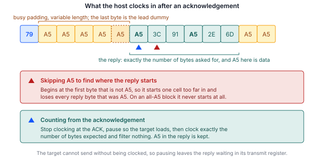

## 1 소개

모든 STM32 마이크로컨트롤러의 ROM에 프로그래밍된 시스템 부트로더는 디버그 프로브 없이, 그리고
디바이스에 사용자 코드가 전혀 없는 상태에서도 시리얼 인터페이스를 통해 내부 플래시 메모리를
프로그래밍하는 수단을 제공합니다. 부트로더가 제공하는 인터페이스는 디바이스마다 다르며, 부품
번호별로 AN2606에 나와 있습니다.

SPI는 많은 제품군에서 그 목록에 포함되어 있습니다. SPI는 이 시리즈에서 다룬 세 가지 인터페이스
중 쓰기 속도가 가장 빠르며, 동시에 호스트 구현이 미묘하게 잘못되기 가장 쉬운 인터페이스입니다.
그 이유는 단 하나의 설계 결정에 있습니다. 타깃이 보낼 내용이 없을 때 전송하는 값이 예약된 값이
아니라 일반적인 데이터 값이라는 점입니다. 이 값을 패딩으로 취급하는 호스트는 모든 식별 명령을
통과한 뒤 플래시 읽기 데이터를 손상시킵니다.

이 노트는 I3C를 다루는 AN0001 및 I2C를 다루는 AN0002의 SPI 버전입니다. 명령 세트는 세 가지
모두에서 거의 동일합니다. 다른 점은 프레이밍이며, 이 버스에서는 프레이밍이 핵심입니다.

### 1.1 범위

이 문서는 다음을 설명합니다.

- 응답 확인(acknowledgement) 핸드셰이크와 응답을 읽는 방법을 규정하는 규칙을 포함한 SPI 시스템
  부트로더 프로토콜의 구조
- 여분의 칩 셀렉트로 NRST와 BOOT0을 구동하는 방법을 포함하여 Binho Pulsar와 STM32 타깃 사이에
  필요한 연결
- 디바이스를 식별, 소거, 프로그래밍 및 검증하는 절차
- 프로그래밍 도구 외부에서 타깃이 새로 프로그래밍된 이미지를 실행하고 있는지 확인하는 방법
- Pulsar 또는 Supernova 중 하나를 구동하는 함께 제공되는 레퍼런스 유틸리티

UART, USB, CAN, I2C 또는 I3C를 통한 프로그래밍, 옵션 바이트 프로그래밍, 시험한 부품의 ROM
부트로더가 이 인터페이스에서 제공하지 않는 읽기 보호(readout protection), 양산용 프로그래밍
픽스처는 다루지 않습니다. I3C는 AN0001을, I2C는 AN0002를 참조하십시오.

### 1.2 적용 디바이스

SPI 시스템 부트로더는 특정 제품군 전용이 아닙니다. 부트로더가 사용하는 핀은 부품마다, 그리고
SPI 인스턴스마다 다르며, 모두 AN2606에 나와 있습니다. 이 핀들은 보드가 Arduino 스타일 SPI
헤더로 배선하는 핀이 아니며, 그 헤더는 같은 주변장치의 애플리케이션 매핑입니다.

Table: 적용 디바이스

| 제품군 | 예시 부품 | 부트로더 SPI 인터페이스 | 근거 |
|---|---|---|---|
| STM32H5 | STM32H503 | SPI1, SPI2, SPI3 | 이 문서를 위해 시험함 |
| STM32H5 | STM32H563 | AN2606 기준 | AN2606, 시험하지 않음 |
| STM32G0, G4 | none | AN2606 기준 | AN2606, 시험하지 않음 |
| STM32L4, L5 | none | AN2606 기준 | AN2606, 시험하지 않음 |
| STM32U5 | none | AN2606 기준 | AN2606, 시험하지 않음 |

하드웨어에서 실제로 시험한 것은 STM32H503뿐이며, 그것도 SPI2 인스턴스만 시험했습니다. 이 문서의
명령을 실행하기 전에 사용 중인 부품에 대해 AN2606에서 핀과 지원 명령 목록을 확인해야 합니다.

### 1.3 관련 문서

Table: 관련 문서

| 문서 | 제목 |
|---|---|
| AN2606 | STM32 microcontroller system memory boot mode |
| AN4286 | SPI protocol used in the STM32 bootloader |
| RM0492 | STM32H503 reference manual |
| AN0001 | Binho Supernova를 사용한 I3C 기반 STM32 마이크로컨트롤러 프로그래밍 |
| AN0002 | Binho Pulsar를 사용한 I2C 기반 STM32 마이크로컨트롤러 프로그래밍 |

## 2 시스템 개요

### 2.1 버스상의 역할

호스트 어댑터는 SPI 컨트롤러이며 클록과 칩 셀렉트를 구동합니다. 시스템 부트로더 모드로 유지되는
타깃은 **모드 0**(클록 유휴 시 로우, 선행 에지에서 데이터 샘플링), MSB 우선, 8비트 워드로 설정된
SPI 타깃입니다.

I2C와 달리 주소가 없으므로 칩 셀렉트당 정확히 하나의 타깃만 프로그래밍할 수 있으며, I3C와 달리
동적 주소 지정도 없습니다. 대신 SPI에서는 호스트가 클록을 완전히 소유하므로 클록 스트레칭이
고려 대상에서 빠지며, Section 5.7에서 보듯이 성능 문제는 완전히 다른 곳으로 옮겨갑니다.

### 2.2 상태 보고

모든 명령은 응답 확인을 받습니다. 호스트는 타깃이 ACK인 `0x79` 또는 NACK인 `0x1F`로 응답할
때까지 더미 바이트를 클록합니다.

Table: 타깃이 전송하는 값

| 값 | 의미 |
|---|---|
| `0x79` | ACK, 해당 단계가 수락됨 |
| `0x1F` | NACK, 해당 단계가 거부됨 |
| `0xA5` | Busy. SPI 주변장치의 언더런 패턴으로, 대기 중인 데이터가 없을 때마다 전송됨 |
| `0x5A` | Sync, 세션이 열릴 때 한 번 전송됨 |

중요한 것은 busy 값 행이며, 그 이유는 Section 2.3에서 설명합니다.

### 2.3 busy 값은 데이터 값이기도 합니다

`0xA5`는 부트로더가 선택해서 보내는 상태 값이 아닙니다. 타깃의 송신 레지스터에 아무것도 로드되어
있지 않을 때마다 SPI 주변장치가 내보내는 언더런 패턴입니다. 이 값을 마침 `0xA5`를 담고 있는
플래시 바이트와 구별할 방법은 없습니다.

이 때문에 대부분의 독자가 처음 작성할 법한 구현은 사용할 수 없습니다. 응답의 시작을 찾는 동안
`0xA5`를 건너뛰는 방식은 모든 식별 명령에서 동작합니다. 그 명령들의 응답은 어느 것도 이 값으로
시작하지 않기 때문입니다. 그러나 이 방식은 첫 바이트가 `0xA5`인 플래시 읽기를 모두 손상시키며,
전체가 `0xA5`인 페이지에서는 아예 반환되지 않습니다. 두 가지 실패 모두 이 문서를 준비하는 과정에서
의도적으로 재현했습니다.

Section 5.6에서 올바르게 동작하는 프레이밍을 제시합니다. 이 프레이밍은 위치 기반입니다. 호스트는
응답 확인에서 클록을 멈추고, 타깃이 데이터를 로드하도록 한 다음, 예상하는 바이트 수만큼 정확히
읽으며 아무것도 걸러내지 않습니다.

> **중요:** 응답의 시작을 검색하는 호스트는 식별 명령으로 수행한 모든 테스트를 통과하면서도
펌웨어 읽기 데이터를 손상시킵니다. 읽기 구현은 Get과 Get ID가 아니라 `0xA5`를 포함한 데이터로
검증하십시오.



### 2.4 호스트 어댑터 옵션

아래 두 구성 모두 같은 유틸리티와 같은 절차를 사용합니다.

Table: 호스트 어댑터 구성

| 어댑터 | 상태 |
|---|---|
| Binho Pulsar | 검증됨. Section 9의 타이밍 측정에 사용 |
| Binho Supernova | 검증됨. 같은 사이클과 같은 악조건 이미지 테스트 |

## 3 하드웨어 설정

### 3.1 필요 장비

Table: 필요 장비

| 항목 | 여기서 사용한 것 |
|---|---|
| 호스트 어댑터 | Binho Pulsar, 하드웨어 리비전 C, 펌웨어 4.4.0 |
| 타깃 보드 | NUCLEO-H503RB |
| 배선 | 전선 7개: 버스용 4개, 접지 1개, 리셋 제어용 2개 |
| 호스트 | Python 3.12 |

### 3.2 연결

STM32H503은 부트로더에 세 개의 SPI 인스턴스를 제공하며, 그중 어느 것에도 대체 핀 매핑이
없습니다. 여기서는 네 개 핀이 모두 포트 B에 있는 SPI2를 사용했습니다.

Table: STM32H503의 SPI 부트로더 핀

| 인스턴스 | MOSI | MISO | SCK | NSS |
|---|---|---|---|---|
| SPI1 | `PA7` | `PA0` | `PA8` | `PB8` |
| SPI2 | `PB1` | `PB14` | `PB10` | `PB12` |
| SPI3 | `PC12` | `PC11` | `PC10` | `PD2` |

Table: Pulsar와 타깃 사이의 연결

| Pulsar | 타깃 | 필수 여부 |
|---|---|---|
| SCK | `PB10` | 예 |
| MOSI | `PB1` | 예 |
| MISO | `PB14` | 예 |
| CS 0 | `PB12` (NSS) | 예 |
| GND | GND | 예 |
| CS 1 | `NRST` | 선택, 자동 부트로더 진입용 |
| CS 2 | `BOOT0` | 선택, 자동 부트로더 진입용 |

> **중요:** 이 핀들은 보드가 Arduino 스타일 SPI 헤더로 배선하는 핀이 아닙니다.
NUCLEO-H503RB에서 그 헤더는 `PA5`, `PA6`, `PA7`, `PC9`의 SPI1을 연결하며, 이는 주변장치의
애플리케이션 매핑이지 ROM이 설정하는 매핑이 아닙니다. 둘에 공통인 핀은 `PA7`뿐입니다. 사용 중인
부품에 대해 AN2606으로 확인하십시오.

### 3.3 칩 셀렉트로 리셋 구동하기

위 표에서 NRST와 BOOT0은 범용 핀이 아니라 칩 셀렉트에 연결되어 있습니다. 이 방법은 칩 셀렉트의
특성을 이런 식으로 사용하는 경우가 드물고, GPIO 핀을 다른 용도로 쓸 수 있게 해 주기 때문에 설명할
가치가 있습니다.

두 어댑터 패키지 어디에도 칩 셀렉트를 특정 레벨로 설정하는 호출은 없습니다. 칩 셀렉트가 제공하는
것은 극성입니다. 액티브 로우 셀렉트는 유휴 시 하이이며, 전송이 지속되는 동안에만 정확히 로우로
구동됩니다. 여기서 두 가지 결과가 나옵니다.

- NRST에 연결된 라인을 선택하고 느린 전송을 클록하면 **폭을 알고 있는 리셋 펄스**가 만들어집니다.
  유틸리티는 10 kHz로 200바이트를 클록하며, 이로써 NRST가 약 160 ms 동안 로우로 유지됩니다.
- BOOT0에 연결된 라인은 **선택되지 않은 동안 하이를 유지**하며, 이는 부품을 부트로더로 진입시키는
  레벨입니다.

같은 방법으로 애플리케이션을 선택할 수는 없습니다. 그러려면 NRST에 펄스를 주는 동안 BOOT0을
로우로 유지해야 하는데, 한 번에 하나의 라인만 선택할 수 있기 때문입니다. 이 경우는 부트로더의 Go
명령이 처리하며, 유틸리티는 자동으로 이 명령으로 대체합니다. 실제로 미치는 영향은 Section 6.5에서
설명합니다.

범용 핀을 대신 사용할 수 있는 경우 `--reset-via gpio`가 해당 핀을 사용하며, AN0001 및 AN0002와
완전히 동일하게 동작합니다.

### 3.4 버스 고려 사항

SPI에는 풀업이 필요하지 않습니다. 네 라인은 타깃 측에서 풀 저항 없이 푸시풀로 설정되므로,
**NSS는 반드시 능동적으로 구동해야 하며 절대 플로팅 상태로 두어서는 안 됩니다**.

> **주의.** 연결하기 전에 버스 전압을 타깃에 맞게 설정하십시오. 유틸리티는 3.3 V로 설정하며,
> 이는 NUCLEO-H503RB에 적합합니다. 더 낮은 전원 전압으로 동작하는 타깃에 3.3 V를 인가하면
> 타깃이 손상될 수 있습니다.

## 4 소프트웨어 설정

### 4.1 호스트 패키지 설치

유틸리티는 벤더 패키지를 통해 어댑터와 통신합니다. 사용하는 어댑터에 맞는 패키지를 설치하십시오.

```
pip install binhopulsar        # for a Pulsar
pip install binhosupernova     # for a Supernova
```

이 문서에 사용한 버전: `binhopulsar` 1.2.0, Python 3.12. 다른 패키지는 필요하지 않으며,
유틸리티가 Intel HEX를 직접 파싱합니다.

### 4.2 레퍼런스 유틸리티 받기

`stm32_flash.py`는 이 문서와 함께 제공되는 자산 아카이브에 포함되어 있습니다.

```
https://cdn.binho.io/application-notes/AN0003/AN0003-assets.zip
```

같은 파일이 이 문서의 Markdown 원본과 함께 `https://github.com/binhollc/application-notes`에도
게시되어 있습니다. 아카이브 내용은 Section 12에 나와 있습니다.

아카이브를 풀면 유틸리티가 들어 있는 `assets` 디렉터리와, Section 7의 검증 이미지가 들어 있는
`firmware` 하위 디렉터리가 생성됩니다. 이 문서의 모든 명령은 해당 `assets` 디렉터리 안에서
실행하는 형태로 표시되어 있습니다.

이 파일은 AN0001 및 AN0002와 함께 제공되는 것과 같은 파일이므로, 하나의 사본으로 세 가지 버스를
모두 처리할 수 있습니다.

> **중요:** SPI 인터페이스가 이미 초기화된 어댑터는 `spiControllerInit`에
`INTERFACE_ALREADY_INITIALIZED`로 응답하며 **함께 전달된 설정을 버립니다**. 이 경우 클록 속도,
모드, 칩 셀렉트는 이전 상태 그대로 유지되고, 호출 자체는 성공한 것처럼 보이지만 모든 전송이
잘못된 설정으로 나가게 됩니다. 호스트는 init이 성공 이외의 결과를 보고할 때마다
`spiControllerSetParameters`를 통해 같은 설정을 다시 적용해야 합니다. 레퍼런스 유틸리티는 이를
수행합니다. 이 처리 없이 작성하면 버스가 상수 값을 읽어 오는 증상이 나타나며, 이는 배선 결함과
똑같아 보입니다.

## 5 부트로더 프로토콜

### 5.1 시스템 부트로더 모드 진입

`NRST`에 로우 펄스를 주고 해제하는 동안 `BOOT0`을 하이로 유지합니다. 유틸리티가 칩 셀렉트로 이를
수행하는 방법은 Section 3.3에서 설명합니다.

### 5.2 세션 시작

호스트가 sync 바이트 `0x5A`를 클록합니다. 타깃은 자체 sync 바이트로 응답한 다음 응답 확인을
보냅니다. 그 이상의 핸드셰이크는 없습니다.

### 5.3 명령 프레이밍

다른 두 버스와 달리, sync 바이트는 첫 번째 명령뿐 아니라 **모든** 명령 앞에 붙습니다.

```
host    5A <op> <~op>
target  ... 79
host    79
```

타깃은 명령을 기다리는 동안 `0x5A`가 아닌 것은 모두 버리므로, 명령 사이에 더미 바이트를 클록해도
문제가 없습니다.

주소를 받는 명령은 4바이트를 빅 엔디언으로 보낸 뒤 그 4바이트의 1바이트 XOR을 보내며, 페이로드
전에 응답 확인을 한 번 더 받습니다.

### 5.4 호스트는 응답 확인에 응답 확인을 보내야 합니다

타깃은 ACK를 보낸 뒤 계속 진행하기 전에 **호스트가 `0x79`를 돌려보낼 때까지 기다립니다**. 응답
확인을 읽고 그냥 다음으로 넘어가는 호스트는 타깃을 블록된 상태로 남겨 두며, 버스상에는 그 이유를
알려 주는 것이 아무것도 없습니다. 세션이 응답을 멈출 뿐입니다.

이것이 구현이 첫 접촉에서 멈추는 가장 유력한 단일 원인입니다.

### 5.5 각 응답 앞에는 더미 바이트 하나가 옵니다

응답 확인 이후 클록되어 나오는 첫 바이트는 오래된 busy 패턴입니다. 첫 번째 응답 바이트가 그 뒤에
대기열로 들어갈 때 타깃의 시프트 레지스터가 여전히 이 패턴을 담고 있기 때문입니다. AN4286은 이를
읽기 전에 더미 바이트를 보내는 것으로 기술합니다.

이는 **전송당 한 번이 아니라 응답당 한 번** 일어납니다. 응답 도중에 더미를 한 번 더 요청하면 실제
바이트가 하나 사라지며, 개발 중에는 원인을 찾기 전까지 이로 인해 보고된 명령 목록이 양방향으로
하나씩 밀렸습니다.

### 5.6 응답 읽기

Section 2.3과 5.5를 종합하면, 올바르게 동작하는 프레이밍은 다음과 같습니다.

1. 응답 확인이 나타날 때까지 클록하고, **거기서 멈춥니다**.
2. `0x79`를 보내 타깃을 해제합니다.
3. 타깃이 첫 번째 응답 바이트를 로드하도록 잠시 대기합니다.
4. 예상하는 바이트 수만큼 정확히 클록하며, 앞에 오는 더미 하나를 버리고 그 외에는 아무것도
   걸러내지 않습니다.

3단계는 안전합니다. 타깃은 클록 없이는 전송할 수 없으므로, 대기하는 동안 응답은 송신 레지스터에서
기다립니다. 응답 도중에 대기하는 것도 마찬가지로 안전합니다. 타깃은 패딩을 보내는 대신 다음 바이트를
대기열에 넣고 기다리기 때문입니다.

안전하지 않은 것은 응답 확인을 지나서까지 클록하는 것입니다. 응답은 구분자 없이 응답 확인 바로
뒤에서 시작하며, busy 값은 데이터와 구별할 수 없기 때문입니다.

### 5.7 지원 명령

Table: STM32H503에서 SPI로 지원되는 명령

| 옵코드 | 명령 |
|---|---|
| `0x00` | Get |
| `0x01` | Get Version |
| `0x02` | Get ID |
| `0x11` | Read Memory |
| `0x21` | Go |
| `0x31` | Write Memory |
| `0x44` | Extended Erase |
| `0x50` | Special Command |
| `0x63` | Write Protect |
| `0x73` | Write Unprotect |

명령은 10개이며, 이 목록은 이 부품이 I3C로 제공하는 목록과 동일합니다. 같은 부품이 I2C로 제공하는
것보다는 5개 적은데, I2C에는 no-stretch 변형 4개와 Checksum이 추가됩니다. no-stretch 변형은 여기서
의미가 없습니다. SPI 타깃은 자신이 구동하지 않는 클록을 스트레칭할 방법이 없기 때문입니다.

Readout Protect(`0x82`)와 Readout Unprotect(`0x92`)는 다른 두 버스에서와 마찬가지로 없습니다.

### 5.8 소거

Extended Erase는 페이지 수와 그 뒤에 이어지는 페이지 번호 목록, 또는 특수 값을 받습니다. 대량
소거(mass erase)는 페이지 목록 없이 `0xFFFF`입니다.

페이지 목록의 경우 카운트 필드는 I2C에서처럼 페이지 수에서 1을 뺀 값이 아니라, I3C에서처럼
**페이지 수**를 담습니다. 이 부품의 플래시 페이지는 8 KB입니다.

## 6 프로그래밍 절차

### 6.1 타깃 식별

```
python stm32_flash.py --bus spi --reset-via cs info

  Adapter: pulsar  fw 4.4.0
  Bus: SPI
  Resetting target into bootloader (NRST=CS1, BOOT0=CS2)
  SPI: 1000 kHz, mode 0, chip select 0
  Bootloader session established

  Protocol version : 2.0
  Device ID        : 0x474  (STM32H503)
  Commands         : 10
      0x00  Get
      ...
      0x73  Write Unprotect
```

지원되는 10개 명령은 위 두 줄 사이에 모두 나열되며, Table 8에 제시된 명령과 같습니다. 어댑터의
시리얼 번호는 첫 줄에 출력되며 여기서는 생략했습니다.

이는 파괴적인 작업을 시도하기 전에 배선, 버스 설정 및 부트로더 진입을 확인해 주므로, 새 보드에서
권장하는 첫 단계입니다.

### 6.2 기존 내용 읽기

```
python stm32_flash.py --bus spi --reset-via cs read backup.bin --address 0x08000000 --length 0x20000
```

### 6.3 이미지 프로그래밍

`flash` 명령은 소거, 프로그래밍, 읽기 및 비교, 그리고 애플리케이션 시작까지 전체 시퀀스를
수행합니다.

```
python stm32_flash.py --bus spi --reset-via cs flash firmware/an0003_image_a.bin --address 0x08000000
```

Intel HEX 파일은 자체 주소를 담고 있으므로 이 옵션을 생략합니다. `--erase pages`는 이미지가
차지하는 페이지만 소거하며, 작은 이미지에서는 더 빠릅니다.

```
python stm32_flash.py --bus spi --reset-via cs flash firmware/an0003_image_a.bin --address 0x08000000 --erase pages
```

`--spi-speed`는 클록을 설정하며, 이를 높여도 기대만큼 이득이 없는 이유는 Section 9.3에서
설명합니다. 세션 옵션은 하위 명령의 앞이나 뒤 어디에나 지정할 수 있습니다.

### 6.4 검증

검증은 기본적으로 수행됩니다. 프로그래밍된 범위를 같은 인터페이스로 다시 읽어 소스 이미지와
바이트 단위로 비교합니다. `--no-verify`로 비활성화할 수 있습니다.

Section 2.3을 고려하면, 이 버스에서는 검증이 다른 버스보다 더 큰 의미를 가집니다. 읽기 프레이밍
오류가 고객에게 도달하기 전에 잡아낼 수 있는 단계이기 때문입니다.

### 6.5 애플리케이션 시작

NRST와 BOOT0이 칩 셀렉트에 연결된 경우 BOOT0을 로우로 구동할 수 없으므로, 유틸리티는 리셋 대신
Go 명령을 실행합니다. 출력에는 이것이 `Jumping to 0x08000000`으로 표시됩니다.

Section 3.3에서 비롯되는 한 가지 결과는 미리 대비해 둘 가치가 있습니다. 어댑터가 연결되어 유휴
상태인 동안 BOOT0에 연결된 라인은 하이를 유지하므로, 전원을 껐다 켜거나 외부 리셋을 하면 타깃은
애플리케이션이 아니라 부트로더로 돌아갑니다. 보드가 스스로 시작해야 하는 경우에는 그 라인을
분리하거나 `--reset-via gpio`를 사용하십시오.

## 7 타깃에서 업데이트 확인

`flash` 명령은 프로그래밍된 범위를 다시 읽어 바이트 단위로 비교하며, 이는 플래시 내용이 제공된
이미지와 일치함을 증명합니다. 그러나 디바이스가 새 펌웨어를 실행하고 있음을 증명하지는 않습니다.

이 공백을 메우기 위해 두 개의 작은 펌웨어 이미지를 이 문서와 함께 제공합니다. 두 이미지는 보고하는
문자와 사용자 LED의 깜박임 속도만 다르고 나머지는 동일합니다.

### 7.1 검증 이미지

Table: 이 문서와 함께 제공되는 검증 이미지

| 이미지 | 파일 | 보고 내용 | LED |
|---|---|---|---|
| A | `firmware/an0003_image_a.bin` | `IMAGE A` | 1 Hz |
| B | `firmware/an0003_image_b.bin` | `IMAGE B` | 5 Hz |

이미지 크기는 864바이트와 860바이트이며 `0x08000000`에서 실행되도록 링크되어 있습니다. 소스, 링커
스크립트, makefile이 함께 제공됩니다.

두 이미지 모두 SPI2 핀을 사용하지 않으므로, 배선을 옮기지 않고도 로드하고 관찰할 수 있습니다.

### 7.2 절차

ST-LINK 가상 COM 포트에서 115200 8N1로 시리얼 터미널을 연 다음, Image A를 프로그래밍합니다.

```
python stm32_flash.py --bus spi --reset-via cs flash firmware/an0003_image_a.bin --address 0x08000000
```

터미널에 배너가 표시되고 이어서 초당 한 줄의 하트비트가 표시됩니다.

```
========================================
  Binho  |  AN0003
  Programming STM32 microcontrollers
  over SPI with the Binho Pulsar
========================================
  Running: IMAGE A
  Kernel clock: 32 MHz
  LED blink: 1 Hz
========================================
  IMAGE A  alive, 1 s
  IMAGE A  alive, 2 s
```

Image B를 프로그래밍하면 보고되는 문자가 바뀌고 LED가 다섯 배 빠르게 깜박입니다.

`IMAGE A`에서 `IMAGE B`로의 전환이 종단 간 결과입니다. 이미지가 SPI를 통해 소거, 프로그래밍 및
검증되었고, 디바이스가 프로그래밍된 내용을 실행하고 있다는 뜻입니다.

> **중요:** 이 이미지들을 프로그래밍하면 디바이스에 이미 있는 애플리케이션이 소거됩니다.
Section 6.2에 설명된 대로 먼저 기존 내용을 보관하십시오.

> **참고:** 제공된 바이너리는 NUCLEO-H503RB용으로 빌드되었습니다. `PA4`를 USART3_TX로,
`PA5`를 사용자 LED로 구동합니다. 다른 보드에서는 시리얼 출력이 나타나지 않습니다. 소스가
제공되므로 `firmware/main.c` 상단의 핀 및 주변장치 정의를 변경하고 다시 빌드하여 다른 보드에
맞게 수정하십시오.

## 8 레퍼런스 유틸리티

### 8.1 명령

Table: 유틸리티 명령

| 명령 | 동작 |
|---|---|
| `list` | 연결된 Binho 어댑터 나열 |
| `info` | 타깃을 식별하고 기능을 보고 |
| `flash` | 이미지 소거, 프로그래밍, 검증 및 실행 |
| `read` | 메모리를 파일로 읽기 |
| `erase` | 사용자 플래시 대량 소거 |
| `reset` | GPIO로 타깃 리셋 |

### 8.2 옵션

세션 옵션은 하위 명령의 앞이나 뒤 어디에나 지정할 수 있습니다. 여기서는 SPI와 관련된 옵션만
나열하며, I3C 및 I2C 옵션은 AN0001과 AN0002에 나와 있습니다.

Table: SPI 세션 옵션

| 옵션 | 기본값 | 의미 |
|---|---|---|
| `--bus` | auto | `spi`, `i2c` 또는 `i3c` |
| `--spi-speed` | 1000000 | SPI 클록(Hz), 10000에서 50000000까지 |
| `--spi-mode` | 0 | SPI 모드 |
| `--spi-cs` | 0 | NSS를 담당하는 칩 셀렉트 |
| `--reset-via` | `gpio` | NRST와 BOOT0을 GPIO 핀 또는 여분의 칩 셀렉트로 구동 |
| `--nrst-cs` | 1 | `NRST`에 연결된 칩 셀렉트, `--reset-via cs`와 함께 사용 |
| `--boot0-cs` | 2 | `BOOT0`에 연결된 칩 셀렉트, `--reset-via cs`와 함께 사용 |
| `--manual` | off | 부트로더 진입을 직접 구동하는 대신 사용자에게 요청 |
| `-v`, `-q` | off | 모든 전송을 기록하거나, 진행 상황 출력을 억제 |

Table: 명령별 옵션

| 옵션 | 적용 대상 | 의미 |
|---|---|---|
| `--address` | `flash`, `read` | 원시 바이너리의 기준 주소 |
| `--length` | `read` | 읽을 바이트 수 |
| `--erase` | `flash` | `mass`, `pages` 또는 `none` |
| `--page-size` | `flash` | `--erase pages`에 사용할 플래시 페이지 크기, 기본값 8192 |
| `--erase-timeout` | `flash`, `erase` | 소거에 허용할 시간(초) |
| `--chunk-size` | `flash`, `read` | 전송당 바이트 수. 기본값 256, 부트로더가 받아들이는 최댓값 |
| `--no-verify` | `flash` | 다시 읽기 비교를 건너뜀 |
| `--no-run` | `flash` | 디바이스를 부트로더 상태로 둠 |
| `--run` | `info`, `read`, `erase` | 이후 애플리케이션을 시작 |

## 9 측정 결과

### 9.1 시험 구성

Table: 시험 구성

| 항목 | 값 |
|---|---|
| 타깃 | STM32H503RB, NUCLEO-H503RB |
| 어댑터 | Binho Pulsar, 하드웨어 리비전 C, 펌웨어 4.4.0 |
| 호스트 패키지 | `binhopulsar` 1.2.0, Python 3.12 |
| 유틸리티 | `stm32_flash.py`, 자산 아카이브에 제공된 그대로 |
| 버스 | SPI2, 모드 0, 3.3 V |

### 9.2 122,912바이트 이미지 프로그래밍

Table: 4 MHz에서 122,912바이트 이미지의 측정 시간

| 작업 | 시간 | 처리량 |
|---|---|---|
| 대량 소거 | 0.03 s | 해당 없음 |
| 프로그래밍 | 4.66 s | 25.8 KiB/s |
| 검증 | 8.19 s | 14.7 KiB/s |

여기서는 쓰기가 읽기보다 빠르며, 이는 다른 두 버스와 반대이고 Section 5.6의 직접적인 결과입니다.
쓰기에서는 호스트가 필요로 하는 것이 응답 확인 뒤에 오지 않으므로 모든 응답 확인을 버스트로
기다릴 수 있습니다. 읽기에서는 응답이 응답 확인 바로 뒤에서 시작하므로, 각 읽기의 응답 확인 중
하나는 그렇게 할 수 없습니다.

### 9.3 클록 속도에 따른 읽기 처리량

열거, 리셋 펄스 및 초기 핸드셰이크를 포함하는 세션 설정은 2.00 s였으며 클록 속도에 따라 달라지지
않았습니다.

Table: 측정된 128 KiB 읽기

| 클록 | 읽기 단계 | 처리량 |
|---|---|---|
| 1 MHz | 10.31 s | 12.4 KiB/s |
| 4 MHz | 8.92 s | 14.3 KiB/s |
| 8 MHz | 8.91 s | 14.4 KiB/s |

세 번의 읽기 모두 바이트 단위로 동일한 데이터를 반환했습니다.

클록을 4 MHz 이상으로 높여도 얻는 것이 거의 없습니다. 각 단계 이후 타깃의 응답 지연이 실제 시간이
아니라 클록 주기 단위로 계산되므로, 클록이 빨라져도 바이트 기준의 대기가 줄어들지 않기 때문입니다.
또한 Read Memory는 블록을 256바이트로 제한하므로, 명령 하나가 전달할 수 있는 양이 한정됩니다.

### 9.4 신뢰성

Table: 완료된 소거, 프로그래밍, 검증 및 실행 사이클

| 구성 | 완료된 사이클 |
|---|---|
| Pulsar, SPI2, 1 MHz, 칩 셀렉트로 리셋 | 6 of 6 |
| Supernova, SPI2, 1 MHz, 칩 셀렉트로 리셋 | 6 of 6 |

사이클은 Image A와 Image B를 번갈아 사용했으므로, 각 사이클은 이전 사이클과 다른 내용을 소거,
프로그래밍 및 검증했습니다.

또한 모든 256바이트 블록이 `0xA5`로 시작하고 한 블록은 전부 `0xA5`로 이루어지도록 구성한 이미지를
두 어댑터 모두에서 프로그래밍하고 바이트 단위로 검증했습니다. 이 이미지는 올바른 읽기 구현과
패딩을 걸러내는 구현을 구별하는 테스트이며, Section 5.6에 설명된 구현은 이를 통과하고 직관적인
대안 구현은 통과하지 못합니다.

이 수치는 하나의 타깃과 하나의 호스트에 대한 것입니다. 절차가 반복 가능하다는 증거이며, 신뢰성
사양이 아닙니다.

## 10 문제 해결

Table: 문제 해결

| 증상 | 예상 원인 및 조치 |
|---|---|
| 첫 번째 응답 확인 이후 세션이 응답을 멈춤 | 호스트가 `0x79`를 돌려보내지 않았습니다. 타깃은 이를 받을 때까지 블록됩니다. Section 5.4를 참조하십시오. |
| 식별은 동작하지만 플래시 읽기 데이터가 손상됨 | 응답을 위치 기반으로 읽지 않고 검색하고 있으며, `0xA5`를 포함한 데이터가 패딩으로 처리되고 있습니다. Section 2.3과 5.6을 참조하십시오. |
| 읽기가 반환되지 않음 | 같은 원인이며, 전체가 `0xA5`인 영역에서 발생합니다. |
| 명령 목록이 하나씩 밀림 | 앞에 오는 더미 바이트를 응답당 한 번이 아니라 전송당 한 번 소비하고 있습니다. Section 5.5를 참조하십시오. |
| 아무것도 응답하지 않음 | 핀이 잘못되었습니다. 부트로더의 SPI 핀은 보드의 Arduino SPI 헤더가 아닙니다. AN2606으로 확인하십시오. |
| 아무것도 응답하지 않으며 배선은 확인됨 | NSS가 플로팅 상태입니다. 타깃은 이 핀을 풀 저항 없이 설정하므로 반드시 구동해야 합니다. |
| 모든 전송이 같은 상수를 읽어 옴 | 어댑터가 SPI 인터페이스가 이미 초기화되었다고 보고하고 init에 전달된 설정을 버렸으므로, 버스가 이전에 설정된 값으로 동작하고 있습니다. `spiControllerSetParameters`로 설정을 다시 적용하십시오. Section 4.2를 참조하십시오. |
| 전원을 껐다 켜면 타깃이 부트로더로 돌아감 | BOOT0이 유휴 시 하이인 칩 셀렉트에 연결된 경우 예상되는 동작입니다. Section 6.5를 참조하십시오. |
| 클록을 높여도 빨라지지 않음 | 약 4 MHz 이상에서는 예상되는 동작입니다. 타깃의 응답 지연이 클록 주기 단위로 계산되므로 클록이 빨라져도 줄어들지 않습니다. Section 9.3을 참조하십시오. |
| 검증 이미지의 시리얼 출력이 깨짐 | 터미널 보율이 맞지 않습니다. 이미지는 115200 8N1을 사용합니다. |

## 11 약어

Table: 약어

| 용어 | 의미 |
|---|---|
| ACK | Acknowledge(응답 확인) |
| CS | Chip select(칩 셀렉트) |
| HSI | High-speed internal oscillator(고속 내부 발진기) |
| MISO | Controller in, target out(컨트롤러 입력, 타깃 출력) |
| MOSI | Controller out, target in(컨트롤러 출력, 타깃 입력) |
| NACK | Not acknowledged(응답 거부) |
| NSS | Target select(타깃 셀렉트) |
| ROM | Read-only memory(읽기 전용 메모리) |
| SCK | Serial clock(시리얼 클록) |
| SPI | Serial Peripheral Interface |
| VCP | Virtual COM port(가상 COM 포트) |

## 12 이 문서의 소스 코드에 관한 참고 사항

이 문서에 표시되고 함께 제공되는 아카이브에 포함된 예제 코드는 평가 및 참고용으로 제공됩니다. 이
코드는 MIT 라이선스로 배포되며, 라이선스 전문은 아카이브에 포함되어 있습니다.

아카이브 `AN0003-assets.zip`은
`https://cdn.binho.io/application-notes/AN0003/AN0003-assets.zip`에 게시되어 있으며 다음 내용을
포함합니다.

Table: 자산 아카이브 내용

| 경로 | 설명 |
|---|---|
| `AN0003.md` | 이 문서의 Markdown 버전 |
| `assets/stm32_flash.py` | 레퍼런스 유틸리티, AN0001 및 AN0002와 공용 |
| `assets/PROTOCOL.md` | SPI 부트로더 프로토콜의 와이어 레벨 노트 |
| `assets/test_hex_parser.py` | Intel HEX 파서 테스트 |
| `assets/LICENSE` | MIT 라이선스 |
| `assets/firmware/main.c` | 두 검증 이미지의 소스 |
| `assets/firmware/link.ld` | 링커 스크립트 |
| `assets/firmware/Makefile` | 두 이미지를 빌드 |
| `assets/firmware/README.md` | 검증 이미지에 관한 노트 |
| `assets/firmware/an0003_image_a.bin` | 미리 빌드된 Image A |
| `assets/firmware/an0003_image_b.bin` | 미리 빌드된 Image B |

## 13 개정 이력

Table: 개정 이력

| 리비전 | 날짜 | 설명 |
|---|---|---|
| 1.0 | 30 August 2026 | 최초 릴리스. |
| 1.1 | 3 September 2026 | 존재하지 않는 값에 대해 em-dash를 사용하던 표 셀 세 개를 `none`으로 변경했습니다. 이는 예시 부품이 지정되지 않은 제품군입니다. 측정 결과는 변경되지 않았습니다. |
