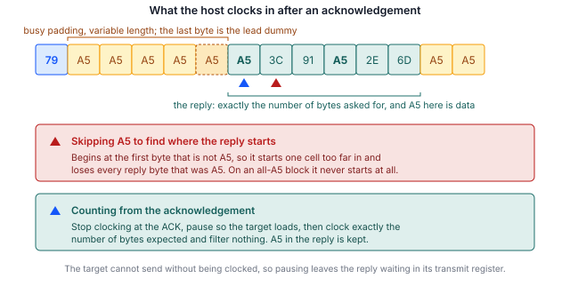

## 1 简介

每一款 STM32 微控制器的 ROM 中都固化了系统引导加载程序，它提供了一种通过串行接口对内部闪存进行编程的手段，既不需要调试探针，也不需要器件上存在任何用户代码。引导加载程序提供的接口因器件而异，AN2606 按料号逐一列出。

在许多系列上，SPI 都出现在该列表中。在本系列已介绍的三种接口中，它的写入速度最快，同时也是主机实现最容易出现隐蔽错误的接口。原因在于一项设计决定：目标器件无话可说时发送的值是一个普通数据值，而不是保留值。把它当作填充字节处理的主机能够通过所有识别命令，却会在读取闪存时损坏数据。

本笔记是 SPI 版本，与介绍 I3C 的 AN0001 和介绍 I2C 的 AN0002 相对应。三者的命令集几乎相同，不同之处在于帧格式，而在这条总线上，帧格式正是关键所在。

### 1.1 范围

本文档介绍：

- SPI 系统引导加载程序协议的结构，包括确认握手，以及决定如何读取应答的规则
- Binho Pulsar 与 STM32 目标器件之间所需的连接，包括一种利用空闲片选驱动 NRST 和 BOOT0 的方法
- 识别、擦除、编程和校验器件的步骤
- 一种在编程工具之外确认目标器件正在运行新编程映像的方法
- 随附的参考实用程序，它可以驱动 Pulsar 或 Supernova

本文档不涉及以下内容：通过 UART、USB、CAN、I2C 或 I3C 进行编程；选项字节编程；读出保护（所测器件的 ROM 引导加载程序未在该接口上提供此功能）；以及量产编程夹具。I3C 请参见 AN0001，I2C 请参见 AN0002。

### 1.2 适用器件

SPI 系统引导加载程序并非某一系列所特有。它所使用的引脚因器件和 SPI 实例而异，全部列于 AN2606 中。这些引脚并不是电路板引到 Arduino 风格 SPI 排针上的引脚，后者是同一外设的应用映射。

Table: 适用器件

| 系列 | 示例器件 | 引导加载程序 SPI 接口 | 依据 |
|---|---|---|---|
| STM32H5 | STM32H503 | SPI1, SPI2, SPI3 | 已为本文档测试 |
| STM32H5 | STM32H563 | 参见 AN2606 | AN2606，未测试 |
| STM32G0, G4 | 无 | 参见 AN2606 | AN2606，未测试 |
| STM32L4, L5 | 无 | 参见 AN2606 | AN2606，未测试 |
| STM32U5 | 无 | 参见 AN2606 | AN2606，未测试 |

只有 STM32H503 在硬件上进行了验证，且仅验证了其 SPI2 实例。在发出本文档中的任何命令之前，必须从 AN2606 中查阅手头器件的引脚和所支持的命令列表。

### 1.3 相关文档

Table: 相关文档

| 文档 | 标题 |
|---|---|
| AN2606 | STM32 microcontroller system memory boot mode |
| AN4286 | SPI protocol used in the STM32 bootloader |
| RM0492 | STM32H503 reference manual |
| AN0001 | 使用 Binho Supernova 通过 I3C 对 STM32 微控制器进行编程 |
| AN0002 | 使用 Binho Pulsar 通过 I2C 对 STM32 微控制器进行编程 |

## 2 系统概述

### 2.1 总线上的角色

主机适配器是 SPI 控制器，驱动时钟和片选。处于系统引导加载程序模式的目标器件是 SPI 目标器件，配置为**模式 0**（时钟空闲为低电平，在前沿采样数据）、MSB 优先、8 位字长。

与 I2C 不同，SPI 没有地址，因此每个片选只能对一个目标器件进行编程；与 I3C 不同，SPI 也没有动态寻址。SPI 的优势在于主机完全掌控时钟，这就排除了时钟延展的问题，并且如第 5.7 节所示，性能问题也因此完全转移到了别处。

### 2.2 状态报告

每条命令都会得到确认。主机持续发送时钟以读入哑字节，直到目标器件应答 `0x79`（ACK）或 `0x1F`（NACK）。

Table: 目标器件发送的值

| 值 | 含义 |
|---|---|
| `0x79` | ACK，该步骤被接受 |
| `0x1F` | NACK，该步骤被拒绝 |
| `0xA5` | 忙。SPI 外设的下溢模式，在没有任何数据排队时发送 |
| `0x5A` | 同步，在会话开始时发送一次 |

忙值是最重要的一行，第 2.3 节将解释原因。

### 2.3 忙值同时也是数据值

`0xA5` 并不是引导加载程序主动选择发送的状态。它是目标器件发送寄存器中没有装载任何数据时 SPI 外设发出的下溢模式。它与恰好为 `0xA5` 的闪存字节之间没有任何区别。

这就排除了大多数读者首先会写出的实现方式。在寻找应答起始位置时跳过 `0xA5`，对每条识别命令都有效，因为这些命令的应答都不以该值开头。但这种做法随后会损坏任何首字节为 `0xA5` 的闪存读取，而对于内容全部为 `0xA5` 的页，读取将永远不会返回。在编写本文档的过程中，我们有意复现了这两种故障。

第 5.6 节给出了可行的帧格式。它是基于位置的：主机在确认处停止发送时钟，让目标器件完成装载，然后准确读取预期数量的字节，不做任何过滤。

> **重要：** 搜索应答起始位置的主机能够通过所有使用识别命令进行的测试，却仍会损坏固件读取。请使用包含 `0xA5` 的数据来验证读取实现，而不要只用 Get 和 Get ID 验证。



### 2.4 主机适配器选项

以下两种配置使用相同的实用程序和相同的步骤。

Table: 主机适配器配置

| 适配器 | 状态 |
|---|---|
| Binho Pulsar | 已验证。用于第 9 节的时序测量 |
| Binho Supernova | 已验证。相同的循环测试和相同的恶意映像测试 |

## 3 硬件设置

### 3.1 所需设备

Table: 所需设备

| 项目 | 本文所用 |
|---|---|
| 主机适配器 | Binho Pulsar，硬件版本 C，固件 4.4.0 |
| 目标板 | NUCLEO-H503RB |
| 接线 | 七根导线：四根用于总线，一根接地，两根用于复位控制 |
| 主机 | Python 3.12 |

### 3.2 连接

STM32H503 为其引导加载程序提供三个 SPI 实例，且每个实例都没有备用引脚映射。本文使用 SPI2，因为它的四个引脚都位于端口 B。

Table: STM32H503 上的 SPI 引导加载程序引脚

| 实例 | MOSI | MISO | SCK | NSS |
|---|---|---|---|---|
| SPI1 | `PA7` | `PA0` | `PA8` | `PB8` |
| SPI2 | `PB1` | `PB14` | `PB10` | `PB12` |
| SPI3 | `PC12` | `PC11` | `PC10` | `PD2` |

Table: Pulsar 与目标器件之间的连接

| Pulsar | 目标器件 | 是否必需 |
|---|---|---|
| SCK | `PB10` | 是 |
| MOSI | `PB1` | 是 |
| MISO | `PB14` | 是 |
| CS 0 | `PB12` (NSS) | 是 |
| GND | GND | 是 |
| CS 1 | `NRST` | 可选，用于自动进入引导加载程序 |
| CS 2 | `BOOT0` | 可选，用于自动进入引导加载程序 |

> **重要：** 这些引脚并不是电路板引到 Arduino 风格 SPI 排针上的引脚。在 NUCLEO-H503RB 上，该排针在 `PA5`、`PA6`、`PA7` 和 `PC9` 上引出 SPI1，这是该外设的应用映射，而不是 ROM 所配置的映射。两者只有 `PA7` 是共用的。请对照 AN2606 确认手头器件的引脚。

### 3.3 利用片选驱动复位

上文将 NRST 和 BOOT0 连接到片选而不是通用引脚上。之所以值得介绍，是因为它利用了片选的一种很少以这种方式使用的特性，并且可以把 GPIO 引脚腾出来用于其他用途。

两个适配器软件包中都没有将片选设置为某一电平的调用。片选所提供的是极性：低电平有效的片选在空闲时为高电平，仅在传输持续期间被拉低。由此可得出两点：

- 选中连接到 NRST 的线路并以低速时钟进行一次传输，即可产生一个**宽度已知的复位脉冲**。实用程序以 10 kHz 发送 200 个字节，使 NRST 保持低电平约 160 ms。
- 连接到 BOOT0 的线路**在未被选中时保持高电平**，而这正是使器件进入引导加载程序的电平。

同样的技巧无法用于选择应用程序，因为那需要在 NRST 产生脉冲时将 BOOT0 保持为低电平，而同一时刻只能选中一条线路。引导加载程序的 Go 命令可以处理这种情况，实用程序会自动回退到该命令。第 6.5 节给出了实际影响。

如果有可用的通用引脚，`--reset-via gpio` 会使用这些引脚，其行为与 AN0001 和 AN0002 中完全相同。

### 3.4 总线注意事项

SPI 不需要上拉电阻。目标器件一侧的四条线路均配置为推挽且不带上下拉，这意味着 **NSS 必须被主动驱动，绝不能悬空**。

> **注意。** 连接之前，请将总线电压设置为与目标器件匹配。实用程序设置为
> 3.3 V，适用于 NUCLEO-H503RB。向供电电压较低的目标器件施加 3.3 V
> 可能会损坏器件。

## 4 软件设置

### 4.1 安装主机软件包

实用程序通过适配器的厂商软件包与适配器通信。请安装与所用适配器对应的软件包：

```
pip install binhopulsar        # for a Pulsar
pip install binhosupernova     # for a Supernova
```

本文档使用的版本：`binhopulsar` 1.2.0，Python 3.12。不需要其他软件包；实用程序自行解析 Intel HEX。

### 4.2 获取参考实用程序

`stm32_flash.py` 包含在本文档随附的资源压缩包中：

```
https://cdn.binho.io/application-notes/AN0003/AN0003-assets.zip
```

相同的文件以及本文档的 Markdown 源文件也发布在 `https://github.com/binhollc/application-notes`。第 12 节列出了压缩包的内容。

压缩包解压后得到一个 `assets` 目录，其中包含实用程序，以及一个 `firmware` 子目录，其中包含第 7 节的验证映像。本文档中的所有命令均以在该 `assets` 目录中运行的形式给出。

它与 AN0001 和 AN0002 随附的文件相同，因此一份副本即可覆盖全部三种总线。

> **重要：** 如果适配器的 SPI 接口已经初始化，它会以 `INTERFACE_ALREADY_INITIALIZED` 应答 `spiControllerInit`，并**丢弃随该调用传入的设置**。此时时钟频率、模式和片选保持原样，每次传输都以错误的配置发出，而调用本身看起来却是成功的。只要初始化报告的结果不是成功，主机就必须通过 `spiControllerSetParameters` 重新应用相同的设置。参考实用程序正是这样做的。如果没有这一步，其症状是总线读回一个恒定值，看起来与接线故障完全相同。

## 5 引导加载程序协议

### 5.1 进入系统引导加载程序模式

在将 `NRST` 拉低产生脉冲并释放的过程中，`BOOT0` 保持高电平。第 3.3 节介绍了实用程序如何利用片选完成这一操作。

### 5.2 会话开始

主机发送同步字节 `0x5A`。目标器件应答它自己的同步字节，随后是一个确认。没有其他握手。

### 5.3 命令帧格式

与另外两种总线不同，同步字节是**每条**命令的前缀，而不仅仅是第一条命令：

```
host    5A <op> <~op>
target  ... 79
host    79
```

目标器件在等待命令时会丢弃任何不是 `0x5A` 的字节，因此在命令之间发送哑字节是无害的。

带地址的命令先以大端序发送四个字节，然后发送这四个字节的单字节异或校验，并在发送有效载荷之前再接收一次确认。

### 5.4 主机必须对确认进行确认

目标器件发送 ACK 之后，会**等待主机回送 `0x79`**，然后才继续。如果主机读到确认后就继续执行，目标器件将处于阻塞状态，而总线上没有任何迹象表明原因：会话只是停止响应。

这是实现在首次通信时挂起的最可能原因。

### 5.5 每个应答前有一个哑字节

确认之后读入的第一个字节是残留的忙模式，因为当第一个应答字节在其后排队时，目标器件的移位寄存器中仍保存着该值。AN4286 将此描述为在读取之前发送一个哑字节。

这种情况**每个应答发生一次，而不是每次传输发生一次**。在应答中途再请求一个哑字节会丢掉一个真实字节；在开发过程中，在查明原因之前，这曾使报告的命令列表向两个方向各错位一个。

### 5.6 读取应答

结合第 2.3 节和第 5.5 节，可行的帧格式如下：

1. 持续发送时钟直到确认出现，并**在此停止**。
2. 发送 `0x79` 以释放目标器件。
3. 短暂暂停，让目标器件装载其第一个应答字节。
4. 准确读入预期数量的字节，丢弃开头的一个哑字节，其他字节一概不过滤。

第 3 步是安全的，因为没有时钟目标器件就无法发送：暂停时，应答会在其发送寄存器中等待。在应答中途暂停同样是安全的，因为目标器件会将下一个字节排队并等待，而不是发送填充字节。

不安全的做法是在确认之后继续发送时钟，因为应答紧接在确认之后开始，没有分隔符，而忙值又无法与数据区分。

### 5.7 支持的命令

Table: STM32H503 上通过 SPI 支持的命令

| 操作码 | 命令 |
|---|---|
| `0x00` | Get |
| `0x01` | Get Version |
| `0x02` | Get ID |
| `0x11` | Read Memory |
| `0x21` | Go |
| `0x31` | Write Memory |
| `0x44` | Extended Erase |
| `0x50` | Special Command |
| `0x63` | Write Protect |
| `0x73` | Write Unprotect |

共十条命令，该列表与此器件通过 I3C 提供的列表完全相同。它比同一器件通过 I2C 提供的命令少五条，I2C 额外提供四种无延展（no-stretch）变体和 Checksum。无延展变体在这里没有意义，因为 SPI 目标器件无法延展一个并非由它驱动的时钟。

Readout Protect（`0x82`）和 Readout Unprotect（`0x92`）不在其中，与另外两种总线的情况相同。

### 5.8 擦除

Extended Erase 接受一个页数，后跟一个页号列表，或者接受一个特殊值。整片擦除为 `0xFFFF`，不带页列表。

对于页列表，计数字段携带的是**页数**（与 I3C 相同），而不是像 I2C 那样的页数减一。此器件上的一个闪存页为 8 KB。

## 6 编程步骤

### 6.1 识别目标器件

```
python stm32_flash.py --bus spi --reset-via cs info

  Adapter: pulsar  fw 4.4.0
  Bus: SPI
  Resetting target into bootloader (NRST=CS1, BOOT0=CS2)
  SPI: 1000 kHz, mode 0, chip select 0
  Bootloader session established

  Protocol version : 2.0
  Device ID        : 0x474  (STM32H503)
  Commands         : 10
      0x00  Get
      ...
      0x73  Write Unprotect
```

这两行之间完整列出了所支持的十条命令，即表 8 中给出的命令。适配器的序列号打印在第一行，此处省略。

建议在任何新电路板上首先执行此步骤，因为它能在尝试任何破坏性操作之前确认接线、总线配置和引导加载程序的进入。

### 6.2 读取现有内容

```
python stm32_flash.py --bus spi --reset-via cs read backup.bin --address 0x08000000 --length 0x20000
```

### 6.3 编程映像

`flash` 命令执行完整的流程：擦除、编程、读回并比较，然后启动应用程序。

```
python stm32_flash.py --bus spi --reset-via cs flash firmware/an0003_image_a.bin --address 0x08000000
```

Intel HEX 文件自带地址，因此可以省略该选项。`--erase pages` 只擦除映像所覆盖的页，对于较小的映像速度更快：

```
python stm32_flash.py --bus spi --reset-via cs flash firmware/an0003_image_a.bin --address 0x08000000 --erase pages
```

`--spi-speed` 用于设置时钟，第 9.3 节解释了为什么提高时钟频率带来的收益低于预期。会话选项既可以放在子命令之前，也可以放在子命令之后。

### 6.4 校验

默认执行校验。通过同一接口读回已编程的范围，并与源映像逐字节比较。可以使用 `--no-verify` 禁用校验。

鉴于第 2.3 节的内容，校验在这条总线上比在其他总线上更为重要：它是能在读取帧格式错误到达客户之前将其发现的步骤。

### 6.5 启动应用程序

当 NRST 和 BOOT0 连接在片选上时，BOOT0 无法被拉低，因此实用程序会发出 Go 命令而不是复位。输出中将此报告为 `Jumping to 0x08000000`。

由第 3.3 节可得出一个值得提前规划的影响：当适配器已连接且处于空闲状态时，连接到 BOOT0 的线路保持高电平，因此断电重启或外部复位会使目标器件重新进入引导加载程序，而不是进入应用程序。如果希望电路板自行启动，请断开该线路，或使用 `--reset-via gpio`。

## 7 在目标器件上确认更新

`flash` 命令会读回已编程的范围并逐字节比较，这证明闪存内容与所提供的映像一致，但并不能证明器件正在执行新固件。

为弥补这一差距，本文档随附了两个小型固件映像。二者完全相同，只是报告的字母和用户 LED 的闪烁频率不同。

### 7.1 验证映像

Table: 本文档随附的验证映像

| 映像 | 文件 | 报告 | LED |
|---|---|---|---|
| A | `firmware/an0003_image_a.bin` | `IMAGE A` | 1 Hz |
| B | `firmware/an0003_image_b.bin` | `IMAGE B` | 5 Hz |

两个映像分别为 864 和 860 字节，链接为从 `0x08000000` 运行。随附提供源代码、链接脚本和 makefile。

两个映像都不使用任何 SPI2 引脚，因此无需改动任何接线即可加载并观察。

### 7.2 步骤

在 ST-LINK 虚拟 COM 端口上以 115200 8N1 打开串口终端，然后编程映像 A：

```
python stm32_flash.py --bus spi --reset-via cs flash firmware/an0003_image_a.bin --address 0x08000000
```

终端显示启动横幅，随后每秒输出一行心跳信息：

```
========================================
  Binho  |  AN0003
  Programming STM32 microcontrollers
  over SPI with the Binho Pulsar
========================================
  Running: IMAGE A
  Kernel clock: 32 MHz
  LED blink: 1 Hz
========================================
  IMAGE A  alive, 1 s
  IMAGE A  alive, 2 s
```

编程映像 B 后，报告的字母随之改变，LED 的闪烁速度加快到五倍。

从 `IMAGE A` 到 `IMAGE B` 的转变就是端到端的结果：映像已通过 SPI 完成擦除、编程和校验，并且器件正在运行所编程的内容。

> **重要：** 编程这些映像会擦除器件上已有的应用程序。请先按照第 6.2 节所述归档现有内容。

> **说明：** 所提供的二进制文件是为 NUCLEO-H503RB 构建的。它们将 `PA4` 用作 USART3_TX，将 `PA5` 用作用户 LED。在任何其他电路板上都不会出现串口输出。由于提供了源代码，可以修改 `firmware/main.c` 开头的引脚和外设定义并重新构建，以移植到其他电路板。

## 8 参考实用程序

### 8.1 命令

Table: 实用程序命令

| 命令 | 操作 |
|---|---|
| `list` | 列出已连接的 Binho 适配器 |
| `info` | 识别目标器件并报告其功能 |
| `flash` | 擦除、编程、校验并运行映像 |
| `read` | 将存储器内容读入文件 |
| `erase` | 整片擦除用户闪存 |
| `reset` | 通过 GPIO 复位目标器件 |

### 8.2 选项

会话选项既可以放在子命令之前，也可以放在子命令之后。此处仅列出与 SPI 相关的选项；I3C 和 I2C 选项分别列于 AN0001 和 AN0002 中。

Table: SPI 会话选项

| 选项 | 默认值 | 含义 |
|---|---|---|
| `--bus` | auto | `spi`、`i2c` 或 `i3c` |
| `--spi-speed` | 1000000 | SPI 时钟，单位 Hz，范围 10000 至 50000000 |
| `--spi-mode` | 0 | SPI 模式 |
| `--spi-cs` | 0 | 承载 NSS 的片选 |
| `--reset-via` | `gpio` | 通过 GPIO 引脚或空闲片选驱动 NRST 和 BOOT0 |
| `--nrst-cs` | 1 | 连接到 `NRST` 的片选，配合 `--reset-via cs` 使用 |
| `--boot0-cs` | 2 | 连接到 `BOOT0` 的片选，配合 `--reset-via cs` 使用 |
| `--manual` | off | 提示手动进入引导加载程序，而不是由程序驱动 |
| `-v`, `-q` | off | 记录每次传输，或抑制进度输出 |

Table: 各命令选项

| 选项 | 适用于 | 含义 |
|---|---|---|
| `--address` | `flash`, `read` | 原始二进制文件的基地址 |
| `--length` | `read` | 要读取的字节数 |
| `--erase` | `flash` | `mass`、`pages` 或 `none` |
| `--page-size` | `flash` | 用于 `--erase pages` 的闪存页大小，默认 8192 |
| `--erase-timeout` | `flash`, `erase` | 擦除允许的秒数 |
| `--chunk-size` | `flash`, `read` | 每次传输的字节数。默认 256，即引导加载程序接受的最大值 |
| `--no-verify` | `flash` | 跳过读回比较 |
| `--no-run` | `flash` | 使器件停留在引导加载程序中 |
| `--run` | `info`, `read`, `erase` | 完成后启动应用程序 |

## 9 实测结果

### 9.1 测试配置

Table: 测试配置

| 项目 | 值 |
|---|---|
| 目标器件 | STM32H503RB，NUCLEO-H503RB |
| 适配器 | Binho Pulsar，硬件版本 C，固件 4.4.0 |
| 主机软件包 | `binhopulsar` 1.2.0，Python 3.12 |
| 实用程序 | `stm32_flash.py`，即资源压缩包中提供的版本 |
| 总线 | SPI2，模式 0，3.3 V |

### 9.2 编程 122,912 字节的映像

Table: 4 MHz 下 122,912 字节映像的实测时间

| 操作 | 时间 | 吞吐量 |
|---|---|---|
| 整片擦除 | 0.03 s | 不适用 |
| 编程 | 4.66 s | 25.8 KiB/s |
| 校验 | 8.19 s | 14.7 KiB/s |

在这里写入比读取更快，这与另外两种总线相反，并且是第 5.6 节的直接结果。写入中的每个确认都可以成批等待，因为其后没有主机需要的数据。而每次读取中都有一个确认不能这样等待，因为应答紧接在它之后开始。

### 9.3 读取吞吐量与时钟频率的关系

会话建立（包括枚举、复位脉冲和开始握手）耗时 2.00 s，且不随时钟频率变化。

Table: 128 KiB 读取实测

| 时钟 | 读取阶段 | 吞吐量 |
|---|---|---|
| 1 MHz | 10.31 s | 12.4 KiB/s |
| 4 MHz | 8.92 s | 14.3 KiB/s |
| 8 MHz | 8.91 s | 14.4 KiB/s |

三次读取返回的数据逐字节完全相同。

将时钟提高到 4 MHz 以上收益甚微，因为目标器件在每个步骤之后的响应延迟是以时钟周期而不是实际时间计算的，所以更快的时钟并不能缩短以字节计的等待。此外，Read Memory 将每个数据块限制为 256 字节，这也限制了每条命令能够携带的数据量。

### 9.4 可靠性

Table: 已完成的擦除、编程、校验和运行循环

| 配置 | 完成的循环数 |
|---|---|
| Pulsar，SPI2，1 MHz，通过片选复位 | 6 次中 6 次 |
| Supernova，SPI2，1 MHz，通过片选复位 | 6 次中 6 次 |

循环在映像 A 和映像 B 之间交替进行，因此每次循环擦除、编程和校验的内容都与上一次不同。

此外，我们构造了一个映像，使其每个 256 字节数据块都以 `0xA5` 开头，并且有一个数据块全部由 `0xA5` 组成，然后分别从两种适配器对其进行编程并逐字节校验。该映像正是区分正确读取实现与过滤填充字节的实现的测试；第 5.6 节所述的实现能够通过该测试，而显而易见的替代实现则不能。

这些数据描述的是一个目标器件和一台主机。它们证明该步骤是可重复的，而不是可靠性规格。

## 10 故障排除

Table: 故障排除

| 症状 | 可能原因及处理方法 |
|---|---|
| 第一次确认之后会话停止响应 | 主机没有回送 `0x79`。目标器件会一直阻塞，直到收到为止。请参见第 5.4 节。 |
| 识别正常，但闪存读取的数据损坏 | 应答是通过搜索而不是按位置读取的，包含 `0xA5` 的数据被当作填充字节。请参见第 2.3 节和第 5.6 节。 |
| 读取永远不返回 | 原因相同，发生在内容全部为 `0xA5` 的区域上。 |
| 命令列表错位一个 | 开头的哑字节是按每次传输而不是按每个应答消耗的。请参见第 5.5 节。 |
| 完全没有响应 | 引脚错误。引导加载程序的 SPI 引脚不是电路板的 Arduino SPI 排针。请对照 AN2606 确认。 |
| 没有响应，接线已确认 | NSS 悬空。目标器件将其配置为不带上下拉，因此必须对其进行驱动。 |
| 每次传输都读回同一个恒定值 | 适配器报告其 SPI 接口已初始化，并丢弃了传给初始化调用的设置，因此总线仍按之前的配置运行。请使用 `spiControllerSetParameters` 重新应用这些设置。请参见第 4.2 节。 |
| 断电重启后目标器件回到引导加载程序 | 当 BOOT0 连接在片选上时属正常现象，因为片选空闲时为高电平。请参见第 6.5 节。 |
| 提高时钟频率并没有变快 | 在约 4 MHz 以上属正常现象。目标器件的响应延迟以时钟周期计算，因此更快的时钟并不能缩短它。请参见第 9.3 节。 |
| 验证映像的串口输出乱码 | 终端波特率不匹配。映像使用 115200 8N1。 |

## 11 缩略语

Table: 缩略语

| 术语 | 含义 |
|---|---|
| ACK | 确认（Acknowledge） |
| CS | 片选（Chip select） |
| HSI | 高速内部振荡器（High-speed internal oscillator） |
| MISO | 控制器输入，目标器件输出（Controller in, target out） |
| MOSI | 控制器输出，目标器件输入（Controller out, target in） |
| NACK | 未确认（Not acknowledged） |
| NSS | 目标器件选择（Target select） |
| ROM | 只读存储器（Read-only memory） |
| SCK | 串行时钟（Serial clock） |
| SPI | 串行外设接口（Serial Peripheral Interface） |
| VCP | 虚拟 COM 端口（Virtual COM port） |

## 12 关于本文档中源代码的说明

本文档中展示的以及随附压缩包中提供的示例代码仅供评估和参考。这些代码依据 MIT 许可证发布，许可证文本包含在压缩包中。

压缩包 `AN0003-assets.zip` 发布于 `https://cdn.binho.io/application-notes/AN0003/AN0003-assets.zip`，包含以下内容。

Table: 资源压缩包的内容

| 路径 | 说明 |
|---|---|
| `AN0003.md` | 本文档的 Markdown 版本 |
| `assets/stm32_flash.py` | 参考实用程序，与 AN0001 和 AN0002 共用 |
| `assets/PROTOCOL.md` | SPI 引导加载程序协议的线路级说明 |
| `assets/test_hex_parser.py` | Intel HEX 解析器的测试 |
| `assets/LICENSE` | MIT 许可证 |
| `assets/firmware/main.c` | 两个验证映像的源代码 |
| `assets/firmware/link.ld` | 链接脚本 |
| `assets/firmware/Makefile` | 构建两个映像 |
| `assets/firmware/README.md` | 验证映像的说明 |
| `assets/firmware/an0003_image_a.bin` | 预构建的映像 A |
| `assets/firmware/an0003_image_b.bin` | 预构建的映像 B |

## 13 修订历史

Table: 修订历史

| 修订版本 | 日期 | 说明 |
|---|---|---|
| 1.0 | 30 August 2026 | 首次发布。 |
| 1.1 | 3 September 2026 | 三个表格单元格原先使用 em-dash 表示不存在的值，现改为 `none`，即未列出示例器件的系列。实测结果均未改变。 |
