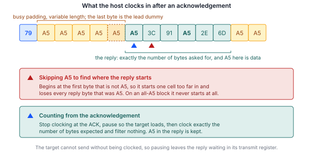

## 1 簡介

每顆 STM32 微控制器 ROM 中燒錄的系統開機載入程式，提供了一種透過序列介面燒錄內部快閃記憶體的方法，
既不需要除錯探針，裝置上也不需要任何使用者程式碼。開機載入程式提供的介面因裝置而異，
並依料號列於 AN2606 中。

SPI 出現在該清單中的許多系列。在本系列已涵蓋的三種介面中，它是寫入速度最快的一種，
也是主機實作最容易出現細微錯誤的一種。原因在於一個設計決策：目標裝置在沒有資料可傳時送出的值是
一般的資料值，而不是保留值。將其視為填充位元組的主機能通過所有識別指令，接著卻會損毀快閃記憶體讀取的資料。

本筆記是 SPI 版本，對應涵蓋 I3C 的 AN0001 與涵蓋 I2C 的 AN0002。三者的指令集幾乎相同。
不同之處在於訊框，而在此匯流排上，關鍵正是訊框。

### 1.1 範圍

本文件說明：

- SPI 系統開機載入程式協定的結構，包括確認（acknowledgement）交握，以及規範如何讀取回應的規則
- Binho Pulsar 與 STM32 目標裝置之間所需的連接，包括從多餘的晶片選擇線驅動 NRST 與 BOOT0 的方法
- 識別、抹除、燒錄並驗證裝置的步驟
- 從燒錄工具外部確認目標裝置正在執行新燒錄映像檔的方法
- 隨附的參考工具程式，可驅動 Pulsar 或 Supernova

本文件不涵蓋透過 UART、USB、CAN、I2C 或 I3C 燒錄；選項位元組（option byte）燒錄；
讀取保護（受測料號的 ROM 開機載入程式在此介面上不提供此功能）；或量產燒錄治具。
I3C 請參閱 AN0001，I2C 請參閱 AN0002。

### 1.2 適用裝置

SPI 系統開機載入程式並非某一系列所專有。其使用的接腳依料號及 SPI 實例而異，全部列於 AN2606 中。
這些接腳並非開發板引至 Arduino 風格 SPI 排針的接腳，後者是同一周邊的應用對應。

Table: 適用裝置

| 系列 | 範例料號 | 開機載入程式 SPI 介面 | 依據 |
|---|---|---|---|
| STM32H5 | STM32H503 | SPI1、SPI2、SPI3 | 已為本文件測試 |
| STM32H5 | STM32H563 | 依 AN2606 | AN2606，未測試 |
| STM32G0、G4 | 無 | 依 AN2606 | AN2606，未測試 |
| STM32L4、L5 | 無 | 依 AN2606 | AN2606，未測試 |
| STM32U5 | 無 | 依 AN2606 | AN2606，未測試 |

僅 STM32H503 在硬體上實際測試過，且僅測試其 SPI2 實例。在執行本文件的任何指令之前，
必須針對手上的料號從 AN2606 查閱接腳與支援的指令清單。

### 1.3 相關文件

Table: 相關文件

| 文件 | 標題 |
|---|---|
| AN2606 | STM32 microcontroller system memory boot mode |
| AN4286 | SPI protocol used in the STM32 bootloader |
| RM0492 | STM32H503 reference manual |
| AN0001 | 使用 Binho Supernova 透過 I3C 燒錄 STM32 微控制器 |
| AN0002 | 使用 Binho Pulsar 透過 I2C 燒錄 STM32 微控制器 |

## 2 系統概觀

### 2.1 匯流排上的角色

主機轉接器是 SPI 控制器，負責驅動時脈與晶片選擇。處於系統開機載入程式模式的目標裝置是
設定為 **mode 0**（時脈閒置為低電位，資料在前緣取樣）、MSB 優先、8 位元字組的 SPI 目標裝置。

與 I2C 不同，SPI 沒有位址，因此每條晶片選擇線只能燒錄一個目標裝置；與 I3C 不同，SPI 也沒有動態定址。
SPI 所提供的則是主機完全掌控時脈，這消除了時脈延展（clock stretching）的問題，
並如第 5.7 節所示，將效能問題完全轉移到其他地方。

### 2.2 狀態回報

每個指令都會被確認。主機持續送出虛擬位元組（dummy byte）的時脈，直到目標裝置回應 `0x79`（ACK）
或 `0x1F`（NACK）。

Table: 目標裝置送出的值

| 值 | 意義 |
|---|---|
| `0x79` | ACK，該步驟已被接受 |
| `0x1F` | NACK，該步驟被拒絕 |
| `0xA5` | 忙碌。SPI 周邊的欠載（underrun）樣式，在沒有任何資料排入佇列時送出 |
| `0x5A` | 同步，在工作階段開啟時送出一次 |

忙碌值是最重要的一列，第 2.3 節將說明原因。

### 2.3 忙碌值同時也是資料值

`0xA5` 並非開機載入程式選擇送出的狀態。它是目標裝置的傳送暫存器中沒有載入任何資料時，
SPI 周邊所發出的欠載樣式。它與恰好存有 `0xA5` 的快閃記憶體位元組沒有任何區別。

這排除了大多數讀者最先會寫出的實作方式。在尋找回應起點時略過 `0xA5`，對所有識別指令都有效，
因為這些指令的回應都不以該值開頭。但接著它會損毀任何第一個位元組為 `0xA5` 的快閃記憶體讀取，
而在整頁皆為 `0xA5` 的頁面上則永遠不會返回。這兩種失敗都在撰寫本文件期間刻意重現過。

第 5.6 節提供可行的訊框方式。它是依位置而定的：主機在確認處停止送出時脈，讓目標裝置載入資料，
然後恰好讀取所預期的位元組數，不做任何過濾。

> **重要：** 搜尋回應起點的主機能通過所有以識別指令進行的測試，卻仍會損毀韌體讀取。
請以含有 `0xA5` 的資料驗證讀取實作，而非以 Get 與 Get ID 驗證。



### 2.4 主機轉接器選項

以下兩種組態使用相同的工具程式與相同的步驟。

Table: 主機轉接器組態

| 轉接器 | 狀態 |
|---|---|
| Binho Pulsar | 已驗證。用於第 9 節的時間量測 |
| Binho Supernova | 已驗證。相同的循環次數與相同的惡意映像檔測試 |

## 3 硬體設定

### 3.1 所需設備

Table: 所需設備

| 項目 | 本文使用 |
|---|---|
| 主機轉接器 | Binho Pulsar，硬體版本 C，韌體 4.4.0 |
| 目標板 | NUCLEO-H503RB |
| 配線 | 七條線：四條用於匯流排，一條接地，兩條用於重置控制 |
| 主機 | Python 3.12 |

### 3.2 連接

STM32H503 為其開機載入程式提供三個 SPI 實例，且每個實例都沒有替代接腳對應。
此處使用 SPI2，因為它的四支接腳都在 port B 上。

Table: STM32H503 上的 SPI 開機載入程式接腳

| 實例 | MOSI | MISO | SCK | NSS |
|---|---|---|---|---|
| SPI1 | `PA7` | `PA0` | `PA8` | `PB8` |
| SPI2 | `PB1` | `PB14` | `PB10` | `PB12` |
| SPI3 | `PC12` | `PC11` | `PC10` | `PD2` |

Table: Pulsar 與目標裝置之間的連接

| Pulsar | 目標裝置 | 必要 |
|---|---|---|
| SCK | `PB10` | 是 |
| MOSI | `PB1` | 是 |
| MISO | `PB14` | 是 |
| CS 0 | `PB12`（NSS） | 是 |
| GND | GND | 是 |
| CS 1 | `NRST` | 選用，用於自動進入開機載入程式 |
| CS 2 | `BOOT0` | 選用，用於自動進入開機載入程式 |

> **重要：** 這些並非開發板引至 Arduino 風格 SPI 排針的接腳。在 NUCLEO-H503RB 上，
該排針在 `PA5`、`PA6`、`PA7` 與 `PC9` 上承載 SPI1，這是該周邊的應用對應，而非 ROM 所設定的對應。
兩者僅 `PA7` 相同。請針對手上的料號以 AN2606 確認。

### 3.3 從晶片選擇線驅動重置

上方將 NRST 與 BOOT0 接在晶片選擇線上，而非通用接腳。這值得說明，因為它利用了晶片選擇線一項很少以此方式使用的特性，
並且可以讓 GPIO 接腳空出來做其他用途。

兩個轉接器套件中都沒有任何呼叫能將晶片選擇線設定為某個電位。晶片選擇線所提供的是極性：
低電位有效的選擇線閒置時為高電位，並僅在傳輸持續期間被拉低。由此產生兩個結果：

- 選取接到 NRST 的那條線並送出一段慢速傳輸，即可產生**已知寬度的重置脈衝**。工具程式以 10 kHz
  送出 200 個位元組，使 NRST 保持低電位約 160 ms。
- 接到 BOOT0 的那條線**在未被選取時維持高電位**，而這正是使該料號進入開機載入程式的電位。

同樣的技巧無法用來選擇應用程式，因為那需要在 NRST 產生脈衝時讓 BOOT0 保持低電位，
而一次只能選取一條線。開機載入程式的 Go 指令可涵蓋此情況，工具程式會自動改用它。
第 6.5 節說明其實際影響。

若改為有可用的通用接腳，`--reset-via gpio` 會使用它們，其行為與 AN0001 及 AN0002 完全相同。

### 3.4 匯流排注意事項

SPI 不需要上拉電阻。四條線在目標裝置端都設定為推挽且無上拉／下拉，這表示 **NSS 必須主動驅動，
絕不可浮接**。

> **注意。** 連接前，請將匯流排電壓設定為與目標裝置相符。工具程式設定為
> 3.3 V，適用於 NUCLEO-H503RB。將 3.3 V 驅動至以較低電源電壓運作的目標裝置
> 可能造成損壞。

## 4 軟體設定

### 4.1 安裝主機套件

工具程式透過轉接器的廠商套件與轉接器溝通。請安裝與所用轉接器相符的套件：

```
pip install binhopulsar        # for a Pulsar
pip install binhosupernova     # for a Supernova
```

本文件使用的版本：`binhopulsar` 1.2.0、Python 3.12。不需要其他套件；
工具程式自行解析 Intel HEX。

### 4.2 取得參考工具程式

`stm32_flash.py` 收錄於本文件隨附的資產壓縮檔中：

```
https://cdn.binho.io/application-notes/AN0003/AN0003-assets.zip
```

相同的檔案連同本文件的 Markdown 原始檔，也發布於
`https://github.com/binhollc/application-notes`。第 12 節列出壓縮檔的內容。

壓縮檔解開後為一個 `assets` 目錄，內含工具程式，以及一個 `firmware`
子目錄，內含第 7 節的驗證映像檔。本文件中的每個指令，都以從該 `assets` 目錄內執行的方式呈現。

它與 AN0001 及 AN0002 隨附的檔案相同，因此一份即可涵蓋全部三種匯流排。

> **重要：** SPI 介面已初始化的轉接器，會以 `INTERFACE_ALREADY_INITIALIZED` 回應
`spiControllerInit`，並**捨棄隨該呼叫傳入的設定**。時脈速率、模式與晶片選擇於是維持原狀，
每次傳輸都以錯誤的設定送出，而該呼叫本身看起來卻是成功的。只要 init 回報的結果不是成功，
主機就必須透過 `spiControllerSetParameters` 重新套用相同的設定。參考工具程式會這麼做。
若未如此實作，症狀會是匯流排讀回一個常數，看起來與配線故障完全相同。

## 5 開機載入程式協定

### 5.1 進入系統開機載入程式模式

在 `NRST` 被拉低後再釋放的期間，`BOOT0` 保持高電位。第 3.3 節說明工具程式如何從晶片選擇線完成此動作。

### 5.2 工作階段開始

主機送出同步位元組 `0x5A`。目標裝置回應自己的同步位元組，接著回應一個確認。之後沒有其他交握。

### 5.3 指令訊框

與另外兩種匯流排不同，同步位元組會加在**每一個**指令之前，而不只是第一個：

```
host    5A <op> <~op>
target  ... 79
host    79
```

目標裝置在等待指令時會捨棄任何不是 `0x5A` 的內容，因此在指令之間送出虛擬位元組不會造成影響。

帶有位址的指令會以大端序（big-endian）送出四個位元組，後接這四個位元組的一位元組 XOR，
並在其酬載之前再接收一次確認。

### 5.4 主機必須確認該確認

目標裝置送出 ACK 之後，會**等待主機回送 `0x79`** 才繼續。讀取確認後就逕自繼續的主機會讓目標裝置卡住，
而匯流排上沒有任何跡象顯示原因：工作階段就此停止回應。

這是實作在首次連線時停止回應最可能的單一原因。

### 5.5 每個回應前都有一個虛擬位元組

確認之後送出時脈讀入的第一個位元組是過時的忙碌樣式，因為在第一個回應位元組排入其後時，
目標裝置的移位暫存器仍存有該值。AN4286 將此描述為在讀取前送出一個虛擬位元組。

它是**每個回應發生一次，而非每次傳輸發生一次**。在回應中途再要求一個虛擬位元組會丟失一個真實位元組，
在開發過程中，這曾使回報的指令清單在找出原因之前雙向各偏移一位。

### 5.6 讀取回應

綜合第 2.3 節與第 5.5 節，可行的訊框方式為：

1. 送出時脈直到出現確認，然後**就此停止**。
2. 送出 `0x79` 以釋放目標裝置。
3. 短暫暫停，讓目標裝置載入第一個回應位元組。
4. 恰好送出所預期位元組數的時脈，捨棄開頭的那一個虛擬位元組，其餘一律不過濾。

步驟 3 是安全的，因為目標裝置在沒有時脈的情況下無法傳送：暫停會讓回應停留在其傳送暫存器中等待。
在回應中途暫停同樣安全，因為目標裝置會將下一個位元組排入佇列並等待，而不會送出填充。

不安全的是在確認之後繼續送出時脈，因為回應緊接在確認之後開始，沒有任何分隔符號，
而忙碌值又無法與資料區分。

### 5.7 支援的指令

Table: STM32H503 上透過 SPI 支援的指令

| 操作碼 | 指令 |
|---|---|
| `0x00` | Get |
| `0x01` | Get Version |
| `0x02` | Get ID |
| `0x11` | Read Memory |
| `0x21` | Go |
| `0x31` | Write Memory |
| `0x44` | Extended Erase |
| `0x50` | Special Command |
| `0x63` | Write Protect |
| `0x73` | Write Unprotect |

共十個指令，此清單與該料號透過 I3C 提供的清單完全相同。比同一料號透過 I2C 提供的少五個，
I2C 另外增加了四個 no-stretch 變體與 Checksum。no-stretch 變體在此沒有意義，
因為 SPI 目標裝置無法延展一個並非由它驅動的時脈。

Readout Protect（`0x82`）與 Readout Unprotect（`0x92`）不存在，在另外兩種匯流排上也是如此。

### 5.8 抹除

Extended Erase 接收一個頁數，後接頁碼清單，或一個特殊值。整片抹除為 `0xFFFF` 且不帶頁碼清單。

對於頁碼清單，計數欄位承載的是**頁數**（與 I3C 相同），而非如 I2C 那樣的頁數減一。
此料號的快閃記憶體一頁為 8 KB。

## 6 燒錄步驟

### 6.1 識別目標裝置

```
python stm32_flash.py --bus spi --reset-via cs info

  Adapter: pulsar  fw 4.4.0
  Bus: SPI
  Resetting target into bootloader (NRST=CS1, BOOT0=CS2)
  SPI: 1000 kHz, mode 0, chip select 0
  Bootloader session established

  Protocol version : 2.0
  Device ID        : 0x474  (STM32H503)
  Commands         : 10
      0x00  Get
      ...
      0x73  Write Unprotect
```

這兩行之間會完整列出十個支援的指令，即表 8 中所列者。轉接器的序號會印在第一行，此處省略。

這是在任何新開發板上建議的第一步，因為它可在嘗試任何破壞性操作之前，確認配線、匯流排組態
以及開機載入程式的進入。

### 6.2 讀取既有內容

```
python stm32_flash.py --bus spi --reset-via cs read backup.bin --address 0x08000000 --length 0x20000
```

### 6.3 燒錄映像檔

`flash` 指令會執行完整的流程：抹除、燒錄、讀回並比對，然後啟動應用程式。

```
python stm32_flash.py --bus spi --reset-via cs flash firmware/an0003_image_a.bin --address 0x08000000
```

Intel HEX 檔案自帶位址，因此可省略該選項。`--erase pages` 只抹除映像檔所涵蓋的頁面，
對於小型映像檔速度較快：

```
python stm32_flash.py --bus spi --reset-via cs flash firmware/an0003_image_a.bin --address 0x08000000 --erase pages
```

`--spi-speed` 用於設定時脈，第 9.3 節說明為何提高時脈所得的效益不如預期。
工作階段選項可置於子指令之前或之後。

### 6.4 驗證

預設會執行驗證。燒錄的範圍會透過相同介面讀回，並與來源映像檔逐位元組比對。
可使用 `--no-verify` 停用。

基於第 2.3 節，驗證在此匯流排上比在其他匯流排上更為重要：它是能在讀取訊框錯誤到達客戶之前將其攔截的步驟。

### 6.5 啟動應用程式

當 NRST 與 BOOT0 接在晶片選擇線上時，BOOT0 無法被拉低，因此工具程式改為發出 Go 指令，
而非執行重置。輸出會將此回報為 `Jumping to 0x08000000`。

由第 3.3 節可推得一個值得預先規劃的結果：當轉接器連接且閒置時，接到 BOOT0 的那條線維持高電位，
因此重新上電或外部重置會讓目標裝置回到開機載入程式，而非進入應用程式。
若預期開發板能自行啟動，請拔除該線，或使用 `--reset-via gpio`。

## 7 在目標裝置上確認更新

`flash` 指令會讀回燒錄的範圍並逐位元組比對，這證明快閃記憶體的內容與所提供的映像檔相符。
但它無法證明裝置正在執行新韌體。

本文件隨附兩個小型韌體映像檔來彌補此落差。兩者完全相同，差別只在於回報的字母，以及使用者 LED 的閃爍頻率。

### 7.1 驗證映像檔

Table: 本文件隨附的驗證映像檔

| 映像檔 | 檔案 | 回報內容 | LED |
|---|---|---|---|
| A | `firmware/an0003_image_a.bin` | `IMAGE A` | 1 Hz |
| B | `firmware/an0003_image_b.bin` | `IMAGE B` | 5 Hz |

兩個映像檔分別為 864 與 860 位元組，並連結為從 `0x08000000` 執行。
原始碼、連結器腳本與 makefile 一併隨附。

兩個映像檔都未使用任何 SPI2 接腳，因此無需變更任何配線即可載入並觀察。

### 7.2 步驟

在 ST-LINK 虛擬 COM 連接埠上以 115200 8N1 開啟序列終端機，然後燒錄映像檔 A：

```
python stm32_flash.py --bus spi --reset-via cs flash firmware/an0003_image_a.bin --address 0x08000000
```

終端機會顯示標題，接著每秒顯示一行心跳訊息：

```
========================================
  Binho  |  AN0003
  Programming STM32 microcontrollers
  over SPI with the Binho Pulsar
========================================
  Running: IMAGE A
  Kernel clock: 32 MHz
  LED blink: 1 Hz
========================================
  IMAGE A  alive, 1 s
  IMAGE A  alive, 2 s
```

燒錄映像檔 B 後，回報的字母會改變，LED 的閃爍速度會快五倍。

從 `IMAGE A` 轉變為 `IMAGE B` 即是端對端的結果：映像檔已透過 SPI 抹除、燒錄並驗證，
且裝置正在執行所燒錄的內容。

> **重要：** 燒錄這些映像檔會抹除裝置上既有的應用程式。
請先依第 6.2 節所述備份既有內容。

> **備註：** 所提供的二進位檔是為 NUCLEO-H503RB 建置的。它們將 `PA4` 驅動為
USART3_TX，將 `PA5` 驅動為使用者 LED。在任何其他開發板上，序列輸出都不會出現。
原始碼已隨附，因此可修改 `firmware/main.c` 開頭的接腳與周邊定義並重新建置，以移植至其他開發板。

## 8 參考工具程式

### 8.1 指令

Table: 工具程式指令

| 指令 | 動作 |
|---|---|
| `list` | 列出已連接的 Binho 轉接器 |
| `info` | 識別目標裝置並回報其功能 |
| `flash` | 抹除、燒錄、驗證並執行映像檔 |
| `read` | 將記憶體讀入檔案 |
| `erase` | 整片抹除使用者快閃記憶體 |
| `reset` | 透過 GPIO 重置目標裝置 |

### 8.2 選項

工作階段選項可置於子指令之前或之後。此處僅列出與 SPI 相關者；
I3C 與 I2C 的選項請參閱 AN0001 與 AN0002。

Table: SPI 工作階段選項

| 選項 | 預設值 | 意義 |
|---|---|---|
| `--bus` | auto | `spi`、`i2c` 或 `i3c` |
| `--spi-speed` | 1000000 | SPI 時脈（Hz），10000 至 50000000 |
| `--spi-mode` | 0 | SPI 模式 |
| `--spi-cs` | 0 | 承載 NSS 的晶片選擇線 |
| `--reset-via` | `gpio` | 從 GPIO 接腳或從多餘的晶片選擇線驅動 NRST 與 BOOT0 |
| `--nrst-cs` | 1 | 接到 `NRST` 的晶片選擇線，搭配 `--reset-via cs` |
| `--boot0-cs` | 2 | 接到 `BOOT0` 的晶片選擇線，搭配 `--reset-via cs` |
| `--manual` | off | 提示使用者手動進入開機載入程式，而非由工具驅動 |
| `-v`、`-q` | off | 記錄每次傳輸，或隱藏進度輸出 |

Table: 個別指令選項

| 選項 | 適用於 | 意義 |
|---|---|---|
| `--address` | `flash`、`read` | 原始二進位檔的基底位址 |
| `--length` | `read` | 要讀取的位元組數 |
| `--erase` | `flash` | `mass`、`pages` 或 `none` |
| `--page-size` | `flash` | `--erase pages` 使用的快閃記憶體頁面大小，預設 8192 |
| `--erase-timeout` | `flash`、`erase` | 抹除所允許的秒數 |
| `--chunk-size` | `flash`、`read` | 每次傳輸的位元組數。預設 256，為開機載入程式可接受的最大值 |
| `--no-verify` | `flash` | 略過讀回比對 |
| `--no-run` | `flash` | 讓裝置停留在開機載入程式 |
| `--run` | `info`、`read`、`erase` | 完成後啟動應用程式 |

## 9 實測結果

### 9.1 測試組態

Table: 測試組態

| 項目 | 值 |
|---|---|
| 目標裝置 | STM32H503RB，NUCLEO-H503RB |
| 轉接器 | Binho Pulsar，硬體版本 C，韌體 4.4.0 |
| 主機套件 | `binhopulsar` 1.2.0，Python 3.12 |
| 工具程式 | `stm32_flash.py`，即資產壓縮檔中所提供者 |
| 匯流排 | SPI2，mode 0，3.3 V |

### 9.2 燒錄 122,912 位元組的映像檔

Table: 在 4 MHz 下燒錄 122,912 位元組映像檔的實測時間

| 操作 | 時間 | 傳輸率 |
|---|---|---|
| 整片抹除 | 0.03 s | 不適用 |
| 燒錄 | 4.66 s | 25.8 KiB/s |
| 驗證 | 8.19 s | 14.7 KiB/s |

在此寫入比讀取快，這與另外兩種匯流排相反，且是第 5.6 節的直接結果。寫入中的每個確認都可以成批等待，
因為其後沒有主機需要的資料。讀取中則有一個確認不能如此，因為回應緊接在它之後開始。

### 9.3 讀取傳輸率與時脈速率的關係

工作階段建立（涵蓋列舉、重置脈衝與開啟交握）耗時 2.00 s，且不隨時脈速率改變。

Table: 128 KiB 讀取實測

| 時脈 | 讀取階段 | 傳輸率 |
|---|---|---|
| 1 MHz | 10.31 s | 12.4 KiB/s |
| 4 MHz | 8.92 s | 14.3 KiB/s |
| 8 MHz | 8.91 s | 14.4 KiB/s |

三次讀取傳回的資料逐位元組完全相同。

將時脈提高到 4 MHz 以上所得效益甚微，因為目標裝置在每個步驟後的回應延遲是以時脈週期計算，
而非以實際時間計算，因此較快的時脈並不會縮短以位元組計算的等待。Read Memory 也將每個區塊上限設為 256 位元組，
這限制了每個指令可承載的資料量。

### 9.4 可靠度

Table: 完成的抹除、燒錄、驗證與執行循環

| 組態 | 完成循環數 |
|---|---|
| Pulsar 於 SPI2，1 MHz，從晶片選擇線重置 | 6 / 6 |
| Supernova 於 SPI2，1 MHz，從晶片選擇線重置 | 6 / 6 |

各循環在映像檔 A 與映像檔 B 之間交替，因此每次循環所抹除、燒錄並驗證的內容都與前一次不同。

此外，一個特別建構、每個 256 位元組區塊皆以 `0xA5` 開頭且其中一個區塊完全由 `0xA5` 組成的映像檔，
已從兩種轉接器燒錄並逐位元組驗證。該映像檔
即是區分正確讀取實作與會過濾填充之實作的測試；第 5.6 節所述的實作能通過此測試，而直覺的替代做法則否。

這些數據描述的是一個目標裝置與一台主機。它們是證明步驟可重複的證據，而非可靠度規格。

## 10 疑難排解

Table: 疑難排解

| 症狀 | 可能原因與處置 |
|---|---|
| 第一個確認之後工作階段停止回應 | 主機未回送 `0x79`。目標裝置會卡住直到收到為止。請參閱第 5.4 節。 |
| 識別正常，但快閃記憶體讀取資料損毀 | 回應是以搜尋方式而非依位置讀取，且含有 `0xA5` 的資料被當成填充。請參閱第 2.3 節與第 5.6 節。 |
| 讀取永不返回 | 原因相同，發生在完全為 `0xA5` 的區域。 |
| 指令清單偏移一位 | 開頭的虛擬位元組是每次傳輸消耗一次，而非每個回應消耗一次。請參閱第 5.5 節。 |
| 完全沒有任何回應 | 接腳錯誤。開機載入程式的 SPI 接腳並非開發板的 Arduino SPI 排針。請以 AN2606 確認。 |
| 沒有回應，配線已確認 | NSS 浮接。目標裝置將其設定為無上拉／下拉，因此必須驅動。 |
| 每次傳輸都讀回相同的常數 | 轉接器回報其 SPI 介面已初始化，並捨棄了傳給 init 的設定，因此匯流排以先前的組態運作。請使用 `spiControllerSetParameters` 重新套用設定。請參閱第 4.2 節。 |
| 重新上電後目標裝置回到開機載入程式 | 當 BOOT0 接在閒置時為高電位的晶片選擇線上時，此為預期行為。請參閱第 6.5 節。 |
| 提高時脈並未變快 | 在約 4 MHz 以上為預期行為。目標裝置的回應延遲以時脈週期計算，因此較快的時脈不會縮短它。請參閱第 9.3 節。 |
| 驗證映像檔的序列輸出出現亂碼 | 終端機鮑率不符。映像檔使用 115200 8N1。 |

## 11 縮寫

Table: 縮寫

| 術語 | 意義 |
|---|---|
| ACK | 確認（Acknowledge） |
| CS | 晶片選擇（Chip select） |
| HSI | 高速內部振盪器（High-speed internal oscillator） |
| MISO | 控制器輸入，目標裝置輸出（Controller in, target out） |
| MOSI | 控制器輸出，目標裝置輸入（Controller out, target in） |
| NACK | 未確認（Not acknowledged） |
| NSS | 目標裝置選擇（Target select） |
| ROM | 唯讀記憶體（Read-only memory） |
| SCK | 序列時脈（Serial clock） |
| SPI | 序列周邊介面（Serial Peripheral Interface） |
| VCP | 虛擬 COM 連接埠（Virtual COM port） |

## 12 關於本文件中原始碼的說明

本文件中所示及隨附壓縮檔中所提供的範例程式碼，僅供評估與參考之用。其以 MIT 授權條款發布，
授權條款全文收錄於壓縮檔中。

壓縮檔 `AN0003-assets.zip` 發布於
`https://cdn.binho.io/application-notes/AN0003/AN0003-assets.zip`，內容如下。

Table: 資產壓縮檔內容

| 路徑 | 說明 |
|---|---|
| `AN0003.md` | 本文件的 Markdown 版本 |
| `assets/stm32_flash.py` | 參考工具程式，與 AN0001 及 AN0002 共用 |
| `assets/PROTOCOL.md` | SPI 開機載入程式協定的線路層級說明 |
| `assets/test_hex_parser.py` | Intel HEX 解析器的測試 |
| `assets/LICENSE` | MIT 授權條款 |
| `assets/firmware/main.c` | 兩個驗證映像檔的原始碼 |
| `assets/firmware/link.ld` | 連結器腳本 |
| `assets/firmware/Makefile` | 建置兩個映像檔 |
| `assets/firmware/README.md` | 驗證映像檔的說明 |
| `assets/firmware/an0003_image_a.bin` | 預先建置的映像檔 A |
| `assets/firmware/an0003_image_b.bin` | 預先建置的映像檔 B |

## 13 修訂歷史

Table: 修訂歷史

| 版本 | 日期 | 說明 |
|---|---|---|
| 1.0 | 30 August 2026 | 初始版本。 |
| 1.1 | 3 September 2026 | 三個原本以破折號表示不存在之值的表格儲存格，現改為 `none`，即未列出範例料號的系列。實測結果均未變更。 |
