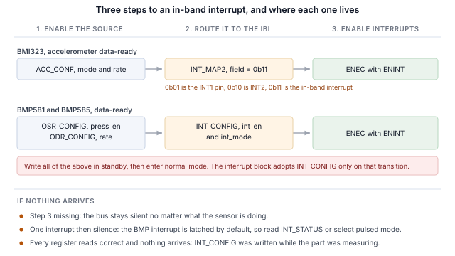
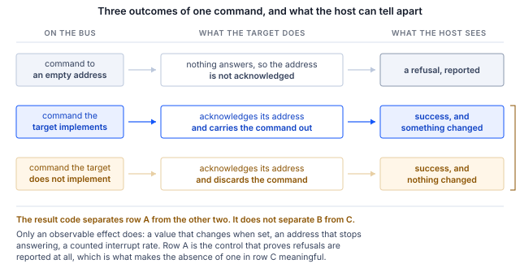

## 1 はじめに

現行世代の Bosch Sensortec MEMS センサは、I2C および SPI に加えて、同じ 2 本のピン上で MIPI I3C
インタフェースを備えています。I3C はその 2 線式のフットプリントを維持したまま、多くの機能を
追加します。

Table: I3C が 2 線式センサインタフェースに追加するもの

| 機能 | 設計にもたらすもの |
|---|---|
| ダイナミックアドレス割り当て | コントローラが実行時にアドレスを割り当てるため、スタティックアドレスの衝突がボード設計上の制約ではなくなり、同一部品が 1 本のバスを共有できます |
| バスからの識別 | すべてのターゲットが 48 ビットの暫定識別子、デバイスクラス、バス能力を報告するため、コントローラは想定していなかったバスでも列挙できます |
| 共通コマンドコード | 列挙、識別、設定、割り込み制御、リセットのための、ブロードキャストとダイレクトの標準コマンドセットで、準拠するすべてのターゲットで同じです |
| インバンド割り込み | センサはデータ線上でホストに割り込みをかけ、その理由を示すバイトを送るため、割り込みピンを配線したり割り当てたりする必要がありません |
| グループアドレッシング | 1 回の書き込みで、グループとしてアドレス指定された複数のターゲットに同時に届きます |
| より高い信号レート | プッシュプルのクロッキングにより、シングルデータレートモードで最大 12.5 MHz に達します。I2C はオープンドレインの制約を受けます |
| 低消費電力 | プッシュプル信号方式により、I2C が常時消費する静的なプルアップ電流を回避できます。またアクティビティステートにより、コントローラは想定されるバスレイテンシをターゲットに伝えられるため、ターゲットはより深くアイドルできます |
| ホットジョイン（Hot-Join） | バスの動作開始後に電源が投入されたターゲットが、列挙を要求できます |
| タイミング制御 | コントローラはターゲットに、共通の基準に対して割り込みのタイムスタンプを付けさせることができます |
| 標準のリセットとリカバリ | ベンダーごとのシーケンスではなく、定義されたターゲットリセットと、定義されたエラー検出およびリカバリ |
| I2C 互換性 | レガシーの I2C デバイスがバスを共有できます |

ターゲットはそのうちセンサが必要とするサブセットを実装しており、そのサブセットは部品によって
異なります。本書では、Binho Supernova USB ホストアダプタと Binho I3C Target Board から 3 つの
Bosch Sensortec 部品を扱います。列挙、バスからの識別、レジスタの読み書き、デコード済み測定値の
ストリーミング、割り込みピンを接続せずにデータ線経由で割り込みを受け取ること、そして上記の機能の
うち各ターゲットが実際に何を実装しているかの確認です。

ここではマイクロコントローラ、ファームウェア、ドライバの移植は一切必要ありません。すべての手順は
ホスト PC からのコマンドです。

### 1.1 対象範囲

本書を読み終えるころには、ハードウェアを手元に用意した読者は、センサを I3C バス上に列挙し、
センサ自身のレジスタから識別し、レジスタを読み書きし、デコード済み測定値をストリーミングし、
割り込みピンを接続せずにセンサの設定済み出力データレートでインバンド割り込みを受信し、ターゲットが
何を実装しているかを観測可能な効果から確認できるようになります。

扱う 3 つの部品は BMI323、BMP581、BMP585 です。3 つともハードウェア上で試験しており、本書の
出力はすべて実際のキャプチャです。

### 1.2 対象デバイス

Table: 対象デバイス

| デバイス | 機能 | 評価ボード | ハードウェアでの試験 |
|---|---|---|---|
| BMI323 | 6 軸 IMU、加速度計およびジャイロスコープ | Shuttle Board 3.0 | あり |
| BMP581 | 気圧センサ | Shuttle Board 3.0 | あり |
| BMP585 | 気圧センサ、耐メディア性 | Shuttle Board 3.0 | あり |

この手法は、Shuttle Board 3.0 アダプタに搭載された I3C インタフェース付きの任意の Bosch
Sensortec MEMS 部品に適用できます。同梱のユーティリティへの追加はテーブルエントリ 1 つで、
第 11 節で説明します。

### 1.3 関連資料

Table: 関連資料

| 資料 | 内容 |
|---|---|
| BST-BMI323-DS000-13 | BMI323 データシート |
| BST-BMP581-DS004-13 | BMP581 データシート |
| BST-BMP585-DS003-02 | BMP585 データシート |
| MIPI I3C Specification v1.1 | 共通コマンドコード、インバンド割り込み、ダイナミックアドレッシング |
| Binho I3C Target Board 製品ページ | ソケット、ジャンパ、対応アダプタボード |

## 2 必要な機器とソフトウェア

### 2.1 ハードウェア

Table: 必要な機器

| 品目 |
|---|
| Binho Supernova USB ホストアダプタ |
| Binho I3C Target Board |
| Shuttle Board 3.0 に搭載された BMI323、BMP581 または BMP585、あるいは他の Shuttle Board 3.0 MEMS アダプタ |
| USB-C ケーブル |

評価ボードは、ラベルの付いた Shuttle Board 3.0 ソケットに差し込みます。本書のどの手順でも、
それ以外は何も接続しません。

### 2.2 接続

Table: 使用する信号

| 信号 | 用途 |
|---|---|
| SCL | I3C クロック、アダプタからターゲットへ |
| SDA | I3C データ、双方向 |
| 3.3 V | ターゲット電源、アダプタから供給 |
| GND | リターン |

2 本の線と電源だけです。**本書では、割り込みのセクションも含め、割り込みピン、リセット線、
ストラップ抵抗は一切接続しません**。I3C では、センサは SDA 上でホストに通知します。

バスは全体を通して 3.3 V で動作します。プルアップはターゲットボードが提供します。

### 2.3 バス設定

Table: 使用するバス設定

| 設定 | 値 |
|---|---|
| プッシュプルレート | 5 MHz、デューティ比 50% |
| オープンドレインレート | 1 MHz |
| ドライブ強度 | Fast mode |
| バス電圧 | 3.3 V |

これらは上限ではなく開始値です。各部品が維持できる値は第 9 節で確認します。

### 2.4 ソフトウェア

```
pip install binhosupernova
```

依存関係は Python 3.12 と `binhosupernova` パッケージのみです。本ノートに付属するアセット
アーカイブを展開し、1 つのコマンドでセットアップを確認します。

```
python i3c_mems.py scan
```

## 3 最初の接触：バスを列挙する

1 つのコマンドで、ホストが割り当てたアドレスでセンサがバス上に参加します。

```
python i3c_mems.py scan
```

```
1 target(s) on the bus at 3300 mV, PUSH_PULL_5_MHZ_50_DC, OPEN_DRAIN_1_MHZ

  dynamic address 0x08
    PID  07 70 10 51 10 00   device id 0x1051
    BCR  0x06   DCR 0x62
    HDR  SDR only   IBI capable
    profile  bmp585
```

これを行ったのは 2 つの共通コマンドコードです。**RSTDAA** は割り当て済みのダイナミックアドレスを
クリアし、バスを既知の状態から開始させます。続いて **ENTDAA** がダイナミックアドレス割り当て
（DAA）を実行します。コントローラがブロードキャストし、すべてのターゲットが 48 ビットの暫定識別子を
使ってアービトレーションを行い、それぞれに順番にアドレスが割り当てられます。部品が 1 つの場合、
そのアドレスは `0x08` です。

アドレスはどこにも設定していません。部品自身のスタティックアドレスは使用されず、知っておく必要も
ありません。

この出力のアドレス以降はすべて、ルックアップテーブルではなくターゲットから得たものです。これが
I2C と違うと最初に感じる点です。I2C ではホストがあらかじめ決めたアドレスに書き込み、何かが応答する
ことを期待します。ここではデバイスが自ら名乗ります。

## 4 バスから部品を識別する

```
python i3c_mems.py identify --device bmp585
```

### 4.1 識別レジスタが持つ情報

名乗りを担うのは 3 つのレジスタで、それぞれレジスタファイルからではなく 1 つのコマンドで
読み出します。

Table: 測定した識別値

| 部品 | PID | Device id (31:16) | BCR | DCR |
|---|---|---|---|---|
| BMI323 | `07 70 10 43 00 00` | `0x1043` | `0x06` | `0xEF` |
| BMP581 | `07 70 10 50 10 00` | `0x1050` | `0x06` | `0x62` |
| BMP585 | `07 70 10 51 10 00` | `0x1051` | `0x06` | `0x62` |

すべての値が対応するデータシートと一致します。いずれの場合もデバイス識別子フィールドにチップ
識別子が埋め込まれているため、コントローラはレジスタファイルに触れる前に部品名を特定できます。

**デバイス特性レジスタ**（DCR）は、そのデバイスのクラスを示します。2 つの気圧センサはどちらも
`0x62` を報告します。これは MIPI レジストリが気圧センサに割り当てている値で、コントローラは
事前知識のないターゲットでも分類できます。DCR は個々の部品ではなくクラスを識別するもので、
両者を区別するのは暫定識別子です。

**バス特性レジスタ**（BCR）は、その部品がバス上で何ができるかを示します。3 つともすべて `0x06` を
報告します。

```
BCR 0x06
  device role                      I3C target
  advanced capabilities (bit 5)    no, so SDR only
  virtual target support           no
  offline capable                  yes
  IBI mandatory payload            yes
  IBI capable                      yes
  max data speed limit             no limit
```

何も設定しないうちに、ここから 2 つの有用な事実がわかります。部品はインバンド割り込みを発生でき、
その際にペイロードを送ります。これは第 7 節で使用します。また、ビット 5 がクリアなので部品は
シングルデータレート専用です。これにより、高データレートに関する疑問に、データシートの表からでは
なくターゲット自身から 1 つのコマンドで答えが得られます。

### 4.2 チップ識別子による確認

Table: チップ識別子レジスタ

| 部品 | レジスタ | 読み出し値 |
|---|---|---|
| BMI323 | `0x00` | `0x1143`、下位バイト `0x43` |
| BMP581 | `0x01` | `0x50` |
| BMP585 | `0x01` | `0x51` |

> **重要：** BMI323 のチップ識別子レジスタは 16 ビット幅で、上位バイトは予約フィールドです。測定
> した部品ではこれが `0x11` と読めるため、データシートのリセット値が `0x0043` であるのに対し、
> レジスタは `0x1143` と読めます。ワード全体をデータシートの値と比較するホストは、部品が誤って
> いると判断してしまいます。下位バイトを比較してください。

## 5 レジスタの読み書き

レジスタアクセスはプライベート転送です。レジスタアドレスを送信し、続いてバイトを読み出します。

```
python i3c_mems.py read  --device bmp585 0x01
python i3c_mems.py write --device bmi323 0x20 0x3127
```

フレーミングはベンダー単位ではなく部品単位で異なり、ある Bosch 部品での前提を別の部品に持ち込む
ことが、最初の読み出しが誤った値を返す最も多い原因です。

Table: 部品ごとに測定したレジスタアクセス

| 部品 | レジスタアドレス | データ幅 | 読み出しペイロード前のダミーバイト数 |
|---|---|---|---|
| BMI323 | 8 ビット | 16 ビット | 2 |
| BMP581 | 8 ビット | 8 ビット | 0 |
| BMP585 | 8 ビット | 8 ビット | 0 |

BMI323 のデータシートはインタフェースごとのダミーバイト数を記載しており、I3C では 2 としています。
BMP581 および BMP585 のデータシートには I3C の場合の数が記載されておらず、ダミーバイトは観測
されませんでした。

数が文書化されていない場合は、リセット値がわかっている一連のレジスタを読み出し、値が一致する
オフセットを見つけることで確認できます。隣接する 2 つのアンカーがあれば曖昧さを排除できます。
BMP585 では、`0x01` の CHIP_ID は `0x51`、`0x02` の REV_ID は `0x32` と読めます。

```
dummy=0: raw 51 32          ->  CHIP_ID 0x51 REV_ID 0x32   <== both anchors match
dummy=1: raw 51 32 22       ->  CHIP_ID 0x32 REV_ID 0x22
dummy=2: raw 51 32 22 00    ->  CHIP_ID 0x22 REV_ID 0x00
```

アンカーが 1 つだけでは、複数のオフセットが成り立っていたはずです。

先頭の `0x7E` ブロードキャストヘッダは、これらの部品では省略可能です。ヘッダありとなしで発行した
読み出しは 3 つの部品すべてで同じ値を返しました。これは BMP581 および BMP585 のデータシートの記述と
一致しています。ホストはヘッダを省略してダイナミックアドレスのセクションから開始でき、これは
すべての I3C トランザクションに適用されます。

## 6 センサデータのストリーミング

### 6.1 BMI323、加速度計

`0x20` の ACC_CONF への 1 回の書き込みで部品を設定します。値 `0x3127` は、加速度計のレンジ ±8 g、
出力データレート 50 Hz、有効な電源モードを選択します。

```
python i3c_mems.py stream --device bmi323 --seconds 5
```

各軸は 16 ビットの符号付き値で、±8 g レンジでは 1 g あたり 4096 カウントです。

静止時の大きさは 1 g で、これはフレーミング、バイトオーダー、符号処理、スケールというチェーン全体が
正しいことを無償で確認できるチェックです。静止状態で測定すると BMI323 は 1.006 g を報告するため、
レンジフィールドとデコードは一致しています。ボードを傾けると、大きさは変わらないまま各軸に値が
再配分されます。

### 6.2 BMP581 と BMP585、気圧と温度

これらの部品は 1 回の書き込みではなく、順序を必要とします。設定レジスタは部品がスタンバイ状態の
間に書き込み、そのあとで初めて測定モードに入ります。

1. `0x37` の ODR_CONFIG に、電源モードとしてスタンバイを書き込む
2. `0x36` の OSR_CONFIG に `press_en` をセットして書き込み、温度とともに気圧を有効にする
3. ODR_CONFIG に、希望する出力データレートと電源モードとしてノーマルを再度書き込む
4. `0x38` の OSR_EFF を読み出して `odr_is_valid` を確認する。これはレートとオーバーサンプリングの
   組み合わせが受け入れられたかどうかを示します

```
python i3c_mems.py stream --device bmp585 --seconds 2 --interval 0.5
```

```
  temperature    21.583 C   pressure 100351.7 Pa   pressure  1003.52 hPa
```

気圧は 24 ビットの符号なし値を 64 で割ったもので、単位はパスカルです。温度は 24 ビットの符号付き値を
65536 で割ったもので、単位は摂氏度です。

同じ部屋で 1 時間以内に、周囲の気圧は BMP585 で 1003.52 hPa、BMP581 で 1003.88 hPa と読めました。
2 つのボード上の 2 つの部品で、差は 0.36 hPa に収まっています。

これらの部品の観測には計測器は不要です。息を吹きかけるか持ち上げると、気圧は高度 1 メートル
あたり約 12 Pa 変化します。

### 6.3 出力データレート

Table: 出力データレートの選択

| 部品 | レジスタ | ここで使用した値 |
|---|---|---|
| BMI323 | `0x20` の `ACC_CONF` | 50 Hz、`0x3127` 設定ワードの一部として |
| BMP581, BMP585 | `0x37` の `ODR_CONFIG` | `0x17` 10 Hz、`0x13` 30 Hz、いずれも誤差ゼロとして記載 |

割り込みレートはこのレートに従うため、第 7 節で重要になります。

## 7 割り込みピンなしでのバス経由の割り込み

インバンド割り込みは、センサの設計を最も目に見える形で変える機能です。部品はデータを運ぶのと同じ
2 本の線で新しいデータの準備ができたことをホストに伝え、ホストは何かを読み出す前にその理由を
知ることができます。そのため、割り込みピンを配線したり、割り当てたり、コネクタに引き出したりする
必要はありません。

### 7.1 3 つのステップ

本書のすべてのインバンド割り込みは、同じ 3 つのステップをこの順序で行います。

1. **センサ内でソースを有効にする。** 出力データレートでの測定そのものです。
2. **それをインバンド割り込みにルーティングする。** どのレジスタでこれを行うかは部品ごとに異なり、
   難しさの大部分はここにあります。
3. **ENINT ビット付きで ENEC を送信する。** これが届くまでは、センサが何をしていてもバスは
   静かなままです。



3 番目のステップは、主張するよりも証明する価値があります。以下の各状態は BMI323 上で 1 秒間の
ウィンドウにわたって測定しました。

Table: BMI323 でインバンド割り込みを有効にするもの

| 状態 | 1 秒間の割り込み数 |
|---|---|
| センサ無効 | 0 |
| DISEC 送信済み、ターゲットの割り込みは無効 | 0 |
| センサ動作中、ルーティング未設定 | 0 |
| `INT_MAP2` 書き込み済み、ルーティング設定済み、まだ無効 | 0 |
| コントローラを割り込み受け入れに設定済み、まだ無効 | 0 |
| **ENINT ビット付きで ENEC を送信** | **50** |

割り込みを有効にするのは ENEC です。ルーティングの書き込みも、コントローラ自身の設定も、それを
行いません。

```
python i3c_mems.py ibi --device bmp585 --seconds 3 --show 3
```

Table: 設定した出力データレートに対する割り込みレート

| 部品 | 設定値 | 測定値 | ウィンドウ |
|---|---|---|---|
| BMI323 | 50 Hz | 毎秒 50.00 | 3.0 s |
| BMP581 | 10 Hz | 毎秒 10.00 | 4.0 s |
| BMP585 | 10 Hz | 毎秒 9.96 | 4.0 s |
| BMP585 | 30 Hz | 毎秒 29.75 | 4.0 s |

> **注：** レートは設定レートと比較できます。個々の到着時刻は比較できません。50 Hz で連続する
> 149 個の間隔を測定したところ、到着間隔は 0.00 ms から 47.00 ms の範囲で平均 20.03 ms であり、
> 149 個のうち 6 個は 1 ms 未満でした。これはホストのトランスポートが割り込みをバッチで配信する
> ためです。そのため本書ではジッタやレイテンシの数値は示していません。

### 7.2 必須データバイト

各割り込みは何が発生したかを示す必須データバイトを運ぶため、ホストはそもそもセンサを読み出すか
どうかを判断できます。

Table: 観測された必須データバイト

| 部品 | 必須バイト | 意味 |
|---|---|---|
| BMI323 | `0x02` | サンプル準備完了、加速度計、ジャイロスコープまたは温度 |
| BMP581, BMP585 | `0x01` | データ準備完了 |

BMI323 のバイトは FIFO ウォーターマークまたはフル状態と割り込みグループ識別子も区別するため、
ホストは読み出しを発行する前に新しいデータと FIFO イベントを見分けられます。

### 7.3 部品ごとのルーティング

**BMI323。** 1 つのフィールドで送り先を選択します。`0x3B` の INT_MAP2 にある `acc_drdy_int` は
ビット 11 と 10 を占め、INT1 ピンには `0b01`、INT2 には `0b10`、I3C インバンド割り込みには
`0b11` を取ります。`0x0C00` を書き込むと最後のものが選択され、割り込みはすでに存在する 2 本の線で
届くようになります。

**BMP581 と BMP585。** `0x14` の INT_CONFIG が有効化とモードを持ちます。これについては 2 つの点で
ベンチ作業の時間を取られ、どちらも割り込みの設定が完全に正しく見える状態で現れます。

> **割り込みはデフォルトでラッチされます。** INT_CONFIG のリセット値は `0x35` でラッチモードを
> 選択し、`0x27` の INT_STATUS は読み出しでクリアされます。そのため割り込みは一度アサートされると、
> ホストがステータスレジスタを読み出すまで再アームされません。結果として、割り込みが 1 回来たあと
> 沈黙します。パルスモードを選択するか、各割り込みのあとに INT_STATUS を読み出してください。
> どちらでも設定したレートが得られます。

> **割り込みブロックが新しい INT_CONFIG の値を採用するのは、次にスタンバイから測定モードへ遷移
> したときだけです。** レジスタはいつでも書き込みを受け付け、新しい値をすぐに読み返せるため、部品の
> 測定中に割り込みを設定したホストには、すべてのレジスタが正しく見えるのに割り込みは来ません。
> 10 Hz に設定した BMP585 での測定結果：ノーマルモードで割り込み設定を書き込んだ場合、2 s で割り込み
> なし。同じレジスタ設定のあとにスタンバイからノーマルへ遷移した場合、21 回の割り込み。スタンバイで
> 設定してからノーマルに入った場合、20 回の割り込み。データシート自身のガイダンスもこれをカバー
> しています。測定モードに切り替える前に設定を書き込んでください。

### 7.4 割り込みの停止

```
python i3c_mems.py reset --device bmi323
```

DISINT ビット付きの DISEC でストリームが停止します。3 つの部品すべてで、1 回のコマンドで停止する
ことを測定しました。ソフトリセットは部品をリセット状態に戻し、共通コマンドコードがラッチしたモードも
クリアします。

## 8 I3C 機能セットの残りを試す

ユーティリティは、ターゲットが何を実装しているかを、結果コードからではなく観測可能な効果から
確認します。このバスではその区別が重要であり、その理由が図 2 です。

Table: ターゲットと未使用アドレスに対する同じコマンド

| コマンド | ターゲット `0x08` に対して | 未使用アドレス `0x0B` に対して |
|---|---|---|
| GETPID | `SUCCESS`、識別子を返す | `I3C_NACK_ADDRESS` |
| GETBCR | `SUCCESS`、`0x06` を返す | `I3C_NACK_ADDRESS` |

ターゲットは実装していないコマンドを ACK して破棄することがあり、I3C 仕様はこれを許容しています。
BMI323 のデータシートは 10 個の共通コマンドコードを非サポートとしていますが、そのすべてが部品に
送信すると成功の結果を返します。上の対照実験は、これがアダプタがエラーを隠しているのではなく
ターゲットの振る舞いであることを示しています。ターゲットのいないアドレスに送った同じコマンドは
拒否され、その拒否は報告されます。



そのため、以下の各行には観測された変化が必要でした。値を設定して読み返す、アドレスを移動して古い
アドレスが応答しなくなったことを確認する、設定したレートに対して割り込みを数える、といったことです。

```
python i3c_mems.py features --device bmp585
```

Table: 測定した共通コマンドコードのサポート状況

| コマンド | BMI323 | BMP581 | BMP585 | 根拠 |
|---|---|---|---|---|
| ENTDAA | サポート | サポート | サポート | 期待される識別子でターゲットが列挙された |
| RSTDAA | サポート | サポート | サポート | テーブルがクリアされ、古いアドレスはその後拒否する |
| SETNEWDA | サポート | サポート | サポート | アドレスが移動し、古いアドレスは拒否する |
| GETPID, GETBCR, GETDCR | サポート | サポート | サポート | データシートの値を返した |
| ENEC, DISEC | サポート | サポート | サポート | 割り込みが繰り返し開始・停止する |
| SETXTIME, GETXTIME | サポート | サポート | サポート | コマンド後に報告されるバイトが変化した |
| SETMWL, SETMRL | 未実装 | 未実装 | 未実装 | 設定後も値が変化しない |
| GETMWL, GETMRL | 未実装 | 未実装 | 未実装 | 同上 |
| SETGRPA, RSTGRPA | 未実装 | 未実装 | 未実装 | グループアドレス経由の書き込みが、割り当て前、割り当て中、割り当て後のいずれでも拒否される |
| HDR モード | 非サポート | 非サポート | 非サポート | BCR ビット 5 がクリア |
| GETHDRCAP | 未実装 | `0x00` を応答 | `0x00` を応答 | HDR モードの報告なし |
| ホットジョイン | 観測されず | 観測されず | 観測されず | いかなる時点でもホットジョイン要求なし |
| GETSTATUS | 未確定 | 未確定 | 未確定 | 応答するが、独立した確認はしていない |
| GETMXDS | 未確定 | 未確定 | 未確定 | 応答するが、観測可能な効果なし |
| ENTAS0 から ENTAS3 | 未確定 | 未確定 | 未確定 | 電流測定が必要 |
| RSTACT | 未確定 | 未確定 | 未確定 | ホストから観測可能な効果なし |

**グループアドレッシング**は、試験方法を明記しておく必要があります。自明な試験では誤った答えが
出るためです。グループアドレスはコントローラが複数のターゲットを同時にアドレス指定するためのもので、
書き込みの宛先です。グループアドレスからの読み出しには定義された応答がなく、ターゲットはこの機能を
正しく実装していてもグループアドレスへの読み出しを拒否することがあります。ここで使用した試験では、
グループアドレスを割り当て、それを経由してレジスタに書き込み、そのレジスタをターゲット自身の
ダイナミックアドレスで読み返し、3 つの結果を要求します。SETGRPA の前は書き込みが拒否されること、
グループアドレスが割り当てられている間は書き込みが反映されること、RSTGRPA のあとは再び拒否される
ことです。試験値は、レジスタがその値を保持できることを確認するため、まずターゲット自身のアドレスで
書き込みます。3 つの部品はすべて、3 つの異なるグループアドレスで、どの段階でも書き込みを拒否し、
一方で SETGRPA 自体は毎回成功の結果を返します。

**SETXTIME** は、試験を繰り返しても結果が繰り返されない唯一の行です。そのサブコマンドはモードを
選択し、モードビットはラッチされるため、部品がすでにそのモードにあるサブコマンドは正しく何も
しません。BMI323 では、GETXTIME が `03 00 0D 78` の状態から、サブコマンド `0x3F` は 2 番目の
バイトを `0x01` に変え、その後二度と変えません。一方 `0xDF` はそれを `0x03` に変えます。1 つの
サブコマンドを送って変化が見られなかったホストは、そのコマンドが未実装であると結論づけることは
できません。サブコマンド `0xFF` はモードを再び無効にします。

タイミング制御を有効にすると、割り込みペイロードも変化します。BMI323 ではペイロードが 1 バイトから
4 バイトに増え、必須バイトのビット 7 がセットされます。このモードはホストの再起動とバスリセットを
経ても維持され、ソフトリセットでクリアされます。

**アクティビティステート**は未確定のままです。部品が低アクティビティステートに入ったことを証明する
には、このセットアップではできない電流測定が必要です。そのため、マトリクスは推測せずにその旨を
示しています。

## 9 バスレート

```
python i3c_mems.py rates --device bmp585 --iterations 100
```

Table: エラーのない最高バスレート

| 部品 | プッシュプル | オープンドレイン |
|---|---|---|
| BMI323 | 12.5 MHz、デューティ比 50% | 4.17 MHz |
| BMP581 | 12.5 MHz、デューティ比 50% | 4.17 MHz |
| BMP585 | 12.5 MHz、デューティ比 50% | 4.17 MHz |

3 つの部品はすべて、アダプタが提供するすべてのレートで合格します。**方法：** チップ識別子
レジスタを連続 100 回読み出し、すべてがエラーなしで期待値を返す必要があり、すべての反復が成功した
場合にのみそのレートは合格となります。これはレジスタ読み出しのループであり、スループットの測定では
ありません。持続的なデータレートについての結論をここから導くべきではありません。

2 つのレートは独立していません。アダプタは一部の組み合わせを無効な周波数ペアとして拒否するため、
オープンドレインのスイープはデフォルトではなく、合格した最速のプッシュプルレートに対して実行します。

## 10 実践上の注意

Table: 実践上の注意

| 部品 | 注意 |
|---|---|
| BMI323 | チップ識別子レジスタは `0x1143` と読めます。下位バイトをデータシートの `0x43` と比較してください |
| BMI323 | すべての読み出しペイロードの前に 2 バイトのダミーバイトがあり、データは 16 ビット幅です |
| BMP581, BMP585 | 割り込み設定はスタンバイ中に書き込み、その後ノーマルモードに入ってください。そうしないと割り込みブロックはそれを採用しません |
| BMP581, BMP585 | 割り込みはデフォルトでラッチされます。各割り込みのあとに INT_STATUS を読み出すか、パルスモードを選択してください |
| すべて | 割り込みを有効にするのは ENINT 付きの ENEC です。ルーティングだけでは有効になりません |
| すべて | 列挙後の最初の読み出しは安定していないことがあります。データシートの推奨どおり、ダミーの読み出しを発行してください |
| すべて | SETXTIME は割り込みペイロードを変えるモードをラッチします。`SETXTIME 0xFF` でオフになります |

## 11 ユーティリティ

Table: ユーティリティのコマンド

| コマンド | 用途 |
|---|---|
| `scan` | バスを列挙し、応答したものを報告する |
| `identify` | ターゲットの識別レジスタをデコードする |
| `read`, `write` | レジスタを読み書きする。書き込み後は読み返しを行う |
| `stream` | ポーリングでデコード済みサンプルを表示する |
| `ibi` | センサ割り込みをバスにルーティングし、届いたものを数える |
| `features` | 観測可能な効果から、ターゲットが何を実装しているかを確認する |
| `rates` | エラーのない最高バスレートを求める |
| `reset`, `power-cycle` | 部品を既知の状態に戻す |

Table: セッションオプション（コマンドの前後どちらでも指定可能）

| オプション | デフォルト |
|---|---|
| `--serial` | 最初に見つかったアダプタ |
| `--voltage` | 3300 mV |
| `--push-pull` | `PUSH_PULL_5_MHZ_50_DC` |
| `--open-drain` | `OPEN_DRAIN_1_MHZ` |

デバイスの追加は、プロファイルテーブルへの 1 エントリです。レジスタのフレーミング、期待される識別
情報、データストリームを開始する書き込み、割り込みをルーティングする書き込み、そして割り込み
ペイロードのデコーダから構成されます。

## 12 測定結果

### 12.1 試験構成

Table: 試験構成

| 項目 | 値 |
|---|---|
| アダプタ | Binho Supernova、ハードウェアリビジョン B、ファームウェア 4.4.0 |
| SDK | `binhosupernova`、Python 3.12、Windows 11 |
| アクセサリ | Binho I3C Target Board |
| バス | 3.3 V、プッシュプル 5 MHz デューティ比 50%、オープンドレイン 1 MHz、Fast mode ドライブ強度 |
| 列挙 | RSTDAA に続いて ENTDAA |
| ターゲット | Shuttle Board 3.0 上の BMI323、BMP581、BMP585、一度に 1 つ |

### 12.2 結果

**識別。** 第 4 節のすべての値は対応するデータシートと一致します。BMI323 のチップ識別子は下位
バイトで比較しています。

**割り込み。** レートは第 7.1 節の表のとおりです。カウントの再現性を確認するため、各部品を 2 回
測定しました。

**サポート状況。** 第 8 節のマトリクスは、各部品に対して `features` コマンドを実行して生成しました。

Table: 部品ごとの判定数

| 部品 | サポート | 未実装 | 未確定 |
|---|---|---|---|
| BMI323 | 11 | 7 | 7 |
| BMP581 | 12 | 7 | 7 |
| BMP585 | 12 | 7 | 7 |

BMI323 が 1 行少ないのは、最大インバンド割り込みペイロードを報告しないため、ユーティリティが
コントローラの上限と比較するための宣言されたサイズが存在しないからです。他の 2 つはこれを報告する
ため、そのチェックがマトリクスに現れます。

**バスレート。** 3 つの部品はすべて、第 9 節に記載した方法で、アダプタが提供するすべてのレートに
合格します。

**回帰カバレッジ。** 本書に示したコマンドは 3 つの部品すべてについて記録済みの出力と照合されて
いるため、読者が目にする内容を変えてしまうユーティリティの変更は検出されます。各部品の記録済み出力は
再生成したうえで、連続した繰り返し実行で再現しました。BMI323 で 5 回、BMP581 と BMP585 でそれぞれ
6 回です。

## 13 トラブルシューティング

Table: トラブルシューティング

| 症状 | 確認事項 |
|---|---|
| ターゲットが列挙されない | ボードが正しいソケットに装着されているか。3.3 V が供給されているか。`power-cycle` を試す |
| 最初の読み出しが誤った値を返す | 部品のダミーバイト数。BMI323 は 2、BMP 部品は 0 |
| BMI323 のチップ識別子が誤って見える | 下位バイトを比較する。上位バイトは予約フィールド |
| 割り込みがまったく届かない | ENEC が ENINT ビット付きで送信されたか |
| 割り込みが 1 回来たあと沈黙する | BMP の割り込みはラッチされる。INT_STATUS を読み出すか、パルスモードを選択する |
| すべてのレジスタが正しく読めるのに何も届かない | 部品の測定中に INT_CONFIG を書き込んだ。スタンバイ中に書き込む |
| 割り込みペイロードが増え、ビット 7 がセットされている | タイミング制御が有効になっている。`SETXTIME 0xFF` またはソフトリセット |
| 識別情報が一度だけ誤って読め、その後は正しく読める | 列挙後には想定される挙動。最初にダミーの読み出しを発行する |

## 14 略語

Table: 略語

| 用語 | 意味 |
|---|---|
| BCR | バス特性レジスタ（Bus characteristics register） |
| CCC | 共通コマンドコード（Common command code） |
| DAA | ダイナミックアドレス割り当て（Dynamic address assignment） |
| DCR | デバイス特性レジスタ（Device characteristics register） |
| ENTDAA | ダイナミックアドレス割り当ての開始（Enter dynamic address assignment） |
| HDR | 高データレート（High data rate） |
| IBI | インバンド割り込み（In-band interrupt） |
| MDB | 必須データバイト（Mandatory data byte） |
| ODR | 出力データレート（Output data rate） |
| PID | 暫定識別子（Provisional identifier） |
| SDR | シングルデータレート（Single data rate） |

## 15 本書のソースコードについて

本書に示し、付属アーカイブで提供するサンプルコードは、評価および参考用として提供されます。
MIT ライセンスの下で公開されており、ライセンス本文はアーカイブに含まれています。

Table: アセットアーカイブの内容

| ファイル | 説明 |
|---|---|
| `AN0004.md` | 本書の Markdown ソース |
| `assets/i3c_mems.py` | リファレンスユーティリティ |
| `assets/LICENSE` | サンプルコードに適用される MIT ライセンス |

## 16 改訂履歴

Table: 改訂履歴

| リビジョン | 日付 | 説明 |
|---|---|---|
| 1.0 | 31 August 2026 | 初版。 |
| 1.1 | 31 August 2026 | SETGRPA および RSTGRPA のサポート行を、グループアドレスからの読み出しではなくグループアドレス経由の書き込みで再測定し、その試験方法を本書に明記しました。判定は 3 つの部品すべてで変わりません。BMI323 の判定数を修正しました。以前の数値は、部品が以前の実行で残されたモードをまだ保持していた実行から取得されていました。 |
| 2.0 | 1 September 2026 | 読者の作業順序（列挙、識別、レジスタの読み書き、データのストリーミング、割り込み、その後に残りの機能セット）に沿ったウォークスルーとして再構成しました。第 1 節は、I3C が 2 線式センサインタフェースに追加するものから始まるようになりました。割り込み設定の図を追加しました。ベンチ作業の時間を取られる部品ごとの挙動を、実践上の注意のセクションにまとめました。測定結果に変更はありません。 |
| 2.1 | 3 September 2026 | 同梱の `i3c_mems.py` を、293 行遅れていた共有ユーティリティから更新しました。`NOT_POWERED` を報告する外部電圧に対するリカバリパス、3 回試行の RSTDAA 判定、HDR-DDR 読み出しが追加されています。本書のテキストと測定結果に変更はなく、どの行も再測定していません。 |
