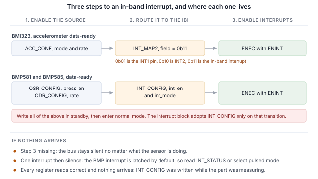
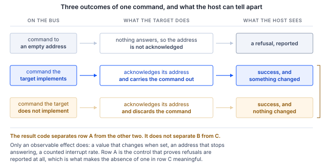

## 1 소개

현 세대 Bosch Sensortec MEMS 센서는 동일한 두 핀 위에서 I2C 및 SPI와 함께 MIPI I3C 인터페이스를
제공합니다. I3C는 이 2선 구성을 그대로 유지하면서 그 위에 상당한 기능 세트를 추가합니다.

Table: I3C가 2선 센서 인터페이스에 추가하는 기능

| 기능 | 설계에 주는 이점 |
|---|---|
| 동적 주소 할당 | 컨트롤러가 런타임에 주소를 배정하므로 정적 주소 충돌이 더 이상 보드 설계의 제약이 되지 않으며, 동일한 부품이 하나의 버스를 공유할 수 있습니다 |
| 버스로부터의 식별 | 모든 타깃이 48비트 임시 식별자(provisional identifier), 디바이스 클래스 및 버스 기능을 보고하므로, 컨트롤러는 사전에 상정하지 않은 버스도 열거할 수 있습니다 |
| 공통 명령 코드 | 열거, 식별, 구성, 인터럽트 제어 및 리셋을 위한 브로드캐스트 및 다이렉트 표준 명령 세트로, 모든 규격 준수 타깃에서 동일합니다 |
| 인밴드 인터럽트 | 센서가 데이터 라인을 통해 호스트에 인터럽트를 걸며, 그 이유를 나타내는 바이트를 함께 전달하므로 인터럽트 핀을 배선하거나 할당할 필요가 없습니다 |
| 그룹 주소 지정 | 한 번의 쓰기로 그룹으로 지정된 여러 타깃에 동시에 도달합니다 |
| 더 높은 신호 속도 | I2C의 오픈 드레인 한계와 달리, 단일 데이터 레이트 모드에서 최대 12.5 MHz의 푸시풀 클로킹을 사용합니다 |
| 저전력 | 푸시풀 신호 방식은 I2C가 지속적으로 소비하는 정적 풀업 전류를 피하며, 액티비티 상태를 통해 컨트롤러가 타깃에 예상 버스 지연 시간을 알려 줄 수 있으므로 타깃은 더 깊은 유휴 상태로 들어갈 수 있습니다 |
| 핫 조인(Hot-Join) | 버스가 동작 중일 때 전원이 인가된 타깃이 열거를 요청할 수 있습니다 |
| 타이밍 제어 | 컨트롤러가 타깃으로 하여금 공유 기준에 대해 인터럽트에 타임스탬프를 붙이도록 할 수 있습니다 |
| 표준 리셋 및 복구 | 벤더별 시퀀스가 아니라 정의된 타깃 리셋과 정의된 오류 검출 및 복구를 사용합니다 |
| I2C 호환성 | 레거시 I2C 디바이스가 버스를 공유할 수 있습니다 |

타깃은 이 중에서 센서에 필요한 부분 집합을 구현하며, 그 부분 집합은 부품마다 다릅니다. 이 노트에서는
Binho Supernova USB 호스트 어댑터와 Binho I3C Target Board로 세 가지 Bosch Sensortec 부품을 다룹니다.
부품을 열거하고, 버스로부터 식별하고, 레지스터를 읽고 쓰고, 디코딩된 측정값을 스트리밍하고, 인터럽트 핀을
연결하지 않은 채 데이터 라인으로 인터럽트를 받고, 위의 기능 중 각 타깃이 실제로 구현한 것이 무엇인지
확인합니다.

이 문서의 어떤 내용도 마이크로컨트롤러, 펌웨어 또는 드라이버 포팅을 필요로 하지 않습니다. 모든 단계는
호스트 PC에서 실행하는 명령입니다.

### 1.1 범위

이 문서를 마치면, 하드웨어를 준비한 독자는 센서를 I3C 버스에 열거하고, 센서 자체의 레지스터로 식별하고,
레지스터를 읽고 쓰고, 디코딩된 측정값을 스트리밍하고, 인터럽트 핀을 연결하지 않은 상태에서 센서에 구성된
출력 데이터 레이트로 인밴드 인터럽트를 수신하고, 관찰 가능한 효과를 통해 타깃이 무엇을 구현하는지
확인하게 됩니다.

다루는 세 부품은 BMI323, BMP581 및 BMP585입니다. 세 부품 모두 하드웨어에서 실행했으며, 이 문서의 모든
출력은 실제 캡처입니다.

### 1.2 적용 디바이스

Table: 다루는 디바이스

| 디바이스 | 기능 | 평가 보드 | 하드웨어 실행 여부 |
|---|---|---|---|
| BMI323 | 6축 IMU, 가속도계 및 자이로스코프 | Shuttle Board 3.0 | 예 |
| BMP581 | 기압 센서 | Shuttle Board 3.0 | 예 |
| BMP585 | 기압 센서, 내매체성 | Shuttle Board 3.0 | 예 |

이 방법은 Shuttle Board 3.0 어댑터에 탑재된, I3C 인터페이스를 갖춘 모든 Bosch Sensortec MEMS 부품에
적용됩니다. 제공된 유틸리티에 부품을 추가하는 것은 테이블 항목 하나로 충분하며, 이는 11절에서 설명합니다.

### 1.3 관련 문서

Table: 관련 문서

| 문서 | 주제 |
|---|---|
| BST-BMI323-DS000-13 | BMI323 데이터시트 |
| BST-BMP581-DS004-13 | BMP581 데이터시트 |
| BST-BMP585-DS003-02 | BMP585 데이터시트 |
| MIPI I3C Specification v1.1 | 공통 명령 코드, 인밴드 인터럽트, 동적 주소 지정 |
| Binho I3C Target Board 제품 페이지 | 소켓, 점퍼 및 지원 어댑터 보드 |

## 2 필요한 장비 및 소프트웨어

### 2.1 하드웨어

Table: 필요한 장비

| 항목 |
|---|
| Binho Supernova USB 호스트 어댑터 |
| Binho I3C Target Board |
| Shuttle Board 3.0에 탑재된 BMI323, BMP581 또는 BMP585, 또는 다른 Shuttle Board 3.0 MEMS 어댑터 |
| USB-C 케이블 |

평가 보드는 라벨이 붙은 Shuttle Board 3.0 소켓에 장착합니다. 이 문서의 어떤 절차에서도 그 밖의 다른 것은
연결하지 않습니다.

### 2.2 연결

Table: 사용하는 신호

| 신호 | 용도 |
|---|---|
| SCL | I3C 클록, 어댑터에서 타깃으로 |
| SDA | I3C 데이터, 양방향 |
| 3.3 V | 타깃 전원, 어댑터에서 공급 |
| GND | 리턴 |

두 개의 선과 전원뿐입니다. **인터럽트 절을 포함하여 이 노트의 어떤 작업에서도 인터럽트 핀, 리셋 라인 또는
스트래핑 저항을 연결하지 않습니다**. I3C에서는 센서가 SDA를 통해 호스트에 신호를 보냅니다.

버스는 전 과정에서 3.3 V로 동작합니다. 풀업은 타깃 보드가 제공합니다.

### 2.3 버스 설정

Table: 사용하는 버스 설정

| 설정 | 값 |
|---|---|
| 푸시풀 레이트 | 5 MHz, 듀티 사이클 50% |
| 오픈 드레인 레이트 | 1 MHz |
| 구동 강도 | Fast mode |
| 버스 전압 | 3.3 V |

이 값들은 한계가 아니라 시작값입니다. 각 부품이 유지할 수 있는 값은 9절에서 확인합니다.

### 2.4 소프트웨어

```
pip install binhosupernova
```

필요한 것은 Python 3.12와 `binhosupernova` 패키지뿐입니다. 이 노트에 첨부된 에셋 아카이브의 압축을 풀고
다음 명령 하나로 설정을 확인합니다.

```
python i3c_mems.py scan
```

## 3 첫 접속: 버스 열거

명령 하나로 호스트가 할당한 주소를 가진 센서를 버스에 올립니다.

```
python i3c_mems.py scan
```

```
1 target(s) on the bus at 3300 mV, PUSH_PULL_5_MHZ_50_DC, OPEN_DRAIN_1_MHZ

  dynamic address 0x08
    PID  07 70 10 51 10 00   device id 0x1051
    BCR  0x06   DCR 0x62
    HDR  SDR only   IBI capable
    profile  bmp585
```

이 작업은 두 개의 공통 명령 코드로 이루어졌습니다. **RSTDAA**는 이미 할당된 동적 주소를 지워 버스가 알려진
상태에서 시작하도록 합니다. 이어서 **ENTDAA**가 동적 주소 할당을 실행합니다. 컨트롤러가 브로드캐스트하면 모든
타깃이 48비트 임시 식별자를 사용해 중재하고, 각 타깃이 차례로 주소를 받습니다. 부품이 하나뿐이면 그 주소는
`0x08`입니다.

어디에서도 주소를 설정하지 않았습니다. 부품 자체의 정적 주소는 사용되지 않았으며 알 필요도 없습니다.

출력에서 주소 다음에 나오는 모든 정보는 조회 테이블이 아니라 타깃에서 온 것이며, 이것이 I2C와 처음으로 다르게
느껴지는 부분입니다. I2C에서는 호스트가 미리 정한 주소에 쓰고 무언가가 응답하기를 기대합니다. 여기서는
디바이스가 스스로를 소개합니다.

## 4 버스로부터 부품 식별

```
python i3c_mems.py identify --device bmp585
```

### 4.1 식별 레지스터가 담고 있는 정보

소개는 세 개의 레지스터가 담당하며, 각각은 레지스터 파일이 아니라 단일 명령으로 읽습니다.

Table: 측정된 식별 값

| 부품 | PID | Device id (31:16) | BCR | DCR |
|---|---|---|---|---|
| BMI323 | `07 70 10 43 00 00` | `0x1043` | `0x06` | `0xEF` |
| BMP581 | `07 70 10 50 10 00` | `0x1050` | `0x06` | `0x62` |
| BMP585 | `07 70 10 51 10 00` | `0x1051` | `0x06` | `0x62` |

모든 값이 해당 데이터시트와 일치합니다. 디바이스 식별자 필드에는 모든 경우에 칩 식별자가 포함되어 있으므로,
컨트롤러는 레지스터 파일에 접근하기 전에 부품의 이름을 알 수 있습니다.

**디바이스 특성 레지스터(device characteristics register)** 는 디바이스가 어떤 클래스인지를 나타냅니다. 두 압력 센서는
모두 `0x62`를 보고하며, 이는 MIPI 레지스트리가 압력 센서에 할당한 값이므로 컨트롤러는 사전 지식이 없는 타깃도
분류할 수 있습니다. DCR은 개별 부품이 아니라 클래스를 식별하며, 둘을 구별하는 것은 임시 식별자입니다.

**버스 특성 레지스터(bus characteristics register)** 는 부품이 버스에서 무엇을 할 수 있는지를 나타냅니다. 세 부품 모두
`0x06`을 보고합니다.

```
BCR 0x06
  device role                      I3C target
  advanced capabilities (bit 5)    no, so SDR only
  virtual target support           no
  offline capable                  yes
  IBI mandatory payload            yes
  IBI capable                      yes
  max data speed limit             no limit
```

아무것도 구성하기 전에 두 가지 유용한 사실을 여기서 알 수 있습니다. 부품은 인밴드 인터럽트를 발생시킬 수 있고
그때 페이로드를 보내며, 이는 7절에서 사용합니다. 또한 비트 5가 클리어되어 있으므로 부품은 단일 데이터 레이트
전용이며, 고속 데이터 레이트 지원 여부에 대한 답을 데이터시트 표가 아니라 타깃 자체로부터 명령 하나로 얻을 수
있습니다.

### 4.2 칩 식별자를 통한 확인

Table: 칩 식별자 레지스터

| 부품 | 레지스터 | 읽은 값 |
|---|---|---|
| BMI323 | `0x00` | `0x1143`, 하위 바이트 `0x43` |
| BMP581 | `0x01` | `0x50` |
| BMP585 | `0x01` | `0x51` |

> **중요:** BMI323 칩 식별자 레지스터는 16비트 폭이며 상위 바이트는 예약 필드로, 측정한 부품에서는 `0x11`로
> 읽힙니다. 따라서 데이터시트의 리셋 값은 `0x0043`이지만 레지스터는 `0x1143`으로 읽힙니다. 워드 전체를
> 데이터시트 값과 비교하는 호스트는 부품이 잘못되었다고 판단하게 됩니다. 하위 바이트를 비교하십시오.

## 5 레지스터 읽기 및 쓰기

레지스터 접근은 프라이빗 전송입니다. 레지스터 주소를 보낸 다음 바이트를 읽습니다.

```
python i3c_mems.py read  --device bmp585 0x01
python i3c_mems.py write --device bmi323 0x20 0x3127
```

프레이밍은 벤더별이 아니라 부품별로 다르며, 한 Bosch 부품의 가정을 다른 부품에 그대로 적용하는 것이 첫 읽기가
잘못된 값을 반환하는 가장 흔한 원인입니다.

Table: 부품별로 측정한 레지스터 접근 방식

| 부품 | 레지스터 주소 | 데이터 폭 | 읽기 페이로드 앞의 더미 바이트 |
|---|---|---|---|
| BMI323 | 8비트 | 16비트 | 2 |
| BMP581 | 8비트 | 8비트 | 0 |
| BMP585 | 8비트 | 8비트 | 0 |

BMI323 데이터시트는 인터페이스별 더미 바이트 수를 명시하며, I3C의 경우 2개입니다. BMP581 및 BMP585
데이터시트는 I3C에 대한 개수를 명시하지 않으며, 실제로도 관찰되지 않았습니다.

개수가 문서화되어 있지 않은 경우, 리셋 값을 알고 있는 연속된 레지스터를 읽고 값이 맞아떨어지는 오프셋을 찾아서
확인할 수 있습니다. 인접한 기준점 두 개면 모호함을 없애기에 충분합니다. BMP585에서는 `0x01`의 CHIP_ID가
`0x51`로, `0x02`의 REV_ID가 `0x32`로 읽힙니다.

```
dummy=0: raw 51 32          ->  CHIP_ID 0x51 REV_ID 0x32   <== both anchors match
dummy=1: raw 51 32 22       ->  CHIP_ID 0x32 REV_ID 0x22
dummy=2: raw 51 32 22 00    ->  CHIP_ID 0x22 REV_ID 0x00
```

기준점이 하나뿐이었다면 둘 이상의 오프셋이 가능했을 것입니다.

이 부품들에서 선행 `0x7E` 브로드캐스트 헤더는 선택 사항입니다. 헤더를 붙인 읽기와 붙이지 않은 읽기는 세 부품
모두에서 같은 값을 반환했으며, 이는 BMP581 및 BMP585 데이터시트의 내용과 일치합니다. 즉, 호스트는 헤더를
생략하고 동적 주소 구간부터 시작할 수 있으며, 이는 모든 I3C 트랜잭션에 적용됩니다.

## 6 센서 데이터 스트리밍

### 6.1 BMI323, 가속도계

`0x20`의 ACC_CONF에 한 번 쓰는 것으로 부품이 구성됩니다. 값 `0x3127`은 가속도계 범위 ±8 g, 출력 데이터 레이트
50 Hz, 그리고 활성화된 전원 모드를 선택합니다.

```
python i3c_mems.py stream --device bmi323 --seconds 5
```

각 축은 ±8 g 범위에서 g당 4096 카운트인 16비트 부호 있는 값입니다.

정지 상태에서 크기는 1 g이며, 이는 프레이밍, 바이트 순서, 부호 처리 및 스케일 등 전체 체인이 올바른지를 별도
비용 없이 확인하는 방법이 됩니다. 정지 상태에서 측정한 BMI323은 1.006 g을 보고하므로 범위 필드와 디코딩이
일치합니다. 보드를 기울이면 크기는 그대로 유지되면서 각 축의 값이 재분배됩니다.

### 6.2 BMP581 및 BMP585, 압력 및 온도

이 부품들은 한 번의 쓰기가 아니라 순서가 필요합니다. 구성 레지스터는 부품이 스탠바이 상태일 때 쓰고, 그 후에야
측정 모드로 진입합니다.

1. `0x37`의 ODR_CONFIG에 전원 모드를 스탠바이로 하여 씁니다
2. `0x36`의 OSR_CONFIG에 `press_en`을 설정하여 써서, 온도와 함께 압력을 활성화합니다
3. ODR_CONFIG에 원하는 출력 데이터 레이트와 전원 모드 normal로 다시 씁니다
4. `0x38`의 OSR_EFF를 읽고 `odr_is_valid`를 확인합니다. 이 값은 레이트와 오버샘플링 조합이
   받아들여졌는지를 나타냅니다

```
python i3c_mems.py stream --device bmp585 --seconds 2 --interval 0.5
```

```
  temperature    21.583 C   pressure 100351.7 Pa   pressure  1003.52 hPa
```

압력은 24비트 부호 없는 값을 64로 나눈 값이며 단위는 파스칼입니다. 온도는 24비트 부호 있는 값을 65536으로 나눈
값이며 단위는 섭씨입니다.

같은 방에서 한 시간 이내에 측정한 주변 압력은 BMP585에서 1003.52 hPa, BMP581에서 1003.88 hPa로, 두 보드의 두
부품 간에 0.36 hPa 이내로 일치했습니다.

이 부품들의 관찰 대상은 별도의 계측기가 필요 없습니다. 부품에 입김을 불거나 들어 올리면, 압력은 고도 1미터당
약 12 Pa 변합니다.

### 6.3 출력 데이터 레이트

Table: 출력 데이터 레이트 선택

| 부품 | 레지스터 | 여기서 사용한 값 |
|---|---|---|
| BMI323 | `0x20`의 `ACC_CONF` | 50 Hz, `0x3127` 구성 워드의 일부 |
| BMP581, BMP585 | `0x37`의 `ODR_CONFIG` | `0x17` 10 Hz, `0x13` 30 Hz, 둘 다 오차 0으로 표기됨 |

인터럽트 레이트가 이 레이트를 따르기 때문에 7절에서 이 레이트가 중요합니다.

## 7 인터럽트 핀 없이 버스를 통한 인터럽트

인밴드 인터럽트(IBI)는 센서 설계를 가장 눈에 띄게 바꾸는 기능입니다. 부품은 데이터를 전달하는 바로 그 두 선을
통해 새 데이터가 준비되었음을 호스트에 알리고, 호스트는 무엇을 읽기 전에 그 이유를 알게 되므로, 인터럽트 핀을
배선하거나 할당하거나 커넥터로 끌어낼 필요가 없습니다.

### 7.1 세 단계

이 노트의 모든 인밴드 인터럽트는 다음 순서의 동일한 세 단계로 이루어집니다.

1. **센서에서 소스를 활성화합니다.** 출력 데이터 레이트로 동작하는 측정 그 자체입니다.
2. **이를 인밴드 인터럽트로 라우팅합니다.** 어떤 레지스터가 이를 담당하는지는 부품마다 다르며, 대부분의
   어려움이 여기에 있습니다.
3. **ENINT 비트와 함께 ENEC를 보냅니다.** 이 명령이 도착하기 전까지는 센서가 무엇을 하든 버스는 조용합니다.



세 번째 단계는 주장만 할 것이 아니라 증명할 가치가 있습니다. 아래의 각 상태는 BMI323에서 1초 구간 동안
측정한 것입니다.

Table: BMI323에서 인밴드 인터럽트를 활성화하는 요소

| 상태 | 1 s 동안의 인터럽트 수 |
|---|---|
| 센서 비활성화 | 0 |
| DISEC 전송, 따라서 타깃의 인터럽트가 비활성화됨 | 0 |
| 센서 동작 중, 라우팅 미구성 | 0 |
| `INT_MAP2` 쓰기, 라우팅 구성됨, 여전히 비활성화 | 0 |
| 컨트롤러가 인터럽트를 받도록 구성됨, 여전히 비활성화 | 0 |
| **ENINT 비트와 함께 ENEC 전송** | **50** |

인터럽트를 활성화하는 것은 ENEC입니다. 라우팅 쓰기나 컨트롤러 자체의 구성은 인터럽트를 활성화하지 않습니다.

```
python i3c_mems.py ibi --device bmp585 --seconds 3 --show 3
```

Table: 구성된 출력 데이터 레이트 대비 인터럽트 레이트

| 부품 | 구성값 | 측정값 | 측정 구간 |
|---|---|---|---|
| BMI323 | 50 Hz | 초당 50.00 | 3.0 s |
| BMP581 | 10 Hz | 초당 10.00 | 4.0 s |
| BMP585 | 10 Hz | 초당 9.96 | 4.0 s |
| BMP585 | 30 Hz | 초당 29.75 | 4.0 s |

> **참고:** 레이트는 구성된 레이트와 비교할 수 있습니다. 개별 도착 시각은 그렇지 않습니다. 50 Hz에서 연속
> 149개 간격을 측정한 결과, 도착 간격은 0.00 ~ 47.00 ms 범위였고 평균은 20.03 ms였으며, 149개 중 6개는
> 1 ms 미만이었습니다. 이는 호스트 전송 계층이 인터럽트를 묶음으로 전달하기 때문입니다. 이러한 이유로 이
> 문서에는 지터 또는 지연 시간 수치를 제시하지 않습니다.

### 7.2 필수 데이터 바이트

각 인터럽트는 무엇이 발생했는지를 나타내는 필수 데이터 바이트(mandatory data byte)를 포함하므로, 호스트는 센서를
읽을지 여부 자체를 판단할 수 있습니다.

Table: 관찰된 필수 데이터 바이트

| 부품 | 필수 바이트 | 의미 |
|---|---|---|
| BMI323 | `0x02` | 샘플 준비, 가속도계, 자이로스코프 또는 온도 |
| BMP581, BMP585 | `0x01` | 데이터 준비 |

BMI323의 바이트는 FIFO 워터마크 또는 풀 조건과 인터럽트 그룹 식별자도 구별하므로, 호스트는 읽기를 실행하기 전에
새 데이터와 FIFO 이벤트를 구분할 수 있습니다.

### 7.3 부품별 라우팅

**BMI323.** 하나의 필드가 목적지를 선택합니다. `0x3B`의 INT_MAP2에 있는 `acc_drdy_int`는 비트 11과 10을
차지하며, INT1 핀은 `0b01`, INT2는 `0b10`, I3C 인밴드 인터럽트는 `0b11`을 사용합니다. `0x0C00`을 쓰면
마지막 항목이 선택되며, 이후 인터럽트는 이미 존재하는 두 선을 통해 도착합니다.

**BMP581 및 BMP585.** `0x14`의 INT_CONFIG가 활성화와 모드를 담당합니다. 이 레지스터에는 벤치 작업 시간을 잡아먹는
두 가지 특성이 있으며, 둘 다 겉보기에는 완전히 올바른 인터럽트 설정처럼 보입니다.

> **인터럽트는 기본적으로 래치됩니다.** INT_CONFIG는 래치 모드를 선택하는 `0x35`로 리셋되며, `0x27`의
> INT_STATUS는 읽으면 클리어됩니다. 따라서 인터럽트는 한 번 어서트된 후 호스트가 상태 레지스터를 읽을 때까지
> 다시 활성화되지 않습니다. 결과는 인터럽트 한 번 후의 침묵입니다. 펄스 모드를 선택하거나, 각 인터럽트 후에
> INT_STATUS를 읽으십시오. 어느 쪽이든 구성된 레이트를 얻을 수 있습니다.

> **인터럽트 블록은 새 INT_CONFIG 값을 스탠바이에서 측정 모드로 다음에 전환될 때에만 채택합니다.** 레지스터는
> 언제든지 쓰기를 받아들이고 즉시 새 값을 읽어 돌려주므로, 부품이 측정 중일 때 인터럽트를 구성하는 호스트는
> 모든 레지스터가 올바르지만 인터럽트는 없는 상태를 보게 됩니다. 10 Hz로 구성한 BMP585에서 측정한 결과,
> normal 모드에서 인터럽트 구성을 쓴 경우 2 s 동안 인터럽트 없음, 같은 레지스터 쓰기 후 스탠바이에서 normal로
> 전환한 경우 21회 인터럽트, 스탠바이에서 구성한 후 normal로 진입한 경우 20회 인터럽트였습니다. 데이터시트의
> 지침 자체가 이를 다루고 있습니다. 측정 모드로 전환하기 전에 구성을 쓰십시오.

### 7.4 인터럽트 중지

```
python i3c_mems.py reset --device bmi323
```

DISINT 비트와 함께 보내는 DISEC가 스트림을 중지하며, 세 부품 모두에서 명령 한 번으로 중지되는 것을
측정했습니다. 소프트 리셋은 부품을 리셋 상태로 되돌리며, 공통 명령 코드가 래치한 모드도 함께 지웁니다.

## 8 나머지 I3C 기능 세트 실행

유틸리티는 결과 코드가 아니라 관찰 가능한 효과를 통해 타깃이 무엇을 구현하는지 확인합니다. 이 버스에서는 그
구분이 중요하며, 그 이유는 그림 2에 있습니다.

Table: 타깃과 비어 있는 주소에 보낸 동일한 명령

| 명령 | 타깃 `0x08`에서 | 비어 있는 주소 `0x0B`에서 |
|---|---|---|
| GETPID | `SUCCESS`, 식별자 반환 | `I3C_NACK_ADDRESS` |
| GETBCR | `SUCCESS`, `0x06` 반환 | `I3C_NACK_ADDRESS` |

타깃은 구현하지 않은 명령을 ACK하고 폐기할 수 있으며, I3C 사양은 이를 허용합니다. BMI323 데이터시트는 열 개의
공통 명령 코드를 지원하지 않는 것으로 표시하지만, 이를 부품에 보내면 모두 성공 결과를 반환합니다. 위의 대조
실험은 이것이 어댑터가 오류를 숨기는 것이 아니라 타깃의 동작임을 보여 줍니다. 타깃이 없는 주소에 같은 명령을
보내면 거부되고, 그 거부가 보고됩니다.



따라서 아래의 각 행은 관찰된 변화를 필요로 했습니다. 값을 설정하고 다시 읽어 확인하거나, 주소를 옮기고 이전
주소가 더 이상 응답하지 않음을 확인하거나, 구성된 레이트에 대해 인터럽트 수를 세는 방식입니다.

```
python i3c_mems.py features --device bmp585
```

Table: 측정한 공통 명령 코드 지원 현황

| 명령 | BMI323 | BMP581 | BMP585 | 근거 |
|---|---|---|---|---|
| ENTDAA | 지원 | 지원 | 지원 | 예상한 식별자로 타깃이 열거됨 |
| RSTDAA | 지원 | 지원 | 지원 | 테이블이 지워지고, 이후 이전 주소가 거부함 |
| SETNEWDA | 지원 | 지원 | 지원 | 주소가 옮겨지고, 이전 주소가 거부함 |
| GETPID, GETBCR, GETDCR | 지원 | 지원 | 지원 | 데이터시트 값을 반환함 |
| ENEC, DISEC | 지원 | 지원 | 지원 | 인터럽트가 반복적으로 시작 및 중지됨 |
| SETXTIME, GETXTIME | 지원 | 지원 | 지원 | 명령 후 보고된 바이트가 변경됨 |
| SETMWL, SETMRL | 미구현 | 미구현 | 미구현 | 설정 후에도 값이 변경되지 않음 |
| GETMWL, GETMRL | 미구현 | 미구현 | 미구현 | 위와 같음 |
| SETGRPA, RSTGRPA | 미구현 | 미구현 | 미구현 | 그룹 주소를 통한 쓰기가 할당 전, 할당 중, 할당 후 모두 거부됨 |
| HDR 모드 | 미지원 | 미지원 | 미지원 | BCR 비트 5 클리어 |
| GETHDRCAP | 미구현 | `0x00` 응답 | `0x00` 응답 | 보고된 HDR 모드 없음 |
| 핫 조인 | 관찰되지 않음 | 관찰되지 않음 | 관찰되지 않음 | 어느 시점에서도 핫 조인 요청 없음 |
| GETSTATUS | 판정 불가 | 판정 불가 | 판정 불가 | 응답하지만 독립적으로 검증하지 않음 |
| GETMXDS | 판정 불가 | 판정 불가 | 판정 불가 | 응답하지만 관찰 가능한 효과 없음 |
| ENTAS0 ~ ENTAS3 | 판정 불가 | 판정 불가 | 판정 불가 | 전류 측정이 필요함 |
| RSTACT | 판정 불가 | 판정 불가 | 판정 불가 | 호스트에서 관찰 가능한 효과 없음 |

**그룹 주소 지정**은 시험 방법을 명시할 필요가 있습니다. 가장 직관적인 시험은 잘못된 답을 주기 때문입니다. 그룹
주소는 컨트롤러가 여러 타깃을 동시에 지정할 수 있게 하는 것이므로 쓰기 목적지입니다. 그룹 주소에서의 읽기에는
정의된 응답이 없으며, 타깃은 이 기능을 올바르게 구현하면서도 그룹 주소 읽기를 거부할 수 있습니다. 여기서
사용한 시험은 그룹 주소를 할당하고, 그 주소를 통해 레지스터를 쓰고, 그 레지스터를 타깃 자신의 동적 주소에서
다시 읽어 확인하며, 세 가지 결과를 요구합니다. SETGRPA 전에는 쓰기가 거부되고, 그룹 주소가 할당되어 있는
동안에는 쓰기가 반영되며, RSTGRPA 후에는 다시 거부되어야 합니다. 시험 값은 먼저 타깃 자신의 주소로 써서
레지스터가 그 값을 유지할 수 있는지 확인합니다. 세 부품 모두 서로 다른 세 개의 그룹 주소에서 모든 단계의
쓰기를 거부했으며, SETGRPA 자체는 매번 성공 결과를 반환했습니다.

**SETXTIME**은 시험을 반복해도 결과가 반복되지 않는 유일한 행입니다. 하위 명령이 모드를 선택하고 모드 비트가
래치되므로, 부품이 이미 들어가 있는 모드의 하위 명령은 올바르게 아무 동작도 하지 않습니다. BMI323에서 GETXTIME이
`03 00 0D 78`인 상태에서 하위 명령 `0x3F`는 두 번째 바이트를 `0x01`로 바꾸고 이후로는 다시 바꾸지 않으며,
`0xDF`는 이를 `0x03`으로 바꿉니다. 하위 명령 하나를 보내고 변화가 없다고 해서 호스트가 명령이 미구현이라고
결론 내릴 수는 없습니다. 하위 명령 `0xFF`는 모드를 다시 비활성화합니다.

타이밍 제어를 활성화하면 인터럽트 페이로드도 바뀝니다. BMI323에서는 페이로드가 1바이트에서 4바이트로 늘어나고
필수 바이트의 비트 7이 설정됩니다. 이 모드는 호스트 재시작과 버스 리셋 후에도 유지되며, 소프트 리셋으로
지워집니다.

**액티비티 상태**는 판정 불가로 남습니다. 부품이 저활동 상태에 들어갔음을 증명하려면 이 구성으로는 할 수 없는
전류 측정이 필요하므로, 매트릭스는 추측하지 않고 그렇게 표기합니다.

## 9 버스 레이트

```
python i3c_mems.py rates --device bmp585 --iterations 100
```

Table: 오류 없는 최고 버스 레이트

| 부품 | 푸시풀 | 오픈 드레인 |
|---|---|---|
| BMI323 | 12.5 MHz, 듀티 사이클 50% | 4.17 MHz |
| BMP581 | 12.5 MHz, 듀티 사이클 50% | 4.17 MHz |
| BMP585 | 12.5 MHz, 듀티 사이클 50% | 4.17 MHz |

세 부품 모두 어댑터가 제공하는 모든 레이트를 통과합니다. **방법:** 칩 식별자 레지스터를 100회 연속으로 읽어
모두 오류 없이 예상 값을 반환해야 하며, 모든 반복이 성공한 경우에만 해당 레이트를 통과로 판정합니다. 이는
레지스터 읽기 루프이지 처리량 측정이 아니므로, 이로부터 지속 데이터 레이트에 대한 결론을 내려서는 안 됩니다.

두 레이트는 서로 독립적이지 않습니다. 어댑터는 일부 조합을 유효하지 않은 주파수 쌍으로 거부하므로, 오픈 드레인
스윕은 기본값이 아니라 통과한 가장 빠른 푸시풀 레이트를 기준으로 실행합니다.

## 10 실무 참고 사항

Table: 실무 참고 사항

| 부품 | 참고 사항 |
|---|---|
| BMI323 | 칩 식별자 레지스터는 `0x1143`으로 읽힙니다. 하위 바이트를 데이터시트의 `0x43`과 비교하십시오 |
| BMI323 | 모든 읽기 페이로드 앞에 더미 바이트 2개가 오며, 데이터는 16비트 폭입니다 |
| BMP581, BMP585 | 인터럽트 구성은 스탠바이에서 쓴 다음 normal 모드로 진입하십시오. 그렇지 않으면 인터럽트 블록이 이를 채택하지 않습니다 |
| BMP581, BMP585 | 인터럽트는 기본적으로 래치됩니다. 각 인터럽트 후에 INT_STATUS를 읽거나 펄스 모드를 선택하십시오 |
| 전체 | 인터럽트를 활성화하는 것은 ENINT와 함께 보내는 ENEC입니다. 라우팅만으로는 활성화되지 않습니다 |
| 전체 | 열거 후 첫 읽기는 안정되지 않았을 수 있습니다. 데이터시트의 권고대로 더미 읽기를 실행하십시오 |
| 전체 | SETXTIME은 인터럽트 페이로드를 바꾸는 모드를 래치합니다. `SETXTIME 0xFF`로 해제합니다 |

## 11 유틸리티

Table: 유틸리티 명령

| 명령 | 용도 |
|---|---|
| `scan` | 버스를 열거하고 응답한 것을 보고합니다 |
| `identify` | 타깃의 식별 레지스터를 디코딩합니다 |
| `read`, `write` | 레지스터를 읽거나 쓰며, 쓰기 후에는 다시 읽어 확인합니다 |
| `stream` | 폴링으로 디코딩된 샘플을 출력합니다 |
| `ibi` | 센서 인터럽트를 버스로 라우팅하고 도착한 수를 셉니다 |
| `features` | 관찰 가능한 효과를 통해 타깃이 무엇을 구현하는지 확인합니다 |
| `rates` | 오류 없는 최고 버스 레이트를 찾습니다 |
| `reset`, `power-cycle` | 부품을 알려진 상태로 되돌립니다 |

Table: 세션 옵션, 명령 앞뒤 어디에나 지정 가능

| 옵션 | 기본값 |
|---|---|
| `--serial` | 처음 발견된 어댑터 |
| `--voltage` | 3300 mV |
| `--push-pull` | `PUSH_PULL_5_MHZ_50_DC` |
| `--open-drain` | `OPEN_DRAIN_1_MHZ` |

디바이스를 추가하려면 프로파일 테이블에 항목 하나를 추가하면 됩니다. 항목에는 레지스터 프레이밍, 예상 식별 정보,
데이터 스트림을 시작하는 쓰기, 인터럽트를 라우팅하는 쓰기, 그리고 인터럽트 페이로드용 디코더가 포함됩니다.

## 12 측정 결과

### 12.1 시험 구성

Table: 시험 구성

| 항목 | 값 |
|---|---|
| 어댑터 | Binho Supernova, 하드웨어 리비전 B, 펌웨어 4.4.0 |
| SDK | `binhosupernova`, Python 3.12, Windows 11 |
| 액세서리 | Binho I3C Target Board |
| 버스 | 3.3 V, 푸시풀 5 MHz 듀티 사이클 50%, 오픈 드레인 1 MHz, fast-mode 구동 강도 |
| 열거 | RSTDAA 후 ENTDAA |
| 타깃 | Shuttle Board 3.0에 탑재된 BMI323, BMP581, BMP585, 한 번에 하나씩 |

### 12.2 결과

**식별.** 4절의 모든 값은 해당 데이터시트와 일치하며, BMI323 칩 식별자는 하위 바이트로 비교했습니다.

**인터럽트.** 레이트는 7.1절의 표와 같습니다. 카운트의 재현성을 확인하기 위해 각 부품을 두 번 측정했습니다.

**지원 현황.** 8절의 매트릭스는 각 부품에 대해 `features` 명령으로 생성했습니다.

Table: 부품별 판정 개수

| 부품 | 지원 | 미구현 | 판정 불가 |
|---|---|---|---|
| BMI323 | 11 | 7 | 7 |
| BMP581 | 12 | 7 | 7 |
| BMP585 | 12 | 7 | 7 |

BMI323은 최대 인밴드 인터럽트 페이로드를 보고하지 않으므로 유틸리티가 컨트롤러의 한계와 비교할 선언된 크기가
없어서 한 행이 다릅니다. 나머지 두 부품은 이를 보고하며, 해당 검사가 매트릭스에 나타납니다.

**버스 레이트.** 9절에 명시한 방법으로 측정한 결과, 세 부품 모두 어댑터가 제공하는 모든 레이트를 통과합니다.

**회귀 커버리지.** 이 문서에 나온 명령들은 세 부품 모두에 대해 기록된 출력과 비교하여 검사되므로, 독자가 보게 될
내용을 바꾸는 유틸리티 변경은 검출됩니다. 각 부품의 기록된 출력은 다시 생성된 후 연속 반복 실행으로
재현되었습니다. BMI323은 5회, BMP581과 BMP585는 각각 6회입니다.

## 13 문제 해결

Table: 문제 해결

| 증상 | 확인 사항 |
|---|---|
| 타깃이 열거되지 않음 | 보드가 올바른 소켓에 장착되었는지, 3.3 V가 공급되는지 확인하고 `power-cycle`을 시도합니다 |
| 첫 읽기가 잘못된 값을 반환함 | 부품의 더미 바이트 수. BMI323은 2개, BMP 부품은 0개 |
| BMI323의 칩 식별자가 잘못된 것처럼 보임 | 하위 바이트를 비교합니다. 상위 바이트는 예약 필드입니다 |
| 인터럽트가 전혀 도착하지 않음 | ENEC가 ENINT 비트와 함께 전송되었는지 |
| 인터럽트 한 번 후 침묵 | BMP 인터럽트는 래치됩니다. INT_STATUS를 읽거나 펄스 모드를 선택합니다 |
| 모든 레지스터가 올바르게 읽히지만 아무것도 도착하지 않음 | 부품이 측정 중일 때 INT_CONFIG를 썼습니다. 스탠바이에서 쓰십시오 |
| 인터럽트 페이로드가 커지고 비트 7이 설정됨 | 타이밍 제어가 활성화되어 있습니다. `SETXTIME 0xFF` 또는 소프트 리셋 |
| 식별 정보가 한 번 잘못 읽힌 후 올바르게 읽힘 | 열거 후에는 예상되는 현상입니다. 먼저 더미 읽기를 실행하십시오 |

## 14 약어

Table: 약어

| 용어 | 의미 |
|---|---|
| BCR | 버스 특성 레지스터(Bus characteristics register) |
| CCC | 공통 명령 코드(Common command code) |
| DAA | 동적 주소 할당(Dynamic address assignment) |
| DCR | 디바이스 특성 레지스터(Device characteristics register) |
| ENTDAA | 동적 주소 할당 진입(Enter dynamic address assignment) |
| HDR | 고속 데이터 레이트(High data rate) |
| IBI | 인밴드 인터럽트(In-band interrupt) |
| MDB | 필수 데이터 바이트(Mandatory data byte) |
| ODR | 출력 데이터 레이트(Output data rate) |
| PID | 임시 식별자(Provisional identifier) |
| SDR | 단일 데이터 레이트(Single data rate) |

## 15 문서 내 소스 코드에 관한 참고 사항

이 문서에 표시되고 첨부 아카이브에 포함된 예제 코드는 평가 및 참조용으로 제공됩니다. 이 코드는 MIT 라이선스로
배포되며, 라이선스 전문은 아카이브에 포함되어 있습니다.

Table: 에셋 아카이브의 내용

| 파일 | 설명 |
|---|---|
| `AN0004.md` | 이 문서의 Markdown 소스 |
| `assets/i3c_mems.py` | 참조용 유틸리티 |
| `assets/LICENSE` | 예제 코드에 적용되는 MIT 라이선스 |

## 16 개정 이력

Table: 개정 이력

| 리비전 | 날짜 | 설명 |
|---|---|---|
| 1.0 | 31 August 2026 | 최초 릴리스. |
| 1.1 | 31 August 2026 | SETGRPA 및 RSTGRPA 지원 행을 그룹 주소에서의 읽기가 아니라 그룹 주소를 통한 쓰기로 재측정했으며, 이제 시험 방법을 문서에 명시합니다. 세 부품 모두 판정은 변경되지 않았습니다. BMI323 판정 개수를 정정했습니다. 이전 값은 부품이 이전 실행에서 남겨진 모드를 아직 유지하고 있던 실행에서 얻은 것이었습니다. |
| 2.0 | 1 September 2026 | 독자가 작업하는 순서(열거, 식별, 레지스터 읽기 및 쓰기, 데이터 스트리밍, 인터럽트, 그리고 나머지 기능 세트)에 따라 워크스루 형식으로 재구성했습니다. 1절은 이제 I3C가 2선 센서 인터페이스에 추가하는 기능으로 시작합니다. 인터럽트 설정 그림을 추가했습니다. 벤치 작업 시간을 잡아먹는 부품별 동작을 실무 참고 사항 절에 모았습니다. 측정 결과는 변경되지 않았습니다. |
| 2.1 | 3 September 2026 | 번들된 `i3c_mems.py` 사본을 293줄 뒤처져 있던 공유 유틸리티로부터 갱신했습니다. `NOT_POWERED`를 보고하는 외부 전압에 대한 복구 경로, 3회 시도 RSTDAA 판정, HDR-DDR 읽기가 추가되었습니다. 이 문서의 텍스트와 측정 결과는 변경되지 않았으며, 어떤 행도 재측정하지 않았습니다. |
