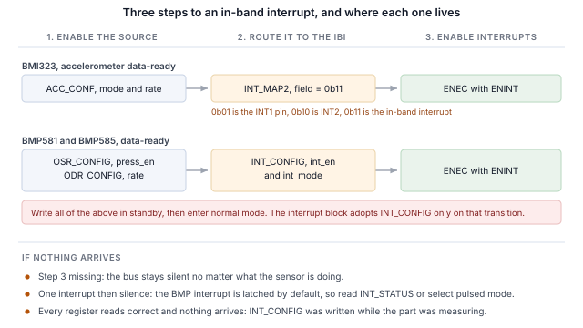
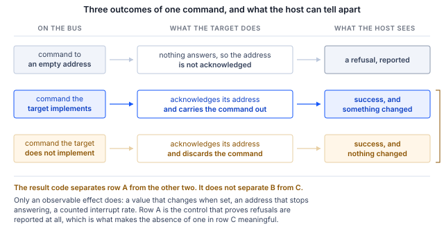

## 1 简介

当前一代 Bosch Sensortec MEMS 传感器在 I2C 和 SPI 之外还提供 MIPI I3C 接口，且使用相同的
两个引脚。I3C 保留了两线占用，并在其上增加了一套丰富的功能。

Table: I3C 为两线传感器接口增加的功能

| 功能 | 为设计带来的好处 |
|---|---|
| 动态地址分配 | 控制器在运行时分配地址，因此静态地址冲突不再是电路板设计的约束，相同的器件也可以共享一条总线 |
| 从总线识别 | 每个目标器件都会报告 48 位临时标识符、器件类别及其总线能力，因此控制器可以枚举并非为其专门设计的总线 |
| 通用命令码 | 一套标准的广播和直接命令，用于枚举、识别、配置、中断控制和复位，在每个符合规范的目标器件上都相同 |
| 带内中断 | 传感器在数据线上中断主机，并携带一个说明原因的字节，因此无需布线或分配中断引脚 |
| 组寻址 | 一次写入即可同时到达以组方式寻址的多个目标器件 |
| 更高的信令速率 | 推挽时钟，在单数据速率模式下最高 12.5 MHz，而 I2C 受开漏限制 |
| 更低功耗 | 推挽信令避免了 I2C 持续消耗的静态上拉电阻电流，活动状态则允许控制器告知目标器件预期的总线延迟，使其可以更深度地空闲 |
| 热加入（Hot-Join） | 在总线运行后才上电的目标器件可以请求被枚举 |
| 时序控制 | 控制器可以让目标器件根据共享参考为其中断加时间戳 |
| 标准复位与恢复 | 定义了目标器件复位以及错误检测与恢复，而不是各厂商各自的序列 |
| I2C 兼容性 | 传统 I2C 器件可以共享总线 |

目标器件只实现传感器所需的子集，且不同器件的子集各不相同。本笔记使用 Binho Supernova
USB 主机适配器和 Binho I3C Target Board，逐步讲解三款 Bosch Sensortec 器件：枚举它们、
从总线识别它们、读写寄存器、流式输出解码后的测量值、在不连接中断引脚的情况下通过数据线
获取中断，以及确定每个目标器件实际实现了上述哪些功能。

这里的任何内容都不需要微控制器、固件或驱动移植。每一步都是从主机 PC 发出的一条命令。

### 1.1 范围

读完本文档后，手边有硬件的读者将能够：把传感器枚举到 I3C 总线上，通过其自身寄存器识别它，
读写寄存器，流式输出解码后的测量值，在不连接中断引脚的情况下以传感器配置的输出数据速率接收
带内中断，并根据可观察到的效果确定目标器件实现了哪些功能。

所讲解的三款器件为 BMI323、BMP581 和 BMP585。三款器件均在硬件上进行了验证，本文档中的每个
输出都是真实采集的结果。

### 1.2 适用器件

Table: 涵盖的器件

| 器件 | 功能 | 评估板 | 已在硬件上验证 |
|---|---|---|---|
| BMI323 | 6 轴 IMU，加速度计和陀螺仪 | Shuttle Board 3.0 | 是 |
| BMP581 | 气压传感器 | Shuttle Board 3.0 | 是 |
| BMP585 | 气压传感器，耐介质型 | Shuttle Board 3.0 | 是 |

该方法适用于 Shuttle Board 3.0 适配板上任何带 I3C 接口的 Bosch Sensortec MEMS 器件。将其
添加到所提供的工具中只需一个表项，详见第 11 节。

### 1.3 相关文档

Table: 相关文档

| 文档 | 主题 |
|---|---|
| BST-BMI323-DS000-13 | BMI323 数据手册 |
| BST-BMP581-DS004-13 | BMP581 数据手册 |
| BST-BMP585-DS003-02 | BMP585 数据手册 |
| MIPI I3C Specification v1.1 | 通用命令码、带内中断、动态寻址 |
| Binho I3C Target Board 产品页面 | 插座、跳线以及支持的适配板 |

## 2 所需设备和软件

### 2.1 硬件

Table: 所需设备

| 项目 |
|---|
| Binho Supernova USB 主机适配器 |
| Binho I3C Target Board |
| 安装在 Shuttle Board 3.0 上的 BMI323、BMP581 或 BMP585，或其他 Shuttle Board 3.0 MEMS 适配板 |
| USB-C 线缆 |

评估板插入标有 Shuttle Board 3.0 的插座。本文档中的任何步骤都不需要连接其他任何东西。

### 2.2 连接

Table: 使用的信号

| 信号 | 用途 |
|---|---|
| SCL | I3C 时钟，从适配器到目标器件 |
| SDA | I3C 数据，双向 |
| 3.3 V | 目标器件电源，由适配器提供 |
| GND | 回路 |

两根线加一路电源。**本笔记中的任何内容都不连接中断引脚、复位线或配置电阻**，包括中断相关
章节：在 I3C 上，传感器通过 SDA 向主机发出信号。

总线全程工作在 3.3 V。上拉电阻由目标板提供。

### 2.3 总线设置

Table: 使用的总线设置

| 设置 | 值 |
|---|---|
| 推挽速率 | 5 MHz，50% 占空比 |
| 开漏速率 | 1 MHz |
| 驱动强度 | Fast mode |
| 总线电压 | 3.3 V |

这些是起始值而非极限值。第 9 节确定每款器件能够承受的速率。

### 2.4 软件

```
pip install binhosupernova
```

Python 3.12 和 `binhosupernova` 软件包是仅有的依赖项。解压本笔记随附的资源压缩包，并用一条
命令确认设置：

```
python i3c_mems.py scan
```

## 3 初次接触：枚举总线

一条命令即可让传感器以主机分配的地址上线到总线：

```
python i3c_mems.py scan
```

```
1 target(s) on the bus at 3300 mV, PUSH_PULL_5_MHZ_50_DC, OPEN_DRAIN_1_MHZ

  dynamic address 0x08
    PID  07 70 10 51 10 00   device id 0x1051
    BCR  0x06   DCR 0x62
    HDR  SDR only   IBI capable
    profile  bmp585
```

这是由两条通用命令码完成的。**RSTDAA** 清除已分配的任何动态地址，使总线从已知状态开始。
**ENTDAA** 随后执行动态地址分配（DAA）：控制器发出广播，每个目标器件使用其 48 位临时标识符
进行仲裁，并依次获得一个地址。只有一个器件时，该地址为 `0x08`。

任何地方都没有配置地址。器件自身的静态地址没有被使用，也不需要知道。

该输出中地址之后的所有内容都来自目标器件，而不是查找表，这是与 I2C 最先感受到的不同之处。
在 I2C 上，主机写入一个事先选定的地址，并期待有器件应答。而在这里，器件会自我介绍。

## 4 从总线识别器件

```
python i3c_mems.py identify --device bmp585
```

### 4.1 识别寄存器包含的内容

由三个寄存器完成自我介绍，每个寄存器都用一条命令读取，而不是从寄存器文件中读取。

Table: 测得的识别值

| 器件 | PID | Device id (31:16) | BCR | DCR |
|---|---|---|---|---|
| BMI323 | `07 70 10 43 00 00` | `0x1043` | `0x06` | `0xEF` |
| BMP581 | `07 70 10 50 10 00` | `0x1050` | `0x06` | `0x62` |
| BMP585 | `07 70 10 51 10 00` | `0x1051` | `0x06` | `0x62` |

每个值都与相应的数据手册一致。在每种情况下，器件标识符字段都嵌入了芯片标识符，因此控制器
在访问寄存器文件之前就能确定器件型号。

**器件特性寄存器（DCR）** 说明器件属于哪一类。两款压力传感器都报告 `0x62`，这是 MIPI 注册表
分配给压力传感器的值，因此控制器可以对事先毫无了解的目标器件进行分类。DCR 标识的是类别而不是
具体器件，区分两者的是临时标识符。

**总线特性寄存器（BCR）** 说明器件在总线上能做什么。三款器件都报告 `0x06`：

```
BCR 0x06
  device role                      I3C target
  advanced capabilities (bit 5)    no, so SDR only
  virtual target support           no
  offline capable                  yes
  IBI mandatory payload            yes
  IBI capable                      yes
  max data speed limit             no limit
```

在进行任何配置之前，这里就给出了两个有用的事实。器件可以发起带内中断，并且发起时会发送数据
负载，第 7 节会用到这一点。另外 bit 5 为 0，因此该器件仅支持单数据速率，这样只用一条命令就
从目标器件本身回答了高数据速率的问题，而不必查阅数据手册中的表格。

### 4.2 用芯片标识符确认

Table: 芯片标识符寄存器

| 器件 | 寄存器 | 读取值 |
|---|---|---|
| BMI323 | `0x00` | `0x1143`，低字节 `0x43` |
| BMP581 | `0x01` | `0x50` |
| BMP585 | `0x01` | `0x51` |

> **重要：** BMI323 芯片标识符寄存器为 16 位宽，其高字节是保留字段，在所测器件上读为 `0x11`，
> 因此该寄存器读为 `0x1143`，而数据手册给出的复位值为 `0x0043`。如果主机将整个字与数据手册
> 中的值比较，会误判器件不对。请比较低字节。

## 5 读写寄存器

寄存器访问是一次私有传输：先发送寄存器地址，然后读取字节。

```
python i3c_mems.py read  --device bmp585 0x01
python i3c_mems.py write --device bmi323 0x20 0x3127
```

帧格式因器件而异，而非因厂商而异，把某款 Bosch 器件的假设沿用到另一款上，是首次读取结果
出错最可能的原因：

Table: 各器件实测的寄存器访问方式

| 器件 | 寄存器地址 | 数据宽度 | 读取数据之前的哑字节数 |
|---|---|---|---|
| BMI323 | 8 位 | 16 位 | 2 |
| BMP581 | 8 位 | 8 位 | 0 |
| BMP585 | 8 位 | 8 位 | 0 |

BMI323 数据手册说明了每种接口的哑字节数，I3C 为两个。BMP581 和 BMP585 数据手册没有说明 I3C
的哑字节数，实测也未观察到哑字节。

在未记载哑字节数的情况下，可以读取一段复位值已知的寄存器，找出它们对齐的偏移量来确定。两个
相邻的锚点就足以消除歧义。在 BMP585 上，位于 `0x01` 的 CHIP_ID 读为 `0x51`，位于 `0x02` 的
REV_ID 读为 `0x32`：

```
dummy=0: raw 51 32          ->  CHIP_ID 0x51 REV_ID 0x32   <== both anchors match
dummy=1: raw 51 32 22       ->  CHIP_ID 0x32 REV_ID 0x22
dummy=2: raw 51 32 22 00    ->  CHIP_ID 0x22 REV_ID 0x00
```

只用一个锚点会允许不止一种偏移量。

在这些器件上，开头的 `0x7E` 广播头是可选的。带和不带广播头发出的读取在三款器件上都返回相同
的值，这与 BMP581 和 BMP585 数据手册一致：主机可以跳过广播头，直接从动态地址部分开始，并且
这适用于所有 I3C 传输。

## 6 流式输出传感器数据

### 6.1 BMI323，加速度计

对位于 `0x20` 的 ACC_CONF 进行一次写入即可配置该器件。值 `0x3127` 选择 ±8 g 的加速度计量程、
50 Hz 的输出数据速率以及一种使能的电源模式。

```
python i3c_mems.py stream --device bmi323 --seconds 5
```

各轴为 16 位有符号值，在 ±8 g 量程下为每 g 4096 个计数。

静止时幅值为 1 g，这是对整个链路是否正确的一次免费检查：帧格式、字节序、符号处理和比例。
实测静止时 BMI323 报告 1.006 g，因此量程字段与解码结果一致。倾斜电路板，各轴数值会重新分配，
而幅值保持不变。

### 6.2 BMP581 和 BMP585，压力和温度

这些器件需要按顺序操作，而不是一次写入。配置寄存器要在器件处于待机状态时写入，然后才进入
测量模式：

1. 写入位于 `0x37` 的 ODR_CONFIG，电源模式为待机
2. 写入位于 `0x36` 的 OSR_CONFIG 并置位 `press_en`，在温度之外同时使能压力
3. 再次写入 ODR_CONFIG，设置所需的输出数据速率，电源模式为正常
4. 读取位于 `0x38` 的 OSR_EFF 并确认 `odr_is_valid`，它报告速率与过采样组合是否被
   接受

```
python i3c_mems.py stream --device bmp585 --seconds 2 --interval 0.5
```

```
  temperature    21.583 C   pressure 100351.7 Pa   pressure  1003.52 hPa
```

压力为 24 位无符号值除以 64，单位为帕斯卡。温度为 24 位有符号值除以 65536，单位为摄氏度。

在同一房间、同一小时内，BMP585 读得的环境气压为 1003.52 hPa，BMP581 为 1003.88 hPa，两块
电路板上的两款器件相差 0.36 hPa。

这些器件的可观察量无需任何仪器：对着它呼气或把它举起，压力会按每米海拔约 12 Pa 变化。

### 6.3 输出数据速率

Table: 输出数据速率选择

| 器件 | 寄存器 | 此处使用的值 |
|---|---|---|
| BMI323 | 位于 `0x20` 的 `ACC_CONF` | 50 Hz，作为 `0x3127` 配置字的一部分 |
| BMP581、BMP585 | 位于 `0x37` 的 `ODR_CONFIG` | `0x17` 10 Hz，`0x13` 30 Hz，两者均列为零误差 |

速率在第 7 节中很重要，因为中断速率跟随它。

## 7 无中断引脚，通过总线发出中断

带内中断是对传感器设计改变最明显的功能。器件通过传输数据的同两根线告诉主机新数据已就绪，
主机在读取任何内容之前就知道原因，因此无需布线、分配中断引脚或将其引出到连接器。

### 7.1 三个步骤

本笔记中的每个带内中断都是同样的三个步骤，顺序如下：

1. **在传感器中使能中断源。** 即以某个输出数据速率进行的测量本身。
2. **将其路由到带内中断。** 由哪个寄存器完成这一步因器件而异，大部分难点也在于此。
3. **发送带 ENINT 位的 ENEC。** 在它到达之前，无论传感器在做什么，总线都保持静默。



第三步值得证明而不仅仅是断言。以下每种状态都是在 BMI323 上以一秒窗口测得的：

Table: 在 BMI323 上使能带内中断的因素

| 状态 | 1 s 内的中断数 |
|---|---|
| 传感器禁用 | 0 |
| 已发送 DISEC，目标器件的中断被禁用 | 0 |
| 传感器运行，未配置路由 | 0 |
| 已写入 `INT_MAP2`，路由已配置，仍为禁用 | 0 |
| 控制器已配置为接受中断，仍为禁用 | 0 |
| **已发送带 ENINT 位的 ENEC** | **50** |

使能中断的是 ENEC。路由写入和控制器自身的配置都不能做到这一点。

```
python i3c_mems.py ibi --device bmp585 --seconds 3 --show 3
```

Table: 中断速率与配置的输出数据速率对比

| 器件 | 配置值 | 实测值 | 窗口 |
|---|---|---|---|
| BMI323 | 50 Hz | 每秒 50.00 次 | 3.0 s |
| BMP581 | 10 Hz | 每秒 10.00 次 | 4.0 s |
| BMP585 | 10 Hz | 每秒 9.96 次 | 4.0 s |
| BMP585 | 30 Hz | 每秒 29.75 次 | 4.0 s |

> **注意：** 速率可以与配置速率相比较，单个到达时间则不行。在 50 Hz 下测量 149 个连续间隔，
> 到达间隔范围为 0.00 至 47.00 ms，平均 20.03 ms，149 个中有 6 个小于 1 ms，这是因为主机
> 传输层是成批递送中断的。因此本文档不给出任何抖动或延迟数据。

### 7.2 强制数据字节

每个中断都携带一个强制数据字节，说明触发了什么，因此主机可以决定是否需要读取传感器：

Table: 观察到的强制数据字节

| 器件 | 强制字节 | 含义 |
|---|---|---|
| BMI323 | `0x02` | 采样就绪，加速度计、陀螺仪或温度 |
| BMP581、BMP585 | `0x01` | 数据就绪 |

BMI323 的字节还能区分 FIFO 水位线或 FIFO 满状态以及中断组标识符，因此主机可以在发出读取之前
区分新数据和 FIFO 事件。

### 7.3 各器件的路由

**BMI323。** 由一个字段选择目的地。位于 `0x3B` 的 INT_MAP2 中的 `acc_drdy_int` 占用 bit 11
和 bit 10，取 `0b01` 表示 INT1 引脚，`0b10` 表示 INT2，`0b11` 表示 I3C 带内中断。写入
`0x0C00` 选择最后一项，中断随后通过已有的两根线到达。

**BMP581 和 BMP585。** 位于 `0x14` 的 INT_CONFIG 包含使能和模式。它有两点会耗费调试时间，
而且两者都表现为一个看起来完全正确的中断设置。

> **中断默认是锁存的。** INT_CONFIG 复位为 `0x35`，该值选择锁存模式，而位于 `0x27` 的
> INT_STATUS 是读清除的。因此中断只断言一次，在主机读取状态寄存器之前不会被重新使能。结果就是
> 一个中断之后便是静默。要么选择脉冲模式，要么在每次中断后读取 INT_STATUS；两种方式都能
> 得到配置的速率。

> **中断模块只在下一次从待机转换到测量模式时才采用新的 INT_CONFIG 值。** 寄存器在任何时候
> 都接受写入，并立即回读出新值，因此在器件测量期间配置中断的主机会看到所有寄存器都正确，却
> 收不到任何中断。在配置为 10 Hz 的 BMP585 上实测：在正常模式下写入中断配置，2 s 内没有中断；
> 写入相同的寄存器后再进行一次从待机到正常的转换，21 个中断；在待机时配置然后进入正常模式，
> 20 个中断。数据手册自身的指导涵盖了这一点：在切换到测量模式之前写入配置。

### 7.4 停止中断

```
python i3c_mems.py reset --device bmi323
```

带 DISINT 位的 DISEC 会停止中断流，实测在三款器件上都只需一条命令即可停止。软复位使器件回到
复位状态，同时也会清除通用命令码锁存的任何模式。

## 8 验证 I3C 功能集的其余部分

该工具根据可观察到的效果而非结果码来确定目标器件实现了什么。这一区别在这条总线上很重要，
图 2 说明了原因。

Table: 对目标器件和未占用地址发送相同命令

| 命令 | 发往目标器件 `0x08` | 发往未占用地址 `0x0B` |
|---|---|---|
| GETPID | `SUCCESS`，返回标识符 | `I3C_NACK_ADDRESS` |
| GETBCR | `SUCCESS`，返回 `0x06` | `I3C_NACK_ADDRESS` |

目标器件可以应答一条它未实现的命令并将其丢弃，这是 I3C 规范所允许的。BMI323 数据手册将十条
通用命令码标记为不支持，而把其中每一条发送给该器件都会返回成功结果。上面的对照表明这是目标器件
的行为，而不是适配器隐瞒了错误：同样的命令发送到没有目标器件的地址时会被拒绝，并且拒绝会被
报告出来。



因此下面的每一行都需要观察到一个变化：设置一个值并读回，移动地址并确认旧地址不再应答，按配置
的速率统计中断数。

```
python i3c_mems.py features --device bmp585
```

Table: 实测的通用命令码支持情况

| 命令 | BMI323 | BMP581 | BMP585 | 依据 |
|---|---|---|---|---|
| ENTDAA | 支持 | 支持 | 支持 | 目标器件以预期的标识符被枚举 |
| RSTDAA | 支持 | 支持 | 支持 | 地址表被清除，旧地址随后拒绝 |
| SETNEWDA | 支持 | 支持 | 支持 | 地址已移动，旧地址拒绝 |
| GETPID, GETBCR, GETDCR | 支持 | 支持 | 支持 | 返回数据手册中的值 |
| ENEC, DISEC | 支持 | 支持 | 支持 | 中断可重复地启动和停止 |
| SETXTIME, GETXTIME | 支持 | 支持 | 支持 | 命令之后某个报告的字节发生了变化 |
| SETMWL, SETMRL | 未实现 | 未实现 | 未实现 | 设置后值未改变 |
| GETMWL, GETMRL | 未实现 | 未实现 | 未实现 | 同上 |
| SETGRPA, RSTGRPA | 未实现 | 未实现 | 未实现 | 通过组地址的写入在分配之前、期间和之后均被拒绝 |
| HDR 模式 | 不支持 | 不支持 | 不支持 | BCR bit 5 为 0 |
| GETHDRCAP | 未实现 | 应答 `0x00` | 应答 `0x00` | 未报告任何 HDR 模式 |
| 热加入 | 未观察到 | 未观察到 | 未观察到 | 任何时候都没有热加入请求 |
| GETSTATUS | 未确定 | 未确定 | 未确定 | 有应答，未经独立核实 |
| GETMXDS | 未确定 | 未确定 | 未确定 | 有应答，无可观察的效果 |
| ENTAS0 至 ENTAS3 | 未确定 | 未确定 | 未确定 | 需要电流测量 |
| RSTACT | 未确定 | 未确定 | 未确定 | 从主机侧无可观察的效果 |

**组寻址** 需要说明其测试方法，因为显而易见的测试会给出错误答案。组地址让控制器可以同时寻址
多个目标器件，因此它是一个写入目的地：从组地址读取没有定义的应答，目标器件可以在正确实现该
功能的同时拒绝组地址读取。这里使用的测试先分配一个组地址，通过它写入一个寄存器，然后在目标
器件自己的动态地址上读回该寄存器，并要求得到三个结果：在 SETGRPA 之前写入被拒绝，在组地址
已分配期间写入生效，在 RSTGRPA 之后写入再次被拒绝。试验值首先在目标器件自己的地址上写入，
以确认该寄存器能保存它。三款器件在每个阶段都拒绝该写入，在三个不同的组地址上均如此，而
SETGRPA 本身每次都返回成功结果。

**SETXTIME** 是唯一一行重复测试不会重复结果的。它的子命令选择模式，且模式位会锁存，因此器件
已经处于的模式所对应的子命令理所当然是空操作。在 BMI323 上，从 GETXTIME 为 `03 00 0D 78` 开始，
子命令 `0x3F` 把第二个字节变为 `0x01`，之后再也不会改变它，而 `0xDF` 把它变为 `0x03`。主机
发送一条子命令而没有看到变化，并不能断定该命令未实现。子命令 `0xFF` 会再次禁用该模式。

使能时序控制还会改变中断负载：在 BMI323 上，它从一个字节增加到四个字节，并且强制字节的 bit 7
被置位。该模式在主机重启和总线复位后仍然保留，由软复位清除。

**活动状态** 仍为未确定。证明器件进入了低活动状态需要进行电流测量，而本设置无法做到，因此
矩阵如实说明而不做猜测。

## 9 总线速率

```
python i3c_mems.py rates --device bmp585 --iterations 100
```

Table: 无错误的最高总线速率

| 器件 | 推挽 | 开漏 |
|---|---|---|
| BMI323 | 12.5 MHz，50% 占空比 | 4.17 MHz |
| BMP581 | 12.5 MHz，50% 占空比 | 4.17 MHz |
| BMP585 | 12.5 MHz，50% 占空比 | 4.17 MHz |

三款器件都通过了适配器提供的所有速率。**方法：** 连续 100 次读取芯片标识符寄存器，必须全部
无错误地返回预期值，只有每次迭代都成功，该速率才算通过。这是一个寄存器读取循环，不是吞吐量
测量，不应从中得出任何关于持续数据速率的结论。

两种速率并非相互独立：适配器会以频率组合无效为由拒绝某些组合，因此开漏扫描是在已通过的最快
推挽速率下进行的，而不是在默认速率下。

## 10 实用注意事项

Table: 实用注意事项

| 器件 | 注意事项 |
|---|---|
| BMI323 | 芯片标识符寄存器读为 `0x1143`；请将低字节与数据手册中的 `0x43` 比较 |
| BMI323 | 每次读取数据之前有两个哑字节，数据为 16 位宽 |
| BMP581、BMP585 | 在待机时写入中断配置，然后进入正常模式，否则中断模块永远不会采用它 |
| BMP581、BMP585 | 中断默认是锁存的。每次中断后读取 INT_STATUS，或选择脉冲模式 |
| 全部 | 使能中断的是带 ENINT 的 ENEC。仅配置路由不行 |
| 全部 | 枚举后的首次读取可能尚未稳定。按照数据手册的建议，先发出一次哑读取 |
| 全部 | SETXTIME 会锁存一个改变中断负载的模式。`SETXTIME 0xFF` 将其关闭 |

## 11 工具

Table: 工具命令

| 命令 | 用途 |
|---|---|
| `scan` | 枚举总线并报告应答的器件 |
| `identify` | 解码目标器件的识别寄存器 |
| `read`, `write` | 读取或写入寄存器，写入后进行回读 |
| `stream` | 通过轮询打印解码后的采样 |
| `ibi` | 将传感器中断路由到总线上并统计到达的中断 |
| `features` | 根据可观察到的效果确定目标器件实现了什么 |
| `rates` | 找出无错误的最高总线速率 |
| `reset`, `power-cycle` | 使器件回到已知状态 |

Table: 会话选项，可放在命令之前或之后

| 选项 | 默认值 |
|---|---|
| `--serial` | 找到的第一个适配器 |
| `--voltage` | 3300 mV |
| `--push-pull` | `PUSH_PULL_5_MHZ_50_DC` |
| `--open-drain` | `OPEN_DRAIN_1_MHZ` |

添加一个器件只需在配置文件表中增加一个条目：寄存器帧格式、预期的识别值、启动数据流的写入、
路由中断的写入，以及中断负载的解码器。

## 12 实测结果

### 12.1 测试配置

Table: 测试配置

| 项目 | 值 |
|---|---|
| 适配器 | Binho Supernova，硬件版本 B，固件 4.4.0 |
| SDK | `binhosupernova`，Python 3.12，Windows 11 |
| 配件 | Binho I3C Target Board |
| 总线 | 3.3 V，推挽 5 MHz 50% 占空比，开漏 1 MHz，fast-mode 驱动强度 |
| 枚举 | RSTDAA 后接 ENTDAA |
| 目标器件 | Shuttle Board 3.0 上的 BMI323、BMP581、BMP585，每次一个 |

### 12.2 结果

**识别。** 第 4 节中的每个值都与相应的数据手册一致，其中 BMI323 芯片标识符按低字节比较。

**中断。** 速率如第 7.1 节表中所列。每款器件都测量了两次，以确认计数可复现。

**支持情况。** 第 8 节中的矩阵是对每款器件运行 `features` 命令生成的。

Table: 各器件的判定计数

| 器件 | 支持 | 未实现 | 未确定 |
|---|---|---|---|
| BMI323 | 11 | 7 | 7 |
| BMP581 | 12 | 7 | 7 |
| BMP585 | 12 | 7 | 7 |

BMI323 相差一行，是因为它不报告最大带内中断负载，因此工具没有可与控制器上限比较的声明大小。
另外两款器件报告了该值，检查项出现在它们的矩阵中。

**总线速率。** 按第 9 节所述方法，三款器件都通过了适配器提供的所有速率。

**回归覆盖。** 本文档中展示的命令针对三款器件都与记录的输出进行比对，因此工具中任何改变读者
所见内容的修改都会被发现。每款器件的记录输出都经过重新生成，然后在多次连续运行中复现：
BMI323 五次，BMP581 和 BMP585 各六次。

## 13 故障排除

Table: 故障排除

| 现象 | 检查项 |
|---|---|
| 没有目标器件被枚举 | 电路板是否插在正确的插座中；是否有 3.3 V；尝试 `power-cycle` |
| 首次读取返回错误的值 | 该器件的哑字节数；BMI323 为两个，BMP 器件为零 |
| BMI323 上的芯片标识符看起来不对 | 比较低字节；高字节是保留字段 |
| 完全没有中断到达 | 确认发送了带 ENINT 位的 ENEC |
| 一个中断之后便是静默 | BMP 中断是锁存的；读取 INT_STATUS 或选择脉冲模式 |
| 所有寄存器读出都正确但没有中断到达 | INT_CONFIG 是在器件测量期间写入的；请在待机时写入 |
| 中断负载变大且 bit 7 被置位 | 时序控制已启用；`SETXTIME 0xFF`，或软复位 |
| 识别值读错一次，之后正确 | 枚举后属正常现象；先发出一次哑读取 |

## 14 缩略语

Table: 缩略语

| 术语 | 含义 |
|---|---|
| BCR | 总线特性寄存器（Bus characteristics register） |
| CCC | 通用命令码（Common command code） |
| DAA | 动态地址分配（Dynamic address assignment） |
| DCR | 器件特性寄存器（Device characteristics register） |
| ENTDAA | 进入动态地址分配（Enter dynamic address assignment） |
| HDR | 高数据速率（High data rate） |
| IBI | 带内中断（In-band interrupt） |
| MDB | 强制数据字节（Mandatory data byte） |
| ODR | 输出数据速率（Output data rate） |
| PID | 临时标识符（Provisional identifier） |
| SDR | 单数据速率（Single data rate） |

## 15 关于本文档中源代码的说明

本文档中展示并在随附压缩包中提供的示例代码仅供评估和参考。它以 MIT 许可证发布，许可证文本
包含在压缩包中。

Table: 资源压缩包内容

| 文件 | 说明 |
|---|---|
| `AN0004.md` | 本文档的 Markdown 源文件 |
| `assets/i3c_mems.py` | 参考工具 |
| `assets/LICENSE` | 涵盖示例代码的 MIT 许可证 |

## 16 修订历史

Table: 修订历史

| 版本 | 日期 | 说明 |
|---|---|---|
| 1.0 | 31 August 2026 | 首次发布。 |
| 1.1 | 31 August 2026 | SETGRPA 和 RSTGRPA 支持情况一行改为通过组地址写入而非从组地址读取进行重新测量，并且文档中现在说明了该测试方法。三款器件的判定结果均未改变。BMI323 的判定计数已更正，此前的计数取自一次器件仍保留着先前运行遗留模式的运行。 |
| 2.0 | 1 September 2026 | 按读者的操作顺序重新组织为逐步讲解：枚举、识别、读写寄存器、流式输出数据、中断，然后是功能集的其余部分。第 1 节现在以 I3C 为两线传感器接口增加的功能开篇。新增一幅中断设置的插图。会耗费调试时间的各器件行为汇总到实用注意事项一节中。所有实测结果均未改变。 |
| 2.1 | 3 September 2026 | 随附的 `i3c_mems.py` 副本已从共享工具更新，此前落后了 293 行。它新增了针对报告 `NOT_POWERED` 的外部电压的恢复路径、三次尝试的 RSTDAA 判定以及 HDR-DDR 读取。本文档的文字和实测结果均未改变，也没有任何一行被重新测量。 |
