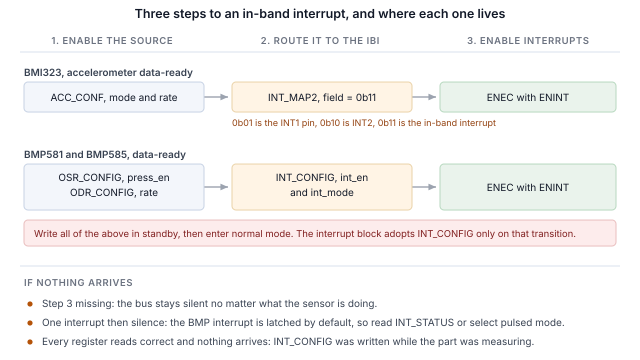
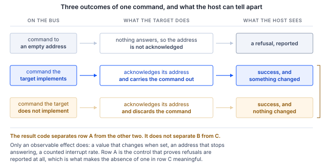

## 1 簡介

新一代 Bosch Sensortec MEMS 感測器除了 I2C 與 SPI 之外，也在相同的兩支腳位上提供 MIPI I3C 介面。
I3C 維持兩線式的佔用空間，並在其上增加了大量功能。

Table: I3C 為兩線式感測器介面增加的功能

| 功能 | 對設計帶來的效益 |
|---|---|
| 動態位址分配 | 控制器在執行期間分配位址，因此靜態位址衝突不再是電路板設計的限制，相同的元件也能共用同一條匯流排 |
| 從匯流排辨識 | 每個目標裝置都會回報 48 位元的暫時識別碼、裝置類別及其匯流排能力，因此控制器可以列舉並非為其設計的匯流排 |
| 通用命令碼 | 一組標準命令集，包含廣播與直接命令，用於列舉、辨識、設定、中斷控制與重置，在每個相容的目標裝置上皆相同 |
| 帶內中斷 | 感測器在資料線上對主機發出中斷，並附帶一個說明原因的位元組，因此不需要佈線或配置中斷腳位 |
| 群組定址 | 一次寫入即可同時送達多個以群組定址的目標裝置 |
| 更高的訊號速率 | 推挽時脈，在單一資料速率模式下可達 12.5 MHz，相較於 I2C 的開汲極限制 |
| 更低的功耗 | 推挽訊號避免了 I2C 持續消耗的靜態上拉電阻電流，而活動狀態讓控制器能告知目標裝置預期的匯流排延遲，使其能更深度地閒置 |
| 熱加入（Hot-Join） | 在匯流排運作後才上電的目標裝置可以請求被列舉 |
| 時序控制 | 控制器可以讓目標裝置依共用參考對其中斷加上時間戳記 |
| 標準重置與復原 | 定義好的目標裝置重置以及定義好的錯誤偵測與復原，而非各廠商自訂的序列 |
| I2C 相容性 | 傳統 I2C 裝置可以共用匯流排 |

目標裝置只會實作感測器所需的子集，而且這個子集因元件而異。本筆記使用 Binho Supernova USB 主機轉接器
與 Binho I3C Target Board，逐步操作三款 Bosch Sensortec 元件：列舉它們、從匯流排辨識它們、讀寫暫存器、
串流輸出解碼後的量測值、在未連接中斷腳位的情況下透過資料線取得中斷，並確認每個目標裝置實際實作了
上述哪些功能。

本文內容不需要微控制器、韌體或驅動程式移植。每個步驟都是從主機 PC 執行的一道命令。

### 1.1 範圍

讀完本文件後，手邊備妥硬體的讀者將能把感測器列舉到 I3C 匯流排上、從其自身的暫存器辨識它、讀寫暫存器、
串流輸出解碼後的量測值、在未連接中斷腳位的情況下以感測器設定的輸出資料速率接收帶內中斷，並從可觀察的
效果確認目標裝置實作了哪些功能。

逐步操作的三款元件為 BMI323、BMP581 與 BMP585。三者皆已在硬體上實際操作，本文件中的每一筆輸出都是
真實擷取的結果。

### 1.2 適用裝置

Table: 涵蓋的裝置

| 裝置 | 功能 | 評估板 | 已在硬體上實測 |
|---|---|---|---|
| BMI323 | 6 軸 IMU，加速度計與陀螺儀 | Shuttle Board 3.0 | 是 |
| BMP581 | 氣壓感測器 | Shuttle Board 3.0 | 是 |
| BMP585 | 氣壓感測器，耐介質型 | Shuttle Board 3.0 | 是 |

此方法適用於任何安裝在 Shuttle Board 3.0 轉接板上、具備 I3C 介面的 Bosch Sensortec MEMS 元件。
將新元件加入隨附的工具程式只需新增一筆表格項目，說明見第 11 節。

### 1.3 相關文件

Table: 相關文件

| 文件 | 主題 |
|---|---|
| BST-BMI323-DS000-13 | BMI323 資料手冊 |
| BST-BMP581-DS004-13 | BMP581 資料手冊 |
| BST-BMP585-DS003-02 | BMP585 資料手冊 |
| MIPI I3C Specification v1.1 | 通用命令碼、帶內中斷、動態定址 |
| Binho I3C Target Board 產品頁面 | 插座、跳線與支援的轉接板 |

## 2 所需設備與軟體

### 2.1 硬體

Table: 所需設備

| 項目 |
|---|
| Binho Supernova USB 主機轉接器 |
| Binho I3C Target Board |
| 安裝在 Shuttle Board 3.0 上的 BMI323、BMP581 或 BMP585，或其他 Shuttle Board 3.0 MEMS 轉接板 |
| USB-C 傳輸線 |

評估板直接插入標示為 Shuttle Board 3.0 的插座。本文件中的任何程序都不需要連接其他東西。

### 2.2 連接

Table: 使用的訊號

| 訊號 | 用途 |
|---|---|
| SCL | I3C 時脈，由轉接器送往目標裝置 |
| SDA | I3C 資料，雙向 |
| 3.3 V | 目標裝置電源，由轉接器提供 |
| GND | 回路 |

只需兩條線與一組電源。**本筆記中的所有內容都未連接中斷腳位、重置線或設定用電阻**，中斷相關章節也是如此：
在 I3C 上，感測器透過 SDA 向主機發出訊號。

匯流排全程以 3.3 V 運作。上拉電阻由目標板提供。

### 2.3 匯流排設定

Table: 使用的匯流排設定

| 設定 | 數值 |
|---|---|
| 推挽速率 | 5 MHz，50% 工作週期 |
| 開汲極速率 | 1 MHz |
| 驅動強度 | Fast mode |
| 匯流排電壓 | 3.3 V |

這些是起始值而非上限。第 9 節確認了每個元件能維持的速率。

### 2.4 軟體

```
pip install binhosupernova
```

唯一的相依項目是 Python 3.12 與 `binhosupernova` 套件。解壓縮本筆記隨附的資源壓縮檔，並以一道命令
確認環境設定：

```
python i3c_mems.py scan
```

## 3 初次接觸：列舉匯流排

一道命令即可讓感測器以主機分配的位址出現在匯流排上：

```
python i3c_mems.py scan
```

```
1 target(s) on the bus at 3300 mV, PUSH_PULL_5_MHZ_50_DC, OPEN_DRAIN_1_MHZ

  dynamic address 0x08
    PID  07 70 10 51 10 00   device id 0x1051
    BCR  0x06   DCR 0x62
    HDR  SDR only   IBI capable
    profile  bmp585
```

這是由兩個通用命令碼完成的。**RSTDAA** 清除任何已分配的動態位址，讓匯流排從已知狀態開始。接著
**ENTDAA** 執行動態位址分配：控制器發出廣播，每個目標裝置以其 48 位元暫時識別碼進行仲裁，並依序各自
獲得一個位址。只有一個元件時，該位址為 `0x08`。

沒有在任何地方設定位址。元件本身的靜態位址並未被使用，也不需要事先知道。

輸出中位址之後的所有內容都來自目標裝置，而非查找表，這是與 I2C 最先感受到的不同之處。在 I2C 上，
主機寫入一個事先選定的位址，並期待有東西回應。在這裡，則是裝置自我介紹。

## 4 從匯流排辨識元件

```
python i3c_mems.py identify --device bmp585
```

### 4.1 識別暫存器所攜帶的資訊

負責自我介紹的是三個暫存器，每一個都以單一命令讀取，而非從暫存器檔案讀取。

Table: 量測到的識別值

| 元件 | PID | 裝置 ID (31:16) | BCR | DCR |
|---|---|---|---|---|
| BMI323 | `07 70 10 43 00 00` | `0x1043` | `0x06` | `0xEF` |
| BMP581 | `07 70 10 50 10 00` | `0x1050` | `0x06` | `0x62` |
| BMP585 | `07 70 10 51 10 00` | `0x1051` | `0x06` | `0x62` |

每個數值都與對應的資料手冊相符。在每種情況下，裝置識別碼欄位都內嵌了晶片識別碼，因此控制器在存取
暫存器檔案之前就能叫出元件名稱。

**裝置特性暫存器（DCR）** 說明這是哪一類裝置。兩款氣壓感測器都回報 `0x62`，這是 MIPI 登錄表分配給
氣壓感測器的值，因此控制器可以為事先一無所知的目標裝置分類。DCR 識別的是類別而非個別元件，區分兩者的
是暫時識別碼。

**匯流排特性暫存器（BCR）** 說明元件在匯流排上能做什麼。三者都回報 `0x06`：

```
BCR 0x06
  device role                      I3C target
  advanced capabilities (bit 5)    no, so SDR only
  virtual target support           no
  offline capable                  yes
  IBI mandatory payload            yes
  IBI capable                      yes
  max data speed limit             no limit
```

在進行任何設定之前，這裡就已提供兩項有用的資訊。元件可以發出帶內中斷，且發出時會附帶酬載，第 7 節
會用到這一點。此外，bit 5 為清除狀態，因此元件僅支援單一資料速率，這樣只需一道命令就能從目標裝置
本身回答高資料速率的問題，而不必查閱資料手冊的表格。

### 4.2 以晶片識別碼確認

Table: 晶片識別碼暫存器

| 元件 | 暫存器 | 讀取值 |
|---|---|---|
| BMI323 | `0x00` | `0x1143`，低位元組 `0x43` |
| BMP581 | `0x01` | `0x50` |
| BMP585 | `0x01` | `0x51` |

> **重要：** BMI323 的晶片識別碼暫存器寬度為 16 位元，其高位元組是保留欄位，在所量測的元件上讀值為
> `0x11`，因此暫存器讀值為 `0x1143`，而資料手冊給出的重置值為 `0x0043`。若主機以整個字組與資料手冊
> 的值比較，會判定元件不正確。請比較低位元組。

## 5 讀寫暫存器

暫存器存取是一種私有傳輸：送出暫存器位址，然後讀取位元組。

```
python i3c_mems.py read  --device bmp585 0x01
python i3c_mems.py write --device bmi323 0x20 0x3127
```

框架格式依元件而定，而非依廠商而定，將某款 Bosch 元件的假設套用到另一款，是第一次讀取結果錯誤最可能
的原因：

Table: 各元件量測到的暫存器存取方式

| 元件 | 暫存器位址 | 資料寬度 | 讀取酬載前的虛擬位元組數 |
|---|---|---|---|
| BMI323 | 8 位元 | 16 位元 | 2 |
| BMP581 | 8 位元 | 8 位元 | 0 |
| BMP585 | 8 位元 | 8 位元 | 0 |

BMI323 資料手冊針對每種介面列出虛擬位元組數，I3C 為兩個。BMP581 與 BMP585 資料手冊並未列出 I3C 的
數量，實測也未觀察到任何虛擬位元組。

若數量未載明，可以讀取一串重置值已知的暫存器，找出它們對齊的偏移量來確認。兩個相鄰的錨點就足以消除
歧義。在 BMP585 上，位於 `0x01` 的 CHIP_ID 讀值為 `0x51`，位於 `0x02` 的 REV_ID 讀值為 `0x32`：

```
dummy=0: raw 51 32          ->  CHIP_ID 0x51 REV_ID 0x32   <== both anchors match
dummy=1: raw 51 32 22       ->  CHIP_ID 0x32 REV_ID 0x22
dummy=2: raw 51 32 22 00    ->  CHIP_ID 0x22 REV_ID 0x00
```

若只有單一錨點，可能會有不只一個偏移量符合。

在這些元件上，開頭的 `0x7E` 廣播標頭是選用的。在三款元件上，帶有與不帶該標頭發出的讀取都傳回相同的值，
這與 BMP581 和 BMP585 資料手冊相符：主機可以略過該標頭，直接從動態位址段開始，且這適用於所有 I3C
傳輸。

## 6 串流感測器資料

### 6.1 BMI323，加速度計

只需對位於 `0x20` 的 ACC_CONF 進行一次寫入即可設定元件。數值 `0x3127` 選擇 ±8 g 的加速度計量程、
50 Hz 的輸出資料速率，以及啟用的電源模式。

```
python i3c_mems.py stream --device bmi323 --seconds 5
```

各軸為 16 位元有號數值，在 ±8 g 量程下為每 g 4096 計數。

靜止時的合成量值為 1 g，這是確認整條鏈路正確的免費檢查：框架格式、位元組順序、正負號處理與比例。
靜止時量測到 BMI323 回報 1.006 g，因此量程欄位與解碼結果一致。傾斜電路板時，各軸數值會重新分配，
而合成量值保持不變。

### 6.2 BMP581 與 BMP585，氣壓與溫度

這些元件需要依特定順序操作，而非單一寫入。設定暫存器必須在元件處於待機時寫入，之後才進入量測模式：

1. 將位於 `0x37` 的 ODR_CONFIG 寫入待機電源模式
2. 將位於 `0x36` 的 OSR_CONFIG 寫入並設定 `press_en`，在溫度之外同時啟用氣壓量測
3. 再次寫入 ODR_CONFIG，設定所需的輸出資料速率與正常電源模式
4. 讀取位於 `0x38` 的 OSR_EFF 並確認 `odr_is_valid`，該欄位回報速率與過取樣組合是否被接受

```
python i3c_mems.py stream --device bmp585 --seconds 2 --interval 0.5
```

```
  temperature    21.583 C   pressure 100351.7 Pa   pressure  1003.52 hPa
```

氣壓為 24 位元無號數值除以 64，單位為帕。溫度為 24 位元有號數值除以 65536，單位為攝氏度。

在同一個房間、一小時之內，BMP585 讀到的環境氣壓為 1003.52 hPa，BMP581 為 1003.88 hPa，兩塊電路板上
的兩個元件相差 0.36 hPa。

這些元件的可觀察量不需要任何儀器：對它呼氣或將它舉起，氣壓每公尺高度約變化 12 Pa。

### 6.3 輸出資料速率

Table: 輸出資料速率選擇

| 元件 | 暫存器 | 本文使用的數值 |
|---|---|---|
| BMI323 | 位於 `0x20` 的 `ACC_CONF` | 50 Hz，作為 `0x3127` 設定字組的一部分 |
| BMP581、BMP585 | 位於 `0x37` 的 `ODR_CONFIG` | `0x17` 10 Hz、`0x13` 30 Hz，兩者列出的誤差皆為零 |

速率在第 7 節很重要，因為中斷速率會跟隨它。

## 7 透過匯流排發出中斷，無需中斷腳位

帶內中斷是最明顯改變感測器設計的功能。元件透過傳輸資料的同一對兩條線告知主機新資料已就緒，主機在讀取
任何資料之前就知道原因，因此不需要佈線、配置中斷腳位或將其引出到連接器。

### 7.1 三個步驟

本筆記中的每個帶內中斷都是相同的三個步驟，且依此順序進行：

1. **在感測器中啟用來源。** 也就是以某個輸出資料速率進行的量測本身。
2. **將其路由到帶內中斷。** 由哪個暫存器負責因元件而異，而這也是大部分困難所在。
3. **送出帶有 ENINT 位元的 ENEC。** 在此命令送達之前，無論感測器在做什麼，匯流排都保持安靜。



第三個步驟值得證明而非僅是斷言。以下每個狀態都是在 BMI323 上以一秒的時間窗量測：

Table: 在 BMI323 上啟用帶內中斷的條件

| 狀態 | 1 s 內的中斷數 |
|---|---|
| 感測器停用 | 0 |
| 已送出 DISEC，因此目標裝置的中斷被停用 | 0 |
| 感測器運作中，未設定路由 | 0 |
| 已寫入 `INT_MAP2`，路由已設定，仍為停用 | 0 |
| 控制器已設定為接受中斷，仍為停用 | 0 |
| **送出帶有 ENINT 位元的 ENEC** | **50** |

啟用中斷的是 ENEC。路由寫入與控制器本身的設定都不會啟用中斷。

```
python i3c_mems.py ibi --device bmp585 --seconds 3 --show 3
```

Table: 中斷速率與設定的輸出資料速率比較

| 元件 | 設定值 | 量測值 | 時間窗 |
|---|---|---|---|
| BMI323 | 50 Hz | 每秒 50.00 | 3.0 s |
| BMP581 | 10 Hz | 每秒 10.00 | 4.0 s |
| BMP585 | 10 Hz | 每秒 9.96 | 4.0 s |
| BMP585 | 30 Hz | 每秒 29.75 | 4.0 s |

> **注意：** 速率可以與設定的速率比較，個別的抵達時間則不行。在 50 Hz 下量測 149 個連續間隔，抵達之間
> 的間隔範圍為 0.00 至 47.00 ms，平均為 20.03 ms，且 149 個中有 6 個小於 1 ms，原因是主機傳輸層會
> 批次遞送中斷。基於這個原因，本文件不提供抖動或延遲數據。

### 7.2 強制資料位元組

每個中斷都攜帶一個說明觸發原因的強制資料位元組，因此主機可以決定是否需要讀取感測器：

Table: 觀察到的強制資料位元組

| 元件 | 強制位元組 | 意義 |
|---|---|---|
| BMI323 | `0x02` | 樣本就緒，加速度計、陀螺儀或溫度 |
| BMP581、BMP585 | `0x01` | 資料就緒 |

BMI323 的位元組還能區分 FIFO 水位或 FIFO 滿的狀況以及中斷群組識別碼，因此主機在發出讀取之前就能分辨
新資料與 FIFO 事件。

### 7.3 各元件的路由

**BMI323。** 由一個欄位選擇目的地。位於 `0x3B` 的 INT_MAP2 中的 `acc_drdy_int` 佔用 bit 11 與 bit 10，
`0b01` 表示 INT1 腳位，`0b10` 表示 INT2，`0b11` 表示 I3C 帶內中斷。寫入 `0x0C00` 即選擇最後一項，
中斷便會透過已存在的兩條線送達。

**BMP581 與 BMP585。** 位於 `0x14` 的 INT_CONFIG 攜帶啟用位元與模式。它有兩點會耗費實驗台時間，
而且兩者呈現出來的都是看起來完全正確的中斷設定。

> **中斷預設為鎖存模式。** INT_CONFIG 的重置值為 `0x35`，選擇鎖存模式，而位於 `0x27` 的 INT_STATUS
> 為讀取即清除。因此中斷只會觸發一次，在主機讀取狀態暫存器之前都不會重新啟動。結果就是一次中斷之後
> 便歸於沉寂。請選擇脈衝模式，或在每次中斷後讀取 INT_STATUS；兩者都能得到設定的速率。

> **中斷區塊只在下一次從待機轉換到量測模式時才會採用新的 INT_CONFIG 值。** 該暫存器隨時接受寫入，
> 並立即讀回新值，因此在元件量測期間設定中斷的主機會看到每個暫存器都正確，卻收不到任何中斷。在設定為
> 10 Hz 的 BMP585 上量測：在正常模式下寫入中斷設定，2 s 內沒有中斷；相同的暫存器設定之後接著一次
> 待機到正常模式的轉換，21 次中斷；在待機時設定後再進入正常模式，20 次中斷。資料手冊本身的指引已涵蓋
> 這一點：在切換到量測模式之前寫入設定。

### 7.4 停止中斷

```
python i3c_mems.py reset --device bmi323
```

帶有 DISINT 位元的 DISEC 會停止串流，實測在三款元件上都是一道命令後即停止。軟體重置會讓元件回到
重置狀態，同時也會清除由通用命令碼鎖存的任何模式。

## 8 操作其餘的 I3C 功能集

工具程式根據可觀察的效果而非結果碼來確認目標裝置實作了哪些功能。這個區別在此匯流排上很重要，
圖 2 說明了原因。

Table: 對目標裝置與對未佔用位址發出相同命令

| 命令 | 對目標裝置 `0x08` | 對未佔用位址 `0x0B` |
|---|---|---|
| GETPID | `SUCCESS`，傳回識別碼 | `I3C_NACK_ADDRESS` |
| GETBCR | `SUCCESS`，傳回 `0x06` | `I3C_NACK_ADDRESS` |

目標裝置可以確認（ACK）一個它並未實作的命令並將其捨棄，這是 I3C 規範所允許的。BMI323 資料手冊將十個
通用命令碼標示為不支援，但將其中每一個送往該元件時都傳回成功的結果。上面的對照顯示這是目標裝置的行為，
而非轉接器隱藏了錯誤：將相同命令送往沒有目標裝置的位址時會遭到拒絕，且拒絕會被回報。



因此下表的每一列都需要觀察到實際的變化：設定一個值並讀回、移動位址並確認舊位址不再回應、依設定的速率
計算中斷次數。

```
python i3c_mems.py features --device bmp585
```

Table: 量測到的通用命令碼支援情形

| 命令 | BMI323 | BMP581 | BMP585 | 證據 |
|---|---|---|---|---|
| ENTDAA | 支援 | 支援 | 支援 | 目標裝置以預期的識別碼被列舉 |
| RSTDAA | 支援 | 支援 | 支援 | 位址表已清除，舊位址隨後拒絕 |
| SETNEWDA | 支援 | 支援 | 支援 | 位址已移動，舊位址拒絕 |
| GETPID, GETBCR, GETDCR | 支援 | 支援 | 支援 | 傳回資料手冊所列的值 |
| ENEC, DISEC | 支援 | 支援 | 支援 | 中斷可重複地啟動與停止 |
| SETXTIME, GETXTIME | 支援 | 支援 | 支援 | 命令後某個回報的位元組改變 |
| SETMWL, SETMRL | 未實作 | 未實作 | 未實作 | 設定後數值未改變 |
| GETMWL, GETMRL | 未實作 | 未實作 | 未實作 | 同上 |
| SETGRPA, RSTGRPA | 未實作 | 未實作 | 未實作 | 透過群組位址的寫入在分配之前、期間與之後都遭拒絕 |
| HDR 模式 | 不支援 | 不支援 | 不支援 | BCR bit 5 為清除狀態 |
| GETHDRCAP | 未實作 | 回應 `0x00` | 回應 `0x00` | 未回報任何 HDR 模式 |
| 熱加入 | 未觀察到 | 未觀察到 | 未觀察到 | 任何時候都沒有熱加入請求 |
| GETSTATUS | 未確定 | 未確定 | 未確定 | 有回應，未經獨立檢查 |
| GETMXDS | 未確定 | 未確定 | 未確定 | 有回應，無可觀察的效果 |
| ENTAS0 至 ENTAS3 | 未確定 | 未確定 | 未確定 | 需要電流量測 |
| RSTACT | 未確定 | 未確定 | 未確定 | 從主機端無可觀察的效果 |

**群組定址** 需要說明其測試方式，因為直觀的測試會得出錯誤的答案。群組位址讓控制器能同時定址多個目標裝置，
因此它是寫入的目的地：從群組位址讀取沒有定義的回應，而目標裝置可以在正確實作此功能的同時拒絕群組位址讀取。
此處使用的測試會分配一個群組位址，透過它寫入一個暫存器，再於目標裝置自己的動態位址讀回該暫存器，並要求
三個結果：在 SETGRPA 之前寫入遭拒絕、群組位址已分配期間寫入生效、在 RSTGRPA 之後再次遭拒絕。測試值會先
在目標裝置自己的位址寫入，以確認該暫存器能保存此值。三款元件在每個階段、三個不同的群組位址上都拒絕寫入，
而 SETGRPA 本身每次都傳回成功的結果。

**SETXTIME** 是唯一一列重複測試不會得到相同結果的項目。它的子命令會選擇模式，且模式位元會鎖存，因此對元件
送出它已處於的子命令理所當然不會有任何作用。在 BMI323 上，從 GETXTIME 為 `03 00 0D 78` 開始，子命令 `0x3F`
會將第二個位元組變為 `0x01`，之後就不再改變，而 `0xDF` 會將其變為 `0x03`。主機若送出一個子命令而未看到
變化，不能斷定該命令未實作。子命令 `0xFF` 會再次停用該模式。

啟用時序控制也會改變中斷酬載：在 BMI323 上，酬載從一個位元組增加為四個，且強制位元組的 bit 7 被設定。
此模式在主機重新啟動與匯流排重置後仍會保留，並由軟體重置清除。

**活動狀態** 維持未確定。要證明元件進入了低活動狀態需要電流量測，而本設置無法進行，因此矩陣如實註明，
而非猜測。

## 9 匯流排速率

```
python i3c_mems.py rates --device bmp585 --iterations 100
```

Table: 最高無錯誤匯流排速率

| 元件 | 推挽 | 開汲極 |
|---|---|---|
| BMI323 | 12.5 MHz，50% 工作週期 | 4.17 MHz |
| BMP581 | 12.5 MHz，50% 工作週期 | 4.17 MHz |
| BMP585 | 12.5 MHz，50% 工作週期 | 4.17 MHz |

三款元件都通過轉接器提供的所有速率。**方法：** 連續 100 次讀取晶片識別碼暫存器必須全部無錯誤地傳回預期值，
且只有每次迭代都成功時該速率才算通過。這是暫存器讀取迴圈，而非吞吐量量測，不應從中得出任何關於持續資料
速率的結論。

兩種速率並非彼此獨立：轉接器會將某些組合視為無效的頻率配對而拒絕，因此開汲極掃描是以通過的最快推挽速率
進行，而非以預設值進行。

## 10 實務注意事項

Table: 實務注意事項

| 元件 | 注意事項 |
|---|---|
| BMI323 | 晶片識別碼暫存器讀值為 `0x1143`；請以低位元組與資料手冊的 `0x43` 比較 |
| BMI323 | 每個讀取酬載前都有兩個虛擬位元組，且資料寬度為 16 位元 |
| BMP581、BMP585 | 在待機時寫入中斷設定，然後再進入正常模式，否則中斷區塊永遠不會採用該設定 |
| BMP581、BMP585 | 中斷預設為鎖存模式。每次中斷後讀取 INT_STATUS，或選擇脈衝模式 |
| 全部 | 啟用中斷的是帶有 ENINT 的 ENEC。僅設定路由並不會啟用 |
| 全部 | 列舉後的第一次讀取可能尚未穩定。請依資料手冊建議先進行一次虛擬讀取 |
| 全部 | SETXTIME 會鎖存一個改變中斷酬載的模式。`SETXTIME 0xFF` 可將其關閉 |

## 11 工具程式

Table: 工具程式命令

| 命令 | 用途 |
|---|---|
| `scan` | 列舉匯流排並回報有回應的裝置 |
| `identify` | 解碼目標裝置的識別暫存器 |
| `read`, `write` | 讀取或寫入暫存器，寫入後會讀回確認 |
| `stream` | 以輪詢方式列印解碼後的樣本 |
| `ibi` | 將感測器中斷路由到匯流排並計算收到的中斷 |
| `features` | 根據可觀察的效果確認目標裝置實作了哪些功能 |
| `rates` | 找出最高的無錯誤匯流排速率 |
| `reset`, `power-cycle` | 讓元件回到已知狀態 |

Table: 工作階段選項，可放在命令之前或之後

| 選項 | 預設值 |
|---|---|
| `--serial` | 找到的第一個轉接器 |
| `--voltage` | 3300 mV |
| `--push-pull` | `PUSH_PULL_5_MHZ_50_DC` |
| `--open-drain` | `OPEN_DRAIN_1_MHZ` |

新增裝置只需在設定檔表格中加入一筆項目：暫存器框架格式、預期的識別值、啟動資料串流的寫入、路由中斷的寫入，
以及中斷酬載的解碼器。

## 12 量測結果

### 12.1 測試配置

Table: 測試配置

| 項目 | 數值 |
|---|---|
| 轉接器 | Binho Supernova，硬體版本 B，韌體 4.4.0 |
| SDK | `binhosupernova`，Python 3.12，Windows 11 |
| 配件 | Binho I3C Target Board |
| 匯流排 | 3.3 V，推挽 5 MHz 50% 工作週期，開汲極 1 MHz，fast-mode 驅動強度 |
| 列舉 | RSTDAA 之後接著 ENTDAA |
| 目標裝置 | 安裝在 Shuttle Board 3.0 上的 BMI323、BMP581、BMP585，一次一個 |

### 12.2 結果

**識別。** 第 4 節中的每個數值都與對應的資料手冊相符，其中 BMI323 晶片識別碼以其低位元組比較。

**中斷。** 速率如第 7.1 節表格所列。每個元件都量測兩次，以確認計數可重現。

**支援情形。** 第 8 節中的矩陣是對每個元件執行 `features` 命令所產生。

Table: 各元件的判定結果統計

| 元件 | 支援 | 未實作 | 未確定 |
|---|---|---|---|
| BMI323 | 11 | 7 | 7 |
| BMP581 | 12 | 7 | 7 |
| BMP585 | 12 | 7 | 7 |

BMI323 相差一列，因為它沒有回報最大帶內中斷酬載，所以工具程式沒有宣告的大小可以與控制器的限制比對。
另外兩款有回報，因此該檢查出現在它們的矩陣中。

**匯流排速率。** 依第 9 節所述的方法，三款元件都通過轉接器提供的所有速率。

**回歸測試涵蓋範圍。** 本文件中展示的命令針對三款元件皆與錄製的輸出進行比對，因此工具程式中任何會改變讀者
所見結果的變更都會被偵測到。每個元件的錄製輸出都經過重新產生，並在重複的連續執行中重現：BMI323 五次，
BMP581 與 BMP585 各六次。

## 13 疑難排解

Table: 疑難排解

| 症狀 | 檢查項目 |
|---|---|
| 沒有任何目標裝置被列舉 | 電路板是否插在正確的插座；3.3 V 是否存在；嘗試 `power-cycle` |
| 第一次讀取傳回錯誤的值 | 該元件的虛擬位元組數；BMI323 為兩個，BMP 元件為零 |
| BMI323 的晶片識別碼看起來不正確 | 比較低位元組；高位元組是保留欄位 |
| 完全沒有收到中斷 | ENEC 是否已帶 ENINT 位元送出 |
| 一次中斷之後便沉寂 | BMP 的中斷為鎖存模式；讀取 INT_STATUS 或選擇脈衝模式 |
| 每個暫存器讀值都正確，卻收不到任何東西 | INT_CONFIG 是在元件量測期間寫入的；請在待機時寫入 |
| 中斷酬載變大且 bit 7 被設定 | 時序控制已啟用；`SETXTIME 0xFF`，或軟體重置 |
| 識別值讀錯一次後即正確 | 列舉後屬預期行為；請先進行一次虛擬讀取 |

## 14 縮寫

Table: 縮寫

| 術語 | 意義 |
|---|---|
| BCR | 匯流排特性暫存器（Bus characteristics register） |
| CCC | 通用命令碼（Common command code） |
| DAA | 動態位址分配（Dynamic address assignment） |
| DCR | 裝置特性暫存器（Device characteristics register） |
| ENTDAA | 進入動態位址分配（Enter dynamic address assignment） |
| HDR | 高資料速率（High data rate） |
| IBI | 帶內中斷（In-band interrupt） |
| MDB | 強制資料位元組（Mandatory data byte） |
| ODR | 輸出資料速率（Output data rate） |
| PID | 暫時識別碼（Provisional identifier） |
| SDR | 單一資料速率（Single data rate） |

## 15 關於本文件中原始碼的說明

本文件中展示以及隨附壓縮檔中提供的範例程式碼僅供評估與參考之用。這些程式碼以 MIT 授權條款發布，
授權條款全文包含在壓縮檔中。

Table: 資源壓縮檔內容

| 檔案 | 說明 |
|---|---|
| `AN0004.md` | 本文件的 Markdown 原始檔 |
| `assets/i3c_mems.py` | 參考工具程式 |
| `assets/LICENSE` | 涵蓋範例程式碼的 MIT 授權條款 |

## 16 修訂歷史

Table: 修訂歷史

| 版本 | 日期 | 說明 |
|---|---|---|
| 1.0 | 31 August 2026 | 初版發布。 |
| 1.1 | 31 August 2026 | SETGRPA 與 RSTGRPA 支援列改以透過群組位址寫入（而非從群組位址讀取）重新量測，且測試方式現已在文件中說明。三款元件的判定結果皆未改變。修正 BMI323 的判定結果統計，先前的數據取自元件仍保留前一次執行所遺留模式的一次執行。 |
| 2.0 | 1 September 2026 | 依讀者實際操作的順序重新編排為逐步操作指南：列舉、辨識、讀寫暫存器、串流資料、中斷，最後是其餘的功能集。第 1 節現在以 I3C 為兩線式感測器介面增加的功能開頭。新增一張中斷設定圖。會耗費實驗台時間的各元件行為彙整於實務注意事項一節。沒有任何量測結果改變。 |
| 2.1 | 3 September 2026 | 隨附的 `i3c_mems.py` 副本已從共用工具程式更新，先前落後了 293 行。新增了針對回報 `NOT_POWERED` 之外部電壓的復原路徑、三次嘗試的 RSTDAA 判定，以及 HDR-DDR 讀取。本文件中沒有任何文字與量測結果改變，也沒有任何一列重新量測。 |
