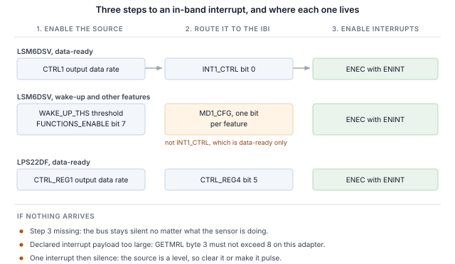

## 1 はじめに

現行世代の STMicroelectronics MEMS センサは、I2C と SPI に加えて MIPI I3C インタフェースを、同じ 2 本のピン上に備えています。
I3C はこの 2 線の構成を維持したまま、その上に多くの機能を追加しています。

Table: I3C が 2 線センサインタフェースに追加するもの

| 機能 | 設計にもたらすもの |
|---|---|
| ダイナミックアドレス割り当て（DAA） | コントローラが実行時にアドレスを割り当てるため、スタティックアドレスの衝突が基板設計上の制約ではなくなり、同一デバイスが 1 本のバスを共有できます |
| バスからの識別 | すべてのターゲットが 48 ビットの暫定 ID、デバイスクラス、バス機能を報告するため、コントローラは想定外のバスも列挙できます |
| 共通コマンドコード | 列挙、識別、設定、割り込み制御、リセットのための標準コマンドセット（ブロードキャストおよびダイレクト）で、準拠するすべてのターゲットで共通です |
| インバンド割り込み（IBI） | センサはデータラインでホストに割り込みをかけ、理由を示すバイトを送るため、割り込みピンの配線や割り当てが不要です |
| グループアドレッシング | 1 回の書き込みで、グループとしてアドレス指定された複数のターゲットに同時に届きます |
| より高い信号速度 | プッシュプルのクロックで、シングルデータレートモードでは最大 12.5 MHz。I2C はオープンドレインの制約を受けます |
| 低消費電力 | プッシュプル信号により I2C が常に消費する静的なプルアップ電流を回避でき、アクティビティステートによってコントローラがターゲットに想定バスレイテンシを伝えることで、ターゲットはより深くアイドルできます |
| ホットジョイン（Hot-Join） | バス稼働後に電源が入ったターゲットが列挙を要求できます |
| タイミング制御 | コントローラはターゲットに、共通の基準に対して割り込みのタイムスタンプを付けさせることができます |
| 標準のリセットとリカバリ | ベンダごとのシーケンスではなく、定義されたターゲットリセットと、定義されたエラー検出およびリカバリ |
| I2C 互換性 | レガシーの I2C デバイスがバスを共有できます |

ターゲットはセンサに必要なサブセットを実装しており、そのサブセットはデバイスによって異なります。
本ノートでは、Binho Supernova USB ホストアダプタと Binho I3C Target Board を使って 2 つの STMicroelectronics デバイスを扱います。
列挙し、バスから識別し、レジスタを読み書きし、デコード済みの測定値をストリーミングし、割り込みピンを接続せずにデータライン経由で割り込みを受け取り、
基板を軽くたたいて割り込みを発生させ、上記の機能のうち各ターゲットが実際に実装しているものを確認します。

ここではマイクロコントローラ、ファームウェア、ドライバの移植は一切必要ありません。すべての手順はホスト PC からのコマンドです。

### 1.1 範囲

本書を読み終えると、手元にハードウェアがある読者は、センサを I3C バス上に列挙し、そのセンサ自身のレジスタから識別し、レジスタを読み書きし、
デコード済みの測定値をストリーミングし、割り込みピンを接続せずにセンサの設定出力データレートでインバンド割り込みを受信し、
基板を軽くたたいて割り込みを発生させ、観測可能な効果からターゲットが何を実装しているかを確認したことになります。

扱う 2 つのデバイスは LSM6DSV と LPS22DF です。どちらもハードウェア上で検証しており、本書のすべての出力は実際のキャプチャです。

### 1.2 対象デバイス

Table: 対象デバイス

| デバイス | 機能 | 評価ボード | ハードウェアで検証済み |
|---|---|---|---|
| LSM6DSV | 6 軸 IMU、加速度計およびジャイロスコープ | STEVAL-MKI239AA | はい |
| LPS22DF | 絶対圧センサ | STEVAL-MKI224V1A | はい |

この方法は、DIL24 アダプタボード上の I3C インタフェースを備えた任意の STMicroelectronics MEMS デバイスに適用できます。
付属ユーティリティへのデバイス追加はテーブルエントリ 1 つで済みます。詳細は第 11 節で説明します。

### 1.3 関連資料

Table: 関連資料

| 資料 | 内容 |
|---|---|
| LSM6DSV データシート | レジスタマップと電気的特性 |
| AN5922 | LSM6DSV アプリケーションノート（割り込み生成を含む） |
| LPS22DF データシート、DS13316 | レジスタマップと、公開されている CCC 値 |
| MIPI I3C Specification v1.1 | 共通コマンドコード、インバンド割り込み、ダイナミックアドレッシング |
| Binho I3C Target Board 製品ページ | ソケット、ジャンパ、対応アダプタボード |

## 2 必要な機器とソフトウェア

### 2.1 ハードウェア

Table: 必要な機器

| 品目 |
|---|
| Binho Supernova USB ホストアダプタ |
| Binho I3C Target Board |
| STEVAL-MKI239AA または STEVAL-MKI224V1A、あるいはその他の DIL24 MEMS アダプタボード |
| USB-C ケーブル |

評価ボードはラベルの付いた DIL24 ソケットに挿入します。本書のどの手順でも、それ以外には何も接続しません。

### 2.2 接続

Table: 使用する信号

| 信号 | 用途 |
|---|---|
| SCL | I3C クロック、アダプタからターゲットへ |
| SDA | I3C データ、双方向 |
| 3.3 V | ターゲット電源、アダプタから供給 |
| GND | リターン |

2 本の線と電源 1 系統です。**本ノートでは、割り込みのセクションを含め、割り込みピン、リセットライン、ストラップ抵抗は一切接続しません**。
I3C ではセンサは SDA 上でホストに通知します。

バスは全体を通して 3.3 V で動作します。プルアップはターゲットボードが提供します。

### 2.3 ソフトウェア

```
pip install binhosupernova
```

依存関係は Python 3.12 と `binhosupernova` パッケージだけです。本ノートに付属するアセットアーカイブを展開し、1 つのコマンドでセットアップを確認します。

```
python i3c_mems.py scan
```

## 3 最初の接触：バスを列挙する

1 つのコマンドで、ホストが割り当てたアドレスでセンサがバス上に現れます。

```
python i3c_mems.py scan
```

```
1 target(s) on the bus at 3300 mV, PUSH_PULL_5_MHZ_50_DC, OPEN_DRAIN_1_MHZ

  dynamic address 0x08
    PID  02 08 00 70 12 0B   device id 0x0070
    BCR  0x07   DCR 0x44
    HDR  SDR only   IBI capable
    profile  lsm6dsv
```

これは 2 つの共通コマンドコードによるものです。**RSTDAA** は割り当て済みのダイナミックアドレスをクリアし、バスを既知の状態から開始させます。
続いて **ENTDAA** がダイナミックアドレス割り当てを実行します。コントローラがブロードキャストし、各ターゲットが 48 ビットの暫定 ID を使って調停し、
順番にアドレスが割り当てられます。デバイスが 1 つの場合、そのアドレスは `0x08` です。

アドレスはどこにも設定していません。デバイス自身のスタティックアドレスは使われておらず、知っている必要もありません。

この出力でアドレスより後の内容はすべて、ルックアップテーブルではなくターゲットから得られたものです。これが I2C と最初に違いを感じる点です。
I2C ではホストがあらかじめ選んだアドレスに書き込み、何かが応答することを期待します。ここでは、デバイスが自己紹介をします。

## 4 バスからデバイスを識別する

```
python i3c_mems.py identify --device lsm6dsv
```

### 4.1 識別レジスタの内容

自己紹介を担うのは 3 つのレジスタで、3 つともレジスタファイルからではなくコマンドで読み出します。

**暫定 ID（PID）** は 48 ビットで、MIPI メンバー ID と品番を含みます。

Table: デバイスごとの暫定 ID

| フィールド | LSM6DSV | LPS22DF |
|---|---|---|
| PID | `02 08 00 70 12 0B` | `02 08 00 B4 10 0B` |
| MIPI メンバー id（47:33） | `0x0104` | `0x0104` |
| デバイス id（31:16） | `0x0070` | `0x00B4` |
| インスタンス id（15:12） | `0b0001` | `0b0001` |

どちらも STMicroelectronics のデバイスなので、メンバー ID は同じです。デバイス ID は、デバイスが `WHO_AM_I` レジスタで報告する値と同じなので、
そのデバイスを知らないコントローラでもレジスタファイルに触れる前に識別できます。

**デバイス特性レジスタ（DCR）** は、デバイスのクラスを示します。

Table: デバイス特性レジスタ

| デバイス | DCR | 意味 |
|---|---|---|
| LSM6DSV | `0x44` | 6 軸 IMU |
| LPS22DF | `0x62` | 圧力センサ |

DCR が識別するのはクラスであり、デバイスそのものではありません。`0x62` は MIPI レジストリが圧力センサに割り当てた値で、準拠する圧力センサはすべてこれを報告します。
`0x62` を読んだコントローラは、圧力センサと通信していることはわかりますが、どのセンサかを知るには PID が必要です。

**バス特性レジスタ（BCR）** は、デバイスがバス上で何ができるかを示します。ここでは両デバイスとも `0x07` を報告します。

```
BCR 0x07
  device role                      I3C target
  advanced capabilities (bit 5)    no, so SDR only
  virtual target support           no
  offline capable                  yes
  IBI mandatory payload            yes
  IBI capable                      yes
  max data speed limit             yes
```

何も設定しないうちから、有用な事実が 2 つわかります。デバイスはインバンド割り込みを発生でき、その際にペイロードを送ります。これは第 7 節で使います。
また、ビット 5 がクリアなので、デバイスはシングルデータレート専用です。つまり、高データレートについての疑問に、データシートの表ではなくターゲット自身から 1 つのコマンドで答えが得られます。

### 4.2 WHO_AM_I による確認

両デバイスには従来型の識別レジスタもあり、レジスタアクセスのフレーミングが正しいことの確認として読む価値があります。

Table: 識別レジスタ

| デバイス | レジスタ | 値 |
|---|---|---|
| LSM6DSV | `0x0F` の `WHO_AM_I` | `0x70` |
| LPS22DF | `0x0F` の `WHO_AM_I` | `0xB4` |

LPS22DF のデータシートはこの点で非常に親切で、表 15 に各識別コマンドが返す正確なバイトが掲載されています。これと測定値を比較すると 8 項目すべてが一致するため、
新しいセットアップをエンドツーエンドで確認するのに適した方法です。

Table: LPS22DF、公開値と測定値の比較

| コマンド | データシート | 測定値 |
|---|---|---|
| GETPID | `02 08 00 B4 10 0B` | `02 08 00 B4 10 0B` |
| GETBCR | `07` | `07` |
| GETDCR | `62` | `62` |
| GETSTATUS | `00 00` | `00 00` |
| GETMXDS | `08 60` | `08 60` |
| GETCAPS | `00 11 18 00` | `00 11 18 00` |
| GETMWL | `00 08` | `00 08` |
| GETMRL | `00 10 05` | `00 10 05` |

## 5 レジスタの読み書き

レジスタアクセスはプライベート転送です。レジスタアドレスを送信し、続いてバイトを読み出します。

```
python i3c_mems.py read  --device lsm6dsv 0x0F
python i3c_mems.py write --device lps22df 0x10 0x18
```

フレーミングは両デバイスで同じです。

Table: レジスタアクセスのフレーミング

| 項目 | LSM6DSV | LPS22DF |
|---|---|---|
| レジスタアドレス幅 | 8 ビット | 8 ビット |
| データ幅 | 8 ビット | 8 ビット |
| 読み出しペイロード前のダミーバイト | 0 | 0 |

> **LSM6DSV でマルチバイト読み出しを行う前に `CTRL3.IF_INC` をセットしてください。** このビットがクリアのままだと
> レジスタアドレスが進まないため、出力レジスタを 6 バイト読み出すと最初のレジスタが 6 回返されます。すると 3 軸すべてが同じ値になり、
> デコードの不具合のように見えますが、そうではありません。また、出力レジスタが完全には読み出されないため、データレディが
> クリアされず、データレディ割り込みは 1 回発生したきり止まります。

これらのデバイスでは、先頭の `0x7E` ブロードキャストヘッダは任意です。ヘッダの有無にかかわらず、読み出しは同じ値を返します。

## 6 センサデータのストリーミング

### 6.1 LSM6DSV、加速度計

```
python i3c_mems.py stream --device lsm6dsv --seconds 5
```

```
  x    -0.029 g   y     0.014 g   z     1.011 g   magnitude     1.012 g
  x    -0.029 g   y     0.013 g   z     1.010 g   magnitude     1.010 g
  x    -0.028 g   y     0.013 g   z     1.011 g   magnitude     1.011 g
```

`0x28` の `OUTX_L_A` から 6 バイト、符号付き 16 ビットの 3 軸で、`CTRL8` で設定した ±2 g フルスケールでは 1 g あたり 16384 カウントです。

静止時の大きさは 1 g で、これはフレーミング、バイト順、符号処理、スケールというチェーン全体が正しいことを無償で確認できるチェックです。
基板を傾けると各軸の値は再配分されますが、大きさは変わりません。

### 6.2 LPS22DF、圧力と温度

```
python i3c_mems.py stream --device lps22df --seconds 5
```

```
  pressure  1006.297 hPa   temperature    22.520 C
  pressure  1006.295 hPa   temperature    22.520 C
  pressure  1006.369 hPa   temperature    22.520 C
```

圧力は `0x28` の `PRESS_OUT_XL` からの 24 ビットで、1 hPa あたり 4096 カウントです。温度は `0x2B` の `TEMP_OUT_L` からの 16 ビットで、1 °C あたり 100 カウントです。
約 1006 hPa と 22 °C は屋内のベンチとして妥当な値です。

このデバイスの観測量に測定器は不要です。息を吹きかけたり持ち上げたりすると、圧力は高度 1 メートルあたり約 12 Pa 変化します。

### 6.3 出力データレート

Table: 出力データレートの選択

| デバイス | レジスタ | フィールド | ここで使用する値 |
|---|---|---|---|
| LSM6DSV | `0x10` の `CTRL1` | ビット 3:0 | `0x03` 15 Hz、`0x04` 30 Hz、`0x05` 60 Hz、`0x06` 120 Hz |
| LPS22DF | `0x10` の `CTRL_REG1` | ビット 6:3 | `0011` 10 Hz、`0111` 100 Hz |

割り込みレートはこのレートに従うため、第 7 節ではこのレートが重要になります。

## 7 割り込みピンを使わないバス経由の割り込み

インバンド割り込みは、センサ設計を最も目に見えて変える機能です。デバイスはデータを運ぶのと同じ 2 本の線で新しいデータの準備ができたことをホストに伝え、
ホストは何かを読み出す前にその理由を知ることができます。そのため割り込みピンの配線、割り当て、コネクタへの引き出しが不要になります。

### 7.1 3 つのステップ

本ノートのインバンド割り込みはすべて、次の順序の同じ 3 ステップです。

1. **センサで要因を有効にする。** データレディ、またはモーション機能です。
2. **それをインバンド割り込みにルーティングする。** どのレジスタでこれを行うかはデバイスごとに異なり、
   難しさの大半はここにあります。
3. **ENINT ビット付きの ENEC を送信する。** これが届くまでは、センサが何をしていても
   バスは沈黙したままです。



```
python i3c_mems.py ibi --device lsm6dsv --seconds 3
```

```
lsm6dsv at 0x08: interrupt routed to the I3C IBI, data-ready through INT1_CTRL, cleared by reading the sample
  IBI from 0x08  MDB 02  extra 00 00 00 05 04 00 00  data ready=True
  IBI from 0x08  MDB 02  extra 00 00 00 05 04 00 00  data ready=True

  183 interrupts in 3.00 s = 61.00/s
  configured output data rate 60 Hz (+1.7%)
```

設定 60 Hz に対して毎秒 61 回で、どちらの割り込みピンにも何も接続していません。

Table: 割り込みレートと設定出力データレートの比較

| デバイス | 設定値 | 測定値 | ウィンドウ |
|---|---|---|---|
| LSM6DSV | 15 Hz | 毎秒 15.67 回 | 3.0 s |
| LSM6DSV | 30 Hz | 毎秒 32.00 回 | 3.0 s |
| LSM6DSV | 60 Hz | 毎秒 61.00 回 | 3.0 s |
| LSM6DSV | 120 Hz | 毎秒 121.67 回 | 3.0 s |
| LPS22DF | 10 Hz | 毎秒 9.62 回 | 3.0 s |

> **注：** レートは設定レートと比較できます。個々の到着時刻は比較できません。ホスト側のトランスポートが
> 割り込みをまとめて配送するためです。この理由から、本書ではジッタやレイテンシの数値は示していません。

### 7.2 必須データバイト

各割り込みは何が発生したかを示す必須データバイトを持っているため、ホストはセンサを読むかどうかを判断できます。

Table: 観測された必須データバイト

| デバイス | 要因 | 必須バイト | ペイロード全体 |
|---|---|---|---|
| LSM6DSV | データレディ | `0x02` | `02 00 00 00 05 04 00 00` |
| LSM6DSV | ウェイクアップ | `0x04` | `04 00 00 02 05 04 00 00` |
| LPS22DF | データレディ、パルス | `0x02` | `02 00 00 33 00` |
| LPS22DF | データレディ、レベル | `0x02` | `02 00 00 03 00` |

どちらのデバイスでも、ペイロードは必須バイト以上の情報を持っています。LSM6DSV ではバイト 3 が `ALL_INT_SRC` で、ウェイクアップでは `0x02`、
データレディでは `0x00` になるため、ホストはレジスタを読まずにモーションイベントと新しいサンプルを区別できます。LPS22DF ではバイト 3 は `STATUS` レジスタです。
上の 2 つのペイロードが異なるのは、パルスの場合は誰もサンプルを読まないためオーバーランビットがセットされてバイトが `0x33` になり、
レベルの場合はホストが割り込みのたびにサンプルを読むため `0x03` のままになるからです。

### 7.3 デバイスごとのルーティング

**LSM6DSV。** データレディは `0x0D` の `INT1_CTRL` のビット 0 `int1_drdy_xl` でルーティングします。それ以外の割り込み機能はすべて異なり、
`0x50` の `FUNCTIONS_ENABLE` ビット 7 でグローバルに有効にし、`INT1_CTRL` ではなく `0x5E` の `MD1_CFG` でルーティングする必要があります。

Table: LSM6DSV の割り込みルーティング

| 要因 | 有効化 | ルート |
|---|---|---|
| 加速度計データレディ | `CTRL1` 出力データレート | `INT1_CTRL` ビット 0 |
| ウェイクアップ、タップ、6D、自由落下、アクティビティ | `FUNCTIONS_ENABLE` ビット 7 | `MD1_CFG`、機能ごとに 1 ビット |

`CTRL5` ビット 0 の `INT_EN_I3C` はこれとは関係ありません。これは I3C 使用中に物理割り込みピンを有効にするもので、インバンド割り込みには影響しません。

**LPS22DF。** データレディは `0x13` の `CTRL_REG4` ビット 5 です。これだけを有効にすると割り込みが 1 回届いた後は沈黙します。
データレディはサンプルが読まれるまでアサートされ続けるレベルだからです。有効な対処は 2 つあり、結果はサンプル単位で一致します。

Table: LPS22DF データレディ、レベルとパルスの比較

| 設定 | 3 s 間の割り込み数 | レート |
|---|---|---|
| `DRDY` のみ、サンプルを読まない | 1 | 0.33/s |
| `DRDY`、割り込みごとにサンプルを読む | 29 | 9.67/s |
| `DRDY` と `DRDY_PLS`（ビット 6） | 29 | 9.62/s |

> **割り込みが 1 回だけ来てその後何も来ないのは、インバンド割り込みの設定が失敗する最も一般的なパターンであり、
> バスの問題ではありません。** 条件がアサートされたままでホストがクリアする必要があるか、要因をパルスに変更できるかのどちらかです。

### 7.4 基板をたたいて割り込みの到着を確認する

実行する価値のあるデモです。LSM6DSV のウェイクアップ検出は、物理的な動きをバスイベントに変換します。

```
python i3c_mems.py wake --device lsm6dsv --seconds 25
```

```
lsm6dsv at 0x08: wake-up armed at threshold 2, routed to the I3C in-band interrupt

  TAP OR TILT THE BOARD. Listening for 25 s.

  t=  9.67s  MDB 04  payload says WU   axes X
  t=  9.91s  MDB 04  payload says WU   axes X,Y,Z
  t= 10.36s  MDB 04  payload says WU   axes X,Y
  t= 11.05s  MDB 04  payload says WU   axes Y
  t= 13.17s  MDB 04  payload says WU   axes Z

  80 wake-up interrupt(s) in 90.2 s
  peak deviation from 1 g during the window: 0.428 g
```

しきい値の単位はフルスケールの 1/64 なので、±2 g では 1 カウントが約 31 mg です。2 カウントは静止した基板のノイズより上で、意図的なタップより下です。
基板に触れない 35 秒間のウィンドウでは、この設定では何も発生しませんでした。

どの機能が発生したかはペイロードからわかり、レジスタアクセスは不要です。軸ごとのビットは `0x45` の `WAKE_UP_SRC` にあり、
割り込みがラッチされて再トリガしている状態ではホストが読む前にクリアされることがあるため、軸フィールドが空でも正常であり、割り込みが誤検出だったことを意味しません。

### 7.5 割り込みペイロードサイズ

設定手順のうち 1 つは、誤っていても何も通知されず、割り込みがまったく来ないという形で現れます。

ターゲットは送信する最大割り込みペイロードを `GETMRL` の 3 バイト目で宣言し、コントローラにも独自の上限があります。
**Supernova が配送する割り込みペイロードは最大 8 バイトです。** LSM6DSV は 10 を宣言し、ペイロードを宣言した長さまでパディングするため、
8 以下を要求されるまで、その割り込みは 1 つも配送されません。

Table: LSM6DSV の宣言割り込みペイロードと配送された割り込みの比較

| 宣言ペイロード | 2 s 間の割り込み数 | 配送されたペイロード |
|---|---|---|
| 1 | 41 | 1 バイト |
| 4 | 41 | 4 バイト |
| 8 | 42 | 8 バイト |
| 9 | 0 | なし |
| 10（リセット値） | 0 | なし |

付属のユーティリティはこれを確認して調整し、何をしたかを報告します。

```
IBI payload negotiation   the target declared 10 byte(s), the adapter takes 8, so it was
                          asked for 8
```

SETXTIME で I3C タイミング制御を有効にすると、ターゲット自身のペイロードの前に 3 バイトのタイムスタンプが追加され、これも同じ上限に含まれます。
そのため、ちょうど 8 バイトのデバイスは、タイミング制御をオンにすると、宣言ペイロードを 3 減らすまで沈黙します。

> **割り込みがまったく来ず、どのレジスタも要因が発生していることを示している場合は、まず `GETMRL` の 3 バイト目を読んでください。**

## 8 I3C の残りの機能を検証する

ターゲットは実装していないコマンドにも応答することがあるため、ユーティリティは結果コードではなく観測可能な効果から、ターゲットが何を実装しているかを確認します。
以下の各行では、値を設定して読み戻す、アドレスを移動して旧アドレスが応答しなくなることを確認する、設定レートに対して割り込みを数える、といった観測された変化を必要としました。

```
python i3c_mems.py features --device lsm6dsv
```

Table: 測定による共通コマンドコードのサポート状況

| コマンド | LSM6DSV | LPS22DF | 根拠 |
|---|---|---|---|
| ENTDAA | サポート | サポート | 期待した ID でターゲットが列挙された |
| RSTDAA | サポート | サポート | テーブルがクリアされ、旧アドレスがその後拒否する |
| SETNEWDA | サポート | サポート | アドレスが移動し、旧アドレスが拒否する |
| GETPID、GETBCR、GETDCR | サポート | サポート | 期待した値を返した |
| ENEC、DISEC | サポート | サポート | 割り込みが再現性をもって開始・停止する |
| SETMWL、GETMWL | サポート | サポート | 値が書き込んだ内容に追従する |
| SETMRL、GETMRL | サポート | サポート | 同上、割り込みペイロードバイトを含む |
| SETGRPA、RSTGRPA | サポート | サポート | グループアドレス経由の書き込みが割り当て中のみ反映される |
| SETXTIME、GETXTIME | サポート | サポート | コマンド後に報告されるバイトが変化した |
| HDR モード | 非サポート | 非サポート | BCR ビット 5 がクリア |
| ホットジョイン | 観測されず | 観測されず | ホットジョイン要求は一度もなかった |
| ENTAS0 から ENTAS3 | 判定不能 | 判定不能 | 電流測定が必要 |
| RSTACT | 判定不能 | 判定不能 | ホストから観測可能な効果がない |
| GETMXDS | 判定不能 | 判定不能 | 応答するが、観測可能な効果がない |

両デバイスとも 15 項目がサポート、4 項目が未実装、8 項目が判定不能と報告され、カウントが再現することを確認するためにそれぞれ繰り返し測定しました。

**グループアドレッシングはこれら両デバイスで実装されています**。これは本当に有用な機能であり、しかも素直な方法でテストすると誤った答えが出るため、
個別に説明する価値があります。グループアドレスはコントローラが複数のターゲットを同時にアドレス指定するためのものなので、書き込み先です。
グループアドレスからの読み出しには定義された応答がなく、ターゲットは機能を正しく実装したうえでグループアドレスの読み出しを拒否することがあります。
ここで使うテストでは、グループアドレスを割り当て、それを通じてレジスタに書き込み、そのレジスタをターゲット自身のダイナミックアドレスで読み戻します。

Table: グループアドレッシング、LSM6DSV

| ステップ | グループ `0x20` 経由の書き込み | 読み戻したレジスタ |
|---|---|---|
| SETGRPA 前 | `I3C_NACK_ADDRESS` | 変化なし |
| SETGRPA 後 | `SUCCESS` | 変化あり |
| RSTGRPA 後 | `I3C_NACK_ADDRESS` | 変化なし |

グループアドレスでの読み出しは、グループアドレッシングが明らかに機能している間も含め、すべての段階で拒否されます。

**アクティビティステート**は判定不能のままです。LSM6DSV では ENTAS0 は受け付けられ、ENTAS1 から ENTAS3 は拒否されますが、毎回そうなるわけではありません。
また、デバイスが低アクティビティステートに入ったことを証明するには電流測定が必要で、このセットアップではそれができません。
ユーティリティは、1 つの結果コードを事実として示すのではなく、複数回の試行のうち何回拒否されたかを報告します。

## 9 バスレート

```
python i3c_mems.py rates --device lsm6dsv --iterations 100
```

Table: エラーのない最高バスレート

| デバイス | プッシュプル | オープンドレイン |
|---|---|---|
| LSM6DSV | 12.5 MHz、デューティ比 50% | 4.17 MHz |
| LPS22DF | 12.5 MHz、デューティ比 50% | 4.17 MHz |

両デバイスとも、アダプタが提供するすべてのレートに合格します。**方法：** 識別レジスタを連続 100 回読み出し、すべてがエラーなく期待値を返す必要があり、
すべての反復が成功した場合にのみそのレートを合格とします。これはレジスタ読み出しループであり、スループット測定ではないため、持続データレートについての結論をここから導くべきではありません。

両デバイスとも BCR ビット 0 をセットして最大データ速度制限があることを宣言しており、GETMXDS は両方で `08 60` を返します。
アダプタが生成できるどのレートでも、この制限はこのループに影響しませんでした。

## 10 実用上の注意

ベンチでの時間を取られた事項の短い一覧です。

Table: 実用上の注意

| デバイス | 注意 |
|---|---|
| LSM6DSV | マルチバイト読み出しの前に `CTRL3.IF_INC` をセットする。さもないとすべてのバイトが同じレジスタから来る |
| LSM6DSV | データレディ以外の割り込み機能には `INT1_CTRL` ではなく `FUNCTIONS_ENABLE` ビット 7 と `MD1_CFG` が必要 |
| LSM6DSV | リセット時の宣言割り込みペイロードは 10 バイト。8 に下げないと割り込みは配送されない |
| LPS22DF | データレディはレベル。割り込みのたびにサンプルを読むか、`DRDY_PLS` をセットする |
| LPS22DF | スタティックアドレスは `0x5C`、SDO が High のときは `0x5D`（データシート 7.2 節のとおり） |
| 両方 | 列挙後の最初の読み出しは安定していないことがある。データシートの推奨どおりダミー読み出しを行う |
| 両方 | SETXTIME は割り込みペイロードを変えるモードをラッチする。`SETXTIME 0xFF` でオフになる |

## 11 ユーティリティ

Table: ユーティリティのコマンド

| コマンド | 用途 |
|---|---|
| `scan` | バスを列挙し、応答したものを報告する |
| `identify` | ターゲットの識別レジスタをデコードする |
| `read`、`write` | レジスタを読み書きする（書き込み後に読み戻しあり） |
| `stream` | ポーリングでデコード済みサンプルを表示する |
| `ibi` | センサ割り込みをバスにルーティングし、届いたものを数える |
| `wake` | モーション割り込みを設定し、届くたびに報告する |
| `features` | 観測可能な効果から、ターゲットが何を実装しているかを確認する |
| `rates` | エラーのない最高バスレートを求める |
| `reset`、`power-cycle` | デバイスを既知の状態に戻す |

デバイスの追加はプロファイルテーブルへの 1 エントリで済みます。レジスタのフレーミング、期待される識別情報、データストリームを開始する書き込み、
割り込みをルーティングする書き込み、割り込みペイロードのデコーダです。

## 12 測定結果

### 12.1 テスト構成

Table: テスト構成

| 項目 | 値 |
|---|---|
| アダプタ | Binho Supernova、ハードウェアリビジョン B、ファームウェア 4.4.0 |
| SDK | `binhosupernova`、Python 3.12、Windows 11 |
| アクセサリ | Binho I3C Target Board |
| バス | 3.3 V、プッシュプル 5 MHz デューティ比 50%、オープンドレイン 1 MHz、ファストモードのドライブ強度 |
| 列挙 | RSTDAA の後に ENTDAA |
| ターゲット | STEVAL-MKI239AA 上の LSM6DSV、STEVAL-MKI224V1A 上の LPS22DF |

### 12.2 結果

**識別。** 第 4 節の値はすべて表のとおりです。LPS22DF の公開されている 8 つの CCC 値はすべて、測定値とバイト単位で一致します。

**割り込み。** レートは第 7.1 節の表のとおりで、いずれも設定出力データレートの 2.3% 以内です。LSM6DSV のモーショントリガ割り込みは
90 秒間のウィンドウで 80 回、すべて基板をたたいていた期間内で、ピーク加速度は 0.428 g でした。

**サポート状況。** 両デバイスとも 15 項目がサポート、4 項目が未実装、8 項目が判定不能で、繰り返しの実行で再現しました。

**バスレート。** 第 9 節に記載の方法により、両デバイスともアダプタが提供するすべてのレートに合格します。

**回帰テストの範囲。** 本書に示したコマンドは、両デバイスについて記録済みの出力と照合されます（LPS22DF は 8、LSM6DSV は 7）。
そのため、読者が目にする内容を変えるユーティリティの変更は検出されます。

## 13 トラブルシューティング

Table: トラブルシューティング

| 症状 | 確認事項 |
|---|---|
| ターゲットが列挙されない | ボードが正しいソケットに挿さっているか。3.3 V が出ているか。`power-cycle` を試す |
| 割り込みがまったく届かない | 宣言割り込みペイロード（`GETMRL` の 3 バイト目）。次に ENEC が送信されたか |
| 割り込みが 1 回来た後に沈黙する | 要因がレベルでクリアが必要、またはパルスに設定できる |
| すべての軸が同じ値を示す | LSM6DSV の `CTRL3.IF_INC` がクリアされている |
| 割り込みペイロードが増えて割り込みが止まった | タイミング制御が有効になっている。`SETXTIME 0xFF` |
| 識別情報の読み出しが 1 回誤り、その後正しくなる | 列挙後には想定どおり。先にダミー読み出しを行う |
| ボードを交換した後に列挙が失敗する | ターゲット電源レールをパワーサイクルしてから再度列挙する |

## 14 略語

Table: 略語

| 用語 | 意味 |
|---|---|
| BCR | バス特性レジスタ（Bus characteristics register） |
| CCC | 共通コマンドコード（Common command code） |
| DAA | ダイナミックアドレス割り当て（Dynamic address assignment） |
| DCR | デバイス特性レジスタ（Device characteristics register） |
| ENTDAA | ダイナミックアドレス割り当ての開始（Enter dynamic address assignment） |
| HDR | 高データレート（High data rate） |
| IBI | インバンド割り込み（In-band interrupt） |
| MDB | 必須データバイト（Mandatory data byte） |
| ODR | 出力データレート（Output data rate） |
| PID | 暫定 ID（Provisional identifier） |
| SDR | シングルデータレート（Single data rate） |

## 15 本書のソースコードについて

本書に示し、付属アーカイブで提供するサンプルコードは、評価および参考用に提供されるものです。MIT ライセンスの下で公開されており、ライセンス本文はアーカイブに含まれています。

Table: アセットアーカイブの内容

| ファイル | 説明 |
|---|---|
| `AN0005.md` | 本書の Markdown ソース |
| `assets/i3c_mems.py` | リファレンスユーティリティ |
| `assets/LICENSE` | サンプルコードに適用される MIT ライセンス |

## 16 改訂履歴

Table: 改訂履歴

| リビジョン | 日付 | 説明 |
|---|---|---|
| 1.0 | 1 September 2026 | 初版。 |
| 1.1 | 3 September 2026 | 同梱の `i3c_mems.py` を、329 行遅れていた共有ユーティリティから更新しました。`NOT_POWERED` を報告する外部電圧に対するリカバリパス、3 回試行による RSTDAA 判定、HDR-DDR 読み出しが追加されています。本書の本文と測定結果は変更されておらず、どの行も再測定していません。 |
