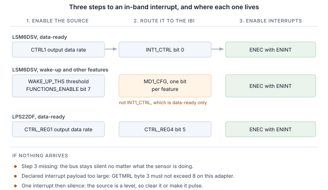

## 1 소개

현재 세대의 STMicroelectronics MEMS 센서는 I2C 및 SPI와 함께 MIPI I3C 인터페이스를 동일한 두 핀으로 제공합니다.
I3C는 이 2선 구성을 유지하면서 그 위에 상당한 기능을 추가합니다.

Table: I3C가 2선 센서 인터페이스에 추가하는 기능

| 기능 | 설계에 주는 이점 |
|---|---|
| 동적 주소 할당(DAA) | 컨트롤러가 실행 중에 주소를 할당하므로 정적 주소 충돌이 더 이상 보드 설계의 제약이 아니며, 동일한 부품이 하나의 버스를 공유할 수 있습니다 |
| 버스로부터의 식별 | 모든 타깃이 48비트 임시 식별자, 디바이스 클래스, 버스 기능을 보고하므로 컨트롤러는 미리 알지 못하는 버스도 열거할 수 있습니다 |
| 공통 명령 코드 | 열거, 식별, 설정, 인터럽트 제어, 리셋을 위한 표준 명령 세트(브로드캐스트 및 다이렉트)로, 모든 규격 준수 타깃에서 동일합니다 |
| 인밴드 인터럽트(IBI) | 센서가 데이터 라인으로 호스트에 인터럽트를 걸고 원인을 알려 주는 바이트를 함께 보내므로, 인터럽트 핀을 배선하거나 할당할 필요가 없습니다 |
| 그룹 주소 지정 | 한 번의 쓰기가 그룹으로 지정된 여러 타깃에 동시에 전달됩니다 |
| 더 높은 신호 속도 | 푸시풀 클럭으로 싱글 데이터 레이트 모드에서 최대 12.5 MHz이며, I2C는 오픈 드레인의 한계를 받습니다 |
| 저전력 | 푸시풀 신호는 I2C가 계속 소비하는 정적 풀업 전류를 피하며, 액티비티 상태를 통해 컨트롤러가 타깃에 예상 버스 지연을 알려 타깃이 더 깊이 유휴 상태에 들어갈 수 있습니다 |
| 핫 조인(Hot-Join) | 버스가 동작한 후에 전원이 들어온 타깃이 열거를 요청할 수 있습니다 |
| 타이밍 제어 | 컨트롤러가 타깃으로 하여금 공유 기준에 대해 인터럽트에 타임스탬프를 붙이게 할 수 있습니다 |
| 표준 리셋 및 복구 | 벤더별 시퀀스가 아니라 정의된 타깃 리셋과 정의된 오류 검출 및 복구 |
| I2C 호환성 | 레거시 I2C 디바이스가 버스를 공유할 수 있습니다 |

타깃은 센서에 필요한 부분 집합을 구현하며, 그 부분 집합은 부품마다 다릅니다.
이 노트는 Binho Supernova USB 호스트 어댑터와 Binho I3C Target Board로 두 가지 STMicroelectronics 부품을 다룹니다.
이를 열거하고, 버스로부터 식별하고, 레지스터를 읽고 쓰고, 디코딩된 측정값을 스트리밍하고, 인터럽트 핀 연결 없이 데이터 라인으로 인터럽트를 받고,
보드를 두드려 인터럽트를 발생시키며, 위 기능 중 각 타깃이 실제로 구현한 것을 확인합니다.

여기서는 마이크로컨트롤러, 펌웨어, 드라이버 포팅이 전혀 필요하지 않습니다. 모든 단계는 호스트 PC에서 실행하는 명령입니다.

### 1.1 범위

이 문서를 마치면 하드웨어를 갖춘 독자는 센서를 I3C 버스에 열거하고, 센서 자체 레지스터로 식별하고, 레지스터를 읽고 쓰고,
디코딩된 측정값을 스트리밍하고, 인터럽트 핀 연결 없이 센서에 설정된 출력 데이터 레이트로 인밴드 인터럽트를 수신하고,
보드를 두드려 인터럽트를 발생시키고, 관찰 가능한 효과로부터 타깃이 무엇을 구현하는지 확인하게 됩니다.

다루는 두 부품은 LSM6DSV와 LPS22DF입니다. 둘 다 하드웨어에서 시험했으며 이 문서의 모든 출력은 실제 캡처입니다.

### 1.2 적용 디바이스

Table: 다루는 디바이스

| 디바이스 | 기능 | 평가 보드 | 하드웨어에서 시험 |
|---|---|---|---|
| LSM6DSV | 6축 IMU, 가속도계 및 자이로스코프 | STEVAL-MKI239AA | 예 |
| LPS22DF | 절대 압력 센서 | STEVAL-MKI224V1A | 예 |

이 방법은 DIL24 어댑터 보드에 장착된, I3C 인터페이스를 갖춘 모든 STMicroelectronics MEMS 부품에 적용됩니다.
제공되는 유틸리티에 부품을 추가하는 것은 테이블 항목 하나이며, 11절에서 설명합니다.

### 1.3 관련 문서

Table: 관련 문서

| 문서 | 주제 |
|---|---|
| LSM6DSV 데이터시트 | 레지스터 맵 및 전기적 특성 |
| AN5922 | LSM6DSV 애플리케이션 노트(인터럽트 생성 포함) |
| LPS22DF 데이터시트, DS13316 | 레지스터 맵 및 공개된 CCC 값 |
| MIPI I3C Specification v1.1 | 공통 명령 코드, 인밴드 인터럽트, 동적 주소 지정 |
| Binho I3C Target Board 제품 페이지 | 소켓, 점퍼, 지원 어댑터 보드 |

## 2 필요한 장비 및 소프트웨어

### 2.1 하드웨어

Table: 필요한 장비

| 항목 |
|---|
| Binho Supernova USB 호스트 어댑터 |
| Binho I3C Target Board |
| STEVAL-MKI239AA 또는 STEVAL-MKI224V1A, 또는 기타 DIL24 MEMS 어댑터 보드 |
| USB-C 케이블 |

평가 보드는 라벨이 붙은 DIL24 소켓에 꽂습니다. 이 문서의 어떤 절차에서도 그 외에는 아무것도 연결하지 않습니다.

### 2.2 연결

Table: 사용하는 신호

| 신호 | 용도 |
|---|---|
| SCL | I3C 클럭, 어댑터에서 타깃으로 |
| SDA | I3C 데이터, 양방향 |
| 3.3 V | 타깃 전원, 어댑터에서 공급 |
| GND | 리턴 |

선 두 개와 전원 하나입니다. **이 노트에서는 인터럽트 절을 포함하여 어떤 경우에도 인터럽트 핀, 리셋 라인, 스트래핑 저항을 연결하지 않습니다**.
I3C에서 센서는 SDA로 호스트에 신호를 보냅니다.

버스는 처음부터 끝까지 3.3 V로 동작합니다. 풀업은 타깃 보드가 제공합니다.

### 2.3 소프트웨어

```
pip install binhosupernova
```

의존성은 Python 3.12와 `binhosupernova` 패키지뿐입니다. 이 노트와 함께 제공되는 에셋 아카이브의 압축을 풀고 명령 하나로 설정을 확인합니다.

```
python i3c_mems.py scan
```

## 3 첫 접촉: 버스 열거

명령 하나로 센서가 호스트가 할당한 주소로 버스에 올라옵니다.

```
python i3c_mems.py scan
```

```
1 target(s) on the bus at 3300 mV, PUSH_PULL_5_MHZ_50_DC, OPEN_DRAIN_1_MHZ

  dynamic address 0x08
    PID  02 08 00 70 12 0B   device id 0x0070
    BCR  0x07   DCR 0x44
    HDR  SDR only   IBI capable
    profile  lsm6dsv
```

이는 두 개의 공통 명령 코드로 이루어졌습니다. **RSTDAA**는 이미 할당된 동적 주소를 지워 버스가 알려진 상태에서 시작하게 합니다.
이어서 **ENTDAA**가 동적 주소 할당을 실행합니다. 컨트롤러가 브로드캐스트하면 각 타깃이 48비트 임시 식별자로 중재하고,
차례로 주소를 받습니다. 부품이 하나뿐이면 그 주소는 `0x08`입니다.

어디에서도 주소를 설정하지 않았습니다. 부품 자체의 정적 주소는 사용되지 않았으며 알 필요도 없습니다.

출력에서 주소 다음의 모든 내용은 룩업 테이블이 아니라 타깃에서 온 것이며, 이것이 I2C와 처음으로 다르게 느껴지는 점입니다.
I2C에서는 호스트가 미리 정한 주소에 쓰고 무언가 응답하기를 기대합니다. 여기서는 디바이스가 스스로를 소개합니다.

## 4 버스로부터 부품 식별

```
python i3c_mems.py identify --device lsm6dsv
```

### 4.1 식별 레지스터가 담는 내용

세 개의 레지스터가 소개를 담당하며, 세 개 모두 레지스터 파일이 아니라 명령으로 읽습니다.

**임시 식별자(PID)** 는 48비트이며 MIPI 멤버 ID와 부품 번호를 담습니다.

Table: 부품별 임시 식별자

| 필드 | LSM6DSV | LPS22DF |
|---|---|---|
| PID | `02 08 00 70 12 0B` | `02 08 00 B4 10 0B` |
| MIPI 멤버 id(47:33) | `0x0104` | `0x0104` |
| 디바이스 id(31:16) | `0x0070` | `0x00B4` |
| 인스턴스 id(15:12) | `0b0001` | `0b0001` |

두 부품 모두 STMicroelectronics 부품이므로 멤버 ID가 같습니다. 디바이스 ID는 부품이 `WHO_AM_I` 레지스터에서 보고하는 값과 같으므로,
이 부품을 처음 접하는 컨트롤러도 레지스터 파일에 접근하기 전에 부품을 식별할 수 있습니다.

**디바이스 특성 레지스터(DCR)** 는 디바이스의 클래스를 알려 줍니다.

Table: 디바이스 특성 레지스터

| 부품 | DCR | 의미 |
|---|---|---|
| LSM6DSV | `0x44` | 6축 IMU |
| LPS22DF | `0x62` | 압력 센서 |

DCR은 부품이 아니라 클래스를 식별합니다. `0x62`는 MIPI 레지스트리가 압력 센서에 할당한 값이며, 규격을 준수하는 모든 압력 센서가 이 값을 보고합니다.
`0x62`를 읽은 컨트롤러는 압력 센서와 통신하고 있음을 알지만, 어떤 센서인지 알려면 PID가 필요합니다.

**버스 특성 레지스터(BCR)** 는 부품이 버스에서 무엇을 할 수 있는지 알려 줍니다. 여기서 두 부품 모두 `0x07`을 보고합니다.

```
BCR 0x07
  device role                      I3C target
  advanced capabilities (bit 5)    no, so SDR only
  virtual target support           no
  offline capable                  yes
  IBI mandatory payload            yes
  IBI capable                      yes
  max data speed limit             yes
```

아무것도 설정하기 전에 유용한 사실 두 가지를 알 수 있습니다. 부품은 인밴드 인터럽트를 발생시킬 수 있고, 그때 페이로드를 보내며, 이는 7절에서 사용합니다.
또한 비트 5가 0이므로 부품은 싱글 데이터 레이트 전용입니다. 즉 고속 데이터 레이트에 대한 질문에 데이터시트 표가 아니라 타깃 자체로부터 명령 하나로 답을 얻습니다.

### 4.2 WHO_AM_I로 확인

두 부품 모두 일반적인 식별 레지스터도 갖추고 있으며, 레지스터 액세스 프레이밍이 올바른지 확인하는 용도로 읽어 볼 만합니다.

Table: 식별 레지스터

| 부품 | 레지스터 | 값 |
|---|---|---|
| LSM6DSV | `0x0F`의 `WHO_AM_I` | `0x70` |
| LPS22DF | `0x0F`의 `WHO_AM_I` | `0xB4` |

LPS22DF 데이터시트는 이 점에서 특히 유용합니다. 표 15에 각 식별 명령이 반환하는 정확한 바이트가 공개되어 있습니다. 측정값과 비교하면 8개 모두 일치하므로,
새 설정을 처음부터 끝까지 확인하는 좋은 방법입니다.

Table: LPS22DF, 공개 값과 측정값 비교

| 명령 | 데이터시트 | 측정값 |
|---|---|---|
| GETPID | `02 08 00 B4 10 0B` | `02 08 00 B4 10 0B` |
| GETBCR | `07` | `07` |
| GETDCR | `62` | `62` |
| GETSTATUS | `00 00` | `00 00` |
| GETMXDS | `08 60` | `08 60` |
| GETCAPS | `00 11 18 00` | `00 11 18 00` |
| GETMWL | `00 08` | `00 08` |
| GETMRL | `00 10 05` | `00 10 05` |

## 5 레지스터 읽기 및 쓰기

레지스터 액세스는 프라이빗 전송입니다. 레지스터 주소를 보낸 다음 바이트를 읽습니다.

```
python i3c_mems.py read  --device lsm6dsv 0x0F
python i3c_mems.py write --device lps22df 0x10 0x18
```

프레이밍은 두 부품에서 동일합니다.

Table: 레지스터 액세스 프레이밍

| 속성 | LSM6DSV | LPS22DF |
|---|---|---|
| 레지스터 주소 폭 | 8비트 | 8비트 |
| 데이터 폭 | 8비트 | 8비트 |
| 읽기 페이로드 앞의 더미 바이트 | 0 | 0 |

> **LSM6DSV에서 멀티바이트 읽기를 하기 전에 `CTRL3.IF_INC`를 설정하십시오.** 이 비트가 0이면 레지스터 주소가
> 증가하지 않으므로, 출력 레지스터를 6바이트 읽으면 첫 번째 레지스터가 여섯 번 반환됩니다. 그러면 세 축이 모두 같은 값으로 읽혀
> 디코딩 오류처럼 보이지만 그렇지 않습니다. 또한 출력 레지스터가 끝까지 읽히지 않으므로 데이터 레디가 해제되지 않고,
> 데이터 레디 인터럽트는 한 번 발생한 뒤 멈춥니다.

이 부품들에서 선두의 `0x7E` 브로드캐스트 헤더는 선택 사항입니다. 헤더가 있든 없든 읽기는 같은 값을 반환합니다.

## 6 센서 데이터 스트리밍

### 6.1 LSM6DSV, 가속도계

```
python i3c_mems.py stream --device lsm6dsv --seconds 5
```

```
  x    -0.029 g   y     0.014 g   z     1.011 g   magnitude     1.012 g
  x    -0.029 g   y     0.013 g   z     1.010 g   magnitude     1.010 g
  x    -0.028 g   y     0.013 g   z     1.011 g   magnitude     1.011 g
```

`0x28`의 `OUTX_L_A`에서 6바이트, 부호 있는 16비트 3축이며, `CTRL8`에서 설정한 ±2 g 풀스케일에서 g당 16384 카운트입니다.

정지 상태에서 크기는 1 g이며, 이는 프레이밍, 바이트 순서, 부호 처리, 스케일 등 전체 체인이 올바른지 공짜로 확인하는 방법입니다.
보드를 기울이면 축 값은 재분배되지만 크기는 그대로입니다.

### 6.2 LPS22DF, 압력 및 온도

```
python i3c_mems.py stream --device lps22df --seconds 5
```

```
  pressure  1006.297 hPa   temperature    22.520 C
  pressure  1006.295 hPa   temperature    22.520 C
  pressure  1006.369 hPa   temperature    22.520 C
```

압력은 `0x28`의 `PRESS_OUT_XL`에서 읽는 24비트로 hPa당 4096 카운트이며, 온도는 `0x2B`의 `TEMP_OUT_L`에서 읽는 16비트로 °C당 100 카운트입니다.
약 1006 hPa와 22 °C는 실내 벤치로서 올바른 값입니다.

이 부품의 관찰 대상은 계측기가 필요 없습니다. 입김을 불거나 들어 올리면 압력이 고도 1미터당 약 12 Pa 변합니다.

### 6.3 출력 데이터 레이트

Table: 출력 데이터 레이트 선택

| 부품 | 레지스터 | 필드 | 여기서 사용한 값 |
|---|---|---|---|
| LSM6DSV | `0x10`의 `CTRL1` | 비트 3:0 | `0x03` 15 Hz, `0x04` 30 Hz, `0x05` 60 Hz, `0x06` 120 Hz |
| LPS22DF | `0x10`의 `CTRL_REG1` | 비트 6:3 | `0011` 10 Hz, `0111` 100 Hz |

인터럽트 레이트가 이 레이트를 따르므로 7절에서 이 레이트가 중요합니다.

## 7 인터럽트 핀 없이 버스를 통한 인터럽트

인밴드 인터럽트는 센서 설계를 가장 눈에 띄게 바꾸는 기능입니다. 부품은 데이터를 전달하는 바로 그 두 선으로 새 데이터가 준비되었음을 호스트에 알리고,
호스트는 아무것도 읽기 전에 그 이유를 알게 되므로, 인터럽트 핀을 배선하거나 할당하거나 커넥터로 끌어낼 필요가 없습니다.

### 7.1 세 단계

이 노트의 모든 인밴드 인터럽트는 다음 순서의 동일한 세 단계입니다.

1. **센서에서 소스를 활성화합니다.** 데이터 레디 또는 모션 기능입니다.
2. **인밴드 인터럽트로 라우팅합니다.** 어떤 레지스터가 이를 담당하는지는 부품마다 다르며,
   어려움의 대부분이 여기에 있습니다.
3. **ENINT 비트를 포함한 ENEC를 보냅니다.** 이것이 도착할 때까지는 센서가 무엇을 하든
   버스는 조용합니다.



```
python i3c_mems.py ibi --device lsm6dsv --seconds 3
```

```
lsm6dsv at 0x08: interrupt routed to the I3C IBI, data-ready through INT1_CTRL, cleared by reading the sample
  IBI from 0x08  MDB 02  extra 00 00 00 05 04 00 00  data ready=True
  IBI from 0x08  MDB 02  extra 00 00 00 05 04 00 00  data ready=True

  183 interrupts in 3.00 s = 61.00/s
  configured output data rate 60 Hz (+1.7%)
```

설정값 60 Hz에 대해 초당 61회이며, 두 인터럽트 핀 어디에도 아무것도 연결하지 않았습니다.

Table: 인터럽트 레이트와 설정된 출력 데이터 레이트 비교

| 부품 | 설정값 | 측정값 | 측정 구간 |
|---|---|---|---|
| LSM6DSV | 15 Hz | 초당 15.67회 | 3.0 s |
| LSM6DSV | 30 Hz | 초당 32.00회 | 3.0 s |
| LSM6DSV | 60 Hz | 초당 61.00회 | 3.0 s |
| LSM6DSV | 120 Hz | 초당 121.67회 | 3.0 s |
| LPS22DF | 10 Hz | 초당 9.62회 | 3.0 s |

> **참고:** 레이트는 설정된 레이트와 비교할 수 있습니다. 개별 도착 시간은 비교할 수 없습니다.
> 호스트 전송 계층이 인터럽트를 묶음으로 전달하기 때문입니다. 이러한 이유로 이 문서에는 지터나 지연 수치를 제시하지 않습니다.

### 7.2 필수 데이터 바이트

각 인터럽트는 무엇이 발생했는지 알려 주는 필수 데이터 바이트를 담고 있으므로, 호스트는 센서를 읽을지 여부를 결정할 수 있습니다.

Table: 관찰된 필수 데이터 바이트

| 부품 | 소스 | 필수 바이트 | 전체 페이로드 |
|---|---|---|---|
| LSM6DSV | 데이터 레디 | `0x02` | `02 00 00 00 05 04 00 00` |
| LSM6DSV | 웨이크업 | `0x04` | `04 00 00 02 05 04 00 00` |
| LPS22DF | 데이터 레디, 펄스 | `0x02` | `02 00 00 33 00` |
| LPS22DF | 데이터 레디, 레벨 | `0x02` | `02 00 00 03 00` |

두 부품 모두 페이로드에는 필수 바이트 이상의 정보가 담깁니다. LSM6DSV에서 바이트 3은 `ALL_INT_SRC`이며, 웨이크업이면 `0x02`, 데이터 레디이면 `0x00`이므로,
호스트는 레지스터를 읽지 않고도 모션 이벤트와 새 샘플을 구분할 수 있습니다. LPS22DF에서 바이트 3은 `STATUS` 레지스터입니다.
위 두 페이로드가 다른 이유는, 펄스의 경우 아무도 샘플을 읽지 않아 오버런 비트가 설정되어 바이트가 `0x33`이 되고,
레벨의 경우 호스트가 인터럽트마다 샘플을 읽어 `0x03`으로 유지되기 때문입니다.

### 7.3 부품별 라우팅

**LSM6DSV.** 데이터 레디는 `0x0D`의 `INT1_CTRL` 비트 0 `int1_drdy_xl`로 라우팅됩니다. 그 밖의 모든 인터럽트 기능은 다릅니다.
`0x50`의 `FUNCTIONS_ENABLE` 비트 7로 전역 활성화해야 하며, `INT1_CTRL`이 아니라 `0x5E`의 `MD1_CFG`를 통해 라우팅해야 합니다.

Table: LSM6DSV 인터럽트 라우팅

| 소스 | 활성화 | 라우팅 |
|---|---|---|
| 가속도계 데이터 레디 | `CTRL1` 출력 데이터 레이트 | `INT1_CTRL` 비트 0 |
| 웨이크업, 탭, 6D, 자유 낙하, 액티비티 | `FUNCTIONS_ENABLE` 비트 7 | `MD1_CFG`, 기능당 1비트 |

`CTRL5` 비트 0 `INT_EN_I3C`는 여기에 해당하지 않습니다. 이는 I3C 사용 중에 물리적 인터럽트 핀을 활성화하며 인밴드 인터럽트에는 영향이 없습니다.

**LPS22DF.** 데이터 레디는 `0x13`의 `CTRL_REG4` 비트 5입니다. 이것만 활성화하면 인터럽트가 한 번 전달된 뒤 조용해집니다.
데이터 레디는 샘플을 읽을 때까지 어서트 상태로 유지되는 레벨이기 때문입니다. 두 가지 해결책이 동작하며 결과는 샘플 단위까지 일치합니다.

Table: LPS22DF 데이터 레디, 레벨과 펄스 비교

| 설정 | 3 s 동안의 인터럽트 수 | 레이트 |
|---|---|---|
| `DRDY`만, 샘플을 읽지 않음 | 1 | 0.33/s |
| `DRDY`, 인터럽트마다 샘플 읽기 | 29 | 9.67/s |
| `DRDY`와 `DRDY_PLS`(비트 6) | 29 | 9.62/s |

> **인터럽트가 한 번 오고 그 뒤로 아무것도 오지 않는 것이 인밴드 인터럽트 설정이 실패하는 가장 흔한 형태이며,
> 이는 버스 문제가 아닙니다.** 조건이 여전히 어서트되어 호스트가 이를 해제해야 하거나, 소스를 펄스 방식으로 바꿀 수 있습니다.

### 7.4 보드를 두드려 인터럽트 도착 확인

실행해 볼 가치가 있는 데모입니다. LSM6DSV의 웨이크업 검출은 물리적 움직임을 버스 이벤트로 바꿉니다.

```
python i3c_mems.py wake --device lsm6dsv --seconds 25
```

```
lsm6dsv at 0x08: wake-up armed at threshold 2, routed to the I3C in-band interrupt

  TAP OR TILT THE BOARD. Listening for 25 s.

  t=  9.67s  MDB 04  payload says WU   axes X
  t=  9.91s  MDB 04  payload says WU   axes X,Y,Z
  t= 10.36s  MDB 04  payload says WU   axes X,Y
  t= 11.05s  MDB 04  payload says WU   axes Y
  t= 13.17s  MDB 04  payload says WU   axes Z

  80 wake-up interrupt(s) in 90.2 s
  peak deviation from 1 g during the window: 0.428 g
```

임계값의 단위는 풀스케일의 1/64이므로 ±2 g에서 1 카운트는 약 31 mg입니다. 2 카운트는 정지한 보드의 노이즈보다 높고 의도적인 탭보다는 낮습니다.
보드를 건드리지 않은 35초 구간 동안 이 설정은 아무것도 발생시키지 않았습니다.

어떤 기능이 발생했는지는 페이로드로 알 수 있으며 레지스터 액세스가 필요 없습니다. 축별 비트는 `0x45`의 `WAKE_UP_SRC`에 있으며,
인터럽트가 래치되어 재트리거되는 동안에는 호스트가 읽기 전에 해제될 수 있으므로, 축 필드가 비어 있는 것은 정상이며 인터럽트가 잘못 발생했다는 뜻이 아닙니다.

### 7.5 인터럽트 페이로드 크기

설정 단계 중 하나는 잘못되어도 아무런 표시가 없으며, 인터럽트가 전혀 오지 않는 것으로 나타납니다.

타깃은 보낼 최대 인터럽트 페이로드를 `GETMRL`의 세 번째 바이트로 선언하며, 컨트롤러에도 자체 한도가 있습니다.
**Supernova는 최대 8바이트의 인터럽트 페이로드를 전달합니다.** LSM6DSV는 10을 선언하고 선언한 길이까지 페이로드를 패딩하므로,
8 이하로 요청받기 전까지는 인터럽트가 하나도 전달되지 않습니다.

Table: LSM6DSV 선언 인터럽트 페이로드와 전달된 인터럽트 비교

| 선언 페이로드 | 2 s 동안의 인터럽트 수 | 전달된 페이로드 |
|---|---|---|
| 1 | 41 | 1바이트 |
| 4 | 41 | 4바이트 |
| 8 | 42 | 8바이트 |
| 9 | 0 | 없음 |
| 10, 리셋 값 | 0 | 없음 |

제공되는 유틸리티는 이를 확인하고 조정한 뒤, 수행한 내용을 보고합니다.

```
IBI payload negotiation   the target declared 10 byte(s), the adapter takes 8, so it was
                          asked for 8
```

SETXTIME으로 I3C 타이밍 제어를 켜면 타깃 자체 페이로드 앞에 3바이트 타임스탬프가 추가되며, 이것도 같은 한도에 포함됩니다.
따라서 정확히 8바이트인 부품은 타이밍 제어가 켜지면, 선언 페이로드를 3만큼 줄일 때까지 조용해집니다.

> **인터럽트가 전혀 도착하지 않는데 모든 레지스터가 소스가 발생 중이라고 표시한다면, 먼저 `GETMRL`의 세 번째 바이트를 읽으십시오.**

## 8 I3C의 나머지 기능 시험

타깃은 구현하지 않은 명령도 응답할 수 있으므로, 유틸리티는 결과 코드가 아니라 관찰 가능한 효과로부터 타깃이 무엇을 구현하는지 확인합니다.
아래 각 행에는 관찰된 변화가 필요했습니다. 값을 설정하고 다시 읽기, 주소를 옮기고 이전 주소가 더 이상 응답하지 않음을 확인하기, 설정된 레이트에 대해 인터럽트 수 세기 등입니다.

```
python i3c_mems.py features --device lsm6dsv
```

Table: 측정된 공통 명령 코드 지원

| 명령 | LSM6DSV | LPS22DF | 근거 |
|---|---|---|---|
| ENTDAA | 지원 | 지원 | 타깃이 예상한 식별자로 열거됨 |
| RSTDAA | 지원 | 지원 | 테이블이 지워지고 이전 주소가 이후 거부함 |
| SETNEWDA | 지원 | 지원 | 주소가 이동하고 이전 주소가 거부함 |
| GETPID, GETBCR, GETDCR | 지원 | 지원 | 예상한 값을 반환함 |
| ENEC, DISEC | 지원 | 지원 | 인터럽트가 반복적으로 시작 및 정지됨 |
| SETMWL, GETMWL | 지원 | 지원 | 값이 쓴 내용을 따름 |
| SETMRL, GETMRL | 지원 | 지원 | 위와 같음, 인터럽트 페이로드 바이트 포함 |
| SETGRPA, RSTGRPA | 지원 | 지원 | 그룹 주소를 통한 쓰기가 할당된 동안에만 반영됨 |
| SETXTIME, GETXTIME | 지원 | 지원 | 명령 후 보고된 바이트가 변경됨 |
| HDR 모드 | 미지원 | 미지원 | BCR 비트 5가 0 |
| 핫 조인 | 관찰되지 않음 | 관찰되지 않음 | 어느 시점에도 핫 조인 요청이 없음 |
| ENTAS0~ENTAS3 | 판정 불가 | 판정 불가 | 전류 측정이 필요 |
| RSTACT | 판정 불가 | 판정 불가 | 호스트에서 관찰 가능한 효과 없음 |
| GETMXDS | 판정 불가 | 판정 불가 | 응답하지만 관찰 가능한 효과 없음 |

두 부품 모두 15개 지원, 4개 미구현, 8개 판정 불가로 보고되며, 개수가 재현되는지 확인하기 위해 각각 반복 측정했습니다.

**그룹 주소 지정은 두 부품 모두에 구현되어 있습니다**. 이는 정말 유용한 기능이고, 직관적인 방법으로 시험하면 잘못된 답이 나오기 때문에
따로 설명할 가치가 있습니다. 그룹 주소는 컨트롤러가 여러 타깃을 동시에 지정하기 위한 것이므로 쓰기 대상입니다.
그룹 주소에서의 읽기에는 정의된 응답이 없으며, 타깃은 기능을 올바르게 구현하면서도 그룹 주소 읽기를 거부할 수 있습니다.
여기서 사용한 시험은 그룹 주소를 할당하고, 그 주소로 레지스터에 쓴 다음, 그 레지스터를 타깃 자체의 동적 주소로 다시 읽는 것입니다.

Table: 그룹 주소 지정, LSM6DSV

| 단계 | 그룹 `0x20`을 통한 쓰기 | 다시 읽은 레지스터 |
|---|---|---|
| SETGRPA 이전 | `I3C_NACK_ADDRESS` | 변경 없음 |
| SETGRPA 이후 | `SUCCESS` | 변경됨 |
| RSTGRPA 이후 | `I3C_NACK_ADDRESS` | 변경 없음 |

그룹 주소에서의 읽기는 그룹 주소 지정이 분명히 동작하는 동안을 포함하여 모든 단계에서 거부됩니다.

**액티비티 상태**는 판정 불가로 남습니다. LSM6DSV에서 ENTAS0은 수락되고 ENTAS1~ENTAS3은 거부되지만 매번 그런 것은 아니며,
부품이 저활동 상태에 들어갔음을 증명하려면 이 설정으로는 할 수 없는 전류 측정이 필요합니다.
유틸리티는 결과 코드 하나를 사실로 제시하지 않고, 여러 번의 시도 중 몇 번이 거부되었는지를 보고합니다.

## 9 버스 레이트

```
python i3c_mems.py rates --device lsm6dsv --iterations 100
```

Table: 오류 없는 최고 버스 레이트

| 부품 | 푸시풀 | 오픈 드레인 |
|---|---|---|
| LSM6DSV | 12.5 MHz, 듀티 사이클 50% | 4.17 MHz |
| LPS22DF | 12.5 MHz, 듀티 사이클 50% | 4.17 MHz |

두 부품 모두 어댑터가 제공하는 모든 레이트를 통과합니다. **방법:** 식별 레지스터를 연속 100회 읽어 모두 오류 없이 예상 값을 반환해야 하며,
모든 반복이 성공한 경우에만 해당 레이트를 통과로 판정합니다. 이는 레지스터 읽기 루프이지 처리량 측정이 아니므로, 지속 데이터 레이트에 대한 결론을 여기서 도출해서는 안 됩니다.

두 부품 모두 BCR 비트 0을 설정하여 최대 데이터 속도 제한을 선언하며, GETMXDS는 두 부품 모두에서 `08 60`을 반환합니다.
어댑터가 생성할 수 있는 어떤 레이트에서도 이 제한은 이 루프에 영향을 주지 않았습니다.

## 10 실무 참고 사항

벤치 시간을 잡아먹은 사항을 짧게 정리한 목록입니다.

Table: 실무 참고 사항

| 부품 | 참고 사항 |
|---|---|
| LSM6DSV | 멀티바이트 읽기 전에 `CTRL3.IF_INC`를 설정해야 하며, 그렇지 않으면 모든 바이트가 같은 레지스터에서 옵니다 |
| LSM6DSV | 데이터 레디 이외의 인터럽트 기능에는 `INT1_CTRL`이 아니라 `FUNCTIONS_ENABLE` 비트 7과 `MD1_CFG`가 필요합니다 |
| LSM6DSV | 리셋 시 선언 인터럽트 페이로드는 10바이트이며, 8로 낮추지 않으면 인터럽트가 전달되지 않습니다 |
| LPS22DF | 데이터 레디는 레벨입니다. 인터럽트마다 샘플을 읽거나 `DRDY_PLS`를 설정합니다 |
| LPS22DF | 정적 주소는 `0x5C`이며, SDO가 High이면 `0x5D`입니다(데이터시트 7.2절 기준) |
| 공통 | 열거 후 첫 번째 읽기는 안정되지 않았을 수 있습니다. 데이터시트의 권고대로 더미 읽기를 수행합니다 |
| 공통 | SETXTIME은 인터럽트 페이로드를 바꾸는 모드를 래치합니다. `SETXTIME 0xFF`로 끕니다 |

## 11 유틸리티

Table: 유틸리티 명령

| 명령 | 용도 |
|---|---|
| `scan` | 버스를 열거하고 응답한 것을 보고합니다 |
| `identify` | 타깃의 식별 레지스터를 디코딩합니다 |
| `read`, `write` | 레지스터를 읽거나 쓰며, 쓰기 후 다시 읽습니다 |
| `stream` | 폴링으로 디코딩된 샘플을 출력합니다 |
| `ibi` | 센서 인터럽트를 버스로 라우팅하고 도착한 것을 셉니다 |
| `wake` | 모션 인터럽트를 준비하고 도착할 때마다 보고합니다 |
| `features` | 관찰 가능한 효과로부터 타깃이 무엇을 구현하는지 확인합니다 |
| `rates` | 오류 없는 최고 버스 레이트를 찾습니다 |
| `reset`, `power-cycle` | 부품을 알려진 상태로 되돌립니다 |

디바이스 추가는 프로파일 테이블의 항목 하나입니다. 레지스터 프레이밍, 예상 식별 정보, 데이터 스트림을 시작하는 쓰기, 인터럽트를 라우팅하는 쓰기,
인터럽트 페이로드 디코더로 구성됩니다.

## 12 측정 결과

### 12.1 시험 구성

Table: 시험 구성

| 항목 | 값 |
|---|---|
| 어댑터 | Binho Supernova, 하드웨어 리비전 B, 펌웨어 4.4.0 |
| SDK | `binhosupernova`, Python 3.12, Windows 11 |
| 액세서리 | Binho I3C Target Board |
| 버스 | 3.3 V, 푸시풀 5 MHz 듀티 사이클 50%, 오픈 드레인 1 MHz, 패스트 모드 구동 강도 |
| 열거 | RSTDAA 후 ENTDAA |
| 타깃 | STEVAL-MKI239AA의 LSM6DSV, STEVAL-MKI224V1A의 LPS22DF |

### 12.2 결과

**식별.** 4절의 모든 값은 표와 같습니다. LPS22DF의 공개된 CCC 값 8개 모두 측정값과 바이트 단위로 일치합니다.

**인터럽트.** 레이트는 7.1절 표와 같으며, 각각 설정 출력 데이터 레이트의 2.3% 이내입니다. LSM6DSV의 모션 트리거 인터럽트는
90초 구간 동안 80회였고, 모두 보드를 두드리던 기간 내에 발생했으며, 최대 가속도는 0.428 g입니다.

**지원.** 두 부품 모두 15개 지원, 4개 미구현, 8개 판정 불가이며, 반복 실행에서 재현됩니다.

**버스 레이트.** 9절에 기술한 방법으로, 두 부품 모두 어댑터가 제공하는 모든 레이트를 통과합니다.

**회귀 시험 범위.** 이 문서에 나온 명령은 두 부품에 대해 기록된 출력과 비교 검사되며(LPS22DF 8개, LSM6DSV 7개),
따라서 독자가 보게 될 내용을 바꾸는 유틸리티 변경은 검출됩니다.

## 13 문제 해결

Table: 문제 해결

| 증상 | 확인 사항 |
|---|---|
| 타깃이 열거되지 않음 | 보드가 올바른 소켓에 장착되었는지, 3.3 V가 공급되는지 확인하고 `power-cycle`을 시도합니다 |
| 인터럽트가 전혀 도착하지 않음 | 선언 인터럽트 페이로드(`GETMRL`의 세 번째 바이트)를 확인한 다음, ENEC를 보냈는지 확인합니다 |
| 인터럽트 한 번 후 조용해짐 | 소스가 레벨이므로 해제가 필요하거나, 펄스로 설정할 수 있습니다 |
| 모든 축이 같은 값으로 읽힘 | LSM6DSV의 `CTRL3.IF_INC`가 0입니다 |
| 인터럽트 페이로드가 커지고 인터럽트가 멈춤 | 타이밍 제어가 켜져 있습니다. `SETXTIME 0xFF` |
| 식별 정보가 한 번 잘못 읽힌 후 올바르게 읽힘 | 열거 후에는 예상된 동작입니다. 먼저 더미 읽기를 수행합니다 |
| 보드 교체 후 열거 실패 | 타깃 전원 레일을 파워 사이클한 다음 다시 열거합니다 |

## 14 약어

Table: 약어

| 용어 | 의미 |
|---|---|
| BCR | 버스 특성 레지스터(Bus characteristics register) |
| CCC | 공통 명령 코드(Common command code) |
| DAA | 동적 주소 할당(Dynamic address assignment) |
| DCR | 디바이스 특성 레지스터(Device characteristics register) |
| ENTDAA | 동적 주소 할당 시작(Enter dynamic address assignment) |
| HDR | 고속 데이터 레이트(High data rate) |
| IBI | 인밴드 인터럽트(In-band interrupt) |
| MDB | 필수 데이터 바이트(Mandatory data byte) |
| ODR | 출력 데이터 레이트(Output data rate) |
| PID | 임시 식별자(Provisional identifier) |
| SDR | 싱글 데이터 레이트(Single data rate) |

## 15 문서 내 소스 코드에 관한 참고

이 문서에 표시되고 함께 제공되는 아카이브에 포함된 예제 코드는 평가 및 참조용으로 제공됩니다. MIT 라이선스로 배포되며, 라이선스 전문은 아카이브에 포함되어 있습니다.

Table: 에셋 아카이브 내용

| 파일 | 설명 |
|---|---|
| `AN0005.md` | 이 문서의 Markdown 소스 |
| `assets/i3c_mems.py` | 참조 유틸리티 |
| `assets/LICENSE` | 예제 코드에 적용되는 MIT 라이선스 |

## 16 개정 이력

Table: 개정 이력

| 리비전 | 날짜 | 설명 |
|---|---|---|
| 1.0 | 1 September 2026 | 최초 릴리스. |
| 1.1 | 3 September 2026 | 번들된 `i3c_mems.py` 사본을, 329줄 뒤처져 있던 공유 유틸리티로부터 갱신했습니다. `NOT_POWERED`를 보고하는 외부 전압에 대한 복구 경로, 3회 시도 RSTDAA 판정, HDR-DDR 읽기가 추가되었습니다. 이 문서의 본문과 측정 결과는 변경되지 않았으며, 어떤 행도 다시 측정하지 않았습니다. |
