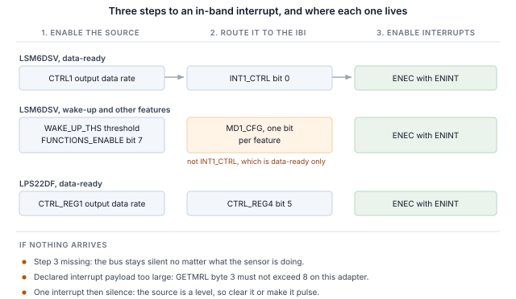

## 1 简介

新一代 STMicroelectronics MEMS 传感器在 I2C 和 SPI 之外还提供 MIPI I3C 接口，三者共用相同的两个引脚。
I3C 保留了这种双线占用，并在其上增加了大量功能。

Table: I3C 为双线传感器接口带来的功能

| 功能 | 为设计带来的好处 |
|---|---|
| 动态地址分配（DAA） | 控制器在运行时分配地址，因此静态地址冲突不再是电路板设计的约束，相同的器件可以共享一条总线 |
| 通过总线识别 | 每个目标器件都会报告一个 48 位临时标识符、器件类别及其总线能力，因此控制器可以枚举并非为其设计的总线 |
| 通用命令码 | 一套标准命令集（广播和直接），用于枚举、识别、配置、中断控制和复位，在所有符合规范的目标器件上都相同 |
| 带内中断（IBI） | 传感器通过数据线向主机发出中断，并携带一个说明原因的字节，因此无需布线或分配中断引脚 |
| 组寻址 | 一次写入可同时到达作为一组寻址的多个目标器件 |
| 更高的信令速率 | 推挽时钟，单数据速率模式下最高 12.5 MHz，而 I2C 受开漏限制 |
| 更低功耗 | 推挽信令避免了 I2C 持续消耗的静态上拉电流，活动状态则让控制器告知目标器件预期的总线延迟，使其能够更深度地空闲 |
| 热加入（Hot-Join） | 在总线运行后才上电的目标器件可以请求被枚举 |
| 时序控制 | 控制器可以让目标器件以共享基准为其中断打时间戳 |
| 标准复位与恢复 | 定义好的目标器件复位以及定义好的错误检测与恢复，而非各厂商各自的序列 |
| I2C 兼容性 | 传统 I2C 器件可以共享总线 |

目标器件实现的是传感器所需的子集，而不同器件的子集各不相同。
本笔记使用 Binho Supernova USB 主机适配器和 Binho I3C Target Board 处理两款 STMicroelectronics 器件：
枚举它们、通过总线识别它们、读写寄存器、输出解码后的测量数据流、在不连接中断引脚的情况下通过数据线获得中断、
通过轻敲电路板触发中断，并确定每个目标器件实际实现了上述哪些功能。

这里的任何内容都不需要微控制器、固件或驱动移植。每一步都是从主机 PC 发出的一条命令。

### 1.1 范围

读完本文后，手边有硬件的读者将已经把传感器枚举到 I3C 总线上、通过其自身寄存器识别它、读写寄存器、
输出解码后的测量数据流、在不连接中断引脚的情况下以传感器配置的输出数据速率接收带内中断、
通过轻敲电路板触发中断，并根据可观察到的效果确定目标器件实现了什么。

本文处理的两款器件是 LSM6DSV 和 LPS22DF。两者都在硬件上进行了验证，本文中的每一项输出都是真实捕获的结果。

### 1.2 适用器件

Table: 涵盖的器件

| 器件 | 功能 | 评估板 | 已在硬件上验证 |
|---|---|---|---|
| LSM6DSV | 6 轴 IMU，加速度计和陀螺仪 | STEVAL-MKI239AA | 是 |
| LPS22DF | 绝对压力传感器 | STEVAL-MKI224V1A | 是 |

该方法适用于任何安装在 DIL24 适配板上、带 I3C 接口的 STMicroelectronics MEMS 器件。
在随附的实用程序中添加一款器件只需一个表项，详见第 11 节。

### 1.3 相关文档

Table: 相关文档

| 文档 | 主题 |
|---|---|
| LSM6DSV 数据手册 | 寄存器映射和电气特性 |
| AN5922 | LSM6DSV 应用笔记，包括其中断生成 |
| LPS22DF 数据手册，DS13316 | 寄存器映射及其公布的 CCC 值 |
| MIPI I3C Specification v1.1 | 通用命令码、带内中断、动态寻址 |
| Binho I3C Target Board 产品页面 | 插座、跳线和支持的适配板 |

## 2 所需设备和软件

### 2.1 硬件

Table: 所需设备

| 项目 |
|---|
| Binho Supernova USB 主机适配器 |
| Binho I3C Target Board |
| STEVAL-MKI239AA 或 STEVAL-MKI224V1A，或其他 DIL24 MEMS 适配板 |
| USB-C 线缆 |

评估板插入标有标签的 DIL24 插座。本文中的任何步骤都不需要连接其他任何东西。

### 2.2 连接

Table: 使用的信号

| 信号 | 用途 |
|---|---|
| SCL | I3C 时钟，适配器到目标器件 |
| SDA | I3C 数据，双向 |
| 3.3 V | 目标器件电源，由适配器提供 |
| GND | 回路 |

两根线和一路电源。**本笔记中的任何内容都不连接中断引脚、复位线或配置电阻**，包括中断相关章节：
在 I3C 上，传感器通过 SDA 向主机发出信号。

总线全程运行在 3.3 V。目标板提供上拉电阻。

### 2.3 软件

```
pip install binhosupernova
```

唯一的依赖是 Python 3.12 和 `binhosupernova` 软件包。解压本笔记附带的资源压缩包，并用一条命令确认环境：

```
python i3c_mems.py scan
```

## 3 初次接触：枚举总线

一条命令即可让传感器以主机分配的地址出现在总线上：

```
python i3c_mems.py scan
```

```
1 target(s) on the bus at 3300 mV, PUSH_PULL_5_MHZ_50_DC, OPEN_DRAIN_1_MHZ

  dynamic address 0x08
    PID  02 08 00 70 12 0B   device id 0x0070
    BCR  0x07   DCR 0x44
    HDR  SDR only   IBI capable
    profile  lsm6dsv
```

这是由两个通用命令码完成的。**RSTDAA** 清除任何已分配的动态地址，使总线从已知状态开始。
**ENTDAA** 随后执行动态地址分配：控制器发出广播，每个目标器件使用其 48 位临时标识符进行仲裁，
并依次获得一个地址。只有一个器件时，该地址为 `0x08`。

没有在任何地方配置地址。器件自身的静态地址没有被使用，也不需要知道。

该输出中地址之后的所有内容都来自目标器件，而不是查找表，这是与 I2C 的第一个明显不同之处。
在 I2C 上，主机写入一个预先选定的地址，并期待有器件应答。而在这里，器件会自我介绍。

## 4 通过总线识别器件

```
python i3c_mems.py identify --device lsm6dsv
```

### 4.1 身份寄存器包含的内容

三个寄存器负责自我介绍，而这三个寄存器都是通过命令读取的，而不是从寄存器文件中读取。

**临时标识符（PID）** 为 48 位，包含 MIPI 成员 ID 和器件编号：

Table: 各器件的临时标识符

| 字段 | LSM6DSV | LPS22DF |
|---|---|---|
| PID | `02 08 00 70 12 0B` | `02 08 00 B4 10 0B` |
| MIPI 成员 id（47:33） | `0x0104` | `0x0104` |
| 器件 id（31:16） | `0x0070` | `0x00B4` |
| 实例 id（15:12） | `0b0001` | `0b0001` |

两者的成员 ID 相同，因为它们都是 STMicroelectronics 的器件。器件 ID 与该器件在其 `WHO_AM_I` 寄存器中报告的值相同，
因此从未接触过该器件的控制器可以在访问寄存器文件之前就识别它。

**器件特性寄存器（DCR）** 说明它属于哪一类器件：

Table: 器件特性寄存器

| 器件 | DCR | 含义 |
|---|---|---|
| LSM6DSV | `0x44` | 6 轴 IMU |
| LPS22DF | `0x62` | 压力传感器 |

DCR 标识的是类别，而不是具体器件。`0x62` 是 MIPI 注册表分配给压力传感器的值，任何符合规范的压力传感器都会报告该值。
读到 `0x62` 的控制器知道自己在与一个压力传感器通信，但需要 PID 才能知道是哪一款。

**总线特性寄存器（BCR）** 说明器件在总线上能做什么。这里的两款器件都报告 `0x07`：

```
BCR 0x07
  device role                      I3C target
  advanced capabilities (bit 5)    no, so SDR only
  virtual target support           no
  offline capable                  yes
  IBI mandatory payload            yes
  IBI capable                      yes
  max data speed limit             yes
```

在进行任何配置之前，这里就给出了两个有用的事实。器件能够发起带内中断，并且在发起时会发送有效载荷，第 7 节会用到这一点。
另外第 5 位为 0，因此该器件仅支持单数据速率，这样只需一条命令就能从目标器件本身回答高数据速率的问题，而不必查数据手册中的表格。

### 4.2 用 WHO_AM_I 确认

两款器件还带有一个常规的身份寄存器，值得读取一下，以确认寄存器访问的帧格式正确：

Table: 身份寄存器

| 器件 | 寄存器 | 值 |
|---|---|---|
| LSM6DSV | `WHO_AM_I`，位于 `0x0F` | `0x70` |
| LPS22DF | `WHO_AM_I`，位于 `0x0F` | `0xB4` |

LPS22DF 数据手册在这方面格外有帮助：其表 15 公布了每个身份命令返回的确切字节。与之对比测量，八项全部一致，
因此这是端到端确认新环境的好方法。

Table: LPS22DF，公布值与测量值对比

| 命令 | 数据手册 | 测量值 |
|---|---|---|
| GETPID | `02 08 00 B4 10 0B` | `02 08 00 B4 10 0B` |
| GETBCR | `07` | `07` |
| GETDCR | `62` | `62` |
| GETSTATUS | `00 00` | `00 00` |
| GETMXDS | `08 60` | `08 60` |
| GETCAPS | `00 11 18 00` | `00 11 18 00` |
| GETMWL | `00 08` | `00 08` |
| GETMRL | `00 10 05` | `00 10 05` |

## 5 读写寄存器

寄存器访问是一次私有传输：先发送寄存器地址，然后读取字节。

```
python i3c_mems.py read  --device lsm6dsv 0x0F
python i3c_mems.py write --device lps22df 0x10 0x18
```

两款器件的帧格式相同：

Table: 寄存器访问帧格式

| 属性 | LSM6DSV | LPS22DF |
|---|---|---|
| 寄存器地址宽度 | 8 位 | 8 位 |
| 数据宽度 | 8 位 | 8 位 |
| 读取有效载荷之前的空字节 | 0 | 0 |

> **在 LSM6DSV 上进行任何多字节读取之前，先设置 `CTRL3.IF_INC`。** 该位为 0 时寄存器地址不会递增，
> 因此对输出寄存器进行六字节读取会将第一个寄存器返回六次。此时三个轴的读数完全相同，看起来像解码错误，但其实不是。
> 这还意味着输出寄存器永远不会被完整读取，因此数据就绪标志永远不会清除，数据就绪中断只触发一次便停止。

在这些器件上，开头的 `0x7E` 广播头是可选的。带或不带它发出的读取都返回相同的值。

## 6 传感器数据流

### 6.1 LSM6DSV，加速度计

```
python i3c_mems.py stream --device lsm6dsv --seconds 5
```

```
  x    -0.029 g   y     0.014 g   z     1.011 g   magnitude     1.012 g
  x    -0.029 g   y     0.013 g   z     1.010 g   magnitude     1.010 g
  x    -0.028 g   y     0.013 g   z     1.011 g   magnitude     1.011 g
```

从位于 `0x28` 的 `OUTX_L_A` 读取六个字节，即三个有符号 16 位轴，在 `CTRL8` 中设置的 ±2 g 满量程下为每 g 16384 个计数。

静止时幅值为 1 g，这是对整条链路的免费检验：帧格式、字节序、符号处理和比例。倾斜电路板时，各轴读数重新分配，而幅值保持不变。

### 6.2 LPS22DF，压力和温度

```
python i3c_mems.py stream --device lps22df --seconds 5
```

```
  pressure  1006.297 hPa   temperature    22.520 C
  pressure  1006.295 hPa   temperature    22.520 C
  pressure  1006.369 hPa   temperature    22.520 C
```

压力为 24 位，每 hPa 4096 个计数，从位于 `0x28` 的 `PRESS_OUT_XL` 读取；温度为 16 位，每 °C 100 个计数，从位于 `0x2B` 的 `TEMP_OUT_L` 读取。
约 1006 hPa 和 22 °C 对室内工作台来说是正确的。

该器件的可观察量不需要任何仪器：对它哈气或将它举高，压力会随海拔每米变化约 12 Pa。

### 6.3 输出数据速率

Table: 输出数据速率选择

| 器件 | 寄存器 | 字段 | 此处使用的值 |
|---|---|---|---|
| LSM6DSV | `CTRL1`，位于 `0x10` | 位 3:0 | `0x03` 15 Hz，`0x04` 30 Hz，`0x05` 60 Hz，`0x06` 120 Hz |
| LPS22DF | `CTRL_REG1`，位于 `0x10` | 位 6:3 | `0011` 10 Hz，`0111` 100 Hz |

速率在第 7 节中很重要，因为中断速率跟随它变化。

## 7 不使用中断引脚，通过总线获得中断

带内中断是对传感器设计改变最明显的功能。器件通过传输数据的同样两根线告诉主机新数据已就绪，
主机在读取任何内容之前就知道原因，因此无需布线、分配中断引脚或将其引出到连接器。

### 7.1 三个步骤

本笔记中的每个带内中断都是相同的三个步骤，顺序如下：

1. **在传感器中使能中断源。** 数据就绪或某个运动功能。
2. **将其路由到带内中断。** 由哪个寄存器完成这一步因器件而异，
   这也是大部分难点所在。
3. **发送带 ENINT 位的 ENEC。** 在它到达之前，无论传感器在做什么，
   总线都保持静默。



```
python i3c_mems.py ibi --device lsm6dsv --seconds 3
```

```
lsm6dsv at 0x08: interrupt routed to the I3C IBI, data-ready through INT1_CTRL, cleared by reading the sample
  IBI from 0x08  MDB 02  extra 00 00 00 05 04 00 00  data ready=True
  IBI from 0x08  MDB 02  extra 00 00 00 05 04 00 00  data ready=True

  183 interrupts in 3.00 s = 61.00/s
  configured output data rate 60 Hz (+1.7%)
```

配置为 60 Hz，实测每秒 61 次，而两个中断引脚都没有连接任何东西。

Table: 中断速率与配置的输出数据速率对比

| 器件 | 配置值 | 测量值 | 时间窗口 |
|---|---|---|---|
| LSM6DSV | 15 Hz | 每秒 15.67 次 | 3.0 s |
| LSM6DSV | 30 Hz | 每秒 32.00 次 | 3.0 s |
| LSM6DSV | 60 Hz | 每秒 61.00 次 | 3.0 s |
| LSM6DSV | 120 Hz | 每秒 121.67 次 | 3.0 s |
| LPS22DF | 10 Hz | 每秒 9.62 次 | 3.0 s |

> **注意：** 速率可以与配置的速率进行比较。但各次到达时间不能比较，因为主机传输层是成批传递中断的。
> 出于这个原因，本文不给出任何抖动或延迟数据。

### 7.2 强制数据字节

每个中断都携带一个说明触发原因的强制数据字节，因此主机可以决定是否需要读取传感器：

Table: 观察到的强制数据字节

| 器件 | 中断源 | 强制字节 | 完整有效载荷 |
|---|---|---|---|
| LSM6DSV | 数据就绪 | `0x02` | `02 00 00 00 05 04 00 00` |
| LSM6DSV | 唤醒 | `0x04` | `04 00 00 02 05 04 00 00` |
| LPS22DF | 数据就绪，脉冲 | `0x02` | `02 00 00 33 00` |
| LPS22DF | 数据就绪，电平 | `0x02` | `02 00 00 03 00` |

在两款器件上，有效载荷携带的都不止强制字节。在 LSM6DSV 上，字节 3 是 `ALL_INT_SRC`，唤醒时为 `0x02`，数据就绪时为 `0x00`，
因此主机无需读取寄存器即可区分运动事件和新样本。在 LPS22DF 上，字节 3 是 `STATUS` 寄存器：
上面两个有效载荷不同，是因为在脉冲情况下没有读取样本，溢出位被置位，该字节读为 `0x33`；
而在电平情况下，主机在每次中断后读取样本，该字节保持为 `0x03`。

### 7.3 各器件的路由

**LSM6DSV。** 数据就绪由位于 `0x0D` 的 `INT1_CTRL` 第 0 位 `int1_drdy_xl` 路由。其他所有中断功能都不同：
必须通过位于 `0x50` 的 `FUNCTIONS_ENABLE` 第 7 位进行全局使能，并通过位于 `0x5E` 的 `MD1_CFG` 路由，而不是 `INT1_CTRL`。

Table: LSM6DSV 中断路由

| 中断源 | 使能 | 路由 |
|---|---|---|
| 加速度计数据就绪 | `CTRL1` 输出数据速率 | `INT1_CTRL` 第 0 位 |
| 唤醒、轻敲、6D、自由落体、活动 | `FUNCTIONS_ENABLE` 第 7 位 | `MD1_CFG`，每个功能一位 |

`CTRL5` 第 0 位 `INT_EN_I3C` 与此无关。它在使用 I3C 时激活物理中断引脚，对带内中断没有影响。

**LPS22DF。** 数据就绪位于 `0x13` 的 `CTRL_REG4` 第 5 位。只使能它只会产生一个中断，然后便是静默，
因为数据就绪是一个电平信号，在样本被读取之前一直保持有效。有两种修复方法可行，且结果精确到每个样本都一致：

Table: LPS22DF 数据就绪，电平与脉冲对比

| 配置 | 3 s 内的中断数 | 速率 |
|---|---|---|
| 仅 `DRDY`，不读取样本 | 1 | 0.33/s |
| `DRDY`，每次中断后读取样本 | 29 | 9.67/s |
| `DRDY` 加 `DRDY_PLS`（第 6 位） | 29 | 9.62/s |

> **一个中断之后便再无中断，是带内中断设置失败最常见的表现，而这并不是总线问题。**
> 要么是条件仍然有效，需要主机将其清除；要么可以让中断源改为脉冲方式。

### 7.4 轻敲电路板，观察中断到达

这是值得运行的演示。LSM6DSV 上的唤醒检测将物理运动转换为总线事件：

```
python i3c_mems.py wake --device lsm6dsv --seconds 25
```

```
lsm6dsv at 0x08: wake-up armed at threshold 2, routed to the I3C in-band interrupt

  TAP OR TILT THE BOARD. Listening for 25 s.

  t=  9.67s  MDB 04  payload says WU   axes X
  t=  9.91s  MDB 04  payload says WU   axes X,Y,Z
  t= 10.36s  MDB 04  payload says WU   axes X,Y
  t= 11.05s  MDB 04  payload says WU   axes Y
  t= 13.17s  MDB 04  payload says WU   axes Z

  80 wake-up interrupt(s) in 90.2 s
  peak deviation from 1 g during the window: 0.428 g
```

阈值的单位是满量程的 1/64，因此在 ±2 g 下一个计数约为 31 mg。两个计数高于静止电路板的噪声，又低于一次有意的轻敲：
在电路板未被触碰的 35 秒时间窗口内，该配置没有产生任何中断。

触发的是哪个功能可从有效载荷得知，无需访问寄存器。各轴的标志位位于 `0x45` 的 `WAKE_UP_SRC` 中，
而在中断锁存并重复触发时，它们可能在主机读取之前就被清除，因此轴字段为空是正常的，并不意味着中断是虚假的。

### 7.5 中断有效载荷大小

有一个设置步骤在出错时是静默的，表现为完全没有中断。

目标器件在 `GETMRL` 的第三个字节中声明它将发送的最大中断有效载荷，而控制器也有自己的限制。
**Supernova 可传递最多八个字节的中断有效载荷。** LSM6DSV 声明的是十个字节，并会将其有效载荷填充到所声明的长度，
因此在被要求改为八个字节或更少之前，它的所有中断都不会被传递。

Table: LSM6DSV 声明的中断有效载荷与传递的中断对比

| 声明的有效载荷 | 2 s 内的中断数 | 传递的有效载荷 |
|---|---|---|
| 1 | 41 | 1 字节 |
| 4 | 41 | 4 字节 |
| 8 | 42 | 8 字节 |
| 9 | 0 | 无 |
| 10（复位值） | 0 | 无 |

随附的实用程序会检查并调整这一点，并报告所做的操作：

```
IBI payload negotiation   the target declared 10 byte(s), the adapter takes 8, so it was
                          asked for 8
```

用 SETXTIME 启用 I3C 时序控制会在目标器件自身的有效载荷之前添加一个三字节时间戳，它同样计入该限额。
因此，恰好处于八字节的器件在启用时序控制后会变得静默，直到声明的有效载荷减少三个字节为止。

> **如果中断始终不到达，而每个寄存器都表明中断源正在触发，请首先读取 `GETMRL` 的第三个字节。**

## 8 验证 I3C 的其余功能

该实用程序根据可观察到的效果而不是结果码来确定目标器件实现了什么，因为目标器件可能会应答一个它并未实现的命令。
下面的每一行都要求观察到一项变化：设置并回读一个值、移动一个地址并确认旧地址不再应答、对照配置速率统计中断数。

```
python i3c_mems.py features --device lsm6dsv
```

Table: 实测通用命令码支持情况

| 命令 | LSM6DSV | LPS22DF | 依据 |
|---|---|---|---|
| ENTDAA | 支持 | 支持 | 目标器件以预期的标识符完成枚举 |
| RSTDAA | 支持 | 支持 | 地址表被清除，旧地址随后拒绝应答 |
| SETNEWDA | 支持 | 支持 | 地址已移动，旧地址拒绝应答 |
| GETPID、GETBCR、GETDCR | 支持 | 支持 | 返回预期值 |
| ENEC、DISEC | 支持 | 支持 | 中断可重复地启动和停止 |
| SETMWL、GETMWL | 支持 | 支持 | 值与写入的一致 |
| SETMRL、GETMRL | 支持 | 支持 | 同上，包括中断有效载荷字节 |
| SETGRPA、RSTGRPA | 支持 | 支持 | 通过组地址的写入仅在分配期间生效 |
| SETXTIME、GETXTIME | 支持 | 支持 | 命令之后某个报告的字节发生了变化 |
| HDR 模式 | 不支持 | 不支持 | BCR 第 5 位为 0 |
| 热加入 | 未观察到 | 未观察到 | 任何时候都没有热加入请求 |
| ENTAS0 至 ENTAS3 | 不确定 | 不确定 | 需要电流测量 |
| RSTACT | 不确定 | 不确定 | 从主机侧无可观察的效果 |
| GETMXDS | 不确定 | 不确定 | 有应答，但无可观察的效果 |

两款器件都报告 15 项支持、4 项未实现和 8 项不确定，并且每款都经过多次测量，以确认计数可以复现。

**这两款器件都实现了组寻址**，这值得单独说明，因为它是一项真正有用的功能，而且显而易见的测试方法会得出错误的结论。
组地址让控制器可以同时寻址多个目标器件，因此它是一个写入目的地：从组地址读取没有定义的应答，
目标器件可能在正确实现该功能的同时拒绝组地址读取。这里使用的测试方法是分配一个组地址，通过它写入一个寄存器，
然后在目标器件自己的动态地址上回读该寄存器：

Table: 组寻址，LSM6DSV

| 步骤 | 通过组 `0x20` 写入 | 回读的寄存器 |
|---|---|---|
| SETGRPA 之前 | `I3C_NACK_ADDRESS` | 未变化 |
| SETGRPA 之后 | `SUCCESS` | 已变化 |
| RSTGRPA 之后 | `I3C_NACK_ADDRESS` | 未变化 |

在每个阶段，对组地址的读取都被拒绝，包括组寻址明显正在工作时。

**活动状态**仍不确定。在 LSM6DSV 上，ENTAS0 被应答，ENTAS1 至 ENTAS3 被拒绝，但并非每次尝试都如此，
而要证明器件进入了低活动状态需要进行电流测量，而本环境无法进行该测量。该实用程序报告多次尝试中有多少次被拒绝，
而不是把单个结果码当作事实呈现。

## 9 总线速率

```
python i3c_mems.py rates --device lsm6dsv --iterations 100
```

Table: 最高无错误总线速率

| 器件 | 推挽 | 开漏 |
|---|---|---|
| LSM6DSV | 12.5 MHz，50% 占空比 | 4.17 MHz |
| LPS22DF | 12.5 MHz，50% 占空比 | 4.17 MHz |

两款器件都通过了适配器提供的所有速率。**方法：** 连续 100 次读取身份寄存器，必须全部返回预期值且无错误，
只有每次迭代都成功，该速率才算通过。这是一个寄存器读取循环，而不是吞吐量测量，不应据此得出任何关于持续数据速率的结论。

两款器件都将 BCR 第 0 位置位，声明存在最大数据速度限制，并且 GETMXDS 在两者上都返回 `08 60`。
在适配器能够产生的任何速率下，该限制都没有对此循环造成影响。

## 10 实用说明

以下是耗费工作台时间的事项的简短列表。

Table: 实用说明

| 器件 | 说明 |
|---|---|
| LSM6DSV | 在任何多字节读取之前设置 `CTRL3.IF_INC`，否则每个字节都来自同一个寄存器 |
| LSM6DSV | 数据就绪以外的中断功能需要 `FUNCTIONS_ENABLE` 第 7 位和 `MD1_CFG`，而不是 `INT1_CTRL` |
| LSM6DSV | 复位时声明的中断有效载荷为 10 字节；将其降至 8，否则不会传递任何中断 |
| LPS22DF | 数据就绪是电平信号。每次中断后读取样本，或设置 `DRDY_PLS` |
| LPS22DF | 静态地址为 `0x5C`，SDO 为高时为 `0x5D`，如其第 7.2 节所述 |
| 两者 | 枚举后的第一次读取可能尚未稳定。按照数据手册的建议，先进行一次空读取 |
| 两者 | SETXTIME 会锁存一个改变中断有效载荷的模式。`SETXTIME 0xFF` 将其关闭 |

## 11 实用程序

Table: 实用程序命令

| 命令 | 用途 |
|---|---|
| `scan` | 枚举总线并报告应答的器件 |
| `identify` | 解码目标器件的身份寄存器 |
| `read`、`write` | 读取或写入寄存器，写入后回读 |
| `stream` | 通过轮询打印解码后的样本 |
| `ibi` | 将传感器中断路由到总线上并统计到达的中断 |
| `wake` | 准备运动中断并报告到达的每个中断 |
| `features` | 根据可观察到的效果确定目标器件实现了什么 |
| `rates` | 查找最高无错误总线速率 |
| `reset`、`power-cycle` | 使器件恢复到已知状态 |

添加一款器件只需在配置表中添加一项：寄存器帧格式、预期的身份、启动数据流的写操作、路由中断的写操作，以及中断有效载荷的解码器。

## 12 测量结果

### 12.1 测试配置

Table: 测试配置

| 项目 | 值 |
|---|---|
| 适配器 | Binho Supernova，硬件版本 B，固件 4.4.0 |
| SDK | `binhosupernova`，Python 3.12，Windows 11 |
| 附件 | Binho I3C Target Board |
| 总线 | 3.3 V，推挽 5 MHz 50% 占空比，开漏 1 MHz，快速模式驱动强度 |
| 枚举 | RSTDAA 之后执行 ENTDAA |
| 目标器件 | STEVAL-MKI239AA 上的 LSM6DSV，STEVAL-MKI224V1A 上的 LPS22DF |

### 12.2 结果

**身份。** 第 4 节中的每个值都与表中一致。LPS22DF 公布的全部八个 CCC 值与测量结果逐字节一致。

**中断。** 速率如第 7.1 节表中所示，每项都在配置输出数据速率的 2.3% 以内。LSM6DSV 上的运动触发中断：
90 秒时间窗口内共 80 次，全部发生在轻敲电路板期间，峰值加速度 0.428 g。

**支持情况。** 两款器件均为 15 项支持、4 项未实现和 8 项不确定，在多次运行中可以复现。

**总线速率。** 按照第 9 节所述的方法，两款器件都通过了适配器提供的所有速率。

**回归覆盖。** 本文中显示的命令会与两款器件的记录输出进行比对，LPS22DF 为 8 条，LSM6DSV 为 7 条，
因此任何改变读者所见结果的实用程序变更都会被发现。

## 13 故障排除

Table: 故障排除

| 症状 | 检查项 |
|---|---|
| 没有目标器件被枚举 | 电路板是否插在正确的插座中；3.3 V 是否存在；尝试 `power-cycle` |
| 完全没有中断到达 | 声明的中断有效载荷，即 `GETMRL` 的第三个字节。然后检查是否已发送 ENEC |
| 一个中断后便静默 | 中断源是电平信号，需要清除，或可设置为脉冲方式 |
| 所有轴读数相同 | LSM6DSV 上的 `CTRL3.IF_INC` 为 0 |
| 中断有效载荷变大且中断停止 | 时序控制已启用；`SETXTIME 0xFF` |
| 身份读取错误一次，随后正确 | 枚举后属于预期现象；先进行一次空读取 |
| 更换电路板后枚举失败 | 对目标器件电源轨重新上电，然后重新枚举 |

## 14 缩略语

Table: 缩略语

| 术语 | 含义 |
|---|---|
| BCR | 总线特性寄存器（Bus characteristics register） |
| CCC | 通用命令码（Common command code） |
| DAA | 动态地址分配（Dynamic address assignment） |
| DCR | 器件特性寄存器（Device characteristics register） |
| ENTDAA | 进入动态地址分配（Enter dynamic address assignment） |
| HDR | 高数据速率（High data rate） |
| IBI | 带内中断（In-band interrupt） |
| MDB | 强制数据字节（Mandatory data byte） |
| ODR | 输出数据速率（Output data rate） |
| PID | 临时标识符（Provisional identifier） |
| SDR | 单数据速率（Single data rate） |

## 15 关于本文中源代码的说明

本文中显示并在随附压缩包中提供的示例代码仅供评估和参考。它基于 MIT 许可证发布，许可证文本包含在压缩包中。

Table: 资源压缩包内容

| 文件 | 说明 |
|---|---|
| `AN0005.md` | 本文的 Markdown 源文件 |
| `assets/i3c_mems.py` | 参考实用程序 |
| `assets/LICENSE` | 涵盖示例代码的 MIT 许可证 |

## 16 修订历史

Table: 修订历史

| 修订版 | 日期 | 说明 |
|---|---|---|
| 1.0 | 1 September 2026 | 首次发布。 |
| 1.1 | 3 September 2026 | 随附的 `i3c_mems.py` 副本已从共享实用程序更新，此前它落后了 329 行。新增了针对报告 `NOT_POWERED` 的外部电压的恢复路径、三次尝试的 RSTDAA 判定以及 HDR-DDR 读取。本文的文字和测量结果均未改变，也没有任何一行被重新测量。 |
