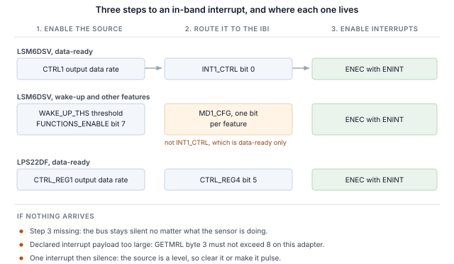

## 1 簡介

新一代 STMicroelectronics MEMS 感測器在 I2C 和 SPI 之外還提供 MIPI I3C 介面，三者共用相同的兩個接腳。
I3C 保留了這種雙線配置，並在其上增加了大量功能。

Table: I3C 為雙線感測器介面帶來的功能

| 功能 | 為設計帶來的好處 |
|---|---|
| 動態位址分配（DAA） | 控制器在執行時分配位址，因此靜態位址衝突不再是電路板設計的限制，相同的元件可以共用一條匯流排 |
| 透過匯流排識別 | 每個目標裝置都會回報一個 48 位元暫時識別碼、裝置類別及其匯流排能力，因此控制器可以列舉並非為其設計的匯流排 |
| 通用命令碼 | 一套標準命令集（廣播和直接），用於列舉、識別、設定、中斷控制和重設，在所有符合規範的目標裝置上都相同 |
| 帶內中斷（IBI） | 感測器透過資料線向主機發出中斷，並攜帶一個說明原因的位元組，因此不需要佈線或分配中斷接腳 |
| 群組定址 | 一次寫入可同時到達以群組定址的多個目標裝置 |
| 更高的訊號速率 | 推挽時脈，單資料速率模式下最高 12.5 MHz，而 I2C 受開汲極限制 |
| 更低功耗 | 推挽訊號避免了 I2C 持續消耗的靜態上拉電流，活動狀態則讓控制器告知目標裝置預期的匯流排延遲，使其能夠更深度地閒置 |
| 熱加入（Hot-Join） | 在匯流排運作後才上電的目標裝置可以請求被列舉 |
| 時序控制 | 控制器可以讓目標裝置以共用基準為其中斷加上時間戳記 |
| 標準重設與復原 | 明確定義的目標裝置重設，以及明確定義的錯誤偵測與復原，而非各廠商各自的序列 |
| I2C 相容性 | 傳統 I2C 裝置可以共用匯流排 |

目標裝置實作的是感測器所需的子集，而不同元件的子集各不相同。
本筆記使用 Binho Supernova USB 主機轉接器和 Binho I3C Target Board 處理兩款 STMicroelectronics 元件：
列舉它們、透過匯流排識別它們、讀寫暫存器、輸出解碼後的量測資料串流、在不連接中斷接腳的情況下透過資料線取得中斷、
透過輕敲電路板觸發中斷，並確定每個目標裝置實際實作了上述哪些功能。

這裡的任何內容都不需要微控制器、韌體或驅動程式移植。每一步都是從主機 PC 發出的一條命令。

### 1.1 範圍

讀完本文後，手邊有硬體的讀者將已經把感測器列舉到 I3C 匯流排上、透過其自身暫存器識別它、讀寫暫存器、
輸出解碼後的量測資料串流、在不連接中斷接腳的情況下以感測器設定的輸出資料速率接收帶內中斷、
透過輕敲電路板觸發中斷，並根據可觀察到的效果確定目標裝置實作了什麼。

本文處理的兩款元件是 LSM6DSV 和 LPS22DF。兩者都在硬體上進行了驗證，本文中的每一項輸出都是實際擷取的結果。

### 1.2 適用裝置

Table: 涵蓋的裝置

| 裝置 | 功能 | 評估板 | 已在硬體上驗證 |
|---|---|---|---|
| LSM6DSV | 6 軸 IMU，加速度計和陀螺儀 | STEVAL-MKI239AA | 是 |
| LPS22DF | 絕對壓力感測器 | STEVAL-MKI224V1A | 是 |

此方法適用於任何安裝在 DIL24 轉接板上、具備 I3C 介面的 STMicroelectronics MEMS 元件。
在隨附的公用程式中新增一款元件只需一個表格項目，詳見第 11 節。

### 1.3 相關文件

Table: 相關文件

| 文件 | 主題 |
|---|---|
| LSM6DSV 資料手冊 | 暫存器對映和電氣特性 |
| AN5922 | LSM6DSV 應用筆記，包括其中斷產生 |
| LPS22DF 資料手冊，DS13316 | 暫存器對映及其公布的 CCC 值 |
| MIPI I3C Specification v1.1 | 通用命令碼、帶內中斷、動態定址 |
| Binho I3C Target Board 產品頁面 | 插座、跳線和支援的轉接板 |

## 2 所需設備和軟體

### 2.1 硬體

Table: 所需設備

| 項目 |
|---|
| Binho Supernova USB 主機轉接器 |
| Binho I3C Target Board |
| STEVAL-MKI239AA 或 STEVAL-MKI224V1A，或其他 DIL24 MEMS 轉接板 |
| USB-C 纜線 |

評估板插入標有標籤的 DIL24 插座。本文中的任何步驟都不需要連接其他任何東西。

### 2.2 連接

Table: 使用的訊號

| 訊號 | 用途 |
|---|---|
| SCL | I3C 時脈，轉接器到目標裝置 |
| SDA | I3C 資料，雙向 |
| 3.3 V | 目標裝置電源，由轉接器提供 |
| GND | 回路 |

兩條線和一路電源。**本筆記中的任何內容都不連接中斷接腳、重設線或設定電阻**，包括中斷相關章節：
在 I3C 上，感測器透過 SDA 向主機發出訊號。

匯流排全程以 3.3 V 運作。目標板提供上拉電阻。

### 2.3 軟體

```
pip install binhosupernova
```

唯一的相依項目是 Python 3.12 和 `binhosupernova` 套件。解壓縮本筆記隨附的資源壓縮檔，並用一條命令確認環境：

```
python i3c_mems.py scan
```

## 3 初次接觸：列舉匯流排

一條命令即可讓感測器以主機分配的位址出現在匯流排上：

```
python i3c_mems.py scan
```

```
1 target(s) on the bus at 3300 mV, PUSH_PULL_5_MHZ_50_DC, OPEN_DRAIN_1_MHZ

  dynamic address 0x08
    PID  02 08 00 70 12 0B   device id 0x0070
    BCR  0x07   DCR 0x44
    HDR  SDR only   IBI capable
    profile  lsm6dsv
```

這是由兩個通用命令碼完成的。**RSTDAA** 清除任何已分配的動態位址，使匯流排從已知狀態開始。
**ENTDAA** 接著執行動態位址分配：控制器發出廣播，每個目標裝置使用其 48 位元暫時識別碼進行仲裁，
並依序獲得一個位址。只有一個元件時，該位址為 `0x08`。

沒有在任何地方設定位址。元件自身的靜態位址沒有被使用，也不需要知道。

該輸出中位址之後的所有內容都來自目標裝置，而不是查找表，這是與 I2C 的第一個明顯不同之處。
在 I2C 上，主機寫入一個預先選定的位址，並期待有裝置回應。而在這裡，裝置會自我介紹。

## 4 透過匯流排識別元件

```
python i3c_mems.py identify --device lsm6dsv
```

### 4.1 身分暫存器包含的內容

三個暫存器負責自我介紹，而這三個暫存器都是透過命令讀取的，而不是從暫存器檔案中讀取。

**暫時識別碼（PID）** 為 48 位元，包含 MIPI 成員 ID 和元件編號：

Table: 各元件的暫時識別碼

| 欄位 | LSM6DSV | LPS22DF |
|---|---|---|
| PID | `02 08 00 70 12 0B` | `02 08 00 B4 10 0B` |
| MIPI 成員 id（47:33） | `0x0104` | `0x0104` |
| 裝置 id（31:16） | `0x0070` | `0x00B4` |
| 實例 id（15:12） | `0b0001` | `0b0001` |

兩者的成員 ID 相同，因為它們都是 STMicroelectronics 的元件。裝置 ID 與該元件在其 `WHO_AM_I` 暫存器中回報的值相同，
因此從未接觸過該元件的控制器可以在存取暫存器檔案之前就識別它。

**裝置特性暫存器（DCR）** 說明它屬於哪一類裝置：

Table: 裝置特性暫存器

| 元件 | DCR | 含義 |
|---|---|---|
| LSM6DSV | `0x44` | 6 軸 IMU |
| LPS22DF | `0x62` | 壓力感測器 |

DCR 識別的是類別，而不是具體元件。`0x62` 是 MIPI 登錄表分配給壓力感測器的值，任何符合規範的壓力感測器都會回報此值。
讀到 `0x62` 的控制器知道自己在與一個壓力感測器通訊，但需要 PID 才能知道是哪一款。

**匯流排特性暫存器（BCR）** 說明元件在匯流排上能做什麼。這裡的兩款元件都回報 `0x07`：

```
BCR 0x07
  device role                      I3C target
  advanced capabilities (bit 5)    no, so SDR only
  virtual target support           no
  offline capable                  yes
  IBI mandatory payload            yes
  IBI capable                      yes
  max data speed limit             yes
```

在進行任何設定之前，這裡就給出了兩個有用的事實。元件能夠發起帶內中斷，並且在發起時會傳送酬載，第 7 節會用到這一點。
另外第 5 位元為 0，因此該元件僅支援單資料速率，這樣只需一條命令就能從目標裝置本身回答高資料速率的問題，而不必查資料手冊中的表格。

### 4.2 以 WHO_AM_I 確認

兩款元件還具備一個傳統的身分暫存器，值得讀取一下，以確認暫存器存取的訊框格式正確：

Table: 身分暫存器

| 元件 | 暫存器 | 值 |
|---|---|---|
| LSM6DSV | `WHO_AM_I`，位於 `0x0F` | `0x70` |
| LPS22DF | `WHO_AM_I`，位於 `0x0F` | `0xB4` |

LPS22DF 資料手冊在這方面格外有幫助：其表 15 公布了每個身分命令傳回的確切位元組。與之對照量測，八項全部一致，
因此這是端對端確認新環境的好方法。

Table: LPS22DF，公布值與量測值對照

| 命令 | 資料手冊 | 量測值 |
|---|---|---|
| GETPID | `02 08 00 B4 10 0B` | `02 08 00 B4 10 0B` |
| GETBCR | `07` | `07` |
| GETDCR | `62` | `62` |
| GETSTATUS | `00 00` | `00 00` |
| GETMXDS | `08 60` | `08 60` |
| GETCAPS | `00 11 18 00` | `00 11 18 00` |
| GETMWL | `00 08` | `00 08` |
| GETMRL | `00 10 05` | `00 10 05` |

## 5 讀寫暫存器

暫存器存取是一次私有傳輸：先傳送暫存器位址，然後讀取位元組。

```
python i3c_mems.py read  --device lsm6dsv 0x0F
python i3c_mems.py write --device lps22df 0x10 0x18
```

兩款元件的訊框格式相同：

Table: 暫存器存取訊框格式

| 屬性 | LSM6DSV | LPS22DF |
|---|---|---|
| 暫存器位址寬度 | 8 位元 | 8 位元 |
| 資料寬度 | 8 位元 | 8 位元 |
| 讀取酬載之前的虛擬位元組 | 0 | 0 |

> **在 LSM6DSV 上進行任何多位元組讀取之前，先設定 `CTRL3.IF_INC`。** 該位元為 0 時暫存器位址不會遞增，
> 因此對輸出暫存器進行六位元組讀取會將第一個暫存器傳回六次。此時三個軸的讀數完全相同，看起來像解碼錯誤，但其實不是。
> 這也表示輸出暫存器永遠不會被完整讀取，因此資料就緒旗標永遠不會清除，資料就緒中斷只觸發一次便停止。

在這些元件上，開頭的 `0x7E` 廣播標頭是選用的。帶或不帶它發出的讀取都傳回相同的值。

## 6 感測器資料串流

### 6.1 LSM6DSV，加速度計

```
python i3c_mems.py stream --device lsm6dsv --seconds 5
```

```
  x    -0.029 g   y     0.014 g   z     1.011 g   magnitude     1.012 g
  x    -0.029 g   y     0.013 g   z     1.010 g   magnitude     1.010 g
  x    -0.028 g   y     0.013 g   z     1.011 g   magnitude     1.011 g
```

從位於 `0x28` 的 `OUTX_L_A` 讀取六個位元組，即三個有號 16 位元軸，在 `CTRL8` 中設定的 ±2 g 滿刻度下為每 g 16384 個計數。

靜止時大小為 1 g，這是對整條鏈路的免費檢驗：訊框格式、位元組順序、正負號處理和比例。傾斜電路板時，各軸讀數重新分配，而大小保持不變。

### 6.2 LPS22DF，壓力和溫度

```
python i3c_mems.py stream --device lps22df --seconds 5
```

```
  pressure  1006.297 hPa   temperature    22.520 C
  pressure  1006.295 hPa   temperature    22.520 C
  pressure  1006.369 hPa   temperature    22.520 C
```

壓力為 24 位元，每 hPa 4096 個計數，從位於 `0x28` 的 `PRESS_OUT_XL` 讀取；溫度為 16 位元，每 °C 100 個計數，從位於 `0x2B` 的 `TEMP_OUT_L` 讀取。
約 1006 hPa 和 22 °C 對室內工作台來說是正確的。

此元件的可觀察量不需要任何儀器：對它呵氣或將它舉高，壓力會隨海拔每公尺變化約 12 Pa。

### 6.3 輸出資料速率

Table: 輸出資料速率選擇

| 元件 | 暫存器 | 欄位 | 此處使用的值 |
|---|---|---|---|
| LSM6DSV | `CTRL1`，位於 `0x10` | 位元 3:0 | `0x03` 15 Hz，`0x04` 30 Hz，`0x05` 60 Hz，`0x06` 120 Hz |
| LPS22DF | `CTRL_REG1`，位於 `0x10` | 位元 6:3 | `0011` 10 Hz，`0111` 100 Hz |

速率在第 7 節中很重要，因為中斷速率會隨之變化。

## 7 不使用中斷接腳，透過匯流排取得中斷

帶內中斷是對感測器設計改變最明顯的功能。元件透過傳輸資料的同樣兩條線告訴主機新資料已就緒，
主機在讀取任何內容之前就知道原因，因此不需要佈線、分配中斷接腳或將其引出到連接器。

### 7.1 三個步驟

本筆記中的每個帶內中斷都是相同的三個步驟，順序如下：

1. **在感測器中啟用中斷來源。** 資料就緒或某個運動功能。
2. **將其路由到帶內中斷。** 由哪個暫存器完成這一步因元件而異，
   這也是大部分難點所在。
3. **傳送帶 ENINT 位元的 ENEC。** 在它到達之前，無論感測器在做什麼，
   匯流排都保持靜默。



```
python i3c_mems.py ibi --device lsm6dsv --seconds 3
```

```
lsm6dsv at 0x08: interrupt routed to the I3C IBI, data-ready through INT1_CTRL, cleared by reading the sample
  IBI from 0x08  MDB 02  extra 00 00 00 05 04 00 00  data ready=True
  IBI from 0x08  MDB 02  extra 00 00 00 05 04 00 00  data ready=True

  183 interrupts in 3.00 s = 61.00/s
  configured output data rate 60 Hz (+1.7%)
```

設定為 60 Hz，實測每秒 61 次，而兩個中斷接腳都沒有連接任何東西。

Table: 中斷速率與設定的輸出資料速率對照

| 元件 | 設定值 | 量測值 | 時間窗口 |
|---|---|---|---|
| LSM6DSV | 15 Hz | 每秒 15.67 次 | 3.0 s |
| LSM6DSV | 30 Hz | 每秒 32.00 次 | 3.0 s |
| LSM6DSV | 60 Hz | 每秒 61.00 次 | 3.0 s |
| LSM6DSV | 120 Hz | 每秒 121.67 次 | 3.0 s |
| LPS22DF | 10 Hz | 每秒 9.62 次 | 3.0 s |

> **注意：** 速率可以與設定的速率進行比較。但各次到達時間不能比較，因為主機傳輸層是成批傳遞中斷的。
> 基於這個原因，本文不提供任何抖動或延遲數據。

### 7.2 強制資料位元組

每個中斷都攜帶一個說明觸發原因的強制資料位元組，因此主機可以決定是否需要讀取感測器：

Table: 觀察到的強制資料位元組

| 元件 | 中斷來源 | 強制位元組 | 完整酬載 |
|---|---|---|---|
| LSM6DSV | 資料就緒 | `0x02` | `02 00 00 00 05 04 00 00` |
| LSM6DSV | 喚醒 | `0x04` | `04 00 00 02 05 04 00 00` |
| LPS22DF | 資料就緒，脈衝 | `0x02` | `02 00 00 33 00` |
| LPS22DF | 資料就緒，準位 | `0x02` | `02 00 00 03 00` |

在兩款元件上，酬載攜帶的都不只強制位元組。在 LSM6DSV 上，位元組 3 是 `ALL_INT_SRC`，喚醒時為 `0x02`，資料就緒時為 `0x00`，
因此主機無需讀取暫存器即可區分運動事件和新樣本。在 LPS22DF 上，位元組 3 是 `STATUS` 暫存器：
上面兩個酬載不同，是因為在脈衝情況下沒有讀取樣本，溢位位元被設定，該位元組讀為 `0x33`；
而在準位情況下，主機在每次中斷後讀取樣本，該位元組保持為 `0x03`。

### 7.3 各元件的路由

**LSM6DSV。** 資料就緒由位於 `0x0D` 的 `INT1_CTRL` 第 0 位元 `int1_drdy_xl` 路由。其他所有中斷功能都不同：
必須透過位於 `0x50` 的 `FUNCTIONS_ENABLE` 第 7 位元進行全域啟用，並透過位於 `0x5E` 的 `MD1_CFG` 路由，而不是 `INT1_CTRL`。

Table: LSM6DSV 中斷路由

| 中斷來源 | 啟用 | 路由 |
|---|---|---|
| 加速度計資料就緒 | `CTRL1` 輸出資料速率 | `INT1_CTRL` 第 0 位元 |
| 喚醒、輕敲、6D、自由落體、活動 | `FUNCTIONS_ENABLE` 第 7 位元 | `MD1_CFG`，每個功能一個位元 |

`CTRL5` 第 0 位元 `INT_EN_I3C` 與此無關。它在使用 I3C 時啟動實體中斷接腳，對帶內中斷沒有影響。

**LPS22DF。** 資料就緒位於 `0x13` 的 `CTRL_REG4` 第 5 位元。只啟用它只會產生一個中斷，然後便是靜默，
因為資料就緒是一個準位訊號，在樣本被讀取之前一直保持有效。有兩種修正方法可行，且結果精確到每個樣本都一致：

Table: LPS22DF 資料就緒，準位與脈衝對照

| 設定 | 3 s 內的中斷數 | 速率 |
|---|---|---|
| 僅 `DRDY`，不讀取樣本 | 1 | 0.33/s |
| `DRDY`，每次中斷後讀取樣本 | 29 | 9.67/s |
| `DRDY` 加 `DRDY_PLS`（第 6 位元） | 29 | 9.62/s |

> **一個中斷之後便再無中斷，是帶內中斷設定失敗最常見的表現，而這並不是匯流排問題。**
> 要麼是條件仍然有效，需要主機將其清除；要麼可以讓中斷來源改為脈衝方式。

### 7.4 輕敲電路板，觀察中斷到達

這是值得執行的示範。LSM6DSV 上的喚醒偵測將實體運動轉換為匯流排事件：

```
python i3c_mems.py wake --device lsm6dsv --seconds 25
```

```
lsm6dsv at 0x08: wake-up armed at threshold 2, routed to the I3C in-band interrupt

  TAP OR TILT THE BOARD. Listening for 25 s.

  t=  9.67s  MDB 04  payload says WU   axes X
  t=  9.91s  MDB 04  payload says WU   axes X,Y,Z
  t= 10.36s  MDB 04  payload says WU   axes X,Y
  t= 11.05s  MDB 04  payload says WU   axes Y
  t= 13.17s  MDB 04  payload says WU   axes Z

  80 wake-up interrupt(s) in 90.2 s
  peak deviation from 1 g during the window: 0.428 g
```

臨界值的單位是滿刻度的 1/64，因此在 ±2 g 下一個計數約為 31 mg。兩個計數高於靜止電路板的雜訊，又低於一次刻意的輕敲：
在電路板未被觸碰的 35 秒時間窗口內，此設定沒有產生任何中斷。

觸發的是哪個功能可從酬載得知，無需存取暫存器。各軸的旗標位元位於 `0x45` 的 `WAKE_UP_SRC` 中，
而在中斷鎖存並重複觸發時，它們可能在主機讀取之前就被清除，因此軸欄位為空是正常的，並不表示中斷是假的。

### 7.5 中斷酬載大小

有一個設定步驟在出錯時是靜默的，表現為完全沒有中斷。

目標裝置在 `GETMRL` 的第三個位元組中宣告它將傳送的最大中斷酬載，而控制器也有自己的限制。
**Supernova 可傳遞最多八個位元組的中斷酬載。** LSM6DSV 宣告的是十個位元組，並會將其酬載填補到所宣告的長度，
因此在被要求改為八個位元組或更少之前，它的所有中斷都不會被傳遞。

Table: LSM6DSV 宣告的中斷酬載與傳遞的中斷對照

| 宣告的酬載 | 2 s 內的中斷數 | 傳遞的酬載 |
|---|---|---|
| 1 | 41 | 1 位元組 |
| 4 | 41 | 4 位元組 |
| 8 | 42 | 8 位元組 |
| 9 | 0 | 無 |
| 10（重設值） | 0 | 無 |

隨附的公用程式會檢查並調整這一點，並回報所做的操作：

```
IBI payload negotiation   the target declared 10 byte(s), the adapter takes 8, so it was
                          asked for 8
```

以 SETXTIME 啟用 I3C 時序控制會在目標裝置自身的酬載之前加入一個三位元組時間戳記，它同樣計入此限額。
因此，恰好處於八位元組的元件在啟用時序控制後會變得靜默，直到宣告的酬載減少三個位元組為止。

> **如果中斷始終不到達，而每個暫存器都顯示中斷來源正在觸發，請先讀取 `GETMRL` 的第三個位元組。**

## 8 驗證 I3C 的其餘功能

此公用程式根據可觀察到的效果而不是結果碼來確定目標裝置實作了什麼，因為目標裝置可能會回應一個它並未實作的命令。
下面的每一列都要求觀察到一項變化：設定並回讀一個值、移動一個位址並確認舊位址不再回應、對照設定速率計算中斷數。

```
python i3c_mems.py features --device lsm6dsv
```

Table: 實測通用命令碼支援情況

| 命令 | LSM6DSV | LPS22DF | 依據 |
|---|---|---|---|
| ENTDAA | 支援 | 支援 | 目標裝置以預期的識別碼完成列舉 |
| RSTDAA | 支援 | 支援 | 位址表被清除，舊位址隨後拒絕回應 |
| SETNEWDA | 支援 | 支援 | 位址已移動，舊位址拒絕回應 |
| GETPID、GETBCR、GETDCR | 支援 | 支援 | 傳回預期值 |
| ENEC、DISEC | 支援 | 支援 | 中斷可重複地啟動和停止 |
| SETMWL、GETMWL | 支援 | 支援 | 值與寫入的一致 |
| SETMRL、GETMRL | 支援 | 支援 | 同上，包括中斷酬載位元組 |
| SETGRPA、RSTGRPA | 支援 | 支援 | 透過群組位址的寫入僅在分配期間生效 |
| SETXTIME、GETXTIME | 支援 | 支援 | 命令之後某個回報的位元組發生了變化 |
| HDR 模式 | 不支援 | 不支援 | BCR 第 5 位元為 0 |
| 熱加入 | 未觀察到 | 未觀察到 | 任何時候都沒有熱加入請求 |
| ENTAS0 至 ENTAS3 | 無法確定 | 無法確定 | 需要電流量測 |
| RSTACT | 無法確定 | 無法確定 | 從主機端無可觀察的效果 |
| GETMXDS | 無法確定 | 無法確定 | 有回應，但無可觀察的效果 |

兩款元件都回報 15 項支援、4 項未實作和 8 項無法確定，並且每款都經過多次量測，以確認計數可以重現。

**這兩款元件都實作了群組定址**，這值得單獨說明，因為它是一項真正有用的功能，而且直覺的測試方法會得出錯誤的結論。
群組位址讓控制器可以同時定址多個目標裝置，因此它是一個寫入目的地：從群組位址讀取沒有定義的回應，
目標裝置可能在正確實作此功能的同時拒絕群組位址讀取。這裡使用的測試方法是分配一個群組位址，透過它寫入一個暫存器，
然後在目標裝置自己的動態位址上回讀該暫存器：

Table: 群組定址，LSM6DSV

| 步驟 | 透過群組 `0x20` 寫入 | 回讀的暫存器 |
|---|---|---|
| SETGRPA 之前 | `I3C_NACK_ADDRESS` | 未變化 |
| SETGRPA 之後 | `SUCCESS` | 已變化 |
| RSTGRPA 之後 | `I3C_NACK_ADDRESS` | 未變化 |

在每個階段，對群組位址的讀取都被拒絕，包括群組定址明顯正在運作時。

**活動狀態**仍無法確定。在 LSM6DSV 上，ENTAS0 被回應，ENTAS1 至 ENTAS3 被拒絕，但並非每次嘗試都如此，
而要證明元件進入了低活動狀態需要進行電流量測，而本環境無法進行該量測。此公用程式回報多次嘗試中有多少次被拒絕，
而不是把單一結果碼當作事實呈現。

## 9 匯流排速率

```
python i3c_mems.py rates --device lsm6dsv --iterations 100
```

Table: 最高無錯誤匯流排速率

| 元件 | 推挽 | 開汲極 |
|---|---|---|
| LSM6DSV | 12.5 MHz，50% 工作週期 | 4.17 MHz |
| LPS22DF | 12.5 MHz，50% 工作週期 | 4.17 MHz |

兩款元件都通過了轉接器提供的所有速率。**方法：** 連續 100 次讀取身分暫存器，必須全部傳回預期值且無錯誤，
只有每次迭代都成功，該速率才算通過。這是一個暫存器讀取迴圈，而不是傳輸量量測，不應據此得出任何關於持續資料速率的結論。

兩款元件都將 BCR 第 0 位元設定為 1，宣告存在最大資料速度限制，並且 GETMXDS 在兩者上都傳回 `08 60`。
在轉接器能夠產生的任何速率下，此限制都沒有對此迴圈造成影響。

## 10 實務說明

以下是耗費工作台時間的事項的簡短清單。

Table: 實務說明

| 元件 | 說明 |
|---|---|
| LSM6DSV | 在任何多位元組讀取之前設定 `CTRL3.IF_INC`，否則每個位元組都來自同一個暫存器 |
| LSM6DSV | 資料就緒以外的中斷功能需要 `FUNCTIONS_ENABLE` 第 7 位元和 `MD1_CFG`，而不是 `INT1_CTRL` |
| LSM6DSV | 重設時宣告的中斷酬載為 10 位元組；將其降至 8，否則不會傳遞任何中斷 |
| LPS22DF | 資料就緒是準位訊號。每次中斷後讀取樣本，或設定 `DRDY_PLS` |
| LPS22DF | 靜態位址為 `0x5C`，SDO 為高時為 `0x5D`，如其第 7.2 節所述 |
| 兩者 | 列舉後的第一次讀取可能尚未穩定。依照資料手冊的建議，先進行一次虛擬讀取 |
| 兩者 | SETXTIME 會鎖存一個改變中斷酬載的模式。`SETXTIME 0xFF` 將其關閉 |

## 11 公用程式

Table: 公用程式命令

| 命令 | 用途 |
|---|---|
| `scan` | 列舉匯流排並回報回應的裝置 |
| `identify` | 解碼目標裝置的身分暫存器 |
| `read`、`write` | 讀取或寫入暫存器，寫入後回讀 |
| `stream` | 透過輪詢列印解碼後的樣本 |
| `ibi` | 將感測器中斷路由到匯流排上並計算到達的中斷 |
| `wake` | 預備運動中斷並回報到達的每個中斷 |
| `features` | 根據可觀察到的效果確定目標裝置實作了什麼 |
| `rates` | 尋找最高無錯誤匯流排速率 |
| `reset`、`power-cycle` | 使元件回到已知狀態 |

新增一款元件只需在設定表中新增一項：暫存器訊框格式、預期的身分、啟動資料串流的寫入操作、路由中斷的寫入操作，以及中斷酬載的解碼器。

## 12 量測結果

### 12.1 測試設定

Table: 測試設定

| 項目 | 值 |
|---|---|
| 轉接器 | Binho Supernova，硬體版本 B，韌體 4.4.0 |
| SDK | `binhosupernova`，Python 3.12，Windows 11 |
| 配件 | Binho I3C Target Board |
| 匯流排 | 3.3 V，推挽 5 MHz 50% 工作週期，開汲極 1 MHz，快速模式驅動強度 |
| 列舉 | RSTDAA 之後執行 ENTDAA |
| 目標裝置 | STEVAL-MKI239AA 上的 LSM6DSV，STEVAL-MKI224V1A 上的 LPS22DF |

### 12.2 結果

**身分。** 第 4 節中的每個值都與表中一致。LPS22DF 公布的全部八個 CCC 值與量測結果逐位元組一致。

**中斷。** 速率如第 7.1 節表中所示，每項都在設定輸出資料速率的 2.3% 以內。LSM6DSV 上的運動觸發中斷：
90 秒時間窗口內共 80 次，全部發生在輕敲電路板期間，峰值加速度 0.428 g。

**支援情況。** 兩款元件均為 15 項支援、4 項未實作和 8 項無法確定，在多次執行中可以重現。

**匯流排速率。** 依照第 9 節所述的方法，兩款元件都通過了轉接器提供的所有速率。

**迴歸覆蓋。** 本文中顯示的命令會與兩款元件的記錄輸出進行比對，LPS22DF 為 8 條，LSM6DSV 為 7 條，
因此任何改變讀者所見結果的公用程式變更都會被發現。

## 13 疑難排解

Table: 疑難排解

| 症狀 | 檢查項目 |
|---|---|
| 沒有目標裝置被列舉 | 電路板是否插在正確的插座中；3.3 V 是否存在；嘗試 `power-cycle` |
| 完全沒有中斷到達 | 宣告的中斷酬載，即 `GETMRL` 的第三個位元組。然後檢查是否已傳送 ENEC |
| 一個中斷後便靜默 | 中斷來源是準位訊號，需要清除，或可設定為脈衝方式 |
| 所有軸讀數相同 | LSM6DSV 上的 `CTRL3.IF_INC` 為 0 |
| 中斷酬載變大且中斷停止 | 時序控制已啟用；`SETXTIME 0xFF` |
| 身分讀取錯誤一次，隨後正確 | 列舉後屬於預期現象；先進行一次虛擬讀取 |
| 更換電路板後列舉失敗 | 對目標裝置電源軌重新上電，然後重新列舉 |

## 14 縮寫

Table: 縮寫

| 術語 | 含義 |
|---|---|
| BCR | 匯流排特性暫存器（Bus characteristics register） |
| CCC | 通用命令碼（Common command code） |
| DAA | 動態位址分配（Dynamic address assignment） |
| DCR | 裝置特性暫存器（Device characteristics register） |
| ENTDAA | 進入動態位址分配（Enter dynamic address assignment） |
| HDR | 高資料速率（High data rate） |
| IBI | 帶內中斷（In-band interrupt） |
| MDB | 強制資料位元組（Mandatory data byte） |
| ODR | 輸出資料速率（Output data rate） |
| PID | 暫時識別碼（Provisional identifier） |
| SDR | 單資料速率（Single data rate） |

## 15 關於本文中原始碼的說明

本文中顯示並在隨附壓縮檔中提供的範例程式碼僅供評估和參考。它依 MIT 授權條款發布，授權條款文字包含在壓縮檔中。

Table: 資源壓縮檔內容

| 檔案 | 說明 |
|---|---|
| `AN0005.md` | 本文的 Markdown 原始檔 |
| `assets/i3c_mems.py` | 參考公用程式 |
| `assets/LICENSE` | 涵蓋範例程式碼的 MIT 授權條款 |

## 16 修訂歷史

Table: 修訂歷史

| 修訂版 | 日期 | 說明 |
|---|---|---|
| 1.0 | 1 September 2026 | 首次發布。 |
| 1.1 | 3 September 2026 | 隨附的 `i3c_mems.py` 副本已從共用公用程式更新，此前它落後了 329 行。新增了針對回報 `NOT_POWERED` 的外部電壓的復原路徑、三次嘗試的 RSTDAA 判定以及 HDR-DDR 讀取。本文的文字和量測結果均未改變，也沒有任何一列被重新量測。 |
