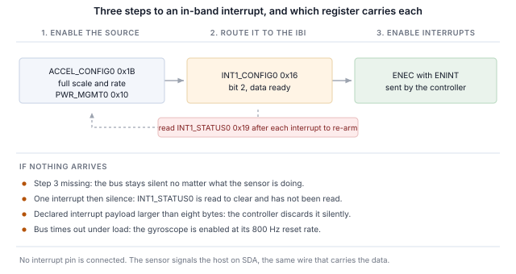

## 1 はじめに

現行世代の TDK InvenSense MEMS センサは、I2C と SPI に加えて MIPI I3C インタフェースを、同じ 2 本のピン上に備えています。
I3C はこの 2 線の構成を維持したまま、その上に多くの機能を追加しています。

Table: I3C が 2 線センサインタフェースに追加するもの

| 機能 | 設計にもたらすもの |
|---|---|
| ダイナミックアドレス割り当て（DAA） | コントローラが実行時にアドレスを割り当てるため、スタティックアドレスの衝突が基板設計上の制約ではなくなり、同一デバイスが 1 本のバスを共有できます |
| バスからの識別 | すべてのターゲットが 48 ビットの暫定 ID、デバイスクラス、バス機能を報告するため、コントローラは想定外のバスも列挙できます |
| 共通コマンドコード | 列挙、識別、設定、割り込み制御、リセットのための標準コマンドセット（ブロードキャストおよびダイレクト）で、準拠するすべてのターゲットで共通です |
| インバンド割り込み（IBI） | センサはデータラインでホストに割り込みをかけ、理由を示すバイトを送るため、割り込みピンの配線や割り当てが不要です |
| 高データレートモード | ダブルデータレート転送はクロックエッジの対ごとに 2 ビットを転送し、クロックを上げずに信号速度を 2 倍にします |
| グループアドレッシング | 1 回の書き込みで、グループとしてアドレス指定された複数のターゲットに同時に届きます |
| より高い信号速度 | プッシュプルのクロックで、シングルデータレートモードでは最大 12.5 MHz。I2C はオープンドレインの制約を受けます |
| 低消費電力 | プッシュプル信号により I2C が常に消費する静的なプルアップ電流を回避でき、アクティビティステートによってコントローラがターゲットに想定バスレイテンシを伝えることで、ターゲットはより深くアイドルできます |
| ホットジョイン（Hot-Join） | バス稼働後に電源が入ったターゲットが列挙を要求できます |
| タイミング制御 | コントローラはターゲットに、共通の基準に対して割り込みのタイムスタンプを付けさせることができます |
| 標準のリセットとリカバリ | ベンダごとのシーケンスではなく、定義されたターゲットリセットと、定義されたエラー検出およびリカバリ |
| I2C 互換性 | レガシーの I2C デバイスがバスを共有できます |

ターゲットはセンサに必要なサブセットを実装しており、そのサブセットはデバイスによって異なります。ICM-45686 は多くのデバイスより多くを実装しています。
バス特性レジスタで拡張機能、つまり高データレート転送を宣言しており、第 8 節でそれを検証します。

本ノートでは、Binho Supernova USB ホストアダプタと Binho mikroBUS Adapter Board を使ってこのデバイスを扱います。
列挙し、バスから識別し、レジスタを読み書きし、デコード済みの測定値をストリーミングし、割り込みピンを接続せずにデータライン経由で割り込みを受け取り、
HDR-DDR で転送し、上記の機能のうちターゲットが実際に実装しているものを確認します。

ここではマイクロコントローラ、ファームウェア、ドライバの移植は一切必要ありません。すべての手順はホスト PC からのコマンドです。

### 1.1 範囲

本書を読み終えると、手元にハードウェアがある読者は、センサを I3C バス上に列挙し、そのセンサ自身のレジスタから識別し、レジスタを読み書きし、
デコード済みの測定値をストリーミングし、割り込みピンを接続せずにセンサの設定出力データレートでインバンド割り込みを受信し、
HDR-DDR 読み出しを行って同じレジスタのシングルデータレート読み出しと照合し、観測可能な効果からターゲットが何を実装しているかを確認したことになります。

扱うデバイスは ICM-45686 です。ハードウェア上で検証しており、本書のすべての出力は実際のキャプチャです。

### 1.2 対象デバイス

Table: 対象デバイス

| デバイス | 機能 | ボード | ハードウェアで検証済み |
|---|---|---|---|
| ICM-45686 | 6 軸 IMU、加速度計およびジャイロスコープ | 6DOF IMU 27 Click | はい |

この方法は、mikroBUS Click ボード上の I3C インタフェースを備えた任意の TDK InvenSense MEMS デバイスに適用できます。
付属ユーティリティへのデバイス追加はテーブルエントリ 1 つで済みます。詳細は第 12 節で説明します。

### 1.3 関連資料

Table: 関連資料

| 資料 | 内容 |
|---|---|
| DS-000489、ICM-45686 データシート | レジスタマップと電気的特性 |
| MIPI I3C Specification v1.1 | 共通コマンドコード、インバンド割り込み、HDR モード、ダイナミックアドレッシング |
| Binho mikroBUS Adapter Board 製品ページ | ソケット、ジャンパ、対応 Click ボード |

## 2 必要な機器とソフトウェア

### 2.1 ハードウェア

Table: 必要な機器

| 品目 |
|---|
| Binho Supernova USB ホストアダプタ |
| Binho mikroBUS Adapter Board |
| 6DOF IMU 27 Click、または I3C インタフェースを備えたその他の mikroBUS MEMS Click ボード |
| USB-C ケーブル |

Click ボードは mikroBUS ソケットに挿入します。本書のどの手順でも、それ以外には何も接続しません。

### 2.2 接続

Table: 使用する信号

| 信号 | 用途 |
|---|---|
| SCL | I3C クロック、アダプタからターゲットへ |
| SDA | I3C データ、双方向 |
| 3.3 V | ターゲット電源 |
| GND | リターン |

2 本の線と電源 1 系統です。**本ノートでは、割り込みのセクションを含め、割り込みピン、リセットライン、ストラップ抵抗は一切接続しません**。
I3C ではセンサは SDA 上でホストに通知します。

> **注：** mikroBUS Adapter Board は I3C Target Board のようにはバス電源レールを供給しないため、ユーティリティの `power-cycle`
> コマンドはここでは `I3C_PORTS_NOT_POWERED` を報告します。その場合はアダプタのリセットにフォールバックします。システムコマンドは
> 動作しているのに I3C 周辺機器が応答しなくなった場合に、復旧させるのはこの操作です。

### 2.3 バス設定

Table: 使用するバス設定

| 設定 | 値 |
|---|---|
| プッシュプルレート | 5 MHz、デューティ比 50% |
| オープンドレインレート | 1 MHz |
| ドライブ強度 | ファストモード |
| バス電圧 | 3.3 V |

これらは限界値ではなく開始値です。デバイスが維持できるレートは第 10 節で確認します。

### 2.4 ソフトウェア

```
pip install binhosupernova
```

依存関係は Python 3.12 と `binhosupernova` パッケージだけです。本ノートに付属するアセットアーカイブを展開し、1 つのコマンドでセットアップを確認します。

```
python i3c_mems.py scan
```

## 3 最初の接触：バスを列挙する

1 つのコマンドで、ホストが割り当てたアドレスでセンサがバス上に現れます。

```
python i3c_mems.py scan
```

```
1 target(s) on the bus at 3300 mV, PUSH_PULL_5_MHZ_50_DC, OPEN_DRAIN_1_MHZ

  dynamic address 0x08
    PID  04 6A 00 00 00 11   device id 0x0000
    BCR  0x27   DCR 0x44
    HDR  claimed   IBI capable
    profile  icm45686
```

これは 2 つの共通コマンドコードによるものです。**RSTDAA** は割り当て済みのダイナミックアドレスをクリアし、バスを既知の状態から開始させます。
続いて **ENTDAA** がダイナミックアドレス割り当てを実行します。コントローラがブロードキャストし、各ターゲットが 48 ビットの暫定 ID を使って調停し、
順番にアドレスが割り当てられます。デバイスが 1 つの場合、そのアドレスは `0x08` です。

アドレスはどこにも設定していません。デバイス自身のスタティックアドレスは使われておらず、知っている必要もありません。

この出力でアドレスより後の内容はすべて、ルックアップテーブルではなくターゲットから得られたものです。これが I2C と最初に違いを感じる点です。
I2C ではホストがあらかじめ選んだアドレスに書き込み、何かが応答することを期待します。ここでは、デバイスが自己紹介をします。

## 4 バスからデバイスを識別する

```
python i3c_mems.py identify --device icm45686
```

### 4.1 識別レジスタの内容

自己紹介を担うのは 3 つのレジスタで、いずれもレジスタファイルからではなく 1 つのコマンドで読み出します。

```
  PID 04 6A 00 00 00 11
    MIPI member id (47:33)       0x0235
    id type selector (32)        0
    device id (31:16)            0x0000
    instance id (15:12)          0b0000
    reserved (11:0)              0x011
```

**暫定 ID** には、製造元を識別する MIPI メンバー ID と、デバイス ID フィールドが含まれます。

> **重要：** このデバイスはデバイス ID フィールドを `0x0000` のままにしています。多くのセンサでは、このフィールドに識別レジスタでも
> 報告される値が埋め込まれており、コントローラは列挙だけでデバイスを特定できます。ここではそうではないため、このフィールドで
> デバイスを識別するホストはこのデバイスを認識できず、代わりに識別レジスタを読む必要があります。付属のユーティリティはまさにそうしています。
> まずフィールドで照合し、フィールドが何も示さない場合はレジスタの読み出しにフォールバックします。

**デバイス特性レジスタ** は `0x44` を報告します。これは MIPI レジストリが 6 軸 IMU に割り当てた値です。識別するのはクラスであり、個々のデバイスではありません。

**バス特性レジスタ** はデバイスがバス上で何ができるかを示し、このデバイスでは 3 つの中で最も興味深いものです。

```
BCR 0x27
  device role                      I3C target
  advanced capabilities (bit 5)    yes
  virtual target support           no
  offline capable                  yes
  IBI mandatory payload            yes
  IBI capable                      yes
  max data speed limit             yes
```

**ビット 5 がセットされています。** これはターゲットが高データレート機能を宣言しているということであり、第 8 節ではこれを鵜呑みにせず検証します。
GETHDRCAP は `0x01` を返します。これは MIPI 仕様が HDR-DDR に割り当てたビットです。

ビット 1 と 2 もセットされているため、デバイスはインバンド割り込みを発生させ、ペイロードを送ります。これは第 7 節で使います。

### 4.2 識別レジスタによる確認

Table: 識別レジスタ

| レジスタ | 値 |
|---|---|
| `0x72` の `WHO_AM_I` | `0xE9` |

## 5 レジスタの読み書き

レジスタアクセスはプライベート転送です。レジスタアドレスを送信し、続いてバイトを読み出します。

```
python i3c_mems.py read  --device icm45686 0x72
python i3c_mems.py write --device icm45686 0x1B 0x0A
```

Table: レジスタアクセスのフレーミング

| 項目 | 値 |
|---|---|
| レジスタアドレス幅 | 8 ビット |
| データ幅 | 8 ビット |
| 読み出しペイロード前のダミーバイト | 0 |
| マルチバイト読み出し時のアドレス自動インクリメント | あり |

マルチバイト読み出しではアドレスが進むため、最初の加速度計レジスタから 6 バイトを読み出すと 3 軸すべてが返されます。

> **自動インクリメントしないレジスタが 1 つあり、立ち上げ時に最初に遭遇する可能性が高いものです。** `0x14` の `FIFO_DATA` は
> FIFO を返すため、ここで 4 バイト読み出すと、レジスタ `0x14` から `0x17` ではなく FIFO の 4 バイトが返されます。FIFO が空の
> デバイスでは同じバイトが 4 回読めるため、インタフェースが自身のレジスタファイルをたどれないように見えます。FIFO としては正しい動作です。
> それ以外のレジスタはすべて通常どおりアドレスが進みます。

### 5.1 バイト順

データレジスタはリトルエンディアンで、下位バイトが先に来ます。

これは仮定せずに確認する価値があります。上位と下位を入れ替えても、各軸はもっともらしい数値にデコードされてしまうからです。確認にコストはかからず、方法は第 6 節で説明します。

## 6 センサデータのストリーミング

2 回の書き込みで加速度計が起動します。

Table: 加速度計の起動

| レジスタ | 値 | 効果 |
|---|---|---|
| `0x1B` の `ACCEL_CONFIG0` | `0x0A` | フルスケールフィールド 0 で ±32 g、出力データレートフィールド 10 で 50 Hz |
| `0x10` の `PWR_MGMT0` | `0x03` | 加速度計を低ノイズモードにする |

```
python i3c_mems.py stream --device icm45686 --seconds 5
```

```
  x     0.021 g   y    -0.028 g   z     1.005 g   magnitude     1.006 g
  x     0.020 g   y    -0.028 g   z     1.005 g   magnitude     1.005 g
  x     0.021 g   y    -0.028 g   z     1.006 g   magnitude     1.006 g
```

`0x00` から 6 バイト、符号付き 16 ビットの 3 軸で、±32 g フルスケールでは 1 g あたり 1024 カウントです。ジャイロスコープは `0x06` から続きます。

**静止時の大きさは 1 g で、これはチェーン全体が正しいことを無償で確認できるチェックです**。フレーミング、バイト順、符号処理、スケールがすべて 1 つの数値に表れます。
第 5.1 節のバイト順も、どの資料も参照せずにこの方法で確定しました。静止時に 1.000 g になるバイト順とフルスケール係数の組み合わせは 1 つしかなく、
このデバイスではそれがリトルエンディアンと ±32 g です。

基板を傾けると各軸の値は再配分されますが、大きさは変わりません。

> **ジャイロスコープが必要でない限り、加速度計だけを有効にしてください。** 2 つのセンサはそれぞれ独立したレートフィールドを持ち、
> ジャイロスコープのリセット時のレートは 800 Hz です。両方を有効にすると、データレディは 2 つのうち速いほうのレートでバスに乗り、
> バスを飽和させるほどの速さになります。測定では 3 秒間のウィンドウの途中でバスタイムアウトとして現れました。

Table: 加速度計出力データレートの選択、`ACCEL_CONFIG0` ビット 3:0

| フィールド | レート | フィールド | レート |
|---|---|---|---|
| `0110` | 800 Hz、リセット値 | `1010` | 50 Hz |
| `0111` | 400 Hz | `1011` | 25 Hz |
| `1000` | 200 Hz | `1100` | 12.5 Hz |
| `1001` | 100 Hz | | |

## 7 割り込みピンを使わないバス経由の割り込み

インバンド割り込みは、センサ設計を最も目に見えて変える機能です。デバイスはデータを運ぶのと同じ 2 本の線で新しいデータの準備ができたことをホストに伝え、
ホストは何かを読み出す前にその理由を知ることができます。そのため割り込みピンの配線、割り当て、コネクタへの引き出しが不要になります。

### 7.1 3 つのステップ

本ノートのインバンド割り込みはすべて、次の順序の同じ 3 ステップです。

1. **センサで要因を有効にする。** ある出力データレートでの測定そのものです。
2. **それをインバンド割り込みにルーティングする。** `0x16` の `INT1_CONFIG0`、ビット 2 です。
3. **ENINT ビット付きの ENEC を送信する。** これが届くまでは、センサが何をしていても
   バスは沈黙したままです。



```
python i3c_mems.py ibi --device icm45686 --seconds 3
```

```
icm45686 at 0x08: interrupt routed to the I3C IBI, data-ready through INT1_CONFIG0,
                  cleared by reading INT1_STATUS0
  IBI from 0x08  MDB 01
  IBI from 0x08  MDB 01

  152 interrupts in 3.00 s = 50.60/s
  configured output data rate 50 Hz (+1.2%)
```

設定 50 Hz に対して毎秒 50 回で、どちらの割り込みピンにも何も接続していません。

> **注：** レートは設定レートと比較できます。個々の到着時刻は比較できません。ホスト側のトランスポートが
> 割り込みをまとめて配送するためです。この理由から、本書ではジッタやレイテンシの数値は示していません。

### 7.2 要因のクリア

`0x19` の `INT1_STATUS0` は読み出しでクリアされます。ホストは割り込みのたびにこれを読みます。読まないとデータレディ条件がアサートされたままになり、
最初の割り込みの後でストリームが止まります。付属のユーティリティはこれを自動的に行います。

### 7.3 必須データバイト

各割り込みは必須データバイトを持っています。データレディが唯一有効な要因の場合、このバイトはすべての割り込みで `0x01` になります。

MIPI 仕様はこのバイトのビット 7 を保留中の読み出しを示すために予約しており、残りのビットはデバイス固有です。割り込みが発生したことを示す以外に
このデバイスがそれらのビットに何をエンコードしているかはここでは確認しておらず、ユーティリティはバイトを解釈せずにそのまま報告します。

### 7.4 割り込みペイロードサイズ

ターゲットは送信する最大割り込みペイロードを `GETMRL` の 3 バイト目で宣言し、コントローラにも独自の上限があります。
**Supernova が配送する割り込みペイロードは最大 8 バイトです。** このデバイスは 1 を宣言しているため調整は不要で、ユーティリティもそのように報告します。

```
IBI payload negotiation   the target declared 1 byte(s), within the 8 the adapter takes,
                          so nothing had to change
```

このチェックは合格する場合でも知っておく価値があります。コントローラが受け付ける以上を宣言したターゲットは、配送されることのない割り込みを発生させ、
しかもどちらの側にもエラーが出ないからです。

## 8 HDR-DDR

このデバイスならではのセクションです。高データレートのダブルデータレート転送は、クロックの両エッジでデータを運ぶことで、クロック周波数を上げずに信号速度を 2 倍にします。
ICM-45686 は BCR ビット 5 でこれへの対応を宣言しています。

宣言は実証ではありません。ここで使うテストでは、シングルデータレートでレジスタを読み、HDR-DDR で同じレジスタを読み、バイトを比較します。

```
HDR-DDR against SDR    register 0x32 reads 6C 36 02 00 over SDR
                       and 6C 36 02 00 over HDR-DDR, the same bytes by both routes

bus after HDR-DDR      SDR transfers still work, so the exit pattern returned the bus
                       to single data rate
```

同じレジスタ、2 つの転送モード、1 組のバイトです。

### 8.1 DDR レジスタ読み出しのアドレス指定

ここに至るには、転送だけからは推測できない 3 つのことが必要で、いずれも誤るとエラーを報告せずに黙って失敗します。

**コマンドバイトはレジスタアドレスではありません。** DDR 読み出しはコマンドコードを運び、そこにレジスタアドレスを入れたくなります。
そのようにして発行した読み出しはゼロを返します。他のどのコマンドコードでの読み出しも同様です。`0x80` から `0xFF` までの 128 個の読み出しコマンドを
すべて試しても、毎回成功の結果とともに、ゼロとパディングしか返りません。

**レジスタはターゲット内部のアドレスポインタから決まります。** DDR 読み出しはそのポインタが指す位置からバイトを返すため、まずポインタを位置決めする必要があります。

**SDR 読み出しは何も乱さずにポインタを位置決めします。** SDR でレジスタ N を読むと、ポインタは N+1 に置かれます。DDR 書き込みもポインタを設定しますが、
進みながら書き込むため、内容が重要なレジスタに読み出しを向ける用途には使えません。

したがって、HDR-DDR でレジスタ N 以降を読み出す手順は次のとおりです。

1. SDR でレジスタ N-1 を 1 バイト読み出し、ポインタを N に置く
2. HDR-DDR 読み出しをコマンド `0x80` で発行する
3. HDR 終了パターンを発生させ、バスをシングルデータレートに戻す

Table: `0x32` 以降を両方の方法で読み出す

| 経路 | バイト |
|---|---|
| `0x32` の SDR 読み出し、4 バイト | `6C 36 02 00` |
| `0x31` の SDR 読み出しの後に HDR-DDR 読み出し | `6C 36 02 00` |

### 8.2 転送長

HDR-DDR は 16 ビットワード単位で転送するため、ペイロードは常に偶数バイトであり、SDK は奇数長を即座に拒否します。
このセットアップでは 2 バイトの読み出しは空のペイロードを返し、4 バイトは動作したため、実用上の最小値は 4 です。

### 8.3 この結果が示すこと、示さないこと

ターゲットとコントローラがダブルデータレート転送を完了してバイトが一致すること、そしてその後バスが問題なくシングルデータレートに戻ることを示しています。

**これはスループット測定ではありません。** 線上の信号速度が 2 倍になることは、センサがデータを生成するレートが 2 倍になることではなく、
レジスタファイルの 4 バイトを読むことはそのどちらも測定しません。このセクションから性能に関する結論を導くべきではありません。

## 9 I3C の残りの機能を検証する

ターゲットは実装していないコマンドにも応答することがあるため、ユーティリティは結果コードではなく観測可能な効果から、ターゲットが何を実装しているかを確認します。
以下の各行では、値を設定して読み戻す、アドレスを移動して旧アドレスが応答しなくなることを確認する、設定レートに対して割り込みを数える、といった観測された変化を必要としました。

```
python i3c_mems.py features --device icm45686
```

Table: 測定による共通コマンドコードのサポート状況

| コマンド | 判定 | 根拠 |
|---|---|---|
| ENTDAA | サポート | 期待した ID でターゲットが列挙された |
| SETNEWDA | サポート | アドレスが移動し、旧アドレスが応答しなくなった |
| RSTDAA | サポート | 受け付けられ、アドレスが解放された。ただし下記参照 |
| GETPID、GETBCR、GETDCR | サポート | 期待した値を返した |
| ENEC、DISEC | サポート | 割り込みが再現性をもって開始・停止する |
| SETMWL、GETMWL | サポート | 4095、次に 64 に設定、その後 64 を報告 |
| SETMRL、GETMRL | サポート | 4095、次に 32 に設定、その後 32 を報告 |
| HDR-DDR | サポート | 両方の転送モードで同じバイト、第 8 節 |
| SETXTIME、GETXTIME | サポート | コマンド後に報告されるバイトが変化した |
| SETGRPA、RSTGRPA | 未実装 | グループアドレス経由の書き込みが割り当て前、割り当て中、割り当て後のいずれでも拒否される |
| ホットジョイン | 観測されず | ホットジョイン要求は一度もなかった |
| ENTAS0 から ENTAS3 | 判定不能 | すべて受け付けられる。アクティビティステートの証明には電流測定が必要 |
| RSTACT | 判定不能 | 受け付けられるが、ホストから観測可能な効果がない |
| GETMXDS | 判定不能 | 実際の制限値ではなく `00 00` を返す |

測定結果のカウント：15 項目がサポート、3 項目が未実装、8 項目が判定不能で、繰り返しの実行で再現しました。

> **RSTDAA は受け付けられますが、その効果は保証されません。** ほとんどの実行では、ターゲットはダイナミックアドレスを解放し、旧アドレスは応答しなくなります。
> おおよそ 8 回に 1 回は、成功の結果を返したうえで、3 回連続の試行にわたって既存のアドレスで応答し続けます。
> ダイナミックアドレスをリセットするホストは、結果を前提とせずに確認すべきです。

**グループアドレッシング** は、素直なテストでは誤った答えが出るため、テスト方法を明記する必要があります。グループアドレスはコントローラが
複数のターゲットを同時にアドレス指定するためのものなので、書き込み先です。グループアドレスからの読み出しには定義された応答がなく、
ターゲットは機能を正しく実装したうえでグループアドレスの読み出しを拒否することがあります。ここで使うテストでは、グループアドレスを割り当て、
それを通じてレジスタに書き込み、そのレジスタをターゲット自身のダイナミックアドレスで読み戻します。このデバイスでは書き込みがすべての段階で拒否されるため、
この機能は実装されていません。

## 10 バスレート

```
python i3c_mems.py rates --device icm45686 --iterations 100
```

Table: エラーのない最高バスレート

| プッシュプル | オープンドレイン |
|---|---|
| 12.5 MHz、デューティ比 50% | 4.17 MHz |

このデバイスはアダプタが提供するすべてのレートに合格します。**方法：** 識別レジスタを連続 100 回読み出し、すべてがエラーなく期待値を返す必要があり、
すべての反復が成功した場合にのみそのレートを合格とします。これはレジスタ読み出しループであり、スループット測定ではないため、持続データレートについての結論をここから導くべきではありません。

このデバイスは BCR ビット 0 をセットして最大データ速度制限があることを宣言していますが、GETMXDS は実際の制限値を報告せず `00 00` を返します。
アダプタが生成できるどのレートでも、いずれもループの完了を妨げませんでした。

## 11 実用上の注意

Table: 実用上の注意

| 注意 |
|---|
| `0x14` の `FIFO_DATA` は FIFO なので自動インクリメントしない。それ以外のレジスタはすべて自動インクリメントする |
| データレジスタはリトルエンディアン。静止時に加速度計の大きさが 1 g になるバイト順とフルスケールの組み合わせはちょうど 1 つだけ |
| ジャイロスコープが必要でない限り加速度計だけを有効にする。ジャイロスコープのリセット時のレートは 800 Hz で、両方を有効にするとバスが飽和することがある |
| `0x19` の `INT1_STATUS0` は読み出しでクリアされる。読まないと割り込みが 1 回届いた後は何も来ない |
| PID のデバイス ID フィールドは `0x0000` なので、ホストは列挙だけではこのデバイスを特定できず、`WHO_AM_I` を読む必要がある |
| DDR 読み出しはレジスタを内部ポインタから取り、そのポインタは直前のレジスタの SDR 読み出しで位置決めできる |
| RSTDAA は受け付けられるが、必ずしもダイナミックアドレスを解放しない。前提とせずに確認する |
| mikroBUS Adapter Board はバス電源レールを供給しないため、`power-cycle` は `I3C_PORTS_NOT_POWERED` を報告し、アダプタのリセットにフォールバックする |
| `0x7F` の `REG_MISC2` ビット 1 はソフトリセットを発生させて自動的にクリアされ、共通コマンドコードがラッチしたモードをすべて元に戻す |

## 12 ユーティリティ

Table: ユーティリティのコマンド

| コマンド | 用途 |
|---|---|
| `scan` | バスを列挙し、応答したものを報告する |
| `identify` | ターゲットの識別レジスタをデコードする |
| `read`、`write` | レジスタを読み書きする（書き込み後に読み戻しあり） |
| `stream` | ポーリングでデコード済みサンプルを表示する |
| `ibi` | センサ割り込みをバスにルーティングし、届いたものを数える |
| `features` | 観測可能な効果から、ターゲットが何を実装しているかを確認する |
| `rates` | エラーのない最高バスレートを求める |
| `reset`、`power-cycle` | デバイスを既知の状態に戻す |

デバイスの追加はプロファイルテーブルへの 1 エントリで済みます。レジスタのフレーミング、期待される識別情報、データストリームを開始する書き込み、
割り込みをルーティングする書き込み、割り込みペイロードのデコーダです。

## 13 測定結果

### 13.1 テスト構成

Table: テスト構成

| 項目 | 値 |
|---|---|
| アダプタ | Binho Supernova、ハードウェアリビジョン B、ファームウェア 4.4.0 |
| SDK | `binhosupernova`、Python 3.12、Windows 11 |
| アクセサリ | Binho mikroBUS Adapter Board |
| バス | 3.3 V、プッシュプル 5 MHz デューティ比 50%、オープンドレイン 1 MHz、ファストモードのドライブ強度 |
| 列挙 | RSTDAA の後に ENTDAA |
| ターゲット | 6DOF IMU 27 Click 上の ICM-45686 |

### 13.2 結果

**識別。** PID `04 6A 00 00 00 11`、BCR `0x27`、DCR `0x44`、`WHO_AM_I` `0xE9`。すべての値がデータシートと一致します。また、
付属プロファイルが使用するレジスタマップは、データシートを参照する前にベンチ上で確定したもので、プロファイルが使用するすべてのレジスタについて両者は一致します。

**データ。** 設定 ±32 g フルスケールに対し、静止時の加速度計の大きさは 1.005 から 1.006 g で、フレーミング、バイト順、符号処理、スケールがまとめて確認できます。

**割り込み。** 設定 50 Hz に対して 3.00 s で 152 回、誤差 +1.2% です。

**HDR-DDR。** レジスタ `0x32` はシングルデータレートで `6C 36 02 00`、HDR-DDR で `6C 36 02 00` と読めます。
その後バスはシングルデータレートに戻り、以降の SDR 転送は成功しました。

**サポート状況。** 15 項目がサポート、3 項目が未実装、8 項目が判定不能です。

**バスレート。** 第 10 節に記載の方法により、プッシュプル 12.5 MHz、オープンドレイン 4.17 MHz です。

**回帰テストの範囲。** 本書に示したコマンドは記録済みの出力と照合されるため、読者が目にする内容を変えるユーティリティの変更は検出されます。
記録済み出力は再生成した後、6 回連続の実行で再現しました。

## 14 トラブルシューティング

Table: トラブルシューティング

| 症状 | 確認事項 |
|---|---|
| ターゲットが列挙されない | Click ボードが mikroBUS ソケットに挿さっているか。3.3 V が出ているか |
| マルチバイト読み出しが同じバイトを繰り返し返す | 読み出しが自動インクリメントしない `FIFO_DATA` `0x14` から始まっている |
| 3 軸すべてが誤っているがもっともらしく見える | バイト順。静止時の大きさは 1 g でなければならない |
| 割り込みが 1 回来た後に沈黙する | `INT1_STATUS0` は読み出しでクリアされるが、読まれていない |
| 割り込みがバスを飽和させる、またはタイムアウトする | ジャイロスコープがリセット時のレート 800 Hz で有効になっている |
| 割り込みがまったく届かない | ENEC が ENINT ビット付きで送信されたか |
| HDR-DDR 読み出しがゼロを返す | ポインタが位置決めされていない。先に直前のレジスタを SDR で読む |
| HDR-DDR 読み出しが拒否される | 長さは偶数である必要があり、実用上の最小値は 4 バイト |
| アダプタが I3C に応答しなくなる | アダプタをリセットする。このアクセサリでは `power-cycle` は適用されない |

## 15 略語

Table: 略語

| 用語 | 意味 |
|---|---|
| BCR | バス特性レジスタ（Bus characteristics register） |
| CCC | 共通コマンドコード（Common command code） |
| DAA | ダイナミックアドレス割り当て（Dynamic address assignment） |
| DCR | デバイス特性レジスタ（Device characteristics register） |
| DDR | ダブルデータレート（Double data rate） |
| ENTDAA | ダイナミックアドレス割り当ての開始（Enter dynamic address assignment） |
| HDR | 高データレート（High data rate） |
| IBI | インバンド割り込み（In-band interrupt） |
| MDB | 必須データバイト（Mandatory data byte） |
| ODR | 出力データレート（Output data rate） |
| PID | 暫定 ID（Provisional identifier） |
| SDR | シングルデータレート（Single data rate） |

## 16 本書のソースコードについて

本書に示し、付属アーカイブで提供するサンプルコードは、評価および参考用に提供されるものです。MIT ライセンスの下で公開されており、ライセンス本文はアーカイブに含まれています。

Table: アセットアーカイブの内容

| ファイル | 説明 |
|---|---|
| `AN0006.md` | 本書の Markdown ソース |
| `assets/i3c_mems.py` | リファレンスユーティリティ |
| `assets/LICENSE` | サンプルコードに適用される MIT ライセンス |

## 17 改訂履歴

Table: 改訂履歴

| リビジョン | 日付 | 説明 |
|---|---|---|
| 1.0 | 1 September 2026 | 初版。 |
