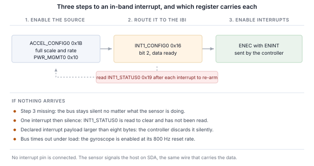

## 1 소개

현재 세대의 TDK InvenSense MEMS 센서는 I2C 및 SPI와 함께 MIPI I3C 인터페이스를 동일한 두 핀으로 제공합니다.
I3C는 이 2선 구성을 유지하면서 그 위에 상당한 기능을 추가합니다.

Table: I3C가 2선 센서 인터페이스에 추가하는 기능

| 기능 | 설계에 주는 이점 |
|---|---|
| 동적 주소 할당(DAA) | 컨트롤러가 실행 중에 주소를 할당하므로 정적 주소 충돌이 더 이상 보드 설계의 제약이 아니며, 동일한 부품이 하나의 버스를 공유할 수 있습니다 |
| 버스로부터의 식별 | 모든 타깃이 48비트 임시 식별자, 디바이스 클래스, 버스 기능을 보고하므로 컨트롤러는 미리 알지 못하는 버스도 열거할 수 있습니다 |
| 공통 명령 코드 | 열거, 식별, 설정, 인터럽트 제어, 리셋을 위한 표준 명령 세트(브로드캐스트 및 다이렉트)로, 모든 규격 준수 타깃에서 동일합니다 |
| 인밴드 인터럽트(IBI) | 센서가 데이터 라인으로 호스트에 인터럽트를 걸고 원인을 알려 주는 바이트를 함께 보내므로, 인터럽트 핀을 배선하거나 할당할 필요가 없습니다 |
| 고속 데이터 레이트 모드 | 더블 데이터 레이트 전송은 클럭 에지 쌍마다 2비트를 전송하여, 클럭을 높이지 않고 신호 속도를 두 배로 만듭니다 |
| 그룹 주소 지정 | 한 번의 쓰기가 그룹으로 지정된 여러 타깃에 동시에 전달됩니다 |
| 더 높은 신호 속도 | 푸시풀 클럭으로 싱글 데이터 레이트 모드에서 최대 12.5 MHz이며, I2C는 오픈 드레인의 한계를 받습니다 |
| 저전력 | 푸시풀 신호는 I2C가 계속 소비하는 정적 풀업 전류를 피하며, 액티비티 상태를 통해 컨트롤러가 타깃에 예상 버스 지연을 알려 타깃이 더 깊이 유휴 상태에 들어갈 수 있습니다 |
| 핫 조인(Hot-Join) | 버스가 동작한 후에 전원이 들어온 타깃이 열거를 요청할 수 있습니다 |
| 타이밍 제어 | 컨트롤러가 타깃으로 하여금 공유 기준에 대해 인터럽트에 타임스탬프를 붙이게 할 수 있습니다 |
| 표준 리셋 및 복구 | 벤더별 시퀀스가 아니라 정의된 타깃 리셋과 정의된 오류 검출 및 복구 |
| I2C 호환성 | 레거시 I2C 디바이스가 버스를 공유할 수 있습니다 |

타깃은 센서에 필요한 부분 집합을 구현하며, 그 부분 집합은 부품마다 다릅니다. ICM-45686은 대부분의 부품보다 더 많이 구현합니다.
버스 특성 레지스터가 고급 기능, 즉 고속 데이터 레이트 전송을 선언하며, 8절에서 이를 시험합니다.

이 노트는 Binho Supernova USB 호스트 어댑터와 Binho mikroBUS Adapter Board로 이 부품을 다룹니다.
이를 열거하고, 버스로부터 식별하고, 레지스터를 읽고 쓰고, 디코딩된 측정값을 스트리밍하고, 인터럽트 핀 연결 없이 데이터 라인으로 인터럽트를 받고,
HDR-DDR로 전송하며, 위 기능 중 타깃이 실제로 구현한 것을 확인합니다.

여기서는 마이크로컨트롤러, 펌웨어, 드라이버 포팅이 전혀 필요하지 않습니다. 모든 단계는 호스트 PC에서 실행하는 명령입니다.

### 1.1 범위

이 문서를 마치면 하드웨어를 갖춘 독자는 센서를 I3C 버스에 열거하고, 센서 자체 레지스터로 식별하고, 레지스터를 읽고 쓰고,
디코딩된 측정값을 스트리밍하고, 인터럽트 핀 연결 없이 센서에 설정된 출력 데이터 레이트로 인밴드 인터럽트를 수신하고,
HDR-DDR 읽기를 수행하여 같은 레지스터의 싱글 데이터 레이트 읽기와 대조하고, 관찰 가능한 효과로부터 타깃이 무엇을 구현하는지 확인하게 됩니다.

다루는 부품은 ICM-45686입니다. 하드웨어에서 시험했으며 이 문서의 모든 출력은 실제 캡처입니다.

### 1.2 적용 디바이스

Table: 다루는 디바이스

| 디바이스 | 기능 | 보드 | 하드웨어에서 시험 |
|---|---|---|---|
| ICM-45686 | 6축 IMU, 가속도계 및 자이로스코프 | 6DOF IMU 27 Click | 예 |

이 방법은 mikroBUS Click 보드에 장착된, I3C 인터페이스를 갖춘 모든 TDK InvenSense MEMS 부품에 적용됩니다.
제공되는 유틸리티에 부품을 추가하는 것은 테이블 항목 하나이며, 12절에서 설명합니다.

### 1.3 관련 문서

Table: 관련 문서

| 문서 | 주제 |
|---|---|
| DS-000489, ICM-45686 데이터시트 | 레지스터 맵 및 전기적 특성 |
| MIPI I3C Specification v1.1 | 공통 명령 코드, 인밴드 인터럽트, HDR 모드, 동적 주소 지정 |
| Binho mikroBUS Adapter Board 제품 페이지 | 소켓, 점퍼, 지원 Click 보드 |

## 2 필요한 장비 및 소프트웨어

### 2.1 하드웨어

Table: 필요한 장비

| 항목 |
|---|
| Binho Supernova USB 호스트 어댑터 |
| Binho mikroBUS Adapter Board |
| 6DOF IMU 27 Click, 또는 I3C 인터페이스를 갖춘 기타 mikroBUS MEMS Click 보드 |
| USB-C 케이블 |

Click 보드는 mikroBUS 소켓에 꽂습니다. 이 문서의 어떤 절차에서도 그 외에는 아무것도 연결하지 않습니다.

### 2.2 연결

Table: 사용하는 신호

| 신호 | 용도 |
|---|---|
| SCL | I3C 클럭, 어댑터에서 타깃으로 |
| SDA | I3C 데이터, 양방향 |
| 3.3 V | 타깃 전원 |
| GND | 리턴 |

선 두 개와 전원 하나입니다. **이 노트에서는 인터럽트 절을 포함하여 어떤 경우에도 인터럽트 핀, 리셋 라인, 스트래핑 저항을 연결하지 않습니다**.
I3C에서 센서는 SDA로 호스트에 신호를 보냅니다.

> **참고:** mikroBUS Adapter Board는 I3C Target Board처럼 버스 전원 레일을 공급하지 않으므로, 유틸리티의 `power-cycle`
> 명령은 여기서 `I3C_PORTS_NOT_POWERED`를 보고합니다. 이 경우 어댑터 리셋으로 대체하며, 시스템 명령은 여전히 동작하는데
> I3C 주변 장치가 응답을 멈췄을 때 이를 복구하는 것이 바로 이 동작입니다.

### 2.3 버스 설정

Table: 사용한 버스 설정

| 설정 | 값 |
|---|---|
| 푸시풀 레이트 | 5 MHz, 듀티 사이클 50% |
| 오픈 드레인 레이트 | 1 MHz |
| 구동 강도 | 패스트 모드 |
| 버스 전압 | 3.3 V |

이 값들은 한계가 아니라 시작 값입니다. 부품이 유지할 수 있는 레이트는 10절에서 확인합니다.

### 2.4 소프트웨어

```
pip install binhosupernova
```

의존성은 Python 3.12와 `binhosupernova` 패키지뿐입니다. 이 노트와 함께 제공되는 에셋 아카이브의 압축을 풀고 명령 하나로 설정을 확인합니다.

```
python i3c_mems.py scan
```

## 3 첫 접촉: 버스 열거

명령 하나로 센서가 호스트가 할당한 주소로 버스에 올라옵니다.

```
python i3c_mems.py scan
```

```
1 target(s) on the bus at 3300 mV, PUSH_PULL_5_MHZ_50_DC, OPEN_DRAIN_1_MHZ

  dynamic address 0x08
    PID  04 6A 00 00 00 11   device id 0x0000
    BCR  0x27   DCR 0x44
    HDR  claimed   IBI capable
    profile  icm45686
```

이는 두 개의 공통 명령 코드로 이루어졌습니다. **RSTDAA**는 이미 할당된 동적 주소를 지워 버스가 알려진 상태에서 시작하게 합니다.
이어서 **ENTDAA**가 동적 주소 할당을 실행합니다. 컨트롤러가 브로드캐스트하면 각 타깃이 48비트 임시 식별자로 중재하고,
차례로 주소를 받습니다. 부품이 하나뿐이면 그 주소는 `0x08`입니다.

어디에서도 주소를 설정하지 않았습니다. 부품 자체의 정적 주소는 사용되지 않았으며 알 필요도 없습니다.

출력에서 주소 다음의 모든 내용은 룩업 테이블이 아니라 타깃에서 온 것이며, 이것이 I2C와 처음으로 다르게 느껴지는 점입니다.
I2C에서는 호스트가 미리 정한 주소에 쓰고 무언가 응답하기를 기대합니다. 여기서는 디바이스가 스스로를 소개합니다.

## 4 버스로부터 부품 식별

```
python i3c_mems.py identify --device icm45686
```

### 4.1 식별 레지스터가 담는 내용

세 개의 레지스터가 소개를 담당하며, 각각 레지스터 파일이 아니라 명령 하나로 읽습니다.

```
  PID 04 6A 00 00 00 11
    MIPI member id (47:33)       0x0235
    id type selector (32)        0
    device id (31:16)            0x0000
    instance id (15:12)          0b0000
    reserved (11:0)              0x011
```

**임시 식별자** 는 제조사를 식별하는 MIPI 멤버 ID와 디바이스 식별자 필드를 담습니다.

> **중요:** 이 부품은 디바이스 식별자 필드를 `0x0000`으로 둡니다. 많은 센서에서 이 필드에는 부품이 식별 레지스터에서도 보고하는
> 값이 들어 있어, 컨트롤러가 열거만으로 부품을 특정할 수 있습니다. 여기서는 그렇지 않으므로, 이 필드로 부품을 식별하는 호스트는
> 이 부품을 인식하지 못하고 대신 식별 레지스터를 읽어야 합니다. 제공되는 유틸리티가 바로 그렇게 합니다. 먼저 필드로 일치 여부를 확인하고,
> 필드가 아무것도 가리키지 않으면 레지스터 읽기로 대체합니다.

**디바이스 특성 레지스터** 는 `0x44`를 보고하며, 이는 MIPI 레지스트리가 6축 IMU에 할당한 값입니다. 이는 개별 부품이 아니라 클래스를 식별합니다.

**버스 특성 레지스터** 는 부품이 버스에서 무엇을 할 수 있는지 알려 주며, 이 부품에서는 셋 중 가장 흥미롭습니다.

```
BCR 0x27
  device role                      I3C target
  advanced capabilities (bit 5)    yes
  virtual target support           no
  offline capable                  yes
  IBI mandatory payload            yes
  IBI capable                      yes
  max data speed limit             yes
```

**비트 5가 설정되어 있습니다.** 이는 타깃이 고속 데이터 레이트 기능을 선언하는 것이며, 8절에서는 이를 그대로 믿지 않고 검증합니다.
GETHDRCAP은 `0x01`로 응답하며, 이는 MIPI 규격이 HDR-DDR에 할당한 비트입니다.

비트 1과 2도 설정되어 있으므로 부품은 인밴드 인터럽트를 발생시키고 페이로드를 함께 보내며, 이는 7절에서 사용합니다.

### 4.2 식별 레지스터로 확인

Table: 식별 레지스터

| 레지스터 | 값 |
|---|---|
| `0x72`의 `WHO_AM_I` | `0xE9` |

## 5 레지스터 읽기 및 쓰기

레지스터 액세스는 프라이빗 전송입니다. 레지스터 주소를 보낸 다음 바이트를 읽습니다.

```
python i3c_mems.py read  --device icm45686 0x72
python i3c_mems.py write --device icm45686 0x1B 0x0A
```

Table: 레지스터 액세스 프레이밍

| 속성 | 값 |
|---|---|
| 레지스터 주소 폭 | 8비트 |
| 데이터 폭 | 8비트 |
| 읽기 페이로드 앞의 더미 바이트 | 0 |
| 멀티바이트 읽기 시 주소 자동 증가 | 예 |

멀티바이트 읽기에서는 주소가 증가하므로, 첫 번째 가속도계 레지스터부터 6바이트를 읽으면 세 축이 모두 반환됩니다.

> **자동 증가하지 않는 레지스터가 하나 있으며, 초기 구동 시 가장 먼저 마주칠 가능성이 높습니다.** `0x14`의 `FIFO_DATA`는
> FIFO를 반환하므로, 여기서 4바이트를 읽으면 레지스터 `0x14`~`0x17`이 아니라 FIFO 4바이트가 반환됩니다. FIFO가 비어 있는
> 부품에서는 같은 바이트가 네 번 읽히므로, 인터페이스가 자신의 레지스터 파일을 순회하지 못하는 것처럼 보입니다. FIFO로서는 올바른 동작입니다.
> 다른 모든 레지스터는 정상적으로 증가합니다.

### 5.1 바이트 순서

데이터 레지스터는 리틀 엔디언입니다. 하위 바이트가 먼저 옵니다.

이는 가정하지 말고 확인할 가치가 있습니다. 상위와 하위가 뒤바뀌어도 각 축이 그럴듯한 숫자로 디코딩되기 때문입니다. 확인에는 비용이 들지 않으며 방법은 6절에서 설명합니다.

## 6 센서 데이터 스트리밍

두 번의 쓰기로 가속도계가 시작됩니다.

Table: 가속도계 시작

| 레지스터 | 값 | 효과 |
|---|---|---|
| `0x1B`의 `ACCEL_CONFIG0` | `0x0A` | 풀스케일 필드 0은 ±32 g, 출력 데이터 레이트 필드 10은 50 Hz |
| `0x10`의 `PWR_MGMT0` | `0x03` | 가속도계를 저잡음 모드로 설정 |

```
python i3c_mems.py stream --device icm45686 --seconds 5
```

```
  x     0.021 g   y    -0.028 g   z     1.005 g   magnitude     1.006 g
  x     0.020 g   y    -0.028 g   z     1.005 g   magnitude     1.005 g
  x     0.021 g   y    -0.028 g   z     1.006 g   magnitude     1.006 g
```

`0x00`에서 6바이트, 부호 있는 16비트 3축이며, ±32 g 풀스케일에서 g당 1024 카운트입니다. 자이로스코프는 `0x06`부터 이어집니다.

**정지 상태에서 크기는 1 g이며, 이는 전체 체인이 올바른지 공짜로 확인하는 방법입니다**. 프레이밍, 바이트 순서, 부호 처리, 스케일이 모두 하나의 숫자에 담깁니다.
5.1절의 바이트 순서도 어떤 문서도 참조하지 않고 이 방법으로 확정했습니다. 정지 상태에서 1.000 g을 만드는 바이트 순서와 풀스케일 계수의 조합은 단 하나이며,
이 부품에서는 그 조합이 리틀 엔디언과 ±32 g입니다.

보드를 기울이면 축 값은 재분배되지만 크기는 그대로입니다.

> **자이로스코프가 필요하지 않다면 가속도계만 활성화하십시오.** 두 센서는 별도의 레이트 필드를 가지며, 자이로스코프의 리셋 레이트는 800 Hz입니다.
> 둘 다 활성화하면 데이터 레디가 둘 중 빠른 쪽의 레이트로 버스에 올라오며, 이는 버스를 압도할 만큼 빠릅니다.
> 측정에서는 3초 구간 도중의 버스 타임아웃으로 나타났습니다.

Table: 가속도계 출력 데이터 레이트 선택, `ACCEL_CONFIG0` 비트 3:0

| 필드 | 레이트 | 필드 | 레이트 |
|---|---|---|---|
| `0110` | 800 Hz, 리셋 값 | `1010` | 50 Hz |
| `0111` | 400 Hz | `1011` | 25 Hz |
| `1000` | 200 Hz | `1100` | 12.5 Hz |
| `1001` | 100 Hz | | |

## 7 인터럽트 핀 없이 버스를 통한 인터럽트

인밴드 인터럽트는 센서 설계를 가장 눈에 띄게 바꾸는 기능입니다. 부품은 데이터를 전달하는 바로 그 두 선으로 새 데이터가 준비되었음을 호스트에 알리고,
호스트는 아무것도 읽기 전에 그 이유를 알게 되므로, 인터럽트 핀을 배선하거나 할당하거나 커넥터로 끌어낼 필요가 없습니다.

### 7.1 세 단계

이 노트의 모든 인밴드 인터럽트는 다음 순서의 동일한 세 단계입니다.

1. **센서에서 소스를 활성화합니다.** 특정 출력 데이터 레이트로 수행하는 측정 자체입니다.
2. **인밴드 인터럽트로 라우팅합니다.** `0x16`의 `INT1_CONFIG0`, 비트 2입니다.
3. **ENINT 비트를 포함한 ENEC를 보냅니다.** 이것이 도착할 때까지는 센서가 무엇을 하든
   버스는 조용합니다.



```
python i3c_mems.py ibi --device icm45686 --seconds 3
```

```
icm45686 at 0x08: interrupt routed to the I3C IBI, data-ready through INT1_CONFIG0,
                  cleared by reading INT1_STATUS0
  IBI from 0x08  MDB 01
  IBI from 0x08  MDB 01

  152 interrupts in 3.00 s = 50.60/s
  configured output data rate 50 Hz (+1.2%)
```

설정값 50 Hz에 대해 초당 50회이며, 두 인터럽트 핀 어디에도 아무것도 연결하지 않았습니다.

> **참고:** 레이트는 설정된 레이트와 비교할 수 있습니다. 개별 도착 시간은 비교할 수 없습니다.
> 호스트 전송 계층이 인터럽트를 묶음으로 전달하기 때문입니다. 이러한 이유로 이 문서에는 지터나 지연 수치를 제시하지 않습니다.

### 7.2 소스 해제

`0x19`의 `INT1_STATUS0`은 읽으면 해제됩니다. 호스트는 인터럽트마다 이를 읽으며, 그러지 않으면 데이터 레디 조건이 어서트 상태로 남아
첫 번째 인터럽트 이후 스트림이 멈춥니다. 제공되는 유틸리티는 이를 자동으로 수행합니다.

### 7.3 필수 데이터 바이트

각 인터럽트는 필수 데이터 바이트를 담고 있습니다. 데이터 레디가 유일하게 활성화된 소스일 때 이 바이트는 모든 인터럽트에서 `0x01`로 읽힙니다.

MIPI 규격은 이 바이트의 비트 7을 대기 중인 읽기를 표시하는 용도로 예약하며, 나머지 비트는 디바이스별로 정의됩니다. 인터럽트가 발생했다는 신호 외에
이 부품이 그 비트들에 무엇을 인코딩하는지는 여기서 확인하지 않았으며, 유틸리티는 바이트를 해석하지 않고 그대로 보고합니다.

### 7.4 인터럽트 페이로드 크기

타깃은 보낼 최대 인터럽트 페이로드를 `GETMRL`의 세 번째 바이트로 선언하며, 컨트롤러에도 자체 한도가 있습니다.
**Supernova는 최대 8바이트의 인터럽트 페이로드를 전달합니다.** 이 부품은 1을 선언하므로 조정할 것이 없으며, 유틸리티도 그렇게 보고합니다.

```
IBI payload negotiation   the target declared 1 byte(s), within the 8 the adapter takes,
                          so nothing had to change
```

이 검사는 통과하더라도 알아 둘 가치가 있습니다. 컨트롤러가 받아들이는 것보다 많이 선언한 타깃은 결코 전달되지 않는 인터럽트를 발생시키며,
양쪽 어디에서도 오류가 나지 않기 때문입니다.

## 8 HDR-DDR

이 부품의 진가가 드러나는 절입니다. 고속 데이터 레이트 더블 데이터 레이트 전송은 클럭의 양쪽 에지에서 데이터를 전송하여 클럭 주파수를 높이지 않고 신호 속도를 두 배로 만들며,
ICM-45686은 BCR 비트 5로 이를 지원한다고 선언합니다.

선언은 실증이 아닙니다. 여기서 사용한 시험은 싱글 데이터 레이트로 레지스터를 읽고, HDR-DDR로 같은 레지스터를 읽은 다음, 바이트를 비교하는 것입니다.

```
HDR-DDR against SDR    register 0x32 reads 6C 36 02 00 over SDR
                       and 6C 36 02 00 over HDR-DDR, the same bytes by both routes

bus after HDR-DDR      SDR transfers still work, so the exit pattern returned the bus
                       to single data rate
```

같은 레지스터, 두 전송 모드, 하나의 바이트 집합입니다.

### 8.1 DDR 레지스터 읽기의 주소 지정 방식

여기에 이르려면 전송 자체만으로는 추측할 수 없는 세 가지가 필요하며, 각각 잘못되면 오류를 보고하지 않고 조용히 실패합니다.

**명령 바이트는 레지스터 주소가 아닙니다.** DDR 읽기는 명령 코드를 담으며, 거기에 레지스터 주소를 넣고 싶어지기 쉽습니다.
그렇게 발행한 읽기는 0을 반환합니다. 다른 모든 명령 코드의 읽기도 마찬가지입니다. `0x80`부터 `0xFF`까지 128개의 읽기 명령을 모두 시도해도
매번 성공 결과와 함께 0과 패딩만 반환됩니다.

**레지스터는 타깃 내부의 주소 포인터에서 결정됩니다.** DDR 읽기는 그 포인터가 가리키는 위치의 바이트를 반환하므로, 먼저 포인터를 위치시켜야 합니다.

**SDR 읽기는 아무것도 건드리지 않고 포인터를 위치시킵니다.** SDR로 레지스터 N을 읽으면 포인터는 N+1에 놓입니다. DDR 쓰기도 포인터를 설정하지만
진행하면서 쓰기를 하므로, 내용이 중요한 레지스터에 읽기를 겨냥하는 용도로는 사용할 수 없습니다.

따라서 HDR-DDR로 레지스터 N 이후를 읽는 순서는 다음과 같습니다.

1. SDR로 레지스터 N-1을 1바이트 읽어 포인터를 N에 둡니다
2. 명령 `0x80`으로 HDR-DDR 읽기를 발행합니다
3. HDR 종료 패턴을 발생시켜 버스를 싱글 데이터 레이트로 되돌립니다

Table: `0x32` 이후를 두 가지 방법으로 읽기

| 경로 | 바이트 |
|---|---|
| `0x32`의 SDR 읽기, 4바이트 | `6C 36 02 00` |
| `0x31`의 SDR 읽기 후 HDR-DDR 읽기 | `6C 36 02 00` |

### 8.2 전송 길이

HDR-DDR은 16비트 워드 단위로 전송하므로 페이로드는 항상 짝수 바이트이며, SDK는 홀수 길이를 즉시 거부합니다.
이 설정에서 2바이트 읽기는 빈 페이로드를 반환한 반면 4바이트는 동작했으므로, 실질적인 최솟값은 4입니다.

### 8.3 이 결과가 말하는 것과 말하지 않는 것

타깃과 컨트롤러가 더블 데이터 레이트 전송을 완료하고 바이트가 일치한다는 것, 그리고 그 후 버스가 깔끔하게 싱글 데이터 레이트로 돌아온다는 것을 말해 줍니다.

**이는 처리량 측정이 아닙니다.** 선로의 신호 속도가 두 배가 되는 것은 센서가 데이터를 생성하는 속도가 두 배가 되는 것이 아니며,
레지스터 파일의 4바이트를 읽는 것은 그 어느 쪽도 측정하지 않습니다. 이 절에서 성능에 관한 결론을 도출해서는 안 됩니다.

## 9 I3C의 나머지 기능 시험

타깃은 구현하지 않은 명령도 응답할 수 있으므로, 유틸리티는 결과 코드가 아니라 관찰 가능한 효과로부터 타깃이 무엇을 구현하는지 확인합니다.
아래 각 행에는 관찰된 변화가 필요했습니다. 값을 설정하고 다시 읽기, 주소를 옮기고 이전 주소가 더 이상 응답하지 않음을 확인하기, 설정된 레이트에 대해 인터럽트 수 세기 등입니다.

```
python i3c_mems.py features --device icm45686
```

Table: 측정된 공통 명령 코드 지원

| 명령 | 판정 | 근거 |
|---|---|---|
| ENTDAA | 지원 | 타깃이 예상한 식별자로 열거됨 |
| SETNEWDA | 지원 | 주소가 이동하고 이전 주소가 응답을 멈춤 |
| RSTDAA | 지원 | 수락되고 주소가 해제됨, 단 아래 참조 |
| GETPID, GETBCR, GETDCR | 지원 | 예상한 값을 반환함 |
| ENEC, DISEC | 지원 | 인터럽트가 반복적으로 시작 및 정지됨 |
| SETMWL, GETMWL | 지원 | 4095, 이후 64로 설정, 그 다음 64를 보고 |
| SETMRL, GETMRL | 지원 | 4095, 이후 32로 설정, 그 다음 32를 보고 |
| HDR-DDR | 지원 | 두 전송 모드에서 같은 바이트, 8절 |
| SETXTIME, GETXTIME | 지원 | 명령 후 보고된 바이트가 변경됨 |
| SETGRPA, RSTGRPA | 미구현 | 그룹 주소를 통한 쓰기가 할당 전, 할당 중, 할당 후 모두 거부됨 |
| 핫 조인 | 관찰되지 않음 | 어느 시점에도 핫 조인 요청이 없음 |
| ENTAS0~ENTAS3 | 판정 불가 | 모두 수락됨. 액티비티 상태를 증명하려면 전류 측정이 필요 |
| RSTACT | 판정 불가 | 수락되나 호스트에서 관찰 가능한 효과 없음 |
| GETMXDS | 판정 불가 | 실제 한계가 아니라 `00 00`으로 응답 |

측정된 개수: 15개 지원, 3개 미구현, 8개 판정 불가이며, 반복 실행에서 재현되었습니다.

> **RSTDAA는 수락되지만 그 효과는 보장되지 않습니다.** 대부분의 실행에서 타깃은 동적 주소를 해제하고 이전 주소는 응답을 멈춥니다.
> 대략 여덟 번에 한 번은 성공 결과를 반환하면서도 연속 세 번의 시도에 걸쳐 기존 주소로 계속 응답합니다.
> 동적 주소를 리셋하는 호스트는 결과를 가정하지 말고 확인해야 합니다.

**그룹 주소 지정** 은 직관적인 시험이 잘못된 답을 내므로 시험 방법을 명시해야 합니다. 그룹 주소는 컨트롤러가 여러 타깃을 동시에 지정하기 위한 것이므로
쓰기 대상입니다. 그룹 주소에서의 읽기에는 정의된 응답이 없으며, 타깃은 기능을 올바르게 구현하면서도 그룹 주소 읽기를 거부할 수 있습니다.
여기서 사용한 시험은 그룹 주소를 할당하고, 그 주소로 레지스터에 쓴 다음, 그 레지스터를 타깃 자체의 동적 주소로 다시 읽는 것입니다.
이 부품에서는 쓰기가 모든 단계에서 거부되므로 이 기능은 구현되어 있지 않습니다.

## 10 버스 레이트

```
python i3c_mems.py rates --device icm45686 --iterations 100
```

Table: 오류 없는 최고 버스 레이트

| 푸시풀 | 오픈 드레인 |
|---|---|
| 12.5 MHz, 듀티 사이클 50% | 4.17 MHz |

이 부품은 어댑터가 제공하는 모든 레이트를 통과합니다. **방법:** 식별 레지스터를 연속 100회 읽어 모두 오류 없이 예상 값을 반환해야 하며,
모든 반복이 성공한 경우에만 해당 레이트를 통과로 판정합니다. 이는 레지스터 읽기 루프이지 처리량 측정이 아니므로, 지속 데이터 레이트에 대한 결론을 여기서 도출해서는 안 됩니다.

이 부품은 BCR 비트 0을 설정하여 최대 데이터 속도 제한을 선언하지만, GETMXDS는 실제 한계를 보고하지 않고 `00 00`으로 응답합니다.
어댑터가 생성할 수 있는 어떤 레이트에서도 둘 다 루프 완료를 방해하지 않았습니다.

## 11 실무 참고 사항

Table: 실무 참고 사항

| 참고 사항 |
|---|
| `0x14`의 `FIFO_DATA`는 FIFO이므로 자동 증가하지 않습니다. 다른 모든 레지스터는 자동 증가합니다 |
| 데이터 레지스터는 리틀 엔디언입니다. 정지 상태에서 가속도계 크기가 1 g가 되는 바이트 순서와 풀스케일의 조합은 정확히 하나입니다 |
| 자이로스코프가 필요하지 않다면 가속도계만 활성화합니다. 자이로스코프의 리셋 레이트는 800 Hz이며 둘 다 활성화하면 버스를 압도할 수 있습니다 |
| `0x19`의 `INT1_STATUS0`은 읽으면 해제됩니다. 읽지 않으면 인터럽트가 한 번 도착한 뒤 아무것도 오지 않습니다 |
| PID의 디바이스 식별자 필드가 `0x0000`이므로 호스트는 열거만으로 이 부품을 특정할 수 없으며 `WHO_AM_I`를 읽어야 합니다 |
| DDR 읽기는 내부 포인터에서 레지스터를 가져오며, 그 포인터는 직전 레지스터의 SDR 읽기로 위치시킵니다 |
| RSTDAA는 수락되지만 항상 동적 주소를 해제하지는 않습니다. 가정하지 말고 확인합니다 |
| mikroBUS Adapter Board는 버스 전원 레일을 공급하지 않으므로 `power-cycle`은 `I3C_PORTS_NOT_POWERED`를 보고하고 어댑터 리셋으로 대체합니다 |
| `0x7F`의 `REG_MISC2` 비트 1은 소프트 리셋을 발생시키고 자동으로 해제되며, 공통 명령 코드가 래치한 모든 모드를 되돌립니다 |

## 12 유틸리티

Table: 유틸리티 명령

| 명령 | 용도 |
|---|---|
| `scan` | 버스를 열거하고 응답한 것을 보고합니다 |
| `identify` | 타깃의 식별 레지스터를 디코딩합니다 |
| `read`, `write` | 레지스터를 읽거나 쓰며, 쓰기 후 다시 읽습니다 |
| `stream` | 폴링으로 디코딩된 샘플을 출력합니다 |
| `ibi` | 센서 인터럽트를 버스로 라우팅하고 도착한 것을 셉니다 |
| `features` | 관찰 가능한 효과로부터 타깃이 무엇을 구현하는지 확인합니다 |
| `rates` | 오류 없는 최고 버스 레이트를 찾습니다 |
| `reset`, `power-cycle` | 부품을 알려진 상태로 되돌립니다 |

디바이스 추가는 프로파일 테이블의 항목 하나입니다. 레지스터 프레이밍, 예상 식별 정보, 데이터 스트림을 시작하는 쓰기, 인터럽트를 라우팅하는 쓰기,
인터럽트 페이로드 디코더로 구성됩니다.

## 13 측정 결과

### 13.1 시험 구성

Table: 시험 구성

| 항목 | 값 |
|---|---|
| 어댑터 | Binho Supernova, 하드웨어 리비전 B, 펌웨어 4.4.0 |
| SDK | `binhosupernova`, Python 3.12, Windows 11 |
| 액세서리 | Binho mikroBUS Adapter Board |
| 버스 | 3.3 V, 푸시풀 5 MHz 듀티 사이클 50%, 오픈 드레인 1 MHz, 패스트 모드 구동 강도 |
| 열거 | RSTDAA 후 ENTDAA |
| 타깃 | 6DOF IMU 27 Click의 ICM-45686 |

### 13.2 결과

**식별.** PID `04 6A 00 00 00 11`, BCR `0x27`, DCR `0x44`, `WHO_AM_I` `0xE9`. 모든 값이 데이터시트와 일치하며,
제공되는 프로파일이 사용하는 레지스터 맵은 데이터시트를 참조하기 전에 벤치에서 확정한 것으로, 프로파일이 사용하는 모든 레지스터에서 둘이 일치합니다.

**데이터.** 설정된 ±32 g 풀스케일에서 정지 상태의 가속도계 크기는 1.005~1.006 g이며, 이는 프레이밍, 바이트 순서, 부호 처리, 스케일을 함께 확인해 줍니다.

**인터럽트.** 설정값 50 Hz에 대해 3.00 s 동안 152회, 오차 +1.2%입니다.

**HDR-DDR.** 레지스터 `0x32`는 싱글 데이터 레이트로 `6C 36 02 00`, HDR-DDR로 `6C 36 02 00`으로 읽힙니다.
이후 버스는 싱글 데이터 레이트로 돌아왔고 이어지는 SDR 전송은 성공했습니다.

**지원.** 15개 지원, 3개 미구현, 8개 판정 불가입니다.

**버스 레이트.** 10절에 기술한 방법으로 푸시풀 12.5 MHz, 오픈 드레인 4.17 MHz입니다.

**회귀 시험 범위.** 이 문서에 나온 명령은 기록된 출력과 비교 검사되므로, 독자가 보게 될 내용을 바꾸는 유틸리티 변경은 검출됩니다.
기록된 출력은 다시 생성한 후 연속 6회 실행에서 재현되었습니다.

## 14 문제 해결

Table: 문제 해결

| 증상 | 확인 사항 |
|---|---|
| 타깃이 열거되지 않음 | Click 보드가 mikroBUS 소켓에 장착되었는지, 3.3 V가 공급되는지 확인합니다 |
| 멀티바이트 읽기가 같은 바이트를 반복해서 반환함 | 자동 증가하지 않는 `FIFO_DATA` `0x14`에서 읽기를 시작했습니다 |
| 세 축이 모두 틀렸지만 그럴듯해 보임 | 바이트 순서를 확인합니다. 정지 상태에서 크기는 1 g여야 합니다 |
| 인터럽트 한 번 후 조용해짐 | `INT1_STATUS0`은 읽으면 해제되는데 읽지 않았습니다 |
| 인터럽트가 버스를 압도하거나 버스가 타임아웃됨 | 자이로스코프가 800 Hz 리셋 레이트로 활성화되어 있습니다 |
| 인터럽트가 전혀 도착하지 않음 | ENEC를 ENINT 비트와 함께 보냈는지 확인합니다 |
| HDR-DDR 읽기가 0을 반환함 | 포인터가 위치되지 않았습니다. 먼저 SDR로 직전 레지스터를 읽습니다 |
| HDR-DDR 읽기가 거부됨 | 길이는 짝수여야 하며 실질적인 최솟값은 4바이트입니다 |
| 어댑터가 I3C에 응답하지 않음 | 어댑터를 리셋합니다. 이 액세서리에서는 `power-cycle`이 적용되지 않습니다 |

## 15 약어

Table: 약어

| 용어 | 의미 |
|---|---|
| BCR | 버스 특성 레지스터(Bus characteristics register) |
| CCC | 공통 명령 코드(Common command code) |
| DAA | 동적 주소 할당(Dynamic address assignment) |
| DCR | 디바이스 특성 레지스터(Device characteristics register) |
| DDR | 더블 데이터 레이트(Double data rate) |
| ENTDAA | 동적 주소 할당 시작(Enter dynamic address assignment) |
| HDR | 고속 데이터 레이트(High data rate) |
| IBI | 인밴드 인터럽트(In-band interrupt) |
| MDB | 필수 데이터 바이트(Mandatory data byte) |
| ODR | 출력 데이터 레이트(Output data rate) |
| PID | 임시 식별자(Provisional identifier) |
| SDR | 싱글 데이터 레이트(Single data rate) |

## 16 문서 내 소스 코드에 관한 참고

이 문서에 표시되고 함께 제공되는 아카이브에 포함된 예제 코드는 평가 및 참조용으로 제공됩니다. MIT 라이선스로 배포되며, 라이선스 전문은 아카이브에 포함되어 있습니다.

Table: 에셋 아카이브 내용

| 파일 | 설명 |
|---|---|
| `AN0006.md` | 이 문서의 Markdown 소스 |
| `assets/i3c_mems.py` | 참조 유틸리티 |
| `assets/LICENSE` | 예제 코드에 적용되는 MIT 라이선스 |

## 17 개정 이력

Table: 개정 이력

| 리비전 | 날짜 | 설명 |
|---|---|---|
| 1.0 | 1 September 2026 | 최초 릴리스. |
