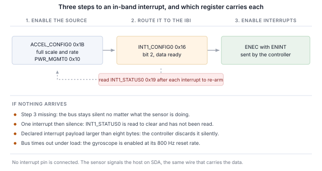

## 1 简介

新一代 TDK InvenSense MEMS 传感器在 I2C 和 SPI 之外还提供 MIPI I3C 接口，三者共用相同的两个引脚。
I3C 保留了这种双线占用，并在其上增加了大量功能。

Table: I3C 为双线传感器接口带来的功能

| 功能 | 为设计带来的好处 |
|---|---|
| 动态地址分配（DAA） | 控制器在运行时分配地址，因此静态地址冲突不再是电路板设计的约束，相同的器件可以共享一条总线 |
| 通过总线识别 | 每个目标器件都会报告一个 48 位临时标识符、器件类别及其总线能力，因此控制器可以枚举并非为其设计的总线 |
| 通用命令码 | 一套标准命令集（广播和直接），用于枚举、识别、配置、中断控制和复位，在所有符合规范的目标器件上都相同 |
| 带内中断（IBI） | 传感器通过数据线向主机发出中断，并携带一个说明原因的字节，因此无需布线或分配中断引脚 |
| 高数据速率模式 | 双数据速率传输在每对时钟沿上传输两位，在不提高时钟频率的情况下使信令速率加倍 |
| 组寻址 | 一次写入可同时到达作为一组寻址的多个目标器件 |
| 更高的信令速率 | 推挽时钟，单数据速率模式下最高 12.5 MHz，而 I2C 受开漏限制 |
| 更低功耗 | 推挽信令避免了 I2C 持续消耗的静态上拉电流，活动状态则让控制器告知目标器件预期的总线延迟，使其能够更深度地空闲 |
| 热加入（Hot-Join） | 在总线运行后才上电的目标器件可以请求被枚举 |
| 时序控制 | 控制器可以让目标器件以共享基准为其中断打时间戳 |
| 标准复位与恢复 | 定义好的目标器件复位以及定义好的错误检测与恢复，而非各厂商各自的序列 |
| I2C 兼容性 | 传统 I2C 器件可以共享总线 |

目标器件实现的是传感器所需的子集，而不同器件的子集各不相同。ICM-45686 实现的比大多数器件都多：
其总线特性寄存器声明了高级能力，即高数据速率传输，第 8 节将对此进行检验。

本笔记使用 Binho Supernova USB 主机适配器和 Binho mikroBUS Adapter Board 处理该器件：
枚举它、通过总线识别它、读写寄存器、输出解码后的测量数据流、在不连接中断引脚的情况下通过数据线获得中断、
以 HDR-DDR 进行传输，并确定目标器件实际实现了上述哪些功能。

这里的任何内容都不需要微控制器、固件或驱动移植。每一步都是从主机 PC 发出的一条命令。

### 1.1 范围

读完本文后，手边有硬件的读者将已经把传感器枚举到 I3C 总线上、通过其自身寄存器识别它、读写寄存器、
输出解码后的测量数据流、在不连接中断引脚的情况下以传感器配置的输出数据速率接收带内中断、
执行一次 HDR-DDR 读取并与同一寄存器的单数据速率读取进行对照检查，并根据可观察到的效果确定目标器件实现了什么。

本文处理的器件是 ICM-45686。它在硬件上进行了验证，本文中的每一项输出都是真实捕获的结果。

### 1.2 适用器件

Table: 涵盖的器件

| 器件 | 功能 | 电路板 | 已在硬件上验证 |
|---|---|---|---|
| ICM-45686 | 6 轴 IMU，加速度计和陀螺仪 | 6DOF IMU 27 Click | 是 |

该方法适用于任何安装在 mikroBUS Click 板上、带 I3C 接口的 TDK InvenSense MEMS 器件。
在随附的实用程序中添加一款器件只需一个表项，详见第 12 节。

### 1.3 相关文档

Table: 相关文档

| 文档 | 主题 |
|---|---|
| DS-000489，ICM-45686 数据手册 | 寄存器映射和电气特性 |
| MIPI I3C Specification v1.1 | 通用命令码、带内中断、HDR 模式、动态寻址 |
| Binho mikroBUS Adapter Board 产品页面 | 插座、跳线和支持的 Click 板 |

## 2 所需设备和软件

### 2.1 硬件

Table: 所需设备

| 项目 |
|---|
| Binho Supernova USB 主机适配器 |
| Binho mikroBUS Adapter Board |
| 6DOF IMU 27 Click，或其他带 I3C 接口的 mikroBUS MEMS Click 板 |
| USB-C 线缆 |

Click 板插入 mikroBUS 插座。本文中的任何步骤都不需要连接其他任何东西。

### 2.2 连接

Table: 使用的信号

| 信号 | 用途 |
|---|---|
| SCL | I3C 时钟，适配器到目标器件 |
| SDA | I3C 数据，双向 |
| 3.3 V | 目标器件电源 |
| GND | 回路 |

两根线和一路电源。**本笔记中的任何内容都不连接中断引脚、复位线或配置电阻**，包括中断相关章节：
在 I3C 上，传感器通过 SDA 向主机发出信号。

> **注意：** mikroBUS Adapter Board 不像 I3C Target Board 那样提供总线电源轨，因此实用程序的 `power-cycle`
> 命令在这里会报告 `I3C_PORTS_NOT_POWERED`。它会退而复位适配器，当系统命令仍然有效而 I3C 外设已停止响应时，
> 正是这一操作能使其恢复。

### 2.3 总线设置

Table: 使用的总线设置

| 设置 | 值 |
|---|---|
| 推挽速率 | 5 MHz，50% 占空比 |
| 开漏速率 | 1 MHz |
| 驱动强度 | 快速模式 |
| 总线电压 | 3.3 V |

这些是起始值而不是极限值。第 10 节确定该器件能够持续承受的速率。

### 2.4 软件

```
pip install binhosupernova
```

唯一的依赖是 Python 3.12 和 `binhosupernova` 软件包。解压本笔记附带的资源压缩包，并用一条命令确认环境：

```
python i3c_mems.py scan
```

## 3 初次接触：枚举总线

一条命令即可让传感器以主机分配的地址出现在总线上：

```
python i3c_mems.py scan
```

```
1 target(s) on the bus at 3300 mV, PUSH_PULL_5_MHZ_50_DC, OPEN_DRAIN_1_MHZ

  dynamic address 0x08
    PID  04 6A 00 00 00 11   device id 0x0000
    BCR  0x27   DCR 0x44
    HDR  claimed   IBI capable
    profile  icm45686
```

这是由两个通用命令码完成的。**RSTDAA** 清除任何已分配的动态地址，使总线从已知状态开始。
**ENTDAA** 随后执行动态地址分配：控制器发出广播，每个目标器件使用其 48 位临时标识符进行仲裁，
并依次获得一个地址。只有一个器件时，该地址为 `0x08`。

没有在任何地方配置地址。器件自身的静态地址没有被使用，也不需要知道。

该输出中地址之后的所有内容都来自目标器件，而不是查找表，这是与 I2C 的第一个明显不同之处。
在 I2C 上，主机写入一个预先选定的地址，并期待有器件应答。而在这里，器件会自我介绍。

## 4 通过总线识别器件

```
python i3c_mems.py identify --device icm45686
```

### 4.1 身份寄存器包含的内容

三个寄存器负责自我介绍，每个寄存器都是通过一条命令读取的，而不是从寄存器文件中读取。

```
  PID 04 6A 00 00 00 11
    MIPI member id (47:33)       0x0235
    id type selector (32)        0
    device id (31:16)            0x0000
    instance id (15:12)          0b0000
    reserved (11:0)              0x011
```

**临时标识符** 包含一个标识制造商的 MIPI 成员 ID，以及一个器件标识符字段。

> **重要：** 该器件将器件标识符字段保留为 `0x0000`。在许多传感器上，该字段嵌入了器件在其身份寄存器中同样报告的值，
> 这使控制器仅凭枚举就能确定器件型号。而这里并非如此，因此依靠该字段识别器件的主机将无法识别此器件，
> 必须改为读取身份寄存器。随附的实用程序正是这样做的：它首先按该字段匹配，当该字段不对应任何器件时，退而读取该寄存器。

**器件特性寄存器** 报告 `0x44`，这是 MIPI 注册表分配给 6 轴 IMU 的值。它标识的是类别，而不是具体器件。

**总线特性寄存器** 说明器件在总线上能做什么，在该器件上它是三者中最值得关注的：

```
BCR 0x27
  device role                      I3C target
  advanced capabilities (bit 5)    yes
  virtual target support           no
  offline capable                  yes
  IBI mandatory payload            yes
  IBI capable                      yes
  max data speed limit             yes
```

**第 5 位被置位。** 这是目标器件在声明具备高数据速率能力，第 8 节将对其进行验证，而不是直接相信。
GETHDRCAP 应答 `0x01`，这是 MIPI 规范分配给 HDR-DDR 的位。

第 1 位和第 2 位也被置位，因此该器件会发起带内中断并随之发送有效载荷，第 7 节会用到这一点。

### 4.2 用身份寄存器确认

Table: 身份寄存器

| 寄存器 | 值 |
|---|---|
| `WHO_AM_I`，位于 `0x72` | `0xE9` |

## 5 读写寄存器

寄存器访问是一次私有传输：先发送寄存器地址，然后读取字节。

```
python i3c_mems.py read  --device icm45686 0x72
python i3c_mems.py write --device icm45686 0x1B 0x0A
```

Table: 寄存器访问帧格式

| 属性 | 值 |
|---|---|
| 寄存器地址宽度 | 8 位 |
| 数据宽度 | 8 位 |
| 读取有效载荷之前的空字节 | 0 |
| 多字节读取时地址自动递增 | 是 |

多字节读取时地址会递增，因此从第一个加速度计寄存器开始的六字节读取会返回全部三个轴。

> **有一个寄存器不会自动递增，而启动调试时很可能最先遇到它。** 位于 `0x14` 的 `FIFO_DATA` 返回 FIFO 内容，
> 因此在此处进行四字节读取会返回四个字节的 FIFO 数据，而不是寄存器 `0x14` 至 `0x17`。在 FIFO 为空的器件上，
> 读到的是同一个字节重复四次，看起来像是接口无法遍历自身的寄存器文件。对于 FIFO 来说，这是正确的行为。
> 其他所有寄存器都会正常递增。

### 5.1 字节序

数据寄存器为小端序：低字节在前。

这一点值得检查而不是假设，因为即使高低字节互换，各轴仍会解码为看似合理的数值。这项检查没有任何成本，详见第 6 节。

## 6 传感器数据流

两次写操作即可启动加速度计。

Table: 启动加速度计

| 寄存器 | 值 | 效果 |
|---|---|---|
| `ACCEL_CONFIG0`，位于 `0x1B` | `0x0A` | 满量程字段为 0，即 ±32 g；输出数据速率字段为 10，即 50 Hz |
| `PWR_MGMT0`，位于 `0x10` | `0x03` | 加速度计处于低噪声模式 |

```
python i3c_mems.py stream --device icm45686 --seconds 5
```

```
  x     0.021 g   y    -0.028 g   z     1.005 g   magnitude     1.006 g
  x     0.020 g   y    -0.028 g   z     1.005 g   magnitude     1.005 g
  x     0.021 g   y    -0.028 g   z     1.006 g   magnitude     1.006 g
```

从 `0x00` 读取六个字节，即三个有符号 16 位轴，在 ±32 g 满量程下为每 g 1024 个计数。陀螺仪数据紧随其后，位于 `0x06`。

**静止时幅值为 1 g，这是对整条链路的免费检验**：帧格式、字节序、符号处理和比例，全部体现在一个数字中。
第 5.1 节中的字节序也是这样确定的，无需参考任何文档：静止时，只有一种字节序和满量程系数的组合能得到 1.000 g，
而在该器件上，这个组合是小端序加 ±32 g。

倾斜电路板时，各轴读数重新分配，而幅值保持不变。

> **除非需要陀螺仪，否则只使能加速度计。** 两个传感器有各自独立的速率字段，而陀螺仪的复位速率为 800 Hz。
> 同时使能两者会使数据就绪以两者中较快的速率出现在总线上，这一速率快到足以淹没总线：
> 实测表现为在三秒时间窗口中途出现总线超时。

Table: 加速度计输出数据速率选择，`ACCEL_CONFIG0` 位 3:0

| 字段 | 速率 | 字段 | 速率 |
|---|---|---|---|
| `0110` | 800 Hz，复位值 | `1010` | 50 Hz |
| `0111` | 400 Hz | `1011` | 25 Hz |
| `1000` | 200 Hz | `1100` | 12.5 Hz |
| `1001` | 100 Hz | | |

## 7 不使用中断引脚，通过总线获得中断

带内中断是对传感器设计改变最明显的功能。器件通过传输数据的同样两根线告诉主机新数据已就绪，
主机在读取任何内容之前就知道原因，因此无需布线、分配中断引脚或将其引出到连接器。

### 7.1 三个步骤

本笔记中的每个带内中断都是相同的三个步骤，顺序如下：

1. **在传感器中使能中断源。** 即以某个输出数据速率进行的测量本身。
2. **将其路由到带内中断。** 位于 `0x16` 的 `INT1_CONFIG0`，第 2 位。
3. **发送带 ENINT 位的 ENEC。** 在它到达之前，无论传感器在做什么，
   总线都保持静默。



```
python i3c_mems.py ibi --device icm45686 --seconds 3
```

```
icm45686 at 0x08: interrupt routed to the I3C IBI, data-ready through INT1_CONFIG0,
                  cleared by reading INT1_STATUS0
  IBI from 0x08  MDB 01
  IBI from 0x08  MDB 01

  152 interrupts in 3.00 s = 50.60/s
  configured output data rate 50 Hz (+1.2%)
```

配置为 50 Hz，实测每秒五十次，而两个中断引脚都没有连接任何东西。

> **注意：** 速率可以与配置的速率进行比较。但各次到达时间不能比较，因为主机传输层是成批传递中断的。
> 出于这个原因，本文不给出任何抖动或延迟数据。

### 7.2 清除中断源

位于 `0x19` 的 `INT1_STATUS0` 为读清除。主机在每次中断后读取它；如果不读取，数据就绪条件将保持有效，
数据流在第一个中断之后便会停止。随附的实用程序会自动完成这一操作。

### 7.3 强制数据字节

每个中断都携带一个强制数据字节。当数据就绪是唯一使能的中断源时，每次中断该字节都读为 `0x01`。

MIPI 规范保留该字节的第 7 位用于指示待处理读取；其余各位由器件自定义。除了表示发生了中断之外，
该器件在这些位中还编码了什么，本文并未确定，因此实用程序只报告该字节而不对其进行解释。

### 7.4 中断有效载荷大小

目标器件在 `GETMRL` 的第三个字节中声明它将发送的最大中断有效载荷，而控制器也有自己的限制。
**Supernova 可传递最多八个字节的中断有效载荷。** 该器件声明为一个字节，因此无需任何调整，实用程序也如此报告：

```
IBI payload negotiation   the target declared 1 byte(s), within the 8 the adapter takes,
                          so nothing had to change
```

即使检查通过，了解这项检查也是值得的，因为声明的有效载荷超过控制器所能接受的目标器件发起的中断永远不会被传递，
而且两端都不会报错。

## 8 HDR-DDR

这是该器件当之无愧的一节。高数据速率双数据速率传输在时钟的两个边沿上传输数据，在不提高时钟频率的情况下使信令速率加倍，
ICM-45686 通过 BCR 第 5 位声明支持此类传输。

声明并不等于验证。这里使用的测试方法是通过单数据速率读取一个寄存器，再通过 HDR-DDR 读取同一个寄存器，然后比较字节。

```
HDR-DDR against SDR    register 0x32 reads 6C 36 02 00 over SDR
                       and 6C 36 02 00 over HDR-DDR, the same bytes by both routes

bus after HDR-DDR      SDR transfers still work, so the exit pattern returned the bus
                       to single data rate
```

同一个寄存器，两种传输模式，一组相同的字节。

### 8.1 DDR 寄存器读取如何寻址

要做到这一点需要三件事，它们都无法仅从传输本身推测出来，而且每一件出错时都是静默失败，而不会报告错误。

**命令字节不是寄存器地址。** DDR 读取携带一个命令码，人们很容易把寄存器地址放在那里。以这种方式发出的读取返回全零。
其他所有命令码的读取也是如此：遍历从 `0x80` 到 `0xFF` 的全部 128 个读取命令，返回的只有零和填充字节，而每次的结果都是成功。

**寄存器来自目标器件内部的地址指针。** DDR 读取返回该指针所在位置的字节，因此必须首先定位该指针。

**SDR 读取可以在不干扰任何东西的情况下定位指针。** 通过 SDR 读取寄存器 N 后，指针停在 N+1。DDR 写入也会设置指针，
但它在移动过程中会写入数据，因此不能用来将读取对准一个其内容很重要的寄存器。

因此，通过 HDR-DDR 读取寄存器 N 及其后寄存器的序列为：

1. 通过 SDR 读取寄存器 N-1 的一个字节，使指针停在 N
2. 发出 HDR-DDR 读取，命令 `0x80`
3. 触发 HDR 退出模式，使总线返回单数据速率

Table: 用两种方式读取 `0x32` 及其后寄存器

| 路径 | 字节 |
|---|---|
| SDR 读取 `0x32`，四个字节 | `6C 36 02 00` |
| SDR 读取 `0x31`，然后 HDR-DDR 读取 | `6C 36 02 00` |

### 8.2 传输长度

HDR-DDR 以 16 位字为单位传输，因此有效载荷始终为偶数个字节，SDK 会直接拒绝奇数长度。
在本环境中，两字节读取返回空的有效载荷，而四字节可以正常工作，因此四字节是实际的最小值。

### 8.3 这一结果说明了什么，又没有说明什么

它说明目标器件和控制器能够完成双数据速率传输并在字节上达成一致，而且之后总线能够干净地返回单数据速率。

**它不是吞吐量测量。** 线路上的信令速率加倍并不等于传感器产生数据的速率加倍，而读取寄存器文件中的四个字节两者都无法测量。
不应从本节得出任何性能结论。

## 9 验证 I3C 的其余功能

该实用程序根据可观察到的效果而不是结果码来确定目标器件实现了什么，因为目标器件可能会应答一个它并未实现的命令。
下面的每一行都要求观察到一项变化：设置并回读一个值、移动一个地址并确认旧地址不再应答、对照配置速率统计中断数。

```
python i3c_mems.py features --device icm45686
```

Table: 实测通用命令码支持情况

| 命令 | 结论 | 依据 |
|---|---|---|
| ENTDAA | 支持 | 目标器件以预期的标识符完成枚举 |
| SETNEWDA | 支持 | 地址已移动，旧地址不再应答 |
| RSTDAA | 支持 | 被接受且地址被释放，但请参见下文 |
| GETPID、GETBCR、GETDCR | 支持 | 返回预期值 |
| ENEC、DISEC | 支持 | 中断可重复地启动和停止 |
| SETMWL、GETMWL | 支持 | 4095，然后设置为 64，随后报告 64 |
| SETMRL、GETMRL | 支持 | 4095，然后设置为 32，随后报告 32 |
| HDR-DDR | 支持 | 两种传输模式得到相同的字节，见第 8 节 |
| SETXTIME、GETXTIME | 支持 | 命令之后某个报告的字节发生了变化 |
| SETGRPA、RSTGRPA | 未实现 | 通过组地址的写入在分配之前、期间和之后都被拒绝 |
| 热加入 | 未观察到 | 任何时候都没有热加入请求 |
| ENTAS0 至 ENTAS3 | 不确定 | 全部被接受；要证明处于某个活动状态需要电流测量 |
| RSTACT | 不确定 | 被接受，从主机侧无可观察的效果 |
| GETMXDS | 不确定 | 应答 `00 00`，而不是实际限制值 |

实测计数：15 项支持、3 项未实现、8 项不确定，在多次运行中可以复现。

> **RSTDAA 会被接受，但其效果并无保证。** 在大多数运行中，目标器件会释放其动态地址，旧地址不再应答。
> 大约每八次运行中有一次，它返回成功结果，却在连续三次尝试中继续在原有地址上应答。
> 复位动态地址的主机应确认结果，而不是想当然。

**组寻址** 需要说明其测试方法，因为显而易见的测试方法会得出错误的结论。组地址让控制器可以同时寻址多个目标器件，
因此它是一个写入目的地：从组地址读取没有定义的应答，目标器件可能在正确实现该功能的同时拒绝组地址读取。
这里使用的测试方法是分配一个组地址，通过它写入一个寄存器，然后在目标器件自己的动态地址上回读该寄存器。
在该器件上，写入在每个阶段都被拒绝，因此该功能未实现。

## 10 总线速率

```
python i3c_mems.py rates --device icm45686 --iterations 100
```

Table: 最高无错误总线速率

| 推挽 | 开漏 |
|---|---|
| 12.5 MHz，50% 占空比 | 4.17 MHz |

该器件通过了适配器提供的所有速率。**方法：** 连续 100 次读取身份寄存器，必须全部返回预期值且无错误，
只有每次迭代都成功，该速率才算通过。这是一个寄存器读取循环，而不是吞吐量测量，不应据此得出任何关于持续数据速率的结论。

该器件将 BCR 第 0 位置位，声明存在最大数据速度限制，而 GETMXDS 应答 `00 00`，并未报告实际限制值。
在适配器能够产生的任何速率下，这两者都没有妨碍该循环完成。

## 11 实用说明

Table: 实用说明

| 说明 |
|---|
| 位于 `0x14` 的 `FIFO_DATA` 不会自动递增，因为它是一个 FIFO。其他所有寄存器都会自动递增 |
| 数据寄存器为小端序。静止时，只有一种字节序与满量程的组合能使加速度计幅值为 1 g |
| 除非需要陀螺仪，否则只使能加速度计：陀螺仪的复位速率为 800 Hz，同时使能两者可能会淹没总线 |
| 位于 `0x19` 的 `INT1_STATUS0` 为读清除。如果不读取它，只会到达一个中断，之后便再无中断 |
| PID 的器件标识符字段为 `0x0000`，因此主机无法仅凭枚举确定该器件型号，必须读取 `WHO_AM_I` |
| DDR 读取从内部指针获取寄存器，而对前一个寄存器的 SDR 读取可以定位该指针 |
| RSTDAA 会被接受，但并不总能释放动态地址。应确认而不是想当然 |
| mikroBUS Adapter Board 不提供总线电源轨，因此 `power-cycle` 会报告 `I3C_PORTS_NOT_POWERED` 并退而复位适配器 |
| 位于 `0x7F` 的 `REG_MISC2` 第 1 位触发软复位并自动清零，这会撤销通用命令码锁存的任何模式 |

## 12 实用程序

Table: 实用程序命令

| 命令 | 用途 |
|---|---|
| `scan` | 枚举总线并报告应答的器件 |
| `identify` | 解码目标器件的身份寄存器 |
| `read`、`write` | 读取或写入寄存器，写入后回读 |
| `stream` | 通过轮询打印解码后的样本 |
| `ibi` | 将传感器中断路由到总线上并统计到达的中断 |
| `features` | 根据可观察到的效果确定目标器件实现了什么 |
| `rates` | 查找最高无错误总线速率 |
| `reset`、`power-cycle` | 使器件恢复到已知状态 |

添加一款器件只需在配置表中添加一项：寄存器帧格式、预期的身份、启动数据流的写操作、路由中断的写操作，以及中断有效载荷的解码器。

## 13 测量结果

### 13.1 测试配置

Table: 测试配置

| 项目 | 值 |
|---|---|
| 适配器 | Binho Supernova，硬件版本 B，固件 4.4.0 |
| SDK | `binhosupernova`，Python 3.12，Windows 11 |
| 附件 | Binho mikroBUS Adapter Board |
| 总线 | 3.3 V，推挽 5 MHz 50% 占空比，开漏 1 MHz，快速模式驱动强度 |
| 枚举 | RSTDAA 之后执行 ENTDAA |
| 目标器件 | 6DOF IMU 27 Click 上的 ICM-45686 |

### 13.2 结果

**身份。** PID `04 6A 00 00 00 11`，BCR `0x27`，DCR `0x44`，`WHO_AM_I` `0xE9`。每个值都与数据手册一致，
随附配置所使用的寄存器映射是在查阅数据手册之前在工作台上确定的；对于配置使用的每个寄存器，两者都一致。

**数据。** 在配置为 ±32 g 满量程的情况下，静止时加速度计幅值为 1.005 至 1.006 g，这同时确认了帧格式、字节序、符号处理和比例。

**中断。** 配置为 50 Hz，3.00 s 内 152 次，误差 +1.2%。

**HDR-DDR。** 寄存器 `0x32` 通过单数据速率读为 `6C 36 02 00`，通过 HDR-DDR 读为 `6C 36 02 00`。
之后总线返回单数据速率，后续 SDR 传输均成功。

**支持情况。** 15 项支持、3 项未实现、8 项不确定。

**总线速率。** 按照第 10 节所述的方法，推挽 12.5 MHz，开漏 4.17 MHz。

**回归覆盖。** 本文中显示的命令会与记录的输出进行比对，因此任何改变读者所见结果的实用程序变更都会被发现。
记录的输出经过重新生成，然后在连续六次运行中得到复现。

## 14 故障排除

Table: 故障排除

| 症状 | 检查项 |
|---|---|
| 没有目标器件被枚举 | Click 板是否插在 mikroBUS 插座中；3.3 V 是否存在 |
| 多字节读取重复返回同一个字节 | 读取从 `FIFO_DATA` `0x14` 开始，该寄存器不会自动递增 |
| 三个轴看起来都不对但又似乎合理 | 字节序；静止时幅值必须为 1 g |
| 一个中断后便静默 | `INT1_STATUS0` 为读清除，但尚未被读取 |
| 中断淹没总线或总线超时 | 陀螺仪以其 800 Hz 复位速率被使能 |
| 完全没有中断到达 | 检查 ENEC 是否已带 ENINT 位发送 |
| HDR-DDR 读取返回全零 | 指针未定位；先通过 SDR 读取前一个寄存器 |
| HDR-DDR 读取被拒绝 | 长度必须为偶数，四字节是实际的最小值 |
| 适配器停止响应 I3C | 复位适配器；`power-cycle` 不适用于此附件 |

## 15 缩略语

Table: 缩略语

| 术语 | 含义 |
|---|---|
| BCR | 总线特性寄存器（Bus characteristics register） |
| CCC | 通用命令码（Common command code） |
| DAA | 动态地址分配（Dynamic address assignment） |
| DCR | 器件特性寄存器（Device characteristics register） |
| DDR | 双数据速率（Double data rate） |
| ENTDAA | 进入动态地址分配（Enter dynamic address assignment） |
| HDR | 高数据速率（High data rate） |
| IBI | 带内中断（In-band interrupt） |
| MDB | 强制数据字节（Mandatory data byte） |
| ODR | 输出数据速率（Output data rate） |
| PID | 临时标识符（Provisional identifier） |
| SDR | 单数据速率（Single data rate） |

## 16 关于本文中源代码的说明

本文中显示并在随附压缩包中提供的示例代码仅供评估和参考。它基于 MIT 许可证发布，许可证文本包含在压缩包中。

Table: 资源压缩包内容

| 文件 | 说明 |
|---|---|
| `AN0006.md` | 本文的 Markdown 源文件 |
| `assets/i3c_mems.py` | 参考实用程序 |
| `assets/LICENSE` | 涵盖示例代码的 MIT 许可证 |

## 17 修订历史

Table: 修订历史

| 修订版 | 日期 | 说明 |
|---|---|---|
| 1.0 | 1 September 2026 | 首次发布。 |
