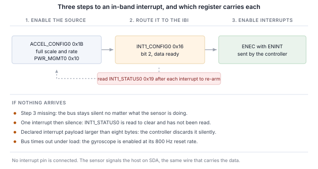

## 1 簡介

新一代 TDK InvenSense MEMS 感測器在 I2C 和 SPI 之外還提供 MIPI I3C 介面，三者共用相同的兩個接腳。
I3C 保留了這種雙線配置，並在其上增加了大量功能。

Table: I3C 為雙線感測器介面帶來的功能

| 功能 | 為設計帶來的好處 |
|---|---|
| 動態位址分配（DAA） | 控制器在執行時分配位址，因此靜態位址衝突不再是電路板設計的限制，相同的元件可以共用一條匯流排 |
| 透過匯流排識別 | 每個目標裝置都會回報一個 48 位元暫時識別碼、裝置類別及其匯流排能力，因此控制器可以列舉並非為其設計的匯流排 |
| 通用命令碼 | 一套標準命令集（廣播和直接），用於列舉、識別、設定、中斷控制和重設，在所有符合規範的目標裝置上都相同 |
| 帶內中斷（IBI） | 感測器透過資料線向主機發出中斷，並攜帶一個說明原因的位元組，因此不需要佈線或分配中斷接腳 |
| 高資料速率模式 | 雙資料速率傳輸在每對時脈邊緣上傳輸兩個位元，在不提高時脈頻率的情況下使訊號速率加倍 |
| 群組定址 | 一次寫入可同時到達以群組定址的多個目標裝置 |
| 更高的訊號速率 | 推挽時脈，單資料速率模式下最高 12.5 MHz，而 I2C 受開汲極限制 |
| 更低功耗 | 推挽訊號避免了 I2C 持續消耗的靜態上拉電流，活動狀態則讓控制器告知目標裝置預期的匯流排延遲，使其能夠更深度地閒置 |
| 熱加入（Hot-Join） | 在匯流排運作後才上電的目標裝置可以請求被列舉 |
| 時序控制 | 控制器可以讓目標裝置以共用基準為其中斷加上時間戳記 |
| 標準重設與復原 | 明確定義的目標裝置重設，以及明確定義的錯誤偵測與復原，而非各廠商各自的序列 |
| I2C 相容性 | 傳統 I2C 裝置可以共用匯流排 |

目標裝置實作的是感測器所需的子集，而不同元件的子集各不相同。ICM-45686 實作的比大多數元件都多：
其匯流排特性暫存器宣告了進階能力，即高資料速率傳輸，第 8 節將對此進行檢驗。

本筆記使用 Binho Supernova USB 主機轉接器和 Binho mikroBUS Adapter Board 處理此元件：
列舉它、透過匯流排識別它、讀寫暫存器、輸出解碼後的量測資料串流、在不連接中斷接腳的情況下透過資料線取得中斷、
以 HDR-DDR 進行傳輸，並確定目標裝置實際實作了上述哪些功能。

這裡的任何內容都不需要微控制器、韌體或驅動程式移植。每一步都是從主機 PC 發出的一條命令。

### 1.1 範圍

讀完本文後，手邊有硬體的讀者將已經把感測器列舉到 I3C 匯流排上、透過其自身暫存器識別它、讀寫暫存器、
輸出解碼後的量測資料串流、在不連接中斷接腳的情況下以感測器設定的輸出資料速率接收帶內中斷、
執行一次 HDR-DDR 讀取並與同一暫存器的單資料速率讀取進行對照檢查，並根據可觀察到的效果確定目標裝置實作了什麼。

本文處理的元件是 ICM-45686。它在硬體上進行了驗證，本文中的每一項輸出都是實際擷取的結果。

### 1.2 適用裝置

Table: 涵蓋的裝置

| 裝置 | 功能 | 電路板 | 已在硬體上驗證 |
|---|---|---|---|
| ICM-45686 | 6 軸 IMU，加速度計和陀螺儀 | 6DOF IMU 27 Click | 是 |

此方法適用於任何安裝在 mikroBUS Click 板上、具備 I3C 介面的 TDK InvenSense MEMS 元件。
在隨附的公用程式中新增一款元件只需一個表格項目，詳見第 12 節。

### 1.3 相關文件

Table: 相關文件

| 文件 | 主題 |
|---|---|
| DS-000489，ICM-45686 資料手冊 | 暫存器對映和電氣特性 |
| MIPI I3C Specification v1.1 | 通用命令碼、帶內中斷、HDR 模式、動態定址 |
| Binho mikroBUS Adapter Board 產品頁面 | 插座、跳線和支援的 Click 板 |

## 2 所需設備和軟體

### 2.1 硬體

Table: 所需設備

| 項目 |
|---|
| Binho Supernova USB 主機轉接器 |
| Binho mikroBUS Adapter Board |
| 6DOF IMU 27 Click，或其他具備 I3C 介面的 mikroBUS MEMS Click 板 |
| USB-C 纜線 |

Click 板插入 mikroBUS 插座。本文中的任何步驟都不需要連接其他任何東西。

### 2.2 連接

Table: 使用的訊號

| 訊號 | 用途 |
|---|---|
| SCL | I3C 時脈，轉接器到目標裝置 |
| SDA | I3C 資料，雙向 |
| 3.3 V | 目標裝置電源 |
| GND | 回路 |

兩條線和一路電源。**本筆記中的任何內容都不連接中斷接腳、重設線或設定電阻**，包括中斷相關章節：
在 I3C 上，感測器透過 SDA 向主機發出訊號。

> **注意：** mikroBUS Adapter Board 不像 I3C Target Board 那樣提供匯流排電源軌，因此公用程式的 `power-cycle`
> 命令在這裡會回報 `I3C_PORTS_NOT_POWERED`。它會改為重設轉接器，當系統命令仍然有效而 I3C 週邊已停止回應時，
> 正是這項操作能使其恢復。

### 2.3 匯流排設定

Table: 使用的匯流排設定

| 設定 | 值 |
|---|---|
| 推挽速率 | 5 MHz，50% 工作週期 |
| 開汲極速率 | 1 MHz |
| 驅動強度 | 快速模式 |
| 匯流排電壓 | 3.3 V |

這些是起始值而不是極限值。第 10 節確定此元件能夠持續承受的速率。

### 2.4 軟體

```
pip install binhosupernova
```

唯一的相依項目是 Python 3.12 和 `binhosupernova` 套件。解壓縮本筆記隨附的資源壓縮檔，並用一條命令確認環境：

```
python i3c_mems.py scan
```

## 3 初次接觸：列舉匯流排

一條命令即可讓感測器以主機分配的位址出現在匯流排上：

```
python i3c_mems.py scan
```

```
1 target(s) on the bus at 3300 mV, PUSH_PULL_5_MHZ_50_DC, OPEN_DRAIN_1_MHZ

  dynamic address 0x08
    PID  04 6A 00 00 00 11   device id 0x0000
    BCR  0x27   DCR 0x44
    HDR  claimed   IBI capable
    profile  icm45686
```

這是由兩個通用命令碼完成的。**RSTDAA** 清除任何已分配的動態位址，使匯流排從已知狀態開始。
**ENTDAA** 接著執行動態位址分配：控制器發出廣播，每個目標裝置使用其 48 位元暫時識別碼進行仲裁，
並依序獲得一個位址。只有一個元件時，該位址為 `0x08`。

沒有在任何地方設定位址。元件自身的靜態位址沒有被使用，也不需要知道。

該輸出中位址之後的所有內容都來自目標裝置，而不是查找表，這是與 I2C 的第一個明顯不同之處。
在 I2C 上，主機寫入一個預先選定的位址，並期待有裝置回應。而在這裡，裝置會自我介紹。

## 4 透過匯流排識別元件

```
python i3c_mems.py identify --device icm45686
```

### 4.1 身分暫存器包含的內容

三個暫存器負責自我介紹，每個暫存器都是透過一條命令讀取的，而不是從暫存器檔案中讀取。

```
  PID 04 6A 00 00 00 11
    MIPI member id (47:33)       0x0235
    id type selector (32)        0
    device id (31:16)            0x0000
    instance id (15:12)          0b0000
    reserved (11:0)              0x011
```

**暫時識別碼** 包含一個識別製造商的 MIPI 成員 ID，以及一個裝置識別碼欄位。

> **重要：** 此元件將裝置識別碼欄位保留為 `0x0000`。在許多感測器上，該欄位嵌入了元件在其身分暫存器中同樣回報的值，
> 這使控制器僅憑列舉就能確定元件型號。而這裡並非如此，因此依靠該欄位識別元件的主機將無法識別此元件，
> 必須改為讀取身分暫存器。隨附的公用程式正是這樣做的：它先依該欄位比對，當該欄位不對應任何元件時，改為讀取該暫存器。

**裝置特性暫存器** 回報 `0x44`，這是 MIPI 登錄表分配給 6 軸 IMU 的值。它識別的是類別，而不是具體元件。

**匯流排特性暫存器** 說明元件在匯流排上能做什麼，在此元件上它是三者中最值得關注的：

```
BCR 0x27
  device role                      I3C target
  advanced capabilities (bit 5)    yes
  virtual target support           no
  offline capable                  yes
  IBI mandatory payload            yes
  IBI capable                      yes
  max data speed limit             yes
```

**第 5 位元被設定。** 這是目標裝置在宣告具備高資料速率能力，第 8 節將對其進行驗證，而不是直接相信。
GETHDRCAP 回應 `0x01`，這是 MIPI 規範分配給 HDR-DDR 的位元。

第 1 位元和第 2 位元也被設定，因此此元件會發起帶內中斷並隨之傳送酬載，第 7 節會用到這一點。

### 4.2 以身分暫存器確認

Table: 身分暫存器

| 暫存器 | 值 |
|---|---|
| `WHO_AM_I`，位於 `0x72` | `0xE9` |

## 5 讀寫暫存器

暫存器存取是一次私有傳輸：先傳送暫存器位址，然後讀取位元組。

```
python i3c_mems.py read  --device icm45686 0x72
python i3c_mems.py write --device icm45686 0x1B 0x0A
```

Table: 暫存器存取訊框格式

| 屬性 | 值 |
|---|---|
| 暫存器位址寬度 | 8 位元 |
| 資料寬度 | 8 位元 |
| 讀取酬載之前的虛擬位元組 | 0 |
| 多位元組讀取時位址自動遞增 | 是 |

多位元組讀取時位址會遞增，因此從第一個加速度計暫存器開始的六位元組讀取會傳回全部三個軸。

> **有一個暫存器不會自動遞增，而啟動除錯時很可能最先遇到它。** 位於 `0x14` 的 `FIFO_DATA` 傳回 FIFO 內容，
> 因此在此處進行四位元組讀取會傳回四個位元組的 FIFO 資料，而不是暫存器 `0x14` 至 `0x17`。在 FIFO 為空的元件上，
> 讀到的是同一個位元組重複四次，看起來像是介面無法走訪自身的暫存器檔案。對於 FIFO 來說，這是正確的行為。
> 其他所有暫存器都會正常遞增。

### 5.1 位元組順序

資料暫存器為小端序：低位元組在前。

這一點值得檢查而不是假設，因為即使高低位元組互換，各軸仍會解碼為看似合理的數值。這項檢查沒有任何成本，詳見第 6 節。

## 6 感測器資料串流

兩次寫入即可啟動加速度計。

Table: 啟動加速度計

| 暫存器 | 值 | 效果 |
|---|---|---|
| `ACCEL_CONFIG0`，位於 `0x1B` | `0x0A` | 滿刻度欄位為 0，即 ±32 g；輸出資料速率欄位為 10，即 50 Hz |
| `PWR_MGMT0`，位於 `0x10` | `0x03` | 加速度計處於低雜訊模式 |

```
python i3c_mems.py stream --device icm45686 --seconds 5
```

```
  x     0.021 g   y    -0.028 g   z     1.005 g   magnitude     1.006 g
  x     0.020 g   y    -0.028 g   z     1.005 g   magnitude     1.005 g
  x     0.021 g   y    -0.028 g   z     1.006 g   magnitude     1.006 g
```

從 `0x00` 讀取六個位元組，即三個有號 16 位元軸，在 ±32 g 滿刻度下為每 g 1024 個計數。陀螺儀資料緊接在後，位於 `0x06`。

**靜止時大小為 1 g，這是對整條鏈路的免費檢驗**：訊框格式、位元組順序、正負號處理和比例，全部反映在一個數字中。
第 5.1 節中的位元組順序也是這樣確定的，無需參考任何文件：靜止時，只有一種位元組順序和滿刻度係數的組合能得到 1.000 g，
而在此元件上，這個組合是小端序加 ±32 g。

傾斜電路板時，各軸讀數重新分配，而大小保持不變。

> **除非需要陀螺儀，否則只啟用加速度計。** 兩個感測器有各自獨立的速率欄位，而陀螺儀的重設速率為 800 Hz。
> 同時啟用兩者會使資料就緒以兩者中較快的速率出現在匯流排上，這一速率快到足以淹沒匯流排：
> 實測表現為在三秒時間窗口中途出現匯流排逾時。

Table: 加速度計輸出資料速率選擇，`ACCEL_CONFIG0` 位元 3:0

| 欄位 | 速率 | 欄位 | 速率 |
|---|---|---|---|
| `0110` | 800 Hz，重設值 | `1010` | 50 Hz |
| `0111` | 400 Hz | `1011` | 25 Hz |
| `1000` | 200 Hz | `1100` | 12.5 Hz |
| `1001` | 100 Hz | | |

## 7 不使用中斷接腳，透過匯流排取得中斷

帶內中斷是對感測器設計改變最明顯的功能。元件透過傳輸資料的同樣兩條線告訴主機新資料已就緒，
主機在讀取任何內容之前就知道原因，因此不需要佈線、分配中斷接腳或將其引出到連接器。

### 7.1 三個步驟

本筆記中的每個帶內中斷都是相同的三個步驟，順序如下：

1. **在感測器中啟用中斷來源。** 即以某個輸出資料速率進行的量測本身。
2. **將其路由到帶內中斷。** 位於 `0x16` 的 `INT1_CONFIG0`，第 2 位元。
3. **傳送帶 ENINT 位元的 ENEC。** 在它到達之前，無論感測器在做什麼，
   匯流排都保持靜默。



```
python i3c_mems.py ibi --device icm45686 --seconds 3
```

```
icm45686 at 0x08: interrupt routed to the I3C IBI, data-ready through INT1_CONFIG0,
                  cleared by reading INT1_STATUS0
  IBI from 0x08  MDB 01
  IBI from 0x08  MDB 01

  152 interrupts in 3.00 s = 50.60/s
  configured output data rate 50 Hz (+1.2%)
```

設定為 50 Hz，實測每秒五十次，而兩個中斷接腳都沒有連接任何東西。

> **注意：** 速率可以與設定的速率進行比較。但各次到達時間不能比較，因為主機傳輸層是成批傳遞中斷的。
> 基於這個原因，本文不提供任何抖動或延遲數據。

### 7.2 清除中斷來源

位於 `0x19` 的 `INT1_STATUS0` 為讀取清除。主機在每次中斷後讀取它；如果不讀取，資料就緒條件將保持有效，
資料串流在第一個中斷之後便會停止。隨附的公用程式會自動完成這項操作。

### 7.3 強制資料位元組

每個中斷都攜帶一個強制資料位元組。當資料就緒是唯一啟用的中斷來源時，每次中斷該位元組都讀為 `0x01`。

MIPI 規範保留該位元組的第 7 位元用於指示待處理讀取；其餘各位元由裝置自訂。除了表示發生了中斷之外，
此元件在這些位元中還編碼了什麼，本文並未確定，因此公用程式只回報該位元組而不對其進行解讀。

### 7.4 中斷酬載大小

目標裝置在 `GETMRL` 的第三個位元組中宣告它將傳送的最大中斷酬載，而控制器也有自己的限制。
**Supernova 可傳遞最多八個位元組的中斷酬載。** 此元件宣告為一個位元組，因此無需任何調整，公用程式也如此回報：

```
IBI payload negotiation   the target declared 1 byte(s), within the 8 the adapter takes,
                          so nothing had to change
```

即使檢查通過，了解這項檢查也是值得的，因為宣告的酬載超過控制器所能接受的目標裝置發起的中斷永遠不會被傳遞，
而且兩端都不會報錯。

## 8 HDR-DDR

這是此元件當之無愧的一節。高資料速率雙資料速率傳輸在時脈的兩個邊緣上傳輸資料，在不提高時脈頻率的情況下使訊號速率加倍，
ICM-45686 透過 BCR 第 5 位元宣告支援此類傳輸。

宣告並不等於驗證。這裡使用的測試方法是透過單資料速率讀取一個暫存器，再透過 HDR-DDR 讀取同一個暫存器，然後比較位元組。

```
HDR-DDR against SDR    register 0x32 reads 6C 36 02 00 over SDR
                       and 6C 36 02 00 over HDR-DDR, the same bytes by both routes

bus after HDR-DDR      SDR transfers still work, so the exit pattern returned the bus
                       to single data rate
```

同一個暫存器，兩種傳輸模式，一組相同的位元組。

### 8.1 DDR 暫存器讀取如何定址

要做到這一點需要三件事，它們都無法僅從傳輸本身推測出來，而且每一件出錯時都是靜默失敗，而不會回報錯誤。

**命令位元組不是暫存器位址。** DDR 讀取攜帶一個命令碼，人們很容易把暫存器位址放在那裡。以這種方式發出的讀取傳回全零。
其他所有命令碼的讀取也是如此：走訪從 `0x80` 到 `0xFF` 的全部 128 個讀取命令，傳回的只有零和填補位元組，而每次的結果都是成功。

**暫存器來自目標裝置內部的位址指標。** DDR 讀取傳回該指標所在位置的位元組，因此必須先定位該指標。

**SDR 讀取可以在不干擾任何東西的情況下定位指標。** 透過 SDR 讀取暫存器 N 後，指標停在 N+1。DDR 寫入也會設定指標，
但它在移動過程中會寫入資料，因此不能用來將讀取對準一個其內容很重要的暫存器。

因此，透過 HDR-DDR 讀取暫存器 N 及其後暫存器的序列為：

1. 透過 SDR 讀取暫存器 N-1 的一個位元組，使指標停在 N
2. 發出 HDR-DDR 讀取，命令 `0x80`
3. 觸發 HDR 結束樣式，使匯流排回到單資料速率

Table: 以兩種方式讀取 `0x32` 及其後暫存器

| 路徑 | 位元組 |
|---|---|
| SDR 讀取 `0x32`，四個位元組 | `6C 36 02 00` |
| SDR 讀取 `0x31`，然後 HDR-DDR 讀取 | `6C 36 02 00` |

### 8.2 傳輸長度

HDR-DDR 以 16 位元字組為單位傳輸，因此酬載始終為偶數個位元組，SDK 會直接拒絕奇數長度。
在本環境中，兩位元組讀取傳回空的酬載，而四位元組可以正常運作，因此四位元組是實際的最小值。

### 8.3 這一結果說明了什麼，又沒有說明什麼

它說明目標裝置和控制器能夠完成雙資料速率傳輸並在位元組上達成一致，而且之後匯流排能夠乾淨地回到單資料速率。

**它不是傳輸量量測。** 線路上的訊號速率加倍並不等於感測器產生資料的速率加倍，而讀取暫存器檔案中的四個位元組兩者都無法量測。
不應從本節得出任何效能結論。

## 9 驗證 I3C 的其餘功能

此公用程式根據可觀察到的效果而不是結果碼來確定目標裝置實作了什麼，因為目標裝置可能會回應一個它並未實作的命令。
下面的每一列都要求觀察到一項變化：設定並回讀一個值、移動一個位址並確認舊位址不再回應、對照設定速率計算中斷數。

```
python i3c_mems.py features --device icm45686
```

Table: 實測通用命令碼支援情況

| 命令 | 結論 | 依據 |
|---|---|---|
| ENTDAA | 支援 | 目標裝置以預期的識別碼完成列舉 |
| SETNEWDA | 支援 | 位址已移動，舊位址不再回應 |
| RSTDAA | 支援 | 被接受且位址被釋放，但請參見下文 |
| GETPID、GETBCR、GETDCR | 支援 | 傳回預期值 |
| ENEC、DISEC | 支援 | 中斷可重複地啟動和停止 |
| SETMWL、GETMWL | 支援 | 4095，然後設定為 64，隨後回報 64 |
| SETMRL、GETMRL | 支援 | 4095，然後設定為 32，隨後回報 32 |
| HDR-DDR | 支援 | 兩種傳輸模式得到相同的位元組，見第 8 節 |
| SETXTIME、GETXTIME | 支援 | 命令之後某個回報的位元組發生了變化 |
| SETGRPA、RSTGRPA | 未實作 | 透過群組位址的寫入在分配之前、期間和之後都被拒絕 |
| 熱加入 | 未觀察到 | 任何時候都沒有熱加入請求 |
| ENTAS0 至 ENTAS3 | 無法確定 | 全部被接受；要證明處於某個活動狀態需要電流量測 |
| RSTACT | 無法確定 | 被接受，從主機端無可觀察的效果 |
| GETMXDS | 無法確定 | 回應 `00 00`，而不是實際限制值 |

實測計數：15 項支援、3 項未實作、8 項無法確定，在多次執行中可以重現。

> **RSTDAA 會被接受，但其效果並無保證。** 在大多數執行中，目標裝置會釋放其動態位址，舊位址不再回應。
> 大約每八次執行中有一次，它傳回成功結果，卻在連續三次嘗試中繼續在原有位址上回應。
> 重設動態位址的主機應確認結果，而不是想當然耳。

**群組定址** 需要說明其測試方法，因為直覺的測試方法會得出錯誤的結論。群組位址讓控制器可以同時定址多個目標裝置，
因此它是一個寫入目的地：從群組位址讀取沒有定義的回應，目標裝置可能在正確實作此功能的同時拒絕群組位址讀取。
這裡使用的測試方法是分配一個群組位址，透過它寫入一個暫存器，然後在目標裝置自己的動態位址上回讀該暫存器。
在此元件上，寫入在每個階段都被拒絕，因此此功能未實作。

## 10 匯流排速率

```
python i3c_mems.py rates --device icm45686 --iterations 100
```

Table: 最高無錯誤匯流排速率

| 推挽 | 開汲極 |
|---|---|
| 12.5 MHz，50% 工作週期 | 4.17 MHz |

此元件通過了轉接器提供的所有速率。**方法：** 連續 100 次讀取身分暫存器，必須全部傳回預期值且無錯誤，
只有每次迭代都成功，該速率才算通過。這是一個暫存器讀取迴圈，而不是傳輸量量測，不應據此得出任何關於持續資料速率的結論。

此元件將 BCR 第 0 位元設定為 1，宣告存在最大資料速度限制，而 GETMXDS 回應 `00 00`，並未回報實際限制值。
在轉接器能夠產生的任何速率下，這兩者都沒有妨礙該迴圈完成。

## 11 實務說明

Table: 實務說明

| 說明 |
|---|
| 位於 `0x14` 的 `FIFO_DATA` 不會自動遞增，因為它是一個 FIFO。其他所有暫存器都會自動遞增 |
| 資料暫存器為小端序。靜止時，只有一種位元組順序與滿刻度的組合能使加速度計大小為 1 g |
| 除非需要陀螺儀，否則只啟用加速度計：陀螺儀的重設速率為 800 Hz，同時啟用兩者可能會淹沒匯流排 |
| 位於 `0x19` 的 `INT1_STATUS0` 為讀取清除。如果不讀取它，只會到達一個中斷，之後便再無中斷 |
| PID 的裝置識別碼欄位為 `0x0000`，因此主機無法僅憑列舉確定此元件型號，必須讀取 `WHO_AM_I` |
| DDR 讀取從內部指標取得暫存器，而對前一個暫存器的 SDR 讀取可以定位該指標 |
| RSTDAA 會被接受，但並不總能釋放動態位址。應確認而不是想當然耳 |
| mikroBUS Adapter Board 不提供匯流排電源軌，因此 `power-cycle` 會回報 `I3C_PORTS_NOT_POWERED` 並改為重設轉接器 |
| 位於 `0x7F` 的 `REG_MISC2` 第 1 位元觸發軟體重設並自動清除，這會撤銷通用命令碼鎖存的任何模式 |

## 12 公用程式

Table: 公用程式命令

| 命令 | 用途 |
|---|---|
| `scan` | 列舉匯流排並回報回應的裝置 |
| `identify` | 解碼目標裝置的身分暫存器 |
| `read`、`write` | 讀取或寫入暫存器，寫入後回讀 |
| `stream` | 透過輪詢列印解碼後的樣本 |
| `ibi` | 將感測器中斷路由到匯流排上並計算到達的中斷 |
| `features` | 根據可觀察到的效果確定目標裝置實作了什麼 |
| `rates` | 尋找最高無錯誤匯流排速率 |
| `reset`、`power-cycle` | 使元件回到已知狀態 |

新增一款元件只需在設定表中新增一項：暫存器訊框格式、預期的身分、啟動資料串流的寫入操作、路由中斷的寫入操作，以及中斷酬載的解碼器。

## 13 量測結果

### 13.1 測試設定

Table: 測試設定

| 項目 | 值 |
|---|---|
| 轉接器 | Binho Supernova，硬體版本 B，韌體 4.4.0 |
| SDK | `binhosupernova`，Python 3.12，Windows 11 |
| 配件 | Binho mikroBUS Adapter Board |
| 匯流排 | 3.3 V，推挽 5 MHz 50% 工作週期，開汲極 1 MHz，快速模式驅動強度 |
| 列舉 | RSTDAA 之後執行 ENTDAA |
| 目標裝置 | 6DOF IMU 27 Click 上的 ICM-45686 |

### 13.2 結果

**身分。** PID `04 6A 00 00 00 11`，BCR `0x27`，DCR `0x44`，`WHO_AM_I` `0xE9`。每個值都與資料手冊一致，
隨附設定所使用的暫存器對映是在查閱資料手冊之前在工作台上確定的；對於設定使用的每個暫存器，兩者都一致。

**資料。** 在設定為 ±32 g 滿刻度的情況下，靜止時加速度計大小為 1.005 至 1.006 g，這同時確認了訊框格式、位元組順序、正負號處理和比例。

**中斷。** 設定為 50 Hz，3.00 s 內 152 次，誤差 +1.2%。

**HDR-DDR。** 暫存器 `0x32` 透過單資料速率讀為 `6C 36 02 00`，透過 HDR-DDR 讀為 `6C 36 02 00`。
之後匯流排回到單資料速率，後續 SDR 傳輸均成功。

**支援情況。** 15 項支援、3 項未實作、8 項無法確定。

**匯流排速率。** 依照第 10 節所述的方法，推挽 12.5 MHz，開汲極 4.17 MHz。

**迴歸覆蓋。** 本文中顯示的命令會與記錄的輸出進行比對，因此任何改變讀者所見結果的公用程式變更都會被發現。
記錄的輸出經過重新產生，然後在連續六次執行中得到重現。

## 14 疑難排解

Table: 疑難排解

| 症狀 | 檢查項目 |
|---|---|
| 沒有目標裝置被列舉 | Click 板是否插在 mikroBUS 插座中；3.3 V 是否存在 |
| 多位元組讀取重複傳回同一個位元組 | 讀取從 `FIFO_DATA` `0x14` 開始，該暫存器不會自動遞增 |
| 三個軸看起來都不對但又似乎合理 | 位元組順序；靜止時大小必須為 1 g |
| 一個中斷後便靜默 | `INT1_STATUS0` 為讀取清除，但尚未被讀取 |
| 中斷淹沒匯流排或匯流排逾時 | 陀螺儀以其 800 Hz 重設速率被啟用 |
| 完全沒有中斷到達 | 檢查 ENEC 是否已帶 ENINT 位元傳送 |
| HDR-DDR 讀取傳回全零 | 指標未定位；先透過 SDR 讀取前一個暫存器 |
| HDR-DDR 讀取被拒絕 | 長度必須為偶數，四位元組是實際的最小值 |
| 轉接器停止回應 I3C | 重設轉接器；`power-cycle` 不適用於此配件 |

## 15 縮寫

Table: 縮寫

| 術語 | 含義 |
|---|---|
| BCR | 匯流排特性暫存器（Bus characteristics register） |
| CCC | 通用命令碼（Common command code） |
| DAA | 動態位址分配（Dynamic address assignment） |
| DCR | 裝置特性暫存器（Device characteristics register） |
| DDR | 雙資料速率（Double data rate） |
| ENTDAA | 進入動態位址分配（Enter dynamic address assignment） |
| HDR | 高資料速率（High data rate） |
| IBI | 帶內中斷（In-band interrupt） |
| MDB | 強制資料位元組（Mandatory data byte） |
| ODR | 輸出資料速率（Output data rate） |
| PID | 暫時識別碼（Provisional identifier） |
| SDR | 單資料速率（Single data rate） |

## 16 關於本文中原始碼的說明

本文中顯示並在隨附壓縮檔中提供的範例程式碼僅供評估和參考。它依 MIT 授權條款發布，授權條款文字包含在壓縮檔中。

Table: 資源壓縮檔內容

| 檔案 | 說明 |
|---|---|
| `AN0006.md` | 本文的 Markdown 原始檔 |
| `assets/i3c_mems.py` | 參考公用程式 |
| `assets/LICENSE` | 涵蓋範例程式碼的 MIT 授權條款 |

## 17 修訂歷史

Table: 修訂歷史

| 修訂版 | 日期 | 說明 |
|---|---|---|
| 1.0 | 1 September 2026 | 首次發布。 |
