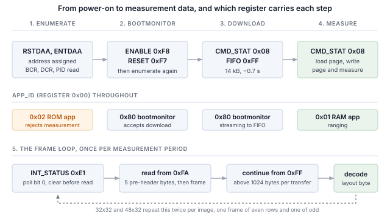

## 1 はじめに

ams OSRAM TMF8829 は、I2C と SPI に加えて MIPI I3C インタフェースを同じ 2 本のピン上に備えた直接飛行時間測距センサです。
放射したレーザパルスに対する戻り光子の時間を計ることで距離を測定し、その測定はゾーンに分割されたシングルフォトンアバランシェダイオードのアレイ全体で行われます。
視野全体で 1 つの距離を報告するのではなく、ゾーンごとに個別の結果を報告します。最大の構成では 1536 ゾーンを報告し、各ゾーンは異なる距離にある最大 4 つの反射を報告できます。

I3C は 2 線の構成を維持したまま、その上に多くの機能を追加しています。

Table: I3C が 2 線センサインタフェースに追加するもの

| 機能 | 設計にもたらすもの |
|---|---|
| ダイナミックアドレス割り当て（DAA） | コントローラが実行時にアドレスを割り当てるため、スタティックアドレスの衝突が基板設計上の制約ではなくなり、同一デバイスが 1 本のバスを共有できます |
| バスからの識別 | すべてのターゲットが 48 ビットの暫定 ID、デバイスクラス、バス機能を報告するため、コントローラは想定外のバスも列挙できます |
| 共通コマンドコード | 列挙、識別、設定、割り込み制御、リセットのための標準コマンドセット（ブロードキャストおよびダイレクト）で、準拠するすべてのターゲットで共通です |
| インバンド割り込み（IBI） | センサはデータラインでホストに割り込みをかけ、理由を示すバイトを送るため、割り込みピンの配線や割り当てが不要です |
| 高データレートモード | ダブルデータレート転送はクロックエッジの対ごとに 2 ビットを転送し、クロックを上げずに信号速度を 2 倍にします |
| より高い信号速度 | プッシュプルのクロックで、シングルデータレートモードでは最大 12.5 MHz。I2C はオープンドレインの制約を受けます |
| 低消費電力 | プッシュプル信号により I2C が常に消費する静的なプルアップ電流を回避でき、アクティビティステートによってコントローラがターゲットに想定バスレイテンシを伝えることで、ターゲットはより深くアイドルできます |
| ホットジョイン（Hot-Join） | バス稼働後に電源が入ったターゲットが列挙を要求できます |
| 標準のリセットとリカバリ | ベンダごとのシーケンスではなく、定義されたターゲットリセットと、定義されたエラー検出およびリカバリ |
| I2C 互換性 | レガシーの I2C デバイスがバスを共有できます |

ターゲットはセンサに必要なサブセットを実装しており、そのサブセットはデバイスによって異なります。本ノートでは、Binho Supernova USB ホストアダプタから TMF8829 を扱います。
列挙し、バスから識別し、ブートローダに入り、測距ファームウェアをダウンロードして起動し、ゾーン構成を選択し、デバイスが提供するすべての解像度で測定フレームを読み出してデコードし、
結果を描画し、HDR-DDR でフレームを転送し、上記の機能のうちターゲットが実際に実装しているものを確認します。

このデバイスの 3 つの特性がホストの書き方を決めており、その 3 つともレジスタマップ型センサとは異なります。

Table: レジスタマップ型センサとの違い

| 特性 | ホストへの影響 |
|---|---|
| 測距ファームウェアは常駐していない | デバイスはブートローダまたは ROM アプリケーションで起動し、どちらも測距しません。アプリケーションは電源投入のたびにバス経由で RAM にダウンロードされるため、このデバイスを使った製品の起動時間の一部になります |
| 結果は FIFO を通じて返される | 距離レジスタはありません。測定は 1 回の連続した転送として読み出され、その長さはフレーム自身が示します。読み出しが不足すると残りが FIFO に残り、次のフレームを壊します |
| 測定はバイト単位ではなくキロバイト単位 | 48x32 構成は最小の結果フォーマットで 1 回の測定あたり 4674 バイトを返します。これが当たる転送上限は第 7.3 節で確認し、各構成のサイズは第 11 節に示します |

ここではマイクロコントローラ、ファームウェア、ドライバの移植は一切必要ありません。すべての手順はホスト PC からのコマンドです。



### 1.1 範囲

本書を読み終えると、手元にハードウェアがある読者は、TMF8829 を I3C バス上に列挙し、ブートローダに強制移行させ、測距ファームウェアをダウンロードして起動し、
各ゾーングリッドを設定し、2 フレームに分かれて届く 2 つの構成を含めて測定フレームを読み出してデコードし、結果を描画し、
HDR-DDR でフレームを転送して同じフレームのシングルデータレート読み出しと照合し、観測可能な効果からターゲットが何を実装しているかを確認したことになります。

扱うデバイスは LIGHTRANGER 14 Click 上の TMF8829 です。ハードウェア上で検証しており、本書のすべての出力は実際のキャプチャです。

本ノートでは、光学キャリブレーション、カバーガラスに対するクロストーク補正、ヒストグラム出力モード、ゾーンごとの距離をデカルト座標に変換する点群補正は扱いません。
これらは設計がセンサの前に置く光学スタックに依存し、センサベンダが文書化しています。

### 1.2 対象デバイス

実例には LIGHTRANGER 14 Click 上の TMF8829 を使用します。バスに関する手順は任意の I3C ターゲットに適用できます。ブートローダ、構成、フレームに関する手順は、
ここで説明するホストインタフェースを共有する TMF882x および TMF88xx ファミリに適用できます。

### 1.3 関連資料

Table: 関連資料

| 資料 | 入手先 |
|---|---|
| TMF8829 データシート | ams OSRAM、DS001140 v2-00、2025-Nov-12。第 10.2 節でインタフェースの節を引用しているリビジョン |
| TMF8829 Host Driver Communication | ams OSRAM。データシートが参照しているが含んでいないフレーム構造を定義 |
| TMF8829 Python ドライバ | `https://github.com/ams-OSRAM/tmf8829_driver_python`、MIT ライセンス。RAM アプリケーションイメージとフレーム構造定義の出典 |
| MIPI I3C Specification | MIPI Alliance |
| Binho Supernova ドキュメント | `https://support.binho.io` |

## 2 必要な機器とソフトウェア

### 2.1 ハードウェア

Table: 必要な機器

| 品目 |
|---|
| Binho Supernova USB ホストアダプタ |
| LIGHTRANGER 14 Click、または TMF8829 を搭載したその他のボード |
| USB-C ケーブル |

### 2.2 接続

Table: 使用する信号

| 信号 | 用途 |
|---|---|
| SCL | I3C クロック、アダプタからターゲットへ |
| SDA | I3C データ、双方向 |
| 3.3 V | ターゲット電源 |
| GND | リターン |

2 本の線と電源 1 系統です。本書では、割り込みピン、リセットライン、ストラップ抵抗は一切接続しません。

> **注：** 本書のどの手順でも外付けのプルアップ抵抗は実装していません。I3C のデータフェーズはプッシュプルで動作し、
> ダイナミックアドレス割り当てとブロードキャストコマンドコードに必要なオープンドレインフェーズはアダプタが駆動します。
> 列挙、ファームウェアのダウンロード、第 11 節のすべてのフレーム読み出しは、SCL と SDA にアダプタとターゲット以外何も接続されていないバスで測定しました。

### 2.3 バス設定

Table: 使用するバス設定

| 設定 | 値 |
|---|---|
| プッシュプルレート | 5 MHz、デューティ比 50% |
| オープンドレインレート | 1 MHz |
| ドライブ強度 | ファストモード |
| バス電圧 | 3.3 V |

### 2.4 ソフトウェア

```
pip install binhosupernova
```

依存関係は Python 3.12 と `binhosupernova` パッケージだけです。

測距ファームウェアはアセットアーカイブ内の `assets/firmware/tmf8829_application.hex` として同梱されています。これはセンサベンダのもので、MIT ライセンスで公開されており、
そのライセンスは `assets/firmware/LICENSES-MIT.TXT` として添付されています。最新のイメージは常に `https://github.com/ams-OSRAM/tmf8829_driver_python` から入手できます。

レンダラはブロック文字と 24 ビットカラーで描画します。それらを表示できない端末では自動的にフォールバックするため、プレーンなコンソールではエラーではなく粗い描画になります。
PDF ではカラーを表示できないため、本書のリストはすべてフォールバックの出力です。

ハードウェアを接続せずにセットアップを確認します。

```
python i3c_tof.py demo --mode 16x16 --style mono
```

## 3 最初の接触：バスを列挙する

```
python i3c_mems.py scan
```

```
1 target(s) on the bus at 3300 mV, PUSH_PULL_5_MHZ_50_DC, OPEN_DRAIN_1_MHZ

  dynamic address 0x08
    PID  02 10 53 CD 47 22   device id 0x53CD
    BCR  0x23   DCR 0x00
    HDR  claimed   IBI capable
    profile  none in this tool
```

これは 2 つの共通コマンドコードによるものです。**RSTDAA** は割り当て済みのダイナミックアドレスをクリアし、バスを既知の状態から開始させます。
続いて **ENTDAA** がダイナミックアドレス割り当てを実行します。コントローラがブロードキャストし、各ターゲットが 48 ビットの暫定 ID を使って調停し、
順番にアドレスが割り当てられます。デバイスが 1 つの場合、そのアドレスは `0x08` です。

アドレスはどこにも設定しておらず、デバイスのスタティックアドレスは使われてもおらず、必要でもありませんでした。

バス特性レジスタは注意深く読む価値があります。これは一連の宣言であり、本ノートの残りの部分でそれを検証するからです。

Table: BCR 0x23 のビットごとの意味

| ビット | 値 | 意味 |
|---|---|---|
| 0 | 1 | 最大データ速度制限：ターゲットに制限があるため、コントローラはクロックを上げる前に問い合わせるべき |
| 1 | 1 | IBI 対応：ターゲットはインバンド割り込みを発生できる |
| 2 | 0 | IBI に必須データバイトがない |
| 5 | 1 | 拡張機能。このデバイスでは HDR を意味する |

第 10 節では、この 2 つを実測された動作と照らし合わせて検証します。

## 4 アプリケーションの状態とブートローダへの移行

レジスタ `0x00` は、デバイスの 3 つのアプリケーションのうちどれが実行中かを報告します。パワーサイクル直後のデバイスで最初の 3 つのレジスタを読み出すと、次のようになります。

```
  target at 0x08, APP_ID 0x80 v33.0
```

Table: アプリケーション識別子

| 値 | 実行中のもの | 何をするか |
|---|---|---|
| `0x80` | ブートモニタ | ブートローダコマンドを受け付ける。RAM の読み書き、FIFO への書き込み、アプリケーションの起動 |
| `0x02` | ROM アプリケーション | バージョンを報告し、測定コマンドを拒否する |
| `0x01` | RAM アプリケーション | 測距する |

デバイスがどれで起動するかは、`ENABLE` の `powerup_select` フィールドがデフォルトの「オーバーライドなし」のままであれば、ヒューズによって選択されます。
ここで測定したデバイスはブートモニタで起動し、ブートローダバージョン 33.0 を報告するため、このボードでは置き換えるべき ROM アプリケーションはなく、
ホストが最初に目にする状態はすでにダウンロードを待っている状態です。

`0x02` で起動するデバイスには以下の手順が必要で、`0x80` で起動するデバイスには不要です。`0x01` と読めるデバイスは以前のセッションでダウンロードされたファームウェアを実行しており、
ソフトリセットだけでは元に戻らないため、以下の手順はこの場合にも適用されます。

厄介なのは、**どちらのアプリケーションもブートローダコマンドセットを実装していない**ことです。アプリケーションを実行中のデバイスにダウンロードを受け付けるよう指示することはできません。
それを行うコマンドを理解できないからです。入口は、何が実行されていても有効なホストインタフェースレジスタです。
`powerup_select` は 2 ビットのフィールドで、値 1 がブートモニタへの強制移行です。

```python
PON            = 1 << 2          # keep the part powered while it reboots
FORCE_BOOTMON  = 1 << 4          # powerup_select = 1: ignore the fuses
SOFT_RESET     = 1 << 6

device.write(ENABLE, [PON | FORCE_BOOTMON])      # 0xF8
device.write(RESET,  [SOFT_RESET])               # 0xF7
```

Table: `ENABLE` ビット 4–5、`powerup_select`

| 値 | 意味 |
|---|---|
| 0 | オーバーライドなし。ヒューズが実行対象を選択する |
| 1 | ブートモニタに強制移行し、ヒューズを無視して、ホストのコマンドを待つ |
| 2 | ベクタテーブルを RAM の先頭に設定し、そこにあるものを実行する |

リセットによってターゲットはバスから外れるため、他の操作を行う前に再度列挙する必要があります。ユーティリティはこれを自動的に行い、結果を報告します。

```
  an application is running; forcing the bootmonitor
    bootloader at 0x08
```

ここではダイナミックアドレスは同じ値に戻りましたが、複数のターゲットがあるバスではそれは保証されません。前提とせずに読み直してください。

## 5 RAM アプリケーションのダウンロード

ファームウェアは Intel HEX ファイルとして提供されます。前のレコードと連続するレコードは解析時に結合すべきで、そうすることで 16 バイトのレコードごとにバスコマンドを 1 つ送るのではなく、
少数の長いストリームとしてダウンロードできます。

各ブロックは、宛先アドレスと**32 ビットワード単位**の長さを持つ FIFO 書き込みコマンドで予告し、その後 FIFO レジスタにストリーミングします。

```python
params = list(address.to_bytes(4, "little")) + list((len(block) // 4).to_bytes(2, "little"))
device.command(BL_W_FIFO_BOTH, params)           # 0x45 to CMD_STAT
device.write(FIFO, block)                        # 0xFF
```

長さはワード単位で表されるため、ブロックはワード境界までパディングする必要があります。端数のワードは表現できません。

### 5.1 両方のプロセッサへのダウンロード

上のコマンドは `W_FIFO`（`0x44`）ではなく `W_FIFO_BOTH`（`0x45`）です。両者の違いは、バイトをどのプロセッサに書き込むかです。
デバイスには 2 つのプロセッサがあり、どちらもイメージを必要としますが、一方にだけ書き込むコマンドを使っても、シーケンスのどの時点でもエラーとして報告されません。

`W_FIFO` でのダウンロードは正常に完了します。すべてのブロックが確認応答されます。`START_RAM_APP` は受け付けられ、`OK` を返します。その後、次のようになります。

```
  START_RAM_APP -> OK; ENABLE 0x14 cpu_ready=False
  regs0-3 FF 21 00 00
```

レジスタ `0x00` は `0xFF` と読め、`ENABLE` の `cpu_ready` は Low のままです。1 つ目の CPU は起動しましたが、2 つ目にはファームウェアがなく、デバイスは停止しました。
ダウンロードにも起動にも、問題を報告したものは何もありません。`W_FIFO_BOTH` で同じシーケンスを実行すると次のようになります。

```
  START_RAM_APP -> OK; ENABLE 0x94 cpu_ready=True
  regs0-3 01 02 C8 00
```

この障害はセッションをまたいで断続的に現れ、確実には再現しません。RAM の内容はソフトリセットでも保持されるため、一度でもアプリケーションを実行したデバイスは
2 つ目の CPU に有効なイメージを保持しており、その上から `W_FIFO` でダウンロードしても正常に起動します。障害はパワーサイクル後の最初のコールドスタートで現れます。

2 つの読み出しで、これを起動失敗の他の原因と区別できます。`ADDR_RAM`（`0x43`）は読み出しポインタを設定し、`R_RAM`（`0x40`）はそこからバイトを返すため、
ダウンロードが書き込まれたかどうかを確認できます。`ENABLE` は `pon` と `cpu_ready` を報告するため、プロセッサの停止と、ターゲットがもうアドレス指定されていない状態を区別できます。
どちらの場合もレジスタ `0x00` は `0xFF` を返します。

ブートローダとアプリケーションは同じコマンドハンドシェイクを使うため、一度理解しておく価値があります。`CMD_STAT` は、コマンドの実行中はそのコマンド自身を、
完了後はステータスコードを読み返します。そのためホストは特定の値ではなく、*送ったコマンド以外の任意の値*をポーリングします。

```python
while time.monotonic() < deadline:
    status = self.read_u8(CMD_STAT)
    if status is not None and status != code:
        return status
```

代わりに `STAT_OK` をポーリングすると、それ以外を報告するコマンドでハングし、最初の読み出しより前に完了するコマンドでは競合が起きます。

```
python i3c_tof.py bringup --firmware firmware/tmf8829_application.hex
```

```
  target at 0x08, APP_ID 0x80 v33.0
  downloading 14,444 bytes in 1 segment(s)
    14,444 bytes in 0.64 s (22.0 kB/s)
  RAM application v2.200 running
  8x8 configured, result format 0x01
  measuring
  frames report layout 0x01: 1 peak(s) per zone
  frame 2  8x8  62/64 zones (97%)  near 128 mm  median 452 mm  far 5462 mm  0 multi-object  20 C
  the part is measuring; run 'live' to watch it
```

バスコマンドあたり 256 バイトで、両方のプロセッサに 14 キロバイトを 0.7 秒未満で送っています。これは電源投入のたびに行われるため、このデバイスを使った製品の起動時間の一部になります。

アプリケーションを起動するとターゲットが再起動し、バスから外れます。レジスタを読む前に再度列挙する必要があります。これを省略するとすべての読み出しが `0xFF` を返し、
上で説明した停止とまったく同じように見えますが、同じものではありません。

## 6 ゾーングリッドの選択と測定の開始

センサはゾーングリッドごとに事前設定されたページを持っているため、解像度の選択はレジスタ書き込みの表ではなく 1 つのコマンドで済みます。
このコマンドはページをレジスタ `0x22` 以降に読み込み、書き戻す前に、上書きする価値のあるものを上書きできます。

Table: ゾーングリッド

| グリッド | コマンド | ゾーン数 | 測定あたりのフレーム数 |
|---|---|---|---|
| 8x8 | `0x40` | 64 | 1 |
| 8x8 長距離 | `0x41` | 64 | 1 |
| 8x8 高精度 | `0x42` | 64 | 1 |
| 16x16 | `0x43` | 256 | 1 |
| 32x32 | `0x45` | 1024 | 2 |
| 48x32 | `0x47` | 1536 | 2 |

最後の列は些細なことではありません。第 7.4 節はそれについての節です。

以降のすべてに関わるページレジスタが 2 つあります。

```python
CFG_PERIOD_MS     = 0x22        # u16, measurement period
CFG_RESULT_FORMAT = 0x2A        # what each zone contains
```

影響が大きいのは `CFG_RESULT_FORMAT` です。これは各ゾーンが報告するオブジェクトの数と、付随するオプションフィールドを設定し、
すべてのフレームでゾーンごとにコストがかかります。

Table: 結果フォーマットのビットごとの意味

| ビット | フィールド | コスト |
|---|---|---|
| 0–2 | ゾーンあたりの報告オブジェクト数、1 から 4 | 各 3 バイト、信号強度付きなら 5 バイト |
| 3 | オブジェクトごとの信号強度 | オブジェクトあたり +2 バイト |
| 4 | ゾーンごとのノイズフロア | +2 バイト |
| 5 | ゾーンごとのクロストーク推定値 | +2 バイト |

オブジェクト 1 つでオプションフィールドなしなら、ゾーンは 3 バイトです：`1 * (3 + 0) + 0 + 0`。オブジェクト 4 つですべてのオプションフィールド付きなら 24 バイトです：`4 * (3 + 2) + 2 + 2`。
48x32 グリッドでは、これが測定あたり 4674 バイトと 36,930 バイトの差になるため、フォーマットは好みではなく帯域幅の判断です。

ページの書き戻しと測定の開始は 1 つのコマンドで、その成功コードは他のすべてのコマンドが使うものとは異なります。

```python
status = device.command(CMD_WRITE_PAGE_AND_MEASURE)   # 0x14
# STAT_ACCEPTED (0x01), not STAT_OK (0x00)
```

周期測定は `STAT_ACCEPTED` を報告し、停止されるまで動作し続けます。このデバイスの他のすべてのコマンドは `STAT_OK` を報告するため、
それをチェックするコードは動作中の測定を失敗と誤認します。

## 7 フレームの読み出し

### 7.1 フレームは FIFO から来る

距離レジスタはありません。測定が完了すると `INT_STATUS`（`0xE1`）のビット 0 がセットされ、フレームは FIFO から読み出されます。

読み出しは FIFO から始めるのではありません。レジスタポインタは自動インクリメントし、`0xFA` と `0xFF` の FIFO データレジスタの間に 4 つの systick レジスタがあるため、
FIFO ステータスレジスタ `0xFA` から始めます。この 5 バイトはフレームより前に届き、フレームの一部ではありません。デコーダがプリヘッダ長を受け取るのはこのためです。

```
  0xFA  FIFOSTATUS  ─┐
  0xFB  SYSTICK_0    │  five bytes that precede every frame
  0xFC  SYSTICK_1    │  and belong to none of them
  0xFD  SYSTICK_2    │
  0xFE  SYSTICK_3   ─┘
  0xFF  FIFO         ─  the frame itself, and it does not auto-increment past here
```

`INT_STATUS` は 1 を書き込んでクリアするレジスタで、フレームを読んだ後ではなく*前に*クリアすべきです。センサはフリーランで動作しているため、
後でクリアすると、前のフレームの転送中に届いたフレームのフラグを捨ててしまうことがあります。

### 7.2 レイアウトバイトがすべてのゾーンのサイズを決める

フレームは、16 バイトのヘッダ、ゾーンからなる本体、12 バイトのフッタで構成されます。

Table: フレームヘッダ

| オフセット | フィールド | 備考 |
|---|---|---|
| 0 | `id` | 上位ニブル `0x1` は結果フレームを示し、下位ニブルは焦点面モード |
| 1 | `layout` | `CFG_RESULT_FORMAT` と同じエンコーディングに、ビット 6 のサブフレームフラグを加えたもの |
| 2–3 | `payload` | このフィールド以降のすべての長さ |
| 4–7 | `fNumber` | 通し番号のフレームインデックス |
| 8–10 | `temperature` | 摂氏温度、符号付き |
| 11 | `bdv` | 使用したブレークダウン電圧 |
| 12–15 | `refPos` | 光学リファレンスのピーク位置 |

ヘッダ以降のすべてのバイトの位置は `layout` バイトによって決まるため、何よりも先にこれをデコードする必要があります。ゾーンの幅は 3 から 24 バイトで、
誤ったストライドで読んでも失敗はしません。もっともらしいが誤った数値でいっぱいのフレームができあがります。

ヘッダは自身の長さも持っており、読み出しサイズを決めるにはこちらのほうが堅牢な方法です。

```python
size = PRE_HEADER + 4 + payload      # the payload field counts everything after itself
```

設定したモードからサイズを計算し、フレームが報告する値と比較するのは、安価で価値のあるチェックです。両者が一致しない場合、書き込んだ構成はセンサが測定に使っている構成ではありません。

さらに 2 つの詳細があり、いずれもエラーではなく誤った答えを生みます。

**距離は 1/4 ミリメートル単位です。** これがデバイスの謳う 0.25 mm の分解能です。ミリメートルとして読むと 2.7 m の壁が 11 m に現れ、
結果のどこにも不正な形式は見当たりません。

**ただし、そうでない場合もあります。** フッタの予約バイトのビット 0 は、ファームウェアがすでにミリメートルに変換済みであることを示します。
したがって、ゾーンをスケーリングする*前に*フッタを読む必要があり、これはバイトが届く順序とは逆です。

Table: フレームフッタ

| オフセット | フィールド |
|---|---|
| 0–3 | `t0Integration` |
| 4–7 | `t1Integration` |
| 8 | `frameStatus`、ビット 0 がセットなら有効 |
| 9 | `reserved`、ビット 0 がセットなら距離はすでにミリメートル |
| 10–11 | `eof`、常に `0xE0F7` |

`frameStatus` と `eof` はどちらもチェックする価値があり、チェックする内容が異なります。フレーム終端マーカは、フレームが FIFO から欠けることなく取り出されたことを示します。
`frameStatus` は、センサがそのフレームの元になった測定を使用可能とみなしていることを示します。

### 7.3 1 つのフレームが 1 回の転送より大きいことがある

32x32 のフレームは 1569 バイトです。これを 1 回の呼び出しで読むと、何も返ってきません。

```
error: short frame read: 0 of 1569 bytes
```

切り詰められた読み出しではなく空の読み出しで、フレームはセンサの FIFO に残ったままです。読み出し長を二分探索すると、境界が正確にわかります。

```
    largest successful read: 1024 bytes
    request  1024 ->  1024 bytes ok
    request  1025 ->     0 bytes SHORT
```

この境界はセンサではなくホストアダプタのものなので、別のコントローラについては同じだと仮定せず測定すべきです。ターゲット自身が宣言する値はまた別の数値で、
それを基準に何かのサイズを決める前に読んでおく価値があります。

```
  GETMRL -> 01 FF      maximum read length 511 bytes
  GETMWL -> FF FF      maximum write length 65535 bytes
```

ターゲットは 511 バイトを宣言していますが、それを強制してはいません。完全な 16x16 フレームを 801 バイトで読み出すと成功し、デコードできます。
したがって、どちらの数値も単独では信頼できる目安になりません。宣言長は実際に動作する長さを過小評価しており、転送を実際に制限しているのはアダプタの上限であり、
以下の分割読み出しのサイズはその組み合わせに基づいて決めています。

そのため、アダプタの上限を超えるフレームは分割して読む必要があり、それを可能にしているのが FIFO です。
最初の読み出しはこれまでどおり `0xFA` から始め、以降の読み出しはすべて `0xFF` から始めます。`0xFF` は自動インクリメントしないため、繰り返し読むとフレームの先頭に戻らずに同じフレームの続きを読めます。

```python
register = FIFOSTATUS if taken == 0 else FIFO
chunk = self.read(register, min(MAX_READ, size - taken))
```

16x16 より大きいグリッドは、すべてのフレームでこれが必要です。

### 7.4 最大の 2 グリッドはインタリーブされて届く

32x32 や 48x32 の測定は 1 フレームで運べる量を超えるため、センサは 16 行ずつ送り、どちらの半分かをレイアウトバイトのビット 6 で示します。

2 つの半分は画像の上半分と下半分では**ありません**。1 つ目が偶数行を、2 つ目が奇数行を運びます。

```
  frame with subframe flag 0  ->  image rows 0, 2, 4, 6, ...
  frame with subframe flag 1  ->  image rows 1, 3, 5, 7, ...
```

インタリーブせずに積み重ねると、誤っているのに形式上は不正として検出できない結果になります。シーンが垂直解像度半分で 2 回、上下に並んで現れます。

```
  ::..          ########%%%%%%%%%@      <- the same scene
  :::...      %%#%######%%%%%%%%@@
  ::::..  ##%%%%%%%%%%%%%%%%%%%%%@
  ::::...  .#########%%%%%%%%%%%%%
  ::::.......
  ::::......
   :....      ##########%%%%%%%%%@      <- and again, sixteen rows down
  :::...  #%%%%%%%%%%%%%%%%%%%%%@@
  ::::..    %%%%%%%%%%%%%%%%%%%%%%
  ::::... ..  ########%%%%%%%%%%%%
  ::::......
  ::::......
```

到着順ではなくサブフレームフラグで並べることで、フレームの欠落や重複は、気づかれない誤った結果ではなく検出可能なエラーになります。

## 8 測定結果の描画

数値として表示した距離のグリッドは、センサが報告したすべてを含んでいますが、空間構造を示すには不向きな形式です。レンダラの 3 つの特性がこれに対処します。

**1 文字セルに 2 ゾーン。** 端末のセルは幅のおよそ 2 倍の高さがあるため、1 セルに 1 ゾーンでは正方形のグリッドが縦長の長方形に描画されます。
上半分のブロックを 1 色で描き、下半分には背景を見せることで、垂直に隣接する 2 ゾーンを 1 セルに収めます。
縦横比が正しくなり、32x32 の画像が端末の 16 行に収まります。

**信頼度は数値ではなく描画で示します。** すべてのゾーンは信号対雑音比を持っており、信頼度の低い読み値を信頼度の高い読み値と同じように描くと、積極的に誤解を招きます。
色は信頼度に比例して背景色に向かって混合されるため、不確かな読み値は目立たなくなり、視線は信頼に値する読み値に向かいます。

**カラースケールは画像と一緒に描画されます。** カラーランプが何に対応付けられているかを知らなければ、深度画像を距離として読むことはできません。
範囲はフレーム自体から、極値ではなく 2 パーセンタイルと 98 パーセンタイルで取るため、1 つの外れ値がスケールの残りを圧縮することはありません。

```
python i3c_tof.py frame --mode 16x16 --style mono --histogram
```

```
  frame 2  16x16  256/256 zones (100%)  near 126 mm  median 369 mm  far 3536 mm  0 multi-object  23 C

  #########%%%%%%%
  #########%%%%%%%
  ########%%%%%%%%
  #########%%%%%%%
  ########%%%%%%%%
  #######%%%%%%%%%
  ######%%%%%%%%%%
    ####%%%%%%%%%@
    ###%%%%%%%%%%%
    ##%%%%%%%%%%%@
    ##%%%%%%%%%%%@
     #%%%%%%%%%%%@
     ##%%%%%%%%%%@
     ##%%%%%%%%%%@
      %%%%%%%%%%%%
     %%%%%%%%%%%%%

      13 cm ████████████████████████████████████████████████ 150
      41 cm ██████████████████████████ 82
      69 cm
      98 cm
     126 cm
     155 cm
     183 cm
     212 cm
     240 cm █ 6
     268 cm █████ 17
     297 cm
     325 cm  1
```

近いものは密に、遠いものは疎に描かれ、反射のないゾーンは空白になります。フレーム全体のグラデーションはセンサから遠ざかるように傾いた面で、左側の空白のくさび形は、その面が測定範囲外に出る部分です。

ヒストグラムは、空間表示では示されない距離ごとの反射の分布を報告します。0.5 メートル未満の 2 つのクラスタが 256 ゾーンのうち 232 を占め、2.4 m から 3.3 m の間に 24 の反射があります。

ハードウェアなしで表示を開発・確認できるよう、合成シーンジェネレータが付属しています。

```
python i3c_tof.py demo --mode 32x32 --scene corner
```

壁、その前にある物体、ゾーンが両方にまたがるエッジ、そして距離とともに弱くなる反射を生成します。これは見た目以上に重要です。
ランダムな数値では見栄えのよいレンダラも、実際の深度データには構造があるため、実際のシーンでは読めないことがあります。

## 9 ゾーンあたり複数のオブジェクト

近くの物体の端を見ているゾーンは、その先も見ています。このデバイスはゾーンあたり最大 4 つのオブジェクトを距離順に報告するため、
最も近いものだけを表示するレンダラは、センサの有用な機能の 1 つを隠してしまいます。

```
python i3c_tof.py frame --peaks 4 --signal --noise --xtalk --style numeric
```

```
  8x8 configured, result format 0x3C

  frame 2  8x8  64/64 zones (100%)  near 136 mm  median 358 mm  far 568 mm  15 multi-object  24 C

     49   47   57   53   18   15   14   14
     49   47   51   49   18   15   14   14
     53   50   48   44   20   17   16   14
     56   49   44   40   32   19   18   14
     42   44   41   38   32   21   21   14
     43   44   40   36   32   23   23   14
     42   43   41   36   32   26   25   14
     38   41   42   37   34   31   28   14
```

64 ゾーンのうち 15 ゾーンが複数の面を報告しました。カラーレンダラでは、これらのセルは塗りつぶしのグリフではなく網掛けのグリフで描かれるため、この機能は説明されるだけでなく目に見えます。

コストは結果フォーマットバイトに表れます。`0x3C` は信号、ノイズ、クロストーク付きの 4 オブジェクトで、デフォルトフォーマットの 3 バイトに対してゾーンあたり 24 バイトです。
8x8 グリッドでは 192 バイトに対して 1536 バイト、48x32 では 4608 バイトに対して 36,864 バイトになります。

## 10 宣言された機能と実測された動作の比較

第 3 節では BCR から 2 つの機能宣言を読み取りました。どちらも結果コードではなく、観測可能な動作に対して検証しました。

### 10.1 インバンド割り込み：対応しているが使われていない

BCR のビット 1 は、ターゲットがインバンド割り込みを発生できることを示しています。これにより、完了した測定はポーリングされる代わりにデータライン上で自ら通知できるはずです。
コントローラを IBI を受け付けるよう設定し、センサを 100 ms でフリーランさせた状態での結果です。

```
  IBIs in 3 s with the sensor free-running: 0
  frames signalled through INT_STATUS in the same 3 s: 31
```

31 フレームが届きました。どれも自ら通知しませんでした。センサのファームウェアはフレームの完了を `INT_STATUS` レジスタと割り込みピンで通知し、そのために IBI を発生させることはありません。
これはベンダ自身のドライバとも一致する解釈で、そのドライバはレジスタをポーリングしており、IBI のサポートをまったく含んでいません。

これは不具合として扱うのではなく、はっきり述べておく価値があります。BCR はシリコンのバスインタフェースに何ができるかを記述するものであり、
その上で動くアプリケーションファームウェアがその機能を使うことを約束するものではありません。10 Hz のフレームを捕まえるために 100 Hz でレジスタをポーリングしても、
1 回のポーリングにかかるのは 1 バイトで、十分に実用的です。ただし、2 本の線での割り込み駆動のフレーム収集を前提としていた設計では、出荷するファームウェアのリビジョンで確認すべきです。

### 10.2 HDR-DDR：実装されているが、文書化されていない

ビット 5 は拡張機能を宣言しており、I3C ではこれはターゲットが少なくとも 1 つの高データレートモードをサポートすることを意味します。このデバイスのバスインタフェースを記述した公開資料は 2 つありますが、
どちらもそれについて触れていません。

データシートのインタフェースの節である DS001140 v2-00 は、デバイスが "provides I3C serial communication interface with clock speed up to 12.5 MHz" であり、
"after the Dynamic Address Assignment, SDR Mode is selected for private messaging" であると述べています。HDR は明示的に入るものなので、これはアドレス割り当て後のターゲットの状態の正しい記述です。
しかし、文書全体を通じて HDR、double data rate、high data rate はいかなる形でも登場しません。
ベンダが公開している Python ドライバも同様で、I3C 固有のコードはダイナミックアドレスの再割り当てだけであり、HDR への移行も DDR 転送も含まず、どちらへの言及もありません。

つまり、機能ビットと文書は食い違っており、ベンチの結果は機能ビットと一致します。以下は、どこかで読んだものではなく測定によって確認したもので、2 つの部分からなります。

**DDR コマンドバイトはワードアドレスです。** DDR 読み出しでは、コマンドバイトはレジスタアドレスでも不透明なセレクタでもありません。`0x80` から `0xFF` までのすべてのコマンドを試すと、
レジスタマップを 2 刻みでたどります。

```
  register = (command - 0x80) * 2
```

したがって、コマンド `0x80` はレジスタ `0x00` から読み、コマンド `0xFD` はレジスタ `0xFA`、つまり FIFO ステータスレジスタから読みます。これはまさにフレーム読み出しの開始位置です。

**各 16 ビットワードは、同じレジスタの SDR 読み出しに対してバイトが入れ替わって届きます。** これは議論の余地のあるエンディアンの好みではなく、
入れ替えを戻すことで 2 つの経路が同一のバイトを返すようになります。

```
  SDR read of 0x00..0x07:            01 02 C8 00 00 00 00 00
  DDR, raw                           02 01 00 C8 00 00 00 00
  DDR, byte-swapped                  01 02 C8 00 00 00 00 00   <- matches SDR
```

この 2 点を考慮すると、深度フレーム全体を HDR-DDR で読み出して正しくデコードできます。2 つの経路を交互に使って 40 フレームを読み出し、40 フレームすべてが両方の経路で有効にデコードされ、
転送がシングルデータレートでもダブルデータレートでも、バイト単位で同じゾーンが得られました。

```
python i3c_tof.py frame --mode 16x16 --hdr
```

```
  frame 2  16x16  256/256 zones (100%)  near 129 mm  median 302 mm  far 2796 mm  0 multi-object  21 C
```

HDR-DDR は、実装されているよりも多く BCR ビット 5 で宣言されています。そしてこのクラスのデバイスにとっては重要です。ペイロードが測定あたりキロバイト単位で、ゾーン数に応じて増えるからです。
このターゲットではこのモードは実装されており、完全な測定フレームを運べます。

このアドレス指定から生じる結果の 1 つを知っておく価値があります。DDR コマンドは 16 ビットワードをアドレス指定するため、`0xFF` の FIFO データレジスタにそれ単独で当たるコマンドはありません。
レジスタ `0xFE` をアドレス指定し 1 バイト後に FIFO に到達するコマンド `0xFF` から DDR フレーム読み出しを続けることを試しましたが、フレームは再構成できませんでした。そのため DDR 読み出しは SDR 読み出しのように分割できません。
これにより、DDR はフレーム全体が 1 回の転送に収まるグリッド、つまり 8x8 と 16x16 に限られます。ユーティリティはそれ以外については、誤ったものを返すのではなく実行を拒否します。

```
error: a 32x32 frame is 1568 bytes, over the 1024-byte transfer limit,
       and a DDR read cannot be chunked
```

それより大きいグリッドでは、第 7.3 節の分割読み出しを使う SDR 経路が完全なフレームを運び、両者は同一のデータを生成します。

## 11 測定結果

### 11.1 テスト構成

Table: テスト構成

| 項目 | 値 |
|---|---|
| アダプタ | Binho Supernova |
| ターゲット | LIGHTRANGER 14 Click 上の TMF8829 |
| ファームウェア | RAM アプリケーション v2.200 |
| バス | I3C SDR、5 MHz プッシュプル、1 MHz オープンドレイン、3.3 V、外付けプルアップなし |
| 結果フォーマット | `0x01`：ゾーンあたり 1 オブジェクト、オプションフィールドなし |
| 測定周期 | 100 ms |
| ダイナミックアドレス | `0x08` |

### 11.2 グリッドごとの測定サイズ

Table: 1 回の完全な測定のサイズ

| グリッド | ゾーン数 | 測定あたりのバイト数 | 転送回数 |
|---|---|---|---|
| 8x8 | 64 | 225 | 1 |
| 16x16 | 256 | 801 | 1 |
| 32x32 | 1024 | 3138 | 4 |
| 48x32 | 1536 | 4674 | 6 |

ゾーンあたり 1 オブジェクト、オプションフィールドなしという、このデバイスで最もコストの低い設定で測定しました。ペイロードはゾーン数に比例して増えるため、
フル解像度のグリッドはデフォルトのグリッドの 20 倍のバイトを転送し、転送回数はそれ以上に速く増えます。16x16 を超える各フレームは第 7.3 節の転送上限を超え、2 つの半分に分かれて届くからです。

これらの数値はデバイスと結果フォーマットの特性であり、読み出すホストには依存しません。かかる時間はバスクロックとホストに依存します。

それを変える手段は 3 つあり、試す価値のある順に示します。

Table: フル解像度画像のコストが高すぎる場合に変更するもの

| 手段 | 効果 |
|---|---|
| プッシュプルクロックを上げる | 5 MHz は保守的な出発点であり、限界ではありません。I3C シングルデータレートは 12.5 MHz まで上げられます |
| 結果フォーマットを削る | オプションフィールドはそれぞれ全ゾーンで 2 バイトかかります。1536 ゾーンでは、フォーマットバイトが最大の単一の手段です |
| 測定周期を延ばす | 10 Hz でのフル解像度は厳しい要求であり、多くのアプリケーションでは必要ありません |

### 11.3 機能のまとめ

Table: このターゲットが実装しているもの

| 機能 | 結果 |
|---|---|
| ダイナミックアドレス割り当て | はい。ENTDAA によりアドレス `0x08` を割り当て |
| バスからの識別 | はい。PID `02 10 53 CD 47 22`、BCR `0x23`、DCR `0x00` |
| SDR でのレジスタ読み書き | はい |
| 宣言された最大読み出し長 | `GETMRL` は 511 バイトを報告。強制されず、801 バイトのフレーム読み出しは成功する |
| 宣言された最大書き込み長 | `GETMWL` は 65535 バイトを報告 |
| このアダプタが実行する最大転送 | 1024 バイト。これを超えると読み出しは切り詰められるのではなく何も返さない。ターゲットではなくコントローラの特性 |
| HDR-DDR | はい。完全な測定フレームを転送し、SDR とバイト単位で照合して確認。データシートには記載されておらず、ベンダのドライバにも実装されていない |
| インバンド割り込み | BCR で宣言。測距ファームウェアは発生させない |
| ゾーングリッド | 8x8、16x16、32x32、48x32、および長距離と高精度の 8x8 バリエーション |
| ゾーンあたりのオブジェクト数 | 最大 4、設定可能 |

## 12 ユーティリティ

リファレンスユーティリティは 4 つのファイルで構成され、それぞれを単独で理解しテストできるよう分割されています。

Table: ユーティリティの構成

| ファイル | 役割 |
|---|---|
| `tof_frame.py` | フレームのバイトとゾーンの相互変換。ハードウェアに依存しない |
| `tof_render.py` | ゾーンの結果を人が読める形にする |
| `tof_device.py` | センサ：ブートローダ、ファームウェアのダウンロード、構成、フレーム |
| `i3c_tof.py` | コマンドライン。何を表示するかだけを決める |

`i3c_tof.py` より上のものは端末について何も知らず、それより下のものはバスについて何も知りません。

`tof_frame.py` はデコードだけでなくエンコードも行うため、センサなしでテストできます。両方向の往復で、モックではなく実際のレイアウトを検証できます。
オブジェクト数とオプションフィールドの 32 通りの組み合わせすべてが往復でき、独立に計算したフレームサイズはそのすべてでフレームが報告する長さと一致します。

Table: コマンド

| コマンド | 機能 |
|---|---|
| `demo` | 合成シーンを描画する。ハードウェア不要 |
| `modes` | ゾーングリッドと、それぞれの読み出しコストを一覧表示する |
| `bringup` | ファームウェアをダウンロードして測定を開始し、各ステップを報告する |
| `frame` | 1 枚の画像をキャプチャして表示する |
| `live` | 中断されるまでセンサを監視する |

## 13 実用上の注意

**両方のプロセッサにダウンロードしてください。** `W_FIFO` ではなく `W_FIFO_BOTH` です。誤ったほうはダウンロードも起動も問題なく完了したうえで停止し、
以前のセッションの有効なイメージが RAM に残っている間は動作し続けることもあります。

**リセットのたび、およびアプリケーションの起動後に再列挙してください。** ブートモニタへの強制移行はデバイスをリセットし、RAM アプリケーションの起動はデバイスを再起動します。
どちらもデバイスをバスから外し、その後のダイナミックアドレスが以前と同じである保証はありません。

**レジスタ 0x00 からの `0xFF` には区別すべき原因が 2 つあります。** ターゲットがもうアドレス指定されていないか、ターゲットはアドレス指定されているがプロセッサが停止しているかです。
`ENABLE` を読めば区別できます。後者の場合は応答があり、残りは `cpu_ready` が教えてくれます。

**何かのサイズを決める前にレイアウトバイトを読んでください。** これがデコードされたフレームと、もっともらしい無意味なフレームとの違いになり、誤っていても捕まえられるエラーはありません。

**割り込みは読み出しの後ではなく前にクリアしてください。** センサはフリーランで動作しており、転送中にセットされたフラグは、後でクリアすると捨てられてしまうフレームです。

**フレーム終端マーカを確認してください。** すべてのフレームの末尾にある `0xE0F7` は、同期を失った分割読み出しを捕まえる安価な方法であり、
それがなければ分割を誤ったフレームは奇妙なシーンと見分けがつきません。

**読み出しに失敗したフレームは FIFO に残っています。** 長すぎる読み出しはセンサにフレームを保持させたままにするため、次の読み出しは新しいフレームではなく同じフレームを返します。
ユーティリティは `live` で、停止する代わりに取りこぼしたフレームを数えます。次のフレームはすでに届きつつあるからです。

## 14 トラブルシューティング

Table: トラブルシューティング

| 症状 | 考えられる原因 |
|---|---|
| `APP_ID` が `0x02` と読め、すべてのコマンドが `STAT_ERR_UNKNOWN_CMD` を返す | ROM アプリケーションが実行中で、RAM アプリケーションがダウンロードされていない |
| ダウンロードと `START_RAM_APP` の両方が成功を報告した後、`APP_ID` が `0xFF` と読め、`cpu_ready` が Low | `W_FIFO_BOTH` ではなく `W_FIFO` でダウンロードした。2 つ目のプロセッサにファームウェアがない |
| `ENABLE` を含むすべてのレジスタが `0xFF` と読める | リセット後またはアプリケーション起動後にターゲットを再列挙していない |
| ブートローダコマンドが拒否される | アプリケーションが実行中。`ENABLE` と `RESET` でブートモニタに強制移行する |
| `short frame read: 0 of N bytes` | 読み出しが 1024 バイトを超えた。分割する |
| 画像に同じシーンが 2 回現れる | サブフレームをインタリーブせずに積み重ねた |
| すべての距離がおよそ 4 倍遠い | 1/4 ミリメートル単位をミリメートルとして読んだ |
| 距離が本来の 1/4 になる | フッタのミリメートルフラグがセットされているのにスケーリングを適用した |
| デコードしたフレームがもっともらしい無意味な値でいっぱい | レイアウトバイトを読んでおらず、ゾーンのストライドが誤っている |
| 測定が設定周期より遅く届く | ホストが次のフレームの完了前に各フレームを読んでいない。第 11.2 節の測定サイズを参照 |
| `STAT_ACCEPTED` をエラーとして扱っている | 周期測定は `0x00` ではなく `0x01` を報告する |

## 15 略語

Table: 略語

| 用語 | 意味 |
|---|---|
| BCR | バス特性レジスタ（Bus characteristics register） |
| CCC | 共通コマンドコード（Common command code） |
| DAA | ダイナミックアドレス割り当て（Dynamic address assignment） |
| DCR | デバイス特性レジスタ（Device characteristics register） |
| DDR | ダブルデータレート（Double data rate） |
| dToF | 直接飛行時間（Direct time-of-flight） |
| ENTDAA | ダイナミックアドレス割り当ての開始（Enter dynamic address assignment） |
| FIFO | 先入れ先出しバッファ（First in, first out buffer） |
| HDR | 高データレート（High data rate） |
| IBI | インバンド割り込み（In-band interrupt） |
| PID | 暫定 ID（Provisional identifier） |
| RSTDAA | ダイナミックアドレス割り当てのリセット（Reset dynamic address assignment） |
| SDR | シングルデータレート（Single data rate） |
| SPAD | シングルフォトンアバランシェダイオード（Single-photon avalanche diode） |
| SNR | 信号対雑音比（Signal-to-noise ratio） |

## 16 本書のソースコードについて

本書に示し、付属アーカイブで提供するサンプルコードは、評価および参考用に提供されるものです。MIT ライセンスの下で公開されており、ライセンス本文はアーカイブに含まれています。

`assets/firmware/` 以下の RAM アプリケーションイメージは Binho のものではありません。© ams-OSRAM AG であり、
`https://github.com/ams-OSRAM/tmf8829_driver_python` で公開された際の MIT ライセンスに基づいてここで再配布しており、そのライセンス本文が同梱されています。
`tof_frame.py` が使用するフレーム構造定義も同じ出典から取得しました。

Table: アセットアーカイブの内容

| ファイル | 説明 |
|---|---|
| `AN0007.md` | 本書の Markdown ソース |
| `assets/i3c_tof.py` | コマンドラインユーティリティ |
| `assets/tof_device.py` | センサの立ち上げと制御 |
| `assets/tof_frame.py` | フレームのデコードとエンコード |
| `assets/tof_render.py` | 端末用レンダラ |
| `assets/i3c_mems.py` | 共有 I3C バスユーティリティ |
| `assets/firmware/tmf8829_application.hex` | TMF8829 RAM アプリケーション、© ams-OSRAM AG、MIT ライセンス |
| `assets/firmware/LICENSES-MIT.TXT` | RAM アプリケーションに適用される MIT ライセンス |
| `assets/LICENSE` | サンプルコードに適用される MIT ライセンス |

## 17 改訂履歴

Table: 改訂履歴

| リビジョン | 日付 | 変更内容 |
|---|---|---|
| 1.0 | 1 September 2026 | 初版 |
| 1.1 | 3 September 2026 | 6 か所の em-dash を通常の句読点に置き換えました。文言、測定結果、結論は変更していません |
| 1.2 | 9 September 2026 | 第 1.3 節の Supernova ドキュメントへのリンクを `https://support.binho.io` に修正しました。文言、測定結果、結論は変更していません |
