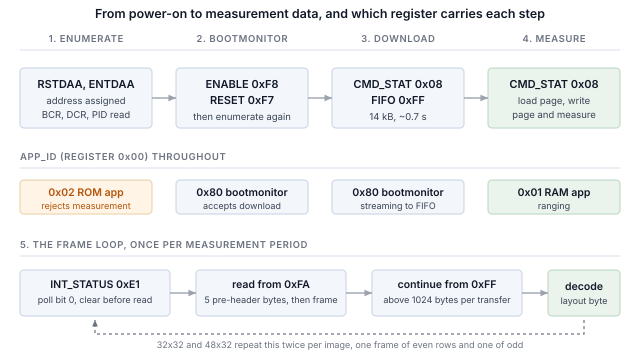

## 1 소개

ams OSRAM TMF8829는 I2C 및 SPI와 함께 MIPI I3C 인터페이스를 동일한 두 핀으로 제공하는 직접 비행 시간 거리 측정 센서입니다.
방출한 레이저 펄스에 대해 돌아온 광자의 시간을 재어 거리를 측정하며, 측정은 존으로 나뉜 단일 광자 애벌란시 다이오드 어레이 전체에서 이루어집니다.
시야 전체에 대해 하나의 거리를 보고하는 대신 존마다 개별 결과를 보고합니다. 가장 큰 구성은 1536개 존을 보고하며, 각 존은 서로 다른 거리에 있는 최대 네 개의 반사를 보고할 수 있습니다.

I3C는 2선 구성을 유지하면서 그 위에 상당한 기능을 추가합니다.

Table: I3C가 2선 센서 인터페이스에 추가하는 기능

| 기능 | 설계에 주는 이점 |
|---|---|
| 동적 주소 할당(DAA) | 컨트롤러가 실행 중에 주소를 할당하므로 정적 주소 충돌이 더 이상 보드 설계의 제약이 아니며, 동일한 부품이 하나의 버스를 공유할 수 있습니다 |
| 버스로부터의 식별 | 모든 타깃이 48비트 임시 식별자, 디바이스 클래스, 버스 기능을 보고하므로 컨트롤러는 미리 알지 못하는 버스도 열거할 수 있습니다 |
| 공통 명령 코드 | 열거, 식별, 설정, 인터럽트 제어, 리셋을 위한 표준 명령 세트(브로드캐스트 및 다이렉트)로, 모든 규격 준수 타깃에서 동일합니다 |
| 인밴드 인터럽트(IBI) | 센서가 데이터 라인으로 호스트에 인터럽트를 걸고 원인을 알려 주는 바이트를 함께 보내므로, 인터럽트 핀을 배선하거나 할당할 필요가 없습니다 |
| 고속 데이터 레이트 모드 | 더블 데이터 레이트 전송은 클럭 에지 쌍마다 2비트를 전송하여, 클럭을 높이지 않고 신호 속도를 두 배로 만듭니다 |
| 더 높은 신호 속도 | 푸시풀 클럭으로 싱글 데이터 레이트 모드에서 최대 12.5 MHz이며, I2C는 오픈 드레인의 한계를 받습니다 |
| 저전력 | 푸시풀 신호는 I2C가 계속 소비하는 정적 풀업 전류를 피하며, 액티비티 상태를 통해 컨트롤러가 타깃에 예상 버스 지연을 알려 타깃이 더 깊이 유휴 상태에 들어갈 수 있습니다 |
| 핫 조인(Hot-Join) | 버스가 동작한 후에 전원이 들어온 타깃이 열거를 요청할 수 있습니다 |
| 표준 리셋 및 복구 | 벤더별 시퀀스가 아니라 정의된 타깃 리셋과 정의된 오류 검출 및 복구 |
| I2C 호환성 | 레거시 I2C 디바이스가 버스를 공유할 수 있습니다 |

타깃은 센서에 필요한 부분 집합을 구현하며, 그 부분 집합은 부품마다 다릅니다. 이 노트는 Binho Supernova USB 호스트 어댑터로 TMF8829를 다룹니다.
이를 열거하고, 버스로부터 식별하고, 부트로더에 진입하고, 거리 측정 펌웨어를 다운로드하여 시작하고, 존 구성을 선택하고, 부품이 제공하는 모든 해상도에서 측정 프레임을 읽고 디코딩하고,
결과를 렌더링하고, HDR-DDR로 프레임을 전송하며, 위 기능 중 타깃이 실제로 구현한 것을 확인합니다.

이 부품의 세 가지 특성이 호스트를 어떻게 작성해야 하는지를 결정하며, 세 가지 모두 레지스터 맵 방식의 센서와 다릅니다.

Table: 레지스터 맵 방식 센서와 다른 점

| 특성 | 호스트에 미치는 영향 |
|---|---|
| 거리 측정 펌웨어가 상주하지 않음 | 부품은 부트로더 또는 ROM 애플리케이션으로 시작하며, 둘 다 거리를 측정하지 않습니다. 애플리케이션은 전원을 켤 때마다 버스를 통해 RAM으로 다운로드되므로, 이 부품을 사용하는 모든 제품의 부팅 시간의 일부가 됩니다 |
| 결과가 FIFO를 통해 반환됨 | 거리 레지스터가 없습니다. 측정은 길이가 프레임 자체에 기술된 하나의 연속 전송으로 읽으며, 짧게 읽으면 나머지가 FIFO에 남아 다음 프레임을 손상시킵니다 |
| 측정이 바이트가 아니라 킬로바이트 단위 | 48x32 구성은 가장 작은 결과 포맷에서 측정당 4674바이트를 반환합니다. 이로 인해 부딪히는 전송 한도는 7.3절에서 확인하며, 각 구성의 크기는 11절에 제시합니다 |

여기서는 마이크로컨트롤러, 펌웨어, 드라이버 포팅이 전혀 필요하지 않습니다. 모든 단계는 호스트 PC에서 실행하는 명령입니다.



### 1.1 범위

이 문서를 마치면 하드웨어를 갖춘 독자는 TMF8829를 I3C 버스에 열거하고, 부트로더로 강제 진입시키고, 거리 측정 펌웨어를 다운로드하여 시작하고,
각 존 그리드를 구성하고, 두 프레임으로 나뉘어 도착하는 두 구성을 포함하여 측정 프레임을 읽고 디코딩하고, 결과를 렌더링하고,
HDR-DDR로 프레임을 전송하여 같은 프레임의 싱글 데이터 레이트 읽기와 대조 검증하고, 관찰 가능한 효과로부터 타깃이 무엇을 구현하는지 확인하게 됩니다.

다루는 부품은 LIGHTRANGER 14 Click의 TMF8829입니다. 하드웨어에서 시험했으며 이 문서의 모든 출력은 실제 캡처입니다.

이 노트는 광학 캘리브레이션, 커버 글라스에 대한 크로스토크 보상, 히스토그램 출력 모드, 존별 거리를 직교 좌표로 변환하는 포인트 클라우드 보정은 다루지 않습니다.
이는 설계에서 센서 앞에 두는 광학 스택에 따라 달라지며, 센서 벤더가 문서로 제공합니다.

### 1.2 적용 디바이스

예제는 LIGHTRANGER 14 Click의 TMF8829를 사용합니다. 버스 절차는 모든 I3C 타깃에 적용되며, 부트로더, 구성, 프레임 절차는
여기서 설명하는 호스트 인터페이스를 공유하는 TMF882x 및 TMF88xx 제품군에 적용됩니다.

### 1.3 관련 문서

Table: 관련 문서

| 문서 | 출처 |
|---|---|
| TMF8829 데이터시트 | ams OSRAM, DS001140 v2-00, 2025-Nov-12. 10.2절에서 인터페이스 절을 인용한 리비전 |
| TMF8829 Host Driver Communication | ams OSRAM. 데이터시트가 참조하지만 포함하지 않는 프레임 구조를 정의 |
| TMF8829 Python 드라이버 | `https://github.com/ams-OSRAM/tmf8829_driver_python`, MIT 라이선스. RAM 애플리케이션 이미지와 프레임 구조 정의의 출처 |
| MIPI I3C Specification | MIPI Alliance |
| Binho Supernova 문서 | `https://support.binho.io` |

## 2 필요한 장비 및 소프트웨어

### 2.1 하드웨어

Table: 필요한 장비

| 항목 |
|---|
| Binho Supernova USB 호스트 어댑터 |
| LIGHTRANGER 14 Click, 또는 TMF8829를 탑재한 기타 보드 |
| USB-C 케이블 |

### 2.2 연결

Table: 사용하는 신호

| 신호 | 용도 |
|---|---|
| SCL | I3C 클럭, 어댑터에서 타깃으로 |
| SDA | I3C 데이터, 양방향 |
| 3.3 V | 타깃 전원 |
| GND | 리턴 |

선 두 개와 전원 하나입니다. 이 문서에서는 어떤 경우에도 인터럽트 핀, 리셋 라인, 스트래핑 저항을 연결하지 않습니다.

> **참고:** 이 문서의 어떤 절차에서도 외부 풀업 저항을 장착하지 않았습니다. I3C는 데이터 단계를 푸시풀로 실행하며,
> 동적 주소 할당과 브로드캐스트 명령 코드에 필요한 오픈 드레인 단계는 어댑터가 구동합니다. 열거, 펌웨어 다운로드,
> 그리고 11절의 모든 프레임 읽기는 SCL과 SDA에 어댑터와 타깃 외에는 아무것도 없는 버스에서 측정했습니다.

### 2.3 버스 설정

Table: 사용한 버스 설정

| 설정 | 값 |
|---|---|
| 푸시풀 레이트 | 5 MHz, 듀티 사이클 50% |
| 오픈 드레인 레이트 | 1 MHz |
| 구동 강도 | 패스트 모드 |
| 버스 전압 | 3.3 V |

### 2.4 소프트웨어

```
pip install binhosupernova
```

의존성은 Python 3.12와 `binhosupernova` 패키지뿐입니다.

거리 측정 펌웨어는 에셋 아카이브에 `assets/firmware/tmf8829_application.hex`로 포함되어 있습니다. 이는 센서 벤더의 것으로 MIT 라이선스로 공개되었으며,
해당 라이선스가 `assets/firmware/LICENSES-MIT.TXT`로 함께 제공됩니다. 최신 이미지는 언제든 `https://github.com/ams-OSRAM/tmf8829_driver_python`에서 받을 수 있습니다.

렌더러는 블록 문자와 24비트 색상으로 그립니다. 이를 표시할 수 없는 터미널에서는 자동으로 대체 방식으로 전환되므로, 일반 콘솔에서는 오류 대신 더 거친 렌더링이 생성됩니다.
PDF는 색상을 표시할 수 없으므로 이 문서의 모든 출력 목록은 대체 방식의 결과입니다.

하드웨어를 연결하지 않고 설정을 확인합니다.

```
python i3c_tof.py demo --mode 16x16 --style mono
```

## 3 첫 접촉: 버스 열거

```
python i3c_mems.py scan
```

```
1 target(s) on the bus at 3300 mV, PUSH_PULL_5_MHZ_50_DC, OPEN_DRAIN_1_MHZ

  dynamic address 0x08
    PID  02 10 53 CD 47 22   device id 0x53CD
    BCR  0x23   DCR 0x00
    HDR  claimed   IBI capable
    profile  none in this tool
```

이는 두 개의 공통 명령 코드로 이루어졌습니다. **RSTDAA**는 이미 할당된 동적 주소를 지워 버스가 알려진 상태에서 시작하게 합니다.
이어서 **ENTDAA**가 동적 주소 할당을 실행합니다. 컨트롤러가 브로드캐스트하면 각 타깃이 48비트 임시 식별자로 중재하고,
차례로 주소를 받습니다. 부품이 하나뿐이면 그 주소는 `0x08`입니다.

어디에서도 주소를 설정하지 않았으며, 부품의 정적 주소는 사용되지도 필요하지도 않았습니다.

버스 특성 레지스터는 자세히 읽어 볼 가치가 있습니다. 이는 일련의 주장이며, 이 노트의 나머지 부분에서 이를 시험하기 때문입니다.

Table: BCR 0x23, 비트별 의미

| 비트 | 값 | 의미 |
|---|---|---|
| 0 | 1 | 최대 데이터 속도 제한: 타깃에 제한이 있으므로, 컨트롤러는 클럭을 높이기 전에 조회해야 합니다 |
| 1 | 1 | IBI 지원: 타깃이 인밴드 인터럽트를 발생시킬 수 있습니다 |
| 2 | 0 | IBI에 필수 데이터 바이트가 없습니다 |
| 5 | 1 | 고급 기능이며, 이 부품에서는 HDR을 의미합니다 |

10절에서는 두 가지를 모두 측정된 동작과 대조하여 시험합니다.

## 4 애플리케이션 상태와 부트로더 진입

레지스터 `0x00`은 부품의 세 애플리케이션 중 어느 것이 실행 중인지 보고합니다. 파워 사이클 직후의 부품에서 처음 세 레지스터를 읽으면 다음과 같습니다.

```
  target at 0x08, APP_ID 0x80 v33.0
```

Table: 애플리케이션 식별자

| 값 | 실행 중인 것 | 하는 일 |
|---|---|---|
| `0x80` | 부트모니터 | 부트로더 명령을 받아들입니다. RAM 읽기 및 쓰기, FIFO 쓰기, 애플리케이션 시작 |
| `0x02` | ROM 애플리케이션 | 버전을 보고하고 측정 명령을 거부합니다 |
| `0x01` | RAM 애플리케이션 | 거리를 측정합니다 |

부품이 어느 것으로 시작하는지는 `ENABLE`의 `powerup_select` 필드가 기본값인 *재정의 없음*으로 유지될 때 퓨즈에 의해 선택됩니다.
여기서 측정한 부품은 부트모니터로 시작하며 부트로더 버전 33.0을 보고하므로, 이 보드에는 대체할 ROM 애플리케이션이 없고
호스트가 처음 보는 상태가 이미 다운로드를 기다리는 상태입니다.

`0x02`로 시작하는 부품은 아래 단계가 필요하고, `0x80`으로 시작하는 부품은 필요하지 않습니다. `0x01`로 읽히는 부품은 이전 세션에서 다운로드한 펌웨어를 실행 중이며,
소프트 리셋만으로는 되돌릴 수 없으므로 아래 단계가 이 경우에도 적용됩니다.

까다로운 점은 **두 애플리케이션 모두 부트로더 명령 세트를 구현하지 않는다**는 것입니다. 애플리케이션을 실행 중인 부품에는 다운로드를 받아들이라고 지시할 수 없습니다.
그렇게 하는 명령을 이해하지 못하기 때문입니다. 진입 경로는 무엇이 실행 중이든 항상 살아 있는 호스트 인터페이스 레지스터입니다.
`powerup_select`는 2비트 필드이며, 값 1이 부트모니터를 강제합니다.

```python
PON            = 1 << 2          # keep the part powered while it reboots
FORCE_BOOTMON  = 1 << 4          # powerup_select = 1: ignore the fuses
SOFT_RESET     = 1 << 6

device.write(ENABLE, [PON | FORCE_BOOTMON])      # 0xF8
device.write(RESET,  [SOFT_RESET])               # 0xF7
```

Table: `ENABLE` 비트 4–5, `powerup_select`

| 값 | 의미 |
|---|---|
| 0 | 재정의 없음. 퓨즈가 실행할 것을 선택합니다 |
| 1 | 부트모니터를 강제하고 퓨즈를 무시하며 호스트 명령을 기다립니다 |
| 2 | 벡터 테이블을 RAM의 시작 주소로 설정하고 그곳에 있는 것을 실행합니다 |

리셋으로 타깃이 버스에서 빠지므로, 다른 작업이 동작하려면 다시 열거해야 합니다. 유틸리티는 이를 자동으로 수행하고 결과를 보고합니다.

```
  an application is running; forcing the bootmonitor
    bootloader at 0x08
```

여기서는 동적 주소가 같은 값으로 돌아왔지만, 타깃이 여러 개인 버스에서는 이것이 보장되지 않습니다. 가정하지 말고 다시 읽으십시오.

## 5 RAM 애플리케이션 다운로드

펌웨어는 Intel HEX 파일로 제공됩니다. 이전 레코드와 연속되는 레코드는 파싱 중에 병합해야 하며, 그러면 16바이트 레코드마다 버스 명령 하나를 보내는 대신
몇 개의 긴 스트림으로 다운로드가 진행됩니다.

각 블록은 대상 주소와 **32비트 워드 단위**의 길이를 담은 FIFO 쓰기 명령으로 먼저 알린 다음, FIFO 레지스터로 스트리밍합니다.

```python
params = list(address.to_bytes(4, "little")) + list((len(block) // 4).to_bytes(2, "little"))
device.command(BL_W_FIFO_BOTH, params)           # 0x45 to CMD_STAT
device.write(FIFO, block)                        # 0xFF
```

길이가 워드 단위로 표현되므로 블록은 워드 경계까지 패딩해야 합니다. 일부만 채워진 워드는 기술할 수 없습니다.

### 5.1 두 프로세서 모두에 다운로드

위의 명령은 `W_FIFO`(`0x44`)가 아니라 `W_FIFO_BOTH`(`0x45`)입니다. 둘의 차이는 바이트를 어느 프로세서에 쓰느냐입니다.
부품에는 프로세서가 두 개 있고 둘 다 이미지가 필요하며, 하나에만 쓰는 명령을 사용해도 시퀀스의 어느 지점에서도 오류로 보고되지 않습니다.

`W_FIFO`로 다운로드하면 정상적으로 완료됩니다. 모든 블록이 확인 응답됩니다. `START_RAM_APP`은 수락되고 `OK`로 응답합니다. 그런 다음:

```
  START_RAM_APP -> OK; ENABLE 0x14 cpu_ready=False
  regs0-3 FF 21 00 00
```

레지스터 `0x00`은 `0xFF`로 읽히고 `ENABLE`의 `cpu_ready`는 Low로 유지됩니다. 첫 번째 CPU는 시작되었지만 두 번째에는 펌웨어가 없어 부품이 정지했습니다.
다운로드나 시작 과정에서 문제를 보고한 것은 아무것도 없습니다. `W_FIFO_BOTH`로 같은 시퀀스를 실행하면 다음과 같습니다.

```
  START_RAM_APP -> OK; ENABLE 0x94 cpu_ready=True
  regs0-3 01 02 C8 00
```

이 장애는 세션에 따라 간헐적으로 나타나며 재현 가능하지 않습니다. RAM 내용은 소프트 리셋 후에도 유지되므로, 한 번이라도 애플리케이션을 실행한 부품은
두 번째 CPU에 유효한 이미지를 보유하고 있으며, 그 위에 `W_FIFO`로 다운로드해도 정상적으로 시작됩니다. 장애는 파워 사이클 후 첫 번째 콜드 스타트에서 나타납니다.

두 번의 읽기로 이를 시작 실패의 다른 원인과 구분할 수 있습니다. `ADDR_RAM`(`0x43`)은 읽기 포인터를 설정하고 `R_RAM`(`0x40`)은 그 위치에서 바이트를 반환하므로,
다운로드가 기록되었는지 확인할 수 있습니다. `ENABLE`은 `pon`과 `cpu_ready`를 보고하므로, 프로세서 정지와 타깃이 더 이상 주소 지정되지 않는 상태를 구분할 수 있습니다.
두 경우 모두 레지스터 `0x00`에서 `0xFF`를 반환합니다.

부트로더와 애플리케이션은 같은 명령 핸드셰이크를 사용하므로 한 번 이해해 둘 가치가 있습니다. `CMD_STAT`은 명령이 실행 중일 때는 그 명령 자체를,
완료되면 상태 코드를 다시 읽어 줍니다. 따라서 호스트는 특정 값이 아니라 *보낸 명령 이외의 모든 값*을 폴링합니다.

```python
while time.monotonic() < deadline:
    status = self.read_u8(CMD_STAT)
    if status is not None and status != code:
        return status
```

대신 `STAT_OK`를 폴링하면 다른 것을 보고하는 명령에서 멈추게 되고, 첫 번째 읽기 전에 끝나는 명령에서는 경쟁 상태가 발생합니다.

```
python i3c_tof.py bringup --firmware firmware/tmf8829_application.hex
```

```
  target at 0x08, APP_ID 0x80 v33.0
  downloading 14,444 bytes in 1 segment(s)
    14,444 bytes in 0.64 s (22.0 kB/s)
  RAM application v2.200 running
  8x8 configured, result format 0x01
  measuring
  frames report layout 0x01: 1 peak(s) per zone
  frame 2  8x8  62/64 zones (97%)  near 128 mm  median 452 mm  far 5462 mm  0 multi-object  20 C
  the part is measuring; run 'live' to watch it
```

버스 명령당 256바이트로 두 프로세서에 14킬로바이트를 0.7초 미만에 보냅니다. 이는 전원을 켤 때마다 일어나므로, 이 부품을 사용하는 모든 제품의 부팅 시간의 일부가 됩니다.

애플리케이션을 시작하면 타깃이 재시작되어 버스에서 빠집니다. 레지스터를 읽으려면 먼저 다시 열거해야 합니다. 이를 건너뛰면 모든 읽기가 `0xFF`를 반환하며,
이는 위에서 설명한 정지와 똑같아 보이지만 같은 것이 아닙니다.

## 6 존 그리드 선택과 측정 시작

센서는 존 그리드마다 사전 구성된 페이지를 갖고 있으므로, 해상도 선택은 레지스터 쓰기 표가 아니라 명령 하나로 이루어집니다.
이 명령은 페이지를 레지스터 `0x22` 이상으로 로드하며, 다시 쓰기 전에 재정의할 가치가 있는 것은 무엇이든 재정의할 수 있습니다.

Table: 존 그리드

| 그리드 | 명령 | 존 수 | 측정당 프레임 수 |
|---|---|---|---|
| 8x8 | `0x40` | 64 | 1 |
| 8x8 장거리 | `0x41` | 64 | 1 |
| 8x8 고정밀 | `0x42` | 64 | 1 |
| 16x16 | `0x43` | 256 | 1 |
| 32x32 | `0x45` | 1024 | 2 |
| 48x32 | `0x47` | 1536 | 2 |

마지막 열은 사소한 내용이 아닙니다. 7.4절이 바로 이것에 관한 절입니다.

이후 모든 것에 중요한 페이지 레지스터가 두 개 있습니다.

```python
CFG_PERIOD_MS     = 0x22        # u16, measurement period
CFG_RESULT_FORMAT = 0x2A        # what each zone contains
```

영향이 큰 것은 `CFG_RESULT_FORMAT`입니다. 이는 각 존이 보고할 객체 수와 함께 제공될 선택 필드를 설정하며,
모든 프레임에서 존마다 비용이 듭니다.

Table: 결과 포맷, 비트별 의미

| 비트 | 필드 | 비용 |
|---|---|---|
| 0–2 | 존당 보고 객체 수, 1~4 | 각 3바이트, 신호 강도 포함 시 5바이트 |
| 3 | 객체별 신호 강도 | 객체당 +2바이트 |
| 4 | 존별 노이즈 플로어 | +2바이트 |
| 5 | 존별 크로스토크 추정값 | +2바이트 |

객체 하나에 선택 필드가 없으면 존은 3바이트입니다: `1 * (3 + 0) + 0 + 0`. 객체 넷에 모든 선택 필드를 포함하면 24바이트입니다: `4 * (3 + 2) + 2 + 2`.
48x32 그리드에서는 이것이 측정당 4674바이트와 36,930바이트의 차이가 되므로, 포맷은 취향이 아니라 대역폭에 관한 결정입니다.

페이지를 다시 쓰고 측정을 시작하는 것은 명령 하나이며, 그 성공 코드는 다른 모든 명령이 사용하는 것과 다릅니다.

```python
status = device.command(CMD_WRITE_PAGE_AND_MEASURE)   # 0x14
# STAT_ACCEPTED (0x01), not STAT_OK (0x00)
```

주기적 측정은 `STAT_ACCEPTED`를 보고하고 중지될 때까지 계속 실행됩니다. 이 부품의 다른 모든 명령은 `STAT_OK`를 보고하므로,
그것을 검사하는 코드는 실행 중인 측정을 실패한 것으로 판단합니다.

## 7 프레임 읽기

### 7.1 프레임은 FIFO에서 옵니다

거리 레지스터는 없습니다. 측정이 완료되면 `INT_STATUS`(`0xE1`)의 비트 0이 설정되고, 프레임은 FIFO에서 읽어 냅니다.

읽기는 FIFO에서 시작하지 않습니다. 레지스터 포인터가 자동 증가하고 네 개의 systick 레지스터가 `0xFA`와 `0xFF`의 FIFO 데이터 레지스터 사이에 있으므로,
FIFO 상태 레지스터 `0xFA`에서 시작합니다. 이 다섯 바이트는 프레임보다 먼저 도착하며 프레임의 일부가 아니므로, 디코더는 프리헤더 길이를 받습니다.

```
  0xFA  FIFOSTATUS  ─┐
  0xFB  SYSTICK_0    │  five bytes that precede every frame
  0xFC  SYSTICK_1    │  and belong to none of them
  0xFD  SYSTICK_2    │
  0xFE  SYSTICK_3   ─┘
  0xFF  FIFO         ─  the frame itself, and it does not auto-increment past here
```

`INT_STATUS`는 1을 써서 해제하는 레지스터이며, 프레임을 읽은 뒤가 아니라 *읽기 전에* 해제해야 합니다. 센서는 자유 실행 중이므로,
나중에 해제하면 이전 프레임이 전송되는 동안 도착한 프레임의 플래그를 버릴 수 있습니다.

### 7.2 레이아웃 바이트가 모든 존의 크기를 결정합니다

프레임은 16바이트 헤더, 존으로 이루어진 본문, 12바이트 푸터로 구성됩니다.

Table: 프레임 헤더

| 오프셋 | 필드 | 비고 |
|---|---|---|
| 0 | `id` | 상위 니블 `0x1`은 결과 프레임을 나타내며, 하위 니블은 초점면 모드입니다 |
| 1 | `layout` | `CFG_RESULT_FORMAT`과 같은 인코딩에 비트 6의 서브프레임 플래그를 더한 것 |
| 2–3 | `payload` | 이 필드 이후 모든 내용의 길이 |
| 4–7 | `fNumber` | 연속 프레임 번호 |
| 8–10 | `temperature` | 섭씨온도, 부호 있음 |
| 11 | `bdv` | 사용된 항복 전압 |
| 12–15 | `refPos` | 광학 기준 피크 위치 |

헤더 이후의 모든 바이트 위치가 `layout` 바이트로 결정되므로, 다른 무엇보다 먼저 이를 디코딩해야 합니다. 존의 폭은 3~24바이트이며,
잘못된 간격으로 읽어도 실패하지 않습니다. 그럴듯하지만 틀린 숫자로 가득한 프레임이 만들어집니다.

헤더에는 자체 길이도 들어 있으며, 이것이 읽기 크기를 정하는 더 견고한 방법입니다.

```python
size = PRE_HEADER + 4 + payload      # the payload field counts everything after itself
```

구성된 모드로부터 크기를 계산해 프레임이 보고하는 값과 비교하는 것은 저렴하고 가치 있는 검사입니다. 두 값이 다르면, 기록한 구성이 센서가 측정에 사용 중인 구성이 아닌 것입니다.

두 가지 세부 사항이 더 있으며, 각각 오류가 아니라 틀린 답을 만듭니다.

**거리는 1/4 밀리미터 단위입니다.** 이것이 부품이 내세우는 0.25 mm 분해능입니다. 밀리미터로 읽으면 2.7 m에 있는 벽이 11 m에 나타나며,
결과의 어디에도 형식이 잘못된 흔적은 보이지 않습니다.

**그렇지 않을 때를 제외하고 말입니다.** 푸터의 예약 바이트의 비트 0은 펌웨어가 이미 밀리미터로 변환했음을 뜻합니다.
따라서 존을 스케일링하기 *전에* 푸터를 읽어야 하며, 이는 바이트가 도착하는 순서와 반대입니다.

Table: 프레임 푸터

| 오프셋 | 필드 |
|---|---|
| 0–3 | `t0Integration` |
| 4–7 | `t1Integration` |
| 8 | `frameStatus`, 비트 0이 설정되면 유효 |
| 9 | `reserved`, 비트 0이 설정되면 거리가 이미 밀리미터 단위 |
| 10–11 | `eof`, 항상 `0xE0F7` |

`frameStatus`와 `eof`는 둘 다 검사할 가치가 있으며, 서로 다른 것을 검사합니다. 프레임 끝 마커는 프레임이 FIFO에서 온전하게 나왔음을 말해 줍니다.
`frameStatus`는 센서가 그 프레임의 바탕이 된 측정을 사용 가능하다고 판단함을 말해 줍니다.

### 7.3 프레임 하나가 전송 한 번보다 클 수 있습니다

32x32 프레임은 1569바이트입니다. 이를 한 번의 호출로 읽으면 아무것도 반환되지 않습니다.

```
error: short frame read: 0 of 1569 bytes
```

잘린 읽기가 아니라 빈 읽기이며, 프레임은 여전히 센서의 FIFO에 남아 있습니다. 읽기 길이에 대해 이진 탐색을 하면 경계를 정확히 찾을 수 있습니다.

```
    largest successful read: 1024 bytes
    request  1024 ->  1024 bytes ok
    request  1025 ->     0 bytes SHORT
```

이 경계는 센서가 아니라 호스트 어댑터에 속하므로, 다른 컨트롤러에 대해서는 같다고 가정하지 말고 측정해야 합니다. 타깃 자체가 선언하는 값은 또 다른 숫자이며,
이를 기준으로 무엇인가의 크기를 정하기 전에 읽어 볼 가치가 있습니다.

```
  GETMRL -> 01 FF      maximum read length 511 bytes
  GETMWL -> FF FF      maximum write length 65535 bytes
```

타깃은 511바이트를 선언하지만 이를 강제하지 않습니다. 완전한 16x16 프레임을 801바이트로 읽으면 성공하고 디코딩됩니다. 따라서 어느 숫자도 단독으로는 신뢰할 만한 기준이 아닙니다.
선언된 길이는 실제로 동작하는 길이를 과소평가하고, 전송을 실제로 제한하는 것은 어댑터의 한도이며, 아래의 분할 읽기는 그 조합을 기준으로 크기를 정했습니다.

따라서 어댑터 한도를 넘는 프레임은 나누어 읽어야 하며, 이를 가능하게 하는 것이 FIFO입니다.
첫 번째 읽기는 이전과 같이 `0xFA`에서 시작하고, 이후의 모든 읽기는 `0xFF`에서 시작합니다. `0xFF`는 자동 증가하지 않으므로, 반복해서 읽으면 프레임을 처음부터 다시 시작하지 않고 같은 프레임을 이어서 읽습니다.

```python
register = FIFOSTATUS if taken == 0 else FIFO
chunk = self.read(register, min(MAX_READ, size - taken))
```

16x16보다 큰 모든 그리드는 모든 프레임에서 이것이 필요합니다.

### 7.4 가장 큰 두 그리드는 인터리빙되어 도착합니다

32x32 또는 48x32 측정은 한 프레임이 담을 수 있는 것보다 데이터가 많으므로, 센서는 한 번에 16행씩 보내고 어느 절반인지를 레이아웃 바이트의 비트 6으로 표시합니다.

두 절반은 이미지의 위쪽과 아래쪽이 **아닙니다**. 첫 번째가 짝수 행을, 두 번째가 홀수 행을 담습니다.

```
  frame with subframe flag 0  ->  image rows 0, 2, 4, 6, ...
  frame with subframe flag 1  ->  image rows 1, 3, 5, 7, ...
```

인터리빙하지 않고 쌓으면, 틀렸지만 형식 오류로 검출할 수 없는 결과가 나옵니다. 장면이 절반의 수직 해상도로 위아래로 두 번 나타납니다.

```
  ::..          ########%%%%%%%%%@      <- the same scene
  :::...      %%#%######%%%%%%%%@@
  ::::..  ##%%%%%%%%%%%%%%%%%%%%%@
  ::::...  .#########%%%%%%%%%%%%%
  ::::.......
  ::::......
   :....      ##########%%%%%%%%%@      <- and again, sixteen rows down
  :::...  #%%%%%%%%%%%%%%%%%%%%%@@
  ::::..    %%%%%%%%%%%%%%%%%%%%%%
  ::::... ..  ########%%%%%%%%%%%%
  ::::......
  ::::......
```

도착 순서가 아니라 서브프레임 플래그로 정렬하면, 누락되거나 중복된 프레임이 조용히 틀린 결과가 아니라 검출 가능한 오류가 됩니다.

## 8 측정 결과 렌더링

숫자로 출력한 거리 그리드는 센서가 보고한 모든 것을 담고 있지만, 공간 구조를 보여 주기에는 좋지 않은 형태입니다. 렌더러의 세 가지 특성이 이를 해결합니다.

**문자 셀 하나에 존 두 개.** 터미널 셀은 높이가 폭의 약 두 배이므로, 셀 하나에 존 하나를 그리면 정사각형 그리드가 길쭉한 직사각형으로 렌더링됩니다.
위쪽 절반 블록을 한 색으로 그리고 아래쪽 절반으로 배경이 보이게 하면, 수직으로 인접한 두 존을 셀 하나에 넣을 수 있습니다.
종횡비가 올바르게 나오고 32x32 이미지가 터미널 16행에 들어갑니다.

**신뢰도는 숫자로 출력하지 않고 그림으로 나타냅니다.** 모든 존에는 신호 대 잡음비가 있으며, 신뢰도가 낮은 판독값을 높은 판독값과 똑같이 그리면 적극적으로 오해를 불러일으킵니다.
색상은 신뢰도에 비례하여 배경색 쪽으로 섞이므로, 불확실한 판독값은 뒤로 물러나고 시선은 신뢰할 만한 판독값에 머뭅니다.

**색상 스케일을 이미지와 함께 렌더링합니다.** 색상 램프가 무엇에 매핑되었는지 모르면 깊이 이미지를 거리로 읽을 수 없습니다.
범위는 프레임 자체에서, 극값이 아니라 2번째와 98번째 백분위수로 취하므로, 하나의 이상값이 스케일의 나머지를 압축하지 않습니다.

```
python i3c_tof.py frame --mode 16x16 --style mono --histogram
```

```
  frame 2  16x16  256/256 zones (100%)  near 126 mm  median 369 mm  far 3536 mm  0 multi-object  23 C

  #########%%%%%%%
  #########%%%%%%%
  ########%%%%%%%%
  #########%%%%%%%
  ########%%%%%%%%
  #######%%%%%%%%%
  ######%%%%%%%%%%
    ####%%%%%%%%%@
    ###%%%%%%%%%%%
    ##%%%%%%%%%%%@
    ##%%%%%%%%%%%@
     #%%%%%%%%%%%@
     ##%%%%%%%%%%@
     ##%%%%%%%%%%@
      %%%%%%%%%%%%
     %%%%%%%%%%%%%

      13 cm ████████████████████████████████████████████████ 150
      41 cm ██████████████████████████ 82
      69 cm
      98 cm
     126 cm
     155 cm
     183 cm
     212 cm
     240 cm █ 6
     268 cm █████ 17
     297 cm
     325 cm  1
```

가까운 것은 조밀하고 먼 것은 성기며, 반사가 없는 존은 비어 있습니다. 프레임 전체의 그라데이션은 센서에서 멀어지는 방향으로 기울어진 표면이며, 왼쪽의 빈 쐐기 모양은 그 표면이 측정 범위를 벗어나는 곳입니다.

히스토그램은 공간 보기로는 보이지 않는, 거리별 반사 분포를 보고합니다. 0.5미터 이내의 두 군집이 256개 존 중 232개를 차지하고, 2.4~3.3 m 사이에 24개의 반사가 있습니다.

하드웨어 없이도 표시를 개발하고 확인할 수 있도록 합성 장면 생성기가 포함되어 있습니다.

```
python i3c_tof.py demo --mode 32x32 --scene corner
```

벽, 그 앞의 물체, 존이 둘 다에 걸치는 가장자리, 그리고 거리에 따라 약해지는 반사를 생성합니다. 이는 생각보다 중요합니다.
무작위 숫자에서는 보기 좋은 렌더러도 실제 깊이 데이터에는 구조가 있으므로 실제 장면에서는 읽을 수 없을 수 있습니다.

## 9 존당 둘 이상의 객체

가까운 물체의 가장자리를 바라보는 존은 그 너머도 봅니다. 이 부품은 존당 최대 네 개의 객체를 거리순으로 보고하며,
가장 가까운 것만 표시하는 렌더러는 센서가 하는 유용한 일 가운데 하나를 숨기게 됩니다.

```
python i3c_tof.py frame --peaks 4 --signal --noise --xtalk --style numeric
```

```
  8x8 configured, result format 0x3C

  frame 2  8x8  64/64 zones (100%)  near 136 mm  median 358 mm  far 568 mm  15 multi-object  24 C

     49   47   57   53   18   15   14   14
     49   47   51   49   18   15   14   14
     53   50   48   44   20   17   16   14
     56   49   44   40   32   19   18   14
     42   44   41   38   32   21   21   14
     43   44   40   36   32   23   23   14
     42   43   41   36   32   26   25   14
     38   41   42   37   34   31   28   14
```

64개 존 중 15개가 둘 이상의 표면을 보고했습니다. 컬러 렌더러에서는 이 셀들을 꽉 찬 글리프 대신 음영 글리프로 그리므로, 이 기능은 설명으로만이 아니라 눈으로 보입니다.

비용은 결과 포맷 바이트에 나타납니다. `0x3C`는 신호, 노이즈, 크로스토크를 포함한 네 객체로, 기본 포맷의 3바이트에 비해 존당 24바이트입니다.
8x8 그리드에서는 192바이트에 대해 1536바이트이고, 48x32에서는 4608바이트에 대해 36,864바이트입니다.

## 10 선언된 기능과 측정된 동작의 비교

3절에서는 BCR에서 두 가지 기능 선언을 읽었습니다. 둘 다 결과 코드가 아니라 관찰 가능한 동작과 대조하여 시험했습니다.

### 10.1 인밴드 인터럽트: 가능하지만 사용되지 않음

BCR의 비트 1은 타깃이 인밴드 인터럽트를 발생시킬 수 있다고 말하며, 이를 통해 완료된 측정은 폴링되는 대신 데이터 라인에서 스스로 알릴 수 있을 것입니다.
컨트롤러가 IBI를 받아들이도록 설정하고 센서를 100 ms로 자유 실행시킨 상태의 결과입니다.

```
  IBIs in 3 s with the sensor free-running: 0
  frames signalled through INT_STATUS in the same 3 s: 31
```

31개 프레임이 도착했습니다. 그중 어느 것도 스스로 알리지 않았습니다. 센서 펌웨어는 `INT_STATUS` 레지스터와 인터럽트 핀으로 프레임 완료를 알리며, 이를 위해 IBI를 발생시키지 않습니다.
이는 벤더 자체 드라이버와도 일치하는 해석으로, 그 드라이버는 레지스터를 폴링하며 IBI 지원을 전혀 포함하지 않습니다.

이는 결함으로 다루기보다 분명하게 밝혀 둘 가치가 있습니다. BCR은 실리콘의 버스 인터페이스가 무엇을 할 수 있는지 기술할 뿐, 그 위에서 실행되는 애플리케이션 펌웨어가 그 기능을 사용한다고 약속하지 않습니다.
10 Hz 프레임을 잡기 위해 100 Hz로 레지스터를 폴링하는 것은 폴링당 1바이트가 들 뿐이며 충분히 실용적입니다. 그러나 두 선만으로 인터럽트 구동 프레임 수집을 기대했던 설계라면,
출하할 펌웨어 리비전에서 이를 확인해야 합니다.

### 10.2 HDR-DDR: 구현되어 있지만 문서화되지 않음

비트 5는 고급 기능을 선언하며, I3C에서 이는 타깃이 최소 하나의 고속 데이터 레이트 모드를 지원한다는 뜻입니다. 이 부품의 버스 인터페이스를 기술한 공개 자료는 두 가지인데, 둘 다 그런 모드를 언급하지 않습니다.

데이터시트의 인터페이스 절인 DS001140 v2-00은 디바이스가 "provides I3C serial communication interface with clock speed up to 12.5 MHz"이며
"after the Dynamic Address Assignment, SDR Mode is selected for private messaging"이라고 기술합니다. HDR은 명시적으로 진입하므로, 이는 주소 할당 후 타깃이 놓인 상태에 대한 올바른 설명입니다.
그러나 문서 전체에 HDR, double data rate, high data rate는 어떤 형태로도 등장하지 않습니다.
벤더가 공개한 Python 드라이버도 마찬가지입니다. I3C 전용 코드는 동적 주소를 재할당하는 것뿐이며, HDR 진입도 DDR 전송도 없고 둘 중 어느 것에 대한 언급도 없습니다.

따라서 기능 비트와 문서는 서로 어긋나며, 벤치 결과는 기능 비트와 일치합니다. 다음 내용은 어딘가에서 읽은 것이 아니라 측정으로 확인한 것이며, 두 부분으로 나뉩니다.

**DDR 명령 바이트는 워드 주소입니다.** DDR 읽기에서 명령 바이트는 레지스터 주소도 아니고 불투명한 선택자도 아닙니다. `0x80`부터 `0xFF`까지 모든 명령을 훑으면
레지스터 맵을 2씩 건너뛰며 순회합니다.

```
  register = (command - 0x80) * 2
```

따라서 명령 `0x80`은 레지스터 `0x00`에서 읽고, 명령 `0xFD`는 레지스터 `0xFA`, 즉 FIFO 상태 레지스터에서 읽습니다. 이는 정확히 프레임 읽기가 시작되는 위치입니다.

**각 16비트 워드는 같은 레지스터의 SDR 읽기에 비해 바이트가 뒤바뀌어 도착합니다.** 이는 논쟁할 만한 엔디언 취향의 문제가 아닙니다.
바이트를 다시 맞바꾸어야 두 경로가 동일한 바이트를 반환합니다.

```
  SDR read of 0x00..0x07:            01 02 C8 00 00 00 00 00
  DDR, raw                           02 01 00 C8 00 00 00 00
  DDR, byte-swapped                  01 02 C8 00 00 00 00 00   <- matches SDR
```

이 두 가지를 고려하면 깊이 프레임 전체를 HDR-DDR로 읽고 올바르게 디코딩할 수 있습니다. 두 경로를 번갈아 가며 40개 프레임을 읽었고, 40개 모두 두 경로에서 유효하게 디코딩되었으며,
전송이 싱글 데이터 레이트로 실행되든 더블 데이터 레이트로 실행되든 바이트 단위로 같은 존을 얻었습니다.

```
python i3c_tof.py frame --mode 16x16 --hdr
```

```
  frame 2  16x16  256/256 zones (100%)  near 129 mm  median 302 mm  far 2796 mm  0 multi-object  21 C
```

HDR-DDR은 실제로 구현되는 경우보다 BCR 비트 5로 선언되는 경우가 더 많으며, 측정당 페이로드가 킬로바이트 단위이고 존 수에 따라 커지므로 이 부류의 부품에서는 중요합니다.
이 타깃에서는 이 모드가 구현되어 있으며 완전한 측정 프레임을 전달합니다.

이 주소 지정 방식에서 비롯되는 결과 하나를 알아 둘 가치가 있습니다. DDR 명령은 16비트 워드를 주소 지정하므로, 어떤 명령도 그 자체로 `0xFF`의 FIFO 데이터 레지스터에 놓이지 않습니다.
레지스터 `0xFE`를 주소 지정하고 1바이트 뒤에 FIFO에 도달하는 명령 `0xFF`로 DDR 프레임 읽기를 이어 가는 방법을 시도했지만 프레임을 재구성하지 못했으므로, DDR 읽기는 SDR 읽기처럼 분할할 수 없습니다.
따라서 DDR은 프레임 전체가 한 번의 전송에 들어가는 그리드, 즉 8x8과 16x16으로 제한됩니다. 유틸리티는 나머지에 대해 틀린 것을 반환하는 대신 실행을 거부합니다.

```
error: a 32x32 frame is 1568 bytes, over the 1024-byte transfer limit,
       and a DDR read cannot be chunked
```

그보다 큰 그리드에서는 7.3절의 분할 읽기를 사용하는 SDR 경로가 완전한 프레임을 전달하며, 두 경로는 동일한 데이터를 생성합니다.

## 11 측정 결과

### 11.1 시험 구성

Table: 시험 구성

| 항목 | 값 |
|---|---|
| 어댑터 | Binho Supernova |
| 타깃 | LIGHTRANGER 14 Click의 TMF8829 |
| 펌웨어 | RAM 애플리케이션 v2.200 |
| 버스 | I3C SDR, 5 MHz 푸시풀, 1 MHz 오픈 드레인, 3.3 V, 외부 풀업 없음 |
| 결과 포맷 | `0x01`: 존당 객체 하나, 선택 필드 없음 |
| 측정 주기 | 100 ms |
| 동적 주소 | `0x08` |

### 11.2 그리드별 측정 크기

Table: 완전한 측정 한 번의 크기

| 그리드 | 존 수 | 측정당 바이트 수 | 전송 횟수 |
|---|---|---|---|
| 8x8 | 64 | 225 | 1 |
| 16x16 | 256 | 801 | 1 |
| 32x32 | 1024 | 3138 | 4 |
| 48x32 | 1536 | 4674 | 6 |

존당 객체 하나, 선택 필드 없음이라는, 이 부품이 제공하는 가장 저렴한 설정에서 측정했습니다. 페이로드는 존 수에 따라 커지므로
전체 해상도 그리드는 기본 그리드의 20배 바이트를 전송하며, 전송 횟수는 그보다 더 빨리 증가합니다. 16x16보다 큰 각 프레임이 7.3절의 전송 한도를 넘어 두 절반으로 나뉘어 도착하기 때문입니다.

이 수치는 부품과 결과 포맷의 특성이며 이를 읽는 호스트와는 무관합니다. 걸리는 시간은 버스 클럭과 호스트에 따라 달라집니다.

이를 바꿀 수 있는 수단은 세 가지이며, 시도해 볼 만한 순서대로 제시합니다.

Table: 전체 해상도 이미지의 비용이 너무 클 때 바꿀 것

| 수단 | 효과 |
|---|---|
| 푸시풀 클럭 높이기 | 5 MHz는 한계가 아니라 보수적인 출발점입니다. I3C 싱글 데이터 레이트는 12.5 MHz까지 갑니다 |
| 결과 포맷 줄이기 | 선택 필드마다 모든 존에서 2바이트가 듭니다. 1536개 존에서는 포맷 바이트가 가장 큰 단일 수단입니다 |
| 측정 주기 늘리기 | 10 Hz의 전체 해상도는 까다로운 요구이며, 많은 애플리케이션에는 필요하지 않습니다 |

### 11.3 기능 요약

Table: 이 타깃이 구현하는 것

| 기능 | 결과 |
|---|---|
| 동적 주소 할당 | 예. ENTDAA로 주소 `0x08` 할당 |
| 버스로부터의 식별 | 예. PID `02 10 53 CD 47 22`, BCR `0x23`, DCR `0x00` |
| SDR 레지스터 읽기 및 쓰기 | 예 |
| 선언된 최대 읽기 길이 | `GETMRL`이 511바이트를 보고함. 강제되지 않으며 801바이트 프레임 읽기가 성공함 |
| 선언된 최대 쓰기 길이 | `GETMWL`이 65535바이트를 보고함 |
| 이 어댑터가 수행하는 최대 전송 | 1024바이트. 이를 넘으면 읽기가 잘리는 대신 아무것도 반환하지 않음. 타깃이 아니라 컨트롤러의 특성 |
| HDR-DDR | 예. 완전한 측정 프레임을 전송하고 SDR과 바이트 단위로 대조 검증함. 데이터시트에 기술되어 있지 않고 벤더 드라이버에도 구현되어 있지 않음 |
| 인밴드 인터럽트 | BCR에 선언됨. 거리 측정 펌웨어는 발생시키지 않음 |
| 존 그리드 | 8x8, 16x16, 32x32, 48x32, 그리고 장거리 및 고정밀 8x8 변형 |
| 존당 객체 수 | 최대 4개, 설정 가능 |

## 12 유틸리티

참조 유틸리티는 네 개의 파일로 이루어져 있으며, 각각을 독립적으로 이해하고 시험할 수 있도록 나뉘어 있습니다.

Table: 유틸리티 구조

| 파일 | 역할 |
|---|---|
| `tof_frame.py` | 프레임 바이트와 존 사이의 상호 변환. 하드웨어 의존성 없음 |
| `tof_render.py` | 존 결과를 사람이 읽을 수 있는 형태로 변환 |
| `tof_device.py` | 센서: 부트로더, 펌웨어 다운로드, 구성, 프레임 |
| `i3c_tof.py` | 명령줄. 무엇을 표시할지만 결정 |

`i3c_tof.py` 위의 어떤 것도 터미널에 대해 알지 못하고, 그 아래의 어떤 것도 버스에 대해 알지 못합니다.

`tof_frame.py`는 디코딩뿐 아니라 인코딩도 하므로 센서 없이 시험할 수 있습니다. 양방향 왕복으로 모의 객체가 아닌 실제 레이아웃을 검증합니다.
객체 수와 선택 필드의 32가지 조합 모두가 왕복되며, 독립적으로 계산한 프레임 크기는 모든 조합에서 프레임이 보고하는 길이와 일치합니다.

Table: 명령

| 명령 | 기능 |
|---|---|
| `demo` | 합성 장면을 렌더링합니다. 하드웨어가 필요 없습니다 |
| `modes` | 존 그리드와 각각의 읽기 비용을 나열합니다 |
| `bringup` | 펌웨어를 다운로드하고 측정을 시작하며 각 단계를 보고합니다 |
| `frame` | 이미지 한 장을 캡처하여 출력합니다 |
| `live` | 중단될 때까지 센서를 관찰합니다 |

## 13 실무 참고 사항

**두 프로세서 모두에 다운로드하십시오.** `W_FIFO`가 아니라 `W_FIFO_BOTH`입니다. 잘못된 쪽은 다운로드도 시작도 깔끔하게 마친 뒤 정지하며,
이전 세션의 유효한 이미지가 RAM에 남아 있는 동안에는 계속 동작할 수도 있습니다.

**매번 리셋한 후, 그리고 애플리케이션을 시작한 후에 다시 열거하십시오.** 부트모니터 강제는 부품을 리셋하고, RAM 애플리케이션 시작은 부품을 재시작합니다.
둘 다 부품을 버스에서 빼며, 이후의 동적 주소가 이전과 같다는 보장은 없습니다.

**레지스터 0x00의 `0xFF`에는 구분할 가치가 있는 두 가지 원인이 있습니다.** 타깃이 더 이상 주소 지정되지 않거나, 타깃은 주소 지정되지만 프로세서가 정지한 경우입니다.
`ENABLE`을 읽으면 구분할 수 있습니다. 두 번째 경우에는 응답이 오며, 나머지는 `cpu_ready`가 알려 줍니다.

**무엇이든 크기를 정하기 전에 레이아웃 바이트를 읽으십시오.** 이것이 디코딩된 프레임과 그럴듯한 엉터리 프레임의 차이를 만들며, 잘못되어도 잡아낼 오류가 없습니다.

**인터럽트는 읽은 뒤가 아니라 읽기 전에 해제하십시오.** 센서는 자유 실행 중이며, 전송 중에 설정된 플래그는 나중에 해제하면 버려지는 프레임입니다.

**프레임 끝 마커를 확인하십시오.** 모든 프레임 끝의 `0xE0F7`은 동기를 잃은 분할 읽기를 잡아내는 저렴한 방법이며,
그렇지 않으면 잘못 분할된 프레임은 이상한 장면과 구별할 수 없습니다.

**읽기에 실패한 프레임은 여전히 FIFO에 있습니다.** 너무 긴 읽기는 센서가 프레임을 계속 보유하게 하므로, 다음 읽기는 새 프레임이 아니라 같은 프레임을 반환합니다.
유틸리티는 `live`에서 멈추는 대신 누락된 프레임을 셉니다. 다음 프레임이 이미 오고 있기 때문입니다.

## 14 문제 해결

Table: 문제 해결

| 증상 | 예상 원인 |
|---|---|
| `APP_ID`가 `0x02`로 읽히고 모든 명령이 `STAT_ERR_UNKNOWN_CMD`를 반환함 | ROM 애플리케이션이 실행 중이며, RAM 애플리케이션이 다운로드되지 않았습니다 |
| 다운로드와 `START_RAM_APP`이 모두 성공을 보고한 후 `APP_ID`가 `0xFF`로 읽히고 `cpu_ready`가 Low임 | `W_FIFO_BOTH` 대신 `W_FIFO`로 다운로드했습니다. 두 번째 프로세서에 펌웨어가 없습니다 |
| `ENABLE`을 포함한 모든 레지스터가 `0xFF`로 읽힘 | 리셋 후 또는 애플리케이션 시작 후 타깃을 다시 열거하지 않았습니다 |
| 부트로더 명령이 거부됨 | 애플리케이션이 실행 중입니다. `ENABLE`과 `RESET`으로 부트모니터를 강제합니다 |
| `short frame read: 0 of N bytes` | 읽기가 1024바이트를 넘었습니다. 나누어 읽습니다 |
| 이미지에 같은 장면이 두 번 나타남 | 서브프레임을 인터리빙하지 않고 쌓았습니다 |
| 모든 거리가 약 네 배 멀게 나옴 | 1/4 밀리미터 단위를 밀리미터로 읽었습니다 |
| 거리가 원래 값의 1/4로 나옴 | 푸터의 밀리미터 플래그가 설정되어 있었는데도 스케일을 적용했습니다 |
| 디코딩된 프레임이 그럴듯한 엉터리 값으로 가득함 | 레이아웃 바이트를 읽지 않아 존 간격이 잘못되었습니다 |
| 측정이 설정된 주기보다 느리게 도착함 | 호스트가 다음 프레임이 완료되기 전에 각 프레임을 읽지 못하고 있습니다. 11.2절의 측정 크기를 참조하십시오 |
| `STAT_ACCEPTED`를 오류로 취급함 | 주기적 측정은 `0x00`이 아니라 `0x01`을 보고합니다 |

## 15 약어

Table: 약어

| 용어 | 의미 |
|---|---|
| BCR | 버스 특성 레지스터(Bus characteristics register) |
| CCC | 공통 명령 코드(Common command code) |
| DAA | 동적 주소 할당(Dynamic address assignment) |
| DCR | 디바이스 특성 레지스터(Device characteristics register) |
| DDR | 더블 데이터 레이트(Double data rate) |
| dToF | 직접 비행 시간(Direct time-of-flight) |
| ENTDAA | 동적 주소 할당 시작(Enter dynamic address assignment) |
| FIFO | 선입선출 버퍼(First in, first out buffer) |
| HDR | 고속 데이터 레이트(High data rate) |
| IBI | 인밴드 인터럽트(In-band interrupt) |
| PID | 임시 식별자(Provisional identifier) |
| RSTDAA | 동적 주소 할당 리셋(Reset dynamic address assignment) |
| SDR | 싱글 데이터 레이트(Single data rate) |
| SPAD | 단일 광자 애벌란시 다이오드(Single-photon avalanche diode) |
| SNR | 신호 대 잡음비(Signal-to-noise ratio) |

## 16 문서 내 소스 코드에 관한 참고

이 문서에 표시되고 함께 제공되는 아카이브에 포함된 예제 코드는 평가 및 참조용으로 제공됩니다. MIT 라이선스로 배포되며, 라이선스 전문은 아카이브에 포함되어 있습니다.

`assets/firmware/` 아래의 RAM 애플리케이션 이미지는 Binho의 것이 아닙니다. © ams-OSRAM AG이며,
`https://github.com/ams-OSRAM/tmf8829_driver_python`에서 공개될 때 함께한 MIT 라이선스에 따라 여기서 재배포하고, 그 라이선스 전문이 옆에 함께 제공됩니다.
`tof_frame.py`가 사용하는 프레임 구조 정의도 같은 출처에서 가져왔습니다.

Table: 에셋 아카이브 내용

| 파일 | 설명 |
|---|---|
| `AN0007.md` | 이 문서의 Markdown 소스 |
| `assets/i3c_tof.py` | 명령줄 유틸리티 |
| `assets/tof_device.py` | 센서 구동 및 제어 |
| `assets/tof_frame.py` | 프레임 디코딩 및 인코딩 |
| `assets/tof_render.py` | 터미널 렌더러 |
| `assets/i3c_mems.py` | 공유 I3C 버스 유틸리티 |
| `assets/firmware/tmf8829_application.hex` | TMF8829 RAM 애플리케이션, © ams-OSRAM AG, MIT 라이선스 |
| `assets/firmware/LICENSES-MIT.TXT` | RAM 애플리케이션에 적용되는 MIT 라이선스 |
| `assets/LICENSE` | 예제 코드에 적용되는 MIT 라이선스 |

## 17 개정 이력

Table: 개정 이력

| 리비전 | 날짜 | 변경 내용 |
|---|---|---|
| 1.0 | 1 September 2026 | 최초 릴리스 |
| 1.1 | 3 September 2026 | em-dash 여섯 개를 일반 문장 부호로 바꾸었습니다. 문구, 측정 결과, 결론은 바뀌지 않았습니다 |
| 1.2 | 9 September 2026 | 1.3절의 Supernova 문서 링크를 `https://support.binho.io`로 수정했습니다. 문구, 측정 결과, 결론은 바뀌지 않았습니다 |
