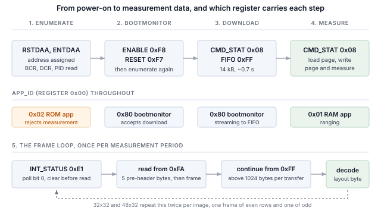

## 1 简介

ams OSRAM TMF8829 是一款直接飞行时间测距传感器，除 I2C 和 SPI 外还提供 MIPI I3C 接口，三者共用相同的两个引脚。
它通过测量返回光子相对于发射激光脉冲的时间来测量距离，测量在划分为多个区域的单光子雪崩二极管阵列上进行，
并为每个区域分别报告结果，而不是为整个视场报告一个距离。最大的配置报告 1536 个区域，每个区域最多可以报告四个不同距离的回波。

I3C 保留了双线占用，并在其上增加了大量功能。

Table: I3C 为双线传感器接口带来的功能

| 功能 | 为设计带来的好处 |
|---|---|
| 动态地址分配（DAA） | 控制器在运行时分配地址，因此静态地址冲突不再是电路板设计的约束，相同的器件可以共享一条总线 |
| 通过总线识别 | 每个目标器件都会报告一个 48 位临时标识符、器件类别及其总线能力，因此控制器可以枚举并非为其设计的总线 |
| 通用命令码 | 一套标准命令集（广播和直接），用于枚举、识别、配置、中断控制和复位，在所有符合规范的目标器件上都相同 |
| 带内中断（IBI） | 传感器通过数据线向主机发出中断，并携带一个说明原因的字节，因此无需布线或分配中断引脚 |
| 高数据速率模式 | 双数据速率传输在每对时钟沿上传输两位，在不提高时钟频率的情况下使信令速率加倍 |
| 更高的信令速率 | 推挽时钟，单数据速率模式下最高 12.5 MHz，而 I2C 受开漏限制 |
| 更低功耗 | 推挽信令避免了 I2C 持续消耗的静态上拉电流，活动状态则让控制器告知目标器件预期的总线延迟，使其能够更深度地空闲 |
| 热加入（Hot-Join） | 在总线运行后才上电的目标器件可以请求被枚举 |
| 标准复位与恢复 | 定义好的目标器件复位以及定义好的错误检测与恢复，而非各厂商各自的序列 |
| I2C 兼容性 | 传统 I2C 器件可以共享总线 |

目标器件实现的是传感器所需的子集，而不同器件的子集各不相同。本笔记使用 Binho Supernova USB 主机适配器处理一颗 TMF8829：
枚举它、通过总线识别它、进入其引导加载程序、下载并启动其测距固件、选择区域配置、以该器件提供的每种分辨率读取并解码测量帧、
渲染结果、以 HDR-DDR 传输一帧，并确定目标器件实际实现了上述哪些功能。

该器件的三个特性决定了主机程序必须如何编写，而这三点都与寄存器映射型传感器不同。

Table: 与寄存器映射型传感器的不同之处

| 特性 | 对主机的影响 |
|---|---|
| 测距固件并非常驻 | 器件上电后进入引导加载程序或 ROM 应用程序，两者都不能测距。应用程序在每次上电时通过总线下载到 RAM 中，因此它构成任何基于该器件的产品启动时间的一部分 |
| 结果通过 FIFO 返回 | 没有距离寄存器。一次测量以一次连续传输的方式读取，其长度由帧本身描述，读取不足会把剩余部分留在 FIFO 中并破坏下一帧 |
| 一次测量是千字节级而不是字节级 | 48x32 配置在最小结果格式下每次测量返回 4674 字节。第 7.3 节确定了由此触及的传输限制，第 11 节给出了每种配置的大小 |

这里的任何内容都不需要微控制器、固件或驱动移植。每一步都是从主机 PC 发出的一条命令。



### 1.1 范围

读完本文后，手边有硬件的读者将已经把 TMF8829 枚举到 I3C 总线上、强制其进入引导加载程序、下载并启动其测距固件、
配置其每一种区域网格、读取并解码测量帧（包括以两帧形式到达的两种配置）、渲染结果、以 HDR-DDR 传输一帧并对照同一帧的单数据速率读取进行验证，
并根据可观察到的效果确定目标器件实现了什么。

本文处理的器件是 LIGHTRANGER 14 Click 上的 TMF8829。它在硬件上进行了验证，本文中的每一项输出都是真实捕获的结果。

本笔记不涉及光学校准、针对盖板玻璃的串扰补偿、直方图输出模式，以及将各区域距离转换为笛卡尔坐标的点云校正。
这些取决于设计在传感器前方放置的光学叠层，并由传感器厂商提供文档。

### 1.2 适用器件

示例使用 LIGHTRANGER 14 Click 上的 TMF8829。总线操作步骤适用于任何 I3C 目标器件；引导加载程序、配置和帧相关步骤适用于
TMF882x 和 TMF88xx 系列，它们共享本文所述的主机接口。

### 1.3 相关文档

Table: 相关文档

| 文档 | 出处 |
|---|---|
| TMF8829 数据手册 | ams OSRAM，DS001140 v2-00，2025-Nov-12；第 10.2 节引用的正是该版本的接口章节 |
| TMF8829 Host Driver Communication | ams OSRAM；定义了数据手册中提及但未包含的帧结构 |
| TMF8829 Python 驱动 | `https://github.com/ams-OSRAM/tmf8829_driver_python`，MIT 许可；RAM 应用程序映像及帧结构定义的来源 |
| MIPI I3C Specification | MIPI Alliance |
| Binho Supernova 文档 | `https://support.binho.io` |

## 2 所需设备和软件

### 2.1 硬件

Table: 所需设备

| 项目 |
|---|
| Binho Supernova USB 主机适配器 |
| LIGHTRANGER 14 Click，或其他搭载 TMF8829 的电路板 |
| USB-C 线缆 |

### 2.2 连接

Table: 使用的信号

| 信号 | 用途 |
|---|---|
| SCL | I3C 时钟，适配器到目标器件 |
| SDA | I3C 数据，双向 |
| 3.3 V | 目标器件电源 |
| GND | 回路 |

两根线和一路电源。本文中的任何内容都不连接中断引脚、复位线或配置电阻。

> **注意：** 本文的任何步骤都没有安装外部上拉电阻。I3C 的数据阶段以推挽方式运行，
> 而动态地址分配和广播命令码所需的开漏阶段由适配器驱动。枚举、固件下载以及第 11 节中的每次帧读取，
> 都是在 SCL 和 SDA 上除适配器和目标器件外没有任何其他元件的总线上测得的。

### 2.3 总线设置

Table: 使用的总线设置

| 设置 | 值 |
|---|---|
| 推挽速率 | 5 MHz，50% 占空比 |
| 开漏速率 | 1 MHz |
| 驱动强度 | 快速模式 |
| 总线电压 | 3.3 V |

### 2.4 软件

```
pip install binhosupernova
```

唯一的依赖是 Python 3.12 和 `binhosupernova` 软件包。

测距固件以 `assets/firmware/tmf8829_application.hex` 的形式包含在资源压缩包中。它属于传感器厂商，以 MIT 许可证发布，
该许可证以 `assets/firmware/LICENSES-MIT.TXT` 的形式随附。最新映像始终可以从 `https://github.com/ams-OSRAM/tmf8829_driver_python` 获取。

渲染器使用块字符和 24 位色彩进行绘制。在无法显示这些内容的终端上，它会自动回退，因此普通控制台会生成较粗糙的渲染结果而不是报错。
本文中的每个输出列表都是回退结果，因为 PDF 无法显示色彩。

在不连接任何硬件的情况下确认环境：

```
python i3c_tof.py demo --mode 16x16 --style mono
```

## 3 初次接触：枚举总线

```
python i3c_mems.py scan
```

```
1 target(s) on the bus at 3300 mV, PUSH_PULL_5_MHZ_50_DC, OPEN_DRAIN_1_MHZ

  dynamic address 0x08
    PID  02 10 53 CD 47 22   device id 0x53CD
    BCR  0x23   DCR 0x00
    HDR  claimed   IBI capable
    profile  none in this tool
```

这是由两个通用命令码完成的。**RSTDAA** 清除任何已分配的动态地址，使总线从已知状态开始。
**ENTDAA** 随后执行动态地址分配：控制器发出广播，每个目标器件使用其 48 位临时标识符进行仲裁，
并依次获得一个地址。只有一个器件时，该地址为 `0x08`。

没有在任何地方配置地址，器件的静态地址既没有被使用，也不需要。

总线特性寄存器值得仔细解读，因为它是一组声明，本笔记的其余部分将对其进行检验。

Table: BCR 0x23，逐位解读

| 位 | 值 | 含义 |
|---|---|---|
| 0 | 1 | 最大数据速度限制：目标器件存在该限制，因此控制器在提高时钟之前应先查询 |
| 1 | 1 | 支持 IBI：目标器件可以发起带内中断 |
| 2 | 0 | IBI 不带强制数据字节 |
| 5 | 1 | 高级能力，在该器件上指 HDR |

第 10 节将对照实测行为检验这两项声明。

## 4 应用程序状态与进入引导加载程序

寄存器 `0x00` 报告器件三个应用程序中正在执行的是哪一个。在刚经过电源循环的器件上读取前三个寄存器：

```
  target at 0x08, APP_ID 0x80 v33.0
```

Table: 应用程序标识符

| 值 | 正在运行的程序 | 它会做什么 |
|---|---|---|
| `0x80` | Bootmonitor | 接受引导加载程序命令：读写 RAM、写入 FIFO、启动应用程序 |
| `0x02` | ROM 应用程序 | 报告其版本，拒绝测量命令 |
| `0x01` | RAM 应用程序 | 进行测距 |

器件上电后进入哪一个由其熔丝选择，前提是 `ENABLE` 的 `powerup_select` 字段保持其默认值“不覆盖”。
这里测量的器件上电后进入 bootmonitor，报告引导加载程序版本 33.0，因此在这块电路板上没有需要替换的 ROM 应用程序，
主机看到的第一个状态就已经在等待下载。

上电后为 `0x02` 的器件需要执行下面的步骤；上电后为 `0x80` 的器件则不需要。读数为 `0x01` 的器件正在运行上一次会话下载的固件，
仅靠软复位无法撤销，因此下面的步骤同样适用于它。

麻烦之处在于，**两个应用程序都没有实现引导加载程序命令集**。正在运行应用程序的器件无法被告知接受下载，
因为执行此操作的命令不在它能理解的范围内。进入的途径是主机接口寄存器，无论正在执行什么，这些寄存器始终有效。
`powerup_select` 是一个两位字段，值 1 用于强制进入 bootmonitor：

```python
PON            = 1 << 2          # keep the part powered while it reboots
FORCE_BOOTMON  = 1 << 4          # powerup_select = 1: ignore the fuses
SOFT_RESET     = 1 << 6

device.write(ENABLE, [PON | FORCE_BOOTMON])      # 0xF8
device.write(RESET,  [SOFT_RESET])               # 0xF7
```

Table: `ENABLE` 第 4–5 位，`powerup_select`

| 值 | 含义 |
|---|---|
| 0 | 不覆盖；由熔丝选择运行的程序 |
| 1 | 强制进入 bootmonitor，忽略熔丝，等待主机命令 |
| 2 | 将向量表设置到 RAM 基址并运行其中的内容 |

复位会使目标器件从总线上掉线，因此必须重新枚举后其他操作才能工作。实用程序会自动完成这一操作并报告结果：

```
  an application is running; forcing the bootmonitor
    bootloader at 0x08
```

这里动态地址恢复为相同的值，但在有多个目标器件的总线上并无保证。应重新读取而不是假设。

## 5 下载 RAM 应用程序

固件以 Intel HEX 文件形式提供。与前一条记录连续的记录应在解析时合并，这样下载会以少量长数据流的形式进行，
而不是每条十六字节记录对应一条总线命令。

每个数据块先用一条写 FIFO 命令声明，该命令携带目标地址和**以 32 位字为单位**的长度，然后流式写入 FIFO 寄存器：

```python
params = list(address.to_bytes(4, "little")) + list((len(block) // 4).to_bytes(2, "little"))
device.command(BL_W_FIFO_BOTH, params)           # 0x45 to CMD_STAT
device.write(FIFO, block)                        # 0xFF
```

由于长度以字为单位表示，数据块必须填充到字边界。不完整的字无法描述。

### 5.1 下载到两个处理器

上面的命令是 `W_FIFO_BOTH`（`0x45`），而不是 `W_FIFO`（`0x44`）。两者的区别在于字节写入到哪个处理器。
该器件有两个处理器，两者都需要映像，而使用只写入一个处理器的命令，在整个序列的任何环节都不会报告为错误。

使用 `W_FIFO` 的下载会正常完成。每个数据块都被确认。`START_RAM_APP` 被接受并应答 `OK`。然后：

```
  START_RAM_APP -> OK; ENABLE 0x14 cpu_ready=False
  regs0-3 FF 21 00 00
```

寄存器 `0x00` 读为 `0xFF`，`ENABLE` 中的 `cpu_ready` 保持为低。第一个 CPU 启动了，第二个没有固件，器件停机。
下载和启动过程中没有任何环节报告问题。使用 `W_FIFO_BOTH` 的相同序列：

```
  START_RAM_APP -> OK; ENABLE 0x94 cpu_ready=True
  regs0-3 01 02 C8 00
```

这种故障在不同会话之间是间歇性的，而不是可复现的。RAM 内容在软复位后得以保留，因此曾经运行过该应用程序的器件，
其第二个 CPU 中保留着有效映像，在其上进行的 `W_FIFO` 下载也能正常启动。该故障出现在电源循环后的第一次冷启动时。

有两次读取可以将其与启动失败的其他原因区分开来。`ADDR_RAM`（`0x43`）设置读取指针，`R_RAM`（`0x40`）从该指针返回字节，
从而确定下载是否已写入。`ENABLE` 报告 `pon` 和 `cpu_ready`，可以区分处理器停机与目标器件不再被寻址；
这两种情况下寄存器 `0x00` 都返回 `0xFF`。

引导加载程序和应用程序使用相同的命令握手，值得一次弄懂。`CMD_STAT` 在命令执行期间读回的是该命令本身，
完成后读回的是状态码。因此主机轮询的是*除所发送命令之外的任何值*，而不是某个特定值：

```python
while time.monotonic() < deadline:
    status = self.read_u8(CMD_STAT)
    if status is not None and status != code:
        return status
```

如果改为轮询 `STAT_OK`，那么任何报告其他结果的命令都会让程序挂起，而在第一次读取之前就完成的命令则会产生竞争。

```
python i3c_tof.py bringup --firmware firmware/tmf8829_application.hex
```

```
  target at 0x08, APP_ID 0x80 v33.0
  downloading 14,444 bytes in 1 segment(s)
    14,444 bytes in 0.64 s (22.0 kB/s)
  RAM application v2.200 running
  8x8 configured, result format 0x01
  measuring
  frames report layout 0x01: 1 peak(s) per zone
  frame 2  8x8  62/64 zones (97%)  near 128 mm  median 452 mm  far 5462 mm  0 multi-object  20 C
  the part is measuring; run 'live' to watch it
```

不到十分之七秒下载十四千字节，每条总线命令 256 字节，写入两个处理器。这一过程在每次上电时都会发生，
因此它是任何基于该器件的产品启动时间的一部分。

启动应用程序会重启目标器件，使其从总线上掉线。必须重新枚举后才能读取其寄存器；跳过这一步会使每次读取都返回 `0xFF`，
看起来与上述停机完全相同，但并不是同一回事。

## 6 选择区域网格并启动测量

传感器为每种区域网格都带有一个预配置页，因此选择分辨率只需一条命令，而不是一张寄存器写入表。
该命令将页面加载到寄存器 `0x22` 及以上，在写回之前可以覆盖其中任何值得覆盖的内容。

Table: 区域网格

| 网格 | 命令 | 区域数 | 每次测量的帧数 |
|---|---|---|---|
| 8x8 | `0x40` | 64 | 1 |
| 8x8 长距离 | `0x41` | 64 | 1 |
| 8x8 高精度 | `0x42` | 64 | 1 |
| 16x16 | `0x43` | 256 | 1 |
| 32x32 | `0x45` | 1024 | 2 |
| 48x32 | `0x47` | 1536 | 2 |

最后一列并非细节。第 7.4 节专门讨论它。

有两个页面寄存器对后续所有内容都很重要：

```python
CFG_PERIOD_MS     = 0x22        # u16, measurement period
CFG_RESULT_FORMAT = 0x2A        # what each zone contains
```

`CFG_RESULT_FORMAT` 是会带来影响的那一个。它设置每个区域报告多少个目标以及附带哪些可选字段，
并且在每一帧中按区域计费：

Table: 结果格式，逐位解读

| 位 | 字段 | 开销 |
|---|---|---|
| 0–2 | 每个区域报告的目标数，1 至 4 | 每个 3 字节，带信号强度时为 5 字节 |
| 3 | 每个目标的信号强度 | 每个目标 +2 字节 |
| 4 | 每个区域的噪声底 | +2 字节 |
| 5 | 每个区域的串扰估计 | +2 字节 |

一个目标且无可选字段时，一个区域为 3 字节：`1 * (3 + 0) + 0 + 0`。四个目标且带全部可选字段时为 24 字节：`4 * (3 + 2) + 2 + 2`。
在 48x32 网格上，这就是每次测量 4674 字节与 36,930 字节之间的差别，因此格式是一项带宽决策，而不是个人偏好。

写回页面并启动测量是一条命令，而它的成功码与其他所有命令使用的不同：

```python
status = device.command(CMD_WRITE_PAGE_AND_MEASURE)   # 0x14
# STAT_ACCEPTED (0x01), not STAT_OK (0x00)
```

周期性测量报告 `STAT_ACCEPTED` 并持续运行，直到被停止。该器件上的其他所有命令都报告 `STAT_OK`，
因此检查 `STAT_OK` 的代码会把正在运行的测量误判为失败。

## 7 读取一帧

### 7.1 帧来自 FIFO

没有距离寄存器。一次测量完成后会置位 `INT_STATUS`（`0xE1`）的第 0 位，而帧从 FIFO 中读出。

读取并不从 FIFO 开始。它从 FIFO 状态寄存器 `0xFA` 开始，因为寄存器指针会自动递增，而四个 systick 寄存器位于 `0xFA`
与位于 `0xFF` 的 FIFO 数据寄存器之间。这五个字节在帧之前到达，不属于帧的一部分，这就是解码器需要一个前置头长度的原因：

```
  0xFA  FIFOSTATUS  ─┐
  0xFB  SYSTICK_0    │  five bytes that precede every frame
  0xFC  SYSTICK_1    │  and belong to none of them
  0xFD  SYSTICK_2    │
  0xFE  SYSTICK_3   ─┘
  0xFF  FIFO         ─  the frame itself, and it does not auto-increment past here
```

`INT_STATUS` 为写 1 清除，应在读取帧*之前*而不是之后清除。传感器是自由运行的：在之后清除可能会丢弃在前一帧仍在传输时到达的帧的标志。

### 7.2 布局字节决定每个区域的大小

一帧由十六字节的帧头、由区域组成的帧体和十二字节的帧尾构成。

Table: 帧头

| 偏移 | 字段 | 说明 |
|---|---|---|
| 0 | `id` | 高半字节 `0x1` 表示结果帧；低半字节为焦平面模式 |
| 1 | `layout` | 编码与 `CFG_RESULT_FORMAT` 相同，另在第 6 位加上子帧标志 |
| 2–3 | `payload` | 该字段之后所有内容的长度 |
| 4–7 | `fNumber` | 连续的帧序号 |
| 8–10 | `temperature` | 摄氏度，有符号 |
| 11 | `bdv` | 所使用的击穿电压 |
| 12–15 | `refPos` | 光学参考峰位置 |

`layout` 字节必须最先解码，因为帧头之后的每个字节都由它定位。一个区域的宽度在 3 到 24 字节之间，以错误的步长读取并不会失败；
它会产生一整帧看似合理但错误的数字。

帧头还携带自身的长度，这是确定读取大小更可靠的方法：

```python
size = PRE_HEADER + 4 + payload      # the payload field counts everything after itself
```

根据配置的模式计算大小并与帧报告的值进行比较，是一项低成本且值得进行的检查。两者不一致时，说明写入的配置并不是传感器正在使用的配置。

还有两个细节，每一个都会产生错误的结果而不是报错：

**距离以四分之一毫米为单位。** 这就是该器件宣传的 0.25 mm 分辨率。如果当作毫米读取，2.7 m 处的墙会显示在 11 m 处，
而结果看起来没有任何格式错误。

**但有时并非如此。** 帧尾保留字节的第 0 位表示固件已经转换为毫米。因此必须在对区域进行换算*之前*读取帧尾，
这与字节到达的顺序正好相反。

Table: 帧尾

| 偏移 | 字段 |
|---|---|
| 0–3 | `t0Integration` |
| 4–7 | `t1Integration` |
| 8 | `frameStatus`，第 0 位置位表示有效 |
| 9 | `reserved`，第 0 位置位表示距离已经是毫米 |
| 10–11 | `eof`，始终为 `0xE0F7` |

`frameStatus` 和 `eof` 都值得检查，而且它们检查的是不同的东西。帧结束标记说明帧从 FIFO 中完整取出。
`frameStatus` 说明传感器认为该帧背后的测量可用。

### 7.3 一帧可能大于一次传输

一个 32x32 帧为 1569 字节。用一次调用读取它，什么也得不到：

```
error: short frame read: 0 of 1569 bytes
```

不是被截断的读取，而是空的读取，帧仍留在传感器的 FIFO 中。对读取长度进行二分查找，可以精确找到边界：

```
    largest successful read: 1024 bytes
    request  1024 ->  1024 bytes ok
    request  1025 ->     0 bytes SHORT
```

这一边界属于主机适配器而不是传感器，因此对于其他控制器，应该进行测量，而不是假设它也有相同的边界。
目标器件自身声明的则又是另一个数字，在围绕它确定任何大小之前值得先读取：

```
  GETMRL -> 01 FF      maximum read length 511 bytes
  GETMWL -> FF FF      maximum write length 65535 bytes
```

目标器件声明为 511 字节，但并不强制执行：对一个完整 16x16 帧进行 801 字节的读取可以成功并解码。因此这两个数字单独都不是可靠的依据。
声明的长度低估了实际可行的长度，适配器的限制才是真正约束一次传输的因素，而下面分块读取的大小正是根据两者的组合确定的。

因此，超过适配器限制的帧必须分块读取，而 FIFO 使这成为可能。
第一次读取与之前一样从 `0xFA` 开始；之后的每次读取都从 `0xFF` 开始，该寄存器不会自动递增，因此反复读取它会继续同一帧而不是重新开始：

```python
register = FIFOSTATUS if taken == 0 else FIFO
chunk = self.read(register, min(MAX_READ, size - taken))
```

16x16 以上的每种网格在每一帧上都需要这样做。

### 7.4 两种最大的网格以交错方式到达

一次 32x32 或 48x32 测量的数据量超过一帧所能承载的量，因此传感器每次发送十六行，并在布局字节的第 6 位标记是哪一半。

两半**不是**图像的上半部分和下半部分。第一帧承载偶数行，第二帧承载奇数行：

```
  frame with subframe flag 0  ->  image rows 0, 2, 4, 6, ...
  frame with subframe flag 1  ->  image rows 1, 3, 5, 7, ...
```

将它们堆叠而不是交错，会产生一个错误却无法检测出格式问题的结果：场景以一半的垂直分辨率出现两次，一个在另一个上方。

```
  ::..          ########%%%%%%%%%@      <- the same scene
  :::...      %%#%######%%%%%%%%@@
  ::::..  ##%%%%%%%%%%%%%%%%%%%%%@
  ::::...  .#########%%%%%%%%%%%%%
  ::::.......
  ::::......
   :....      ##########%%%%%%%%%@      <- and again, sixteen rows down
  :::...  #%%%%%%%%%%%%%%%%%%%%%@@
  ::::..    %%%%%%%%%%%%%%%%%%%%%%
  ::::... ..  ########%%%%%%%%%%%%
  ::::......
  ::::......
```

按子帧标志而不是按到达顺序排列，可以使丢帧或重复帧成为可检测的错误，而不是悄无声息的错误结果。

## 8 渲染测量结果

以数字形式打印的距离网格包含传感器报告的所有内容，但这种形式难以展现空间结构。渲染器的三个特性解决了这个问题。

**每个字符单元两个区域。** 终端单元的高度约为宽度的两倍，因此每个单元一个区域会把正方形网格渲染成拉长的矩形。
用一种颜色绘制上半块，并让背景透过下半部分显示，就能在一个单元中放入两个垂直相邻的区域。
这样纵横比正确，一个 32x32 图像可以容纳在十六行终端中。

**置信度是画出来的，而不是打印出来的。** 每个区域都带有信噪比，而将低置信度读数与高置信度读数以相同方式绘制会产生实际的误导。
颜色按置信度比例向背景色混合，因此不确定的读数会淡出，视线会落在值得信任的读数上。

**色标与图像一同渲染。** 如果不知道色带映射到什么范围，就无法将深度图像读作距离。范围取自帧本身，
取第 2 和第 98 百分位而不是极值，因此单个异常读数不会压缩色标的其余部分。

```
python i3c_tof.py frame --mode 16x16 --style mono --histogram
```

```
  frame 2  16x16  256/256 zones (100%)  near 126 mm  median 369 mm  far 3536 mm  0 multi-object  23 C

  #########%%%%%%%
  #########%%%%%%%
  ########%%%%%%%%
  #########%%%%%%%
  ########%%%%%%%%
  #######%%%%%%%%%
  ######%%%%%%%%%%
    ####%%%%%%%%%@
    ###%%%%%%%%%%%
    ##%%%%%%%%%%%@
    ##%%%%%%%%%%%@
     #%%%%%%%%%%%@
     ##%%%%%%%%%%@
     ##%%%%%%%%%%@
      %%%%%%%%%%%%
     %%%%%%%%%%%%%

      13 cm ████████████████████████████████████████████████ 150
      41 cm ██████████████████████████ 82
      69 cm
      98 cm
     126 cm
     155 cm
     183 cm
     212 cm
     240 cm █ 6
     268 cm █████ 17
     297 cm
     325 cm  1
```

近处密集，远处稀疏，没有回波的区域为空白。帧中的渐变是一个向远离传感器方向倾斜的表面；左侧的空白楔形区域是它超出量程的地方。

直方图报告回波按距离的分布，这是空间视图无法显示的：半米以内的两个簇占 256 个区域中的 232 个，另有 24 个回波位于 2.4 至 3.3 m 之间。

附带了一个合成场景生成器，因此无需硬件即可开发和检查显示效果：

```
python i3c_tof.py demo --mode 32x32 --scene corner
```

它会生成一面墙、墙前的一个物体、区域同时跨越两者的边缘，以及随距离减弱的回波。这比听起来更重要：
在随机数上看起来不错的渲染器，在真实场景上可能无法阅读，因为真实的深度数据是有结构的。

## 9 每个区域多于一个目标

观察附近物体边缘的区域会看到物体后方的内容。该器件每个区域最多报告四个目标，按距离排序，
而只显示最近目标的渲染器会隐藏传感器较有用的功能之一。

```
python i3c_tof.py frame --peaks 4 --signal --noise --xtalk --style numeric
```

```
  8x8 configured, result format 0x3C

  frame 2  8x8  64/64 zones (100%)  near 136 mm  median 358 mm  far 568 mm  15 multi-object  24 C

     49   47   57   53   18   15   14   14
     49   47   51   49   18   15   14   14
     53   50   48   44   20   17   16   14
     56   49   44   40   32   19   18   14
     42   44   41   38   32   21   21   14
     43   44   40   36   32   23   23   14
     42   43   41   36   32   26   25   14
     38   41   42   37   34   31   28   14
```

六十四个区域中有十五个报告了不止一个表面。在彩色渲染器中，这些单元以带阴影的字形而不是实心字形绘制，因此这一能力是可见的，而不只是被描述。

代价体现在结果格式字节上：`0x3C` 表示四个目标并带信号、噪声和串扰，即每个区域 24 字节，而默认格式为 3 字节。
在 8x8 网格上为 1536 字节对 192 字节。在 48x32 上为 36,864 字节对 4608 字节。

## 10 声明能力与实测行为对比

第 3 节从 BCR 中读出了两项能力声明。两者都是对照可观察的行为而不是结果码进行检验的。

### 10.1 带内中断：具备能力，但未使用

BCR 的第 1 位表示目标器件可以发起带内中断，这样完成的测量就可以在数据线上自行通告，而不需要轮询。
在控制器配置为接受 IBI、传感器以 100 ms 自由运行的情况下：

```
  IBIs in 3 s with the sensor free-running: 0
  frames signalled through INT_STATUS in the same 3 s: 31
```

三十一帧到达。没有一帧自行通告。传感器固件通过其 `INT_STATUS` 寄存器和中断引脚通知帧完成，而不会为此发起 IBI，
这一结论与厂商自己的驱动程序一致，该驱动程序轮询该寄存器，完全不包含 IBI 支持。

这一点值得直白地说明，而不是当作故障处理。BCR 描述的是芯片总线接口能够做什么；它并不保证在其上运行的应用固件会使用这一能力。
以 100 Hz 轮询寄存器来捕获 10 Hz 的帧，每次轮询只需一个字节，完全可行。但如果某个设计指望通过两根线以中断驱动方式采集帧，
则应对照其将要出货的固件版本进行确认。

### 10.2 HDR-DDR：已实现，但未见于文档

第 5 位声明了高级能力，在 I3C 中这意味着目标器件至少支持一种高数据速率模式。有两份公开资料描述了该器件的总线接口，但两者都没有提及任何高数据速率模式。

数据手册的接口章节 DS001140 v2-00 指出，该器件 "provides I3C serial communication interface with clock speed up to 12.5 MHz"，
并且 "after the Dynamic Address Assignment, SDR Mode is selected for private messaging"。这正确描述了目标器件在地址分配后所处的状态，
因为 HDR 需要显式进入。但在整份文档中，没有任何形式的 HDR、double data rate 或 high data rate 字样。
厂商发布的 Python 驱动也是如此：其唯一针对 I3C 的代码是重新分配动态地址，不包含任何 HDR 进入、DDR 传输，也没有提及两者中的任何一个。

因此，能力位与文档不一致，而工作台上的结果与能力位一致。以下内容是通过测量而不是从任何地方读到的方式确定的，分为两部分。

**DDR 命令字节是字地址。** 在 DDR 读取中，命令字节既不是寄存器地址，也不是不透明的选择符。遍历从 `0x80` 到 `0xFF` 的每个命令，
会以两个为步长遍历寄存器映射：

```
  register = (command - 0x80) * 2
```

因此命令 `0x80` 从寄存器 `0x00` 读取，命令 `0xFD` 从寄存器 `0xFA` 读取，即 FIFO 状态寄存器，正是帧读取的起点。

**每个 16 位字到达时都是字节交换的**，相对于对相同寄存器的 SDR 读取而言。这不是可以争论的字节序偏好；
交换回来才能使两条路径返回相同的字节：

```
  SDR read of 0x00..0x07:            01 02 C8 00 00 00 00 00
  DDR, raw                           02 01 00 C8 00 00 00 00
  DDR, byte-swapped                  01 02 C8 00 00 00 00 00   <- matches SDR
```

考虑到这两点后，一整个深度帧可以通过 HDR-DDR 读取并正确解码。在两条路径之间交替读取了四十帧，四十帧在两条路径上都解码为有效，
无论传输以单数据速率还是双数据速率进行，得到的区域都逐字节相同：

```
python i3c_tof.py frame --mode 16x16 --hdr
```

```
  frame 2  16x16  256/256 zones (100%)  near 129 mm  median 302 mm  far 2796 mm  0 multi-object  21 C
```

BCR 第 5 位声明 HDR-DDR 的情况多于真正实现它的情况，而它与这一类器件相关，因为每次测量的有效载荷是千字节级的，并随区域数增长。
在该目标器件上，这一模式已实现，并能承载完整的测量帧。

寻址方式带来的一个后果值得了解。DDR 命令寻址的是 16 位字，因此没有任何命令能单独落在位于 `0xFF` 的 FIFO 数据寄存器上。
曾尝试从命令 `0xFF` 继续 DDR 帧读取，该命令寻址寄存器 `0xFE` 并在一个字节之后到达 FIFO，但无法重建该帧，因此 DDR 读取无法像 SDR 读取那样分块进行。
这将其限制在整帧可以放入单次传输的网格：8x8 和 16x16。对于其余网格，实用程序会拒绝执行，而不是返回错误的结果：

```
error: a 32x32 frame is 1568 bytes, over the 1024-byte transfer limit,
       and a DDR read cannot be chunked
```

对于更大的网格，第 7.3 节中带分块读取的 SDR 路径可以承载完整帧，并且两者产生的数据相同。

## 11 测量结果

### 11.1 测试配置

Table: 测试配置

| 项目 | 值 |
|---|---|
| 适配器 | Binho Supernova |
| 目标器件 | LIGHTRANGER 14 Click 上的 TMF8829 |
| 固件 | RAM 应用程序 v2.200 |
| 总线 | I3C SDR，5 MHz 推挽，1 MHz 开漏，3.3 V，无外部上拉电阻 |
| 结果格式 | `0x01`：每个区域一个目标，无可选字段 |
| 测量周期 | 100 ms |
| 动态地址 | `0x08` |

### 11.2 各网格的测量大小

Table: 一次完整测量的大小

| 网格 | 区域数 | 每次测量的字节数 | 传输次数 |
|---|---|---|---|
| 8x8 | 64 | 225 | 1 |
| 16x16 | 256 | 801 | 1 |
| 32x32 | 1024 | 3138 | 4 |
| 48x32 | 1536 | 4674 | 6 |

测量条件为每个区域一个目标且无可选字段，这是该器件提供的开销最小的设置。有效载荷随区域数增长，
因此全分辨率网格传输的字节数是默认网格的二十倍，而传输次数增长得更快，因为 16x16 以上的每一帧都超过第 7.3 节中的传输限制，并分两半到达。

这些数字是器件和结果格式的属性，与读取它们的主机无关。它们所需的时间则取决于总线时钟和主机。

有三个手段可以改变它，按值得尝试的顺序排列：

Table: 如果全分辨率图像开销过大，可以调整什么

| 手段 | 效果 |
|---|---|
| 提高推挽时钟 | 5 MHz 是一个保守的起点，而不是极限；I3C 单数据速率最高可达 12.5 MHz |
| 精简结果格式 | 每个可选字段在每个区域上都要多花 2 字节；在 1536 个区域上，格式字节是最大的单一手段 |
| 延长测量周期 | 10 Hz 的全分辨率是一项苛刻的要求，许多应用并不需要 |

### 11.3 功能汇总

Table: 该目标器件实现的功能

| 功能 | 结果 |
|---|---|
| 动态地址分配 | 是；由 ENTDAA 分配地址 `0x08` |
| 通过总线识别 | 是；PID `02 10 53 CD 47 22`，BCR `0x23`，DCR `0x00` |
| SDR 寄存器读写 | 是 |
| 声明的最大读取长度 | `GETMRL` 报告 511 字节；未强制执行，801 字节的帧读取可以成功 |
| 声明的最大写入长度 | `GETMWL` 报告 65535 字节 |
| 该适配器执行的最大传输 | 1024 字节；超过该值时读取返回空而不是截断。这是控制器而不是目标器件的属性 |
| HDR-DDR | 是；完整测量帧已传输，并与 SDR 逐字节对照验证。数据手册中未描述，厂商驱动中也未实现 |
| 带内中断 | 在 BCR 中声明；测距固件不会发起 |
| 区域网格 | 8x8、16x16、32x32、48x32，另有长距离和高精度 8x8 变体 |
| 每个区域的目标数 | 最多 4 个，可配置 |

## 12 实用程序

参考实用程序由四个文件组成，这样划分是为了让每个文件都可以单独理解和测试：

Table: 实用程序结构

| 文件 | 职责 |
|---|---|
| `tof_frame.py` | 帧字节与区域之间的相互转换。不依赖硬件 |
| `tof_render.py` | 将区域结果转换为人可以阅读的形式 |
| `tof_device.py` | 传感器：引导加载程序、固件下载、配置、帧 |
| `i3c_tof.py` | 命令行，只负责决定显示什么 |

`i3c_tof.py` 之上的部分不了解终端，之下的部分不了解总线。

`tof_frame.py` 既能编码也能解码，这使它无需传感器即可测试：双向往返一次就能检验真实的布局，而不是模拟对象。
目标数与可选字段的全部 32 种组合都能完成往返，并且对于每一种组合，独立计算出的帧大小都与帧报告的长度一致。

Table: 命令

| 命令 | 功能 |
|---|---|
| `demo` | 渲染合成场景；无需硬件 |
| `modes` | 列出区域网格及每种网格的读取开销 |
| `bringup` | 下载固件并开始测量，报告每个步骤 |
| `frame` | 捕获并打印单幅图像 |
| `live` | 持续观察传感器，直到被中断 |

## 13 实用说明

**下载到两个处理器。** 使用 `W_FIFO_BOTH`，而不是 `W_FIFO`。错误的那个命令下载正常、启动正常，然后停机，
而且只要 RAM 中保留着上一次会话的有效映像，它就可能一直正常工作。

**每次复位后以及启动应用程序后都要重新枚举。** 强制进入 bootmonitor 会复位器件，启动 RAM 应用程序会重启器件。
两者都会使其从总线上掉线，之后的动态地址并不保证与之前相同。

**寄存器 0x00 返回 `0xFF` 有两种值得区分的原因。** 目标器件不再被寻址，或者目标器件被寻址但其处理器已停机。
读取 `ENABLE` 可以区分两者：第二种情况下它会应答，而 `cpu_ready` 会说明其余情况。

**在确定任何大小之前先读取布局字节。** 它决定了得到的是解码正确的帧还是一帧看似合理的无意义数据，而且如果出错，也没有可捕获的错误。

**在读取之前而不是之后清除中断。** 传感器是自由运行的，在传输期间置位的标志对应一个帧，在之后清除会将其丢弃。

**检查帧结束标记。** 每帧末尾的 `0xE0F7` 是发现失去同步的分块读取的低成本方法，否则分块错误的帧与一个奇怪的场景无法区分。

**读取失败的帧仍在 FIFO 中。** 过长的读取会使传感器保留该帧，因此下一次读取返回的是同一帧而不是新的帧。
实用程序在 `live` 中统计丢弃的帧而不是停止，因为下一帧已经在路上了。

## 14 故障排除

Table: 故障排除

| 症状 | 可能原因 |
|---|---|
| `APP_ID` 读为 `0x02`，且每条命令都返回 `STAT_ERR_UNKNOWN_CMD` | 正在运行 ROM 应用程序；RAM 应用程序尚未下载 |
| 下载和 `START_RAM_APP` 都报告成功，随后 `APP_ID` 读为 `0xFF` 且 `cpu_ready` 为低 | 使用 `W_FIFO` 而不是 `W_FIFO_BOTH` 下载；第二个处理器没有固件 |
| 每个寄存器都读为 `0xFF`，包括 `ENABLE` | 复位后或启动应用程序后没有重新枚举目标器件 |
| 引导加载程序命令被拒绝 | 正在运行应用程序；通过 `ENABLE` 和 `RESET` 强制进入 bootmonitor |
| `short frame read: 0 of N bytes` | 读取超过了 1024 字节；应分块读取 |
| 图像中同一场景出现两次 | 子帧被堆叠而不是交错 |
| 每个距离都远了大约四倍 | 将四分之一毫米单位当作毫米读取 |
| 距离只有应有值的四分之一 | 帧尾的毫米标志已置位，但仍进行了换算 |
| 解码后的帧充满看似合理的无意义数据 | 没有读取布局字节，因此区域步长错误 |
| 测量到达的速度低于配置的周期 | 主机没有在下一帧完成之前读取每一帧；参见第 11.2 节中的测量大小 |
| `STAT_ACCEPTED` 被当作错误 | 周期性测量报告 `0x01`，而不是 `0x00` |

## 15 缩略语

Table: 缩略语

| 术语 | 含义 |
|---|---|
| BCR | 总线特性寄存器（Bus characteristics register） |
| CCC | 通用命令码（Common command code） |
| DAA | 动态地址分配（Dynamic address assignment） |
| DCR | 器件特性寄存器（Device characteristics register） |
| DDR | 双数据速率（Double data rate） |
| dToF | 直接飞行时间（Direct time-of-flight） |
| ENTDAA | 进入动态地址分配（Enter dynamic address assignment） |
| FIFO | 先进先出缓冲区（First in, first out buffer） |
| HDR | 高数据速率（High data rate） |
| IBI | 带内中断（In-band interrupt） |
| PID | 临时标识符（Provisional identifier） |
| RSTDAA | 复位动态地址分配（Reset dynamic address assignment） |
| SDR | 单数据速率（Single data rate） |
| SPAD | 单光子雪崩二极管（Single-photon avalanche diode） |
| SNR | 信噪比（Signal-to-noise ratio） |

## 16 关于本文中源代码的说明

本文中显示并在随附压缩包中提供的示例代码仅供评估和参考。它基于 MIT 许可证发布，许可证文本包含在压缩包中。

`assets/firmware/` 下的 RAM 应用程序映像不属于 Binho。其版权为 © ams-OSRAM AG，此处依据其在
`https://github.com/ams-OSRAM/tmf8829_driver_python` 发布时所附的 MIT 许可证再分发，其许可证文本随附在旁。
`tof_frame.py` 使用的帧结构定义取自同一来源。

Table: 资源压缩包内容

| 文件 | 说明 |
|---|---|
| `AN0007.md` | 本文的 Markdown 源文件 |
| `assets/i3c_tof.py` | 命令行实用程序 |
| `assets/tof_device.py` | 传感器启动与控制 |
| `assets/tof_frame.py` | 帧解码与编码 |
| `assets/tof_render.py` | 终端渲染器 |
| `assets/i3c_mems.py` | 共享 I3C 总线实用程序 |
| `assets/firmware/tmf8829_application.hex` | TMF8829 RAM 应用程序，© ams-OSRAM AG，MIT 许可 |
| `assets/firmware/LICENSES-MIT.TXT` | 涵盖 RAM 应用程序的 MIT 许可证 |
| `assets/LICENSE` | 涵盖示例代码的 MIT 许可证 |

## 17 修订历史

Table: 修订历史

| 修订版 | 日期 | 变更 |
|---|---|---|
| 1.0 | 1 September 2026 | 首次发布 |
| 1.1 | 3 September 2026 | 六处 em-dash 被替换为普通标点。措辞、测量结果和结论均未改变 |
| 1.2 | 9 September 2026 | 第 1.3 节中的 Supernova 文档链接更正为 `https://support.binho.io`。措辞、测量结果和结论均未改变 |
