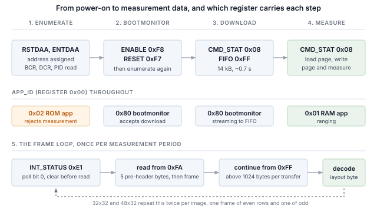

## 1 簡介

ams OSRAM TMF8829 是一款直接飛行時間測距感測器，除 I2C 和 SPI 外還提供 MIPI I3C 介面，三者共用相同的兩個接腳。
它透過量測返回光子相對於發射雷射脈衝的時間來量測距離，量測在劃分為多個區域的單光子雪崩二極體陣列上進行，
並為每個區域分別回報結果，而不是為整個視野回報一個距離。最大的設定回報 1536 個區域，每個區域最多可以回報四個不同距離的回波。

I3C 保留了雙線配置，並在其上增加了大量功能。

Table: I3C 為雙線感測器介面帶來的功能

| 功能 | 為設計帶來的好處 |
|---|---|
| 動態位址分配（DAA） | 控制器在執行時分配位址，因此靜態位址衝突不再是電路板設計的限制，相同的元件可以共用一條匯流排 |
| 透過匯流排識別 | 每個目標裝置都會回報一個 48 位元暫時識別碼、裝置類別及其匯流排能力，因此控制器可以列舉並非為其設計的匯流排 |
| 通用命令碼 | 一套標準命令集（廣播和直接），用於列舉、識別、設定、中斷控制和重設，在所有符合規範的目標裝置上都相同 |
| 帶內中斷（IBI） | 感測器透過資料線向主機發出中斷，並攜帶一個說明原因的位元組，因此不需要佈線或分配中斷接腳 |
| 高資料速率模式 | 雙資料速率傳輸在每對時脈邊緣上傳輸兩個位元，在不提高時脈頻率的情況下使訊號速率加倍 |
| 更高的訊號速率 | 推挽時脈，單資料速率模式下最高 12.5 MHz，而 I2C 受開汲極限制 |
| 更低功耗 | 推挽訊號避免了 I2C 持續消耗的靜態上拉電流，活動狀態則讓控制器告知目標裝置預期的匯流排延遲，使其能夠更深度地閒置 |
| 熱加入（Hot-Join） | 在匯流排運作後才上電的目標裝置可以請求被列舉 |
| 標準重設與復原 | 明確定義的目標裝置重設，以及明確定義的錯誤偵測與復原，而非各廠商各自的序列 |
| I2C 相容性 | 傳統 I2C 裝置可以共用匯流排 |

目標裝置實作的是感測器所需的子集，而不同元件的子集各不相同。本筆記使用 Binho Supernova USB 主機轉接器處理一顆 TMF8829：
列舉它、透過匯流排識別它、進入其開機載入程式、下載並啟動其測距韌體、選擇區域設定、以該元件提供的每種解析度讀取並解碼量測訊框、
算繪結果、以 HDR-DDR 傳輸一個訊框，並確定目標裝置實際實作了上述哪些功能。

此元件的三個特性決定了主機程式必須如何撰寫，而這三點都與暫存器對映型感測器不同。

Table: 與暫存器對映型感測器的不同之處

| 特性 | 對主機的影響 |
|---|---|
| 測距韌體並非常駐 | 元件上電後進入開機載入程式或 ROM 應用程式，兩者都不能測距。應用程式在每次上電時透過匯流排下載到 RAM 中，因此它構成任何基於此元件的產品開機時間的一部分 |
| 結果透過 FIFO 傳回 | 沒有距離暫存器。一次量測以一次連續傳輸的方式讀取，其長度由訊框本身描述，讀取不足會把剩餘部分留在 FIFO 中並破壞下一個訊框 |
| 一次量測是千位元組級而不是位元組級 | 48x32 設定在最小結果格式下每次量測傳回 4674 位元組。第 7.3 節確定了由此觸及的傳輸限制，第 11 節列出了每種設定的大小 |

這裡的任何內容都不需要微控制器、韌體或驅動程式移植。每一步都是從主機 PC 發出的一條命令。



### 1.1 範圍

讀完本文後，手邊有硬體的讀者將已經把 TMF8829 列舉到 I3C 匯流排上、強制其進入開機載入程式、下載並啟動其測距韌體、
設定其每一種區域網格、讀取並解碼量測訊框（包括以兩個訊框形式到達的兩種設定）、算繪結果、以 HDR-DDR 傳輸一個訊框並對照同一訊框的單資料速率讀取進行驗證，
並根據可觀察到的效果確定目標裝置實作了什麼。

本文處理的元件是 LIGHTRANGER 14 Click 上的 TMF8829。它在硬體上進行了驗證，本文中的每一項輸出都是實際擷取的結果。

本筆記不涉及光學校準、針對蓋板玻璃的串擾補償、直方圖輸出模式，以及將各區域距離轉換為笛卡兒座標的點雲校正。
這些取決於設計在感測器前方放置的光學疊層，並由感測器廠商提供文件。

### 1.2 適用裝置

範例使用 LIGHTRANGER 14 Click 上的 TMF8829。匯流排操作步驟適用於任何 I3C 目標裝置；開機載入程式、設定和訊框相關步驟適用於
TMF882x 和 TMF88xx 系列，它們共用本文所述的主機介面。

### 1.3 相關文件

Table: 相關文件

| 文件 | 出處 |
|---|---|
| TMF8829 資料手冊 | ams OSRAM，DS001140 v2-00，2025-Nov-12；第 10.2 節引用的正是該版本的介面章節 |
| TMF8829 Host Driver Communication | ams OSRAM；定義了資料手冊中提及但未包含的訊框結構 |
| TMF8829 Python 驅動程式 | `https://github.com/ams-OSRAM/tmf8829_driver_python`，MIT 授權；RAM 應用程式映像檔及訊框結構定義的來源 |
| MIPI I3C Specification | MIPI Alliance |
| Binho Supernova 文件 | `https://support.binho.io` |

## 2 所需設備和軟體

### 2.1 硬體

Table: 所需設備

| 項目 |
|---|
| Binho Supernova USB 主機轉接器 |
| LIGHTRANGER 14 Click，或其他搭載 TMF8829 的電路板 |
| USB-C 纜線 |

### 2.2 連接

Table: 使用的訊號

| 訊號 | 用途 |
|---|---|
| SCL | I3C 時脈，轉接器到目標裝置 |
| SDA | I3C 資料，雙向 |
| 3.3 V | 目標裝置電源 |
| GND | 回路 |

兩條線和一路電源。本文中的任何內容都不連接中斷接腳、重設線或設定電阻。

> **注意：** 本文的任何步驟都沒有安裝外部上拉電阻。I3C 的資料階段以推挽方式運作，
> 而動態位址分配和廣播命令碼所需的開汲極階段由轉接器驅動。列舉、韌體下載以及第 11 節中的每次訊框讀取，
> 都是在 SCL 和 SDA 上除轉接器和目標裝置外沒有任何其他元件的匯流排上測得的。

### 2.3 匯流排設定

Table: 使用的匯流排設定

| 設定 | 值 |
|---|---|
| 推挽速率 | 5 MHz，50% 工作週期 |
| 開汲極速率 | 1 MHz |
| 驅動強度 | 快速模式 |
| 匯流排電壓 | 3.3 V |

### 2.4 軟體

```
pip install binhosupernova
```

唯一的相依項目是 Python 3.12 和 `binhosupernova` 套件。

測距韌體以 `assets/firmware/tmf8829_application.hex` 的形式包含在資源壓縮檔中。它屬於感測器廠商，依 MIT 授權條款發布，
該授權條款以 `assets/firmware/LICENSES-MIT.TXT` 的形式隨附。最新映像檔隨時可以從 `https://github.com/ams-OSRAM/tmf8829_driver_python` 取得。

算繪器使用區塊字元和 24 位元色彩進行繪製。在無法顯示這些內容的終端機上，它會自動降級，因此一般主控台會產生較粗糙的算繪結果而不是報錯。
本文中的每個輸出列表都是降級結果，因為 PDF 無法顯示色彩。

在不連接任何硬體的情況下確認環境：

```
python i3c_tof.py demo --mode 16x16 --style mono
```

## 3 初次接觸：列舉匯流排

```
python i3c_mems.py scan
```

```
1 target(s) on the bus at 3300 mV, PUSH_PULL_5_MHZ_50_DC, OPEN_DRAIN_1_MHZ

  dynamic address 0x08
    PID  02 10 53 CD 47 22   device id 0x53CD
    BCR  0x23   DCR 0x00
    HDR  claimed   IBI capable
    profile  none in this tool
```

這是由兩個通用命令碼完成的。**RSTDAA** 清除任何已分配的動態位址，使匯流排從已知狀態開始。
**ENTDAA** 接著執行動態位址分配：控制器發出廣播，每個目標裝置使用其 48 位元暫時識別碼進行仲裁，
並依序獲得一個位址。只有一個元件時，該位址為 `0x08`。

沒有在任何地方設定位址，元件的靜態位址既沒有被使用，也不需要。

匯流排特性暫存器值得仔細解讀，因為它是一組宣告，本筆記的其餘部分將對其進行檢驗。

Table: BCR 0x23，逐位元解讀

| 位元 | 值 | 含義 |
|---|---|---|
| 0 | 1 | 最大資料速度限制：目標裝置存在該限制，因此控制器在提高時脈之前應先查詢 |
| 1 | 1 | 支援 IBI：目標裝置可以發起帶內中斷 |
| 2 | 0 | IBI 不帶強制資料位元組 |
| 5 | 1 | 進階能力，在此元件上指 HDR |

第 10 節將對照實測行為檢驗這兩項宣告。

## 4 應用程式狀態與進入開機載入程式

暫存器 `0x00` 回報元件三個應用程式中正在執行的是哪一個。在剛經過電源循環的元件上讀取前三個暫存器：

```
  target at 0x08, APP_ID 0x80 v33.0
```

Table: 應用程式識別碼

| 值 | 正在執行的程式 | 它會做什麼 |
|---|---|---|
| `0x80` | Bootmonitor | 接受開機載入程式命令：讀寫 RAM、寫入 FIFO、啟動應用程式 |
| `0x02` | ROM 應用程式 | 回報其版本，拒絕量測命令 |
| `0x01` | RAM 應用程式 | 進行測距 |

元件上電後進入哪一個由其熔絲選擇，前提是 `ENABLE` 的 `powerup_select` 欄位保持其預設值「不覆寫」。
這裡量測的元件上電後進入 bootmonitor，回報開機載入程式版本 33.0，因此在這塊電路板上沒有需要取代的 ROM 應用程式，
主機看到的第一個狀態就已經在等待下載。

上電後為 `0x02` 的元件需要執行下面的步驟；上電後為 `0x80` 的元件則不需要。讀數為 `0x01` 的元件正在執行上一次工作階段下載的韌體，
僅靠軟體重設無法撤銷，因此下面的步驟同樣適用於它。

麻煩之處在於，**兩個應用程式都沒有實作開機載入程式命令集**。正在執行應用程式的元件無法被告知接受下載，
因為執行此操作的命令不在它能理解的範圍內。進入的途徑是主機介面暫存器，無論正在執行什麼，這些暫存器始終有效。
`powerup_select` 是一個兩位元欄位，值 1 用於強制進入 bootmonitor：

```python
PON            = 1 << 2          # keep the part powered while it reboots
FORCE_BOOTMON  = 1 << 4          # powerup_select = 1: ignore the fuses
SOFT_RESET     = 1 << 6

device.write(ENABLE, [PON | FORCE_BOOTMON])      # 0xF8
device.write(RESET,  [SOFT_RESET])               # 0xF7
```

Table: `ENABLE` 第 4–5 位元，`powerup_select`

| 值 | 含義 |
|---|---|
| 0 | 不覆寫；由熔絲選擇執行的程式 |
| 1 | 強制進入 bootmonitor，忽略熔絲，等待主機命令 |
| 2 | 將向量表設定到 RAM 基底位址並執行其中的內容 |

重設會使目標裝置從匯流排上離線，因此必須重新列舉後其他操作才能運作。公用程式會自動完成這項操作並回報結果：

```
  an application is running; forcing the bootmonitor
    bootloader at 0x08
```

這裡動態位址恢復為相同的值，但在有多個目標裝置的匯流排上並無保證。應重新讀取而不是假設。

## 5 下載 RAM 應用程式

韌體以 Intel HEX 檔案形式提供。與前一筆記錄連續的記錄應在剖析時合併，這樣下載會以少量長資料串流的形式進行，
而不是每筆十六位元組記錄對應一條匯流排命令。

每個資料區塊先用一條寫入 FIFO 命令宣告，該命令攜帶目的位址和**以 32 位元字組為單位**的長度，然後串流寫入 FIFO 暫存器：

```python
params = list(address.to_bytes(4, "little")) + list((len(block) // 4).to_bytes(2, "little"))
device.command(BL_W_FIFO_BOTH, params)           # 0x45 to CMD_STAT
device.write(FIFO, block)                        # 0xFF
```

由於長度以字組為單位表示，資料區塊必須填補到字組邊界。不完整的字組無法描述。

### 5.1 下載到兩個處理器

上面的命令是 `W_FIFO_BOTH`（`0x45`），而不是 `W_FIFO`（`0x44`）。兩者的區別在於位元組寫入到哪個處理器。
此元件有兩個處理器，兩者都需要映像檔，而使用只寫入一個處理器的命令，在整個序列的任何環節都不會回報為錯誤。

使用 `W_FIFO` 的下載會正常完成。每個資料區塊都被確認。`START_RAM_APP` 被接受並回應 `OK`。然後：

```
  START_RAM_APP -> OK; ENABLE 0x14 cpu_ready=False
  regs0-3 FF 21 00 00
```

暫存器 `0x00` 讀為 `0xFF`，`ENABLE` 中的 `cpu_ready` 保持為低。第一個 CPU 啟動了，第二個沒有韌體，元件停機。
下載和啟動過程中沒有任何環節回報問題。使用 `W_FIFO_BOTH` 的相同序列：

```
  START_RAM_APP -> OK; ENABLE 0x94 cpu_ready=True
  regs0-3 01 02 C8 00
```

這種故障在不同工作階段之間是間歇性的，而不是可重現的。RAM 內容在軟體重設後得以保留，因此曾經執行過該應用程式的元件，
其第二個 CPU 中保留著有效映像檔，在其上進行的 `W_FIFO` 下載也能正常啟動。此故障出現在電源循環後的第一次冷啟動時。

有兩次讀取可以將其與啟動失敗的其他原因區分開來。`ADDR_RAM`（`0x43`）設定讀取指標，`R_RAM`（`0x40`）從該指標傳回位元組，
從而確定下載是否已寫入。`ENABLE` 回報 `pon` 和 `cpu_ready`，可以區分處理器停機與目標裝置不再被定址；
這兩種情況下暫存器 `0x00` 都傳回 `0xFF`。

開機載入程式和應用程式使用相同的命令交握，值得一次弄懂。`CMD_STAT` 在命令執行期間讀回的是該命令本身，
完成後讀回的是狀態碼。因此主機輪詢的是*除所傳送命令之外的任何值*，而不是某個特定值：

```python
while time.monotonic() < deadline:
    status = self.read_u8(CMD_STAT)
    if status is not None and status != code:
        return status
```

如果改為輪詢 `STAT_OK`，那麼任何回報其他結果的命令都會讓程式停滯，而在第一次讀取之前就完成的命令則會產生競爭。

```
python i3c_tof.py bringup --firmware firmware/tmf8829_application.hex
```

```
  target at 0x08, APP_ID 0x80 v33.0
  downloading 14,444 bytes in 1 segment(s)
    14,444 bytes in 0.64 s (22.0 kB/s)
  RAM application v2.200 running
  8x8 configured, result format 0x01
  measuring
  frames report layout 0x01: 1 peak(s) per zone
  frame 2  8x8  62/64 zones (97%)  near 128 mm  median 452 mm  far 5462 mm  0 multi-object  20 C
  the part is measuring; run 'live' to watch it
```

不到十分之七秒下載十四千位元組，每條匯流排命令 256 位元組，寫入兩個處理器。這一過程在每次上電時都會發生，
因此它是任何基於此元件的產品開機時間的一部分。

啟動應用程式會重新啟動目標裝置，使其從匯流排上離線。必須重新列舉後才能讀取其暫存器；跳過這一步會使每次讀取都傳回 `0xFF`，
看起來與上述停機完全相同，但並不是同一回事。

## 6 選擇區域網格並啟動量測

感測器為每種區域網格都帶有一個預先設定的頁面，因此選擇解析度只需一條命令，而不是一張暫存器寫入表。
該命令將頁面載入到暫存器 `0x22` 及以上，在寫回之前可以覆寫其中任何值得覆寫的內容。

Table: 區域網格

| 網格 | 命令 | 區域數 | 每次量測的訊框數 |
|---|---|---|---|
| 8x8 | `0x40` | 64 | 1 |
| 8x8 長距離 | `0x41` | 64 | 1 |
| 8x8 高精度 | `0x42` | 64 | 1 |
| 16x16 | `0x43` | 256 | 1 |
| 32x32 | `0x45` | 1024 | 2 |
| 48x32 | `0x47` | 1536 | 2 |

最後一欄並非細節。第 7.4 節專門討論它。

有兩個頁面暫存器對後續所有內容都很重要：

```python
CFG_PERIOD_MS     = 0x22        # u16, measurement period
CFG_RESULT_FORMAT = 0x2A        # what each zone contains
```

`CFG_RESULT_FORMAT` 是會帶來影響的那一個。它設定每個區域回報多少個目標以及附帶哪些選用欄位，
並且在每個訊框中按區域計費：

Table: 結果格式，逐位元解讀

| 位元 | 欄位 | 開銷 |
|---|---|---|
| 0–2 | 每個區域回報的目標數，1 至 4 | 每個 3 位元組，帶訊號強度時為 5 位元組 |
| 3 | 每個目標的訊號強度 | 每個目標 +2 位元組 |
| 4 | 每個區域的雜訊底 | +2 位元組 |
| 5 | 每個區域的串擾估計 | +2 位元組 |

一個目標且無選用欄位時，一個區域為 3 位元組：`1 * (3 + 0) + 0 + 0`。四個目標且帶全部選用欄位時為 24 位元組：`4 * (3 + 2) + 2 + 2`。
在 48x32 網格上，這就是每次量測 4674 位元組與 36,930 位元組之間的差別，因此格式是一項頻寬決策，而不是個人偏好。

寫回頁面並啟動量測是一條命令，而它的成功碼與其他所有命令使用的不同：

```python
status = device.command(CMD_WRITE_PAGE_AND_MEASURE)   # 0x14
# STAT_ACCEPTED (0x01), not STAT_OK (0x00)
```

週期性量測回報 `STAT_ACCEPTED` 並持續執行，直到被停止。此元件上的其他所有命令都回報 `STAT_OK`，
因此檢查 `STAT_OK` 的程式碼會把正在執行的量測誤判為失敗。

## 7 讀取一個訊框

### 7.1 訊框來自 FIFO

沒有距離暫存器。一次量測完成後會設定 `INT_STATUS`（`0xE1`）的第 0 位元，而訊框從 FIFO 中讀出。

讀取並不從 FIFO 開始。它從 FIFO 狀態暫存器 `0xFA` 開始，因為暫存器指標會自動遞增，而四個 systick 暫存器位於 `0xFA`
與位於 `0xFF` 的 FIFO 資料暫存器之間。這五個位元組在訊框之前到達，不屬於訊框的一部分，這就是解碼器需要一個前置標頭長度的原因：

```
  0xFA  FIFOSTATUS  ─┐
  0xFB  SYSTICK_0    │  five bytes that precede every frame
  0xFC  SYSTICK_1    │  and belong to none of them
  0xFD  SYSTICK_2    │
  0xFE  SYSTICK_3   ─┘
  0xFF  FIFO         ─  the frame itself, and it does not auto-increment past here
```

`INT_STATUS` 為寫 1 清除，應在讀取訊框*之前*而不是之後清除。感測器是自由執行的：在之後清除可能會丟棄在前一個訊框仍在傳輸時到達的訊框的旗標。

### 7.2 版面配置位元組決定每個區域的大小

一個訊框由十六位元組的標頭、由區域組成的本體和十二位元組的結尾構成。

Table: 訊框標頭

| 偏移 | 欄位 | 說明 |
|---|---|---|
| 0 | `id` | 高半位元組 `0x1` 表示結果訊框；低半位元組為焦平面模式 |
| 1 | `layout` | 編碼與 `CFG_RESULT_FORMAT` 相同，另在第 6 位元加上子訊框旗標 |
| 2–3 | `payload` | 該欄位之後所有內容的長度 |
| 4–7 | `fNumber` | 連續的訊框序號 |
| 8–10 | `temperature` | 攝氏度，有號 |
| 11 | `bdv` | 所使用的崩潰電壓 |
| 12–15 | `refPos` | 光學參考峰位置 |

`layout` 位元組必須最先解碼，因為標頭之後的每個位元組都由它定位。一個區域的寬度在 3 到 24 位元組之間，以錯誤的步幅讀取並不會失敗；
它會產生一整個訊框看似合理但錯誤的數字。

標頭還攜帶自身的長度，這是確定讀取大小更可靠的方法：

```python
size = PRE_HEADER + 4 + payload      # the payload field counts everything after itself
```

根據設定的模式計算大小並與訊框回報的值進行比較，是一項低成本且值得進行的檢查。兩者不一致時，表示寫入的設定並不是感測器正在使用的設定。

還有兩個細節，每一個都會產生錯誤的結果而不是報錯：

**距離以四分之一公釐為單位。** 這就是此元件標榜的 0.25 mm 解析度。如果當作公釐讀取，2.7 m 處的牆會顯示在 11 m 處，
而結果看起來沒有任何格式錯誤。

**但有時並非如此。** 訊框結尾保留位元組的第 0 位元表示韌體已經轉換為公釐。因此必須在對區域進行換算*之前*讀取結尾，
這與位元組到達的順序正好相反。

Table: 訊框結尾

| 偏移 | 欄位 |
|---|---|
| 0–3 | `t0Integration` |
| 4–7 | `t1Integration` |
| 8 | `frameStatus`，第 0 位元設定表示有效 |
| 9 | `reserved`，第 0 位元設定表示距離已經是公釐 |
| 10–11 | `eof`，始終為 `0xE0F7` |

`frameStatus` 和 `eof` 都值得檢查，而且它們檢查的是不同的東西。訊框結束標記說明訊框從 FIFO 中完整取出。
`frameStatus` 說明感測器認為該訊框背後的量測可用。

### 7.3 一個訊框可能大於一次傳輸

一個 32x32 訊框為 1569 位元組。用一次呼叫讀取它，什麼也得不到：

```
error: short frame read: 0 of 1569 bytes
```

不是被截斷的讀取，而是空的讀取，訊框仍留在感測器的 FIFO 中。對讀取長度進行二分搜尋，可以精確找到邊界：

```
    largest successful read: 1024 bytes
    request  1024 ->  1024 bytes ok
    request  1025 ->     0 bytes SHORT
```

這一邊界屬於主機轉接器而不是感測器，因此對於其他控制器，應該進行量測，而不是假設它也有相同的邊界。
目標裝置自身宣告的則又是另一個數字，在圍繞它確定任何大小之前值得先讀取：

```
  GETMRL -> 01 FF      maximum read length 511 bytes
  GETMWL -> FF FF      maximum write length 65535 bytes
```

目標裝置宣告為 511 位元組，但並不強制執行：對一個完整 16x16 訊框進行 801 位元組的讀取可以成功並解碼。因此這兩個數字單獨都不是可靠的依據。
宣告的長度低估了實際可行的長度，轉接器的限制才是真正約束一次傳輸的因素，而下面分塊讀取的大小正是根據兩者的組合確定的。

因此，超過轉接器限制的訊框必須分塊讀取，而 FIFO 使這成為可能。
第一次讀取與之前一樣從 `0xFA` 開始；之後的每次讀取都從 `0xFF` 開始，該暫存器不會自動遞增，因此反覆讀取它會繼續同一個訊框而不是重新開始：

```python
register = FIFOSTATUS if taken == 0 else FIFO
chunk = self.read(register, min(MAX_READ, size - taken))
```

16x16 以上的每種網格在每個訊框上都需要這樣做。

### 7.4 兩種最大的網格以交錯方式到達

一次 32x32 或 48x32 量測的資料量超過一個訊框所能承載的量，因此感測器每次傳送十六列，並在版面配置位元組的第 6 位元標記是哪一半。

兩半**不是**影像的上半部和下半部。第一個訊框承載偶數列，第二個訊框承載奇數列：

```
  frame with subframe flag 0  ->  image rows 0, 2, 4, 6, ...
  frame with subframe flag 1  ->  image rows 1, 3, 5, 7, ...
```

將它們堆疊而不是交錯，會產生一個錯誤卻無法偵測出格式問題的結果：場景以一半的垂直解析度出現兩次，一個在另一個上方。

```
  ::..          ########%%%%%%%%%@      <- the same scene
  :::...      %%#%######%%%%%%%%@@
  ::::..  ##%%%%%%%%%%%%%%%%%%%%%@
  ::::...  .#########%%%%%%%%%%%%%
  ::::.......
  ::::......
   :....      ##########%%%%%%%%%@      <- and again, sixteen rows down
  :::...  #%%%%%%%%%%%%%%%%%%%%%@@
  ::::..    %%%%%%%%%%%%%%%%%%%%%%
  ::::... ..  ########%%%%%%%%%%%%
  ::::......
  ::::......
```

依子訊框旗標而不是依到達順序排列，可以使遺漏或重複的訊框成為可偵測的錯誤，而不是無聲無息的錯誤結果。

## 8 算繪量測結果

以數字形式列印的距離網格包含感測器回報的所有內容，但這種形式難以呈現空間結構。算繪器的三個特性解決了這個問題。

**每個字元格兩個區域。** 終端機字元格的高度約為寬度的兩倍，因此每個字元格一個區域會把正方形網格算繪成拉長的矩形。
用一種顏色繪製上半區塊，並讓背景透過下半部顯示，就能在一個字元格中放入兩個垂直相鄰的區域。
這樣長寬比正確，一個 32x32 影像可以容納在十六列終端機中。

**信賴度是畫出來的，而不是印出來的。** 每個區域都帶有訊雜比，而將低信賴度讀數與高信賴度讀數以相同方式繪製會造成實際的誤導。
顏色依信賴度比例向背景色混合，因此不確定的讀數會淡出，視線會落在值得信任的讀數上。

**色標與影像一同算繪。** 如果不知道色帶對映到什麼範圍，就無法將深度影像讀作距離。範圍取自訊框本身，
取第 2 和第 98 百分位數而不是極值，因此單一異常讀數不會壓縮色標的其餘部分。

```
python i3c_tof.py frame --mode 16x16 --style mono --histogram
```

```
  frame 2  16x16  256/256 zones (100%)  near 126 mm  median 369 mm  far 3536 mm  0 multi-object  23 C

  #########%%%%%%%
  #########%%%%%%%
  ########%%%%%%%%
  #########%%%%%%%
  ########%%%%%%%%
  #######%%%%%%%%%
  ######%%%%%%%%%%
    ####%%%%%%%%%@
    ###%%%%%%%%%%%
    ##%%%%%%%%%%%@
    ##%%%%%%%%%%%@
     #%%%%%%%%%%%@
     ##%%%%%%%%%%@
     ##%%%%%%%%%%@
      %%%%%%%%%%%%
     %%%%%%%%%%%%%

      13 cm ████████████████████████████████████████████████ 150
      41 cm ██████████████████████████ 82
      69 cm
      98 cm
     126 cm
     155 cm
     183 cm
     212 cm
     240 cm █ 6
     268 cm █████ 17
     297 cm
     325 cm  1
```

近處密集，遠處稀疏，沒有回波的區域為空白。訊框中的漸層是一個向遠離感測器方向傾斜的表面；左側的空白楔形區域是它超出量程的地方。

直方圖回報回波依距離的分布，這是空間視圖無法顯示的：半公尺以內的兩個群集占 256 個區域中的 232 個，另有 24 個回波位於 2.4 至 3.3 m 之間。

附帶了一個合成場景產生器，因此不需要硬體即可開發和檢查顯示效果：

```
python i3c_tof.py demo --mode 32x32 --scene corner
```

它會產生一面牆、牆前的一個物體、區域同時跨越兩者的邊緣，以及隨距離減弱的回波。這比聽起來更重要：
在隨機數上看起來不錯的算繪器，在真實場景上可能無法閱讀，因為真實的深度資料是有結構的。

## 9 每個區域多於一個目標

觀察附近物體邊緣的區域會看到物體後方的內容。此元件每個區域最多回報四個目標，依距離排序，
而只顯示最近目標的算繪器會隱藏感測器較有用的功能之一。

```
python i3c_tof.py frame --peaks 4 --signal --noise --xtalk --style numeric
```

```
  8x8 configured, result format 0x3C

  frame 2  8x8  64/64 zones (100%)  near 136 mm  median 358 mm  far 568 mm  15 multi-object  24 C

     49   47   57   53   18   15   14   14
     49   47   51   49   18   15   14   14
     53   50   48   44   20   17   16   14
     56   49   44   40   32   19   18   14
     42   44   41   38   32   21   21   14
     43   44   40   36   32   23   23   14
     42   43   41   36   32   26   25   14
     38   41   42   37   34   31   28   14
```

六十四個區域中有十五個回報了不止一個表面。在彩色算繪器中，這些字元格以帶陰影的字符而不是實心字符繪製，因此這項能力是可見的，而不只是被描述。

代價反映在結果格式位元組上：`0x3C` 表示四個目標並帶訊號、雜訊和串擾，即每個區域 24 位元組，而預設格式為 3 位元組。
在 8x8 網格上為 1536 位元組對 192 位元組。在 48x32 上為 36,864 位元組對 4608 位元組。

## 10 宣告能力與實測行為對照

第 3 節從 BCR 中讀出了兩項能力宣告。兩者都是對照可觀察的行為而不是結果碼進行檢驗的。

### 10.1 帶內中斷：具備能力，但未使用

BCR 的第 1 位元表示目標裝置可以發起帶內中斷，這樣完成的量測就可以在資料線上自行通告，而不需要輪詢。
在控制器設定為接受 IBI、感測器以 100 ms 自由執行的情況下：

```
  IBIs in 3 s with the sensor free-running: 0
  frames signalled through INT_STATUS in the same 3 s: 31
```

三十一個訊框到達。沒有一個自行通告。感測器韌體透過其 `INT_STATUS` 暫存器和中斷接腳通知訊框完成，而不會為此發起 IBI，
這一結論與廠商自己的驅動程式一致，該驅動程式輪詢該暫存器，完全不包含 IBI 支援。

這一點值得直白地說明，而不是當作故障處理。BCR 描述的是晶片匯流排介面能夠做什麼；它並不保證在其上執行的應用韌體會使用這項能力。
以 100 Hz 輪詢暫存器來擷取 10 Hz 的訊框，每次輪詢只需一個位元組，完全可行。但如果某個設計指望透過兩條線以中斷驅動方式擷取訊框，
則應對照其將要出貨的韌體版本進行確認。

### 10.2 HDR-DDR：已實作，但未見於文件

第 5 位元宣告了進階能力，在 I3C 中這表示目標裝置至少支援一種高資料速率模式。有兩份公開資料描述了此元件的匯流排介面，但兩者都沒有提及任何高資料速率模式。

資料手冊的介面章節 DS001140 v2-00 指出，此裝置 "provides I3C serial communication interface with clock speed up to 12.5 MHz"，
並且 "after the Dynamic Address Assignment, SDR Mode is selected for private messaging"。這正確描述了目標裝置在位址分配後所處的狀態，
因為 HDR 需要明確進入。但在整份文件中，沒有任何形式的 HDR、double data rate 或 high data rate 字樣。
廠商發布的 Python 驅動程式也是如此：其唯一針對 I3C 的程式碼是重新分配動態位址，不包含任何 HDR 進入、DDR 傳輸，也沒有提及兩者中的任何一個。

因此，能力位元與文件不一致，而工作台上的結果與能力位元一致。以下內容是透過量測而不是從任何地方讀到的方式確定的，分為兩部分。

**DDR 命令位元組是字組位址。** 在 DDR 讀取中，命令位元組既不是暫存器位址，也不是不透明的選擇子。走訪從 `0x80` 到 `0xFF` 的每個命令，
會以兩個為步幅走訪暫存器對映：

```
  register = (command - 0x80) * 2
```

因此命令 `0x80` 從暫存器 `0x00` 讀取，命令 `0xFD` 從暫存器 `0xFA` 讀取，即 FIFO 狀態暫存器，正是訊框讀取的起點。

**每個 16 位元字組到達時都是位元組交換的**，相對於對相同暫存器的 SDR 讀取而言。這不是可以爭論的位元組順序偏好；
交換回來才能使兩條路徑傳回相同的位元組：

```
  SDR read of 0x00..0x07:            01 02 C8 00 00 00 00 00
  DDR, raw                           02 01 00 C8 00 00 00 00
  DDR, byte-swapped                  01 02 C8 00 00 00 00 00   <- matches SDR
```

考慮到這兩點後，一整個深度訊框可以透過 HDR-DDR 讀取並正確解碼。在兩條路徑之間交替讀取了四十個訊框，四十個訊框在兩條路徑上都解碼為有效，
無論傳輸以單資料速率還是雙資料速率進行，得到的區域都逐位元組相同：

```
python i3c_tof.py frame --mode 16x16 --hdr
```

```
  frame 2  16x16  256/256 zones (100%)  near 129 mm  median 302 mm  far 2796 mm  0 multi-object  21 C
```

BCR 第 5 位元宣告 HDR-DDR 的情況多於真正實作它的情況，而它與這一類元件相關，因為每次量測的酬載是千位元組級的，並隨區域數增長。
在此目標裝置上，這一模式已實作，並能承載完整的量測訊框。

定址方式帶來的一個後果值得了解。DDR 命令定址的是 16 位元字組，因此沒有任何命令能單獨落在位於 `0xFF` 的 FIFO 資料暫存器上。
曾嘗試從命令 `0xFF` 繼續 DDR 訊框讀取，該命令定址暫存器 `0xFE` 並在一個位元組之後到達 FIFO，但無法重建該訊框，因此 DDR 讀取無法像 SDR 讀取那樣分塊進行。
這將其限制在整個訊框可以放入單次傳輸的網格：8x8 和 16x16。對於其餘網格，公用程式會拒絕執行，而不是傳回錯誤的結果：

```
error: a 32x32 frame is 1568 bytes, over the 1024-byte transfer limit,
       and a DDR read cannot be chunked
```

對於更大的網格，第 7.3 節中帶分塊讀取的 SDR 路徑可以承載完整訊框，並且兩者產生的資料相同。

## 11 量測結果

### 11.1 測試設定

Table: 測試設定

| 項目 | 值 |
|---|---|
| 轉接器 | Binho Supernova |
| 目標裝置 | LIGHTRANGER 14 Click 上的 TMF8829 |
| 韌體 | RAM 應用程式 v2.200 |
| 匯流排 | I3C SDR，5 MHz 推挽，1 MHz 開汲極，3.3 V，無外部上拉電阻 |
| 結果格式 | `0x01`：每個區域一個目標，無選用欄位 |
| 量測週期 | 100 ms |
| 動態位址 | `0x08` |

### 11.2 各網格的量測大小

Table: 一次完整量測的大小

| 網格 | 區域數 | 每次量測的位元組數 | 傳輸次數 |
|---|---|---|---|
| 8x8 | 64 | 225 | 1 |
| 16x16 | 256 | 801 | 1 |
| 32x32 | 1024 | 3138 | 4 |
| 48x32 | 1536 | 4674 | 6 |

量測條件為每個區域一個目標且無選用欄位，這是此元件提供的開銷最小的設定。酬載隨區域數增長，
因此全解析度網格傳輸的位元組數是預設網格的二十倍，而傳輸次數增長得更快，因為 16x16 以上的每個訊框都超過第 7.3 節中的傳輸限制，並分兩半到達。

這些數字是元件和結果格式的屬性，與讀取它們的主機無關。它們所需的時間則取決於匯流排時脈和主機。

有三個手段可以改變它，依值得嘗試的順序排列：

Table: 如果全解析度影像開銷過大，可以調整什麼

| 手段 | 效果 |
|---|---|
| 提高推挽時脈 | 5 MHz 是一個保守的起點，而不是極限；I3C 單資料速率最高可達 12.5 MHz |
| 精簡結果格式 | 每個選用欄位在每個區域上都要多花 2 位元組；在 1536 個區域上，格式位元組是最大的單一手段 |
| 延長量測週期 | 10 Hz 的全解析度是一項嚴苛的要求，許多應用並不需要 |

### 11.3 功能摘要

Table: 此目標裝置實作的功能

| 功能 | 結果 |
|---|---|
| 動態位址分配 | 是；由 ENTDAA 分配位址 `0x08` |
| 透過匯流排識別 | 是；PID `02 10 53 CD 47 22`，BCR `0x23`，DCR `0x00` |
| SDR 暫存器讀寫 | 是 |
| 宣告的最大讀取長度 | `GETMRL` 回報 511 位元組；未強制執行，801 位元組的訊框讀取可以成功 |
| 宣告的最大寫入長度 | `GETMWL` 回報 65535 位元組 |
| 此轉接器執行的最大傳輸 | 1024 位元組；超過該值時讀取傳回空而不是截斷。這是控制器而不是目標裝置的屬性 |
| HDR-DDR | 是；完整量測訊框已傳輸，並與 SDR 逐位元組對照驗證。資料手冊中未描述，廠商驅動程式中也未實作 |
| 帶內中斷 | 在 BCR 中宣告；測距韌體不會發起 |
| 區域網格 | 8x8、16x16、32x32、48x32，另有長距離和高精度 8x8 變體 |
| 每個區域的目標數 | 最多 4 個，可設定 |

## 12 公用程式

參考公用程式由四個檔案組成，這樣劃分是為了讓每個檔案都可以單獨理解和測試：

Table: 公用程式結構

| 檔案 | 職責 |
|---|---|
| `tof_frame.py` | 訊框位元組與區域之間的相互轉換。不依賴硬體 |
| `tof_render.py` | 將區域結果轉換為人可以閱讀的形式 |
| `tof_device.py` | 感測器：開機載入程式、韌體下載、設定、訊框 |
| `i3c_tof.py` | 命令列，只負責決定顯示什麼 |

`i3c_tof.py` 之上的部分不了解終端機，之下的部分不了解匯流排。

`tof_frame.py` 既能編碼也能解碼，這使它不需要感測器即可測試：雙向來回一次就能檢驗真實的版面配置，而不是模擬物件。
目標數與選用欄位的全部 32 種組合都能完成來回轉換，並且對於每一種組合，獨立計算出的訊框大小都與訊框回報的長度一致。

Table: 命令

| 命令 | 功能 |
|---|---|
| `demo` | 算繪合成場景；不需要硬體 |
| `modes` | 列出區域網格及每種網格的讀取開銷 |
| `bringup` | 下載韌體並開始量測，回報每個步驟 |
| `frame` | 擷取並列印單幅影像 |
| `live` | 持續觀察感測器，直到被中斷 |

## 13 實務說明

**下載到兩個處理器。** 使用 `W_FIFO_BOTH`，而不是 `W_FIFO`。錯誤的那個命令下載正常、啟動正常，然後停機，
而且只要 RAM 中保留著上一次工作階段的有效映像檔，它就可能一直正常運作。

**每次重設後以及啟動應用程式後都要重新列舉。** 強制進入 bootmonitor 會重設元件，啟動 RAM 應用程式會重新啟動元件。
兩者都會使其從匯流排上離線，之後的動態位址並不保證與之前相同。

**暫存器 0x00 傳回 `0xFF` 有兩種值得區分的原因。** 目標裝置不再被定址，或者目標裝置被定址但其處理器已停機。
讀取 `ENABLE` 可以區分兩者：第二種情況下它會回應，而 `cpu_ready` 會說明其餘情況。

**在確定任何大小之前先讀取版面配置位元組。** 它決定了得到的是解碼正確的訊框還是一個看似合理的無意義訊框，而且如果出錯，也沒有可擷取的錯誤。

**在讀取之前而不是之後清除中斷。** 感測器是自由執行的，在傳輸期間設定的旗標對應一個訊框，在之後清除會將其丟棄。

**檢查訊框結束標記。** 每個訊框末尾的 `0xE0F7` 是發現失去同步的分塊讀取的低成本方法，否則分塊錯誤的訊框與一個奇怪的場景無法區分。

**讀取失敗的訊框仍在 FIFO 中。** 過長的讀取會使感測器保留該訊框，因此下一次讀取傳回的是同一個訊框而不是新的訊框。
公用程式在 `live` 中計算丟棄的訊框而不是停止，因為下一個訊框已經在路上了。

## 14 疑難排解

Table: 疑難排解

| 症狀 | 可能原因 |
|---|---|
| `APP_ID` 讀為 `0x02`，且每條命令都傳回 `STAT_ERR_UNKNOWN_CMD` | 正在執行 ROM 應用程式；RAM 應用程式尚未下載 |
| 下載和 `START_RAM_APP` 都回報成功，隨後 `APP_ID` 讀為 `0xFF` 且 `cpu_ready` 為低 | 使用 `W_FIFO` 而不是 `W_FIFO_BOTH` 下載；第二個處理器沒有韌體 |
| 每個暫存器都讀為 `0xFF`，包括 `ENABLE` | 重設後或啟動應用程式後沒有重新列舉目標裝置 |
| 開機載入程式命令被拒絕 | 正在執行應用程式；透過 `ENABLE` 和 `RESET` 強制進入 bootmonitor |
| `short frame read: 0 of N bytes` | 讀取超過了 1024 位元組；應分塊讀取 |
| 影像中同一場景出現兩次 | 子訊框被堆疊而不是交錯 |
| 每個距離都遠了大約四倍 | 將四分之一公釐單位當作公釐讀取 |
| 距離只有應有值的四分之一 | 訊框結尾的公釐旗標已設定，但仍進行了換算 |
| 解碼後的訊框充滿看似合理的無意義資料 | 沒有讀取版面配置位元組，因此區域步幅錯誤 |
| 量測到達的速度低於設定的週期 | 主機沒有在下一個訊框完成之前讀取每個訊框；參見第 11.2 節中的量測大小 |
| `STAT_ACCEPTED` 被當作錯誤 | 週期性量測回報 `0x01`，而不是 `0x00` |

## 15 縮寫

Table: 縮寫

| 術語 | 含義 |
|---|---|
| BCR | 匯流排特性暫存器（Bus characteristics register） |
| CCC | 通用命令碼（Common command code） |
| DAA | 動態位址分配（Dynamic address assignment） |
| DCR | 裝置特性暫存器（Device characteristics register） |
| DDR | 雙資料速率（Double data rate） |
| dToF | 直接飛行時間（Direct time-of-flight） |
| ENTDAA | 進入動態位址分配（Enter dynamic address assignment） |
| FIFO | 先進先出緩衝區（First in, first out buffer） |
| HDR | 高資料速率（High data rate） |
| IBI | 帶內中斷（In-band interrupt） |
| PID | 暫時識別碼（Provisional identifier） |
| RSTDAA | 重設動態位址分配（Reset dynamic address assignment） |
| SDR | 單資料速率（Single data rate） |
| SPAD | 單光子雪崩二極體（Single-photon avalanche diode） |
| SNR | 訊雜比（Signal-to-noise ratio） |

## 16 關於本文中原始碼的說明

本文中顯示並在隨附壓縮檔中提供的範例程式碼僅供評估和參考。它依 MIT 授權條款發布，授權條款文字包含在壓縮檔中。

`assets/firmware/` 下的 RAM 應用程式映像檔不屬於 Binho。其版權為 © ams-OSRAM AG，此處依據其在
`https://github.com/ams-OSRAM/tmf8829_driver_python` 發布時所附的 MIT 授權條款再散布，其授權條款文字隨附在旁。
`tof_frame.py` 使用的訊框結構定義取自同一來源。

Table: 資源壓縮檔內容

| 檔案 | 說明 |
|---|---|
| `AN0007.md` | 本文的 Markdown 原始檔 |
| `assets/i3c_tof.py` | 命令列公用程式 |
| `assets/tof_device.py` | 感測器啟動與控制 |
| `assets/tof_frame.py` | 訊框解碼與編碼 |
| `assets/tof_render.py` | 終端機算繪器 |
| `assets/i3c_mems.py` | 共用 I3C 匯流排公用程式 |
| `assets/firmware/tmf8829_application.hex` | TMF8829 RAM 應用程式，© ams-OSRAM AG，MIT 授權 |
| `assets/firmware/LICENSES-MIT.TXT` | 涵蓋 RAM 應用程式的 MIT 授權條款 |
| `assets/LICENSE` | 涵蓋範例程式碼的 MIT 授權條款 |

## 17 修訂歷史

Table: 修訂歷史

| 修訂版 | 日期 | 變更 |
|---|---|---|
| 1.0 | 1 September 2026 | 首次發布 |
| 1.1 | 3 September 2026 | 六處 em-dash 被替換為一般標點。措辭、量測結果和結論均未改變 |
| 1.2 | 9 September 2026 | 第 1.3 節中的 Supernova 文件連結更正為 `https://support.binho.io`。措辭、量測結果和結論均未改變 |
