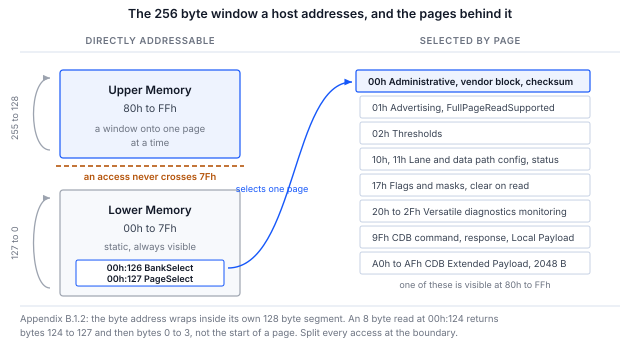

> **検証範囲**。セクション 5 のすべてのコマンドは実際に実行されており、示されているすべての出力は
> その実行から貼り付けたものです。実行対象は光モジュールではなく、**CMIS イメージを提示する I2C ターゲットモードの
> Binho Supernova** です。したがって手順とホスト側の経路は検証されていますが、モジュール自体の動作は検証されていません。
> セクション 8 では、これが何をカバーし、何をカバーしないかを正確に述べています。

## 1 はじめに

ワイヤ上の CMIS のやり取りは、ページ化されたステートフルな対話です。1 回のレジスタ読み出しは、
バイトオフセットの書き込み、リピーテッド START、読み出しで構成されます。そのオフセットが何を意味するかは
バンクとページの選択に依存しますが、その選択は以前のトランザクションで書き込まれたものかもしれず、
モジュールによって暗黙に上書きされているかもしれず、さらにアドレスはアドレス空間全体ではなく
自身の 128 バイトのセグメント内でロールオーバーします。

そのため「モジュールが応答した」ことは「モジュールが動作している」ことと同じではなく、
立ち上げの最初の 1 時間が、エンジニアが思っていた内容では決してなかったバイトを相手に
ホストをデバッグすることに費やされることが非常に多いのです。

本ノートでは、Binho USB ホストアダプタだけを使用して、モジュールが存在し、読み出しに応じ、
正しくページ化されており、内部的に自己整合していることを確認します。最後はモジュール自身が計算した
チェックサムで締めくくります。これは、存在しないターゲットや電源の入っていないターゲットが
偶然に生成する可能性が最も低い結果だからです。セクション 4 では、偶然に生成され得る唯一のケースと、
そのケースを除外する条件を示します。

### 1.1 適用範囲

本書を読み終えると、ハードウェアを手元に持つ読者は、管理バス上のモジュールを検出し、
レディ状態をポーリングし、識別情報とモジュール状態をデコードし、温度と電源のモニタ値を読み出し、
モジュール自身のアドバタイズから最大アクセス長を求め、Upper Memory からベンダブロックを読み出し、
Page 00h のチェックサムを検証できるようになります。

本書は I2C 管理インタフェース（I2CMCI）を対象とします。これは CMIS 付録 B.2 で規範的に規定されており、
出荷されているすべてのモジュールが実装しています。SPI インタフェースは AN0010、I3C バインディングは AN0009 で
扱います。ファームウェア更新、Common Data Block、およびパフォーマンスモニタリングは対象外です。
ファームウェア更新時間の問題は AN0011 で扱います。

### 1.2 対象デバイス

Table: 対象デバイス

| 項目 | 役割 | 根拠 |
|---|---|---|
| Binho Supernova | ホストアダプタ、I2C コントローラ | 検証済み、セクション 8 |
| Binho Pulsar | ホストアダプタ、I2C コントローラ | 未検証。SDK の違いはバスセレクタを引数に取る点のみです |
| CMIS で管理される任意のモジュール | アドレス 0x50 のターゲット | **未検証**。下記の注記を参照してください |
| CMIS I2CMCI アナライザを使用した Saleae Logic | オプションのバスオブザーバ | アナライザは開発中です |

> **この手順は光モジュールに対しては実行されていません。** 0x50 の I2C ターゲットとして設定され、
> CMIS 5.3 イメージを保持した 2 台目の Supernova に対して、エンドツーエンドで実行されています。これにより、
> 本書の主題であるホスト、レジスタアクセス層、ページング、およびチェックサムが検証されます。
> モジュールに属するもの、すなわちホールドオフ動作、ページのサポート、ロールオーバー規則は一切検証されません。
> 本書全体を通して、各知見はそれが属する層に帰属させており、セクション 8.3 にはモジュールで引き続き確認が必要な
> 事項を列挙しています。モジュールに対して実行された時点でリビジョン 1.0 となります。

### 1.3 関連資料

Table: 関連資料

| 資料 | 内容 |
|---|---|
| OIF-CMIS-05.3 | Common Management Interface Specification、リビジョン 5.3、2024 年 9 月 4 日 |
| OIF-CMIS-05.4 | リビジョン 5.4、2026 年 5 月 21 日、照合に使用 |
| SFF-8024 | CMIS バイト 00h:0 が参照する識別子コードのレジストリ |
| AN0009 | Binho Supernova を使用した I3C 経由の CMIS 光モジュールの管理 |
| AN0010 | Binho Pulsar を使用した SPI 経由の CMIS 光モジュールの立ち上げ |
| AN0011 | Binho Supernova を使用した CMIS ファームウェア更新時間の測定 |

## 2 必要な機器とソフトウェア

### 2.1 ハードウェア

Table: 必要な機器

| 項目 |
|---|
| Binho Supernova または Binho Pulsar USB ホストアダプタ |
| CMIS で管理される光モジュール、またはモジュール評価ボード |
| USB-C ケーブル |
| Saleae Logic キャプチャハードウェア（オプション） |

### 2.2 接続

Table: アダプタとモジュール間の接続

| アダプタ | モジュール | 必須 |
|---|---|---|
| SCL | 管理クロック | はい |
| SDA | 管理データ | はい |
| 3V3 | 管理電源 | はい（ボードが自ら供給する場合を除く） |
| GND | リターン | はい |

> **注意**：アダプタの 3V3 を接続する前に、モジュールの管理電源レールを確認してください。
> アダプタはレールに電源を供給することも、外部電源を受け入れることもでき、以下の手順ではアダプタからの供給を使用します。
> キャリアボードがすでにレールを供給している場合は、同じネットに 2 つ目の電源を駆動するのではなく、
> アダプタの外部電圧モードを使用してください。

アダプタにはソフトウェアで選択可能なプルアップがあります。モジュールボードにすでにプルアップが実装されている場合は、
2 組目を並列に接続するのではなく、アダプタ側を無効にしてください。

### 2.3 ソフトウェア

```
pip install binhosupernova        # Supernova
pip install binhopulsar           # Pulsar
```

本ノートに付属するユーティリティ `cmis_mci.py` に必要なのは、これらのパッケージのいずれか 1 つと
Python 標準ライブラリだけです。それ以外は何も必要ありません。

そのうち 2 つのコマンドはアダプタもモジュールもまったく必要とせず、最初に実行する価値があります。
ハードウェアが関与する前に、ツール内のアドレス計算が正しいことを確認できるためです。

```
python cmis_mci.py selfcheck
python cmis_mci.py budget
```

## 3 CMIS 管理モデル

CMIS 第 4.2 章は、レジスタモデルとそれを運ぶトランスポートを分離しています。この分離こそが、
バスが変わっても本書の手順がそのまま通用する理由です。

Table: ホストにとって重要な層

| 層 | 内容 |
|---|---|
| RAL、第 5 章 | 256 バイトのウィンドウに対する、READ、WRITE、TEST のちょうど 3 つのプリミティブ |
| MCI、付録 B | それらを運ぶ交換可能なトランスポートバインディング：I2CMCI または SPIMCI |
| MSL、セクション 5.1 | 固定の管理上の意味を持つ個別ピン。そのうち Reset と Interrupt は必須です |

256 バイトのウィンドウは、静的で常に見えるバイトアドレス 00h から 7Fh の **Lower Memory** と、
00h:126 の `BankSelect` と 00h:127 の `PageSelect` で選択される、はるかに大きなメモリへのウィンドウである
80h から FFh の **Upper Memory** に分かれています。



図 1 はモデル全体を 1 ページにまとめたものです。そのうち 2 つの性質が初日の混乱の大半を生み出しており、
どちらもセクション 6 で扱います。アドレスは先へ進むのではなく自身の 128 バイトセグメント内でラップすること、
そしてホストが選択したページが必ずしもモジュールが実際にいるページではないことです。

### 3.1 すべてのモジュールは 0x50 で応答する

I2CMCI のコントロールバイトは、書き込みが A0h、読み出しが A1h です。これを 1 ビット右にシフトすると
7 ビットアドレス **0x50** となり、CMIS にはアドレスストラップの仕組みがありません。これまでに製造された
すべての CMIS モジュールがこのアドレスで応答します。

オプションの ModSel ピンを持つポイントツーポイントのリンクでは、これは特に問題になりません。
複数のモジュールが 1 本のバスを共有した瞬間に設計上の問題となり、AN0009 はそこからこの話題を引き継ぎます。

### 3.2 アクセス長は仮定するのではなくアドバタイズされる

Table: アクセス長の制限

| 方向 | 制限 | 出典 |
|---|---|---|
| READ | デフォルトで Nmax = 8、フルページリードがアドバタイズされている場合は 128 | セクション 5.2.2.1 |
| WRITE | 常に最大 8 バイト値 | セクション 5.2.2.2 |
| WRITE、CDB Extended Payload | 第 7.8 章で規定される場合は 8 を超える | セクション 5.2.2.2 の注記 |

この非対称性は見落としやすく、しかも重要です。`FullPageReadSupported` が引き上げるのは読み出しの制限だけです。
セクション 5.2.2.2 は、成功した WRITE は「最大 8 個の指定されたバイト値の列を書き込む」と述べており、
これを変更するアドバタイズはありません。AN0011 はこの帰結に基づいています。

> **仕様の誤り。** セクション 5.2.2.1 は、フルページリードのアドバタイズを `01h:251.4` として引用しています。
> 実際のフィールドは **`01h:251.1-0`** の `FullPageReadSupported` で、00 が不明、01 が非サポート、10 がサポートを
> 表す 2 ビットのエンコードです。CMIS 5.4 の改訂履歴でも 2 ビットのフィールドであることが確認されています。
> このアドバタイズをチェックするホストは、すぐにこの問題に突き当たります。付属のユーティリティは正しいアドレスを読み出し、
> 「不明」を保守的なデフォルト値である 8 として扱います。

### 3.3 モジュール状態

Table: モジュールステートマシンの状態、表 6-14

| 値 | 状態 |
|---|---|
| 1 | ModuleLowPwr |
| 2 | ModulePwrUp |
| 3 | ModuleReady |
| 4 | ModulePwrDn |
| 5 | ModuleFault |

状態は `00h:3.3-1` にあります。電源投入時には 1 つの期限が適用されます。`MgmtInit` は
**tMgmtInit = 2000 ms** 以内に `ModuleLowPwr` に到達しなければなりません。これは、インタフェースがレディになり、
`ModuleStateChangedFlag` がセットされた割り込みが発生したことを意味します。それより早くポーリングされたモジュールは、
必ずしも故障しているわけではありません。

フラットメモリモジュールはこのハンドシェイクを省略します。tMgmtInit の経過後にインタフェースがレディであるとみなされるため、
ホストはその期間が過ぎるのを待つだけです。

## 4 各ステップが証明すること

セクション 5 の手順は短いものです。各ステップが含まれているのは、それを省略すると後で自信に満ちた誤った答えが
得られるためであり、このセクションでは各ステップが必要な理由を説明します。

Table: 立ち上げシーケンスと各ステップで確認される内容

| ステップ | レジスタ | 除外されるもの |
|---|---|---|
| バススキャン | なし | モジュールがそもそもバス上に存在しない。これはソフトウェア上の説明では解決できません |
| TEST | なし | モジュールは存在するが、たとえば MgmtInit 中でまだアクセスを拒否している |
| 識別情報 | 00h:0 から 00h:2 | 誤ったフォームファクタ、および 16 進数としてデコードされたリビジョン |
| モジュール状態 | 00h:3.3-1 | 故障中またはまだ電源投入中のモジュールを、レディであるかのように読み出すこと |
| モニタ | 00h:14 から 00h:17 | もっともらしいが一定のバイト。変化する温度とレール電圧は偶然では生じません |
| アドバタイズ | 01h:251.1-0 | モジュールが受け付けるより長いアクセス。これは断続的に失敗します |
| ベンダブロック | 00h:129 以降 | 一度も機能していなかったページング。これらのバイトは Upper Memory にあるためです |
| チェックサム | 00h:222 | 上記すべてを一度に |

**識別情報は 10 進数でコード化されています。** `00h:1` は CMIS リビジョンを 2 桁の 10 進数として保持しているため、
`0x53` は CMIS 5.3 であり、8.3 ではありません。

**モニタのスケーリングはワイヤ上ではなく仕様に規定されています。** `00h:14` の `TempMonValue` は
1/256 ℃ 単位の符号付き 16 ビット値であり、`00h:16` の `VccMonVoltage` は 100 マイクロボルト単位の
符号なし 16 ビット値です。

**チェックサムは利用可能な最も強力なチェックですが、意味を持つためには 1 つの条件が必要です。**
チェックサムは Page 00h のバイト 128 から 221、すなわち 94 バイトのモジュール固有の内容を対象とし、
モジュール自身が `00h:222` に書き込んだバイトと比較されます。古いバッファ、フローティング状態のバス、
あるいは一度も設定されていないターゲットは、通常このチェックに失敗します。また、これらのバイトは Upper Memory に
あるため、そこに到達できたこと自体がページングが機能したことの証明になります。

> **注意**：すべての読み出しで同じバイトを返すバスは、それ自体と整合します。94 バイトの `00h` の合計は `00h` であり、
> 同じバスから読み出した格納済みチェックサムも `00h` であるため、比較は合格しますが、何も証明しません。
> すべて `00h` というのが重要なケースです。`00h` はアイドル状態のバスが返す値であり、SPIMCI のアクノリッジでもあるためです。
> Page 00h に 2 種類以上の異なる値が含まれている場合にのみ、チェックサムを有効とみなしてください。
> 本ノートに付属するユーティリティはこれを強制します。2 つのバイトを比較するだけのホストは、
> 空のバス上で正常なモジュールを報告してしまいます。

## 5 手順

### 5.1 モジュールを確認する前にツールを確認する

```
python cmis_mci.py selfcheck
```

これは、アダプタを接続せずに、B.1.2 のラップ規則と 8.2.15 のページ上書きに従うシミュレーションモジュールに対して、
アドレス計算を実行します。

```
  [OK] an access splits at 7Fh and at Nmax
  [OK] identity and module state decode
  [OK] Page 00h checksum agrees, in accesses of Nmax or fewer bytes
  [OK] FullPageReadSupported raises Nmax, and the 94 byte read fits in one access
  [OK] an all-zero page is rejected, not read as a checksum that agrees
  [OK] a module that overrides an unsupported page is caught, not believed
  [OK] TEST answers on a live module
  [OK] a write stays within the 8 byte WRITE limit while reads use Nmax

cmis_mci.py 1.1 self-check: 8/8 OK
```

### 5.2 モジュールを見つける

```
$ python cmis_mci.py scan
0x50  <- CMIS module
```

このコマンドは応答したすべてのアドレスを報告し、0x50 にマークを付けます。そこで何も応答しない場合、
障害は電源または管理ピンにあり、ソフトウェアをいくら調べても解決しません。

### 5.3 立ち上げを実行する

```
$ python cmis_mci.py bringup
MCI     : I2CMCI
TEST()  : ready
00h:0   : 0x18 QSFP-DD
00h:1   : CMIS 5.3
00h:2   : MciMaxSpeed code 5
00h:3   : ModuleReady
00h:14  : 34.50 C   (S16, 1/256 C)
00h:16  : 3.300 V   (U16, 100 uV)
01h:251 : FullPageReadSupported gives Nmax 8 bytes for reads
00h:129 : VendorName 'BINHO PHOTONICS'
00h:148 : VendorPN   'QDD-400G-DR4'
00h:166 : VendorSN   'SN2608140001'
00h:222 : checksum computed 0x5b, module stores 0x5b, OK

PASS    : present, readable, paged correctly and self consistent.
```

このコマンドはセクション 4 の表に示したステップを順に実行し、Page 00h のチェックサムが一致しない場合は
ゼロ以外の終了コードで終了します。

この出力のうち 2 行は注意深く読む価値があります。どちらも失敗ではなく、手順が正しく機能していることを示しているからです。

`MciMaxSpeed code 5` は I2CMCI のエンコードでは**予約**されており、定義されているのは 0、1、2 のみです。
ここでのターゲットはこの値を報告しているため、もっともらしい値に暗黙にマッピングするのではなく、値をそのまま表示しています。
未定義のコードに対して「3.4 MHz」と表示するホストは推測しているにすぎません。

`FullPageReadSupported gives Nmax 8` は保守的な分岐です。`01h:251.1-0` のアドバタイズは 00、すなわち不明として
読み返されており、不明は「サポート」ではありません。これを 128 として扱うホストは、ターゲットが一度も同意していない
アクセスを発行することになります。

### 5.4 個々のレジスタを読み書きする

```
$ python cmis_mci.py read  --byte 3
00h:3 x1 = 07

$ python cmis_mci.py read  --page 01h --byte 251
01h:251 x1 = 00

$ python cmis_mci.py write --byte 127 --data 01
wrote 01, read back 01, match
```

すべての書き込みの後にはリードバックが行われ、その結果が報告されます。リードバックされていない書き込みは、
何かが書き込まれたことの証拠にはならないためです。

`00h:3 = 07` は ModuleReady とデコードされます。`07h` のビット 3-1 は `011` であり、これは状態 3 です。

### 5.5 ベンダブロックを読み出す

```
$ python cmis_mci.py identify
identifier    0x18 QSFP-DD
CMIS revision 5.3
VendorName    'BINHO PHOTONICS'
VendorOUI     00 00 00
VendorPN      'QDD-400G-DR4'
VendorRev     '1A'
VendorSN      'SN2608140001'
DateCode      '260814AB'
```

上記のすべてのフィールドは Page 00h の Upper Memory にあるため、それらを読み出せたこと自体が
ページ選択が機能したことの証拠になります。

## 6 誤ったバイトを読む 2 つのパターン

どちらもまったく妥当に見える出力を生成します。それこそが、これらが高くつく理由です。

### 6.1 アドレスはセグメント内でラップし、先へは進まない

付録 B.1.2 の規定は明確です。現在のバイトアドレスは自身の 128 バイトセグメント内でロールオーバーし、
127 から 0 に、255 から 128 に戻り、Lower Memory と Upper Memory の間を越えることはありません。
したがって、`00h:124` からの 8 バイト読み出しは、バイト 124 から 127 に続いてバイト 0 から 3 を返し、
Page 00h の先頭は返しません。

付属のユーティリティはすべてのアクセスをセグメント境界で分割するため、このユーティリティを通じてこのケースが
発生することはありません。

```
split_access(124, 8, nmax=8)   ->   [(124, 4), (128, 4)]
```

NXP AN15071 のセクション 2.1.1 は、同社の I3C ターゲットに対して逆の規則、すなわち 256 バイト空間全体にわたって
FFh でラップする規則を規定しています。`rollover` コマンドは、特定のターゲットがどちらの規則を実装しているかを確認します。

```
$ python cmis_mci.py rollover
8 bytes from 00h:124, last four : 18 42 49 4e
00h:0-3                         : 18 53 54 07
Page 00h:128-131                : 18 42 49 4e

ran on into Upper Memory, as NXP AN15071 2.1.1 specifies
Either way, do not issue an access that crosses 7Fh. Split it.
```

> **この結果はフィクスチャの性質であり、CMIS の性質でも、いずれかのモジュールの性質でもありません。**
> ここで使用しているターゲットは I2C ターゲットモードの Binho Supernova で、フラットなメモリ領域を提示するため、
> 7Fh を越えて先へ進みます。これを掲載しているのは、コマンドが実際に報告した内容であり、かつコマンドが検出するために
> 存在するケースを示しているためです。光モジュールの動作に関する証拠として読まないでください。

### 6.2 書き込んだページが現在のページとは限らない

セクション 8.2.15 では、モジュールがホストのページ書き込みを上書きすることが認められています。
サポートされていないページを選択すると、`PageSelect` には代わりにサポートされているページが保持され、
どこにもエラーは報告されません。パッシブなオブザーバには、モジュールがどのページをサポートしているかを知る方法がありません。

そのため、ユーティリティは選択を読み返し、ホストがいないページのデータを返すのではなく例外を発生させます。

```
CmisError: module overrode the page selection: asked for bank 0x00 page 0x99,
           it is on bank 0x00 page 0x00 (CMIS 8.2.15, page not supported)
```

## 7 ユーティリティ

Table: ユーティリティのコマンド

| コマンド | 目的 |
|---|---|
| `selfcheck` | シミュレーションモジュールに対して、アドレス計算をオフラインでチェックする |
| `scan` | バス上で何が応答するかを報告する |
| `bringup` | モジュール検出シーケンスをエンドツーエンドで実行する |
| `identify` | 識別情報とベンダブロックをデコードする |
| `read`、`write` | レジスタアクセス。すべての書き込み後にリードバックを行う |
| `rollover` | モジュールがどのアドレスラップ規則を実装しているかを確認する |
| `spi-probe` | SPIMCI のフロー制御カウントと R/Wn の極性を確認する |
| `timing` | 表 10-4 の上限値に照らしてアクセスの各フェーズの時間を計測する |
| `budget` | ファームウェア更新時間の見積もり（オフライン） |
| `ibi` | インバンド割り込み（IBI）をカウントする（I3C のみ） |

`--transport i2c`、`i3c`、または `spi` で管理インタフェースを選択します。レジスタモデルの実装は 1 つだけで、
変わるのはその下のトランスポートだけです。

## 8 測定結果

### 8.1 テスト構成

Table: テスト構成

| 項目 | 値 |
|---|---|
| コントローラ | Binho Supernova、シリアル `1912DEB5…79FA`、ファームウェア 4.4.0、ハードウェアリビジョン C |
| ターゲット | Binho Supernova、シリアル `ED7BF8F3…F7BB`、ファームウェア 4.4.0、ハードウェアリビジョン C、0x50 の I2C ターゲットとして設定 |
| ターゲットの内容 | CMIS 5.3 イメージ。付録 C の 400G QSFP-DD の例で、Lower Memory と Page 00h をカバーする 256 バイト |
| SDK | `binhosupernova` 4.2.0、Python 3.10.12 |
| ホスト | Ubuntu 22.04、x86-64 |
| バス | 3.3 V、400 kHz、アダプタのプルアップ、2 台のアダプタ間を直接ケーブル接続 |

> **ターゲットは光モジュールではなくアダプタです。** 2 台目の Supernova は CMIS イメージを保持する I2C ターゲットとして
> 設定されており、レジスタモデルに対しては忠実なフィクスチャですが、モジュールに属するすべてのものに対しては忠実ではありません。
> セクション 8.3 でその境界を示します。

### 8.2 結果

**オフライン。** アドレス計算のセルフチェックは、シミュレーションモジュールに対して 8 項目中 8 項目すべて合格しました。
対象は、セグメント境界での分割、Nmax の読み出し制限、8 バイトの書き込み制限、Page 00h のチェックサム、
`FullPageReadSupported` のデコード、およびセクション 8.2.15 のページ上書きです。

**バススキャン。** ターゲットは 0x50 で応答し、それ以外のアドレスでは応答しませんでした。

**立ち上げ。** セクション 4 の 8 つのステップがすべて完了し、Page 00h のチェックサムの計算結果は `0x5B` で、
格納値 `0x5B` と一致しました。チェックサムのバイトに到達するには、ページ選択、Nmax サイズのアクセスに分割した
94 バイトの読み出し、および `00h:222` の個別の読み出しが必要だったため、この一致はデータだけでなく
ページングとアクセス分割もカバーしています。

**アドバタイズ。** `01h:251.1-0` は 00、すなわち不明を返し、ホストは `Nmax` を 8 に維持しました。
ターゲットは Page 01h の内容を保持していないため、これは機能が抑制された結果ではなく、正しい保守的な結果です。

**レジスタアクセス。** `00h:3` は `07` を返し、ModuleReady とデコードされました。`00h:127` への `01` の書き込みと、
その後の `00` の書き込みは、いずれもバイト単位で一致してリードバックされました。

**実行によって 2 つの不具合が見つかり、どちらも付属のユーティリティで修正されています。** どちらもコードを読むだけでは
わかりませんでした。バススキャンが SDK の応答から誤ったキーを解析していたため、バス上にあるターゲットが存在しないと
報告されていました。`binhosupernova` 4.2.0 は `detected_7_bit_addresses` で応答し、認識できない応答形式に対しては、
現在は空のリストを返すのではなく例外を発生させます。また別に、`argparse` は `parents=` で作成したサブパーサ間で
アクションオブジェクトを共有するため、1 つのサブコマンドに設定したデフォルトがすべてのサブコマンドのデフォルトになり、
すべてのコマンドが `--transport i3c` を指定されたかのように実行されていました。

### 8.3 実際のモジュールで引き続き確認が必要な事項

このセクションのすべての内容はホストとレジスタモデルに属するものです。モジュールに関する証拠は一切含まれていません。
未確認の事項：

Table: 実際のモジュールで未確認の事項

| 項目 | フィクスチャでは答えられない理由 |
|---|---|
| ホールドオフ動作、tREAD および tWRITE | フィクスチャは即座に応答します。クロックを引き延ばしたり NACK を返したりする理由がありません |
| モジュールがどのページをサポートしているか | フィクスチャはすべてのページを受け付けます。セクション 8.2.15 の上書きはオフラインのセルフチェックでのみ検証されています |
| ロールオーバー規則、セクション 6.1 | フィクスチャはフラットな領域を実装しているため、ラップせずに 7Fh を越えて先へ進みます。セクション 6.1 の注記を参照してください |
| `FullPageReadSupported` が 10 を返す場合 | ここにはフルページリードをアドバタイズするターゲットがないため、128 バイトの経路はオフラインでのみ検証されています |
| 物理量に追従するモニタ値 | 読み返された温度と電圧はイメージに格納されたバイトであり、測定値ではありません |

## 9 トラブルシューティング

Table: トラブルシューティング

| 症状 | 考えられる原因と対処 |
|---|---|
| 0x50 で何も応答しない | 管理電源レールがない、または SCL と SDA が接続されていません。ソフトウェアではなく、まず電源を確認してください |
| バススキャンでモジュールは見つかるが TEST が拒否される | モジュールがまだ MgmtInit 中である可能性があります。tMgmtInit（2000 ms）待ってから再試行してください |
| 識別情報は有効なフォームファクタとして読めるが、チェックサムが失敗する | ページングがホストの想定どおりに動作していません。選択後に `00h:127` を読み返してください |
| マルチバイト読み出しが別のページのバイトを返す | アクセスが 7Fh を越えています。セグメント境界で分割してください |
| ページ選択は受け付けられたように見えるが、読み出しが Page 00h を返す | モジュールはそのページをサポートしておらず、セクション 8.2.15 に従って修正しています |
| 8 バイトより長い読み出しが断続的に失敗する | モジュールはフルページリードをアドバタイズしていません。Nmax を 8 に維持してください |
| コントローラが START を駆動できない | バスにプルアップがないか、弱すぎます。アダプタのプルアップを有効にするか、2.2k から 4.7k を実装してください |

## 10 略語

Table: 略語

| 用語 | 意味 |
|---|---|
| CDB | Common Data Block |
| CMIS | Common Management Interface Specification |
| I2CMCI | I2C Management Communication Interface |
| MCI | Management Communication Interface |
| MSL | Management Signalling Layer |
| Nmax | 1 回のレジスタアクセスにおける最大バイト数 |
| OIF | Optical Internetworking Forum |
| RAL | Register Access Layer（レジスタアクセス層） |
| SPIMCI | SPI Management Communication Interface |

## 11 本書のソースコードに関する注記

本書に示し、付属のアーカイブで提供しているサンプルコードは、評価および参考を目的として提供されています。
MIT ライセンスの下でリリースされており、ライセンスの全文はアーカイブに含まれています。

Table: アセットアーカイブの内容

| ファイル | 説明 |
|---|---|
| `AN0008.md` | 本書の Markdown ソース |
| `assets/cmis_mci.py` | リファレンスユーティリティ。AN0008 から AN0011 で共有 |
| `assets/LICENSE` | サンプルコードを対象とする MIT ライセンス |

## 12 改訂履歴

Table: 改訂履歴

| リビジョン | 日付 | 説明 |
|---|---|---|
| 0.1 | 2026 年 9 月 1 日 | 社内レビュー用ドラフト。仕様の内容は検証済み。手順はまだハードウェアで実行していません。 |
| 0.2 | 2026 年 9 月 1 日 | Supernova I2C ターゲットフィクスチャに対して手順をエンドツーエンドで実行。セクション 5 のすべての出力はその実行から貼り付けたもの。ユーティリティの不具合を 2 件発見して修正。光モジュールに対してはまだ実行していません。 |
| 0.3 | 2026 年 9 月 2 日 | AN0007 から番号を変更。Page 00h チェックサムに関する記述を訂正：ベンチでの実行で、すべてゼロのページが比較に合格することが判明したため、偶然には合格し得ないチェックとは記述しないこととし、ユーティリティは単一の値が繰り返されるページを拒否するようにしました。 |
| 0.4 | 2026 年 9 月 3 日 | 共有ユーティリティを 1.1 に更新し、AN0011 が必要とする SPIMCI の行を追加。セルフチェックの出力を再実行し、表示されるバージョン以外は変化なし。 |
| 1.0 | 2026 年 11 月 6 日 | 公開。 |
