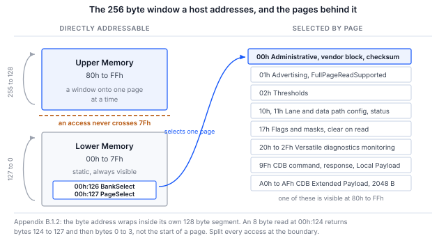

> **검증 범위**. 섹션 5의 모든 명령은 실제로 실행되었으며, 표시된 모든 출력은 그 실행에서 붙여 넣은 것입니다.
> 실행 대상은 광 모듈이 아니라 **CMIS 이미지를 제공하는 I2C 타깃 모드의 Binho Supernova**이므로,
> 절차와 호스트 경로는 검증되었지만 모듈 자체의 동작은 검증되지 않았습니다. 섹션 8에서는 이것이 무엇을 다루고
> 무엇을 다루지 않는지 정확히 설명합니다.

## 1 소개

와이어 상의 CMIS 교환은 페이지 단위의 상태 기반 대화입니다. 한 번의 레지스터 읽기는 바이트 오프셋 쓰기,
반복 START, 읽기로 구성됩니다. 그 오프셋이 무엇을 의미하는지는 뱅크와 페이지 선택에 따라 달라지는데,
이 선택은 이전 트랜잭션에서 기록되었을 수 있고, 모듈에 의해 조용히 재정의되었을 수 있으며,
주소는 주소 공간 전체가 아니라 자신의 128바이트 세그먼트 안에서 롤오버됩니다.

그렇기 때문에 "모듈이 응답했다"는 것은 "모듈이 동작한다"는 것과 같지 않으며, 브링업의 첫 한 시간이
엔지니어가 생각한 내용이 결코 아니었던 바이트를 상대로 호스트를 디버깅하는 데 소비되는 경우가 매우 많습니다.

이 노트는 Binho USB 호스트 어댑터 하나만으로 모듈이 존재하고, 읽기에 응하며, 페이지가 올바르게 선택되어 있고,
내부적으로 자기 일관성이 있음을 확인합니다. 마지막은 모듈 자신이 계산한 체크섬으로 마무리합니다.
이것은 존재하지 않거나 전원이 공급되지 않은 타깃이 우연히 만들어낼 가능성이 가장 낮은 결과이기 때문입니다.
섹션 4에서는 우연히 만들어질 수 있는 유일한 경우와 그 경우를 배제하는 조건을 설명합니다.

### 1.1 범위

이 문서를 다 읽으면 하드웨어를 갖춘 독자는 관리 버스에서 모듈을 감지하고, 준비 상태를 폴링하고,
식별 정보와 모듈 상태를 디코딩하고, 온도 및 전원 모니터 값을 읽고, 모듈 자체의 광고(advertisement)로부터
최대 액세스 길이를 알아내고, Upper Memory에서 벤더 블록을 읽고, Page 00h 체크섬을 검증할 수 있게 됩니다.

이 문서는 I2C 관리 인터페이스(I2CMCI)를 다룹니다. 이는 CMIS 부록 B.2에서 규범적으로 규정하며,
배포된 모든 모듈이 구현합니다. SPI 인터페이스는 AN0010에서, I3C 바인딩은 AN0009에서 다룹니다.
펌웨어 업데이트, Common Data Block 및 성능 모니터링은 범위에서 제외되며, 펌웨어 업데이트 시간 문제는 AN0011에서 다룹니다.

### 1.2 적용 디바이스

Table: 적용 디바이스

| 항목 | 역할 | 근거 |
|---|---|---|
| Binho Supernova | 호스트 어댑터, I2C 컨트롤러 | 검증됨, 섹션 8 |
| Binho Pulsar | 호스트 어댑터, I2C 컨트롤러 | 검증되지 않음. SDK는 버스 선택자를 인수로 받는다는 점만 다릅니다 |
| CMIS로 관리되는 모든 모듈 | 주소 0x50의 타깃 | **검증되지 않음.** 아래 설명을 참조하십시오 |
| CMIS I2CMCI 분석기를 사용하는 Saleae Logic | 선택 사항인 버스 관찰기 | 분석기는 개발 중입니다 |

> **이 절차는 광 모듈에서 실행된 적이 없습니다.** 0x50의 I2C 타깃으로 설정되어 CMIS 5.3 이미지를 보유한
> 두 번째 Supernova를 대상으로 엔드투엔드로 실행되었습니다. 이를 통해 이 문서의 주제인 호스트, 레지스터 액세스 계층,
> 페이징 및 체크섬이 검증됩니다. 홀드오프 동작, 페이지 지원, 롤오버 규칙 등 모듈에 속하는 것은 전혀 검증되지 않습니다.
> 문서 전체에서 각 결과는 해당 계층에 귀속시켰으며, 섹션 8.3에는 모듈에서 여전히 확인해야 할 사항이 나열되어 있습니다.
> 모듈에서 실행되면 개정 1.0이 됩니다.

### 1.3 관련 문서

Table: 관련 문서

| 문서 | 주제 |
|---|---|
| OIF-CMIS-05.3 | Common Management Interface Specification, 개정 5.3, 2024년 9월 4일 |
| OIF-CMIS-05.4 | 개정 5.4, 2026년 5월 21일, 교차 확인에 사용 |
| SFF-8024 | CMIS 바이트 00h:0이 참조하는 식별자 코드 레지스트리 |
| AN0009 | Binho Supernova를 사용한 I3C 기반 CMIS 광 모듈 관리 |
| AN0010 | Binho Pulsar를 사용한 SPI 기반 CMIS 광 모듈 브링업 |
| AN0011 | Binho Supernova를 사용한 CMIS 펌웨어 업데이트 시간 측정 |

## 2 필요한 장비 및 소프트웨어

### 2.1 하드웨어

Table: 필요한 장비

| 항목 |
|---|
| Binho Supernova 또는 Binho Pulsar USB 호스트 어댑터 |
| CMIS로 관리되는 광 모듈 또는 모듈 평가 보드 |
| USB-C 케이블 |
| Saleae Logic 캡처 하드웨어, 선택 사항 |

### 2.2 연결

Table: 어댑터와 모듈 간 연결

| 어댑터 | 모듈 | 필수 여부 |
|---|---|---|
| SCL | 관리 클록 | 예 |
| SDA | 관리 데이터 | 예 |
| 3V3 | 관리 전원 | 예, 보드가 자체 전원을 공급하는 경우 제외 |
| GND | 리턴 | 예 |

> **주의:** 어댑터의 3V3을 연결하기 전에 모듈의 관리 전원 레일을 확인하십시오.
> 어댑터는 레일에 전원을 공급할 수도 있고 외부 전원을 받을 수도 있으며, 아래 절차에서는 어댑터의 전원을 사용합니다.
> 캐리어 보드가 이미 레일을 공급하는 경우에는 같은 네트에 두 번째 전원을 구동하지 말고 어댑터의 외부 전압 모드를 사용하십시오.

어댑터에는 소프트웨어로 선택 가능한 풀업이 있습니다. 모듈 보드에 이미 풀업이 있는 경우에는
두 번째 풀업 세트를 병렬로 추가하지 말고 어댑터의 풀업을 비활성화하십시오.

### 2.3 소프트웨어

```
pip install binhosupernova        # Supernova
pip install binhopulsar           # Pulsar
```

이 노트와 함께 제공되는 유틸리티 `cmis_mci.py`에는 위 패키지 중 하나와 Python 표준 라이브러리만 필요합니다.
그 외에는 아무것도 필요하지 않습니다.

그중 두 명령은 어댑터도 모듈도 전혀 필요하지 않으며, 하드웨어가 관여하기 전에 도구의 주소 연산이
올바른지 확인할 수 있으므로 가장 먼저 실행해 볼 가치가 있습니다.

```
python cmis_mci.py selfcheck
python cmis_mci.py budget
```

## 3 CMIS 관리 모델

CMIS 4.2장은 레지스터 모델과 이를 전달하는 트랜스포트를 분리하며, 이 분리 덕분에 이 문서의 절차는
버스가 바뀌어도 그대로 유효합니다.

Table: 호스트에 중요한 계층

| 계층 | 설명 |
|---|---|
| RAL, 5장 | 256바이트 창에 대한 정확히 세 개의 프리미티브 READ, WRITE, TEST |
| MCI, 부록 B | 이를 전달하는 교체 가능한 트랜스포트 바인딩: I2CMCI 또는 SPIMCI |
| MSL, 섹션 5.1 | 고정된 관리 의미를 갖는 개별 핀. 그중 Reset과 Interrupt는 필수입니다 |

256바이트 창은 바이트 주소 00h~7Fh로 정적이며 항상 보이는 **Lower Memory**와, 80h~FFh로
00h:126의 `BankSelect`와 00h:127의 `PageSelect`로 선택되는 훨씬 더 큰 메모리에 대한 창인
**Upper Memory**로 나뉩니다.



그림 1은 모델 전체를 한 페이지에 보여 줍니다. 이 모델의 두 가지 특성이 첫날 혼란의 대부분을 일으키며,
둘 다 섹션 6에서 다룹니다. 주소는 계속 진행하지 않고 자신의 128바이트 세그먼트 안에서 래핑된다는 점,
그리고 호스트가 선택한 페이지가 반드시 모듈이 실제로 있는 페이지는 아니라는 점입니다.

### 3.1 모든 모듈은 0x50에서 응답한다

I2CMCI 제어 바이트는 쓰기 시 A0h, 읽기 시 A1h입니다. 이를 오른쪽으로 1비트 시프트하면 7비트 주소 **0x50**이 되며,
CMIS는 주소 스트래핑을 제공하지 않습니다. 지금까지 만들어진 모든 CMIS 모듈이 이 주소에서 응답합니다.

선택 사항인 ModSel 핀이 있는 점대점 링크에서는 이것이 특별한 문제가 되지 않습니다. 둘 이상의 모듈이 하나의 버스를
공유하는 순간 설계 문제가 되며, AN0009가 그 지점에서 이 주제를 이어받습니다.

### 3.2 액세스 길이는 가정하지 않고 광고된다

Table: 액세스 길이 제한

| 방향 | 제한 | 출처 |
|---|---|---|
| READ | 기본값 Nmax = 8, 전체 페이지 읽기가 광고된 경우 128 | 섹션 5.2.2.1 |
| WRITE | 항상 최대 8개 바이트 값 | 섹션 5.2.2.2 |
| WRITE, CDB Extended Payload | 7.8장에서 규정하는 경우 8 초과 | 섹션 5.2.2.2 주석 |

이 비대칭은 놓치기 쉽고 또 중요합니다. `FullPageReadSupported`는 읽기에 대한 제한만 높입니다.
섹션 5.2.2.2는 성공적인 WRITE가 "최대 8개의 주어진 바이트 값 시퀀스를 기록한다"고 규정하며,
이를 바꾸는 광고는 없습니다. AN0011은 이 결과를 바탕으로 작성되었습니다.

> **사양 결함.** 섹션 5.2.2.1은 전체 페이지 읽기 광고를 `01h:251.4`로 인용합니다. 실제 필드는
> **`01h:251.1-0`** 위치의 `FullPageReadSupported`이며, 00은 알 수 없음, 01은 지원하지 않음, 10은 지원함을 나타내는
> 2비트 인코딩입니다. CMIS 5.4 개정 이력에서도 2비트 필드임이 확인됩니다. 광고를 검사하는 호스트는
> 즉시 이 문제에 부딪힙니다. 제공된 유틸리티는 올바른 주소를 읽고 "알 수 없음"을 보수적인 기본값 8로 처리합니다.

### 3.3 모듈 상태

Table: 모듈 상태 머신 상태, 표 6-14

| 값 | 상태 |
|---|---|
| 1 | ModuleLowPwr |
| 2 | ModulePwrUp |
| 3 | ModuleReady |
| 4 | ModulePwrDn |
| 5 | ModuleFault |

상태는 `00h:3.3-1`에 있습니다. 전원 투입 시 하나의 기한이 적용됩니다. `MgmtInit`은 **tMgmtInit = 2000 ms** 이내에
`ModuleLowPwr`에 도달해야 하며, 이는 인터페이스가 준비되었고 `ModuleStateChangedFlag`가 설정된 인터럽트가
발생했음을 의미합니다. 그보다 일찍 폴링된 모듈이 반드시 고장 난 것은 아닙니다.

플랫 메모리 모듈은 이 핸드셰이크를 생략합니다. tMgmtInit 이후 인터페이스가 준비된 것으로 간주되므로,
호스트는 그 시간이 지나기를 기다리기만 하면 됩니다.

## 4 각 단계가 증명하는 것

섹션 5의 절차는 짧습니다. 각 단계가 포함된 이유는 이를 건너뛰면 나중에 확신에 찬 잘못된 답이 나오기 때문이며,
이 섹션에서는 각 단계가 필요한 이유를 설명합니다.

Table: 브링업 시퀀스와 각 단계가 확인하는 내용

| 단계 | 레지스터 | 배제하는 것 |
|---|---|---|
| 버스 스캔 | 없음 | 모듈이 아예 버스에 없는 경우. 어떤 소프트웨어적 설명으로도 해결할 수 없습니다 |
| TEST | 없음 | 모듈은 존재하지만 예를 들어 MgmtInit 중이어서 아직 액세스를 거부하는 경우 |
| 식별 정보 | 00h:0 ~ 00h:2 | 잘못된 폼 팩터, 그리고 16진수로 디코딩된 개정 번호 |
| 모듈 상태 | 00h:3.3-1 | 고장 상태이거나 아직 전원 투입 중인 모듈을 준비된 것처럼 읽는 경우 |
| 모니터 | 00h:14 ~ 00h:17 | 그럴듯하지만 고정된 바이트. 실시간 온도와 레일 값은 우연일 수 없습니다 |
| 광고 | 01h:251.1-0 | 모듈이 허용하는 것보다 긴 액세스. 간헐적으로 실패합니다 |
| 벤더 블록 | 00h:129부터 | 한 번도 동작하지 않은 페이징. 이 바이트들은 Upper Memory에 있기 때문입니다 |
| 체크섬 | 00h:222 | 위의 모든 것을 한 번에 |

**식별 정보는 10진수로 코딩됩니다.** `00h:1`은 CMIS 개정 번호를 두 자리 10진수로 저장하므로
`0x53`은 8.3이 아니라 CMIS 5.3입니다.

**모니터 값의 스케일링은 와이어가 아니라 사양에 정의되어 있습니다.** `00h:14`의 `TempMonValue`는
1/256 섭씨도 단위의 부호 있는 16비트 값이고, `00h:16`의 `VccMonVoltage`는 100 마이크로볼트 단위의
부호 없는 16비트 값입니다.

**체크섬은 사용 가능한 가장 강력한 검사이지만, 의미를 가지려면 한 가지 조건이 필요합니다.** 체크섬은
Page 00h의 바이트 128~221, 즉 94바이트의 모듈 고유 내용을 대상으로 하며, 모듈 자신이 `00h:222`에 기록한
바이트와 비교합니다. 오래된 버퍼, 플로팅 상태의 버스, 또는 한 번도 설정되지 않은 타깃은 일반적으로 이 검사에
실패하며, 이 바이트들은 Upper Memory에 있으므로 여기에 도달했다는 것 자체가 페이징이 동작했음을 증명합니다.

> **주의:** 모든 읽기에서 같은 바이트를 반환하는 버스는 그 자체로 일관됩니다. 94바이트의 `00h`를 합하면 `00h`이고,
> 같은 버스에서 읽은 저장된 체크섬도 `00h`이므로 비교는 통과하지만 아무것도 증명하지 못합니다.
> 모두 `00h`인 경우가 중요한데, `00h`는 유휴 버스가 반환하는 값이자 SPIMCI의 응답(acknowledgement)이기 때문입니다.
> Page 00h에 서로 다른 값이 둘 이상 있을 때만 체크섬을 유효한 것으로 간주하십시오. 이 노트와 함께 제공되는
> 유틸리티는 이를 강제합니다. 두 바이트만 비교하고 다른 것은 확인하지 않는 호스트는 빈 버스에서 정상 모듈을 보고하게 됩니다.

## 5 절차

### 5.1 모듈을 확인하기 전에 도구를 확인한다

```
python cmis_mci.py selfcheck
```

이 명령은 어댑터를 연결하지 않은 상태에서, B.1.2 래핑 규칙과 8.2.15 페이지 재정의를 따르는 시뮬레이션 모듈을
대상으로 주소 연산을 실행합니다.

```
  [OK] an access splits at 7Fh and at Nmax
  [OK] identity and module state decode
  [OK] Page 00h checksum agrees, in accesses of Nmax or fewer bytes
  [OK] FullPageReadSupported raises Nmax, and the 94 byte read fits in one access
  [OK] an all-zero page is rejected, not read as a checksum that agrees
  [OK] a module that overrides an unsupported page is caught, not believed
  [OK] TEST answers on a live module
  [OK] a write stays within the 8 byte WRITE limit while reads use Nmax

cmis_mci.py 1.1 self-check: 8/8 OK
```

### 5.2 모듈 찾기

```
$ python cmis_mci.py scan
0x50  <- CMIS module
```

이 명령은 응답하는 모든 주소를 보고하고 0x50을 표시합니다. 그 주소에서 아무것도 응답하지 않으면
결함은 전원 또는 관리 핀에 있으며, 소프트웨어를 아무리 조사해도 해결되지 않습니다.

### 5.3 브링업 실행

```
$ python cmis_mci.py bringup
MCI     : I2CMCI
TEST()  : ready
00h:0   : 0x18 QSFP-DD
00h:1   : CMIS 5.3
00h:2   : MciMaxSpeed code 5
00h:3   : ModuleReady
00h:14  : 34.50 C   (S16, 1/256 C)
00h:16  : 3.300 V   (U16, 100 uV)
01h:251 : FullPageReadSupported gives Nmax 8 bytes for reads
00h:129 : VendorName 'BINHO PHOTONICS'
00h:148 : VendorPN   'QDD-400G-DR4'
00h:166 : VendorSN   'SN2608140001'
00h:222 : checksum computed 0x5b, module stores 0x5b, OK

PASS    : present, readable, paged correctly and self consistent.
```

이 명령은 섹션 4의 표에 나열된 단계를 순서대로 수행하며, Page 00h 체크섬이 일치하지 않으면
0이 아닌 코드로 종료합니다.

출력 중 두 줄은 주의 깊게 읽어 볼 가치가 있습니다. 둘 다 실패가 아니라 절차가 제대로 동작하고 있음을 보여 주기 때문입니다.

`MciMaxSpeed code 5`는 I2CMCI 인코딩에서 **예약**된 값이며, 이 인코딩은 0, 1, 2만 정의합니다.
여기서의 타깃이 이 값을 보고하므로, 그럴듯한 값으로 조용히 매핑하지 않고 값을 그대로 표시합니다.
정의되지 않은 코드에 대해 "3.4 MHz"를 출력하는 호스트는 추측하고 있는 것입니다.

`FullPageReadSupported gives Nmax 8`은 보수적인 분기입니다. `01h:251.1-0`의 광고는 00, 즉 알 수 없음으로
읽혔으며, 알 수 없음은 "지원함"이 아닙니다. 이를 128로 처리하는 호스트는 타깃이 동의한 적 없는 액세스를 발행합니다.

### 5.4 개별 레지스터 읽기 및 쓰기

```
$ python cmis_mci.py read  --byte 3
00h:3 x1 = 07

$ python cmis_mci.py read  --page 01h --byte 251
01h:251 x1 = 00

$ python cmis_mci.py write --byte 127 --data 01
wrote 01, read back 01, match
```

모든 쓰기 뒤에는 리드백이 수행되고 그 결과가 보고됩니다. 리드백하지 않은 쓰기는 무언가가 기록되었다는 증거가
되지 않기 때문입니다.

`00h:3 = 07`은 ModuleReady로 디코딩됩니다. `07h`의 비트 3-1은 `011`이며, 이는 상태 3입니다.

### 5.5 벤더 블록 읽기

```
$ python cmis_mci.py identify
identifier    0x18 QSFP-DD
CMIS revision 5.3
VendorName    'BINHO PHOTONICS'
VendorOUI     00 00 00
VendorPN      'QDD-400G-DR4'
VendorRev     '1A'
VendorSN      'SN2608140001'
DateCode      '260814AB'
```

위의 모든 필드는 Page 00h의 Upper Memory에 있으므로, 이를 읽을 수 있다는 것 자체가 페이지 선택이
동작했다는 증거입니다.

## 6 잘못된 바이트를 읽는 두 가지 경우

두 경우 모두 완전히 합리적으로 보이는 출력을 만들어 내며, 바로 그 점 때문에 비용이 많이 듭니다.

### 6.1 주소는 세그먼트 안에서 래핑되며, 계속 진행하지 않는다

부록 B.1.2의 규정은 명확합니다. 현재 바이트 주소는 자신의 128바이트 세그먼트 안에서 롤오버되어
127은 0으로, 255는 128로 돌아가며, Lower Memory와 Upper Memory 사이를 넘나들지 않습니다.
따라서 `00h:124`에서 8바이트를 읽으면 바이트 124~127에 이어 바이트 0~3이 반환되며, Page 00h의 시작 부분이
반환되지 않습니다.

제공된 유틸리티는 모든 액세스를 세그먼트 경계에서 분할하므로, 이 유틸리티를 통해서는 이 경우가 발생할 수 없습니다.

```
split_access(124, 8, nmax=8)   ->   [(124, 4), (128, 4)]
```

NXP AN15071 섹션 2.1.1은 자사 I3C 타깃에 대해 반대 규칙, 즉 256바이트 공간 전체에서 FFh에서 래핑하는 규칙을
규정합니다. `rollover` 명령은 특정 타깃이 어떤 규칙을 구현하는지 확인합니다.

```
$ python cmis_mci.py rollover
8 bytes from 00h:124, last four : 18 42 49 4e
00h:0-3                         : 18 53 54 07
Page 00h:128-131                : 18 42 49 4e

ran on into Upper Memory, as NXP AN15071 2.1.1 specifies
Either way, do not issue an access that crosses 7Fh. Split it.
```

> **이 결과는 픽스처의 특성이며, CMIS의 특성도 아니고 어떤 모듈의 특성도 아닙니다.** 여기서 사용한 타깃은
> I2C 타깃 모드의 Binho Supernova로, 플랫 메모리 영역을 제공하므로 7Fh를 넘어 계속 진행합니다.
> 이 결과를 싣는 이유는 명령이 실제로 보고한 내용이며, 명령이 감지하기 위해 존재하는 경우를 보여 주기 때문입니다.
> 광 모듈 동작에 대한 증거로 해석하지 마십시오.

### 6.2 기록한 페이지가 현재 페이지라는 보장은 없다

섹션 8.2.15는 모듈이 호스트의 페이지 쓰기를 재정의하는 것을 허용합니다. 지원되지 않는 페이지를 선택하면
`PageSelect`에는 대신 지원되는 페이지가 남으며, 어디에서도 오류가 보고되지 않습니다. 수동 관찰자는
모듈이 어떤 페이지를 지원하는지 알 수 없습니다.

따라서 유틸리티는 선택 값을 다시 읽고, 호스트가 있지 않은 페이지의 데이터를 반환하는 대신 예외를 발생시킵니다.

```
CmisError: module overrode the page selection: asked for bank 0x00 page 0x99,
           it is on bank 0x00 page 0x00 (CMIS 8.2.15, page not supported)
```

## 7 유틸리티

Table: 유틸리티 명령

| 명령 | 용도 |
|---|---|
| `selfcheck` | 시뮬레이션 모듈을 대상으로 주소 연산을 오프라인에서 검사 |
| `scan` | 버스에서 무엇이 응답하는지 보고 |
| `bringup` | 모듈 검색 시퀀스를 엔드투엔드로 실행 |
| `identify` | 식별 정보와 벤더 블록을 디코딩 |
| `read`, `write` | 레지스터 액세스. 모든 쓰기 후 리드백 수행 |
| `rollover` | 모듈이 어떤 주소 래핑 규칙을 구현하는지 확인 |
| `spi-probe` | SPIMCI 흐름 제어 카운트와 R/Wn 극성을 확인 |
| `timing` | 표 10-4의 상한값에 대해 액세스 단계별 시간 측정 |
| `budget` | 펌웨어 업데이트 시간 예산, 오프라인 |
| `ibi` | 인밴드 인터럽트(IBI) 횟수 계산, I3C 전용 |

`--transport i2c`, `i3c` 또는 `spi`로 관리 인터페이스를 선택합니다. 레지스터 모델의 구현은 하나뿐이며,
그 아래의 트랜스포트만 바뀝니다.

## 8 측정 결과

### 8.1 테스트 구성

Table: 테스트 구성

| 항목 | 값 |
|---|---|
| 컨트롤러 | Binho Supernova, 시리얼 `1912DEB5…79FA`, 펌웨어 4.4.0, 하드웨어 개정 C |
| 타깃 | Binho Supernova, 시리얼 `ED7BF8F3…F7BB`, 펌웨어 4.4.0, 하드웨어 개정 C, 0x50의 I2C 타깃으로 설정 |
| 타깃 내용 | CMIS 5.3 이미지. 부록 C의 400G QSFP-DD 예제이며, Lower Memory와 Page 00h를 포함하는 256바이트 |
| SDK | `binhosupernova` 4.2.0, Python 3.10.12 |
| 호스트 | Ubuntu 22.04, x86-64 |
| 버스 | 3.3 V, 400 kHz, 어댑터 풀업, 두 어댑터 간 직접 케이블 연결 |

> **타깃은 광 모듈이 아니라 어댑터입니다.** 두 번째 Supernova는 CMIS 이미지를 보유한 I2C 타깃으로 설정되어 있어,
> 레지스터 모델에 대해서는 충실한 픽스처이지만 모듈에 속하는 모든 것에 대해서는 그렇지 않습니다. 섹션 8.3에서 그 경계를 구분합니다.

### 8.2 결과

**오프라인.** 주소 연산 자체 검사는 시뮬레이션 모듈을 대상으로 8개 중 8개 모두 통과했으며, 세그먼트 경계 분할,
Nmax 읽기 제한, 8바이트 쓰기 제한, Page 00h 체크섬, `FullPageReadSupported` 디코딩, 섹션 8.2.15 페이지 재정의를
다룹니다.

**버스 스캔.** 타깃은 0x50에서 응답했으며 다른 주소에서는 응답하지 않았습니다.

**브링업.** 섹션 4의 여덟 단계가 모두 완료되었으며, Page 00h 체크섬은 `0x5B`로 계산되어 저장된 `0x5B`와 일치했습니다.
체크섬 바이트에 도달하려면 페이지 선택, Nmax 크기 액세스로 분할된 94바이트 읽기, 그리고 `00h:222`의 별도 읽기가
필요했으므로, 이 일치는 데이터뿐 아니라 페이징과 액세스 분할도 포괄합니다.

**광고.** `01h:251.1-0`은 00, 즉 알 수 없음으로 읽혔고, 호스트는 `Nmax`를 8로 유지했습니다. 타깃에는 Page 01h
내용이 없으므로, 이는 기능이 억제된 것이 아니라 올바른 보수적 결과입니다.

**레지스터 액세스.** `00h:3`은 `07`로 읽혀 ModuleReady로 디코딩되었습니다. `00h:127`에 `01`을 쓴 후 `00`을 쓴
두 번의 쓰기 모두 바이트 단위로 일치하게 리드백되었습니다.

**실행을 통해 두 가지 결함이 발견되었으며, 둘 다 제공된 유틸리티에서 수정되었습니다.** 둘 다 코드를 읽는 것만으로는
드러나지 않았습니다. 버스 스캔이 SDK 응답에서 잘못된 키를 파싱하여 버스에 있는 타깃이 없는 것으로 보고되었습니다.
`binhosupernova` 4.2.0은 `detected_7_bit_addresses`로 응답하며, 이제 인식할 수 없는 응답 형태에 대해서는
빈 목록을 반환하는 대신 예외를 발생시킵니다. 이와 별개로, `argparse`는 `parents=`로 생성된 서브파서 간에
액션 객체를 공유하므로, 한 서브커맨드에 설정한 기본값이 모든 서브커맨드의 기본값이 되어 모든 명령이
`--transport i3c`가 지정된 것처럼 실행되었습니다.

### 8.3 실제 모듈에서 여전히 확인해야 할 사항

이 섹션의 모든 내용은 호스트와 레지스터 모델에 속합니다. 어느 것도 모듈에 대한 증거가 아닙니다. 미확인 사항:

Table: 실제 모듈에서 미확인 사항

| 질문 | 픽스처로 답할 수 없는 이유 |
|---|---|
| 홀드오프 동작, tREAD 및 tWRITE | 픽스처는 즉시 응답합니다. 클록을 늘리거나 NACK할 이유가 없습니다 |
| 모듈이 어떤 페이지를 지원하는지 | 픽스처는 모든 페이지를 허용합니다. 섹션 8.2.15 재정의는 오프라인 자체 검사에서만 검증됩니다 |
| 롤오버 규칙, 섹션 6.1 | 픽스처는 플랫 영역을 구현하므로 래핑하지 않고 7Fh를 넘어 계속 진행합니다. 섹션 6.1의 설명을 참조하십시오 |
| `FullPageReadSupported`가 10으로 읽힐 때 | 여기서는 전체 페이지 읽기를 광고하는 타깃이 없으므로 128바이트 경로는 오프라인에서만 검증됩니다 |
| 물리량을 추종하는 모니터 값 | 읽힌 온도와 전압은 이미지에 저장된 바이트이며 측정값이 아닙니다 |

## 9 문제 해결

Table: 문제 해결

| 증상 | 가능한 원인 및 조치 |
|---|---|
| 0x50에서 아무것도 응답하지 않음 | 관리 전원 레일이 없거나 SCL과 SDA가 연결되지 않았습니다. 소프트웨어가 아니라 전원을 먼저 확인하십시오 |
| 버스 스캔에서 모듈은 찾았지만 TEST가 거부됨 | 모듈이 아직 MgmtInit 중일 수 있습니다. tMgmtInit, 즉 2000 ms를 기다린 후 다시 시도하십시오 |
| 식별 정보는 유효한 폼 팩터로 읽히지만 체크섬이 실패함 | 페이징이 호스트의 예상대로 동작하지 않습니다. 선택 후 `00h:127`을 다시 읽으십시오 |
| 멀티바이트 읽기가 다른 페이지의 바이트를 반환함 | 액세스가 7Fh를 넘었습니다. 세그먼트 경계에서 분할하십시오 |
| 페이지 선택이 수락된 것처럼 보이지만 읽기가 Page 00h를 반환함 | 모듈이 해당 페이지를 지원하지 않아 섹션 8.2.15에 따라 이를 수정했습니다 |
| 8바이트보다 긴 읽기가 간헐적으로 실패함 | 모듈이 전체 페이지 읽기를 광고하지 않습니다. Nmax를 8로 유지하십시오 |
| 컨트롤러가 START를 구동할 수 없음 | 버스에 풀업이 없거나 너무 약합니다. 어댑터의 풀업을 활성화하거나 2.2k~4.7k를 장착하십시오 |

## 10 약어

Table: 약어

| 용어 | 의미 |
|---|---|
| CDB | Common Data Block |
| CMIS | Common Management Interface Specification |
| I2CMCI | I2C Management Communication Interface |
| MCI | Management Communication Interface |
| MSL | Management Signalling Layer |
| Nmax | 한 번의 레지스터 액세스에서의 최대 바이트 수 |
| OIF | Optical Internetworking Forum |
| RAL | Register Access Layer(레지스터 액세스 계층) |
| SPIMCI | SPI Management Communication Interface |

## 11 문서의 소스 코드에 관한 참고 사항

이 문서에 표시되고 함께 제공되는 아카이브에 포함된 예제 코드는 평가 및 참고용으로 제공됩니다.
MIT 라이선스로 배포되며, 라이선스 전문은 아카이브에 포함되어 있습니다.

Table: 에셋 아카이브의 내용

| 파일 | 설명 |
|---|---|
| `AN0008.md` | 이 문서의 Markdown 소스 |
| `assets/cmis_mci.py` | 참조 유틸리티, AN0008부터 AN0011까지 공유 |
| `assets/LICENSE` | 예제 코드에 적용되는 MIT 라이선스 |

## 12 개정 이력

Table: 개정 이력

| 개정 | 날짜 | 설명 |
|---|---|---|
| 0.1 | 2026년 9월 1일 | 내부 검토용 초안. 사양 내용은 검증됨. 절차는 아직 하드웨어에서 실행되지 않음. |
| 0.2 | 2026년 9월 1일 | Supernova I2C 타깃 픽스처를 대상으로 절차를 엔드투엔드로 실행. 섹션 5의 모든 출력은 그 실행에서 붙여 넣음. 유틸리티 결함 2건을 발견하고 수정. 아직 광 모듈에서는 실행되지 않음. |
| 0.3 | 2026년 9월 2일 | AN0007에서 번호 변경. Page 00h 체크섬에 대한 서술을 수정함: 벤치 실행에서 모두 0인 페이지가 비교를 통과하는 것이 확인되어, 이 노트는 더 이상 이를 우연히 통과할 수 없는 검사라고 부르지 않으며, 유틸리티는 하나의 값이 반복되는 페이지를 거부함. |
| 0.4 | 2026년 9월 3일 | 공유 유틸리티를 1.1로 올려 AN0011에 필요한 SPIMCI 행을 추가. 자체 검사 출력을 다시 실행했으며, 출력되는 버전 외에는 변경 없음. |
| 1.0 | 2026년 11월 6일 | 공개. |
