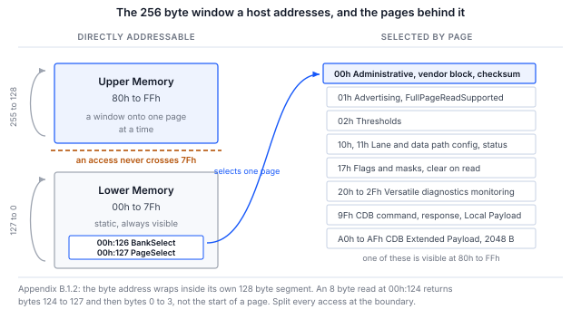

> **测试范围**。第 5 节中的每条命令都已实际运行，所示的每段输出均粘贴自该次运行。
> 运行对象是**处于 I2C 目标器件模式并呈现 CMIS 映像的 Binho Supernova**，而不是光模块，
> 因此流程和主机路径得到了验证，而模块自身的行为没有。第 8 节准确说明了这覆盖了什么、没有覆盖什么。

## 1 简介

线路上的 CMIS 交换是一种分页的、有状态的对话。一次寄存器读取由写入字节偏移、重复 START 和读取组成。
该偏移的含义取决于存储体（bank）和页的选择，而这一选择可能是在之前某次事务中写入的，
可能已被模块静默覆盖，并且地址会在其自身的 128 字节段内回绕，而不是跨越整个地址空间。

这就是为什么"模块有应答"并不等于"模块工作正常"，也是为什么启动调试的第一个小时
常常花在针对一些字节调试主机上，而这些字节从来就不是工程师以为的那些内容。

本笔记仅使用一个 Binho USB 主机适配器，确认模块存在、愿意被读取、分页正确并且内部自洽。
它以模块自身计算的校验和作为结尾，因为对于不存在或未上电的目标器件来说，
这是最不可能偶然产生的结果。第 4 节给出了它可能偶然产生的唯一情形，以及排除该情形的条件。

### 1.1 范围

读完本文档后，手边有硬件的读者将能够在管理总线上检测到模块，轮询其就绪状态，
解码其标识和模块状态，读取其温度和电源监测值，根据模块自身的通告得出其最大访问长度，
从高端存储区（Upper Memory）读取其厂商信息块，并验证 Page 00h 校验和。

本文档涵盖 I2C 管理接口（I2CMCI），CMIS 附录 B.2 对其做了规范性规定，所有已部署的模块均实现了该接口。
SPI 接口见 AN0010，I3C 绑定见 AN0009。固件更新、Common Data Block 和性能监测不在本文范围内；
固件更新时间问题见 AN0011。

### 1.2 适用器件

Table: 适用器件

| 项目 | 角色 | 依据 |
|---|---|---|
| Binho Supernova | 主机适配器，I2C 控制器 | 已验证，第 8 节 |
| Binho Pulsar | 主机适配器，I2C 控制器 | 未验证。SDK 的唯一区别是需要一个总线选择参数 |
| 任何受 CMIS 管理的模块 | 地址 0x50 处的目标器件 | **未验证**。见下方提示 |
| 带 CMIS I2CMCI 分析器的 Saleae Logic | 可选的总线观察器 | 分析器正在开发中 |

> **该流程尚未在光模块上运行过。** 它已在另一台作为 0x50 处 I2C 目标器件、装载 CMIS 5.3 映像的
> Supernova 上端到端运行。这验证了主机、寄存器访问层、分页和校验和，而这些正是本文档的主题。
> 它没有验证任何属于模块的行为：保持（hold-off）行为、页支持或回绕规则。全文中每项发现都归属于其所属的层，
> 第 8.3 节列出了仍需由模块确认的内容。在模块上运行之后，本文档将升为修订版 1.0。

### 1.3 相关文档

Table: 相关文档

| 文档 | 主题 |
|---|---|
| OIF-CMIS-05.3 | Common Management Interface Specification，修订版 5.3，2024 年 9 月 4 日 |
| OIF-CMIS-05.4 | 修订版 5.4，2026 年 5 月 21 日，用于交叉核对 |
| SFF-8024 | CMIS 字节 00h:0 所引用的标识符代码注册表 |
| AN0009 | 使用 Binho Supernova 通过 I3C 管理 CMIS 光模块 |
| AN0010 | 使用 Binho Pulsar 通过 SPI 启动调试 CMIS 光模块 |
| AN0011 | 使用 Binho Supernova 测量 CMIS 固件更新时间 |

## 2 所需设备和软件

### 2.1 硬件

Table: 所需设备

| 项目 |
|---|
| Binho Supernova 或 Binho Pulsar USB 主机适配器 |
| 一个受 CMIS 管理的光模块，或模块评估板 |
| USB-C 线缆 |
| Saleae Logic 采集硬件，可选 |

### 2.2 连接

Table: 适配器与模块之间的连接

| 适配器 | 模块 | 是否必需 |
|---|---|---|
| SCL | 管理时钟 | 是 |
| SDA | 管理数据 | 是 |
| 3V3 | 管理电源 | 是，除非电路板自行供电 |
| GND | 回路 | 是 |

> **注意**：在连接适配器的 3V3 之前，请确认模块的管理电源轨。
> 适配器既可以为该电源轨供电，也可以接受外部电源，下面的流程使用适配器供电。
> 如果载板已经提供该电源轨，请使用适配器的外部电压模式，而不要在同一网络上驱动第二个电源。

适配器具有可由软件选择的上拉电阻。如果模块板上已经带有上拉电阻，请禁用适配器的上拉电阻，
而不要再并联一组。

### 2.3 软件

```
pip install binhosupernova        # Supernova
pip install binhopulsar           # Pulsar
```

本笔记附带的工具 `cmis_mci.py` 需要上述软件包之一以及 Python 标准库，除此之外别无其他依赖。

其中两条命令既不需要适配器也不需要模块，值得最先运行，
因为它们能在涉及任何硬件之前确认工具中的地址运算是正确的：

```
python cmis_mci.py selfcheck
python cmis_mci.py budget
```

## 3 CMIS 管理模型

CMIS 第 4.2 章将寄存器模型与承载它的传输方式分开，正是这种分离使本文档的流程在更换总线后依然适用。

Table: 对主机重要的各层

| 层 | 说明 |
|---|---|
| RAL，第 5 章 | 恰好三个原语：READ、WRITE 和 TEST，作用于一个 256 字节的窗口 |
| MCI，附录 B | 承载这些原语的可替换传输绑定：I2CMCI 或 SPIMCI |
| MSL，第 5.1 节 | 具有固定管理含义的离散引脚，其中 Reset 和 Interrupt 是必需的 |

256 字节窗口分为**低端存储区（Lower Memory）**，即字节地址 00h 至 7Fh，它是静态的并且始终可见；
以及**高端存储区（Upper Memory）**，即 80h 至 FFh，它是一个窗口，指向由 00h:126 处的 `BankSelect`
和 00h:127 处的 `PageSelect` 所选择的更大存储空间。



图 1 在一页中展示了整个模型。它的两个特性造成了第一天的大部分困惑，第 6 节对二者都有说明：
地址在其自身的 128 字节段内回绕而不是继续向后，并且主机选择的页不一定就是模块当前所在的页。

### 3.1 每个模块都在 0x50 应答

I2CMCI 控制字节写操作为 A0h，读操作为 A1h。右移一位即为 7 位地址 **0x50**，
而且 CMIS 不提供地址配置引脚。所有曾经制造的 CMIS 模块都在该地址应答。

在带有可选 ModSel 引脚的点对点链路上，这并不值得一提。一旦有多个模块共享一条总线，
它就成为一个设计问题，AN0009 正是从这里接着讨论这一主题。

### 3.2 访问长度是通告的，而不是假定的

Table: 访问长度限制

| 方向 | 限制 | 出处 |
|---|---|---|
| READ | 默认 Nmax = 8，通告支持整页读取时为 128 | 第 5.2.2.1 节 |
| WRITE | 始终最多八个字节值 | 第 5.2.2.2 节 |
| WRITE，CDB Extended Payload | 在第 7.8 章规定的情况下多于 8 | 第 5.2.2.2 节注释 |

这种不对称很容易被忽略，而且很重要：`FullPageReadSupported` 只提高读取的限制。
第 5.2.2.2 节规定，成功的 WRITE "写入最多八个给定字节值的序列"，没有任何通告可以改变这一点。
AN0011 正是建立在这一结论之上。

> **规范缺陷。** 第 5.2.2.1 节将整页读取通告引用为 `01h:251.4`。该字段实际是位于
> **`01h:251.1-0`** 的 `FullPageReadSupported`，这是一个两位编码，其中 00 表示未知，01 表示不支持，
> 10 表示支持。CMIS 5.4 的修订历史确认了这是一个两位字段。任何检查该通告的主机都会立即遇到这个问题。
> 所提供的工具读取正确的地址，并将"未知"视为保守的默认值 8。

### 3.3 模块状态

Table: 模块状态机状态，表 6-14

| 值 | 状态 |
|---|---|
| 1 | ModuleLowPwr |
| 2 | ModulePwrUp |
| 3 | ModuleReady |
| 4 | ModulePwrDn |
| 5 | ModuleFault |

状态位于 `00h:3.3-1`。上电时有一个时限：`MgmtInit` 必须在 **tMgmtInit = 2000 ms** 内到达
`ModuleLowPwr`，即接口就绪，并且已发出设置了 `ModuleStateChangedFlag` 的中断。
在此之前就被轮询的模块不一定有故障。

平面存储（flat memory）模块跳过该握手。在 tMgmtInit 之后即认为接口就绪，因此主机只需等待这段时间结束。

## 4 每一步证明了什么

第 5 节中的流程很短。之所以保留每一步，是因为跳过它会在之后得出一个看似可信的错误结论，
本节说明每一步存在的理由。

Table: 启动调试序列及每一步所确认的内容

| 步骤 | 寄存器 | 排除的情况 |
|---|---|---|
| 总线扫描 | 无 | 模块根本不在总线上，这不是任何软件解释能解决的 |
| TEST | 无 | 模块存在但仍在拒绝访问，例如在 MgmtInit 期间 |
| 标识 | 00h:0 至 00h:2 | 错误的外形规格，以及被按十六进制解码的修订版 |
| 模块状态 | 00h:3.3-1 | 将处于故障或仍在上电过程中的模块当作已就绪来读取 |
| 监测值 | 00h:14 至 00h:17 | 看似合理但恒定的字节：实时变化的温度和电源轨读数不可能是巧合 |
| 通告 | 01h:251.1-0 | 访问长度超过模块所接受的长度，这会导致间歇性失败 |
| 厂商信息块 | 00h:129 起 | 分页从未生效，因为这些字节位于高端存储区 |
| 校验和 | 00h:222 | 以上所有情况，一次性排除 |

**标识采用十进制编码。** `00h:1` 以两位十进制数字保存 CMIS 修订版，因此 `0x53` 表示 CMIS 5.3，而不是 8.3。

**监测值的比例系数在规范中规定，而不在线路上传输。** 位于 `00h:14` 的 `TempMonValue` 是以
1/256 摄氏度为增量的有符号 16 位值，位于 `00h:16` 的 `VccMonVoltage` 是以 100 微伏为增量的无符号 16 位值。

**校验和是可用的最强检查，但它需要满足一个条件才有意义。** 它覆盖 Page 00h 的字节 128 至 221，
即 94 字节的模块特定内容，并与模块自己写入 `00h:222` 的字节进行比较。过期的缓冲区、浮空的总线，
或从未启用的目标器件通常都无法通过该检查；而能够读到这些字节本身也证明了分页有效，因为它们位于高端存储区。

> **注意**：对每次读取都返回相同字节的总线是自洽的。九十四个 `00h` 字节之和为 `00h`，
> 而从同一总线读取的存储校验和也是 `00h`，因此比较会通过，却什么也没有证明。
> 全 `00h` 是需要关注的情形，因为 `00h` 正是空闲总线返回的值，同时也是 SPIMCI 的确认应答。
> 只有当 Page 00h 包含不止一个不同的值时，才应将校验和视为有效。本笔记附带的工具强制执行这一点；
> 只比较这两个字节而不做其他检查的主机，会在空总线上报告模块正常。

## 5 流程

### 5.1 在确认模块之前先确认工具

```
python cmis_mci.py selfcheck
```

该命令在不连接适配器的情况下，针对一个遵守 B.1.2 回绕规则和 8.2.15 页覆盖规则的模拟模块运行地址运算：

```
  [OK] an access splits at 7Fh and at Nmax
  [OK] identity and module state decode
  [OK] Page 00h checksum agrees, in accesses of Nmax or fewer bytes
  [OK] FullPageReadSupported raises Nmax, and the 94 byte read fits in one access
  [OK] an all-zero page is rejected, not read as a checksum that agrees
  [OK] a module that overrides an unsupported page is caught, not believed
  [OK] TEST answers on a live module
  [OK] a write stays within the 8 byte WRITE limit while reads use Nmax

cmis_mci.py 1.1 self-check: 8/8 OK
```

### 5.2 找到模块

```
$ python cmis_mci.py scan
0x50  <- CMIS module
```

该命令报告每个有应答的地址，并标记 0x50。如果该地址没有应答，故障在于电源或管理引脚，
再多的软件排查也无济于事。

### 5.3 运行启动调试

```
$ python cmis_mci.py bringup
MCI     : I2CMCI
TEST()  : ready
00h:0   : 0x18 QSFP-DD
00h:1   : CMIS 5.3
00h:2   : MciMaxSpeed code 5
00h:3   : ModuleReady
00h:14  : 34.50 C   (S16, 1/256 C)
00h:16  : 3.300 V   (U16, 100 uV)
01h:251 : FullPageReadSupported gives Nmax 8 bytes for reads
00h:129 : VendorName 'BINHO PHOTONICS'
00h:148 : VendorPN   'QDD-400G-DR4'
00h:166 : VendorSN   'SN2608140001'
00h:222 : checksum computed 0x5b, module stores 0x5b, OK

PASS    : present, readable, paged correctly and self consistent.
```

该命令按顺序执行第 4 节表中所列的步骤，如果 Page 00h 校验和不匹配，则以非零状态退出。

输出中有两行值得仔细阅读，因为二者都是流程在正常工作，而不是出错。

`MciMaxSpeed code 5` 在 I2CMCI 编码中是**保留**值，该编码只定义了 0、1 和 2。
这里的目标器件报告了该值，因此工具直接显示该值，而不是静默地将其映射为某个看似合理的值。
对未定义代码打印"3.4 MHz"的主机是在猜测。

`FullPageReadSupported gives Nmax 8` 是保守分支。`01h:251.1-0` 处的通告读回为 00，表示未知，
而未知并不等于"支持"。将其视为 128 的主机会发出目标器件从未同意的访问。

### 5.4 读写单个寄存器

```
$ python cmis_mci.py read  --byte 3
00h:3 x1 = 07

$ python cmis_mci.py read  --page 01h --byte 251
01h:251 x1 = 00

$ python cmis_mci.py write --byte 127 --data 01
wrote 01, read back 01, match
```

每次写入之后都会进行回读并报告结果，因为未经回读的写入不能证明任何内容已写入。

`00h:3 = 07` 解码为 ModuleReady：`07h` 的位 3-1 为 `011`，即状态 3。

### 5.5 读取厂商信息块

```
$ python cmis_mci.py identify
identifier    0x18 QSFP-DD
CMIS revision 5.3
VendorName    'BINHO PHOTONICS'
VendorOUI     00 00 00
VendorPN      'QDD-400G-DR4'
VendorRev     '1A'
VendorSN      'SN2608140001'
DateCode      '260814AB'
```

以上每个字段都位于 Page 00h 的高端存储区，因此能够读取它们本身就证明页选择有效。

## 6 读到错误字节的两种情况

这两种情况产生的输出看起来都完全合理，这正是它们代价高昂的原因。

### 6.1 地址在其段内回绕，而不是继续向后

附录 B.1.2 的规定毫不含糊：当前字节地址在其自身的 128 字节段内回绕，127 回到 0，255 回到 128，
并且从不在低端存储区和高端存储区之间跨越。因此，在 `00h:124` 处进行的八字节读取返回字节 124 至 127，
然后是字节 0 至 3，而不是 Page 00h 的开头。

所提供的工具在段边界处拆分每次访问，因此通过该工具不会出现这种情况：

```
split_access(124, 8, nmax=8)   ->   [(124, 4), (128, 4)]
```

NXP AN15071 第 2.1.1 节为其 I3C 目标器件规定了相反的规则，即在整个 256 字节空间上于 FFh 处回绕。
`rollover` 命令用于确定给定目标器件实现的是哪条规则：

```
$ python cmis_mci.py rollover
8 bytes from 00h:124, last four : 18 42 49 4e
00h:0-3                         : 18 53 54 07
Page 00h:128-131                : 18 42 49 4e

ran on into Upper Memory, as NXP AN15071 2.1.1 specifies
Either way, do not issue an access that crosses 7Fh. Split it.
```

> **该结果是测试夹具的特性，既不是 CMIS 的特性，也不是任何模块的特性。** 这里使用的目标器件是处于
> I2C 目标器件模式的 Binho Supernova，它呈现的是平面存储区，因此会跨越 7Fh 继续向后。
> 之所以展示该结果，是因为这是命令实际报告的内容，并且它演示了该命令所要检测的情形。
> 请不要将其视为关于光模块行为的证据。

### 6.2 写入的页不等于当前所在的页

第 8.2.15 节允许模块覆盖主机的页写入。选择不支持的页时，`PageSelect` 会改为保存一个受支持的页，
并且不会在任何地方报告错误。被动观察者无法知道模块支持哪些页。

因此，该工具会回读选择结果，并抛出异常，而不是返回来自主机并未处于的页的数据：

```
CmisError: module overrode the page selection: asked for bank 0x00 page 0x99,
           it is on bank 0x00 page 0x00 (CMIS 8.2.15, page not supported)
```

## 7 工具

Table: 工具命令

| 命令 | 用途 |
|---|---|
| `selfcheck` | 离线针对模拟模块检查地址运算 |
| `scan` | 报告总线上有哪些地址应答 |
| `bringup` | 端到端的模块发现序列 |
| `identify` | 解码标识和厂商信息块 |
| `read`、`write` | 寄存器访问，每次写入后都进行回读 |
| `rollover` | 确定模块实现的是哪种地址回绕规则 |
| `spi-probe` | 确定 SPIMCI 流控计数和 R/Wn 极性 |
| `timing` | 按照表 10-4 的上限对各访问阶段计时 |
| `budget` | 固件更新时间预算，离线 |
| `ibi` | 统计带内中断（IBI），仅限 I3C |

`--transport i2c`、`i3c` 或 `spi` 用于选择管理接口。寄存器模型只有一种实现；变化的只是其下层的传输方式。

## 8 实测结果

### 8.1 测试配置

Table: 测试配置

| 项目 | 值 |
|---|---|
| 控制器 | Binho Supernova，序列号 `1912DEB5…79FA`，固件 4.4.0，硬件修订版 C |
| 目标器件 | Binho Supernova，序列号 `ED7BF8F3…F7BB`，固件 4.4.0，硬件修订版 C，作为 0x50 处的 I2C 目标器件启用 |
| 目标器件内容 | CMIS 5.3 映像，即附录 C 中的 400G QSFP-DD 示例，256 字节，覆盖低端存储区和 Page 00h |
| SDK | `binhosupernova` 4.2.0，Python 3.10.12 |
| 主机 | Ubuntu 22.04，x86-64 |
| 总线 | 3.3 V，400 kHz，适配器上拉电阻，两个适配器之间直接用线缆连接 |

> **目标器件是适配器，而不是光模块。** 第二台 Supernova 作为装载 CMIS 映像的 I2C 目标器件启用，
> 这使它对于寄存器模型而言是一个忠实的测试夹具，而对于所有属于模块的行为而言则不是。第 8.3 节划出了这条界线。

### 8.2 结果

**离线。** 地址运算自检针对模拟模块 8 项全部通过，覆盖段边界拆分、Nmax 读取限制、8 字节写入限制、
Page 00h 校验和、`FullPageReadSupported` 解码以及第 8.2.15 节的页覆盖。

**总线扫描。** 目标器件在 0x50 应答，在其他地址均无应答。

**启动调试。** 第 4 节的全部八个步骤均已完成，Page 00h 校验和计算结果为 `0x5B`，与存储的 `0x5B` 一致。
读取校验和字节需要一次页选择、一次拆分为 Nmax 大小访问的 94 字节读取，以及对 `00h:222` 的单独读取，
因此这一致性不仅覆盖了数据，也覆盖了分页和访问拆分。

**通告。** `01h:251.1-0` 读回 00，即未知，主机将 `Nmax` 保持为 8。目标器件中没有 Page 01h 的内容，
因此这是正确的保守结果，而不是某项功能被抑制。

**寄存器访问。** `00h:3` 读回 `07`，解码为 ModuleReady。向 `00h:127` 写入 `01`，随后再写入 `00`，
两次回读均逐字节一致。

**运行过程中发现了两个缺陷，二者均已在所提供的工具中修复。** 仅阅读代码无法发现其中任何一个。
总线扫描从 SDK 响应中解析了错误的键，因此在总线上的目标器件被报告为不存在；`binhosupernova` 4.2.0
的应答使用 `detected_7_bit_addresses`，现在遇到无法识别的响应格式时会抛出异常，而不是返回空列表。
另外，`argparse` 会在用 `parents=` 创建的子解析器之间共享 action 对象，因此在某个子命令上设置的默认值
成为了所有子命令的默认值，导致每条命令都像指定了 `--transport i3c` 一样运行。

### 8.3 真实模块仍需确认的内容

本节中的所有内容都属于主机和寄存器模型，没有任何一项是关于模块的证据。尚待确认的事项：

Table: 尚待在真实模块上确认的事项

| 问题 | 测试夹具无法回答的原因 |
|---|---|
| 保持行为、tREAD 和 tWRITE | 测试夹具立即应答，它没有理由延展时钟或发出 NACK |
| 模块支持哪些页 | 测试夹具接受所有页。第 8.2.15 节的页覆盖只在离线自检中得到验证 |
| 回绕规则，第 6.1 节 | 测试夹具实现的是平面存储区，因此会跨越 7Fh 继续向后，而不是回绕。见第 6.1 节中的说明 |
| `FullPageReadSupported` 读回 10 时 | 这里没有目标器件通告整页读取，因此 128 字节路径只在离线状态下得到验证 |
| 跟随物理量变化的监测值 | 读回的温度和电压是映像中存储的字节，而不是测量值 |

## 9 故障排除

Table: 故障排除

| 现象 | 可能原因及处理方法 |
|---|---|
| 0x50 处无应答 | 管理电源轨缺失，或 SCL 和 SDA 未连接。先检查电源，而不是软件 |
| 总线扫描找到了模块，但 TEST 被拒绝 | 模块可能仍处于 MgmtInit。等待 tMgmtInit，即 2000 ms，然后重试 |
| 标识读取为有效的外形规格，但校验和失败 | 分页的行为与主机的预期不符。选择页之后回读 `00h:127` |
| 多字节读取返回了来自其他页的字节 | 访问跨越了 7Fh。在段边界处拆分访问 |
| 页选择看似已被接受，但读取返回的是 Page 00h | 模块不支持该页并按照第 8.2.15 节对其进行了更正 |
| 长于 8 字节的读取间歇性失败 | 模块没有通告整页读取。将 Nmax 保持为 8 |
| 控制器无法发出 START | 总线没有上拉电阻，或上拉太弱。启用适配器的上拉电阻，或安装 2.2k 至 4.7k 的电阻 |

## 10 缩略语

Table: 缩略语

| 术语 | 含义 |
|---|---|
| CDB | Common Data Block（通用数据块） |
| CMIS | Common Management Interface Specification（通用管理接口规范） |
| I2CMCI | I2C Management Communication Interface（I2C 管理通信接口） |
| MCI | Management Communication Interface（管理通信接口） |
| MSL | Management Signalling Layer（管理信令层） |
| Nmax | 一次寄存器访问中的最大字节数 |
| OIF | Optical Internetworking Forum（光互联论坛） |
| RAL | Register Access Layer（寄存器访问层） |
| SPIMCI | SPI Management Communication Interface（SPI 管理通信接口） |

## 11 关于文档中源代码的说明

本文档中显示以及随附归档中提供的示例代码仅供评估和参考。
它们依据 MIT 许可证发布，许可证全文包含在归档中。

Table: 资源归档的内容

| 文件 | 说明 |
|---|---|
| `AN0008.md` | 本文档的 Markdown 源文件 |
| `assets/cmis_mci.py` | 参考工具，由 AN0008 至 AN0011 共用 |
| `assets/LICENSE` | 涵盖示例代码的 MIT 许可证 |

## 12 修订历史

Table: 修订历史

| 修订版 | 日期 | 说明 |
|---|---|---|
| 0.1 | 2026 年 9 月 1 日 | 供内部评审的草稿。规范内容已核实；流程尚未在硬件上运行。 |
| 0.2 | 2026 年 9 月 1 日 | 流程已在 Supernova I2C 目标器件测试夹具上端到端运行；第 5 节中的所有输出均粘贴自该次运行。发现并修复了两个工具缺陷。尚未在光模块上运行。 |
| 0.3 | 2026 年 9 月 2 日 | 由 AN0007 重新编号而来。更正了关于 Page 00h 校验和的说法：一次实测运行显示全零页也能通过比较，因此本笔记不再称其为不可能偶然通过的检查，并且工具会拒绝由单一重复值构成的页。 |
| 0.4 | 2026 年 9 月 3 日 | 共用工具升至 1.1，新增了 AN0011 所需的 SPIMCI 相关行。自检输出已重新运行，除打印的版本号外没有变化。 |
| 1.0 | 2026 年 11 月 6 日 | 正式发布。 |
