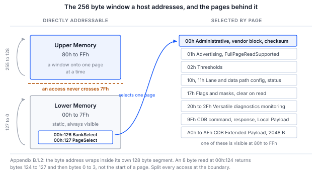

> **測試範圍**。第 5 節中的每個命令都已實際執行，所示的每段輸出均貼自該次執行。
> 執行對象是**處於 I2C 目標裝置模式並呈現 CMIS 映像的 Binho Supernova**，而不是光模組，
> 因此流程與主機路徑經過驗證，而模組本身的行為則沒有。第 8 節精確說明了這涵蓋了什麼、沒有涵蓋什麼。

## 1 簡介

線路上的 CMIS 交換是一種分頁的、有狀態的對話。一次暫存器讀取由寫入位元組偏移、重複 START 與讀取組成。
該偏移的意義取決於記憶庫（bank）與頁的選擇，而這項選擇可能是在先前某次交易中寫入的，
可能已被模組靜默覆寫，而且位址會在其自身的 128 位元組區段內回繞，而不是跨越整個位址空間。

這就是為什麼「模組有回應」並不等於「模組運作正常」，也是為什麼啟動除錯的第一個小時
常常花在針對一些位元組除錯主機上，而這些位元組從來就不是工程師所以為的內容。

本筆記僅使用一個 Binho USB 主機轉接器，確認模組存在、願意被讀取、分頁正確且內部自洽。
它以模組自身計算的檢查碼作為結尾，因為對於不存在或未上電的目標裝置而言，
這是最不可能偶然產生的結果。第 4 節列出了它可能偶然產生的唯一情形，以及排除該情形的條件。

### 1.1 範圍

讀完本文件後，手邊有硬體的讀者將能夠在管理匯流排上偵測到模組、輪詢其就緒狀態、
解碼其識別資訊與模組狀態、讀取其溫度與電源監測值、依據模組自身的通告得出其最大存取長度、
從高端記憶區（Upper Memory）讀取其廠商資訊區塊，並驗證 Page 00h 檢查碼。

本文件涵蓋 I2C 管理介面（I2CMCI），CMIS 附錄 B.2 對其做了規範性規定，所有已部署的模組均實作了該介面。
SPI 介面請見 AN0010，I3C 繫結請見 AN0009。韌體更新、Common Data Block 與效能監測不在本文範圍內；
韌體更新時間的問題請見 AN0011。

### 1.2 適用裝置

Table: 適用裝置

| 項目 | 角色 | 依據 |
|---|---|---|
| Binho Supernova | 主機轉接器，I2C 控制器 | 已驗證，第 8 節 |
| Binho Pulsar | 主機轉接器，I2C 控制器 | 未驗證。SDK 的唯一差異是需要一個匯流排選擇參數 |
| 任何受 CMIS 管理的模組 | 位址 0x50 的目標裝置 | **未驗證**。請見下方提示 |
| 搭配 CMIS I2CMCI 分析器的 Saleae Logic | 選用的匯流排觀察器 | 分析器正在開發中 |

> **此流程尚未在光模組上執行過。** 它已在另一台作為 0x50 之 I2C 目標裝置、載有 CMIS 5.3 映像的
> Supernova 上端對端執行。這驗證了主機、暫存器存取層、分頁與檢查碼，而這些正是本文件的主題。
> 它並未驗證任何屬於模組的行為：保持（hold-off）行為、頁支援或回繞規則。全文中每項發現都歸屬於其所屬的層，
> 第 8.3 節列出仍需由模組確認的內容。在模組上執行之後，本文件將升為修訂版 1.0。

### 1.3 相關文件

Table: 相關文件

| 文件 | 主題 |
|---|---|
| OIF-CMIS-05.3 | Common Management Interface Specification，修訂版 5.3，2024 年 9 月 4 日 |
| OIF-CMIS-05.4 | 修訂版 5.4，2026 年 5 月 21 日，用於交叉核對 |
| SFF-8024 | CMIS 位元組 00h:0 所引用的識別碼註冊表 |
| AN0009 | 使用 Binho Supernova 透過 I3C 管理 CMIS 光模組 |
| AN0010 | 使用 Binho Pulsar 透過 SPI 啟動除錯 CMIS 光模組 |
| AN0011 | 使用 Binho Supernova 量測 CMIS 韌體更新時間 |

## 2 所需設備與軟體

### 2.1 硬體

Table: 所需設備

| 項目 |
|---|
| Binho Supernova 或 Binho Pulsar USB 主機轉接器 |
| 一個受 CMIS 管理的光模組，或模組評估板 |
| USB-C 線材 |
| Saleae Logic 擷取硬體，選用 |

### 2.2 連接

Table: 轉接器與模組之間的連接

| 轉接器 | 模組 | 是否必要 |
|---|---|---|
| SCL | 管理時脈 | 是 |
| SDA | 管理資料 | 是 |
| 3V3 | 管理電源 | 是，除非電路板自行供電 |
| GND | 回路 | 是 |

> **注意**：連接轉接器的 3V3 之前，請先確認模組的管理電源軌。
> 轉接器可以為該電源軌供電，也可以接受外部電源，下面的流程使用轉接器供電。
> 若載板已經提供該電源軌，請改用轉接器的外部電壓模式，而不要在同一網路上驅動第二個電源。

轉接器具有可由軟體選擇的上拉電阻。若模組板上已有上拉電阻，請停用轉接器的上拉電阻，
而不要再並聯一組。

### 2.3 軟體

```
pip install binhosupernova        # Supernova
pip install binhopulsar           # Pulsar
```

本筆記隨附的工具程式 `cmis_mci.py` 需要上述套件之一以及 Python 標準函式庫，除此之外別無其他相依項目。

其中兩個命令既不需要轉接器也不需要模組，值得最先執行，
因為它們能在涉及任何硬體之前確認工具程式中的位址運算是正確的：

```
python cmis_mci.py selfcheck
python cmis_mci.py budget
```

## 3 CMIS 管理模型

CMIS 第 4.2 章將暫存器模型與承載它的傳輸方式分開，正是這種分離使本文件的流程在更換匯流排後依然適用。

Table: 對主機重要的各層

| 層 | 說明 |
|---|---|
| RAL，第 5 章 | 恰好三個原語：READ、WRITE 與 TEST，作用於一個 256 位元組的視窗 |
| MCI，附錄 B | 承載這些原語的可替換傳輸繫結：I2CMCI 或 SPIMCI |
| MSL，第 5.1 節 | 具有固定管理意義的離散接腳，其中 Reset 與 Interrupt 為必要 |

256 位元組視窗分為**低端記憶區（Lower Memory）**，即位元組位址 00h 至 7Fh，它是靜態的且永遠可見；
以及**高端記憶區（Upper Memory）**，即 80h 至 FFh，它是一個視窗，指向由 00h:126 的 `BankSelect`
與 00h:127 的 `PageSelect` 所選擇的更大記憶空間。



圖 1 在一頁中呈現了整個模型。它的兩項特性造成了第一天大部分的困惑，第 6 節對兩者都有說明：
位址在其自身的 128 位元組區段內回繞而不是繼續往後，而且主機選擇的頁不一定就是模組目前所在的頁。

### 3.1 每個模組都在 0x50 回應

I2CMCI 控制位元組在寫入時為 A0h，讀取時為 A1h。右移一位即為 7 位元位址 **0x50**，
而且 CMIS 不提供位址設定接腳。所有曾經製造的 CMIS 模組都在該位址回應。

在帶有選用 ModSel 接腳的點對點鏈路上，這並不值得一提。一旦有多個模組共用一條匯流排，
它就成為一個設計問題，AN0009 正是從這裡接續討論此主題。

### 3.2 存取長度是通告的，而非假定的

Table: 存取長度限制

| 方向 | 限制 | 出處 |
|---|---|---|
| READ | 預設 Nmax = 8，通告支援整頁讀取時為 128 | 第 5.2.2.1 節 |
| WRITE | 一律最多八個位元組值 | 第 5.2.2.2 節 |
| WRITE，CDB Extended Payload | 在第 7.8 章規定的情況下多於 8 | 第 5.2.2.2 節附註 |

這種不對稱很容易被忽略，而且很重要：`FullPageReadSupported` 只提高讀取的限制。
第 5.2.2.2 節規定，成功的 WRITE「寫入最多八個給定位元組值的序列」，沒有任何通告可以改變這一點。
AN0011 正是建立在這項結論之上。

> **規格缺陷。** 第 5.2.2.1 節將整頁讀取通告引用為 `01h:251.4`。該欄位實際是位於
> **`01h:251.1-0`** 的 `FullPageReadSupported`，這是一個兩位元編碼，其中 00 表示未知，01 表示不支援，
> 10 表示支援。CMIS 5.4 的修訂歷史確認了這是一個兩位元欄位。任何檢查該通告的主機都會立即遇到這個問題。
> 所提供的工具程式讀取正確的位址，並將「未知」視為保守的預設值 8。

### 3.3 模組狀態

Table: 模組狀態機狀態，表 6-14

| 值 | 狀態 |
|---|---|
| 1 | ModuleLowPwr |
| 2 | ModulePwrUp |
| 3 | ModuleReady |
| 4 | ModulePwrDn |
| 5 | ModuleFault |

狀態位於 `00h:3.3-1`。上電時有一個時限：`MgmtInit` 必須在 **tMgmtInit = 2000 ms** 內到達
`ModuleLowPwr`，亦即介面就緒，並且已發出設定了 `ModuleStateChangedFlag` 的中斷。
在此之前就被輪詢的模組不一定有故障。

平面記憶（flat memory）模組會略過此交握。在 tMgmtInit 之後即視為介面就緒，因此主機只需等待這段時間結束。

## 4 每個步驟證明了什麼

第 5 節中的流程很短。之所以保留每個步驟，是因為略過它會在之後得出一個看似可信的錯誤結論，
本節說明每個步驟存在的理由。

Table: 啟動除錯序列及每個步驟所確認的內容

| 步驟 | 暫存器 | 排除的情況 |
|---|---|---|
| 匯流排掃描 | 無 | 模組根本不在匯流排上，這不是任何軟體解釋能解決的 |
| TEST | 無 | 模組存在但仍在拒絕存取，例如在 MgmtInit 期間 |
| 識別資訊 | 00h:0 至 00h:2 | 錯誤的外形規格，以及被以十六進位解碼的修訂版 |
| 模組狀態 | 00h:3.3-1 | 將處於故障或仍在上電中的模組當作已就緒來讀取 |
| 監測值 | 00h:14 至 00h:17 | 看似合理但恆定的位元組：即時的溫度與電源軌讀數不可能是巧合 |
| 通告 | 01h:251.1-0 | 存取長度超過模組所接受的長度，這會導致間歇性失敗 |
| 廠商資訊區塊 | 00h:129 起 | 分頁從未生效，因為這些位元組位於高端記憶區 |
| 檢查碼 | 00h:222 | 以上所有情況，一次排除 |

**識別資訊採十進位編碼。** `00h:1` 以兩位十進位數字儲存 CMIS 修訂版，因此 `0x53` 表示 CMIS 5.3，而不是 8.3。

**監測值的比例係數規定於規格中，而不在線路上傳輸。** 位於 `00h:14` 的 `TempMonValue` 是以
1/256 攝氏度為增量的有號 16 位元值，位於 `00h:16` 的 `VccMonVoltage` 是以 100 微伏為增量的無號 16 位元值。

**檢查碼是可用的最強檢查，但它需要滿足一個條件才有意義。** 它涵蓋 Page 00h 的位元組 128 至 221，
即 94 位元組的模組特定內容，並與模組自己寫入 `00h:222` 的位元組比較。過時的緩衝區、浮接的匯流排，
或從未啟用的目標裝置通常都無法通過此檢查；而能夠讀到這些位元組本身也證明了分頁有效，因為它們位於高端記憶區。

> **注意**：對每次讀取都傳回相同位元組的匯流排是自洽的。九十四個 `00h` 位元組之和為 `00h`，
> 而從同一匯流排讀取的儲存檢查碼也是 `00h`，因此比較會通過，卻什麼也沒有證明。
> 全 `00h` 是需要關注的情形，因為 `00h` 正是閒置匯流排傳回的值，同時也是 SPIMCI 的確認回應。
> 只有當 Page 00h 包含不只一個相異值時，才應將檢查碼視為有效。本筆記隨附的工具程式會強制執行這一點；
> 只比較這兩個位元組而不做其他檢查的主機，會在空的匯流排上回報模組正常。

## 5 流程

### 5.1 確認模組之前先確認工具

```
python cmis_mci.py selfcheck
```

此命令在不連接轉接器的情況下，針對一個遵守 B.1.2 回繞規則與 8.2.15 頁覆寫規則的模擬模組執行位址運算：

```
  [OK] an access splits at 7Fh and at Nmax
  [OK] identity and module state decode
  [OK] Page 00h checksum agrees, in accesses of Nmax or fewer bytes
  [OK] FullPageReadSupported raises Nmax, and the 94 byte read fits in one access
  [OK] an all-zero page is rejected, not read as a checksum that agrees
  [OK] a module that overrides an unsupported page is caught, not believed
  [OK] TEST answers on a live module
  [OK] a write stays within the 8 byte WRITE limit while reads use Nmax

cmis_mci.py 1.1 self-check: 8/8 OK
```

### 5.2 找到模組

```
$ python cmis_mci.py scan
0x50  <- CMIS module
```

此命令回報每個有回應的位址，並標示 0x50。若該位址沒有回應，故障在於電源或管理接腳，
再多的軟體排查也無濟於事。

### 5.3 執行啟動除錯

```
$ python cmis_mci.py bringup
MCI     : I2CMCI
TEST()  : ready
00h:0   : 0x18 QSFP-DD
00h:1   : CMIS 5.3
00h:2   : MciMaxSpeed code 5
00h:3   : ModuleReady
00h:14  : 34.50 C   (S16, 1/256 C)
00h:16  : 3.300 V   (U16, 100 uV)
01h:251 : FullPageReadSupported gives Nmax 8 bytes for reads
00h:129 : VendorName 'BINHO PHOTONICS'
00h:148 : VendorPN   'QDD-400G-DR4'
00h:166 : VendorSN   'SN2608140001'
00h:222 : checksum computed 0x5b, module stores 0x5b, OK

PASS    : present, readable, paged correctly and self consistent.
```

此命令依序執行第 4 節表中所列的步驟，若 Page 00h 檢查碼不符，則以非零狀態結束。

輸出中有兩行值得仔細閱讀，因為兩者都是流程在正常運作，而不是失敗。

`MciMaxSpeed code 5` 在 I2CMCI 編碼中是**保留**值，該編碼只定義了 0、1 與 2。
這裡的目標裝置回報了該值，因此工具直接顯示該值，而不是靜默地將其對應為某個看似合理的值。
對未定義代碼印出「3.4 MHz」的主機是在猜測。

`FullPageReadSupported gives Nmax 8` 是保守分支。`01h:251.1-0` 的通告讀回為 00，表示未知，
而未知並不等於「支援」。將其視為 128 的主機會發出目標裝置從未同意的存取。

### 5.4 讀寫個別暫存器

```
$ python cmis_mci.py read  --byte 3
00h:3 x1 = 07

$ python cmis_mci.py read  --page 01h --byte 251
01h:251 x1 = 00

$ python cmis_mci.py write --byte 127 --data 01
wrote 01, read back 01, match
```

每次寫入之後都會回讀並回報結果，因為未經回讀的寫入無法證明任何內容已寫入。

`00h:3 = 07` 解碼為 ModuleReady：`07h` 的位元 3-1 為 `011`，即狀態 3。

### 5.5 讀取廠商資訊區塊

```
$ python cmis_mci.py identify
identifier    0x18 QSFP-DD
CMIS revision 5.3
VendorName    'BINHO PHOTONICS'
VendorOUI     00 00 00
VendorPN      'QDD-400G-DR4'
VendorRev     '1A'
VendorSN      'SN2608140001'
DateCode      '260814AB'
```

以上每個欄位都位於 Page 00h 的高端記憶區，因此能夠讀取它們本身就證明頁選擇有效。

## 6 讀到錯誤位元組的兩種情況

這兩種情況所產生的輸出看起來都完全合理，這正是它們代價高昂的原因。

### 6.1 位址在其區段內回繞，而不是繼續往後

附錄 B.1.2 的規定毫不含糊：目前位元組位址在其自身的 128 位元組區段內回繞，127 回到 0，255 回到 128，
並且從不在低端記憶區與高端記憶區之間跨越。因此，在 `00h:124` 進行的八位元組讀取會傳回位元組 124 至 127，
接著是位元組 0 至 3，而不是 Page 00h 的開頭。

所提供的工具程式在區段邊界處分割每次存取，因此透過該工具不會出現這種情況：

```
split_access(124, 8, nmax=8)   ->   [(124, 4), (128, 4)]
```

NXP AN15071 第 2.1.1 節為其 I3C 目標裝置規定了相反的規則，即在整個 256 位元組空間中於 FFh 回繞。
`rollover` 命令用於確定特定目標裝置實作的是哪一條規則：

```
$ python cmis_mci.py rollover
8 bytes from 00h:124, last four : 18 42 49 4e
00h:0-3                         : 18 53 54 07
Page 00h:128-131                : 18 42 49 4e

ran on into Upper Memory, as NXP AN15071 2.1.1 specifies
Either way, do not issue an access that crosses 7Fh. Split it.
```

> **此結果是測試治具的特性，既不是 CMIS 的特性，也不是任何模組的特性。** 這裡使用的目標裝置是處於
> I2C 目標裝置模式的 Binho Supernova，它呈現的是平面記憶區，因此會跨越 7Fh 繼續往後。
> 之所以呈現此結果，是因為這是命令實際回報的內容，而且它示範了該命令所要偵測的情形。
> 請勿將其視為關於光模組行為的證據。

### 6.2 寫入的頁不等於目前所在的頁

第 8.2.15 節允許模組覆寫主機的頁寫入。選擇不支援的頁時，`PageSelect` 會改為保存一個受支援的頁，
而且不會在任何地方回報錯誤。被動觀察者無法得知模組支援哪些頁。

因此，此工具程式會回讀選擇結果並引發例外，而不是傳回主機並未處於之頁的資料：

```
CmisError: module overrode the page selection: asked for bank 0x00 page 0x99,
           it is on bank 0x00 page 0x00 (CMIS 8.2.15, page not supported)
```

## 7 工具程式

Table: 工具程式命令

| 命令 | 用途 |
|---|---|
| `selfcheck` | 離線針對模擬模組檢查位址運算 |
| `scan` | 回報匯流排上有哪些位址回應 |
| `bringup` | 端對端的模組探索序列 |
| `identify` | 解碼識別資訊與廠商資訊區塊 |
| `read`、`write` | 暫存器存取，每次寫入後都會回讀 |
| `rollover` | 確定模組實作的是哪一種位址回繞規則 |
| `spi-probe` | 確定 SPIMCI 流量控制計數與 R/Wn 極性 |
| `timing` | 依表 10-4 的上限為各存取階段計時 |
| `budget` | 韌體更新時間預算，離線 |
| `ibi` | 計數帶內中斷（IBI），僅限 I3C |

`--transport i2c`、`i3c` 或 `spi` 用於選擇管理介面。暫存器模型只有一種實作；改變的只是其下層的傳輸方式。

## 8 實測結果

### 8.1 測試組態

Table: 測試組態

| 項目 | 值 |
|---|---|
| 控制器 | Binho Supernova，序號 `1912DEB5…79FA`，韌體 4.4.0，硬體修訂版 C |
| 目標裝置 | Binho Supernova，序號 `ED7BF8F3…F7BB`，韌體 4.4.0，硬體修訂版 C，作為 0x50 的 I2C 目標裝置啟用 |
| 目標裝置內容 | CMIS 5.3 映像，即附錄 C 中的 400G QSFP-DD 範例，256 位元組，涵蓋低端記憶區與 Page 00h |
| SDK | `binhosupernova` 4.2.0，Python 3.10.12 |
| 主機 | Ubuntu 22.04，x86-64 |
| 匯流排 | 3.3 V，400 kHz，轉接器上拉電阻，兩個轉接器之間以線材直接連接 |

> **目標裝置是轉接器，而不是光模組。** 第二台 Supernova 作為載有 CMIS 映像的 I2C 目標裝置啟用，
> 這使它對暫存器模型而言是一個忠實的測試治具，而對所有屬於模組的行為而言則不是。第 8.3 節劃出了這條界線。

### 8.2 結果

**離線。** 位址運算自我檢查針對模擬模組 8 項全部通過，涵蓋區段邊界分割、Nmax 讀取限制、8 位元組寫入限制、
Page 00h 檢查碼、`FullPageReadSupported` 解碼，以及第 8.2.15 節的頁覆寫。

**匯流排掃描。** 目標裝置在 0x50 回應，其他位址皆無回應。

**啟動除錯。** 第 4 節的全部八個步驟均已完成，Page 00h 檢查碼計算結果為 `0x5B`，與儲存的 `0x5B` 一致。
讀取檢查碼位元組需要一次頁選擇、一次分割為 Nmax 大小存取的 94 位元組讀取，以及對 `00h:222` 的個別讀取，
因此這項一致不僅涵蓋了資料，也涵蓋了分頁與存取分割。

**通告。** `01h:251.1-0` 讀回 00，即未知，主機將 `Nmax` 維持為 8。目標裝置中沒有 Page 01h 的內容，
因此這是正確的保守結果，而不是某項功能遭到抑制。

**暫存器存取。** `00h:3` 讀回 `07`，解碼為 ModuleReady。對 `00h:127` 寫入 `01`，隨後再寫入 `00`，
兩次回讀均逐位元組一致。

**執行過程中發現了兩個缺陷，兩者均已在所提供的工具程式中修正。** 僅閱讀程式碼無法發現其中任何一個。
匯流排掃描從 SDK 回應中解析了錯誤的鍵，因此在匯流排上的目標裝置被回報為不存在；`binhosupernova` 4.2.0
的回應使用 `detected_7_bit_addresses`，現在遇到無法辨識的回應格式時會引發例外，而不是傳回空清單。
另外，`argparse` 會在以 `parents=` 建立的子剖析器之間共用 action 物件，因此在某個子命令上設定的預設值
成為所有子命令的預設值，導致每個命令都如同指定了 `--transport i3c` 一般執行。

### 8.3 真實模組仍需確認的內容

本節中的所有內容都屬於主機與暫存器模型，沒有任何一項是關於模組的證據。尚待確認的事項：

Table: 尚待在真實模組上確認的事項

| 問題 | 測試治具無法回答的原因 |
|---|---|
| 保持行為、tREAD 與 tWRITE | 測試治具立即回應，它沒有理由延展時脈或發出 NACK |
| 模組支援哪些頁 | 測試治具接受所有頁。第 8.2.15 節的頁覆寫只在離線自我檢查中驗證 |
| 回繞規則，第 6.1 節 | 測試治具實作的是平面記憶區，因此會跨越 7Fh 繼續往後，而不是回繞。請見第 6.1 節中的說明 |
| `FullPageReadSupported` 讀回 10 時 | 這裡沒有目標裝置通告整頁讀取，因此 128 位元組路徑只在離線狀態下驗證 |
| 隨物理量變化的監測值 | 讀回的溫度與電壓是映像中儲存的位元組，而不是量測值 |

## 9 疑難排解

Table: 疑難排解

| 症狀 | 可能原因與處理方式 |
|---|---|
| 0x50 無回應 | 管理電源軌不存在，或 SCL 與 SDA 未連接。先檢查電源，而不是軟體 |
| 匯流排掃描找到模組，但 TEST 被拒絕 | 模組可能仍處於 MgmtInit。等待 tMgmtInit，即 2000 ms，然後重試 |
| 識別資訊讀取為有效的外形規格，但檢查碼失敗 | 分頁的行為與主機的預期不符。選擇頁之後回讀 `00h:127` |
| 多位元組讀取傳回來自其他頁的位元組 | 存取跨越了 7Fh。在區段邊界處分割存取 |
| 頁選擇看似已被接受，但讀取傳回的是 Page 00h | 模組不支援該頁，並依第 8.2.15 節將其更正 |
| 長於 8 位元組的讀取間歇性失敗 | 模組未通告整頁讀取。將 Nmax 維持為 8 |
| 控制器無法發出 START | 匯流排沒有上拉電阻，或上拉太弱。啟用轉接器的上拉電阻，或安裝 2.2k 至 4.7k 的電阻 |

## 10 縮寫

Table: 縮寫

| 術語 | 意義 |
|---|---|
| CDB | Common Data Block（通用資料區塊） |
| CMIS | Common Management Interface Specification（通用管理介面規格） |
| I2CMCI | I2C Management Communication Interface（I2C 管理通訊介面） |
| MCI | Management Communication Interface（管理通訊介面） |
| MSL | Management Signalling Layer（管理訊號層） |
| Nmax | 一次暫存器存取中的最大位元組數 |
| OIF | Optical Internetworking Forum（光互連論壇） |
| RAL | Register Access Layer（暫存器存取層） |
| SPIMCI | SPI Management Communication Interface（SPI 管理通訊介面） |

## 11 關於文件中原始碼的說明

本文件中顯示以及隨附封存檔中提供的範例程式碼僅供評估與參考。
其依據 MIT 授權條款發布，授權條款全文包含在封存檔中。

Table: 資源封存檔的內容

| 檔案 | 說明 |
|---|---|
| `AN0008.md` | 本文件的 Markdown 原始檔 |
| `assets/cmis_mci.py` | 參考工具程式，由 AN0008 至 AN0011 共用 |
| `assets/LICENSE` | 涵蓋範例程式碼的 MIT 授權條款 |

## 12 修訂歷史

Table: 修訂歷史

| 修訂版 | 日期 | 說明 |
|---|---|---|
| 0.1 | 2026 年 9 月 1 日 | 供內部審查的草稿。規格內容已核實；流程尚未在硬體上執行。 |
| 0.2 | 2026 年 9 月 1 日 | 流程已在 Supernova I2C 目標裝置測試治具上端對端執行；第 5 節中的所有輸出均貼自該次執行。發現並修正了兩個工具程式缺陷。尚未在光模組上執行。 |
| 0.3 | 2026 年 9 月 2 日 | 由 AN0007 重新編號而來。更正了關於 Page 00h 檢查碼的說法：一次實測執行顯示全零頁也能通過比較，因此本筆記不再稱其為不可能偶然通過的檢查，而且工具程式會拒絕由單一重複值構成的頁。 |
| 0.4 | 2026 年 9 月 3 日 | 共用工具程式升至 1.1，新增 AN0011 所需的 SPIMCI 相關列。自我檢查輸出已重新執行，除印出的版本號外沒有變化。 |
| 1.0 | 2026 年 11 月 6 日 | 正式發布。 |
