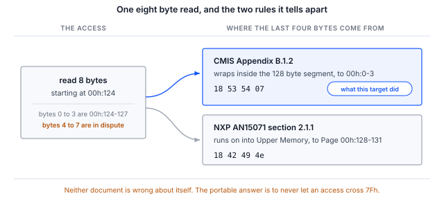
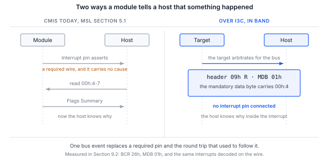

> **検証範囲**。本書の仕様に関する内容は出典を確認して検証済みであり、セクション 6 の手順は、
> インバンド割り込み（IBI）の配信を含め、I3C CMIS ターゲットに対してエンドツーエンドで実行済みです。セクション 9 には、
> ホスト側で測定し、ワイヤ上で独立に確認した出力を掲載しています。

> **公開されている CMIS のどのリビジョンも、I3C 管理通信インタフェースを定義していません。**
> CMIS 5.2 と 5.3 は I3C にまったく言及していません。CMIS 5.4 のセクション 1.3.2 は、今後のリビジョンで予定されている
> 機能の 1 つとして「I3C に基づく I2C 互換 MCI」を挙げており、OIF はその追加を公に約束していますが、まだ規定していません。
> 5.3 と 5.4 の表 B-1 には、I2CMCI と SPIMCI のちょうど 2 つの MCI バリアントだけが記載されています。したがって、
> 本書で CMIS を I3C にマッピングしている内容はすべて **Binho による派生であり、OIF CMIS のバインディングではありません**。
> 2 つのベンダの派生が相互運用できるとは限りません。

## 1 はじめに

コネクタはすでにこれを許容しています。OSFP-XD リビジョン 1.1 のセクション 10.5.1 には、必須の 400 kbit/s I2C を運ぶのと
同じ SCL および SDA ピン上で、オプションの 12.5 Mbit/s I3C シングルデータレートが記載されています。I3C で管理される
モジュールは、現時点でコネクタ上は規格に適合しています。

シリコンベンダはすでにこれに沿って開発を進めています。NXP のアプリケーションノート AN15071 は、MCX N947 上で
12.5 Mbit/s の I3C を介して動作する CMIS 5.3 ターゲットを提供しています。これを動かすために NXP は、2 枚目の開発ボード用の
USB-I3C ブリッジファームウェアと専用のホスト実行ファイルを作成しました。本ノートは、このギャップを市販のアダプタで埋めるものです。

存在しないのは、何が正しいかを示す仕様です。そのため本ノートは、手順についてだけでなく、I3C バインディングが迫る判断についても
同じくらい扱います。バインディングを採用する読者は、それらの判断を下し、文書化しなければならないからです。

### 1.1 適用範囲

本書を読み終えると、ハードウェアを手元に持つ読者は、ダイナミックアドレス割り当て（DAA）によって I3C CMIS ターゲットを
バス上に立ち上げ、I3C シングルデータレートのプライベート転送で識別情報を読み出して Page 00h のチェックサムを検証し、
ターゲットが実装しているアドレスロールオーバー規則を確認し、割り込みピンを接続せずにターゲットからインバンド割り込みを
受信できるようになります。

本書はレベル A のバインディング、すなわち I3C プライベート転送上で I2CMCI のセマンティクスをバイト単位でそのまま維持する
方式を対象とします。これは NXP が提供したものであり、今後 2 年間ラボに存在することになる方式です。SPIMCI の 3 次元アドレス
指定と大容量転送を採用したネイティブな I3CMCI についてはセクション 4 で説明しますが、まだ行われていない OIF の作業を
必要とするため、ここでは実装しません。

AN0008 はレジスタモデルそのものを扱っており、前提となる資料です。本書はその内容を前提としています。

### 1.2 対象デバイス

Table: 対象デバイス

| 項目 | 役割 | 根拠 |
|---|---|---|
| Binho Supernova | ホストアダプタ、I3C コントローラ | セクション 9、セクション 6 のすべてのコマンド |
| Binho CMIS ターゲットファームウェアを実行する NXP FRDM-MCXN947 | I3C CMIS ターゲット | セクション 9、列挙からチェックサムまで |
| AN15071 ファームウェアを実行する NXP MCX N947 | I3C CMIS ターゲット | 本ノートでは未検証 |
| スタティックアドレス 0x50 の任意の I3C CMIS ターゲット | ターゲット | 本ノートでは未検証 |

> **Binho Pulsar には I3C インタフェースがありません。** 本ノートには Supernova が必要です。ユーティリティは、
> 後で配線不良のように見える形で失敗するのではなく、Pulsar 上では `--transport i3c` を拒否します。

> **未検証と記載された行は、何かを主張するものではありません。** セクション 4 のマッピングは、OIF-CMIS-05.3 および 05.4、
> MIPI I3C Basic v1.1.1、ならびに OSFP-XD リビジョン 1.1 から導出したものです。セクション 9 では、何を何に対して実行したかを
> 報告しています。本ノートは市販の光モジュールに対しては実行しておらず、ここでの結果をそのようなものとして読むべきではありません。

### 1.3 関連資料

Table: 関連資料

| 資料 | 内容 |
|---|---|
| OIF-CMIS-05.3、OIF-CMIS-05.4 | Common Management Interface Specification、および 5.4 のセクション 1.3.2 |
| OSFP-XD Specification Revision 1.1 | セクション 10.5.1、2 線式の速度。セクション 10.5.2、INT および RSTn のシグナリング |
| NXP AN15071 | Implementation of Optical module CMIS protocol over I3C on the MCX N947 |
| MIPI I3C Basic v1.1.1 | ENTDAA、SETDASA、SETAASA、ENEC と DISEC、インバンド割り込み、ホットジョイン（Hot-Join） |
| AN0008 | Binho Supernova を使用した I2C 経由の CMIS 光モジュールの立ち上げ |

## 2 必要な機器とソフトウェア

### 2.1 ハードウェア

Table: 必要な機器

| 項目 |
|---|
| Binho Supernova USB ホストアダプタ |
| I3C CMIS ターゲット。セクション 9 では Binho CMIS ターゲットファームウェアを実行する NXP FRDM-MCXN947 を使用 |
| USB-C ケーブル |
| Saleae Logic キャプチャハードウェア（オプション） |

### 2.2 接続

Table: Supernova とターゲット間の接続

| Supernova | ターゲット | 必須 |
|---|---|---|
| SCL | I3C クロック | はい |
| SDA | I3C データ、双方向 | はい |
| 3V3 | ターゲット電源 | はい（ボードが自ら供給する場合を除く） |
| GND | リターン | はい |
| 割り込みピン | モジュール割り込み | いいえ。その理由はセクション 7 で説明します |

### 2.3 ソフトウェア

```
pip install binhosupernova
python cmis_mci.py selfcheck
```

本ノートに付属するユーティリティは、AN0008、AN0010、AN0011 に付属するものと同じファイルです。
`--transport i3c` で I3C バインディングを選択します。

Supernova はデフォルトで `PUSH_PULL_12_5_MHZ_50_DC` で駆動します。これはまさに OSFP-XD が指定するレートであるため、
立ち上げは便宜的な近似値ではなく、OSFP-XD ホストが使用するレートで実行されます。

`--push-pull` でこのレートを変更できます。読み出しにロジックで応答するモジュールは 12.5 Mbit/s を維持できますが、
割り込み内でファームウェアから応答する開発用ターゲットは維持できない場合があり、その症状は原因を示すエラーではなく、
読み出しデータの不足や NACK として現れます。セクション 9 には、そのターゲットが必要としたレートとその理由を記録しています。

## 3 2 つのレベルのバインディングと、構築しているのはどちらか

**レベル A、より高速な I2C としての I3C。** I3C シングルデータレートのプライベート転送上で、I2CMCI のセマンティクスを
バイト単位でそのまま維持します。すなわち、現在のバイトアドレスポインタ、00h:126 と 00h:127 によるページ選択、
および 8 バイトのアクセス制限です。仕様の変更は必要ありません。NXP のターゲットはスタティックアドレス 0x50 にあり、
これは A0h を 1 ビット右にシフトした値で、意図的に連続性を保っています。本ノートが実装するのはこのレベルです。

**レベル B、ネイティブな I3CMCI。** SPIMCI の 3 次元アドレス指定と大容量転送を採用し、識別には ENTDAA、
割り込みピンの代わりにインバンド割り込み、挿入にはホットジョインを使用し、ModSel を廃止します。これには OIF の作業が必要であり、
まさに動作するエクササイザを持つ者にとっての好機となります。

## 4 メカニズムごとのマッピング

Table: I3C に移行される CMIS のメカニズム

| CMIS のメカニズム | I2CMCI での方法 | I3C での方法 | 評価 |
|---|---|---|---|
| 読み出しと書き込みのフレーミング | START の後のコントロールバイト A0h または A1h | コントロールバイトは I2C アドレスバイトであるため、I3C アドレスヘッダとその RnW ビットに集約される | 明快、1 対 1 |
| 次のアクセスのホールドオフ | コントロールバイトの後の NACK、B.2.6.2 | アドレスヘッダに NACK | 明快、1 対 1 |
| TEST によるレディポーリング | ダミー書き込みで ACK を確認、B.2.5.5 | 長さゼロのプライベート書き込み、またはアドレスヘッダの ACK のみ | 明快、1 対 1 |
| 現在のアクセスの遅延 | クロックストレッチング。RAL では tREAD として抽象化され、最大 500 マイクロ秒 | 利用不可：I3C シングルデータレートではターゲットのクロックストレッチングが禁止されている | コストはないが、明文化が必要 |
| 割り込み | 必須の個別ピン、ton_Int は最大 200 ms | インバンド割り込み。その必須データバイトで原因を運べる | 明確な改善 |
| モジュールの挿入 | プレゼンスピンの後、最大 tMgmtInit（2000 ms）までポーリング | ホットジョイン。モジュールが通信可能になり次第インバンドで通知される | 明確な改善 |
| バスの共有 | なし。ポイントツーポイントで、オプションの ModSel ピンあり | ダイナミックアドレス指定により ModSel が完全に不要になる | 判断が必要、セクション 5 |
| 最大転送長 | Nmax、デフォルトは 8 | SETMWL、SETMRL、GETMXDS がネイティブにネゴシエートする | 冗長、優先順位の規則が必要 |
| 速度の検出 | 00h:2.5-2 の MciMaxSpeed | I2CMCI と SPIMCI のどちらのエンコードにも I3C のコードポイントがない | 致命的な仕様の欠落 |
| ブロードキャスト | BankBroadcastEnable、1 つのモジュール内 | ブロードキャスト CCC はバス上のすべてのモジュールに同時に届く | CMIS がこれまで持たなかった機能 |

このうち 3 つの行は、表の項目以上の説明に値します。

### 4.1 tREAD は失われるのではなく再規定される

CMIS は、tREAD は「I2CMCI のクロックストレッチ時間を抽象化したもの」であると明言しています。tREAD はメカニズムそのものではなく、
メカニズムに対する抽象として定義されているため、I3C バインディングは機能を失うのではなく、その抽象を再規定することになります。
CMIS はすでに、拒否されたアクセスを第一級の結果、すなわちセクション 5.2.2.1 の `REJECTED` としてモデル化しており、
ホストはこれをリトライするか、`TEST()` で事前にテストします。

> **名称について。間違えやすいためです。** RAL レベルでは、10 ms の揮発性ホールドオフは **tWRITE** です。*tNACK* は
> tWRITE が抽象化している I2CMCI レベルのパラメータであり、同様に tWRITENV は I2CMCI の *tWR* を抽象化しています。
> この区別がここで重要なのは、まさに I3C バインディングが I2CMCI 層を置き換えるからです。RAL レベルの記号は残りますが、
> I2CMCI レベルの記号は残りません。

### 4.2 速度のアドバタイズには I3C のコードポイントがない

OSFP-XD は、モジュールが 12.5 Mbit/s の I3C シングルデータレートをサポートしていることを知るために、`00h:2.5-2` の
`MciMaxSpeed` を読むようホストに指示しています。しかし、このレジスタではそれを表現できません。

Table: MciMaxSpeed のエンコード

| トランスポート | エンコード |
|---|---|
| I2CMCI | 0 = 400 kHz、1 = 1 MHz、2 = 3.4 MHz、3 から 15 は予約 |
| SPIMCI | 0 = 1、1 = 2、2 = 4、3 = 8、4 = 12、5 = 16、6 = 20 MHz |
| I3C | 公開されているどのリビジョンにもエンコードが存在しない |

SPIMCI が追加されたときに独自のエンコード表を得たことは、I3CMCI を導入する際の方法の前例となります。
これは、それを行える立場にある人にとって、低コストかつ具体的な貢献です。

### 4.3 ロールオーバー：2 つの資料、互換性のない 2 つの規則

CMIS 付録 B.1.2 は、現在のバイトアドレスを自身の 128 バイトセグメント内でラップさせます。NXP AN15071 のセクション 2.1.1 は、
256 バイト空間全体にわたって FFh でラップさせます。これらは同じアクセスに対する異なる動作であり、どちらの資料も
それ自体としては誤っていません。



図 1 はこの食い違い全体を 1 ページにまとめたものです。`00h:124` からの 8 バイト読み出しで 2 つの規則を区別できます。
バイト 4 から 7 が `00h:0-3` として返るか、Page 00h の先頭として返るかのどちらかだからです。

```
python cmis_mci.py rollover --transport i3c
```

セクション 9 のターゲットに対して実行すると、答えは CMIS の規則でした。

```
8 bytes from 00h:124, last four : 18 53 54 07
00h:0-3                         : 18 53 54 07
Page 00h:128-131                : 18 42 49 4e

segment wrap, as CMIS B.1.2 specifies
```

最後の 4 バイトは Page 00h の先頭ではなく 00h:0-3 の Lower Memory であるため、このターゲットはセグメント内でラップしています。

このコマンドは両方向に判別できます。メモリが 1 つのフラットな領域である、I2C ターゲットモードに設定した Binho アダプタに対して
実行すると、同じ 8 バイト読み出しはもう一方の答えを返します。

```
8 bytes from 00h:124, last four : 18 42 49 4e
00h:0-3                         : 18 53 54 07
Page 00h:128-131                : 18 42 49 4e

ran on into Upper Memory, as NXP AN15071 2.1.1 specifies
```

この 2 つ目の結果は、そのアダプタのメモリモデルの性質です。いずれかの光モジュールについて述べたものではなく、
どちらの結果も、実行対象としたターゲット以外のターゲットに関する証拠にはなりません。ベンダの一覧表ではなく
このコマンドが存在するのはそのためです。

ターゲットがどちらの規則を実装していても、ホストにとって移植性のある答えは同じです。7Fh をまたぐアクセスは決して発行せず、
分割してください。

## 5 すべての CMIS モジュールは 0x50 で応答する

CMIS にはアドレスストラップの仕組みがありません。A0h を 1 ビット右にシフトすると、これまでに製造されたすべてのモジュールで
0x50 になります。ModSel ピンを持つポイントツーポイントの I2C リンクでは、これは特に問題になりません。

マルチドロップの I3C バスでは、これは避けられない判断になります。

- **SETDASA と SETAASA はいずれもスタティックアドレスを基にしている**ため、立ち上げられるモジュールはちょうど 1 つだけです。
  同じスタティックアドレスにある 2 つ目のモジュールは、どちらの方法でもアドレス指定できません。
- **マルチドロップには ENTDAA が必要**であり、モジュールごとに一意の 48 ビットのプロビジョニング済み識別子が必要ですが、
  CMIS は現在、モジュールがそれを持つことを要求していません。

ダイナミックアドレス指定によって ModSel を正当に廃止することはできます。セクション 5.1 の脚注 3 は ModSel を MCI の定義の一部と
しているため、新しい MCI ではこれを廃止できます。

```
python cmis_mci.py scan --transport i3c
```

このコマンドはダイナミックアドレス割り当てを実行し、各ターゲットのスタティックアドレス、割り当てられたダイナミックアドレス、
BCR、DCR を含むターゲット一覧を表示します。

## 6 手順

以下のすべてのコマンドは、通信するターゲットを指定する `--address` を受け付け、複数のターゲットがあるバスではこれが必要です。
開発ボードでは通常そうなります。セクション 9 で使用した FRDM-MCXN947 は同じ I3C バス上に P3T1755DP 温度センサを搭載しており、
それが先に列挙されます。ユーティリティは誤ったターゲットを読むのではなく、推測を拒否します。誤ったターゲットでもバイトは返り、
そのバイトは何らかの値としてデコードされてしまうからです。

### 6.1 列挙する

```
python cmis_mci.py scan --transport i3c
```

`scan` は 1 つを選ぶのではなくすべてのターゲットを一覧表示するため、残りのコマンドにどのアドレスを渡すべきかを教えてくれる
コマンドです。

### 6.2 割り当てられたダイナミックアドレスで CMIS を立ち上げる

```
python cmis_mci.py bringup --transport i3c
```

このコマンドは、AN0008 のシーケンスを I3C シングルデータレートのプライベート転送上で実行し、Page 00h のチェックサムで終了します。
結果と並べてバインディングの但し書きを表示します。但し書きのない出力は、重要な場面で引用されてしまう可能性があるからです。

### 6.3 ロールオーバー規則を確認する

```
python cmis_mci.py rollover --transport i3c
```

### 6.4 データライン上で割り込みを受け取る

```
python cmis_mci.py ibi --transport i3c --seconds 10
```

## 7 インバンド割り込みこそ構築する価値のある部分

CMIS は、Management Signalling Layer に個別の Interrupt ピンを要求していますが、このピンがホストに伝えるのは何かが起きたことだけです。
その後ホストは、何が起きたのかを知るために、`00h:4-7` の Flags Summary の読み出しに 1 往復を費やします。

I3C のインバンド割り込みは必須のデータバイトを運びます。そこに Flags Summary や原因コードを入れれば、ホストは割り込みの後ではなく
割り込みの中で理由を知ることができます。これは、I3C バインディングによって CMIS が必須の配線を追加するのではなく**削減**できる
最初のメカニズムであり、OSFP-XD では共有されているマルチレベルの INT および RSTn ピンも解放されます。



図 2 は両者を並べて示しています。左側は必須の配線 1 本と 1 往復です。右側は 1 回のバスイベントで、それが運ぶバイトは、
往復で取得するはずだった Flags Summary です。

ここでは範囲が重要です。ENEC と DISEC は I3C のメカニズムであり、派生ではありません。派生であるのは、必須データバイトが
何を運ぶかについての判断です。この判断は文書化してください。別のベンダは異なる判断をするからです。

セクション 9.2 に測定結果を掲載しています。ターゲットは割り込みピンを接続しない状態で 1 秒に 1 回割り込みを発生させ、
ホストはそれを 1 バイトを含む受理済み要求として受信します。また、同じ時間帯のロジックアナライザのキャプチャでは、ターゲットが
自分のアドレスをバスに駆動し、そのバイトを返していることがわかります。そのバイトは `00h:4` の Flags Summary です。

## 8 アナライザがもたらすもの

CMIS I3CMCI アナライザでデコードした SCL と SDA のキャプチャには、シングルデータレート、CCC セット、ENTDAA、
インバンド割り込み、ホットジョインといった I3C トランスポートそのものが表示され、その上にプライベート書き込みと読み出しの
ペイロードに対する CMIS の解釈が重ねて表示されます。

トランスポートのデコードは標準の I3C であり、派生ではありません。その上の CMIS の解釈は派生であり、アナライザは 3 か所で
そのことを明示しています。設定パネルの読み取り専用のバインディングフィールド、デコードされた各フレームのバブルテキスト、
そして FrameV2 のバインディング注記列です。

Binho の派生と NXP の派生でロールオーバーの扱いが異なる部分では、アナライザは CMIS に従い、セグメントをまたぐアクセスを
エラーではなく情報として示します。AN15071 に基づく実際のターゲットは本当にもう一方の動作をする可能性があり、
アナライザの役割は何が起きたかを示すことだからです。

> **CMIS I3CMCI アナライザは開発中であり、まだリリースされていません。** このセクションでは、アナライザが生成するデコードを
> 説明しており、読者が現時点で購入できる製品を説明しているわけではありません。

## 9 測定結果

### 9.1 テスト構成

Table: テスト構成

| 項目 | 値 |
|---|---|
| アダプタ | Binho Supernova、シリアル `4F970418…1111` |
| SDK | `binhosupernova` 4.2.0、Python 3.14、Linux |
| ユーティリティ | `cmis_mci.py` 1.1 |
| ターゲット | Binho CMIS ターゲットファームウェアを実行する NXP FRDM-MCXN947、ダイナミックアドレス 0x09 |
| ターゲットイメージ | CMIS 5.3 付録 C の例、400G QSFP-DD モジュール |
| バス | 3.3 V、I3C SDR、プッシュプル 2.5 Mbit/s（デューティ比 25%）、オープンドレイン 1 Mbit/s、ファストモードの駆動強度 |
| アナライザ | Acute TravelBus、8 チャネル、800 MHz、しきい値 1.6 V、SCL と SDA のみ |
| 列挙 | ENTDAA |
| ターゲット | 0x09 の CMIS ターゲット、および 0x08 のボード上の P3T1755DP |
| 日付 | 2026 年 9 月 2 日および 3 日 |

> **ターゲットは市販の光モジュールではなく、ファームウェアで実装したターゲットです。** これは、検証に必要だった CMIS の
> レジスタモデル、すなわち Lower Memory と Upper Memory のページング、セクション 8.2.15 の非サポートページの上書き、
> および付録 B.1.2 の 128 バイトセグメント内でのラップを実装しています。以下の結果は、セクション 4 のバインディングが、
> CMIS の規定どおりに動作するターゲットに対して機能することを示すものです。いずれかのベンダのモジュールがどのように
> 動作するかを示すものではありません。

> **セクション 2.3 の 12.5 Mbit/s ではなく 2.5 Mbit/s である理由。** このターゲットは、読み出しにロジックではなく、
> 割り込み内のファームウェアから応答します。バイトアドレスが到着してから読み出しの最初のデータビットまでは約 1 バイト分の
> 時間しかなく、2.5 Mbit/s を超えると割り込みの進入レイテンシがその中に収まりません。これはこのベンチターゲットの性質です。
> バインディング、Supernova、または I3C の制限ではなく、ロジックで応答するモジュールにはこのような制約はありません。

### 9.2 結果

**オフライン。** 本ノートが駆動するレジスタアクセス層は、シミュレーションモジュールに対するセルフチェックで 8 項目中 8 項目に
合格しました。これはアドレス計算をカバーするものであり、I3C トランスポートはカバーしていません。

```
$ python cmis_mci.py selfcheck
  [OK] an access splits at 7Fh and at Nmax
  [OK] identity and module state decode
  [OK] Page 00h checksum agrees, in accesses of Nmax or fewer bytes
  [OK] FullPageReadSupported raises Nmax, and the 94 byte read fits in one access
  [OK] an all-zero page is rejected, not read as a checksum that agrees
  [OK] a module that overrides an unsupported page is caught, not believed
  [OK] TEST answers on a live module
  [OK] a write stays within the 8 byte WRITE limit while reads use Nmax

cmis_mci.py 1.1 self-check: 8/8 OK
```

**列挙。** ダイナミックアドレス割り当てにより、バス上の両方のターゲットが立ち上がります。モジュールは 0x09 で、
0x08 はボード上の温度センサです。

```
$ python cmis_mci.py scan --transport i3c --push-pull PUSH_PULL_2_5_MHZ_25_DC
static 0x00 -> dynamic 0x08  BCR 0x03  DCR 0x63
static 0x00 -> dynamic 0x09  BCR 0x26  DCR 0x00
```

**立ち上げ。** AN0008 のシーケンスを I3C シングルデータレートのプライベート転送上で実行し、Page 00h のチェックサムで終了します。

```
$ python cmis_mci.py bringup --transport i3c --address 0x09 --push-pull PUSH_PULL_2_5_MHZ_25_DC
MCI     : I3CMCI
binding : Binho derivation, not an OIF CMIS binding
TEST()  : ready
00h:0   : 0x18 QSFP-DD
00h:1   : CMIS 5.3
00h:2   : MciMaxSpeed code 5
00h:3   : ModuleReady
00h:14  : 34.50 C   (S16, 1/256 C)
00h:16  : 3.300 V   (U16, 100 uV)
01h:251 : FullPageReadSupported gives Nmax 8 bytes for reads
00h:129 : VendorName 'BINHO PHOTONICS'
00h:148 : VendorPN   'QDD-400G-DR4'
00h:166 : VendorSN   'SN2608140001'
00h:222 : checksum computed 0x5b, module stores 0x5b, OK

PASS    : present, readable, paged correctly and self consistent.
```

チェックサムは読み返す価値のある部分です。ターゲットが実際に返したバイトから計算され、ターゲットが格納しているバイトと
比較されるため、対象となる 94 バイトのどこかでページング、バイトアドレスポインタ、またはトランスポートが誤っていれば失敗します。

**ロールオーバー。** このターゲットは AN15071 の規則ではなく CMIS の規則を実装しています。出力とその意味はセクション 4.3 に
掲載しています。

**識別情報。**

```
$ python cmis_mci.py identify --transport i3c --address 0x09 --push-pull PUSH_PULL_2_5_MHZ_25_DC
identifier    0x18 QSFP-DD
CMIS revision 5.3
VendorName    'BINHO PHOTONICS'
VendorOUI     00 00 00
VendorPN      'QDD-400G-DR4'
VendorRev     '1A'
VendorSN      'SN2608140001'
DateCode      '260814AB'
```

**インバンド割り込み。** ターゲットは割り込みピンを接続しない状態で 1 秒に 1 回割り込みを発生させます。`ibi` は
コントローラのターゲットごとの受理フラグを設定し、ENEC を送信して待ち受け、時間枠が終了すると DISEC を送信します。

```
$ python cmis_mci.py ibi --transport i3c --address 0x09 --push-pull PUSH_PULL_2_5_MHZ_25_DC --seconds 10
accept flag set and ENEC sent to 0x09, listening for 10 s
10 in-band interrupt(s) in 10 s
  {'id': 0, 'command': 'I3C CONTROLLER IBI REQUEST NOTIFICATION', 'result': 'IBI_REQUEST_ACCEPTED_WITH_PAYLOAD', 'target_address': 9, 'payload_length': 1, 'payload': [1]}
```

2 つの条件は文書化しておく価値があります。他のすべての点で正しいターゲットでも、どちらか一方を満たさなければ暗黙に失敗するからです。
ターゲットは BCR でその機能をアドバタイズしなければなりません。ビット 1 は割り込み対応、ビット 2 はペイロードを示し、
このターゲットが BCR 0x26 として列挙されるのはそのためです。また、ENEC が有効にするのは**ターゲット**側であり、
コントローラはターゲットごとに別の受理フラグを保持していて、このフラグはダイナミックアドレス割り当て後に拒否の状態で起動します。
このフラグが設定されるまで、アダプタは割り込みを破棄し、どちらの側にもエラーは出ません。

**ワイヤ上の割り込み。** ホストアダプタが報告するのは自身が受信したと考えている内容であり、ターゲットが駆動した内容と同じとは
限りません。同じ時間帯をアナライザでキャプチャし、アダプタとは独立にデコードした結果は次のとおりです。

```
$ acute decode --samples ibi.bin --json
{"type":"private","ccc":null,"ccc_name":null,"address":9,"is_read":true,"data":[1]}
... eight in total ...
{"type":"ccc","ccc":129,"ccc_name":"DISEC","address":9,"is_read":false,"data":[1]}
```

10 回の割り込みのうち 8 回がアナライザのキャプチャウィンドウ内に収まりました。これは、連続ストリーミングではなく
バッファ間で再アームするアナライザが、1 秒に 1 回のイベントに対して捉える数として妥当なものです。いずれも 0x09 に対する
読み出し方向のアドレスヘッダで、1 バイトの 0x01 を運んでおり、セッションを終了する DISEC がキャプチャを締めくくっています。
デコーダにはインバンド割り込みのフレームタイプがないため、それぞれをプライベート読み出しとしてラベル付けしています。
ホストはこの時間帯に読み出しを発行していないため、その中での 0x09 の読み出しは、ターゲットがバスのアービトレーションを
行っているものとしか考えられません。また、セッションを開いていない状態で同じバスを対照としてキャプチャしても、
トランザクションは 1 件もデコードされませんでした。

**ワイヤ上のレジスタトラフィック。** プライベート読み出しにも同じ処理を行いました。ロジックアナライザでバスをキャプチャし、
デコードしたトランザクションを CMIS レジスタモデルに対してリプレイしました。
6123 回のプライベート読み出しのうち 6110 回がバイト単位で一致しました。これには、セグメント境界をまたぐ読み出しや、
ターゲットの送信 FIFO より長い読み出しも含まれます。残りのうち 2 回は空で、11 回はキャプチャの途切れによってリプレイが
ページ状態を見失ったものです。独自のターゲットを立ち上げるすべての方にこの手順を推奨します。この同じターゲットの初期リビジョンは、
ワイヤ上には 1 バイトしか駆動していないのに、ホストには正しい 4 バイトを報告していたからです。

## 10 トラブルシューティング

Table: トラブルシューティング

| 症状 | 考えられる原因と対処 |
|---|---|
| `--transport i3c` が拒否される | アダプタが Pulsar で、I3C インタフェースがありません。Supernova を使用してください |
| どのターゲットも列挙されない | ターゲットの電源レールがないか、ターゲットが駆動していません。3V3 と 2 本の信号を確認してください |
| ターゲットが 2 つあるが、1 つしか列挙されない | 両方がスタティックアドレス 0x50 で応答しています。SETDASA では 2 つ目をアドレス指定できません。一意のプロビジョニング済み識別子を使用して ENTDAA を使用してください |
| 列挙は成功するが、読み出しで意味のある値が返らない | ターゲットが AN15071 のラップ規則を実装している可能性があります。`rollover` を実行してください |
| 読み出しデータが不足する、またはターゲットが NACK し、バスを遅くすると悪化する | ターゲットが送信 FIFO にデータを供給し続けていません。時間枠が固定であるため、送られるバイト数はバスレートに比例し、バスが遅いほど少なくなります。ターゲットが正しく補充できるようになってから `--push-pull` を下げてください |
| コマンドが 2 つのターゲットを報告して実行を拒否する | 開発ボードには通常 2 つ目の I3C デバイスがあります。`scan` を実行してから `--address` を渡してください |
| ホストは正しいバイトを報告しているが、システムの動作がおかしい | ロジックアナライザで確認してください。ホストアダプタが報告するのは自身が受信したと考えている内容であり、ターゲットが駆動した内容ではありません |
| マルチバイト読み出しが別のページのバイトを返す | アクセスが 7Fh を越えています。どちらのラップ規則が適用される場合でも分割してください |
| 割り込みがまったく届かない | 確認すべき順に 3 つの原因があります。コントローラのターゲットごとの受理フラグがまだ拒否状態で、割り込みを暗黙に破棄している。ターゲットが BCR のビット 1 とビット 2 でその機能をアドバタイズしていない。ENEC が受理されなかった |
| 初期化時にレートが拒否される | この SDK バージョンではプッシュプルのレート名が異なります。エラーに使用可能な名前が表示されます |

## 11 略語

Table: 略語

| 用語 | 意味 |
|---|---|
| BCR | Bus characteristics register（バス特性レジスタ） |
| CCC | Common command code（共通コマンドコード） |
| CMIS | Common Management Interface Specification |
| DCR | Device characteristics register（デバイス特性レジスタ） |
| ENTDAA | Enter dynamic address assignment（ダイナミックアドレス割り当ての開始） |
| I2CMCI | I2C Management Communication Interface |
| IBI | In-band interrupt（インバンド割り込み） |
| MCI | Management Communication Interface |
| MSL | Management Signalling Layer |
| OIF | Optical Internetworking Forum |
| RAL | Register Access Layer（レジスタアクセス層） |
| SDR | Single data rate（シングルデータレート） |

## 12 本書のソースコードに関する注記

本書に示し、付属のアーカイブで提供しているサンプルコードは、評価および参考を目的として提供されています。
MIT ライセンスの下でリリースされており、ライセンスの全文はアーカイブに含まれています。

Table: アセットアーカイブの内容

| ファイル | 説明 |
|---|---|
| `AN0009.md` | 本書の Markdown ソース |
| `assets/cmis_mci.py` | リファレンスユーティリティ。AN0008 から AN0011 で共有 |
| `assets/LICENSE` | サンプルコードを対象とする MIT ライセンス |

## 13 改訂履歴

Table: 改訂履歴

| リビジョン | 日付 | 説明 |
|---|---|---|
| 0.1 | 2026 年 9 月 1 日 | 社内レビュー用ドラフト。仕様の内容は検証済み。手順はまだハードウェアで実行していません。 |
| 0.2 | 2026 年 9 月 2 日 | AN0008 から番号を変更。ユーティリティのセルフチェック数を 8 項目中 8 項目に更新。手順はまだハードウェアで実行していません。 |
| 0.3 | 2026 年 9 月 2 日 | I3C CMIS ターゲットに対して手順をエンドツーエンドで実行。セクション 9 に出力、セクション 4.3 に測定したロールオーバー規則を掲載。`--push-pull` と、ターゲットがそれを必要とする場合がある理由を追加。インバンド割り込みの配信は未完了。 |
| 0.4 | 2026 年 9 月 2 日 | セクション 4.3 で、もう一方の規則を実装する 2 つ目のターゲットに対して、`rollover` が両方向に判別できることを示すように変更。 |
| 0.5 | 2026 年 9 月 3 日 | インバンド割り込みの配信を測定し、ワイヤ上で確認。セクション 9.2 にホストの出力、アナライザのデコード、および他の点では正しいターゲットが暗黙に失敗する 2 つの条件を掲載。セクション 7 は単なる主張ではなくなりました。市販の光モジュールを除き、本ノートで未完了の事項はなくなりました。 |
| 0.6 | 2026 年 9 月 3 日 | 共有ユーティリティを 1.1 に更新し、AN0011 が必要とする SPIMCI の行を追加。セルフチェックの出力を再実行し、表示されるバージョン以外は変化なし。 |
| 1.0 | 2026 年 11 月 6 日 | 公開。 |
