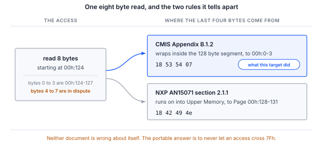
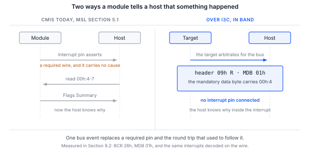

> **검증 범위**. 이 문서의 사양 내용은 출처를 확인하고 검증했으며, 섹션 6의 절차는 이제 인밴드 인터럽트(IBI) 전달을
> 포함하여 I3C CMIS 타깃을 대상으로 엔드투엔드로 실행되었습니다. 섹션 9에는 호스트에서 측정하고 와이어에서 독립적으로
> 확인한 출력이 실려 있습니다.

> **공개된 CMIS 개정판 중 어느 것도 I3C 관리 통신 인터페이스를 정의하지 않습니다.**
> CMIS 5.2와 5.3은 I3C를 전혀 언급하지 않습니다. CMIS 5.4 섹션 1.3.2는 향후 개정판에서 예정된 기능 중 하나로
> "I3C 기반의 I2C 호환 MCI"를 나열하고 있으므로, OIF는 이를 추가하겠다고 공개적으로 약속했지만 아직 규정하지는 않았습니다.
> 5.3과 5.4의 표 B-1은 모두 I2CMCI와 SPIMCI라는 정확히 두 가지 MCI 변형만 나열합니다. 따라서 이 문서에서 CMIS를 I3C에
> 매핑하는 모든 내용은 **OIF CMIS 바인딩이 아니라 Binho의 파생 방식**이며, 두 벤더의 파생 방식이 서로 호환될 필요는 없습니다.

## 1 소개

커넥터는 이미 이를 허용합니다. OSFP-XD 개정 1.1 섹션 10.5.1은 필수 400 kbit/s I2C를 전달하는 같은 SCL 및 SDA 핀에서
선택 사항인 12.5 Mbit/s I3C 단일 데이터 속도를 나열합니다. I3C로 관리되는 모듈은 오늘날 커넥터 차원에서 규격에 부합합니다.

실리콘 벤더들은 이미 이에 맞춰 개발하고 있습니다. NXP 애플리케이션 노트 AN15071은 MCX N947에서 12.5 Mbit/s로 I3C를 통해
동작하는 CMIS 5.3 타깃을 제공합니다. 이를 실행하기 위해 NXP는 두 번째 개발 보드용 USB-I3C 브리지 펌웨어와 전용 호스트
실행 파일을 작성했으며, 이 노트는 바로 그 공백을 시판 중인 어댑터로 채웁니다.

존재하지 않는 것은 무엇이 올바른지를 말해 주는 사양입니다. 따라서 이 노트는 절차만큼이나 I3C 바인딩이 강요하는 결정에 관한
것이기도 합니다. 바인딩을 채택하는 독자는 그러한 결정을 내리고 문서로 남겨야 하기 때문입니다.

### 1.1 범위

이 문서를 다 읽으면 하드웨어를 갖춘 독자는 동적 주소 할당(DAA)을 통해 I3C CMIS 타깃을 버스에 올리고, I3C 단일 데이터 속도
프라이빗 전송으로 식별 정보를 읽고 Page 00h 체크섬을 검증하며, 타깃이 구현하는 주소 롤오버 규칙을 확인하고,
인터럽트 핀을 연결하지 않은 상태에서 타깃으로부터 인밴드 인터럽트를 수신할 수 있게 됩니다.

이 문서는 레벨 A 바인딩, 즉 I3C 프라이빗 전송 위에서 I2CMCI 시맨틱을 바이트 단위로 그대로 유지하는 방식을 다룹니다.
이는 NXP가 제공한 방식이며 향후 2년간 연구실에 존재할 방식입니다. SPIMCI의 3차원 주소 지정과 대용량 전송을 채택하는
네이티브 I3CMCI는 섹션 4에서 논의하지만, 아직 이루어지지 않은 OIF의 작업이 필요하므로 여기서는 구현하지 않습니다.

AN0008은 레지스터 모델 자체를 다루며 이 문서의 전제 조건입니다. 이 문서는 그 내용을 알고 있다고 가정합니다.

### 1.2 적용 디바이스

Table: 적용 디바이스

| 항목 | 역할 | 근거 |
|---|---|---|
| Binho Supernova | 호스트 어댑터, I3C 컨트롤러 | 섹션 9, 섹션 6의 모든 명령 |
| Binho CMIS 타깃 펌웨어를 실행하는 NXP FRDM-MCXN947 | I3C CMIS 타깃 | 섹션 9, 열거부터 체크섬까지 |
| AN15071 펌웨어를 실행하는 NXP MCX N947 | I3C CMIS 타깃 | 이 노트에서는 검증되지 않음 |
| 정적 주소 0x50의 모든 I3C CMIS 타깃 | 타깃 | 이 노트에서는 검증되지 않음 |

> **Binho Pulsar에는 I3C 인터페이스가 없습니다.** 이 노트에는 Supernova가 필요합니다. 유틸리티는 나중에 배선 결함처럼
> 보이는 방식으로 실패하는 대신 Pulsar에서는 `--transport i3c`를 거부합니다.

> **검증되지 않은 것으로 표시된 행은 어떠한 주장도 아닙니다.** 섹션 4의 매핑은 OIF-CMIS-05.3 및 05.4, MIPI I3C Basic v1.1.1,
> 그리고 OSFP-XD 개정 1.1에서 도출한 것입니다. 섹션 9는 무엇을 무엇에 대해 실행했는지 보고합니다. 이 노트는 상용 광 모듈에서
> 실행되지 않았으며, 여기의 어떤 결과도 그러한 결과로 해석해서는 안 됩니다.

### 1.3 관련 문서

Table: 관련 문서

| 문서 | 주제 |
|---|---|
| OIF-CMIS-05.3, OIF-CMIS-05.4 | Common Management Interface Specification 및 5.4의 섹션 1.3.2 |
| OSFP-XD Specification Revision 1.1 | 섹션 10.5.1, 2선 속도. 섹션 10.5.2, INT 및 RSTn 신호 |
| NXP AN15071 | Implementation of Optical module CMIS protocol over I3C on the MCX N947 |
| MIPI I3C Basic v1.1.1 | ENTDAA, SETDASA, SETAASA, ENEC 및 DISEC, 인밴드 인터럽트, 핫 조인(Hot-Join) |
| AN0008 | Binho Supernova를 사용한 I2C 기반 CMIS 광 모듈 브링업 |

## 2 필요한 장비 및 소프트웨어

### 2.1 하드웨어

Table: 필요한 장비

| 항목 |
|---|
| Binho Supernova USB 호스트 어댑터 |
| I3C CMIS 타깃. 섹션 9에서는 Binho CMIS 타깃 펌웨어를 실행하는 NXP FRDM-MCXN947을 사용 |
| USB-C 케이블 |
| Saleae Logic 캡처 하드웨어, 선택 사항 |

### 2.2 연결

Table: Supernova와 타깃 간 연결

| Supernova | 타깃 | 필수 여부 |
|---|---|---|
| SCL | I3C 클록 | 예 |
| SDA | I3C 데이터, 양방향 | 예 |
| 3V3 | 타깃 전원 | 예, 보드가 자체 전원을 공급하는 경우 제외 |
| GND | 리턴 | 예 |
| 인터럽트 핀 | 모듈 인터럽트 | 아니요. 그 이유는 섹션 7에서 설명합니다 |

### 2.3 소프트웨어

```
pip install binhosupernova
python cmis_mci.py selfcheck
```

이 노트와 함께 제공되는 유틸리티는 AN0008, AN0010, AN0011과 함께 제공되는 것과 같은 파일입니다.
`--transport i3c`로 I3C 바인딩을 선택합니다.

Supernova는 기본적으로 `PUSH_PULL_12_5_MHZ_50_DC`로 구동하며, 이는 OSFP-XD가 지정하는 속도와 정확히 같습니다.
따라서 브링업은 편의상의 근사치가 아니라 OSFP-XD 호스트가 사용할 속도로 실행됩니다.

`--push-pull`은 이 속도를 재정의합니다. 로직으로 읽기에 응답하는 모듈은 12.5 Mbit/s를 유지하지만, 인터럽트 안에서 펌웨어로
응답하는 개발용 타깃은 그렇지 못할 수 있으며, 그 증상은 원인을 알려 주는 오류가 아니라 짧은 읽기 또는 NACK입니다.
섹션 9에는 해당 타깃에 필요했던 속도와 그 이유가 기록되어 있습니다.

## 3 두 가지 수준의 바인딩과 여러분이 구축하는 것

**레벨 A, 더 빠른 I2C로서의 I3C.** I3C 단일 데이터 속도 프라이빗 전송 위에서 I2CMCI 시맨틱을 바이트 단위로 그대로
유지합니다. 즉, 현재 바이트 주소 포인터, 00h:126 및 00h:127을 통한 페이지 선택, 8바이트 액세스 제한을 유지합니다.
사양 변경은 필요하지 않습니다. NXP의 타깃은 A0h를 오른쪽으로 1비트 시프트한 정적 주소 0x50에 있으며, 의도적으로
연속성을 유지합니다. 이 노트가 구현하는 것이 바로 이 레벨입니다.

**레벨 B, 네이티브 I3CMCI.** SPIMCI의 3차원 주소 지정과 대용량 전송을 채택하고, 식별에는 ENTDAA를, 인터럽트 핀 대신
인밴드 인터럽트를, 삽입에는 핫 조인을 사용하며, ModSel을 없앱니다. 이를 위해서는 OIF의 작업이 필요하며, 바로 이 점이
동작하는 익서사이저(exerciser)를 가진 누구에게나 기회가 됩니다.

## 4 메커니즘별 매핑

Table: I3C로 옮겨지는 CMIS 메커니즘

| CMIS 메커니즘 | I2CMCI의 방식 | I3C에서 | 판정 |
|---|---|---|---|
| 읽기 및 쓰기 프레이밍 | START 뒤의 제어 바이트 A0h 또는 A1h | 제어 바이트가 곧 I2C 주소 바이트이므로 I3C 주소 헤더와 그 RnW 비트로 통합됨 | 깔끔함, 일대일 |
| 다음 액세스 홀드오프 | 제어 바이트 뒤의 NACK, B.2.6.2 | 주소 헤더에 NACK | 깔끔함, 일대일 |
| TEST 준비 상태 폴링 | 더미 쓰기 후 ACK 확인, B.2.5.5 | 길이 0의 프라이빗 쓰기, 또는 주소 헤더 ACK만으로 | 깔끔함, 일대일 |
| 현재 액세스 지연 | 클록 스트레칭. RAL에서 tREAD로 추상화되며 최대 500마이크로초 | 사용 불가: I3C 단일 데이터 속도는 타깃의 클록 스트레칭을 금지함 | 비용은 없으나 문서화 필요 |
| 인터럽트 | 필수 개별 핀, ton_Int 최대 200 ms | 인밴드 인터럽트. 필수 데이터 바이트에 원인을 담을 수 있음 | 명백한 개선 |
| 모듈 삽입 | 존재 감지 핀 후 최대 tMgmtInit, 즉 2000 ms 동안 폴링 | 핫 조인. 모듈이 통신할 수 있게 되는 즉시 인밴드로 알림 | 명백한 개선 |
| 버스 공유 | 없음. 점대점이며 선택 사항인 ModSel 핀 사용 | 동적 주소 지정으로 ModSel이 완전히 불필요해짐 | 결정 필요, 섹션 5 |
| 최대 전송 길이 | Nmax, 기본값 8 | SETMWL, SETMRL, GETMXDS가 기본적으로 협상함 | 중복, 우선순위 규칙 필요 |
| 속도 검색 | 00h:2.5-2의 MciMaxSpeed | I2CMCI와 SPIMCI 인코딩 모두 I3C용 코드 포인트가 없음 | 차단 수준의 사양 공백 |
| 브로드캐스트 | BankBroadcastEnable, 한 모듈 내 | 브로드캐스트 CCC가 버스의 모든 모듈에 동시에 도달함 | CMIS가 가져 본 적 없는 기능 |

이 중 세 행은 표의 항목 이상의 설명이 필요합니다.

### 4.1 tREAD는 사라지는 것이 아니라 재규정된다

CMIS는 tREAD가 "I2CMCI 클록 스트레치 시간의 추상화"라고 명시합니다. tREAD는 메커니즘 자체가 아니라 메커니즘에 대한
추상화로 정의되어 있으므로, I3C 바인딩은 기능을 잃는 것이 아니라 그 추상화를 재규정합니다. CMIS는 이미 거부된 액세스를
일급 결과, 즉 섹션 5.2.2.1의 `REJECTED`로 모델링하고 있으며, 호스트는 이를 재시도하거나 `TEST()`로 사전 테스트합니다.

> **명칭에 대하여. 혼동하기 쉽기 때문입니다.** RAL 수준에서 10 ms의 휘발성 홀드오프는 **tWRITE**입니다. *tNACK*은
> tWRITE가 추상화하는 I2CMCI 수준 파라미터이며, 마찬가지로 tWRITENV는 I2CMCI의 *tWR*을 추상화합니다. 이 구분이 여기서
> 중요한 이유는 바로 I3C 바인딩이 I2CMCI 계층을 대체하기 때문입니다. RAL 수준의 기호는 남지만 I2CMCI 수준의 기호는 남지 않습니다.

### 4.2 속도 광고에는 I3C용 코드 포인트가 없다

OSFP-XD는 모듈이 12.5 Mbit/s의 I3C 단일 데이터 속도를 지원하는지 알아내기 위해 `00h:2.5-2`의 `MciMaxSpeed`를 읽도록
호스트에 지시합니다. 그러나 이 레지스터로는 이를 표현할 수 없습니다.

Table: MciMaxSpeed 인코딩

| 트랜스포트 | 인코딩 |
|---|---|
| I2CMCI | 0 = 400 kHz, 1 = 1 MHz, 2 = 3.4 MHz, 3~15 예약 |
| SPIMCI | 0 = 1, 1 = 2, 2 = 4, 3 = 8, 4 = 12, 5 = 16, 6 = 20 MHz |
| I3C | 공개된 어떤 개정판에도 인코딩이 존재하지 않음 |

SPIMCI가 추가될 때 자체 인코딩 표를 받았다는 사실은 I3CMCI를 도입해야 하는 방식의 선례이며, 이를 할 수 있는 위치에 있는
누구에게나 비용이 적게 들고 구체적인 기여가 됩니다.

### 4.3 롤오버: 두 문서, 서로 호환되지 않는 두 규칙

CMIS 부록 B.1.2는 현재 바이트 주소를 자신의 128바이트 세그먼트 안에서 래핑합니다. NXP AN15071 섹션 2.1.1은 256바이트 공간
전체에서 FFh에서 래핑합니다. 이는 같은 액세스에 대한 서로 다른 동작이며, 두 문서 모두 그 자체로는 틀리지 않았습니다.



그림 1은 이 불일치 전체를 한 페이지에 보여 줍니다. `00h:124`에서 8바이트를 읽으면 두 규칙을 구분할 수 있는데,
바이트 4~7이 `00h:0-3`으로 반환되거나 Page 00h의 시작 부분으로 반환되기 때문입니다.

```
python cmis_mci.py rollover --transport i3c
```

섹션 9의 타깃을 대상으로 실행하면 답은 CMIS 규칙입니다.

```
8 bytes from 00h:124, last four : 18 53 54 07
00h:0-3                         : 18 53 54 07
Page 00h:128-131                : 18 42 49 4e

segment wrap, as CMIS B.1.2 specifies
```

마지막 네 바이트는 Page 00h의 시작 부분이 아니라 00h:0-3의 Lower Memory이므로, 이 타깃은 세그먼트 안에서 래핑합니다.

이 명령은 양방향으로 판별합니다. 메모리가 하나의 플랫 영역인, I2C 타깃 모드로 설정된 Binho 어댑터를 대상으로 실행하면
같은 8바이트 읽기가 다른 답을 반환합니다.

```
8 bytes from 00h:124, last four : 18 42 49 4e
00h:0-3                         : 18 53 54 07
Page 00h:128-131                : 18 42 49 4e

ran on into Upper Memory, as NXP AN15071 2.1.1 specifies
```

이 두 번째 결과는 해당 어댑터의 메모리 모델 특성입니다. 이는 어떤 광 모듈에 대한 진술도 아니며, 두 결과 모두 실행 대상이
된 타깃 외의 다른 타깃에 대한 증거가 아닙니다. 벤더 표 대신 이 명령이 존재하는 이유가 바로 이것입니다.

타깃이 어떤 규칙을 구현하든 호스트에게 이식 가능한 답은 같습니다. 7Fh를 넘는 액세스는 절대 발행하지 말고 분할하십시오.

## 5 모든 CMIS 모듈은 0x50에서 응답한다

CMIS에는 주소 스트래핑이 없습니다. A0h를 오른쪽으로 1비트 시프트하면 지금까지 만들어진 모든 모듈에서 0x50입니다.
ModSel 핀이 있는 점대점 I2C 링크에서는 이것이 특별한 문제가 되지 않습니다.

멀티드롭 I3C 버스에서는 피할 수 없는 결정이 됩니다.

- **SETDASA와 SETAASA는 모두 정적 주소를 기준으로 동작하므로** 정확히 하나의 모듈만 올릴 수 있습니다.
  같은 정적 주소에 있는 두 번째 모듈은 어느 방법으로도 주소 지정할 수 없습니다.
- **멀티드롭에는 ENTDAA가 필요하며**, 모듈마다 고유한 48비트 프로비저닝 식별자가 필요하지만 CMIS는 현재 모듈이 이를
  갖추도록 요구하지 않습니다.

동적 주소 지정은 ModSel을 정당하게 없앨 수 있습니다. 섹션 5.1 각주 3은 ModSel을 MCI 정의의 일부로 규정하므로, 새로운 MCI는
이를 없앨 수 있습니다.

```
python cmis_mci.py scan --transport i3c
```

이 명령은 동적 주소 할당을 실행하고, 각 타깃의 정적 주소, 할당된 동적 주소, BCR, DCR을 포함한 타깃 표를 출력합니다.

## 6 절차

아래의 모든 명령은 통신할 타깃을 지정하는 `--address`를 받으며, 둘 이상의 타깃이 있는 버스에서는 이것이 필요합니다.
개발 보드는 보통 그렇습니다. 섹션 9에서 사용한 FRDM-MCXN947은 같은 I3C 버스에 P3T1755DP 온도 센서를 탑재하고 있으며,
이 센서가 먼저 열거됩니다. 유틸리티는 잘못된 타깃을 읽는 대신 추측을 거부합니다. 잘못된 타깃도 바이트를 반환하고,
그 바이트도 무언가로 디코딩되기 때문입니다.

### 6.1 열거

```
python cmis_mci.py scan --transport i3c
```

`scan`은 하나를 고르지 않고 모든 타깃을 나열하므로, 나머지 명령에 어떤 주소를 전달해야 하는지 알려 주는 명령입니다.

### 6.2 할당된 동적 주소로 CMIS 브링업

```
python cmis_mci.py bringup --transport i3c
```

이 명령은 I3C 단일 데이터 속도 프라이빗 전송 위에서 AN0008 시퀀스를 수행하고 Page 00h 체크섬으로 마칩니다.
결과와 함께 바인딩에 대한 단서 문구를 출력하는데, 이 문구가 없는 출력은 중요한 자리에서 인용될 수 있기 때문입니다.

### 6.3 롤오버 규칙 확인

```
python cmis_mci.py rollover --transport i3c
```

### 6.4 데이터 라인으로 인터럽트 받기

```
python cmis_mci.py ibi --transport i3c --seconds 10
```

## 7 인밴드 인터럽트야말로 구축할 가치가 있는 부분이다

CMIS는 Management Signalling Layer에 개별 Interrupt 핀을 요구하며, 이 핀은 호스트에게 무언가가 발생했다는 사실만 알려 줍니다.
그런 다음 호스트는 무엇이 발생했는지 알아내기 위해 `00h:4-7`의 Flags Summary를 읽는 데 왕복 한 번을 소비합니다.

I3C 인밴드 인터럽트는 필수 데이터 바이트를 전달합니다. 여기에 Flags Summary나 원인 코드를 넣으면 호스트는 인터럽트가 끝난
뒤가 아니라 인터럽트 안에서 이유를 알게 됩니다. 이는 I3C 바인딩을 통해 CMIS가 필수 배선을 추가하는 대신 **줄일** 수 있는
첫 번째 메커니즘이며, OSFP-XD에서는 공유되는 다중 레벨 INT 및 RSTn 핀도 해방시킵니다.



그림 2는 두 방식을 나란히 보여 줍니다. 왼쪽은 필수 배선 하나와 왕복 한 번입니다. 오른쪽은 한 번의 버스 이벤트이며,
그것이 전달하는 바이트는 왕복을 통해 가져왔을 Flags Summary입니다.

여기서는 범위가 중요합니다. ENEC와 DISEC는 I3C 메커니즘이며 파생 방식이 아닙니다. 파생된 것은 필수 데이터 바이트가 무엇을
담을지에 대한 결정입니다. 이 결정을 문서로 남기십시오. 다른 벤더는 다른 결정을 내릴 것이기 때문입니다.

섹션 9.2에 측정 결과가 있습니다. 타깃은 인터럽트 핀을 연결하지 않은 상태에서 1초에 한 번 인터럽트를 발생시키고,
호스트는 이를 1바이트를 담은 수락된 요청으로 수신하며, 같은 시간 구간의 로직 분석기 캡처는 타깃이 자신의 주소를 버스에
구동하고 그 바이트를 반환하는 것을 보여 줍니다. 그 바이트는 `00h:4`의 Flags Summary입니다.

## 8 분석기가 더해 주는 것

CMIS I3CMCI 분석기로 디코딩한 SCL 및 SDA 캡처는 단일 데이터 속도, CCC 세트, ENTDAA, 인밴드 인터럽트, 핫 조인 등
I3C 트랜스포트 자체를 보여 주며, 프라이빗 쓰기 및 읽기 페이로드 위에 CMIS 해석을 겹쳐 표시합니다.

트랜스포트 디코딩은 표준 I3C이며 파생 방식이 아닙니다. 그 위의 CMIS 해석은 파생 방식이며, 분석기는 이를 세 곳에서 명시합니다.
설정 패널의 읽기 전용 바인딩 필드, 디코딩된 각 프레임의 버블 텍스트, 그리고 FrameV2 바인딩 메모 열입니다.

Binho 파생 방식과 NXP 파생 방식이 롤오버에서 다른 부분에서는, 분석기는 CMIS를 따르며 세그먼트를 넘는 액세스를 오류가 아닌
정보로 표시합니다. AN15071 기반의 실제 타깃은 정말로 다른 방식으로 동작할 수 있으며, 분석기의 역할은 무슨 일이 일어났는지
보여 주는 것이기 때문입니다.

> **CMIS I3CMCI 분석기는 개발 중이며 아직 출시되지 않았습니다.** 이 섹션은 분석기가 생성하는 디코딩을 설명하는 것이며,
> 독자가 지금 구매할 수 있는 제품을 설명하는 것이 아닙니다.

## 9 측정 결과

### 9.1 테스트 구성

Table: 테스트 구성

| 항목 | 값 |
|---|---|
| 어댑터 | Binho Supernova, 시리얼 `4F970418…1111` |
| SDK | `binhosupernova` 4.2.0, Python 3.14, Linux |
| 유틸리티 | `cmis_mci.py` 1.1 |
| 타깃 | Binho CMIS 타깃 펌웨어를 실행하는 NXP FRDM-MCXN947, 동적 주소 0x09 |
| 타깃 이미지 | CMIS 5.3 부록 C의 예제, 400G QSFP-DD 모듈 |
| 버스 | 3.3 V, I3C SDR, 푸시풀 2.5 Mbit/s(듀티 사이클 25%), 오픈 드레인 1 Mbit/s, 고속 모드 구동 강도 |
| 분석기 | Acute TravelBus, 8채널, 800 MHz, 1.6 V 임계값, SCL 및 SDA만 |
| 열거 | ENTDAA |
| 타깃 | 0x09의 CMIS 타깃 및 0x08의 보드 탑재 P3T1755DP |
| 날짜 | 2026년 9월 2일 및 3일 |

> **타깃은 상용 광 모듈이 아니라 펌웨어로 구현한 타깃입니다.** 이 타깃은 우리가 검증해야 했던 CMIS 레지스터 모델, 즉
> Lower Memory 및 Upper Memory 페이징, 섹션 8.2.15의 미지원 페이지 재정의, 부록 B.1.2의 128바이트 세그먼트 내 래핑을
> 구현합니다. 아래 결과는 섹션 4의 바인딩이 CMIS 규정대로 동작하는 타깃에서 작동함을 입증합니다. 어떤 벤더의 모듈이
> 어떻게 동작하는지를 입증하지는 않습니다.

> **섹션 2.3의 12.5 Mbit/s가 아니라 2.5 Mbit/s인 이유.** 이 타깃은 로직이 아니라 인터럽트 안의 펌웨어에서 읽기에 응답합니다.
> 바이트 주소가 도착한 후 읽기의 첫 데이터 비트까지는 대략 한 바이트 시간밖에 없으며, 2.5 Mbit/s를 넘으면 인터럽트 진입
> 지연이 그 안에 들어가지 않습니다. 이는 이 벤치 타깃의 특성입니다. 바인딩, Supernova, I3C의 한계가 아니며, 로직으로
> 응답하는 모듈에는 이러한 제약이 없습니다.

### 9.2 결과

**오프라인.** 이 노트가 구동하는 레지스터 액세스 계층은 시뮬레이션 모듈을 대상으로 한 자체 검사에서 8개 중 8개를
통과합니다. 이는 주소 연산을 다루며 I3C 트랜스포트는 다루지 않습니다.

```
$ python cmis_mci.py selfcheck
  [OK] an access splits at 7Fh and at Nmax
  [OK] identity and module state decode
  [OK] Page 00h checksum agrees, in accesses of Nmax or fewer bytes
  [OK] FullPageReadSupported raises Nmax, and the 94 byte read fits in one access
  [OK] an all-zero page is rejected, not read as a checksum that agrees
  [OK] a module that overrides an unsupported page is caught, not believed
  [OK] TEST answers on a live module
  [OK] a write stays within the 8 byte WRITE limit while reads use Nmax

cmis_mci.py 1.1 self-check: 8/8 OK
```

**열거.** 동적 주소 할당으로 버스의 두 타깃이 모두 올라옵니다. 모듈은 0x09이고, 0x08은 보드의 온도 센서입니다.

```
$ python cmis_mci.py scan --transport i3c --push-pull PUSH_PULL_2_5_MHZ_25_DC
static 0x00 -> dynamic 0x08  BCR 0x03  DCR 0x63
static 0x00 -> dynamic 0x09  BCR 0x26  DCR 0x00
```

**브링업.** I3C 단일 데이터 속도 프라이빗 전송 위에서 AN0008 시퀀스를 수행하고 Page 00h 체크섬으로 마칩니다.

```
$ python cmis_mci.py bringup --transport i3c --address 0x09 --push-pull PUSH_PULL_2_5_MHZ_25_DC
MCI     : I3CMCI
binding : Binho derivation, not an OIF CMIS binding
TEST()  : ready
00h:0   : 0x18 QSFP-DD
00h:1   : CMIS 5.3
00h:2   : MciMaxSpeed code 5
00h:3   : ModuleReady
00h:14  : 34.50 C   (S16, 1/256 C)
00h:16  : 3.300 V   (U16, 100 uV)
01h:251 : FullPageReadSupported gives Nmax 8 bytes for reads
00h:129 : VendorName 'BINHO PHOTONICS'
00h:148 : VendorPN   'QDD-400G-DR4'
00h:166 : VendorSN   'SN2608140001'
00h:222 : checksum computed 0x5b, module stores 0x5b, OK

PASS    : present, readable, paged correctly and self consistent.
```

체크섬은 두 번 읽어 볼 가치가 있는 부분입니다. 타깃이 실제로 반환한 바이트로 계산하여 타깃이 저장한 바이트와 비교하므로,
대상 94바이트의 어디에서든 페이징, 바이트 주소 포인터 또는 트랜스포트가 잘못되면 실패합니다.

**롤오버.** 이 타깃은 AN15071 규칙이 아니라 CMIS 규칙을 구현합니다. 섹션 4.3에 출력과 그 의미가 실려 있습니다.

**식별 정보.**

```
$ python cmis_mci.py identify --transport i3c --address 0x09 --push-pull PUSH_PULL_2_5_MHZ_25_DC
identifier    0x18 QSFP-DD
CMIS revision 5.3
VendorName    'BINHO PHOTONICS'
VendorOUI     00 00 00
VendorPN      'QDD-400G-DR4'
VendorRev     '1A'
VendorSN      'SN2608140001'
DateCode      '260814AB'
```

**인밴드 인터럽트.** 타깃은 인터럽트 핀을 연결하지 않은 상태에서 1초에 한 번 인터럽트를 발생시킵니다. `ibi`는 컨트롤러의
타깃별 수락 플래그를 설정하고, ENEC를 보내고, 대기한 뒤, 시간 구간이 끝나면 DISEC를 보냅니다.

```
$ python cmis_mci.py ibi --transport i3c --address 0x09 --push-pull PUSH_PULL_2_5_MHZ_25_DC --seconds 10
accept flag set and ENEC sent to 0x09, listening for 10 s
10 in-band interrupt(s) in 10 s
  {'id': 0, 'command': 'I3C CONTROLLER IBI REQUEST NOTIFICATION', 'result': 'IBI_REQUEST_ACCEPTED_WITH_PAYLOAD', 'target_address': 9, 'payload_length': 1, 'payload': [1]}
```

두 가지 조건은 문서로 남겨 둘 가치가 있습니다. 다른 모든 면에서 올바른 타깃이라도 둘 중 하나라도 충족하지 않으면 조용히
실패하기 때문입니다. 타깃은 BCR에서 해당 기능을 광고해야 하며, 비트 1은 인터럽트 가능, 비트 2는 페이로드를 나타냅니다.
이 타깃이 BCR 0x26으로 열거되는 이유가 이것입니다. 또한 ENEC는 **타깃**을 활성화하는 것이며, 컨트롤러는 별도의 타깃별
수락 플래그를 유지하는데, 이 플래그는 동적 주소 할당 후 거부 상태로 시작합니다. 이 플래그가 설정될 때까지 어댑터는
인터럽트를 폐기하며, 어느 쪽에서도 오류가 발생하지 않습니다.

**와이어 상의 인터럽트.** 호스트 어댑터는 자신이 수신했다고 믿는 내용을 보고하며, 이는 타깃이 구동한 내용과 같지 않습니다.
같은 시간 구간을 분석기로 캡처하여 어댑터와 독립적으로 디코딩한 결과는 다음과 같습니다.

```
$ acute decode --samples ibi.bin --json
{"type":"private","ccc":null,"ccc_name":null,"address":9,"is_read":true,"data":[1]}
... eight in total ...
{"type":"ccc","ccc":129,"ccc_name":"DISEC","address":9,"is_read":false,"data":[1]}
```

10번의 인터럽트 중 8번이 분석기의 캡처 창 안에 들어왔으며, 이는 연속 스트리밍이 아니라 버퍼 사이에 다시 대기 상태로
들어가는 분석기가 1초에 한 번 발생하는 이벤트에서 포착할 수 있는 수준입니다. 각각은 읽기 방향의 0x09 주소 헤더로 단일
바이트 0x01을 담고 있으며, 세션을 끝내는 DISEC가 캡처를 마무리합니다. 디코더에는 인밴드 인터럽트 프레임 유형이 없으므로
각각을 프라이빗 읽기로 표시합니다. 호스트는 이 시간 구간에 읽기를 발행하지 않았으므로, 그 안에서 0x09에 대한 읽기는
타깃이 버스를 중재하는 것일 수밖에 없으며, 세션을 열지 않은 상태에서 같은 버스를 대조 캡처했을 때는 트랜잭션이 전혀
디코딩되지 않았습니다.

**와이어 상의 레지스터 트래픽.** 프라이빗 읽기도 같은 방식으로 처리했습니다. 로직 분석기로 버스를 캡처하고, 디코딩된
트랜잭션을 CMIS 레지스터 모델에 대해 재생했습니다.
6123번의 프라이빗 읽기 중 6110번이 바이트 단위로 일치했으며, 여기에는 세그먼트 경계를 넘는 읽기와 타깃의 전송 FIFO보다
긴 읽기도 포함됩니다. 나머지 중 2번은 비어 있었고, 11번은 캡처의 공백 때문에 재생 과정에서 페이지 상태를 잃은 경우입니다.
자체 타깃을 브링업하는 모든 분께 이 단계를 권장합니다. 바로 이 타깃의 초기 개정판이 와이어에는 한 바이트만 구동하면서
호스트에는 올바른 네 바이트를 보고한 적이 있기 때문입니다.

## 10 문제 해결

Table: 문제 해결

| 증상 | 가능한 원인 및 조치 |
|---|---|
| `--transport i3c`가 거부됨 | 어댑터가 Pulsar이며 I3C 인터페이스가 없습니다. Supernova를 사용하십시오 |
| 어떤 타깃도 열거되지 않음 | 타깃 전원 레일이 없거나 타깃이 구동하지 않습니다. 3V3과 두 신호를 확인하십시오 |
| 타깃이 둘인데 하나만 열거됨 | 둘 다 정적 주소 0x50에서 응답합니다. SETDASA로는 두 번째 타깃을 주소 지정할 수 없으므로 고유한 프로비저닝 식별자와 함께 ENTDAA를 사용하십시오 |
| 열거는 성공하지만 읽기에서 의미 있는 값이 나오지 않음 | 타깃이 AN15071 래핑 규칙을 구현하고 있을 수 있습니다. `rollover`를 실행하십시오 |
| 읽기가 짧게 돌아오거나 타깃이 NACK하며, 버스를 느리게 하면 더 나빠짐 | 타깃이 전송 FIFO를 계속 채우지 못하고 있습니다. 시간 창이 고정되어 있으므로 전달되는 바이트 수는 버스 속도에 비례하며, 버스가 느릴수록 적게 전달됩니다. 타깃이 올바르게 다시 채울 수 있게 된 후에만 `--push-pull`을 낮추십시오 |
| 명령이 두 타깃을 보고하고 실행을 거부함 | 개발 보드에는 보통 두 번째 I3C 디바이스가 있습니다. `scan`을 실행한 다음 `--address`를 전달하십시오 |
| 호스트는 올바른 바이트를 보고하지만 시스템이 오동작함 | 로직 분석기로 확인하십시오. 호스트 어댑터는 자신이 수신했다고 믿는 내용을 보고하며, 타깃이 구동한 내용을 보고하는 것이 아닙니다 |
| 멀티바이트 읽기가 다른 페이지의 바이트를 반환함 | 액세스가 7Fh를 넘었습니다. 어떤 래핑 규칙이 적용되든 분할하십시오 |
| 인터럽트가 전혀 도착하지 않음 | 확인할 가치가 있는 순서대로 세 가지 원인이 있습니다. 컨트롤러의 타깃별 수락 플래그가 여전히 거부 상태여서 인터럽트를 조용히 폐기합니다. 타깃이 BCR의 비트 1과 비트 2로 해당 기능을 광고하지 않습니다. ENEC가 수락되지 않았습니다 |
| 초기화 시 속도가 거부됨 | 이 SDK 버전에서는 푸시풀 속도 이름이 다릅니다. 오류 메시지에 허용되는 이름이 나열됩니다 |

## 11 약어

Table: 약어

| 용어 | 의미 |
|---|---|
| BCR | Bus characteristics register(버스 특성 레지스터) |
| CCC | Common command code(공통 명령 코드) |
| CMIS | Common Management Interface Specification |
| DCR | Device characteristics register(디바이스 특성 레지스터) |
| ENTDAA | Enter dynamic address assignment(동적 주소 할당 시작) |
| I2CMCI | I2C Management Communication Interface |
| IBI | In-band interrupt(인밴드 인터럽트) |
| MCI | Management Communication Interface |
| MSL | Management Signalling Layer |
| OIF | Optical Internetworking Forum |
| RAL | Register Access Layer(레지스터 액세스 계층) |
| SDR | Single data rate(단일 데이터 속도) |

## 12 문서의 소스 코드에 관한 참고 사항

이 문서에 표시되고 함께 제공되는 아카이브에 포함된 예제 코드는 평가 및 참고용으로 제공됩니다.
MIT 라이선스로 배포되며, 라이선스 전문은 아카이브에 포함되어 있습니다.

Table: 에셋 아카이브의 내용

| 파일 | 설명 |
|---|---|
| `AN0009.md` | 이 문서의 Markdown 소스 |
| `assets/cmis_mci.py` | 참조 유틸리티, AN0008부터 AN0011까지 공유 |
| `assets/LICENSE` | 예제 코드에 적용되는 MIT 라이선스 |

## 13 개정 이력

Table: 개정 이력

| 개정 | 날짜 | 설명 |
|---|---|---|
| 0.1 | 2026년 9월 1일 | 내부 검토용 초안. 사양 내용은 검증됨. 절차는 아직 하드웨어에서 실행되지 않음. |
| 0.2 | 2026년 9월 2일 | AN0008에서 번호 변경. 유틸리티 자체 검사 수를 8개 중 8개로 갱신. 절차는 여전히 하드웨어에서 실행되지 않음. |
| 0.3 | 2026년 9월 2일 | I3C CMIS 타깃을 대상으로 절차를 엔드투엔드로 실행. 섹션 9에 출력, 섹션 4.3에 측정된 롤오버 규칙을 수록. `--push-pull`과 타깃에 이것이 필요할 수 있는 이유를 추가. 인밴드 인터럽트 전달은 미완료. |
| 0.4 | 2026년 9월 2일 | 섹션 4.3에서 다른 규칙을 구현하는 두 번째 타깃을 대상으로 `rollover`가 양방향으로 판별함을 보여 주도록 변경. |
| 0.5 | 2026년 9월 3일 | 인밴드 인터럽트 전달을 측정하고 와이어에서 확인. 섹션 9.2에 호스트 출력, 분석기 디코딩, 그리고 다른 면에서 올바른 타깃이 조용히 실패하는 두 가지 조건을 수록. 섹션 7은 더 이상 주장에 그치지 않음. 상용 광 모듈을 제외하면 이 노트에서 미완료 사항은 없음. |
| 0.6 | 2026년 9월 3일 | 공유 유틸리티를 1.1로 올려 AN0011에 필요한 SPIMCI 행을 추가. 자체 검사 출력을 다시 실행했으며, 출력되는 버전 외에는 변경 없음. |
| 1.0 | 2026년 11월 6일 | 공개. |
