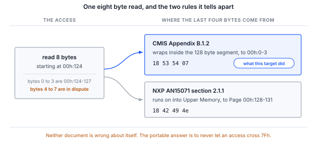
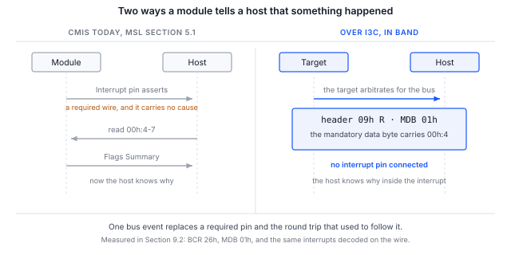

> **测试范围**。本文档中的规范内容均有出处并已核实，第 6 节中的流程现已在 I3C CMIS 目标器件上
> 端到端运行，包括带内中断（IBI）的传递。第 9 节给出了输出，这些输出在主机端测得，并在线路上独立确认。

> **目前已发布的 CMIS 修订版均未定义 I3C 管理通信接口。**
> CMIS 5.2 和 5.3 完全没有提及 I3C。CMIS 5.4 第 1.3.2 节将"基于 I3C 的 I2C 兼容 MCI"列为预计在后续修订版中
> 出现的特性之一，因此 OIF 已公开承诺会增加该接口，但尚未对其做出规定。5.3 和 5.4 的表 B-1 都恰好只列出两种
> MCI 变体：I2CMCI 和 SPIMCI。因此，本文档中所有将 CMIS 映射到 I3C 的内容都是 **Binho 的推导，而不是 OIF CMIS
> 绑定**，两家厂商的推导不一定能够互通。

## 1 简介

连接器已经允许这样做。OSFP-XD 修订版 1.1 第 10.5.1 节列出了可选的 12.5 Mbit/s I3C 单数据速率，
它使用与必需的 400 kbit/s I2C 相同的 SCL 和 SDA 引脚。如今在连接器层面，受 I3C 管理的模块是合规的。

芯片厂商已经在按此开发。NXP 应用笔记 AN15071 在 MCX N947 上提供了一个以 12.5 Mbit/s 通过 I3C 工作的
CMIS 5.3 目标器件。为了对其进行测试，NXP 为第二块开发板编写了 USB 转 I3C 桥接固件，以及一个定制的主机可执行程序，
而本笔记正是用一款已上市的适配器来填补这一空白。

尚不存在的是一份说明何为正确行为的规范。因此，本笔记既是关于流程的，也同样是关于 I3C 绑定所迫使做出的决策的，
因为采用这种绑定的读者必须做出这些决策并将其记录下来。

### 1.1 范围

读完本文档后，手边有硬件的读者将能够通过动态地址分配（DAA）将 I3C CMIS 目标器件接入总线，
通过 I3C 单数据速率私有传输读取其标识并验证其 Page 00h 校验和，确定其实现的地址回绕规则，
并在不连接中断引脚的情况下接收来自它的带内中断。

本文档涵盖 A 级绑定，即通过 I3C 私有传输逐字节保留 I2CMCI 语义，这正是 NXP 所提供的方案，
也是未来两年实验室中将会存在的方案。采用 SPIMCI 三维寻址和大块传输的原生 I3CMCI 在第 4 节中有所讨论，
但本文没有实现，因为它需要 OIF 尚未开展的工作。

AN0008 介绍寄存器模型本身，是本文档的前提。本文档假定读者已经了解其内容。

### 1.2 适用器件

Table: 适用器件

| 项目 | 角色 | 依据 |
|---|---|---|
| Binho Supernova | 主机适配器，I3C 控制器 | 第 9 节，第 6 节中的每条命令 |
| 运行 Binho CMIS 目标器件固件的 NXP FRDM-MCXN947 | I3C CMIS 目标器件 | 第 9 节，从枚举到校验和 |
| 运行 AN15071 固件的 NXP MCX N947 | I3C CMIS 目标器件 | 本笔记未验证 |
| 任何静态地址为 0x50 的 I3C CMIS 目标器件 | 目标器件 | 本笔记未验证 |

> **Binho Pulsar 没有 I3C 接口。** 本笔记需要使用 Supernova。该工具在 Pulsar 上会拒绝 `--transport i3c`，
> 而不是在之后以看似接线故障的方式失败。

> **标记为未验证的行不构成任何声明。** 第 4 节中的映射推导自 OIF-CMIS-05.3 和 05.4、MIPI I3C Basic v1.1.1
> 以及 OSFP-XD 修订版 1.1。第 9 节报告了我们运行了什么以及针对什么运行。我们尚未在商用光模块上运行本笔记，
> 这里的任何结果都不应被理解为针对商用光模块的结果。

### 1.3 相关文档

Table: 相关文档

| 文档 | 主题 |
|---|---|
| OIF-CMIS-05.3、OIF-CMIS-05.4 | Common Management Interface Specification，以及 5.4 的第 1.3.2 节 |
| OSFP-XD Specification Revision 1.1 | 第 10.5.1 节，双线速率；第 10.5.2 节，INT 和 RSTn 信令 |
| NXP AN15071 | Implementation of Optical module CMIS protocol over I3C on the MCX N947 |
| MIPI I3C Basic v1.1.1 | ENTDAA、SETDASA、SETAASA、ENEC 和 DISEC、带内中断、热加入（Hot-Join） |
| AN0008 | 使用 Binho Supernova 通过 I2C 启动调试 CMIS 光模块 |

## 2 所需设备和软件

### 2.1 硬件

Table: 所需设备

| 项目 |
|---|
| Binho Supernova USB 主机适配器 |
| 一个 I3C CMIS 目标器件。第 9 节使用的是运行 Binho CMIS 目标器件固件的 NXP FRDM-MCXN947 |
| USB-C 线缆 |
| Saleae Logic 采集硬件，可选 |

### 2.2 连接

Table: Supernova 与目标器件之间的连接

| Supernova | 目标器件 | 是否必需 |
|---|---|---|
| SCL | I3C 时钟 | 是 |
| SDA | I3C 数据，双向 | 是 |
| 3V3 | 目标器件电源 | 是，除非电路板自行供电 |
| GND | 回路 | 是 |
| 中断引脚 | 模块中断 | 否，第 7 节说明了原因 |

### 2.3 软件

```
pip install binhosupernova
python cmis_mci.py selfcheck
```

本笔记附带的工具与 AN0008、AN0010 和 AN0011 附带的是同一个文件。`--transport i3c` 用于选择 I3C 绑定。

Supernova 默认以 `PUSH_PULL_12_5_MHZ_50_DC` 驱动，这正是 OSFP-XD 所规定的速率，
因此启动调试以 OSFP-XD 主机实际使用的速率运行，而不是以某个方便的近似速率运行。

`--push-pull` 用于覆盖该速率。由逻辑电路响应读取的模块可以维持 12.5 Mbit/s；而在中断中由固件响应读取的开发用目标器件
可能做不到，其症状是读取长度不足或 NACK，而不是一个指明原因的错误。第 9 节记录了其目标器件所需的速率及原因。

## 3 两个级别的绑定，以及您正在构建的是哪一个

**A 级，把 I3C 当作更快的 I2C。** 通过 I3C 单数据速率私有传输逐字节保留 I2CMCI 语义：当前字节地址指针、
通过 00h:126 和 00h:127 进行的页选择，以及 8 字节的访问限制。不需要修改任何规范。NXP 的目标器件位于静态地址 0x50，
即 A0h 右移一位，有意保持了连续性。本笔记实现的就是这一级别。

**B 级，原生 I3CMCI。** 采用 SPIMCI 的三维寻址和大块传输，用 ENTDAA 获取标识，用带内中断替代中断引脚，
用热加入处理插入，并去掉 ModSel。这需要 OIF 开展工作，而这恰恰为任何拥有可用测试工具的人提供了机会。

## 4 逐个机制的映射

Table: 移植到 I3C 上的 CMIS 机制

| CMIS 机制 | I2CMCI 的实现方式 | 在 I3C 上 | 结论 |
|---|---|---|---|
| 读写帧格式 | START 之后的控制字节 A0h 或 A1h | 控制字节就是 I2C 地址字节，因此它合并到 I3C 地址头及其 RnW 位中 | 干净，一一对应 |
| 推迟下一次访问 | 在控制字节之后 NACK，B.2.6.2 | 对地址头 NACK | 干净，一一对应 |
| TEST 就绪轮询 | 虚拟写入，观察 ACK，B.2.5.5 | 零长度私有写入，或仅凭地址头的 ACK | 干净，一一对应 |
| 延迟当前访问 | 时钟延展，在 RAL 中抽象为 tREAD，最长 500 微秒 | 不可用：I3C 单数据速率禁止目标器件进行时钟延展 | 没有代价，但必须写明 |
| 中断 | 必需的离散引脚，ton_Int 最长 200 ms | 带内中断，其必需的数据字节可以携带中断原因 | 严格升级 |
| 模块插入 | 在位引脚，然后轮询最长 tMgmtInit，即 2000 ms | 热加入，模块一旦能够通信即在带内通告 | 严格升级 |
| 总线共享 | 无。点对点，带可选的 ModSel 引脚 | 动态寻址完全取消了 ModSel | 需要做出决策，第 5 节 |
| 最大传输长度 | Nmax，默认为 8 | SETMWL、SETMRL 和 GETMXDS 原生协商该值 | 冗余，需要优先级规则 |
| 速率发现 | 00h:2.5-2 处的 MciMaxSpeed | I2CMCI 和 SPIMCI 的编码中都没有 I3C 的码点 | 阻塞性的规范漏洞 |
| 广播 | BankBroadcastEnable，限于单个模块内 | 广播 CCC 在同一时刻到达总线上的每个模块 | CMIS 从未具备的能力 |

其中三行值得比表格条目更多的说明。

### 4.1 tREAD 被重新规定，而不是丢失

CMIS 明确指出，tREAD"是 I2CMCI 时钟延展时间的抽象"。由于它被定义为对该机制的抽象而不是机制本身，
I3C 绑定只需重新规定该抽象，而不会丢失任何能力。CMIS 已经将被拒绝的访问建模为一种一等结果，
即第 5.2.2.1 节中的 `REJECTED`，主机会对其重试，或预先使用 `TEST()` 进行测试。

> **关于命名，因为这很容易弄错。** 在 RAL 层，10 ms 的易失性保持时间是 **tWRITE**。*tNACK* 是 tWRITE 所抽象的
> I2CMCI 层参数，同样，tWRITENV 抽象的是 I2CMCI 的 *tWR*。这一区别在这里之所以重要，恰恰是因为 I3C 绑定
> 替换了 I2CMCI 层：RAL 层的符号保留下来，而 I2CMCI 层的符号则不再适用。

### 4.2 速率通告没有 I3C 的码点

OSFP-XD 要求主机读取 `00h:2.5-2` 处的 `MciMaxSpeed`，以发现模块支持 12.5 Mbit/s 的 I3C 单数据速率。
但该寄存器无法表达这一点。

Table: MciMaxSpeed 编码

| 传输方式 | 编码 |
|---|---|
| I2CMCI | 0 = 400 kHz，1 = 1 MHz，2 = 3.4 MHz，3 至 15 保留 |
| SPIMCI | 0 = 1，1 = 2，2 = 4，3 = 8，4 = 12，5 = 16，6 = 20 MHz |
| I3C | 任何已发布修订版中都不存在相应编码 |

SPIMCI 在加入时获得了自己的编码表，这为 I3CMCI 应如何引入提供了先例，
对于任何有条件做出贡献的人来说，这都是一项成本低且具体的贡献。

### 4.3 回绕：两份文档，两条互不兼容的规则

CMIS 附录 B.1.2 规定当前字节地址在其自身的 128 字节段内回绕。NXP AN15071 第 2.1.1 节规定在整个 256 字节空间上
于 FFh 处回绕。这是同一访问上的两种不同行为，而两份文档各自都没有错。



图 1 在一页中展示了全部分歧。在 `00h:124` 处进行的八字节读取可以区分这两条规则，
因为字节 4 至 7 要么作为 `00h:0-3` 返回，要么作为 Page 00h 的开头返回：

```
python cmis_mci.py rollover --transport i3c
```

在第 9 节的目标器件上运行，结果是 CMIS 规则：

```
8 bytes from 00h:124, last four : 18 53 54 07
00h:0-3                         : 18 53 54 07
Page 00h:128-131                : 18 42 49 4e

segment wrap, as CMIS B.1.2 specifies
```

最后四个字节是低端存储区 00h:0-3 的内容，而不是 Page 00h 的开头，因此该目标器件在段内回绕。

该命令在两个方向上都能区分。在置于 I2C 目标器件模式的 Binho 适配器上运行时，由于其存储器是一个平面存储区，
同样的八字节读取会返回另一种结果：

```
8 bytes from 00h:124, last four : 18 42 49 4e
00h:0-3                         : 18 53 54 07
Page 00h:128-131                : 18 42 49 4e

ran on into Upper Memory, as NXP AN15071 2.1.1 specifies
```

第二个结果是该适配器存储器模型的特性。它不是关于任何光模块的陈述，而且两个结果都不能作为除其运行对象之外
任何其他目标器件的证据。这正是提供该命令而不是提供一张厂商列表的原因。

无论目标器件实现的是哪条规则，对主机而言可移植的做法都是一样的：绝不发出跨越 7Fh 的访问，而是将其拆分。

## 5 每个 CMIS 模块都在 0x50 应答

CMIS 中没有地址配置引脚。A0h 右移一位，对于所有曾经制造的模块都是 0x50。在带有 ModSel 引脚的点对点 I2C 链路上，
这并不值得一提。

在多点 I3C 总线上，这是一个无法回避的决策：

- **SETDASA 和 SETAASA 都以静态地址为依据**，因此它们只能启动恰好一个模块。
  位于相同静态地址的第二个模块无法通过其中任何一个进行寻址。
- **多点连接需要 ENTDAA**，以及每个模块唯一的 48 位预置标识符，而 CMIS 目前并不要求模块具备该标识符。

动态寻址确实可以合理地去掉 ModSel：第 5.1 节脚注 3 将 ModSel 作为 MCI 定义的一部分，因此新的 MCI 可以去掉它。

```
python cmis_mci.py scan --transport i3c
```

该命令运行动态地址分配，并打印得到的目标器件表，其中包含每个目标器件的静态地址、所分配的动态地址、BCR 和 DCR。

## 6 流程

下面的每条命令都接受 `--address` 参数来指定要通信的目标器件，在承载多个目标器件的总线上必须提供该参数。
开发板通常就是这种情况：第 9 节使用的 FRDM-MCXN947 在同一条 I3C 总线上带有一个 P3T1755DP 温度传感器，
并且它会先被枚举。该工具拒绝猜测，以免读取错误的目标器件，因为错误的目标器件仍然会返回字节，
而这些字节仍然会被解码成某些内容。

### 6.1 枚举

```
python cmis_mci.py scan --transport i3c
```

`scan` 列出每个目标器件，而不是从中选择一个，因此正是这条命令告诉您应向其余命令传递哪个地址。

### 6.2 通过分配的动态地址启动调试 CMIS

```
python cmis_mci.py bringup --transport i3c
```

该命令通过 I3C 单数据速率私有传输执行 AN0008 的序列，并以 Page 00h 校验和结束。
它会在结果旁边打印绑定的限定说明，因为不带该说明的输出可能会在某个重要场合被引用。

### 6.3 确定回绕规则

```
python cmis_mci.py rollover --transport i3c
```

### 6.4 在数据线上接收中断

```
python cmis_mci.py ibi --transport i3c --seconds 10
```

## 7 带内中断才是值得为之构建的部分

CMIS 要求在管理信令层中设置一个离散的 Interrupt 引脚，而该引脚只告诉主机发生了某件事。
随后主机需要花一次往返读取 `00h:4-7` 处的 Flags Summary，才能弄清发生了什么。

I3C 带内中断携带一个必需的数据字节。将 Flags Summary 或原因代码放入其中，意味着主机在中断之内
而不是之后就得知原因。这是第一个让 CMIS 通过 I3C 绑定**减少**一根必需连线、而不是增加一根的机制，
而且在 OSFP-XD 上，它还释放了共用的多电平 INT 和 RSTn 引脚。



图 2 将二者并列展示。左侧是一根必需的连线加一次往返。右侧是一次总线事件，
它所携带的字节就是那次往返本应取回的 Flags Summary。

这里需要明确范围。ENEC 和 DISEC 是 I3C 机制，不属于推导。属于推导的是关于必需数据字节携带什么内容的决策。
请把这个决策记录下来，因为其他厂商会做出不同的决策。

第 9.2 节给出了测量结果。目标器件在不连接中断引脚的情况下每秒发出一次中断，主机将其作为携带一个字节的
已接受请求接收；对同一时间窗口的逻辑分析仪采集显示，目标器件将自己的地址驱动到总线上并返回该字节。
该字节就是 `00h:4` 处的 Flags Summary。

## 8 分析器带来了什么

使用 CMIS I3CMCI 分析器解码的 SCL 和 SDA 采集会显示 I3C 传输本身，包括单数据速率、CCC 集合、ENTDAA、
带内中断和热加入，并在私有写入和读取的负载之上叠加 CMIS 解释。

传输层解码是标准 I3C，不属于推导。而其上的 CMIS 解释属于推导，分析器在三个地方声明了这一点：
设置面板中的只读绑定字段、每个已解码帧的气泡文本，以及 FrameV2 的绑定说明列。

在 Binho 推导与 NXP 推导关于回绕的规定不同之处，分析器遵循 CMIS，并将跨段访问标记为提示信息而不是错误，
因为真实的基于 AN15071 的目标器件确实可能以另一种方式工作，而分析器的职责是显示实际发生了什么。

> **CMIS I3CMCI 分析器正在开发中，尚未发布。** 本节描述的是它产生的解码结果，而不是读者今天就能购买的产品。

## 9 实测结果

### 9.1 测试配置

Table: 测试配置

| 项目 | 值 |
|---|---|
| 适配器 | Binho Supernova，序列号 `4F970418…1111` |
| SDK | `binhosupernova` 4.2.0，Python 3.14，Linux |
| 工具 | `cmis_mci.py` 1.1 |
| 目标器件 | 运行 Binho CMIS 目标器件固件的 NXP FRDM-MCXN947，动态地址 0x09 |
| 目标器件映像 | CMIS 5.3 附录 C 中的示例，一个 400G QSFP-DD 模块 |
| 总线 | 3.3 V，I3C SDR，推挽 2.5 Mbit/s、25% 占空比，开漏 1 Mbit/s，快速模式驱动强度 |
| 分析器 | Acute TravelBus，8 通道，800 MHz，1.6 V 阈值，仅 SCL 和 SDA |
| 枚举 | ENTDAA |
| 目标器件 | 0x09 处的 CMIS 目标器件，以及 0x08 处的板载 P3T1755DP |
| 日期 | 2026 年 9 月 2 日和 3 日 |

> **目标器件是固件实现的目标器件，而不是商用光模块。** 它实现了我们需要验证的 CMIS 寄存器模型：
> 低端存储区和高端存储区的分页、第 8.2.15 节的不支持页覆盖，以及附录 B.1.2 规定的 128 字节段内回绕。
> 下面的结果确认第 4 节中的绑定在行为符合 CMIS 规定的目标器件上可以工作，但不能确认任何厂商的模块会如何表现。

> **为什么是 2.5 Mbit/s，而不是第 2.3 节中的 12.5 Mbit/s。** 该目标器件在中断中由固件而不是由逻辑电路响应读取。
> 从字节地址到达到读取的第一个数据位之间大约只有一个字节的时间，而在高于 2.5 Mbit/s 时，中断进入延迟无法容纳在其中。
> 这是该实验台目标器件的特性，而不是绑定、Supernova 或 I3C 的限制；由逻辑电路响应的模块没有这样的约束。

### 9.2 结果

**离线。** 本笔记所驱动的寄存器访问层针对模拟模块自检 8 项全部通过。这覆盖的是地址运算，而不是 I3C 传输。

```
$ python cmis_mci.py selfcheck
  [OK] an access splits at 7Fh and at Nmax
  [OK] identity and module state decode
  [OK] Page 00h checksum agrees, in accesses of Nmax or fewer bytes
  [OK] FullPageReadSupported raises Nmax, and the 94 byte read fits in one access
  [OK] an all-zero page is rejected, not read as a checksum that agrees
  [OK] a module that overrides an unsupported page is caught, not believed
  [OK] TEST answers on a live module
  [OK] a write stays within the 8 byte WRITE limit while reads use Nmax

cmis_mci.py 1.1 self-check: 8/8 OK
```

**枚举。** 动态地址分配使总线上的两个目标器件都上线。模块为 0x09；0x08 是板载温度传感器。

```
$ python cmis_mci.py scan --transport i3c --push-pull PUSH_PULL_2_5_MHZ_25_DC
static 0x00 -> dynamic 0x08  BCR 0x03  DCR 0x63
static 0x00 -> dynamic 0x09  BCR 0x26  DCR 0x00
```

**启动调试。** 通过 I3C 单数据速率私有传输执行 AN0008 的序列，并以 Page 00h 校验和结束。

```
$ python cmis_mci.py bringup --transport i3c --address 0x09 --push-pull PUSH_PULL_2_5_MHZ_25_DC
MCI     : I3CMCI
binding : Binho derivation, not an OIF CMIS binding
TEST()  : ready
00h:0   : 0x18 QSFP-DD
00h:1   : CMIS 5.3
00h:2   : MciMaxSpeed code 5
00h:3   : ModuleReady
00h:14  : 34.50 C   (S16, 1/256 C)
00h:16  : 3.300 V   (U16, 100 uV)
01h:251 : FullPageReadSupported gives Nmax 8 bytes for reads
00h:129 : VendorName 'BINHO PHOTONICS'
00h:148 : VendorPN   'QDD-400G-DR4'
00h:166 : VendorSN   'SN2608140001'
00h:222 : checksum computed 0x5b, module stores 0x5b, OK

PASS    : present, readable, paged correctly and self consistent.
```

校验和是值得反复阅读的部分。它基于目标器件实际返回的字节计算，并与目标器件存储的字节进行比较，
因此只要分页、字节地址指针或传输在其覆盖的 94 字节中任何位置出错，它就会失败。

**回绕。** 该目标器件实现的是 CMIS 规则，而不是 AN15071 的规则。第 4.3 节给出了输出及其含义。

**标识。**

```
$ python cmis_mci.py identify --transport i3c --address 0x09 --push-pull PUSH_PULL_2_5_MHZ_25_DC
identifier    0x18 QSFP-DD
CMIS revision 5.3
VendorName    'BINHO PHOTONICS'
VendorOUI     00 00 00
VendorPN      'QDD-400G-DR4'
VendorRev     '1A'
VendorSN      'SN2608140001'
DateCode      '260814AB'
```

**带内中断。** 目标器件在不连接中断引脚的情况下每秒发出一次中断。`ibi` 设置控制器针对每个目标器件的接受标志，
发送 ENEC，进行监听，并在时间窗口结束时发送 DISEC。

```
$ python cmis_mci.py ibi --transport i3c --address 0x09 --push-pull PUSH_PULL_2_5_MHZ_25_DC --seconds 10
accept flag set and ENEC sent to 0x09, listening for 10 s
10 in-band interrupt(s) in 10 s
  {'id': 0, 'command': 'I3C CONTROLLER IBI REQUEST NOTIFICATION', 'result': 'IBI_REQUEST_ACCEPTED_WITH_PAYLOAD', 'target_address': 9, 'payload_length': 1, 'payload': [1]}
```

有两个条件值得记录下来，因为一个在其他各方面都正确的目标器件，只要不满足其中任何一个，仍然会静默失败。
目标器件必须在其 BCR 中通告该能力，位 1 表示支持中断，位 2 表示带负载，这就是该目标器件枚举为 BCR 0x26 的原因。
另外，ENEC 启用的是**目标器件**，而控制器另外保存一个针对每个目标器件的接受标志，该标志在动态地址分配之后
默认处于拒绝状态。在该标志被设置之前，适配器会丢弃中断，两端都不会报错。

**线路上的中断。** 主机适配器报告的是它认为自己接收到的内容，这与目标器件实际驱动的内容并不相同。
以下是同一时间窗口在分析器上采集、并独立于适配器解码的结果：

```
$ acute decode --samples ibi.bin --json
{"type":"private","ccc":null,"ccc_name":null,"address":9,"is_read":true,"data":[1]}
... eight in total ...
{"type":"ccc","ccc":129,"ccc_name":"DISEC","address":9,"is_read":false,"data":[1]}
```

十次中断中有八次落在分析器的采集窗口内，对于一个在缓冲区之间重新启动、而不是连续流式采集的分析器来说，
这正是它对每秒一次事件所能捕获到的数量。每一次都是读方向上针对 0x09 的地址头，携带单个字节 0x01，
结束会话的 DISEC 也结束了这次采集。解码器没有带内中断帧类型，因此将每一次都标记为私有读取。
主机在该时间窗口内没有发出任何读取，因此其中针对 0x09 的读取只能是目标器件在仲裁总线；
而在没有打开会话的情况下对同一总线进行的对照采集，没有解码出任何事务。

**线路上的寄存器流量。** 私有读取也经过了同样的处理。我们用逻辑分析仪采集总线，并将解码出的事务
针对 CMIS 寄存器模型进行回放：
6123 次私有读取中有 6110 次逐字节匹配，其中包括跨越段边界的读取和长于目标器件发送 FIFO 的读取。
其余的读取中，2 次为空，11 次是由于采集中存在间隙，导致回放丢失了页状态。我们建议任何启动调试自己目标器件的人
都执行这一步，因为该目标器件的一个早期修订版曾向主机报告了四个正确的字节，而实际只向线路上驱动了一个字节。

## 10 故障排除

Table: 故障排除

| 现象 | 可能原因及处理方法 |
|---|---|
| `--transport i3c` 被拒绝 | 适配器是 Pulsar，它没有 I3C 接口。请使用 Supernova |
| 没有目标器件被枚举 | 目标器件电源轨缺失，或目标器件没有驱动。确认 3V3 和两路信号 |
| 有两个目标器件，但只有一个被枚举 | 二者都在静态地址 0x50 应答。SETDASA 无法寻址第二个；请使用带唯一预置标识符的 ENTDAA |
| 枚举成功，但读取返回的内容不合理 | 目标器件可能实现的是 AN15071 回绕规则。运行 `rollover` |
| 读取长度不足或目标器件 NACK，并且降低总线速率后情况更糟 | 目标器件没有持续为其发送 FIFO 填充数据。由于时间窗口是固定的，传送的字节数随总线速率变化，因此总线越慢，传送的字节越少。只有在目标器件能正确重新填充之后才降低 `--push-pull` |
| 命令报告有两个目标器件并拒绝执行 | 开发板通常带有第二个 I3C 器件。运行 `scan`，然后传递 `--address` |
| 主机报告的字节正确，但系统行为异常 | 用逻辑分析仪确认。主机适配器报告的是它认为自己接收到的内容，而不是目标器件实际驱动的内容 |
| 多字节读取返回了来自其他页的字节 | 访问跨越了 7Fh。无论适用哪条回绕规则，都要拆分访问 |
| 始终收不到中断 | 三个原因，按值得检查的顺序排列：控制器针对每个目标器件的接受标志仍处于拒绝状态，并静默丢弃中断；目标器件没有在其 BCR 的位 1 和位 2 中通告该能力；ENEC 未被接受 |
| 初始化时速率被拒绝 | 该 SDK 版本中的推挽速率名称不同。错误信息会列出可接受的名称 |

## 11 缩略语

Table: 缩略语

| 术语 | 含义 |
|---|---|
| BCR | Bus characteristics register（总线特性寄存器） |
| CCC | Common command code（通用命令代码） |
| CMIS | Common Management Interface Specification（通用管理接口规范） |
| DCR | Device characteristics register（器件特性寄存器） |
| ENTDAA | Enter dynamic address assignment（进入动态地址分配） |
| I2CMCI | I2C Management Communication Interface（I2C 管理通信接口） |
| IBI | In-band interrupt（带内中断） |
| MCI | Management Communication Interface（管理通信接口） |
| MSL | Management Signalling Layer（管理信令层） |
| OIF | Optical Internetworking Forum（光互联论坛） |
| RAL | Register Access Layer（寄存器访问层） |
| SDR | Single data rate（单数据速率） |

## 12 关于文档中源代码的说明

本文档中显示以及随附归档中提供的示例代码仅供评估和参考。
它们依据 MIT 许可证发布，许可证全文包含在归档中。

Table: 资源归档的内容

| 文件 | 说明 |
|---|---|
| `AN0009.md` | 本文档的 Markdown 源文件 |
| `assets/cmis_mci.py` | 参考工具，由 AN0008 至 AN0011 共用 |
| `assets/LICENSE` | 涵盖示例代码的 MIT 许可证 |

## 13 修订历史

Table: 修订历史

| 修订版 | 日期 | 说明 |
|---|---|---|
| 0.1 | 2026 年 9 月 1 日 | 供内部评审的草稿。规范内容已核实；流程尚未在硬件上运行。 |
| 0.2 | 2026 年 9 月 2 日 | 由 AN0008 重新编号而来。工具自检计数更新为 8 项全部通过。流程仍未在硬件上运行。 |
| 0.3 | 2026 年 9 月 2 日 | 流程已在 I3C CMIS 目标器件上端到端运行。第 9 节给出输出，第 4.3 节给出实测的回绕规则。新增 `--push-pull` 及目标器件可能需要它的原因。带内中断传递仍待完成。 |
| 0.4 | 2026 年 9 月 2 日 | 第 4.3 节现在展示了 `rollover` 针对实现另一条规则的第二个目标器件，在两个方向上都能区分。 |
| 0.5 | 2026 年 9 月 3 日 | 带内中断传递已实测并在线路上确认。第 9.2 节给出主机输出、分析器解码，以及在其他方面都正确的目标器件仍会静默失败的两个条件。第 7 节不再只是论证。除商用光模块外，本笔记中已没有待完成的事项。 |
| 0.6 | 2026 年 9 月 3 日 | 共用工具升至 1.1，新增了 AN0011 所需的 SPIMCI 相关行。自检输出已重新运行，除打印的版本号外没有变化。 |
| 1.0 | 2026 年 11 月 6 日 | 正式发布。 |
