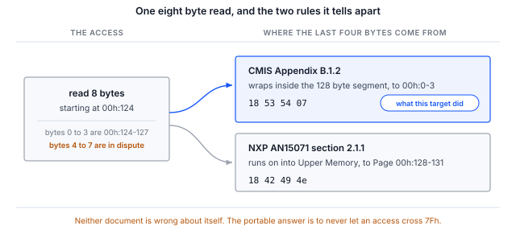
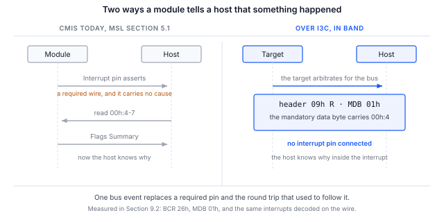

> **測試範圍**。本文件中的規格內容均有出處並已核實，第 6 節中的流程現已在 I3C CMIS 目標裝置上
> 端對端執行，包括帶內中斷（IBI）的傳遞。第 9 節列出了輸出，這些輸出在主機端量得，並在線路上獨立確認。

> **目前已發布的 CMIS 修訂版均未定義 I3C 管理通訊介面。**
> CMIS 5.2 與 5.3 完全沒有提及 I3C。CMIS 5.4 第 1.3.2 節將「基於 I3C 的 I2C 相容 MCI」列為預計在後續修訂版中
> 出現的功能之一，因此 OIF 已公開承諾會新增該介面，但尚未對其做出規定。5.3 與 5.4 的表 B-1 都恰好只列出兩種
> MCI 變體：I2CMCI 與 SPIMCI。因此，本文件中所有將 CMIS 對應到 I3C 的內容都是 **Binho 的推導，而不是 OIF CMIS
> 繫結**，兩家廠商的推導不一定能夠互通。

## 1 簡介

連接器已經允許這樣做。OSFP-XD 修訂版 1.1 第 10.5.1 節列出了選用的 12.5 Mbit/s I3C 單一資料速率，
它使用與必要之 400 kbit/s I2C 相同的 SCL 與 SDA 接腳。如今在連接器層面，受 I3C 管理的模組是合規的。

晶片廠商已經在依此開發。NXP 應用筆記 AN15071 在 MCX N947 上提供了一個以 12.5 Mbit/s 透過 I3C 運作的
CMIS 5.3 目標裝置。為了對其進行測試，NXP 為第二塊開發板撰寫了 USB 轉 I3C 橋接韌體，以及一個客製的主機執行檔，
而本筆記正是以一款已上市的轉接器來填補這個缺口。

尚不存在的是一份說明何謂正確行為的規格。因此，本筆記不僅關於流程，也同樣關於 I3C 繫結所迫使做出的決策，
因為採用這種繫結的讀者必須做出這些決策並加以記錄。

### 1.1 範圍

讀完本文件後，手邊有硬體的讀者將能夠透過動態位址分配（DAA）將 I3C CMIS 目標裝置接入匯流排，
透過 I3C 單一資料速率私有傳輸讀取其識別資訊並驗證其 Page 00h 檢查碼，確定其實作的位址回繞規則，
並在不連接中斷接腳的情況下接收來自它的帶內中斷。

本文件涵蓋 A 級繫結，即透過 I3C 私有傳輸逐位元組保留 I2CMCI 語意，這正是 NXP 所提供的方案，
也是未來兩年實驗室中將會存在的方案。採用 SPIMCI 三維定址與大量傳輸的原生 I3CMCI 在第 4 節中有所討論，
但本文並未實作，因為它需要 OIF 尚未進行的工作。

AN0008 介紹暫存器模型本身，是本文件的前提。本文件假定讀者已了解其內容。

### 1.2 適用裝置

Table: 適用裝置

| 項目 | 角色 | 依據 |
|---|---|---|
| Binho Supernova | 主機轉接器，I3C 控制器 | 第 9 節，第 6 節中的每個命令 |
| 執行 Binho CMIS 目標裝置韌體的 NXP FRDM-MCXN947 | I3C CMIS 目標裝置 | 第 9 節，從列舉到檢查碼 |
| 執行 AN15071 韌體的 NXP MCX N947 | I3C CMIS 目標裝置 | 本筆記未驗證 |
| 任何靜態位址為 0x50 的 I3C CMIS 目標裝置 | 目標裝置 | 本筆記未驗證 |

> **Binho Pulsar 沒有 I3C 介面。** 本筆記需要使用 Supernova。此工具程式在 Pulsar 上會拒絕 `--transport i3c`，
> 而不是在之後以看似接線故障的方式失敗。

> **標記為未驗證的列不構成任何聲明。** 第 4 節中的對應推導自 OIF-CMIS-05.3 與 05.4、MIPI I3C Basic v1.1.1
> 以及 OSFP-XD 修訂版 1.1。第 9 節回報了我們執行了什麼以及針對什麼執行。我們尚未在商用光模組上執行本筆記，
> 這裡的任何結果都不應被理解為針對商用光模組的結果。

### 1.3 相關文件

Table: 相關文件

| 文件 | 主題 |
|---|---|
| OIF-CMIS-05.3、OIF-CMIS-05.4 | Common Management Interface Specification，以及 5.4 的第 1.3.2 節 |
| OSFP-XD Specification Revision 1.1 | 第 10.5.1 節，雙線速率；第 10.5.2 節，INT 與 RSTn 訊號 |
| NXP AN15071 | Implementation of Optical module CMIS protocol over I3C on the MCX N947 |
| MIPI I3C Basic v1.1.1 | ENTDAA、SETDASA、SETAASA、ENEC 與 DISEC、帶內中斷、熱加入（Hot-Join） |
| AN0008 | 使用 Binho Supernova 透過 I2C 啟動除錯 CMIS 光模組 |

## 2 所需設備與軟體

### 2.1 硬體

Table: 所需設備

| 項目 |
|---|
| Binho Supernova USB 主機轉接器 |
| 一個 I3C CMIS 目標裝置。第 9 節使用的是執行 Binho CMIS 目標裝置韌體的 NXP FRDM-MCXN947 |
| USB-C 線材 |
| Saleae Logic 擷取硬體，選用 |

### 2.2 連接

Table: Supernova 與目標裝置之間的連接

| Supernova | 目標裝置 | 是否必要 |
|---|---|---|
| SCL | I3C 時脈 | 是 |
| SDA | I3C 資料，雙向 | 是 |
| 3V3 | 目標裝置電源 | 是，除非電路板自行供電 |
| GND | 回路 | 是 |
| 中斷接腳 | 模組中斷 | 否，第 7 節說明了原因 |

### 2.3 軟體

```
pip install binhosupernova
python cmis_mci.py selfcheck
```

本筆記隨附的工具程式與 AN0008、AN0010 和 AN0011 隨附的是同一個檔案。`--transport i3c` 用於選擇 I3C 繫結。

Supernova 預設以 `PUSH_PULL_12_5_MHZ_50_DC` 驅動，這正是 OSFP-XD 所指定的速率，
因此啟動除錯以 OSFP-XD 主機實際使用的速率執行，而不是以某個方便的近似速率執行。

`--push-pull` 用於覆寫該速率。由邏輯電路回應讀取的模組可以維持 12.5 Mbit/s；而在中斷中由韌體回應讀取的開發用目標裝置
可能做不到，其症狀是讀取長度不足或 NACK，而不是一個指明原因的錯誤。第 9 節記錄了其目標裝置所需的速率及原因。

## 3 兩個等級的繫結，以及您正在建構的是哪一個

**A 級，把 I3C 當作更快的 I2C。** 透過 I3C 單一資料速率私有傳輸逐位元組保留 I2CMCI 語意：目前位元組位址指標、
透過 00h:126 與 00h:127 進行的頁選擇，以及 8 位元組的存取限制。不需要修改任何規格。NXP 的目標裝置位於靜態位址 0x50，
即 A0h 右移一位，刻意保持了連續性。本筆記實作的就是這個等級。

**B 級，原生 I3CMCI。** 採用 SPIMCI 的三維定址與大量傳輸，以 ENTDAA 取得識別資訊，以帶內中斷取代中斷接腳，
以熱加入處理插入，並去除 ModSel。這需要 OIF 進行工作，而這恰好為任何擁有可用測試工具的人提供了機會。

## 4 逐一機制的對應

Table: 移植到 I3C 上的 CMIS 機制

| CMIS 機制 | I2CMCI 的做法 | 在 I3C 上 | 結論 |
|---|---|---|---|
| 讀寫訊框格式 | START 之後的控制位元組 A0h 或 A1h | 控制位元組就是 I2C 位址位元組，因此它併入 I3C 位址標頭及其 RnW 位元 | 乾淨，一對一 |
| 延後下一次存取 | 在控制位元組之後 NACK，B.2.6.2 | 對位址標頭 NACK | 乾淨，一對一 |
| TEST 就緒輪詢 | 虛擬寫入，觀察 ACK，B.2.5.5 | 零長度私有寫入，或僅憑位址標頭的 ACK | 乾淨，一對一 |
| 延遲目前的存取 | 時脈延展，在 RAL 中抽象為 tREAD，最長 500 微秒 | 不可用：I3C 單一資料速率禁止目標裝置進行時脈延展 | 沒有代價，但必須寫明 |
| 中斷 | 必要的離散接腳，ton_Int 最長 200 ms | 帶內中斷，其必要的資料位元組可以攜帶中斷原因 | 嚴格升級 |
| 模組插入 | 在位接腳，然後輪詢最長 tMgmtInit，即 2000 ms | 熱加入，模組一旦能夠通訊即在帶內通告 | 嚴格升級 |
| 匯流排共用 | 無。點對點，帶選用的 ModSel 接腳 | 動態定址完全取消了 ModSel | 需要做出決策，第 5 節 |
| 最大傳輸長度 | Nmax，預設為 8 | SETMWL、SETMRL 與 GETMXDS 原生協商該值 | 冗餘，需要優先順序規則 |
| 速率探索 | 00h:2.5-2 的 MciMaxSpeed | I2CMCI 與 SPIMCI 的編碼中都沒有 I3C 的碼位 | 阻斷性的規格漏洞 |
| 廣播 | BankBroadcastEnable，限於單一模組內 | 廣播 CCC 在同一時刻到達匯流排上的每個模組 | CMIS 從未具備的能力 |

其中三列值得比表格項目更多的說明。

### 4.1 tREAD 是被重新規定，而不是遺失

CMIS 明確指出，tREAD「是 I2CMCI 時脈延展時間的抽象」。由於它被定義為對該機制的抽象而不是機制本身，
I3C 繫結只需重新規定該抽象，而不會失去任何能力。CMIS 已經將被拒絕的存取建模為一級結果，
即第 5.2.2.1 節中的 `REJECTED`，主機會加以重試，或預先使用 `TEST()` 測試。

> **關於命名，因為這很容易弄錯。** 在 RAL 層，10 ms 的揮發性保持時間是 **tWRITE**。*tNACK* 是 tWRITE 所抽象的
> I2CMCI 層參數，同樣地，tWRITENV 抽象的是 I2CMCI 的 *tWR*。這項區別在這裡之所以重要，正是因為 I3C 繫結
> 取代了 I2CMCI 層：RAL 層的符號保留下來，而 I2CMCI 層的符號則不再適用。

### 4.2 速率通告沒有 I3C 的碼位

OSFP-XD 要求主機讀取 `00h:2.5-2` 的 `MciMaxSpeed`，以得知模組支援 12.5 Mbit/s 的 I3C 單一資料速率。
但該暫存器無法表達這一點。

Table: MciMaxSpeed 編碼

| 傳輸方式 | 編碼 |
|---|---|
| I2CMCI | 0 = 400 kHz，1 = 1 MHz，2 = 3.4 MHz，3 至 15 保留 |
| SPIMCI | 0 = 1，1 = 2，2 = 4，3 = 8，4 = 12，5 = 16，6 = 20 MHz |
| I3C | 任何已發布修訂版中都不存在相應編碼 |

SPIMCI 在加入時獲得了自己的編碼表，這為 I3CMCI 應如何引入提供了先例，
對於任何有條件做出貢獻的人來說，這都是一項成本低且具體的貢獻。

### 4.3 回繞：兩份文件，兩條互不相容的規則

CMIS 附錄 B.1.2 規定目前位元組位址在其自身的 128 位元組區段內回繞。NXP AN15071 第 2.1.1 節規定在整個 256 位元組空間中
於 FFh 回繞。這是同一存取上的兩種不同行為，而兩份文件各自都沒有錯。



圖 1 在一頁中呈現了全部分歧。在 `00h:124` 進行的八位元組讀取可以區分這兩條規則，
因為位元組 4 至 7 要麼以 `00h:0-3` 傳回，要麼以 Page 00h 的開頭傳回：

```
python cmis_mci.py rollover --transport i3c
```

在第 9 節的目標裝置上執行，結果是 CMIS 規則：

```
8 bytes from 00h:124, last four : 18 53 54 07
00h:0-3                         : 18 53 54 07
Page 00h:128-131                : 18 42 49 4e

segment wrap, as CMIS B.1.2 specifies
```

最後四個位元組是低端記憶區 00h:0-3 的內容，而不是 Page 00h 的開頭，因此該目標裝置在區段內回繞。

此命令在兩個方向上都能區分。在置於 I2C 目標裝置模式的 Binho 轉接器上執行時，由於其記憶體是一個平面記憶區，
同樣的八位元組讀取會傳回另一種結果：

```
8 bytes from 00h:124, last four : 18 42 49 4e
00h:0-3                         : 18 53 54 07
Page 00h:128-131                : 18 42 49 4e

ran on into Upper Memory, as NXP AN15071 2.1.1 specifies
```

第二個結果是該轉接器記憶體模型的特性。它不是關於任何光模組的陳述，而且兩個結果都不能作為其執行對象以外
任何其他目標裝置的證據。這正是提供此命令而不是提供一張廠商列表的原因。

無論目標裝置實作的是哪一條規則，對主機而言可攜的做法都相同：絕不發出跨越 7Fh 的存取，而是將其分割。

## 5 每個 CMIS 模組都在 0x50 回應

CMIS 中沒有位址設定接腳。A0h 右移一位，對所有曾經製造的模組而言都是 0x50。在帶有 ModSel 接腳的點對點 I2C 鏈路上，
這並不值得一提。

在多點 I3C 匯流排上，這是一個無法迴避的決策：

- **SETDASA 與 SETAASA 都以靜態位址為依據**，因此它們只能啟動恰好一個模組。
  位於相同靜態位址的第二個模組無法透過其中任何一個定址。
- **多點連接需要 ENTDAA**，以及每個模組唯一的 48 位元預置識別碼，而 CMIS 目前並不要求模組具備該識別碼。

動態定址確實可以合理地去除 ModSel：第 5.1 節註腳 3 將 ModSel 作為 MCI 定義的一部分，因此新的 MCI 可以去除它。

```
python cmis_mci.py scan --transport i3c
```

此命令執行動態位址分配，並印出所得的目標裝置表，其中包含每個目標裝置的靜態位址、所分配的動態位址、BCR 與 DCR。

## 6 流程

下面的每個命令都接受 `--address` 參數來指定要通訊的目標裝置，在承載多個目標裝置的匯流排上必須提供該參數。
開發板通常就是這種情況：第 9 節使用的 FRDM-MCXN947 在同一條 I3C 匯流排上帶有一個 P3T1755DP 溫度感測器，
而且它會先被列舉。此工具程式拒絕猜測，以免讀取錯誤的目標裝置，因為錯誤的目標裝置仍然會傳回位元組，
而這些位元組仍然會被解碼成某些內容。

### 6.1 列舉

```
python cmis_mci.py scan --transport i3c
```

`scan` 列出每個目標裝置，而不是從中選擇一個，因此正是這個命令告訴您應向其餘命令傳遞哪個位址。

### 6.2 透過分配的動態位址啟動除錯 CMIS

```
python cmis_mci.py bringup --transport i3c
```

此命令透過 I3C 單一資料速率私有傳輸執行 AN0008 的序列，並以 Page 00h 檢查碼結束。
它會在結果旁邊印出繫結的限定說明，因為不帶該說明的輸出可能會在某個重要場合被引用。

### 6.3 確定回繞規則

```
python cmis_mci.py rollover --transport i3c
```

### 6.4 在資料線上接收中斷

```
python cmis_mci.py ibi --transport i3c --seconds 10
```

## 7 帶內中斷才是值得為之建構的部分

CMIS 要求在管理訊號層中設置一個離散的 Interrupt 接腳，而該接腳只告訴主機發生了某件事。
接著主機需要花一次往返讀取 `00h:4-7` 的 Flags Summary，才能弄清楚發生了什麼。

I3C 帶內中斷攜帶一個必要的資料位元組。將 Flags Summary 或原因代碼放入其中，意味著主機在中斷之內
而不是之後就得知原因。這是第一個讓 CMIS 透過 I3C 繫結**減少**一條必要連線、而不是增加一條的機制，
而且在 OSFP-XD 上，它還釋放了共用的多電位 INT 與 RSTn 接腳。



圖 2 將兩者並列呈現。左側是一條必要的連線加上一次往返。右側是一次匯流排事件，
它所攜帶的位元組就是那次往返原本要取回的 Flags Summary。

這裡需要明確範圍。ENEC 與 DISEC 是 I3C 機制，不屬於推導。屬於推導的是關於必要資料位元組攜帶什麼內容的決策。
請把這項決策記錄下來，因為其他廠商會做出不同的決策。

第 9.2 節列出了量測結果。目標裝置在不連接中斷接腳的情況下每秒發出一次中斷，主機將其作為攜帶一個位元組的
已接受請求接收；對同一時間窗口的邏輯分析儀擷取顯示，目標裝置將自己的位址驅動到匯流排上並傳回該位元組。
該位元組就是 `00h:4` 的 Flags Summary。

## 8 分析器帶來了什麼

以 CMIS I3CMCI 分析器解碼的 SCL 與 SDA 擷取會顯示 I3C 傳輸本身，包括單一資料速率、CCC 集合、ENTDAA、
帶內中斷與熱加入，並在私有寫入與讀取的酬載之上疊加 CMIS 解讀。

傳輸層解碼是標準 I3C，不屬於推導。而其上的 CMIS 解讀屬於推導，分析器在三個地方聲明了這一點：
設定面板中的唯讀繫結欄位、每個已解碼訊框的泡泡文字，以及 FrameV2 的繫結說明欄。

在 Binho 推導與 NXP 推導對回繞的規定不同之處，分析器遵循 CMIS，並將跨區段存取標記為提示資訊而不是錯誤，
因為真實的、以 AN15071 為基礎的目標裝置確實可能以另一種方式運作，而分析器的職責是顯示實際發生了什麼。

> **CMIS I3CMCI 分析器正在開發中，尚未發布。** 本節描述的是它產生的解碼結果，而不是讀者今天就能購買的產品。

## 9 實測結果

### 9.1 測試組態

Table: 測試組態

| 項目 | 值 |
|---|---|
| 轉接器 | Binho Supernova，序號 `4F970418…1111` |
| SDK | `binhosupernova` 4.2.0，Python 3.14，Linux |
| 工具程式 | `cmis_mci.py` 1.1 |
| 目標裝置 | 執行 Binho CMIS 目標裝置韌體的 NXP FRDM-MCXN947，動態位址 0x09 |
| 目標裝置映像 | CMIS 5.3 附錄 C 中的範例，一個 400G QSFP-DD 模組 |
| 匯流排 | 3.3 V，I3C SDR，推挽 2.5 Mbit/s、25% 工作週期，開汲極 1 Mbit/s，快速模式驅動強度 |
| 分析器 | Acute TravelBus，8 通道，800 MHz，1.6 V 臨界值，僅 SCL 與 SDA |
| 列舉 | ENTDAA |
| 目標裝置 | 0x09 的 CMIS 目標裝置，以及 0x08 的板載 P3T1755DP |
| 日期 | 2026 年 9 月 2 日與 3 日 |

> **目標裝置是以韌體實作的目標裝置，而不是商用光模組。** 它實作了我們需要驗證的 CMIS 暫存器模型：
> 低端記憶區與高端記憶區的分頁、第 8.2.15 節的不支援頁覆寫，以及附錄 B.1.2 規定的 128 位元組區段內回繞。
> 下面的結果確認第 4 節中的繫結在行為符合 CMIS 規定的目標裝置上可以運作，但無法確認任何廠商的模組會如何表現。

> **為什麼是 2.5 Mbit/s，而不是第 2.3 節中的 12.5 Mbit/s。** 此目標裝置在中斷中由韌體而不是由邏輯電路回應讀取。
> 從位元組位址到達到讀取的第一個資料位元之間大約只有一個位元組的時間，而在高於 2.5 Mbit/s 時，中斷進入延遲無法容納在其中。
> 這是此實驗台目標裝置的特性，而不是繫結、Supernova 或 I3C 的限制；由邏輯電路回應的模組沒有這樣的限制。

### 9.2 結果

**離線。** 本筆記所驅動的暫存器存取層針對模擬模組自我檢查 8 項全部通過。這涵蓋的是位址運算，而不是 I3C 傳輸。

```
$ python cmis_mci.py selfcheck
  [OK] an access splits at 7Fh and at Nmax
  [OK] identity and module state decode
  [OK] Page 00h checksum agrees, in accesses of Nmax or fewer bytes
  [OK] FullPageReadSupported raises Nmax, and the 94 byte read fits in one access
  [OK] an all-zero page is rejected, not read as a checksum that agrees
  [OK] a module that overrides an unsupported page is caught, not believed
  [OK] TEST answers on a live module
  [OK] a write stays within the 8 byte WRITE limit while reads use Nmax

cmis_mci.py 1.1 self-check: 8/8 OK
```

**列舉。** 動態位址分配使匯流排上的兩個目標裝置都上線。模組為 0x09；0x08 是板載溫度感測器。

```
$ python cmis_mci.py scan --transport i3c --push-pull PUSH_PULL_2_5_MHZ_25_DC
static 0x00 -> dynamic 0x08  BCR 0x03  DCR 0x63
static 0x00 -> dynamic 0x09  BCR 0x26  DCR 0x00
```

**啟動除錯。** 透過 I3C 單一資料速率私有傳輸執行 AN0008 的序列，並以 Page 00h 檢查碼結束。

```
$ python cmis_mci.py bringup --transport i3c --address 0x09 --push-pull PUSH_PULL_2_5_MHZ_25_DC
MCI     : I3CMCI
binding : Binho derivation, not an OIF CMIS binding
TEST()  : ready
00h:0   : 0x18 QSFP-DD
00h:1   : CMIS 5.3
00h:2   : MciMaxSpeed code 5
00h:3   : ModuleReady
00h:14  : 34.50 C   (S16, 1/256 C)
00h:16  : 3.300 V   (U16, 100 uV)
01h:251 : FullPageReadSupported gives Nmax 8 bytes for reads
00h:129 : VendorName 'BINHO PHOTONICS'
00h:148 : VendorPN   'QDD-400G-DR4'
00h:166 : VendorSN   'SN2608140001'
00h:222 : checksum computed 0x5b, module stores 0x5b, OK

PASS    : present, readable, paged correctly and self consistent.
```

檢查碼是值得反覆閱讀的部分。它根據目標裝置實際傳回的位元組計算，並與目標裝置儲存的位元組比較，
因此只要分頁、位元組位址指標或傳輸在其涵蓋的 94 位元組中任何位置出錯，它就會失敗。

**回繞。** 此目標裝置實作的是 CMIS 規則，而不是 AN15071 的規則。第 4.3 節列出了輸出及其意義。

**識別資訊。**

```
$ python cmis_mci.py identify --transport i3c --address 0x09 --push-pull PUSH_PULL_2_5_MHZ_25_DC
identifier    0x18 QSFP-DD
CMIS revision 5.3
VendorName    'BINHO PHOTONICS'
VendorOUI     00 00 00
VendorPN      'QDD-400G-DR4'
VendorRev     '1A'
VendorSN      'SN2608140001'
DateCode      '260814AB'
```

**帶內中斷。** 目標裝置在不連接中斷接腳的情況下每秒發出一次中斷。`ibi` 設定控制器針對每個目標裝置的接受旗標，
傳送 ENEC，進行監聽，並在時間窗口結束時傳送 DISEC。

```
$ python cmis_mci.py ibi --transport i3c --address 0x09 --push-pull PUSH_PULL_2_5_MHZ_25_DC --seconds 10
accept flag set and ENEC sent to 0x09, listening for 10 s
10 in-band interrupt(s) in 10 s
  {'id': 0, 'command': 'I3C CONTROLLER IBI REQUEST NOTIFICATION', 'result': 'IBI_REQUEST_ACCEPTED_WITH_PAYLOAD', 'target_address': 9, 'payload_length': 1, 'payload': [1]}
```

有兩個條件值得記錄下來，因為一個在其他各方面都正確的目標裝置，只要不符合其中任何一個，仍然會靜默失敗。
目標裝置必須在其 BCR 中通告該能力，位元 1 表示支援中斷，位元 2 表示帶酬載，這就是此目標裝置列舉為 BCR 0x26 的原因。
另外，ENEC 啟用的是**目標裝置**，而控制器另外保存一個針對每個目標裝置的接受旗標，該旗標在動態位址分配之後
預設處於拒絕狀態。在該旗標被設定之前，轉接器會丟棄中斷，兩端都不會回報錯誤。

**線路上的中斷。** 主機轉接器回報的是它認為自己接收到的內容，這與目標裝置實際驅動的內容並不相同。
以下是同一時間窗口在分析器上擷取、並獨立於轉接器解碼的結果：

```
$ acute decode --samples ibi.bin --json
{"type":"private","ccc":null,"ccc_name":null,"address":9,"is_read":true,"data":[1]}
... eight in total ...
{"type":"ccc","ccc":129,"ccc_name":"DISEC","address":9,"is_read":false,"data":[1]}
```

十次中斷中有八次落在分析器的擷取窗口內，對於一個在緩衝區之間重新啟動、而不是連續串流擷取的分析器而言，
這正是它對每秒一次事件所能捕捉到的數量。每一次都是讀取方向上針對 0x09 的位址標頭，攜帶單一位元組 0x01，
結束工作階段的 DISEC 也結束了這次擷取。解碼器沒有帶內中斷訊框類型，因此將每一次都標記為私有讀取。
主機在該時間窗口內沒有發出任何讀取，因此其中針對 0x09 的讀取只能是目標裝置在仲裁匯流排；
而在沒有開啟工作階段的情況下對同一匯流排進行的對照擷取，沒有解碼出任何交易。

**線路上的暫存器流量。** 私有讀取也經過了同樣的處理。我們以邏輯分析儀擷取匯流排，並將解碼出的交易
針對 CMIS 暫存器模型進行重播：
6123 次私有讀取中有 6110 次逐位元組相符，其中包括跨越區段邊界的讀取，以及長於目標裝置傳送 FIFO 的讀取。
其餘讀取中，2 次為空，11 次是由於擷取中存在間隙，導致重播遺失了頁狀態。我們建議任何啟動除錯自己目標裝置的人
都執行這一步，因為此目標裝置的一個早期修訂版曾向主機回報四個正確的位元組，而實際只向線路上驅動了一個位元組。

## 10 疑難排解

Table: 疑難排解

| 症狀 | 可能原因與處理方式 |
|---|---|
| `--transport i3c` 被拒絕 | 轉接器是 Pulsar，它沒有 I3C 介面。請使用 Supernova |
| 沒有目標裝置被列舉 | 目標裝置電源軌不存在，或目標裝置沒有驅動。確認 3V3 與兩路訊號 |
| 有兩個目標裝置，但只有一個被列舉 | 兩者都在靜態位址 0x50 回應。SETDASA 無法定址第二個；請使用帶唯一預置識別碼的 ENTDAA |
| 列舉成功，但讀取傳回的內容不合理 | 目標裝置可能實作的是 AN15071 回繞規則。執行 `rollover` |
| 讀取長度不足或目標裝置 NACK，且降低匯流排速率後情況更糟 | 目標裝置沒有持續為其傳送 FIFO 填入資料。由於時間窗口是固定的，傳送的位元組數隨匯流排速率變化，因此匯流排越慢，傳送的位元組越少。只有在目標裝置能正確重新填入之後才降低 `--push-pull` |
| 命令回報有兩個目標裝置並拒絕執行 | 開發板通常帶有第二個 I3C 裝置。執行 `scan`，然後傳遞 `--address` |
| 主機回報的位元組正確，但系統行為異常 | 以邏輯分析儀確認。主機轉接器回報的是它認為自己接收到的內容，而不是目標裝置實際驅動的內容 |
| 多位元組讀取傳回來自其他頁的位元組 | 存取跨越了 7Fh。無論適用哪條回繞規則，都要分割存取 |
| 始終收不到中斷 | 三個原因，依值得檢查的順序排列：控制器針對每個目標裝置的接受旗標仍處於拒絕狀態，並靜默丟棄中斷；目標裝置沒有在其 BCR 的位元 1 與位元 2 中通告該能力；ENEC 未被接受 |
| 初始化時速率被拒絕 | 此 SDK 版本中的推挽速率名稱不同。錯誤訊息會列出可接受的名稱 |

## 11 縮寫

Table: 縮寫

| 術語 | 意義 |
|---|---|
| BCR | Bus characteristics register（匯流排特性暫存器） |
| CCC | Common command code（通用命令代碼） |
| CMIS | Common Management Interface Specification（通用管理介面規格） |
| DCR | Device characteristics register（裝置特性暫存器） |
| ENTDAA | Enter dynamic address assignment（進入動態位址分配） |
| I2CMCI | I2C Management Communication Interface（I2C 管理通訊介面） |
| IBI | In-band interrupt（帶內中斷） |
| MCI | Management Communication Interface（管理通訊介面） |
| MSL | Management Signalling Layer（管理訊號層） |
| OIF | Optical Internetworking Forum（光互連論壇） |
| RAL | Register Access Layer（暫存器存取層） |
| SDR | Single data rate（單一資料速率） |

## 12 關於文件中原始碼的說明

本文件中顯示以及隨附封存檔中提供的範例程式碼僅供評估與參考。
其依據 MIT 授權條款發布，授權條款全文包含在封存檔中。

Table: 資源封存檔的內容

| 檔案 | 說明 |
|---|---|
| `AN0009.md` | 本文件的 Markdown 原始檔 |
| `assets/cmis_mci.py` | 參考工具程式，由 AN0008 至 AN0011 共用 |
| `assets/LICENSE` | 涵蓋範例程式碼的 MIT 授權條款 |

## 13 修訂歷史

Table: 修訂歷史

| 修訂版 | 日期 | 說明 |
|---|---|---|
| 0.1 | 2026 年 9 月 1 日 | 供內部審查的草稿。規格內容已核實；流程尚未在硬體上執行。 |
| 0.2 | 2026 年 9 月 2 日 | 由 AN0008 重新編號而來。工具程式自我檢查計數更新為 8 項全部通過。流程仍未在硬體上執行。 |
| 0.3 | 2026 年 9 月 2 日 | 流程已在 I3C CMIS 目標裝置上端對端執行。第 9 節列出輸出，第 4.3 節列出實測的回繞規則。新增 `--push-pull` 及目標裝置可能需要它的原因。帶內中斷傳遞仍待完成。 |
| 0.4 | 2026 年 9 月 2 日 | 第 4.3 節現在呈現 `rollover` 針對實作另一條規則的第二個目標裝置，在兩個方向上都能區分。 |
| 0.5 | 2026 年 9 月 3 日 | 帶內中斷傳遞已實測並在線路上確認。第 9.2 節列出主機輸出、分析器解碼，以及在其他方面都正確的目標裝置仍會靜默失敗的兩個條件。第 7 節不再只是論證。除商用光模組外，本筆記中已沒有待完成的事項。 |
| 0.6 | 2026 年 9 月 3 日 | 共用工具程式升至 1.1，新增 AN0011 所需的 SPIMCI 相關列。自我檢查輸出已重新執行，除印出的版本號外沒有變化。 |
| 1.0 | 2026 年 11 月 6 日 | 正式發布。 |
