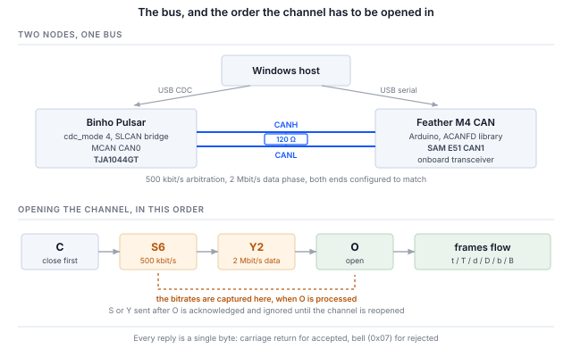

## 1 はじめに

Binho Pulsar は、I2C、SPI、UART、GPIO 用の USB ホストアダプタです。NXP MCAN コントローラと TJA1044GT CAN-FD トランシーバも搭載しており、ファームウェア v4.4.0 以降では、USB 仮想 COM ポートを、**SLCAN** を使ってそのトランシーバをホストにブリッジするモードにできます。SLCAN は ASCII シリアル CAN プロトコルで、元々は Lawicel のものですが、現在では幅広いアダプタやツールが対応しています。

本書を書く価値があるのは、まさにこの最後の点です。Pulsar の Python SDK には CAN コマンドがまったくなく、その必要もありません。CAN-FD モードではデバイスが従来型の SLCAN アダプタとして振る舞うため、既存の CAN ソフトウェアのエコシステムがそのまま駆動できるからです。

Table: CAN-FD がクラシック CAN に追加するもの

| 機能 | 設計にもたらすもの |
|---|---|
| 64 バイトのペイロード | 8 バイトが 64 バイトになり、クラシック CAN では複数のフレームに分割して再構成しなければならないレコードが 1 フレームに収まる |
| ビットレートスイッチング | アービトレーションフェーズはすべてのノードが追従できるレートのまま、データフェーズはより高速に動作する。その時点で駆動しているノードは 1 つだけだからである |
| 拡張された DLC エンコーディング | DLC 値 9～F で 12、16、20、24、32、48、64 バイトを選択するため、8 を超えるペイロードはバイト数ではなく段階表で指定される |
| より強力なフレームチェック | クラシック CAN がすべての長さに使う単一の 15 ビット多項式ではなく、ペイロードに応じたサイズの CRC とスタッフビット数を使う |
| 物理層は不変 | 同じ 2 本の線、同じトランシーバ、同じ 120 Ω の終端 |
| 共存 | クラシックフレームと FD フレームはバスを共有でき、クラシックか FD かはバス単位ではなくフレーム単位で決まる |

この構成の 3 つの性質がホストの書き方を決めており、3 つとも本シリーズの他のアダプタとは異なります。

Table: 他の Binho ホストアダプタとの違い

| 性質 | ホストへの影響 |
|---|---|
| CAN-FD は SDK のコマンドグループではなく CDC モードである | モードは HID 経由で選択されてフラッシュメモリに保存され、その後デバイスは専用の SLCAN ブリッジになる。その間、I2C、SPI、UART、GPIO の各マネージャは動作しない |
| インタフェースはシリアル回線プロトコルである | コマンドはキャリッジリターンで終わる ASCII で、デバイスは受理を `\r`、拒否を `\a` で応答する。ライブラリを介さずにターミナルで診断できる |
| ホストは共有バス上の 1 つのノードである | ポイントツーポイントのバスとは異なり、フレームは要求しなくても現れ、誰かがアクノリッジする必要があり、ホストが他の処理で忙しい間にも届く。8.2 節と 13 節はいずれもその帰結である |

本ノートでは、Pulsar と、この目的のために構築した 2 つ目の CAN-FD ノードを使って説明します。Pulsar を CAN-FD モードに切り替え、Pulsar が話す SLCAN プロトコルを説明し、遠端ノードを構築して立ち上げ、双方向のクラシックおよび FD の通信を実証し、その後 python-can とその上に構築されたスタックからバスを駆動します。

ここでは専用 SDK は一切必要ありません。ホスト側の各手順は、シリアルポート上の 1 行の ASCII か、すでに入手可能なソフトウェアの呼び出しのどちらかです。

### 1.1 対象範囲

本書を読み終えると、手元にハードウェアがある読者は次のことを行えるようになります。Pulsar を CAN-FD モードに切り替え、ブリッジが SLCAN に応答することを確認し、2 つ目の CAN-FD ノードを構築してそのビットタイミングをアダプタに合わせ、クラシックフレームとビットレートスイッチングを伴う 64 バイトの FD フレームを双方向でやり取りし、DBC を通してライブ通信をデコードし、ログをキャプチャしてリプレイし、CANopen、J1939、ISO-TP の各スタックからバスを駆動することです。

作業例では、Pulsar と Adafruit Feather M4 CAN Express を組み合わせます。どちらもハードウェア上で動作確認しており、本書の出力はすべて実際のキャプチャです。

本ノートは Windows ネイティブのホストツールを対象とします。Linux で同じツールを使う通常の手段である `can-utils` と SocketCAN のファミリは対象外です。Windows ではそれらに USB パススルー層と Linux 環境が必要ですが、このアダプタを使うにはどちらも必要ないためです。

### 1.2 対象デバイス

CAN-FD モードは **Pulsar 専用**です。Binho Supernova のマイクロコントローラには MCAN ペリフェラルがなく、そのファームウェアはこのモードを拒否します。ホスト側の内容は任意の SLCAN アダプタに適用でき、ノードのファームウェアは CAN1 のピンが引き出された SAM E51 ベースの任意のボードに適用できます。

### 1.3 関連資料

Table: 関連資料

| 資料 | 場所 |
|---|---|
| CDC CAN-FD (SLCAN) mode | Binho ファームウェアドキュメント、`docs/CDC-CANFD-Mode.md`。ブリッジのコマンドセットと制限に関する正式な資料 |
| Binho Pulsar ドキュメント | `https://support.binho.io` |
| python-can | `https://python-can.readthedocs.io` |
| cantools | `https://cantools.readthedocs.io` |
| ACANFD_FeatherM4CAN | `https://github.com/pierremolinaro/acanfd-featherM4can`、ノードに使用した CAN-FD ドライバ |
| CAN FD 仕様 | Robert Bosch GmbH、*CAN with Flexible Data-Rate*、v1.0 |
| ISO 11898-1 | CAN データリンク層。FD フレームフォーマットを含む |

## 2 必要な機器とソフトウェア

### 2.1 ハードウェア

Table: 必要な機器

| 品目 |
|---|
| Binho Pulsar、ファームウェア v4.4.0 以降 |
| Adafruit Feather M4 CAN Express、または他の CAN-FD ノード |
| 両者間の 2 線式 CAN 接続、CANH 同士と CANL 同士 |
| 120 Ω の終端 |
| USB-C ケーブル 2 本 |

### 2.2 接続

Table: 使用する信号

| 信号 | 用途 |
|---|---|
| CANH | CAN バス、ドミナント時ハイの線 |
| CANL | CAN バス、ドミナント時ローの線 |
| GND | 2 枚のボード間の共通リターン |

Pulsar の CANH と CANL はオンボードの TJA1044GT から出ており、Feather の CANH と CANL はそのボード上のトランシーバから出ています。3 本目の線は不要で、どちらのボードも相手に電源を供給しません。

> **注**：CAN には終端が必要であり、2 つ目のノードも必要です。送信者が 1 つだけでアクノリッジする者がいないバスは、中途半端に動作することはありません。送信側はアクノリッジを一切受け取れず、フレームを無期限に再送し続け、送信キューは最初に送ったフレームの後ろで詰まります。この症状はバスではなくアダプタを疑わせるものであるため、それぞれの側からどう見えるかを 14 節にまとめています。

### 2.3 バス設定

Table: 使用したバス設定

| 設定 | 値 | 設定方法 |
|---|---|---|
| アービトレーションビットレート | 500 kbit/s | SLCAN `S6`、ノード側は `DataBitRateFactor` の基準 |
| データフェーズビットレート | 2 Mbit/s | SLCAN `Y2`、ノード側は `DataBitRateFactor::x4` |
| 終端 | 120 Ω | ハードウェア |
| シリアルポートのレート | 無関係 | 以下を参照 |

COM ポートのボーレートは関係ありません。このポートは実際の UART ではなく USB CDC エンドポイントであるため、その数値は破棄されます。CAN のビットレートは `S` コマンドと `Y` コマンドだけで決まります。

### 2.4 ソフトウェア

```
pip install python-can cantools
```

8 節と 9 節の内容はすべて、Python 3.12 と `python-can` および `cantools` で対応できます。10 節では `canopen`、`can-j1939`、`can-isotp` を追加します。CDC モードの切り替えには `hidapi` が必要です。

ノードのファームウェアには、Adafruit SAMD コアを含む Arduino ツールチェーンと 1 つのライブラリが必要です。

```
arduino-cli core install adafruit:samd \
  --additional-urls https://adafruit.github.io/arduino-board-index/package_adafruit_index.json
arduino-cli lib install ACANFD_FeatherM4CAN
```

> **注**：Windows では、コアを Arduino のデフォルトの場所にインストールしてください。GCC ツールチェーンはそれだけで約 130 文字のパスの深さに達し、データディレクトリを深い場所に置くと `cc1plus.exe` が 260 文字の制限を超えます。そのときのエラーは `cannot execute 'cc1plus'` であり、パスの問題には見えません。

## 3 Pulsar を CAN-FD モードに切り替える

CAN-FD は、USB 仮想 COM ポートのいくつかある機能モードの 1 つです。モードは HID 経由で設定されてフラッシュメモリに保存されるため、電源を入れ直しても保持されます。設定にはファームウェア付属のツールを使います。

```
python device_settings_cli.py --device pulsar show
```

```
Connected to Binho Pulsar
  webusb_enabled : 1  (on)
  cdc_enabled    : 1  (on)
  cdc_mode       : 0  (uart_passthrough)
```

モード 0 はデフォルトで、透過的な USB-UART ブリッジです。何よりも先にこれを知っておく価値があります。デフォルトモードの Pulsar は、SLCAN コマンドに一切応答せず何も出力しない COM ポートを提示するからです。故障しているわけでも、ポートを間違えているわけでもありません。UART をブリッジしているのです。

```
python device_settings_cli.py --device pulsar set --cdc-mode canfd
```

```
Settings updated:
  cdc_mode       : 4  (canfd)

Resetting device to persist settings to flash...
```

リセットは想定どおりの動作です。モードは起動時に適用されるため、ツールはデバイスを再起動して設定を有効にします。その後 Pulsar は再列挙され、戻ってきた COM ポートが SLCAN インタフェースです。

モードが排他的であることから、2 つの帰結が生じます。

Pulsar が CAN-FD モードにある間、**HID プロトコルマネージャは動作しません**。モードを元に戻すまで I2C、SPI、UART、GPIO は使用できず、デバイスは専用の SLCAN ブリッジになります。設定コマンドは HID 経由で引き続き使用でき、モードを元に戻すのもその方法で行います。

```
python device_settings_cli.py --device pulsar set --cdc-mode uart_passthrough
```

また、設定はフラッシュメモリにあるため、CAN-FD モードのままにした Pulsar は CAN-FD モードで起動します。ユニットの I2C と SPI が失われたように見える場合は、まずこれを確認してください。

## 4 SLCAN プロトコル

### 4.1 コマンドセット

コマンドは ASCII で、1 行に 1 つ、キャリッジリターンで終わります。デバイスはコマンドを受理すると `\r` (0x0D) を、受理しないと `\a` (0x07、ベル) を返します。これにより、インタフェース全体にターミナルからアクセスでき、何かがうまくいかないときに調べ始めるにはターミナルが適切な場所です。

Table: SLCAN コマンド

| コマンド | 意味 | 備考 |
|---|---|---|
| `S0`–`S8` | アービトレーションビットレートを選択 | チャネルを開いた時点で確定 |
| `Y1`, `Y2`, `Y5` | CAN-FD データフェーズビットレートを選択 | チャネルを開いた時点で確定 |
| `O` | 通常モードでチャネルを開く | |
| `L` | リッスンオンリーでチャネルを開く | アクノリッジしない。13 節を参照 |
| `C` | チャネルを閉じる | トランシーバはスタンバイになる |
| `t` / `T` | クラシックフレームを送信、標準 / 拡張 ID | |
| `d` / `D` | ビットレートスイッチングなしの FD フレームを送信 | |
| `b` / `B` | ビットレートスイッチングありの FD フレームを送信 | |
| `V`, `N`, `F` | バージョン、シリアル番号、ステータスフラグ | このファームウェアでは固定の定数 |
| `s` | カスタムビットタイミング | 受理されるが無視される。`S` を使用する |

ライブラリを使う前に、ブリッジが応答することを確認します。

```
python canfd_slcan.py probe --port COM12 --bitrate 500000 --data-bitrate 2000000
```

```
  V   -> b'V0101\r'   ok   version
  N   -> b'NFFFF\r'   ok   serial number
  F   -> b'F00\r'     ok   status flags
  S6  -> b'\r'        ok   nominal 500000
  Y2  -> b'\r'        ok   data phase 2000000
  Q   -> b'\x07'      ok   an unsupported command should bell
```

最後の行は他の行と同じくらい重要です。すべてに同じように応答するデバイスでは何も証明できません。未知のコマンドにベルを返すデバイスは、コマンドを解析しています。

`V`、`N`、`F` はライブの値ではなく定数を返すため、ブリッジが待ち受けていることは証明できますが、それがどのデバイスか、バスがどのような状態かは証明できません。

### 4.2 フレームフォーマット

送信フレームは 1 つの文字列です。

```
<letter><identifier><dlc><data bytes>
```

先頭の文字は 3 つの事実を同時に表します。フレームがクラシック（`t`）か FD（`d`、`b`）か、データフェーズでレートを切り替えるか（`b` と `B` は切り替え、`d` と `D` は切り替えない）、そして識別子が標準（小文字）か拡張（大文字）かです。識別子は標準で 16 進 3 桁、拡張で 8 桁、DLC は 16 進 1 桁で、データはバイトの組として続きます。

チャネルが開いた後、受信したフレームは同じ形式で要求なしに届きます。

```
t1238DEADBEEF00112233       classic, std 0x123, 8 bytes
b200F0102...                FD with BRS, std 0x200, DLC F = 64 bytes
```

### 4.3 ビットレートと DLC の対応

Table: DLC とペイロード長の対応

| DLC | 0–8 | 9 | A | B | C | D | E | F |
|---|---|---|---|---|---|---|---|---|
| バイト数 | 0–8 | 12 | 16 | 20 | 24 | 32 | 48 | 64 |

8 バイトを超えると、ペイロード長は自由に決められず、この段階表から選ぶことになります。20 バイトのペイロードは DLC `B` です。13 バイトのペイロードは存在せず、16 バイトにパディングする必要があります。添付のユーティリティは自動的にパディングします。これは、呼び出し側がなぜ 13 バイトが 16 バイトになったのか悩むままにせず、どこかで明示しておく価値のある判断です。

ビットレートはチャネルを開いた時点で確定します。**`S` と `Y` は `O` の前に送ってください。** 後から設定しても受理されアクノリッジされますが、チャネルを閉じて開き直すまで効果はありません。この種の障害は、順序の問題ではなくビットタイミングの問題のように見えます。



## 5 遠端ノード

CAN バスには、フレームをアクノリッジするためにも、観察する価値のあるものを用意するためにも、2 つ目の参加者が必要です。ここで使用するノードは Adafruit Feather M4 CAN Express で、SAM E51 と CAN-FD トランシーバを組み合わせたものであり、`ACANFD_FeatherM4CAN` ライブラリを使って Arduino C++ でプログラムします。

> **注**：このボード上で測定したところ、CircuitPython の `canio` モジュールは**クラシック CAN 専用**です。`Message` は最大 8 バイトしか受け付けず、コンストラクタは `fd`、`can_fd`、`data_bitrate` を拒否します。MCAN ペリフェラル自体は FD に対応しており、`canio` のループバックでコントローラの動作は確認できますが、FD は公開されていません。したがって、このボードで CAN-FD ノードを作るには C++ を使う必要があります。

### 5.1 どの CAN モジュールを使うか、そして動作を左右する 2 本のピン

SAM E51 には 2 つの CAN モジュールがあり、このボードは **CAN1** をオンボードのトランシーバに配線しています。CANH と CANL がヘッダまで届いているのは CAN1 だけです。CAN0 は D12 と D13 に存在しますが、その先には何もつながっていません。

正しく設定されたノードがバスを駆動できるかどうかは、2 本のピンで決まります。トランシーバには、アクティブにするためにローに駆動しなければならないスタンバイ入力と、ハイに駆動しなければならない昇圧コンバータのイネーブルがあります。どちらも放置すると、ノードはエラーなく設定され、送信成功を報告しながら、信号線上には何も出しません。

ライブラリは CAN1 の `beginFD` 内でこの 2 つを処理し、PB12 をロー、PB13 をハイに駆動します。これは思い込まずに知っておく価値があります。これが処理されていないボードでは、まずここを確認してください。

### 5.2 ビットタイミングを合わせる

ノードは、データフェーズのレートを絶対値ではなく、アービトレーションレートの**倍数**として表します。

```cpp
ACANFD_FeatherM4CAN_Settings settings(
    ACANFD_FeatherM4CAN_Settings::CLOCK_48MHz, 500 * 1000, DataBitRateFactor::x4);
settings.mModuleMode = ACANFD_FeatherM4CAN_Settings::NORMAL_FD;
const uint32_t errorCode = can1.beginFD(settings);
```

500 kbit/s に係数 4 を掛けると 2 Mbit/s となり、SLCAN では `S6` の後に `Y2` を送ることに相当します。どちらかがチャネルを開く前に、両端の設定が一致している必要があります。

`beginFD` は、要求された組み合わせのビットタイミングが見つからない場合に 0 以外を返し、ノードは処理を続けずにそれを報告します。誤ったレートで黙って動作するノードは、動作を拒否するノードよりも診断が難しいからです。

### 5.3 受信したフレームの再送信

記録しておく価値のある、わかりにくい不具合が 1 つあります。`CANFDMessage` にはドライバに属する `idx` フィールドがあり、受信したフレームでは、そのフレームが到着したインデックスが入っています。そのため、受信したフレームをコピーしてエコーすると 0 以外の `idx` が引き継がれ、送信パスはそれを*専用送信バッファ番号 idx を使う*という意味に解釈しますが、そのバッファは存在しません。

```cpp
CANFDMessage reply = frame;   // carries frame.idx
reply.id  = RESPONSE_ID;
reply.idx = 0;                // without this, status 2 and nothing on the bus
```

症状は、送信ステータスが 2（`kTransmitBufferIndexTooLarge`）となり、フレームが出ないことです。0 は*送信 FIFO を使う*という意味であり、エコーにはこれが必要です。

## 6 最初の通信

両端のレートが一致すると、ノード自身のコンソールに、設定と送信の様子が表示されます。

```
=== Feather M4 CAN :: CAN-FD test node ===
arbitration 500000 bit/s, data x4 = 2000000 bit/s   (SLCAN: S6 then Y2)
CAN1 configured, transceiver active
diagnostic: 0x100 heartbeat, 0x200 ramp, 0x123->0x321 echo
device:     0x110 environment, 0x210 trace, 0x600->0x601 cmd
```

ホスト側では、チャネルを開いて受信します。

```
python canfd_slcan.py listen --port COM12 --bitrate 500000 --data-bitrate 2000000
```

```
  channel open (normal), 500000 nominal, 2000000 data; collecting for 4 s
   id=0x100 classic len=8   x8
   id=0x110 classic len=8   x41
   id=0x200 fd+brs  len=64  x4
   id=0x210 fd+brs  len=48  x20
  73 frame string(s), 73 decoded, 4 distinct
```

これらの件数は 7 節の周期と照合する価値があります。何も取りこぼしていないことを確認する最も手軽な方法だからです。4 秒間で、500 ms 周期の `0x100` は 8 件、100 ms 周期の `0x110` は 41 件、1 s 周期の `0x200` は 4 件、200 ms 周期の `0x210` は 20 件となります。周期から期待される値を大きく下回る件数は損失を示し、一致していればカタログ全体が届いていることを意味します。

これらのうち 2 つが、この作業を行う理由そのものです。`0x200` はビットレートスイッチングを伴う 64 バイトのフレーム、`0x210` は 48 バイトのフレームであり、どちらもクラシック CAN のホストではまったく受信できません。これらを表示するツールは、FD に対応していると称しているだけでなく、実際に FD を処理しています。

逆方向と FD の往復は次のとおりです。

```
python canfd_slcan.py roundtrip --port COM12 --bitrate 500000 --data-bitrate 2000000
```

```
  --- classic ---
    drained 9 buffered frame(s) first
    reply id=0x321 classic dlc=8 len=8
    payload identical: True

  --- CAN-FD, 64 bytes, BRS ---
    drained 0 buffered frame(s) first
    reply id=0x321 fd+brs dlc=64 len=64
    payload identical: True
```

FD の要求に対して、ビットレートスイッチングが保持された FD の応答が返り、ペイロードはバイト単位で同一でした。これは送信テストでは示せない主張です。遠端が送信したものを受信したこと、そして途中でフレームがダウングレードされなかったことを証明しています。

## 7 デモノードのメッセージカタログ

このノードは意図的に 2 つの役割を同時に持っており、この分割はどのようなテストノードでも維持する価値があります。

**診断層**はバスが動作することを証明するためにあり、障害が起きたときに原因が絞り込めるよう、できるだけ少ないことしか行いません。

Table: 診断メッセージ

| ID | フレーム | レート | 内容 |
|---|---|---|---|
| `0x100` | クラシック、8 バイト | 500 ms | シーケンス番号と受信カウンタ |
| `0x200` | BRS ありの FD、64 バイト | 1 s | バイトのランプ |
| `0x123` → `0x321` | 要求に従う | 要求時 | エコー。フレーム種別と BRS を保持 |

**デバイス層**はその上にあり、ホストがデコードする価値のあるものを持てるようにするためのものです。バスの診断にはどれも必要ありません。

Table: シミュレートしたデバイスのメッセージ

| ID | フレーム | レート | 内容 |
|---|---|---|---|
| `0x110` | クラシック、8 バイト | 100 ms、変更可能 | 温度、湿度、気圧、フラグ、シーケンス |
| `0x210` | BRS ありの FD、48 バイト | 200 ms | ヘッダ付きの 16 サンプルの波形トレース |
| `0x600` → `0x601` | クラシック、8 バイト | 要求時 | `INFO`、`COUNTERS`、`SET_RATE` |

`0x210` は、CAN-FD を単に動作確認するのではなく、CAN-FD を*支持する*根拠となるメッセージです。16 ビットのサンプル 16 個に 12 バイトのヘッダを加えると、1 フレームで 44 バイトになります。同じトレースをクラシック CAN で送ると 6 フレームと再構成の仕組みが必要になり、しかもその 6 フレームはバス上の他のすべてと交互に流れるため、受信側はそれらが順不同で、あるいは不完全に届く場合にも対処しなければなりません。

信号線からデコードした結果は次のとおりです。

```
python canfd_slcan.py monitor --port COM12 --bitrate 500000 --data-bitrate 2000000
```

```
   0x100  heartbeat seq=11024 rx=10 echoes=0
   0x110  environment 19.7 C  49.1 %RH  1012.7 hPa  flags=0x01 seq=212
   0x200  fd ramp 64 bytes, first=0x88
   0x210  trace seq=27560 uptime=5515031 ms  16 samples peak=7998  [7331, 5548, 2921, -151, -3200, -5762, ...]
```

コマンドエンドポイントは `0x601` で応答し、先頭にコマンドバイトをエコーするため、トランザクション識別子がなくても応答を要求と対応付けられます。

```
python canfd_slcan.py command info --port COM12 --bitrate 500000 --data-bitrate 2000000
```

```
  TX t600101   (info)
  RX 0x601  cmd INFO  id=BIN fw=1.0 features=0x07 trace_samples=16
```

`SET_RATE` は、読み取り専用のカタログでは示せないことを示すため、一言触れておく価値があります。250 ms を要求します。

```
  TX t600303FA00   (set-rate)
  RX 0x601  cmd SET_RATE period=250 ms, accepted
```

再度受信すると、`0x110` は 4 秒間で 41 件ではなく 16 件となり、他の識別子はすべて件数が変わりません。つまり、このコマンドは単にアクノリッジされただけでなく、デバイスの動作を変えたことになります。

```
   id=0x100 classic len=8   x8
   id=0x110 classic len=8   x16
   id=0x200 fd+brs  len=64  x4
   id=0x210 fd+brs  len=48  x20
```

範囲外の要求は**拒否されずにクランプされ**、応答には実際に適用された値が含まれます。ノードの下限 10 ms を下回る 5 ms を要求した場合は次のとおりです。

```
  TX t6003030500   (set-rate)
  RX 0x601  cmd SET_RATE period=10 ms, accepted
```

デバイスが動作している周期の根拠は、要求ではなく応答です。そうでないと仮定する呼び出し側は、範囲外の値を要求するまでは正しく動作します。

複数バイトのフィールドはすべて**リトルエンディアン**です。CAN 自体はバイト順を規定しないため、これは選択の問題であり、文書化しておかないと両端が気づかないうちに食い違います。

## 8 python-can からバスを駆動する

python-can から見ると、このブリッジは標準のインタフェースで使える通常の SLCAN アダプタであり、Binho 固有のコードは不要です。

```python
import can

bus = can.Bus(interface="slcan", channel="COM12", bitrate=500_000)
bus.set_bitrate(500_000, 2_000_000)      # nominal, then FD data phase

bus.send(can.Message(arbitration_id=0x123, is_extended_id=False,
                     data=bytes(range(64)), is_fd=True, bitrate_switch=True))
print(bus.recv(timeout=1.0))
bus.shutdown()
```

### 8.1 `set_bitrate` が機能し、コンストラクタだけでは機能しない理由

FD のデータフェーズのレートはコンストラクタに渡せません。`set_bitrate` がその手段であり、それが機能するのは内部で行っている処理によるものです。チャネルを閉じ、`S` と `Y` を書き込み、再び開きます。これはまさに 4.3 節が求める順序です。すでに開いているチャネルでレートを設定しても、受理されたうえで無視されます。

Table: python-can のビットレート対応

| 要求値 | 送信されるもの | バスの実際のレート |
|---|---|---|
| 500 000 | `S6` | 500 kbit/s |
| 1 000 000 | `S8` | 1 Mbit/s |
| 750 000 | `S7` | **800 kbit/s** |
| data 2 000 000 | `Y2` | 2 Mbit/s |
| data 5 000 000 | `Y5` | 5 Mbit/s |

3 行目は落とし穴です。python-can の表は 750 000 を `S7` に対応付けていますが、このファームウェアの `S7` は 800 kbit/s です。750 kbit/s を要求すると、どちらの側からも警告なしにバスは 800 kbit/s で動作します。また、このバックエンドはデータフェーズに 2 Mbit/s と 5 Mbit/s しか提供しないため、`Y1` は生のプロトコルからは使えますが、そのインタフェース経由では使えません。

### 8.2 バックログと、要求/応答テストで読み捨てが必要な理由

これは実際に時間を取られる問題です。ノードは送信し続けており、ホストがポートの安定待ちの 2 秒とチャネルの閉じ直しに時間を費やしている間も、ブリッジはバッファリングを続けます。要求を送る時点では、その応答の前に無関係なフレームのキューができています。

送信してから次の数フレームを読むループは、*過去の記録*を読んでいることになります。応答はバックログの後ろに存在しており、正常に動作しているノードが応答しなかったように見えます。測定に意味を持たせるのは、先に読み捨てることです。

```
  --- classic request/response ---
    drained 42 buffered frame(s) first
    reply id=0x321 classic dlc=8 len=8 data=DEADBEEF00010203
```

この例では、過去のフレームが 42 個ありました。読み捨てを行わないと、同じテストは、正しく応答したノードから応答がまったくなかったと報告しました。

### 8.3 ロギングとリプレイ

python-can は、キャプチャとリプレイのワークフローに対応するコマンドラインツールをインストールします。

```
python -m can.logger -i slcan -c COM12 -b 500000 --fd --data-bitrate 2000000 -f capture.asc
python -m can.player -i slcan -c COM12 -b 500000 --fd --data-bitrate 2000000 capture.asc
```

ログは FD レコードが正しく記録された Vector ASC ファイルで、`f 64` は DLC F とそのバイト数です。

```
 0.000000 1  100             Rx   d 8 00 00 07 6E 00 07 00 07
 0.000000 CANFD   1 Rx        200   1 0 f 64 B7 B8 B9 BA BB BC ...
```

これをリプレイするとフレームが信号線上に戻り、ノードはそれらを受信しました。`0x100` が 17 件、`0x200` が 13 件です。

> **注**：このキャプチャのタイムスタンプはすべて `0.000000` です。ファームウェアは SLCAN のタイムスタンプコマンド（`Z0`/`Z1`）を実装していないため、python-can が記録できるものがありません。ログは構造的には有効で、FD レコードも正しいものの、タイミング情報は含まれていません。フレーム間のタイミングが必要な場合は、代わりにホストから取得する必要があります。

## 9 DBC によるデコード

DBC は生のバイトを名前付きでスケーリングされた信号に変換するものであり、最も一般的な CAN のワークフローです。`cantools` は DBC を読み込み、ライブ通信をデコードします。

```python
import can, cantools

db = cantools.database.load_file("binho_canfd_demo.dbc")
bus = can.Bus(interface="slcan", channel="COM12", bitrate=500_000)
bus.set_bitrate(500_000, 2_000_000)

message = bus.recv(timeout=1.0)
print(db.decode_message(message.arbitration_id, message.data))
```

```
  0x100 Heartbeat        Seq=7787, RxCount=4, EchoCount=0
  0x110 Environment      Temperature=20.3, Humidity=42.4, Pressure=1014.2, Flags=1, EnvSeq=159
  0x200 FdRamp           FirstByte=53
  0x210 Telemetry        TraceSeq=19469, UptimeMs=3896831, SampleCount=16, Reserved=0, Sample00=-3434, ...
```

添付の DBC は、7 つのメッセージすべてと 35 の信号を記述しています。これは手書きではなくスクリプトで生成しており、その理由は改めて述べる価値のある 2 点です。トレースには 16 の信号があり、そのビットオフセットはオフバイワンのミスを招きやすいこと、そして 1 ビットずれた DBC は失敗するのではなく、もっともらしい無意味な値にデコードされることです。

> **注**：DBC は FD メッセージにマークを付ける必要があります。そうしないと、読み込む側は 48 バイトや 64 バイトのメッセージを不正なクラシックフレームとして扱います。属性は `VFrameFormat` で、`StandardCAN_FD` に設定します。`cantools` はこれを読み込みますが書き出さないため、データベースをダンプして作成した DBC ではこのフラグが失われます。添付のジェネレータはこの属性を追記し、その後ファイルを再読み込みして属性が残っていることを確認します。

残りのワークフローは、`cantools` のコマンドラインでコードを書かずに行えます。

Table: cantools のサブコマンド

| コマンド | 機能 |
|---|---|
| `dump` | 各メッセージをビットレイアウト図付きで表示する |
| `decode` | candump 形式のテキストを DBC でデコードする |
| `monitor` | curses ベースのライブデコード表示 |
| `plot` | デコードした信号を時系列でプロットする |
| `convert` | DBC、KCD、SYM、ARXML の間で変換する |
| `generate_c_source` | 組み込み側向けに C のエンコーダとデコーダを出力する |

```
python -m cantools decode binho_canfd_demo.dbc < candump.log
```

```
  can0  210   [48]  0E 4C 00 00 C7 76 3B 00 10 00 00 00 03 F4 ... ::
Telemetry(
    TraceSeq: 19470,
    UptimeMs: 3897031 ms,
    SampleCount: 16,
    Sample00: -3069,
    Sample01: -8,
    ...
)
```

> **注**：`decode` と `plot` が入力とするのは **candump** テキストですが、`can.logger` が書き出すのは **ASC** です。この 2 つの形式は直接には相互運用できないため、`cantools` で使うキャプチャは candump 形式で書き出す必要があります。これはアダプタの制約ではなく、ツール間の継ぎ目の問題です。

## 10 上位のスタック

ブリッジは通常の SLCAN アダプタであるため、python-can 上に構築されたプロトコルスタックはそのまま動作します。以下はいずれも、ライブラリが呼び出しを受け付けたことを観察するのではなく、スタックに送信させて、フレームが信号線に届いたことを*ノード*側で確認することで検証しました。

Table: ブリッジ上で検証したスタック

| スタック | 送信したもの | ノードで確認したもの |
|---|---|---|
| `canopen` | NMT リセット。CANopen マスタが最初に送るブロードキャスト | `0x000` |
| `can-j1939` | アドレスクレーム。8 バイトの NAME を運ぶ PGN `0xEE00` | `0x18EEFF80`、拡張 |
| `can-isotp` | CAN-FD 上の 60 バイトの ISO-TP シングルフレーム | `0x700` |

```python
import canopen
network = canopen.Network()
network.connect(interface="slcan", channel="COM12", bitrate=500_000)
network.nmt.state = "RESET"
network.disconnect()
```

ISO-TP のケースは興味深いもので、FD を支持するもう 1 つの根拠です。送信長を 64 バイトに設定すると、ISO-TP は最大 62 バイトのペイロードを**シングルフレーム**で運ぶことができ、フロー制御が不要なため、デモに協調する相手も必要ありません。

```python
import can, isotp
bus = can.Bus(interface="slcan", channel="COM12", bitrate=500_000)
bus.set_bitrate(500_000, 2_000_000)
stack = isotp.CanStack(
    bus=bus,
    address=isotp.Address(isotp.AddressingMode.Normal_11bits, txid=0x700, rxid=0x701),
    params={"tx_data_length": 64, "can_fd": True, "bitrate_switch": True})
stack.start()
stack.send(bytes(range(60)))
```

同じ 60 バイトをクラシック CAN で送ると、ファーストフレーム 1 つ、コンセキュティブフレーム 8 つ、そしてフロー制御のハンドシェイクが必要になります。UDS はこのトランスポートの上で動作するため、`udsoncan` も同じ経路をたどります。完全な診断セッションには ISO-TP サーバを実装した相手が必要ですが、デモノードは意図的にそれを実装していません。

## 11 測定結果

### 11.1 テスト構成

Table: テスト構成

| 項目 | 値 |
|---|---|
| アダプタ | Binho Pulsar、ハードウェアリビジョン C、ファームウェア 4.5.0、`cdc_mode` 4 |
| ノード | Adafruit Feather M4 CAN Express、SAM E51、`ACANFD_FeatherM4CAN` 2.0.0 |
| ノードファームウェアのサイズ | 23,484 バイト、フラッシュメモリの 4% |
| バス | アービトレーション 500 kbit/s、データフェーズ 2 Mbit/s、120 Ω 終端 |
| ホスト | Windows 11、Python 3.12、python-can 4.6.1、cantools 43.0.2 |

### 11.2 ブリッジが実装しているもの

Table: 検証済みの動作

| 機能 | 結果 |
|---|---|
| クラシックフレーム、標準 ID | 対応、双方向 |
| CAN-FD フレーム、最大 64 バイト | 対応、双方向、ペイロードがバイト単位で同一であることを確認 |
| ビットレートスイッチング | 対応、フレーム単位で、エコーを経ても保持 |
| 拡張識別子 | 対応。J1939 のアドレスクレーム `0x18EEFF80` で確認 |
| アービトレーションビットレート | `S0`–`S8` |
| データフェーズビットレート | `Y1`, `Y2`, `Y5` |
| リッスンオンリーモード | 対応、`L`。13 節の注意を参照 |
| 未知のコマンドの扱い | ベル、`0x07` |
| 受信タイムスタンプ | 未実装。ログのタイムスタンプはすべて 0 |
| エラーおよびバス状態の報告 | 未実装。`F` は定数を返す |
| リモート送信要求 | 非対応 |
| ホスト側の受信フィルタリング | 未実装。すべての識別子を受信する |

### 11.3 検証したホストソフトウェア

Table: ブリッジ経由で駆動したホストソフトウェア

| ソフトウェア | 検証内容 |
|---|---|
| python-can 4.6.1、`slcan` | クラシックと FD の送受信、FD の往復 |
| `can.logger` | FD レコードが正しい ASC キャプチャ |
| `can.player` | バスへのリプレイ、ノードで受信 |
| cantools 43.0.2 | ライブフレームの DBC デコード。`dump`、`decode` |
| canopen 2.4.1 | バス上の NMT ブロードキャスト |
| can-j1939 2.0.12 | バス上のアドレスクレーム |
| can-isotp 2.0.7 | FD 上の 60 バイトのシングルフレーム |
| udsoncan 1.26.1 | インストール済み。can-isotp 上で動作し、ISO-TP の相手が必要 |
| canmatrix 1.2 | インストール済み。データベース変換、バスは関与しない |

## 12 リファレンス資料

Table: 提供するもの

| ファイル | 目的 |
|---|---|
| `assets/canfd_node/canfd_node.ino` | CAN-FD ノードのファームウェア |
| `assets/tools/canfd_slcan.py` | ホストユーティリティ、8 つのサブコマンド |
| `assets/tools/device_settings_cli.py` | Pulsar の CDC モードを切り替える |
| `assets/dbc/binho_canfd_demo.dbc` | ノードの 7 つのメッセージ用の DBC |
| `assets/dbc/generate_dbc.py` | その DBC を生成し、セルフチェックする |

ユーティリティは意図的に 2 つの層を分けています。

`probe`、`listen`、`send`、`monitor`、`command` は、CAN ライブラリを介さずにシリアルポート上で SLCAN を話します。この層では、送信した正確な ASCII と、返ってきた正確な `\r` または `\a` の両方が見えるため、問題を診断できます。

`roundtrip` は代わりに python-can の標準インタフェースを経由します。これは読者が実際にアダプタを使う方法です。同じハードウェアに対して両方を実行すると障害箇所を特定できます。生の層が動作してライブラリの層が動作しない場合、障害はライブラリの駆動方法にあります。

Table: ユーティリティのサブコマンド

| コマンド | 機能 |
|---|---|
| `mode` | CDC モードの切り替え方法と、その代償 |
| `probe` | ブリッジが SLCAN に応答することを確認する |
| `rates` | ビットレートの表と DLC の対応 |
| `listen` | バス上のフレームを識別子ごとにデコードする |
| `send` | 1 フレームを送信する。クラシックまたは FD、BRS は任意 |
| `monitor` | デモノードのカタログを工学単位にデコードする |
| `command` | `INFO`、`COUNTERS`、`SET_RATE` を送信して応答をデコードする |
| `roundtrip` | python-can を介した要求と応答、クラシックと FD |

## 13 実用上の注意

**`S` と `Y` は `O` の前に送ってください。** ビットレートはチャネルを開いた時点で確定します。後から設定しても受理されアクノリッジされますが、チャネルを閉じて開き直すまで効果はありません。

**要求/応答の測定の前には読み捨てを行ってください。** ホストがポートを開いてチャネルを開閉している間、ブリッジはバスの通信をバッファリングするため、応答はバックログの後ろに位置します。送信後に次の数フレームを読むと、過去の記録を読むことになります。

**リッスンオンリーモードのノードを唯一の相手にしてはいけません。** `L` は決してアクノリッジしないチャネルを開きます。2 ノードのバスでは、これは相手にとって致命的です。そのフレームを誰もアクノリッジしないため、コントローラは無期限に再送し、最初に送ったフレームから先に進めません。症状は、1 つのメッセージが何千回も現れ、それ以外は何も現れないことです。`L` は、3 つ目のノードがアクノリッジする場合にのみ使用してください。

**受信したフレームを再送信するときは `idx` をクリアしてください。** ノード側では、コピーした受信ディスクリプタにドライバ自身のインデックスが含まれており、送信パスはそれを専用バッファ番号として読み取ります。

**受信したフレーム文字列は防御的に解析してください。** 読み取りウィンドウはフレームの途中で開くことがよくあるため、バッファから最初に取り出される文字列は、先頭の文字がない末尾部分や、16 進数の桁数が奇数のものであることがよくあります。これは正常であり、それに対して例外を送出するデコーダは、正常に動作していたモニタを止めてしまいます。

**CAN-FD モードの Pulsar には I2C、SPI、UART、GPIO がありません。** そして設定は電源を入れ直しても保持されます。これらのインタフェースが消えたように見える場合は、まず `cdc_mode` を確認してください。

**8 バイトを超える場合、パディングは省略できません。** FD の長さは段階表から決まるため、13 バイトのペイロードは 16 バイトにパディングする必要があります。

## 14 トラブルシューティング

Table: トラブルシューティング

| 症状 | 考えられる原因 |
|---|---|
| COM ポートが何も応答せず、バナーもベルもない | Pulsar が `uart_passthrough` モードにある。SLCAN を話しているのではなく UART をブリッジしている |
| すべてのコマンドがベルを返す | コマンドの形式が誤っている、またはチャネルが閉じているかリッスンオンリーのときに送信しようとした |
| コマンドは受理されるが、フレームが一切届かない | チャネルが `O` で開かれていない、両端のビットレートの不一致、終端の欠落、または CANH と CANL の入れ違い |
| 1 つの識別子が何千回も現れ、他には何もない | アダプタが `L` で開かれた。相手のフレームがアクノリッジされず、永久に再送されている |
| ノードが送信ステータス 2 を報告する | 受信したフレームを `idx` をクリアせずに再送信した |
| ノードが送信ステータス 3 を報告する | 何もアクノリッジしないためキューが満杯。相手のチャネルが閉じている、または終端の欠落 |
| ビットレートの変更が無視されたように見える | `O` の後に `S` または `Y` を送った。閉じて開き直す |
| 750 kbit/s を要求したが、バスは 800 で動作する | python-can は 750 000 を `S7` に対応付けるが、このファームウェアではそれは 800 kbit/s である |
| 要求/応答で応答なしと報告されるが、ノードは応答を記録している | 応答が受信バックログの後ろにあった。送信前に読み捨てる |
| ログのタイムスタンプがすべて 0 | ファームウェアが `Z0`/`Z1` を実装していない。タイミングはホストから取得する |
| DBC が 48 バイトや 64 バイトのメッセージを不正としてデコードする | DBC のそれらのメッセージに `VFrameFormat` がない |
| ノードのビルド時に `cannot execute 'cc1plus'` が出る | Windows のパス長の問題。Arduino コアをデフォルトの場所にインストールする |
| ノードは設定されるが、バスを一切駆動しない | トランシーバのスタンバイが解除されていない、または昇圧コンバータが有効になっていない |

## 15 略語

Table: 略語

| 用語 | 意味 |
|---|---|
| BRS | ビットレートスイッチ（Bit-rate switch） |
| CAN | コントローラエリアネットワーク（Controller Area Network） |
| CAN-FD | 可変データレート対応 CAN（CAN with Flexible Data-rate） |
| CDC | 通信デバイスクラス（Communications Device Class）、USB のシリアルポートクラス |
| DBC | CAN ネットワーク用の Vector のデータベース形式 |
| DLC | データ長コード（Data length code） |
| ECU | 電子制御ユニット（Electronic control unit） |
| FD | 可変データレート（Flexible Data-rate） |
| HID | ヒューマンインタフェースデバイス（Human Interface Device）、SDK が使用する USB クラス |
| ISO-TP | ISO 15765-2 トランスポートプロトコル |
| MCAN | 多くのマイクロコントローラにライセンス供与されている Bosch M_CAN コントローラ |
| NMT | ネットワーク管理（Network management）、CANopen のサービス |
| PGN | パラメータグループ番号（Parameter group number）、J1939 の識別子 |
| RTR | リモート送信要求（Remote transmission request） |
| SLCAN | シリアルライン CAN（Serial line CAN）、ASCII アダプタプロトコル |
| UDS | 統合診断サービス（Unified Diagnostic Services）、ISO 14229 |

## 16 本書中のソースコードについて

本書に示し、付属のアーカイブで提供するサンプルコードは、評価および参考用として提供されます。これらは MIT ライセンスの下で公開されており、ライセンス本文はアーカイブに含まれています。

`device_settings_cli.py` は Binho 自身のファームウェアツールであり、3 節のモード切り替えを別途ダウンロードせずに再現できるよう同梱しています。ノードのファームウェアは Pierre Molinaro による `ACANFD_FeatherM4CAN` ライブラリに依存しています。このライブラリは Arduino のライブラリマネージャからインストールするものであり、ここでは再配布していません。

Table: アセットアーカイブの内容

| ファイル | 説明 |
|---|---|
| `AN0012.md` | 本書の Markdown ソース |
| `assets/canfd_node/canfd_node.ino` | Feather M4 CAN Express 用の CAN-FD ノードファームウェア |
| `assets/tools/canfd_slcan.py` | SLCAN ブリッジ用のホストユーティリティ |
| `assets/tools/device_settings_cli.py` | HID 経由での CDC モードの切り替え |
| `assets/dbc/binho_canfd_demo.dbc` | ノードのメッセージを記述した DBC |
| `assets/dbc/generate_dbc.py` | その DBC のジェネレータ |
| `assets/LICENSE` | サンプルコードに適用される MIT ライセンス |

## 17 改訂履歴

Table: 改訂履歴

| リビジョン | 日付 | 説明 |
|---|---|---|
| 0.1 | 9 September 2026 | 社内レビュー用ドラフト。AN0008 として執筆し、レビュー前に AN0012 に番号を変更した。測定内容に変更はない。すべての結果は、ファームウェア 4.5.0 の Pulsar で専用に構築した CAN-FD ノードを相手に取得したものであり、ホストツールは Windows 上でネイティブに動作するものに限定している。 |
| 1.0 | 6 November 2026 | 公開。 |
