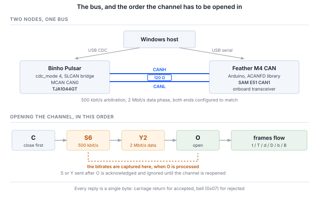

## 1 소개

Binho Pulsar는 I2C, SPI, UART 및 GPIO용 USB 호스트 어댑터입니다. 또한 NXP MCAN 컨트롤러와 TJA1044GT CAN-FD 트랜시버를 탑재하고 있으며, 펌웨어 v4.4.0부터는 USB 가상 COM 포트를 **SLCAN**을 사용해 이 트랜시버를 호스트에 브리지하는 모드로 전환할 수 있습니다. SLCAN은 원래 Lawicel에서 나온 ASCII 직렬 CAN 프로토콜로, 현재는 다양한 어댑터와 도구가 지원합니다.

이 문서를 쓸 가치가 있는 이유가 바로 이 마지막 부분입니다. Pulsar의 Python SDK에는 CAN 명령이 전혀 없으며, 필요하지도 않습니다. CAN-FD 모드에서 디바이스는 일반적인 SLCAN 어댑터로 동작하므로, 기존 CAN 소프트웨어 생태계가 수정 없이 이를 구동합니다.

Table: CAN-FD가 클래식 CAN에 추가하는 것

| 기능 | 설계에 주는 이점 |
|---|---|
| 64바이트 페이로드 | 8바이트가 64바이트가 되므로, 클래식 CAN에서는 여러 프레임으로 나누어 다시 조립해야 하는 레코드가 한 프레임에 들어감 |
| 비트레이트 스위칭 | 중재 단계는 모든 노드가 따라갈 수 있는 속도로 유지하고, 데이터 단계는 더 빠르게 동작함. 그 시점에는 하나의 노드만 구동하기 때문임 |
| 확장된 DLC 인코딩 | DLC 값 9~F가 12, 16, 20, 24, 32, 48, 64바이트를 선택하므로, 8바이트를 넘는 페이로드는 바이트 수가 아니라 단계 표로 지정됨 |
| 더 강력한 프레임 검사 | 클래식 CAN이 모든 길이에 사용하는 단일 15비트 다항식 대신, 페이로드에 맞는 크기의 CRC와 스터프 비트 카운트를 사용함 |
| 변하지 않는 물리 계층 | 같은 두 선, 같은 트랜시버, 같은 120 Ω 종단 |
| 공존 | 클래식 프레임과 FD 프레임이 버스를 공유하며, 클래식인지 FD인지는 버스 단위가 아니라 프레임 단위로 정해짐 |

이 구성의 세 가지 특성이 호스트 작성 방식을 결정하며, 세 가지 모두 이 시리즈의 다른 어댑터와 다릅니다.

Table: 다른 Binho 호스트 어댑터와의 차이점

| 특성 | 호스트에 미치는 영향 |
|---|---|
| CAN-FD는 SDK 명령 그룹이 아니라 CDC 모드임 | 모드는 HID로 선택되어 플래시 메모리에 저장되며, 이후 디바이스는 전용 SLCAN 브리지가 됨. 그동안 I2C, SPI, UART 및 GPIO 관리자는 실행되지 않음 |
| 인터페이스가 직렬 회선 프로토콜임 | 명령은 캐리지 리턴으로 끝나는 ASCII이며, 디바이스는 수락 시 `\r`, 거부 시 `\a`로 응답함. 중간에 라이브러리 없이 터미널로 진단할 수 있음 |
| 호스트는 공유 버스의 한 노드임 | 점대점 버스와 달리 프레임이 요청 없이 나타나고, 누군가 응답(ACK)해야 하며, 호스트가 다른 일로 바쁜 동안에도 도착함. 8.2절과 13절은 모두 이 점에서 비롯됨 |

이 노트는 Pulsar와 이 목적을 위해 구축한 두 번째 CAN-FD 노드를 사용해 진행합니다. Pulsar를 CAN-FD 모드로 전환하고, Pulsar가 사용하는 SLCAN 프로토콜을 설명하고, 원격 노드를 구축하여 초기 구동하고, 양방향으로 클래식 및 FD 트래픽을 검증한 다음, python-can과 그 위에 구축된 스택에서 버스를 구동합니다.

여기서는 전용 SDK가 전혀 필요하지 않습니다. 호스트 측의 모든 단계는 직렬 포트상의 ASCII 한 줄이거나, 이미 갖추어진 소프트웨어에 대한 호출입니다.

### 1.1 범위

이 문서를 마치면 하드웨어를 갖춘 독자는 다음을 수행하게 됩니다. Pulsar를 CAN-FD 모드로 전환하고, 브리지가 SLCAN에 응답하는지 확인하고, 두 번째 CAN-FD 노드를 구축하여 비트 타이밍을 어댑터와 맞추고, 클래식 프레임과 비트레이트 스위칭을 사용하는 64바이트 FD 프레임을 양방향으로 교환하고, DBC로 실시간 트래픽을 디코딩하고, 로그를 캡처하고 재생하며, CANopen, J1939, ISO-TP 스택에서 버스를 구동합니다.

예제는 Pulsar와 Adafruit Feather M4 CAN Express를 조합합니다. 둘 다 하드웨어에서 동작을 확인했으며, 이 문서의 모든 출력은 실제 캡처입니다.

이 노트는 Windows 네이티브 호스트 도구를 다룹니다. Linux에서 같은 도구를 사용하는 일반적인 방법인 `can-utils`와 SocketCAN 계열은 범위에서 제외됩니다. Windows에서는 USB 패스스루 계층과 Linux 환경이 필요하지만, 이 어댑터를 사용하는 데는 둘 다 필요하지 않기 때문입니다.

### 1.2 적용 디바이스

CAN-FD 모드는 **Pulsar 전용**입니다. Binho Supernova의 마이크로컨트롤러에는 MCAN 주변장치가 없으며, 펌웨어가 이 모드를 거부합니다. 호스트 측 내용은 모든 SLCAN 어댑터에 적용되며, 노드 펌웨어는 CAN1 핀이 외부로 나와 있는 SAM E51 기반의 모든 보드에 적용됩니다.

### 1.3 관련 문서

Table: 관련 문서

| 문서 | 위치 |
|---|---|
| CDC CAN-FD (SLCAN) mode | Binho 펌웨어 문서, `docs/CDC-CANFD-Mode.md`. 브리지의 명령 집합과 제한 사항에 관한 공식 자료 |
| Binho Pulsar 문서 | `https://support.binho.io` |
| python-can | `https://python-can.readthedocs.io` |
| cantools | `https://cantools.readthedocs.io` |
| ACANFD_FeatherM4CAN | `https://github.com/pierremolinaro/acanfd-featherM4can`, 노드에 사용한 CAN-FD 드라이버 |
| CAN FD 사양 | Robert Bosch GmbH, *CAN with Flexible Data-Rate*, v1.0 |
| ISO 11898-1 | CAN 데이터 링크 계층, FD 프레임 형식 포함 |

## 2 필요한 장비 및 소프트웨어

### 2.1 하드웨어

Table: 필요한 장비

| 항목 |
|---|
| 펌웨어 v4.4.0 이상의 Binho Pulsar |
| Adafruit Feather M4 CAN Express 또는 기타 CAN-FD 노드 |
| 둘 사이의 2선식 CAN 연결, CANH는 CANH에, CANL은 CANL에 |
| 120 Ω 종단 |
| USB-C 케이블 2개 |

### 2.2 연결

Table: 사용하는 신호

| 신호 | 용도 |
|---|---|
| CANH | CAN 버스, 도미넌트 시 하이가 되는 선 |
| CANL | CAN 버스, 도미넌트 시 로우가 되는 선 |
| GND | 두 보드 사이의 공통 리턴 |

Pulsar의 CANH와 CANL은 온보드 TJA1044GT에서 나오며, Feather의 CANH와 CANL은 해당 보드의 트랜시버에서 나옵니다. 세 번째 선은 필요 없으며, 어느 보드도 다른 보드에 전원을 공급하지 않습니다.

> **참고:** CAN에는 종단이 필요하고, 두 번째 노드도 필요합니다. 송신자가 하나뿐이고 응답자가 없는 버스는 반쯤 동작하지 않습니다. 송신 측은 응답(ACK)을 전혀 받지 못해 프레임을 무한히 재시도하며, 송신 큐는 처음 보낸 프레임 뒤에서 막힙니다. 이 증상은 버스가 아니라 어댑터를 의심하게 만들기 때문에, 14절에 양쪽 끝에서 각각 어떻게 보이는지 정리해 두었습니다.

### 2.3 버스 설정

Table: 사용한 버스 설정

| 설정 | 값 | 설정 방법 |
|---|---|---|
| 중재 비트레이트 | 500 kbit/s | SLCAN `S6`, 노드에서는 `DataBitRateFactor` 기준 |
| 데이터 단계 비트레이트 | 2 Mbit/s | SLCAN `Y2`, 노드에서는 `DataBitRateFactor::x4` |
| 종단 | 120 Ω | 하드웨어 |
| 직렬 포트 속도 | 무관 | 아래 참조 |

COM 포트의 보레이트는 중요하지 않습니다. 이 포트는 실제 UART가 아니라 USB CDC 엔드포인트이므로 그 값은 버려지며, CAN 비트레이트는 오직 `S` 및 `Y` 명령으로만 결정됩니다.

### 2.4 소프트웨어

```
pip install python-can cantools
```

8절과 9절의 모든 내용은 Python 3.12와 `python-can`, `cantools`로 충분합니다. 10절에서는 `canopen`, `can-j1939`, `can-isotp`를 추가합니다. CDC 모드를 전환하려면 `hidapi`가 필요합니다.

노드 펌웨어에는 Adafruit SAMD 코어가 포함된 Arduino 도구 체인과 라이브러리 하나가 필요합니다.

```
arduino-cli core install adafruit:samd \
  --additional-urls https://adafruit.github.io/arduino-board-index/package_adafruit_index.json
arduino-cli lib install ACANFD_FeatherM4CAN
```

> **참고:** Windows에서는 코어를 Arduino 기본 위치에 설치하십시오. GCC 도구 체인 자체가 약 130자의 경로 깊이에 이르기 때문에, 데이터 디렉터리를 깊은 위치에 두면 `cc1plus.exe`가 260자 제한을 넘게 됩니다. 이때의 오류는 `cannot execute 'cc1plus'`이며, 경로 문제처럼 보이지 않습니다.

## 3 Pulsar를 CAN-FD 모드로 전환하기

CAN-FD는 USB 가상 COM 포트의 여러 기능 모드 중 하나입니다. 모드는 HID로 설정되어 플래시 메모리에 저장되므로 전원을 껐다 켜도 유지되며, 펌웨어 자체 도구로 적용합니다.

```
python device_settings_cli.py --device pulsar show
```

```
Connected to Binho Pulsar
  webusb_enabled : 1  (on)
  cdc_enabled    : 1  (on)
  cdc_mode       : 0  (uart_passthrough)
```

모드 0은 기본값으로, 투명한 USB-UART 브리지입니다. 다른 무엇보다 먼저 이를 알아 둘 가치가 있습니다. 기본 모드의 Pulsar는 어떤 SLCAN 명령에도 응답하지 않고 아무것도 출력하지 않는 COM 포트를 제공하기 때문입니다. 고장 난 것도 아니고 잘못된 포트도 아닙니다. UART를 브리지하고 있는 것입니다.

```
python device_settings_cli.py --device pulsar set --cdc-mode canfd
```

```
Settings updated:
  cdc_mode       : 4  (canfd)

Resetting device to persist settings to flash...
```

리셋은 예상된 동작입니다. 모드는 부팅 시 적용되므로, 도구가 설정을 적용하기 위해 디바이스를 다시 시작합니다. 그러면 Pulsar가 다시 열거되고, 다시 나타난 COM 포트가 SLCAN 인터페이스입니다.

모드가 배타적이라는 데서 두 가지 결과가 따릅니다.

Pulsar가 CAN-FD 모드에 있는 동안 **HID 프로토콜 관리자는 실행되지 않습니다**. 모드를 다시 바꿀 때까지 I2C, SPI, UART, GPIO를 사용할 수 없으며, 디바이스는 전용 SLCAN 브리지가 됩니다. 설정 명령은 여전히 HID로 동작하며, 모드를 되돌리는 것도 이 방법으로 합니다.

```
python device_settings_cli.py --device pulsar set --cdc-mode uart_passthrough
```

또한 설정이 플래시 메모리에 있으므로, CAN-FD 모드로 둔 Pulsar는 다시 켜도 CAN-FD 모드로 돌아옵니다. 장치가 I2C와 SPI를 잃어버린 것처럼 보인다면 가장 먼저 이것을 확인하십시오.

## 4 SLCAN 프로토콜

### 4.1 명령 집합

명령은 ASCII이며, 한 줄에 하나씩, 캐리지 리턴으로 끝납니다. 디바이스는 명령을 수락하면 `\r` (0x0D)를, 수락하지 않으면 `\a` (0x07, 벨)을 반환합니다. 따라서 터미널에서 전체 인터페이스에 접근할 수 있으며, 무언가 동작하지 않을 때 시작하기에 알맞은 곳이 터미널입니다.

Table: SLCAN 명령

| 명령 | 의미 | 비고 |
|---|---|---|
| `S0`–`S8` | 중재 비트레이트 선택 | 채널을 열 때 확정됨 |
| `Y1`, `Y2`, `Y5` | CAN-FD 데이터 단계 비트레이트 선택 | 채널을 열 때 확정됨 |
| `O` | 일반 모드로 채널 열기 | |
| `L` | 수신 전용 모드로 채널 열기 | 응답(ACK)하지 않음. 13절 참조 |
| `C` | 채널 닫기 | 트랜시버가 대기 상태로 전환됨 |
| `t` / `T` | 클래식 프레임 송신, 표준 / 확장 ID | |
| `d` / `D` | 비트레이트 스위칭 없는 FD 프레임 송신 | |
| `b` / `B` | 비트레이트 스위칭 있는 FD 프레임 송신 | |
| `V`, `N`, `F` | 버전, 시리얼 번호, 상태 플래그 | 이 펌웨어에서는 고정 상수 |
| `s` | 사용자 정의 비트 타이밍 | 수락되지만 무시됨. `S`를 사용할 것 |

라이브러리를 사용하기 전에 브리지가 응답하는지 확인합니다.

```
python canfd_slcan.py probe --port COM12 --bitrate 500000 --data-bitrate 2000000
```

```
  V   -> b'V0101\r'   ok   version
  N   -> b'NFFFF\r'   ok   serial number
  F   -> b'F00\r'     ok   status flags
  S6  -> b'\r'        ok   nominal 500000
  Y2  -> b'\r'        ok   data phase 2000000
  Q   -> b'\x07'      ok   an unsupported command should bell
```

마지막 줄은 다른 줄만큼 중요합니다. 모든 것에 똑같이 응답하는 디바이스는 아무것도 증명하지 못합니다. 알 수 없는 명령에 벨을 울리는 디바이스는 명령을 파싱하고 있는 것입니다.

`V`, `N`, `F`는 실시간 값이 아니라 상수를 반환하므로, 브리지가 수신 대기 중이라는 것은 증명하지만 어떤 디바이스인지나 버스가 어떤 상태인지는 증명하지 못합니다.

### 4.2 프레임 형식

송신 프레임은 하나의 문자열입니다.

```
<letter><identifier><dlc><data bytes>
```

첫 글자는 세 가지 사실을 동시에 나타냅니다. 프레임이 클래식(`t`)인지 FD(`d`, `b`)인지, 데이터 단계에서 속도를 전환하는지(`b`와 `B`는 전환하고 `d`와 `D`는 전환하지 않음), 그리고 식별자가 표준(소문자)인지 확장(대문자)인지입니다. 식별자는 표준이 16진수 세 자리, 확장이 여덟 자리이고, DLC는 16진수 한 자리이며, 데이터는 바이트 쌍으로 이어집니다.

채널이 열리면 수신된 프레임이 같은 형태로 요청 없이 도착합니다.

```
t1238DEADBEEF00112233       classic, std 0x123, 8 bytes
b200F0102...                FD with BRS, std 0x200, DLC F = 64 bytes
```

### 4.3 비트레이트와 DLC 매핑

Table: DLC와 페이로드 길이

| DLC | 0–8 | 9 | A | B | C | D | E | F |
|---|---|---|---|---|---|---|---|---|
| 바이트 | 0–8 | 12 | 16 | 20 | 24 | 32 | 48 | 64 |

8바이트를 넘으면 페이로드 길이는 자유롭게 정할 수 없고 이 단계 표에서 정해집니다. 20바이트 페이로드는 DLC `B`이며, 13바이트 페이로드는 존재하지 않으므로 16바이트로 패딩해야 합니다. 함께 제공되는 유틸리티는 자동으로 패딩합니다. 이는 호출하는 쪽이 왜 13바이트가 16바이트가 되었는지 궁금해하게 두지 말고 어딘가에 명시해 둘 가치가 있는 결정입니다.

비트레이트는 채널을 열 때 확정됩니다. **`S`와 `Y`는 `O`보다 먼저 보내십시오.** 나중에 설정하면 수락되고 응답도 오지만, 채널을 닫았다가 다시 열 때까지는 효과가 없습니다. 이런 종류의 고장은 순서 문제가 아니라 비트 타이밍 문제처럼 보입니다.



## 5 원격 노드

CAN 버스에는 프레임에 응답하기 위해서도, 관찰할 만한 대상을 갖기 위해서도 두 번째 참여자가 필요합니다. 여기서 사용하는 노드는 SAM E51과 CAN-FD 트랜시버를 조합한 Adafruit Feather M4 CAN Express이며, `ACANFD_FeatherM4CAN` 라이브러리를 사용해 Arduino C++로 프로그래밍합니다.

> **참고:** 이 보드에서 측정한 결과, CircuitPython의 `canio` 모듈은 **클래식 CAN 전용**입니다. `Message`는 최대 8바이트만 받으며, 생성자는 `fd`, `can_fd`, `data_bitrate`를 거부합니다. MCAN 주변장치 자체는 FD를 지원하고 `canio` 루프백으로 컨트롤러가 동작하는 것도 확인되지만, FD는 노출되어 있지 않습니다. 따라서 이 보드에서 CAN-FD 노드는 C++로 만들어야 합니다.

### 5.1 어떤 CAN 모듈을 쓰는지, 그리고 동작 여부를 결정하는 두 핀

SAM E51에는 두 개의 CAN 모듈이 있으며, 이 보드는 **CAN1**을 온보드 트랜시버에 연결합니다. CANH와 CANL이 헤더까지 이어지는 것은 CAN1뿐입니다. CAN0은 D12와 D13에 존재하지만 그 뒤에는 아무것도 연결되어 있지 않습니다.

올바르게 설정된 노드가 버스를 구동할 수 있는지는 두 핀이 결정합니다. 트랜시버에는 활성화하려면 로우로 구동해야 하는 대기 입력과, 하이로 구동해야 하는 부스트 컨버터 인에이블이 있습니다. 둘 다 그대로 두면 노드는 오류 없이 설정되고 송신 성공을 보고하지만 신호선에는 아무것도 내보내지 않습니다.

라이브러리는 CAN1의 `beginFD` 안에서 이 두 가지를 처리하여 PB12를 로우로, PB13을 하이로 구동합니다. 이는 가정하기보다 알아 둘 가치가 있습니다. 이것이 처리되지 않는 보드에서는 가장 먼저 확인해야 할 사항입니다.

### 5.2 비트 타이밍 맞추기

노드는 데이터 단계 속도를 절댓값이 아니라 중재 속도의 **배수**로 표현합니다.

```cpp
ACANFD_FeatherM4CAN_Settings settings(
    ACANFD_FeatherM4CAN_Settings::CLOCK_48MHz, 500 * 1000, DataBitRateFactor::x4);
settings.mModuleMode = ACANFD_FeatherM4CAN_Settings::NORMAL_FD;
const uint32_t errorCode = can1.beginFD(settings);
```

500 kbit/s에 배수 4를 곱하면 2 Mbit/s이며, 이는 SLCAN에서 `S6` 다음에 `Y2`를 보내는 것에 해당합니다. 어느 쪽이든 채널을 열기 전에 양쪽 끝이 일치해야 합니다.

`beginFD`는 요청한 조합에 대한 비트 타이밍을 찾지 못하면 0이 아닌 값을 반환하며, 노드는 계속 진행하지 않고 이를 보고합니다. 잘못된 속도로 조용히 동작하는 노드는 동작을 거부하는 노드보다 진단하기 어렵기 때문입니다.

### 5.3 수신한 프레임 다시 보내기

기록해 둘 가치가 있는, 눈에 잘 띄지 않는 결함이 하나 있습니다. `CANFDMessage`에는 드라이버에 속한 `idx` 필드가 있으며, 수신한 프레임에서는 그 프레임이 도착한 인덱스가 들어 있습니다. 따라서 수신한 프레임을 복사해 에코하면 0이 아닌 `idx`가 그대로 전달되고, 송신 경로는 이를 *전용 송신 버퍼 번호 idx를 사용하라*는 뜻으로 해석하는데, 그런 버퍼는 존재하지 않습니다.

```cpp
CANFDMessage reply = frame;   // carries frame.idx
reply.id  = RESPONSE_ID;
reply.idx = 0;                // without this, status 2 and nothing on the bus
```

증상은 송신 상태 2, 즉 `kTransmitBufferIndexTooLarge`이며 프레임이 나가지 않는 것입니다. 0은 *송신 FIFO를 사용하라*는 뜻이며, 에코에 필요한 것이 바로 이것입니다.

## 6 첫 트래픽

양쪽 끝의 속도가 일치하면 노드 자체 콘솔에 설정 및 송신 상황이 표시됩니다.

```
=== Feather M4 CAN :: CAN-FD test node ===
arbitration 500000 bit/s, data x4 = 2000000 bit/s   (SLCAN: S6 then Y2)
CAN1 configured, transceiver active
diagnostic: 0x100 heartbeat, 0x200 ramp, 0x123->0x321 echo
device:     0x110 environment, 0x210 trace, 0x600->0x601 cmd
```

호스트에서는 채널을 열고 수신합니다.

```
python canfd_slcan.py listen --port COM12 --bitrate 500000 --data-bitrate 2000000
```

```
  channel open (normal), 500000 nominal, 2000000 data; collecting for 4 s
   id=0x100 classic len=8   x8
   id=0x110 classic len=8   x41
   id=0x200 fd+brs  len=64  x4
   id=0x210 fd+brs  len=48  x20
  73 frame string(s), 73 decoded, 4 distinct
```

이 개수는 7절의 주기와 대조해 볼 가치가 있습니다. 아무것도 누락되지 않았음을 확인하는 가장 간단한 방법이기 때문입니다. 4초 동안 500 ms 주기의 `0x100`은 8개, 100 ms 주기의 `0x110`은 41개, 1 s 주기의 `0x200`은 4개, 200 ms 주기의 `0x210`은 20개가 됩니다. 주기에 비해 크게 적은 개수는 손실을 뜻하고, 일치하면 카탈로그 전체가 도착하고 있다는 뜻입니다.

이 중 두 가지가 이 모든 작업을 하는 이유입니다. `0x200`은 비트레이트 스위칭을 사용하는 64바이트 프레임이고 `0x210`은 48바이트 프레임이며, 둘 다 클래식 CAN 호스트로는 전혀 수신할 수 없습니다. 이들을 표시하는 도구는 FD를 지원한다고 보고만 하는 것이 아니라 실제로 FD를 처리하고 있는 것입니다.

반대 방향과 FD 왕복은 다음과 같습니다.

```
python canfd_slcan.py roundtrip --port COM12 --bitrate 500000 --data-bitrate 2000000
```

```
  --- classic ---
    drained 9 buffered frame(s) first
    reply id=0x321 classic dlc=8 len=8
    payload identical: True

  --- CAN-FD, 64 bytes, BRS ---
    drained 0 buffered frame(s) first
    reply id=0x321 fd+brs dlc=64 len=64
    payload identical: True
```

FD 요청은 비트레이트 스위칭이 유지된 FD 응답으로 돌아왔고, 페이로드는 바이트 단위로 동일했습니다. 이는 송신 테스트로는 할 수 없는 확인입니다. 원격 측이 보낸 것을 수신했다는 것, 그리고 도중에 아무것도 프레임을 다운그레이드하지 않았다는 것을 증명합니다.

## 7 데모 노드의 메시지 카탈로그

이 노드는 의도적으로 두 가지 역할을 동시에 하며, 이런 분리는 어떤 테스트 노드에서든 유지할 가치가 있습니다.

**진단 계층**은 버스가 동작함을 증명하기 위해 존재하며, 고장 났을 때 원인의 범위가 좁도록 가능한 한 적은 일만 합니다.

Table: 진단 메시지

| ID | 프레임 | 주기 | 내용 |
|---|---|---|---|
| `0x100` | 클래식, 8바이트 | 500 ms | 시퀀스 번호와 수신 카운터 |
| `0x200` | BRS 사용 FD, 64바이트 | 1 s | 바이트 램프 |
| `0x123` → `0x321` | 요청을 따름 | 요청 시 | 에코, 프레임 유형과 BRS 유지 |

**디바이스 계층**은 그 위에 있으며, 호스트가 디코딩할 만한 대상을 갖도록 하기 위해 존재합니다. 버스를 진단하는 데는 이 중 아무것도 필요하지 않습니다.

Table: 시뮬레이션 디바이스 메시지

| ID | 프레임 | 주기 | 내용 |
|---|---|---|---|
| `0x110` | 클래식, 8바이트 | 100 ms, 변경 가능 | 온도, 습도, 기압, 플래그, 시퀀스 |
| `0x210` | BRS 사용 FD, 48바이트 | 200 ms | 헤더가 있는 16샘플 파형 트레이스 |
| `0x600` → `0x601` | 클래식, 8바이트 | 요청 시 | `INFO`, `COUNTERS`, `SET_RATE` |

`0x210`은 CAN-FD를 단지 시험하는 것이 아니라 CAN-FD를 *지지하는* 근거가 되는 메시지입니다. 16비트 샘플 16개에 12바이트 헤더를 더하면 한 프레임에 44바이트입니다. 같은 트레이스를 클래식 CAN으로 보내면 여섯 프레임과 재조립 방식이 필요하며, 그 여섯 프레임은 버스상의 다른 모든 것과 섞여 들어오므로 수신 측은 순서가 바뀌거나 일부만 도착하는 경우도 처리해야 합니다.

신호선에서 디코딩한 결과는 다음과 같습니다.

```
python canfd_slcan.py monitor --port COM12 --bitrate 500000 --data-bitrate 2000000
```

```
   0x100  heartbeat seq=11024 rx=10 echoes=0
   0x110  environment 19.7 C  49.1 %RH  1012.7 hPa  flags=0x01 seq=212
   0x200  fd ramp 64 bytes, first=0x88
   0x210  trace seq=27560 uptime=5515031 ms  16 samples peak=7998  [7331, 5548, 2921, -151, -3200, -5762, ...]
```

명령 엔드포인트는 `0x601`에서 응답하며, 첫 번째 위치에 명령 바이트를 에코하므로 트랜잭션 식별자 없이도 응답을 요청과 짝지을 수 있습니다.

```
python canfd_slcan.py command info --port COM12 --bitrate 500000 --data-bitrate 2000000
```

```
  TX t600101   (info)
  RX 0x601  cmd INFO  id=BIN fw=1.0 features=0x07 trace_samples=16
```

`SET_RATE`는 읽기 전용 카탈로그로는 보여 줄 수 없는 것을 보여 주므로 짚어 둘 가치가 있습니다. 250 ms를 요청합니다.

```
  TX t600303FA00   (set-rate)
  RX 0x601  cmd SET_RATE period=250 ms, accepted
```

다시 수신해 보면 `0x110`은 4초 동안 41개가 아니라 16개이고 다른 모든 식별자의 개수는 그대로이므로, 이 명령은 단지 응답을 받은 것이 아니라 디바이스의 동작을 바꾼 것입니다.

```
   id=0x100 classic len=8   x8
   id=0x110 classic len=8   x16
   id=0x200 fd+brs  len=64  x4
   id=0x210 fd+brs  len=48  x20
```

범위를 벗어난 요청은 **거부되지 않고 제한(clamp)되며**, 응답에는 실제로 적용된 값이 담깁니다. 노드의 하한인 10 ms보다 낮은 5 ms를 요청하면 다음과 같습니다.

```
  TX t6003030500   (set-rate)
  RX 0x601  cmd SET_RATE period=10 ms, accepted
```

디바이스가 실행 중인 주기의 기준은 요청이 아니라 응답입니다. 그렇지 않다고 가정하는 호출자는 범위를 벗어난 값을 요청하기 전까지만 맞습니다.

모든 다중 바이트 필드는 **리틀 엔디언**입니다. CAN 자체는 바이트 순서를 규정하지 않으므로 이는 선택 사항이며, 문서로 남겨 두지 않으면 양쪽 끝이 모르는 사이에 어긋나게 됩니다.

## 8 python-can으로 버스 구동하기

python-can에게 이 브리지는 기본 제공 인터페이스로 사용하는 평범한 SLCAN 어댑터이며, Binho 전용 코드가 필요 없습니다.

```python
import can

bus = can.Bus(interface="slcan", channel="COM12", bitrate=500_000)
bus.set_bitrate(500_000, 2_000_000)      # nominal, then FD data phase

bus.send(can.Message(arbitration_id=0x123, is_extended_id=False,
                     data=bytes(range(64)), is_fd=True, bitrate_switch=True))
print(bus.recv(timeout=1.0))
bus.shutdown()
```

### 8.1 `set_bitrate`는 동작하고 생성자만으로는 동작하지 않는 이유

FD 데이터 단계 속도는 생성자에 전달할 수 없습니다. `set_bitrate`가 그 경로이며, 이것이 동작하는 이유는 내부에서 하는 일 때문입니다. 채널을 닫고, `S`와 `Y`를 쓰고, 다시 엽니다. 이는 정확히 4.3절이 요구하는 순서입니다. 이미 열린 채널에서 속도를 설정하면 수락되지만 무시됩니다.

Table: python-can 비트레이트 매핑

| 요청 값 | 전송되는 명령 | 버스 실제 속도 |
|---|---|---|
| 500 000 | `S6` | 500 kbit/s |
| 1 000 000 | `S8` | 1 Mbit/s |
| 750 000 | `S7` | **800 kbit/s** |
| data 2 000 000 | `Y2` | 2 Mbit/s |
| data 5 000 000 | `Y5` | 5 Mbit/s |

세 번째 행은 함정입니다. python-can의 표는 750 000을 `S7`에 매핑하는데, 이 펌웨어의 `S7`은 800 kbit/s입니다. 750 kbit/s를 요청하면 양쪽 어디에서도 경고 없이 버스가 800 kbit/s로 동작합니다. 또한 이 백엔드는 데이터 단계에 2 Mbit/s와 5 Mbit/s만 제공하므로, `Y1`은 원시 프로토콜로는 사용할 수 있지만 그 인터페이스로는 사용할 수 없습니다.

### 8.2 백로그, 그리고 요청/응답 테스트에 비우기가 필요한 이유

이 문제는 실제로 시간을 잡아먹습니다. 노드는 계속 송신하고, 호스트가 2초의 포트 안정화 시간과 채널을 닫았다 다시 여는 데 시간을 쓰는 동안 브리지는 계속 버퍼링합니다. 요청이 나갈 때쯤에는 그 응답 앞에 관련 없는 프레임들이 줄지어 있습니다.

송신한 다음 이어지는 몇 프레임을 읽는 루프는 *과거 기록*을 읽게 됩니다. 응답은 백로그 뒤에 분명히 있지만, 정상 동작하는 노드가 전혀 응답하지 않은 것처럼 보입니다. 측정을 의미 있게 만드는 것은 먼저 비우는 것입니다.

```
  --- classic request/response ---
    drained 42 buffered frame(s) first
    reply id=0x321 classic dlc=8 len=8 data=DEADBEEF00010203
```

이 예에서는 과거 프레임이 42개 있었습니다. 비우지 않으면, 같은 테스트는 올바르게 응답한 노드로부터 응답이 전혀 없었다고 보고했습니다.

### 8.3 로깅과 재생

python-can은 캡처와 재생 작업 흐름을 다루는 명령줄 도구를 설치합니다.

```
python -m can.logger -i slcan -c COM12 -b 500000 --fd --data-bitrate 2000000 -f capture.asc
python -m can.player -i slcan -c COM12 -b 500000 --fd --data-bitrate 2000000 capture.asc
```

로그는 FD 레코드가 올바르게 기록된 Vector ASC 파일이며, `f 64`는 DLC F와 그 바이트 수입니다.

```
 0.000000 1  100             Rx   d 8 00 00 07 6E 00 07 00 07
 0.000000 CANFD   1 Rx        200   1 0 f 64 B7 B8 B9 BA BB BC ...
```

이를 재생하자 프레임이 신호선에 다시 놓였고 노드가 이를 수신했습니다. `0x100` 17개와 `0x200` 13개입니다.

> **참고:** 이 캡처의 모든 타임스탬프는 `0.000000`입니다. 펌웨어가 SLCAN 타임스탬프 명령(`Z0`/`Z1`)을 구현하지 않으므로 python-can이 기록할 것이 없습니다. 로그는 구조적으로 유효하고 FD 레코드도 올바르지만, 타이밍 정보는 담고 있지 않습니다. 프레임 간 타이밍이 필요한 경우에는 대신 호스트에서 얻어야 합니다.

## 9 DBC로 디코딩하기

DBC는 원시 바이트를 이름이 있고 스케일이 적용된 신호로 바꾸며, 가장 흔한 CAN 작업 흐름입니다. `cantools`는 DBC를 읽고 실시간 트래픽을 디코딩합니다.

```python
import can, cantools

db = cantools.database.load_file("binho_canfd_demo.dbc")
bus = can.Bus(interface="slcan", channel="COM12", bitrate=500_000)
bus.set_bitrate(500_000, 2_000_000)

message = bus.recv(timeout=1.0)
print(db.decode_message(message.arbitration_id, message.data))
```

```
  0x100 Heartbeat        Seq=7787, RxCount=4, EchoCount=0
  0x110 Environment      Temperature=20.3, Humidity=42.4, Pressure=1014.2, Flags=1, EnvSeq=159
  0x200 FdRamp           FirstByte=53
  0x210 Telemetry        TraceSeq=19469, UptimeMs=3896831, SampleCount=16, Reserved=0, Sample00=-3434, ...
```

함께 제공되는 DBC는 일곱 개 메시지 전부와 35개 신호를 기술합니다. 이 DBC는 손으로 작성하지 않고 스크립트로 생성했는데, 다시 강조할 만한 이유가 두 가지 있습니다. 트레이스에는 비트 오프셋이 off-by-one 오류를 유발하기 쉬운 신호가 16개 있으며, 한 비트가 어긋난 DBC는 실패하는 것이 아니라 그럴듯한 엉터리 값으로 디코딩됩니다.

> **참고:** DBC는 FD 메시지를 표시해야 하며, 그렇지 않으면 읽는 쪽이 48바이트나 64바이트 메시지를 잘못된 클래식 프레임으로 취급합니다. 해당 속성은 `VFrameFormat`이며 `StandardCAN_FD`로 설정합니다. `cantools`는 이를 읽지만 쓰지는 않으므로, 데이터베이스를 덤프하여 만든 DBC는 이 플래그를 잃습니다. 함께 제공되는 생성기는 이 속성을 덧붙인 다음 파일을 다시 로드하여 속성이 유지되었는지 확인합니다.

나머지 작업 흐름은 `cantools` 명령줄로 코드 없이 처리할 수 있습니다.

Table: cantools 하위 명령

| 명령 | 기능 |
|---|---|
| `dump` | 각 메시지를 비트 배치도와 함께 출력 |
| `decode` | candump 형식의 텍스트를 DBC로 디코딩 |
| `monitor` | curses 기반 실시간 디코딩 보기 |
| `plot` | 디코딩된 신호를 시간에 따라 그래프로 표시 |
| `convert` | DBC, KCD, SYM, ARXML 간 변환 |
| `generate_c_source` | 임베디드 측용 C 인코더와 디코더 생성 |

```
python -m cantools decode binho_canfd_demo.dbc < candump.log
```

```
  can0  210   [48]  0E 4C 00 00 C7 76 3B 00 10 00 00 00 03 F4 ... ::
Telemetry(
    TraceSeq: 19470,
    UptimeMs: 3897031 ms,
    SampleCount: 16,
    Sample00: -3069,
    Sample01: -8,
    ...
)
```

> **참고:** `decode`와 `plot`은 **candump** 텍스트를 입력으로 받지만, `can.logger`는 **ASC**를 씁니다. 두 형식은 직접 호환되지 않으므로, `cantools`에서 사용할 캡처는 candump 형식으로 작성해야 합니다. 이는 어댑터의 한계가 아니라 도구 사이의 이음새 문제입니다.

## 10 상위 스택

브리지는 평범한 SLCAN 어댑터이므로, python-can 위에 구축된 프로토콜 스택이 수정 없이 동작합니다. 아래 각 항목은 라이브러리가 호출을 받아들였는지 관찰하는 방식이 아니라, 스택에 송신을 요청하고 프레임이 신호선에 도달했는지 *노드*에서 확인하는 방식으로 검증했습니다.

Table: 브리지에서 검증한 스택

| 스택 | 송신한 것 | 노드에서 확인한 것 |
|---|---|---|
| `canopen` | NMT 리셋, CANopen 마스터가 처음에 보내는 브로드캐스트 | `0x000` |
| `can-j1939` | 주소 클레임, 8바이트 NAME을 담은 PGN `0xEE00` | `0x18EEFF80`, 확장 |
| `can-isotp` | CAN-FD를 통한 60바이트 ISO-TP 단일 프레임 | `0x700` |

```python
import canopen
network = canopen.Network()
network.connect(interface="slcan", channel="COM12", bitrate=500_000)
network.nmt.state = "RESET"
network.disconnect()
```

ISO-TP의 경우가 흥미로우며, FD를 지지하는 또 하나의 근거입니다. 송신 길이를 64바이트로 설정하면 ISO-TP는 최대 62바이트의 페이로드를 **단일 프레임**으로 전달할 수 있으며, 흐름 제어가 필요 없으므로 시연에 협조하는 상대도 필요 없습니다.

```python
import can, isotp
bus = can.Bus(interface="slcan", channel="COM12", bitrate=500_000)
bus.set_bitrate(500_000, 2_000_000)
stack = isotp.CanStack(
    bus=bus,
    address=isotp.Address(isotp.AddressingMode.Normal_11bits, txid=0x700, rxid=0x701),
    params={"tx_data_length": 64, "can_fd": True, "bitrate_switch": True})
stack.start()
stack.send(bytes(range(60)))
```

같은 60바이트를 클래식 CAN으로 보내면 첫 프레임 하나, 연속 프레임 여덟 개, 그리고 흐름 제어 핸드셰이크가 필요합니다. UDS는 이 전송 계층 위에서 동작하므로 `udsoncan`도 같은 경로를 따릅니다. 완전한 진단 세션에는 ISO-TP 서버를 구현한 상대가 필요하지만, 데모 노드는 의도적으로 이를 구현하지 않습니다.

## 11 측정 결과

### 11.1 테스트 구성

Table: 테스트 구성

| 항목 | 값 |
|---|---|
| 어댑터 | Binho Pulsar, 하드웨어 리비전 C, 펌웨어 4.5.0, `cdc_mode` 4 |
| 노드 | Adafruit Feather M4 CAN Express, SAM E51, `ACANFD_FeatherM4CAN` 2.0.0 |
| 노드 펌웨어 크기 | 23,484바이트, 플래시 메모리의 4% |
| 버스 | 중재 500 kbit/s, 데이터 단계 2 Mbit/s, 120 Ω 종단 |
| 호스트 | Windows 11, Python 3.12, python-can 4.6.1, cantools 43.0.2 |

### 11.2 브리지가 구현하는 것

Table: 검증된 동작

| 기능 | 결과 |
|---|---|
| 클래식 프레임, 표준 ID | 예, 양방향 |
| CAN-FD 프레임, 최대 64바이트 | 예, 양방향, 페이로드가 바이트 단위로 동일함을 확인 |
| 비트레이트 스위칭 | 예, 프레임 단위이며 에코를 거쳐도 유지됨 |
| 확장 식별자 | 예. J1939 주소 클레임 `0x18EEFF80`에서 확인 |
| 중재 비트레이트 | `S0`–`S8` |
| 데이터 단계 비트레이트 | `Y1`, `Y2`, `Y5` |
| 수신 전용 모드 | 예, `L`. 13절의 주의 사항 참조 |
| 알 수 없는 명령 처리 | 벨, `0x07` |
| 수신 타임스탬프 | 구현되지 않음. 기록된 모든 타임스탬프가 0임 |
| 오류 및 버스 상태 보고 | 구현되지 않음. `F`는 상수를 반환함 |
| 원격 전송 요청 | 지원되지 않음 |
| 호스트 측 수락 필터링 | 구현되지 않음. 모든 식별자를 수신함 |

### 11.3 검증된 호스트 소프트웨어

Table: 브리지를 통해 구동한 호스트 소프트웨어

| 소프트웨어 | 검증 내용 |
|---|---|
| python-can 4.6.1, `slcan` | 클래식 및 FD 송수신, FD 왕복 |
| `can.logger` | FD 레코드가 올바른 ASC 캡처 |
| `can.player` | 버스로 재생, 노드에서 수신 |
| cantools 43.0.2 | 실시간 프레임의 DBC 디코딩. `dump`, `decode` |
| canopen 2.4.1 | 버스상의 NMT 브로드캐스트 |
| can-j1939 2.0.12 | 버스상의 주소 클레임 |
| can-isotp 2.0.7 | FD를 통한 60바이트 단일 프레임 |
| udsoncan 1.26.1 | 설치됨. can-isotp 위에서 동작하며 ISO-TP 상대가 필요함 |
| canmatrix 1.2 | 설치됨. 데이터베이스 변환, 버스는 관여하지 않음 |

## 12 참조 자료

Table: 제공되는 것

| 파일 | 용도 |
|---|---|
| `assets/canfd_node/canfd_node.ino` | CAN-FD 노드 펌웨어 |
| `assets/tools/canfd_slcan.py` | 호스트 유틸리티, 하위 명령 8개 |
| `assets/tools/device_settings_cli.py` | Pulsar의 CDC 모드 전환 |
| `assets/dbc/binho_canfd_demo.dbc` | 노드의 일곱 개 메시지용 DBC |
| `assets/dbc/generate_dbc.py` | 해당 DBC를 생성하고 자체 점검함 |

유틸리티는 의도적으로 두 계층을 분리해 둡니다.

`probe`, `listen`, `send`, `monitor`, `command`는 CAN 라이브러리 없이 직렬 포트로 SLCAN을 직접 사용합니다. 보낸 정확한 ASCII와 반환된 정확한 `\r` 또는 `\a`가 모두 보이므로, 이 계층에서 문제를 진단할 수 있습니다.

`roundtrip`은 대신 python-can의 기본 제공 인터페이스를 거치며, 이는 독자가 실제로 어댑터를 사용하는 방식입니다. 같은 하드웨어에 대해 두 계층을 모두 실행하면 결함의 위치를 찾을 수 있습니다. 원시 계층은 동작하고 라이브러리 계층은 동작하지 않는다면, 결함은 라이브러리를 구동하는 방식에 있습니다.

Table: 유틸리티 하위 명령

| 명령 | 기능 |
|---|---|
| `mode` | CDC 모드를 전환하는 방법과 그 대가 |
| `probe` | 브리지가 SLCAN에 응답하는지 확인 |
| `rates` | 비트레이트 표와 DLC 매핑 |
| `listen` | 버스의 프레임을 식별자별로 디코딩 |
| `send` | 프레임 하나 송신, 클래식 또는 FD, BRS 선택 가능 |
| `monitor` | 데모 노드의 카탈로그를 공학 단위로 디코딩 |
| `command` | `INFO`, `COUNTERS` 또는 `SET_RATE`를 보내고 응답을 디코딩 |
| `roundtrip` | python-can을 통한 요청과 응답, 클래식 및 FD |

## 13 실무 참고 사항

**`S`와 `Y`는 `O`보다 먼저 보내십시오.** 비트레이트는 채널을 열 때 확정됩니다. 나중에 설정하면 수락되고 응답도 오지만, 채널을 닫았다가 다시 열 때까지는 효과가 없습니다.

**요청/응답 측정 전에 비우십시오.** 호스트가 포트를 열고 채널을 껐다 켜는 동안 브리지는 버스 트래픽을 버퍼링하므로, 응답은 백로그 뒤에 놓입니다. 송신 후 이어지는 몇 프레임을 읽으면 과거 기록을 읽게 됩니다.

**수신 전용 모드는 유일한 상대 노드가 될 수 없습니다.** `L`은 절대 응답하지 않는 채널을 엽니다. 노드가 두 개인 버스에서 이는 상대에게 치명적입니다. 아무도 그 프레임에 응답하지 않으므로 컨트롤러는 프레임을 무한히 재시도하고, 처음 보낸 프레임에서 결코 넘어가지 못합니다. 증상은 한 메시지가 수천 번 나타나고 다른 것은 아무것도 없는 것입니다. `L`은 세 번째 노드가 응답하는 경우에만 사용하십시오.

**수신한 프레임을 다시 보낼 때는 `idx`를 지우십시오.** 노드 측에서 복사한 수신 디스크립터는 드라이버 자체의 인덱스를 담고 있으며, 송신 경로는 이를 전용 버퍼 번호로 읽습니다.

**수신한 프레임 문자열은 방어적으로 파싱하십시오.** 읽기 구간은 프레임 중간에서 열리는 경우가 흔하므로, 버퍼에서 나오는 첫 문자열은 앞 글자가 없는 꼬리 부분이거나 16진수 자릿수가 홀수인 경우가 많습니다. 이는 정상이며, 여기서 예외를 발생시키는 디코더는 잘 동작하던 모니터를 멈추게 합니다.

**CAN-FD 모드의 Pulsar에는 I2C, SPI, UART 또는 GPIO가 없으며,** 이 설정은 전원을 껐다 켜도 유지됩니다. 이 인터페이스들이 사라진 것처럼 보이면 가장 먼저 `cdc_mode`를 확인하십시오.

**8바이트를 넘으면 패딩은 선택 사항이 아닙니다.** FD 길이는 단계 표에서 정해지므로, 13바이트 페이로드는 16바이트로 패딩해야 합니다.

## 14 문제 해결

Table: 문제 해결

| 증상 | 가능한 원인 |
|---|---|
| COM 포트가 아무 응답도 없고, 배너도 벨도 없음 | Pulsar가 `uart_passthrough` 모드임. SLCAN을 사용하는 것이 아니라 UART를 브리지하고 있음 |
| 모든 명령이 벨을 반환함 | 잘못된 형식의 명령이거나, 채널이 닫혀 있거나 수신 전용일 때 송신을 시도함 |
| 명령은 수락되지만 프레임이 전혀 도착하지 않음 | 채널을 `O`로 열지 않음, 양쪽 끝의 비트레이트 불일치, 종단 누락, 또는 CANH와 CANL이 바뀜 |
| 한 식별자가 수천 번 나타나고 다른 것은 없음 | 어댑터를 `L`로 열었음. 상대의 프레임이 응답을 받지 못해 계속 재시도되고 있음 |
| 노드가 송신 상태 2를 보고함 | 수신한 프레임을 `idx`를 지우지 않고 다시 보냄 |
| 노드가 송신 상태 3을 보고함 | 아무것도 응답하지 않아 큐가 가득 참. 상대 채널이 닫혔거나 종단이 누락됨 |
| 비트레이트 변경이 무시된 것처럼 보임 | `O` 이후에 `S` 또는 `Y`를 보냄. 닫았다가 다시 열 것 |
| 750 kbit/s를 요청했는데 버스가 800으로 동작함 | python-can은 750 000을 `S7`에 매핑하며, 이 펌웨어에서 `S7`은 800 kbit/s임 |
| 요청/응답에서 응답 없음으로 보고되지만 노드는 응답을 기록함 | 응답이 수신 백로그 뒤에 있었음. 송신 전에 비울 것 |
| 기록된 타임스탬프가 모두 0임 | 펌웨어가 `Z0`/`Z1`을 구현하지 않음. 타이밍은 호스트에서 얻을 것 |
| DBC가 48바이트 또는 64바이트 메시지를 잘못된 것으로 디코딩함 | DBC의 해당 메시지에 `VFrameFormat`이 없음 |
| 노드 빌드 시 `cannot execute 'cc1plus'` 발생 | Windows 경로 길이 문제. Arduino 코어를 기본 위치에 설치할 것 |
| 노드가 설정은 되지만 버스를 전혀 구동하지 않음 | 트랜시버 대기 상태가 해제되지 않았거나, 부스트 컨버터가 활성화되지 않음 |

## 15 약어

Table: 약어

| 용어 | 의미 |
|---|---|
| BRS | 비트레이트 스위치(Bit-rate switch) |
| CAN | 컨트롤러 영역 네트워크(Controller Area Network) |
| CAN-FD | 유연한 데이터 속도를 지원하는 CAN(CAN with Flexible Data-rate) |
| CDC | 통신 디바이스 클래스(Communications Device Class), USB 직렬 포트 클래스 |
| DBC | CAN 네트워크용 Vector 데이터베이스 형식 |
| DLC | 데이터 길이 코드(Data length code) |
| ECU | 전자 제어 장치(Electronic control unit) |
| FD | 유연한 데이터 속도(Flexible Data-rate) |
| HID | 휴먼 인터페이스 디바이스(Human Interface Device), SDK가 사용하는 USB 클래스 |
| ISO-TP | ISO 15765-2 전송 프로토콜 |
| MCAN | 여러 마이크로컨트롤러에 라이선스되어 탑재된 Bosch M_CAN 컨트롤러 |
| NMT | 네트워크 관리(Network management), CANopen 서비스 |
| PGN | 파라미터 그룹 번호(Parameter group number), J1939 식별자 |
| RTR | 원격 전송 요청(Remote transmission request) |
| SLCAN | 직렬 회선 CAN(Serial line CAN), ASCII 어댑터 프로토콜 |
| UDS | 통합 진단 서비스(Unified Diagnostic Services), ISO 14229 |

## 16 문서 내 소스 코드에 관한 참고

이 문서에 표시되고 함께 제공되는 아카이브에 포함된 예제 코드는 평가 및 참고용으로 제공됩니다. 이 코드는 MIT 라이선스로 배포되며, 라이선스 전문은 아카이브에 포함되어 있습니다.

`device_settings_cli.py`는 Binho 자체의 펌웨어 도구로, 3절의 모드 전환을 별도의 다운로드 없이 재현할 수 있도록 포함했습니다. 노드 펌웨어는 Pierre Molinaro의 `ACANFD_FeatherM4CAN` 라이브러리에 의존하며, 이 라이브러리는 Arduino 라이브러리 관리자에서 설치하고 여기서는 재배포하지 않습니다.

Table: 에셋 아카이브의 내용

| 파일 | 설명 |
|---|---|
| `AN0012.md` | 이 문서의 Markdown 소스 |
| `assets/canfd_node/canfd_node.ino` | Feather M4 CAN Express용 CAN-FD 노드 펌웨어 |
| `assets/tools/canfd_slcan.py` | SLCAN 브리지용 호스트 유틸리티 |
| `assets/tools/device_settings_cli.py` | HID를 통한 CDC 모드 전환 |
| `assets/dbc/binho_canfd_demo.dbc` | 노드의 메시지를 기술하는 DBC |
| `assets/dbc/generate_dbc.py` | 해당 DBC의 생성기 |
| `assets/LICENSE` | 예제 코드에 적용되는 MIT 라이선스 |

## 17 개정 이력

Table: 개정 이력

| 리비전 | 날짜 | 설명 |
|---|---|---|
| 0.1 | 9 September 2026 | 내부 검토용 초안. AN0008로 작성되었고 검토 전에 AN0012로 번호가 변경되었으며, 측정 내용은 변경되지 않음. 모든 결과는 펌웨어 4.5.0의 Pulsar에서 전용으로 구축한 CAN-FD 노드를 대상으로 얻었으며, 호스트 도구는 Windows에서 네이티브로 실행되는 것으로 한정함. |
| 1.0 | 6 November 2026 | 공개. |
