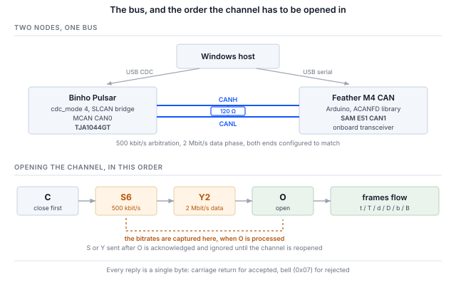

## 1 引言

Binho Pulsar 是一款用于 I2C、SPI、UART 和 GPIO 的 USB 主机适配器。它还内置一个 NXP MCAN 控制器和一个 TJA1044GT CAN-FD 收发器，并且从固件 v4.4.0 起，其 USB 虚拟 COM 端口可以切换到一种模式，通过 **SLCAN** 将该收发器桥接到主机。SLCAN 是 ASCII 串行 CAN 协议，最初来自 Lawicel，如今被大量适配器和工具所支持。

最后这一点正是值得为此撰写一份文档的原因。Pulsar 的 Python SDK 完全没有 CAN 命令，也不需要：在 CAN-FD 模式下，该设备表现为一个常规的 SLCAN 适配器，因此现有的 CAN 软件生态系统无需修改即可驱动它。

Table: CAN-FD 相对于经典 CAN 增加了什么

| 特性 | 为设计带来什么 |
|---|---|
| 64 字节有效载荷 | 八字节变为六十四字节，因此经典 CAN 必须跨帧分段再重组的记录可以放进一帧 |
| 比特率切换 | 仲裁段保持在所有节点都能跟随的速率，而数据段运行得更快，因为此时只有一个节点在驱动总线 |
| 更大的 DLC 编码 | DLC 值 9 至 F 分别选择 12、16、20、24、32、48 和 64 字节，因此 8 字节以上的有效载荷由阶梯表而不是字节数来确定 |
| 更强的帧校验 | CRC 的长度与有效载荷相匹配，并带有填充位计数，而不是经典 CAN 对所有长度都使用的单一 15 位多项式 |
| 物理层不变 | 同样的两根线、同样的收发器、同样的 120 Ω 终端电阻 |
| 共存 | 经典帧和 FD 帧可以共享一条总线，帧是经典还是 FD 按帧决定，而不是按总线决定 |

此配置的三个特性决定了主机端的编写方式，而且这三点都与本系列中的其他适配器不同。

Table: 与其他 Binho 主机适配器的不同之处

| 特性 | 对主机的影响 |
|---|---|
| CAN-FD 是一种 CDC 模式，而不是 SDK 命令组 | 该模式通过 HID 选择并存储在闪存中，之后设备成为专用的 SLCAN 桥。在此期间，I2C、SPI、UART 和 GPIO 管理器不运行 |
| 接口是串行线路协议 | 命令为以回车符结尾的 ASCII，设备以 `\r` 表示接受、以 `\a` 表示拒绝。这可以用终端诊断，中间不经过任何库 |
| 主机是共享总线上的一个节点 | 与点对点总线不同，帧会不请自来，需要有节点应答，并且会在主机忙于其他事务时到达。第 8.2 节和第 13 节都是这一点的结果 |

本笔记使用一个 Pulsar 和一个为此专门构建的第二个 CAN-FD 节点进行讲解：将 Pulsar 切换到 CAN-FD 模式，介绍它使用的 SLCAN 协议，构建并启动远端节点，验证双向的经典和 FD 通信，然后从 python-can 及基于它的协议栈驱动总线。

这里的一切都不需要专用 SDK。主机端的每一步，要么是串行端口上的一行 ASCII，要么是对现成软件的一次调用。

### 1.1 范围

读完本文后，手头有硬件的读者将能够：将 Pulsar 切换到 CAN-FD 模式，确认桥接器响应 SLCAN，构建第二个 CAN-FD 节点并使其位时序与适配器匹配，双向交换经典帧和带比特率切换的 64 字节 FD 帧，通过 DBC 解码实时流量，捕获并回放日志，以及从 CANopen、J1939 和 ISO-TP 协议栈驱动总线。

示例将 Pulsar 与 Adafruit Feather M4 CAN Express 配对。两者都在硬件上进行了测试，本文中的每个输出都是真实捕获。

本笔记涵盖 Windows 原生主机工具。`can-utils` 和 SocketCAN 系列（在 Linux 上通常通过它们使用相同的工具）不在范围内：在 Windows 上，它们需要 USB 透传层和 Linux 环境，而使用该适配器并不需要这两者。

### 1.2 适用器件

CAN-FD 模式**仅适用于 Pulsar**。Binho Supernova 的微控制器没有 MCAN 外设，其固件会拒绝该模式。主机端内容适用于任何 SLCAN 适配器；节点固件适用于任何基于 SAM E51 并引出其 CAN1 引脚的板卡。

### 1.3 相关文档

Table: 相关文档

| 文档 | 位置 |
|---|---|
| CDC CAN-FD (SLCAN) mode | Binho 固件文档，`docs/CDC-CANFD-Mode.md`；关于桥接器命令集和限制的权威说明 |
| Binho Pulsar 文档 | `https://support.binho.io` |
| python-can | `https://python-can.readthedocs.io` |
| cantools | `https://cantools.readthedocs.io` |
| ACANFD_FeatherM4CAN | `https://github.com/pierremolinaro/acanfd-featherM4can`，节点使用的 CAN-FD 驱动 |
| CAN FD 规范 | Robert Bosch GmbH，*CAN with Flexible Data-Rate*，v1.0 |
| ISO 11898-1 | CAN 数据链路层，包括 FD 帧格式 |

## 2 所需设备和软件

### 2.1 硬件

Table: 所需设备

| 项目 |
|---|
| Binho Pulsar，固件 v4.4.0 或更高版本 |
| Adafruit Feather M4 CAN Express，或其他 CAN-FD 节点 |
| 两者之间的双线 CAN 连接，CANH 接 CANH，CANL 接 CANL |
| 120 Ω 终端电阻 |
| 两根 USB-C 线缆 |

### 2.2 连接

Table: 使用的信号

| 信号 | 用途 |
|---|---|
| CANH | CAN 总线，显性高电平线 |
| CANL | CAN 总线，显性低电平线 |
| GND | 两块板之间的公共回路 |

Pulsar 的 CANH 和 CANL 来自其板载 TJA1044GT；Feather 的则来自该板上的收发器。不需要第三根线，两块板也不互相供电。

> **注意**：CAN 需要终端电阻，也需要第二个节点。一条只有发送者而没有应答者的总线不会“部分工作”：发送者永远收不到应答，会无限重试该帧，其发送队列会堵塞在它发出的第一帧之后。第 14 节列出了从两端看到的现象，因为该症状会让人怀疑适配器而不是总线。

### 2.3 总线设置

Table: 使用的总线设置

| 设置 | 值 | 设置方式 |
|---|---|---|
| 仲裁比特率 | 500 kbit/s | SLCAN `S6`，节点端为 `DataBitRateFactor` 基准 |
| 数据段比特率 | 2 Mbit/s | SLCAN `Y2`，节点端为 `DataBitRateFactor::x4` |
| 终端电阻 | 120 Ω | 硬件 |
| 串口速率 | 无关 | 见下文 |

COM 端口的波特率无关紧要。该端口是 USB CDC 端点而不是真实的 UART，因此这个数值会被丢弃；CAN 比特率仅由 `S` 和 `Y` 命令决定。

### 2.4 软件

```
pip install python-can cantools
```

Python 3.12 加上 `python-can` 和 `cantools` 即可覆盖第 8 节和第 9 节的全部内容。第 10 节另外需要 `canopen`、`can-j1939` 和 `can-isotp`。切换 CDC 模式需要 `hidapi`。

节点固件需要 Arduino 工具链、Adafruit SAMD 内核和一个库：

```
arduino-cli core install adafruit:samd \
  --additional-urls https://adafruit.github.io/arduino-board-index/package_adafruit_index.json
arduino-cli lib install ACANFD_FeatherM4CAN
```

> **注意**：在 Windows 上，请将内核安装到 Arduino 的默认位置。GCC 工具链本身的路径深度就达到约 130 个字符，若将数据目录放在较深的位置，会使 `cc1plus.exe` 超过 260 个字符的限制。此时的错误是 `cannot execute 'cc1plus'`，看起来并不像路径问题。

## 3 将 Pulsar 切换到 CAN-FD 模式

CAN-FD 是 USB 虚拟 COM 端口的几种功能模式之一。该模式通过 HID 设置并存储在闪存中，因此断电重启后仍然保留，由固件自带的工具进行设置：

```
python device_settings_cli.py --device pulsar show
```

```
Connected to Binho Pulsar
  webusb_enabled : 1  (on)
  cdc_enabled    : 1  (on)
  cdc_mode       : 0  (uart_passthrough)
```

模式 0 是默认模式，即透明的 USB 转 UART 桥。在做任何其他事情之前了解这一点很有必要，因为处于默认模式的 Pulsar 会提供一个不响应任何 SLCAN 命令、也不产生任何输出的 COM 端口。它没有故障，也不是端口选错了；它正在桥接一个 UART。

```
python device_settings_cli.py --device pulsar set --cdc-mode canfd
```

```
Settings updated:
  cdc_mode       : 4  (canfd)

Resetting device to persist settings to flash...
```

复位是预期行为：模式在启动时应用，因此该工具会重启设备使设置生效。随后 Pulsar 重新枚举，它重新出现的 COM 端口就是 SLCAN 接口。

模式的排他性带来两个结果。

当 Pulsar 处于 CAN-FD 模式时，**HID 协议管理器不运行**。在切换回原模式之前，I2C、SPI、UART 和 GPIO 均不可用；设备是一个专用的 SLCAN 桥。设置命令仍可通过 HID 使用，切换回原模式就是通过它完成的：

```
python device_settings_cli.py --device pulsar set --cdc-mode uart_passthrough
```

并且由于该设置存储在闪存中，处于 CAN-FD 模式的 Pulsar 重新上电后仍处于 CAN-FD 模式。如果某台设备看起来失去了 I2C 和 SPI 功能，这是首先要检查的地方。

## 4 SLCAN 协议

### 4.1 命令集

命令为 ASCII，每行一条，以回车符结尾。设备接受命令时回复 `\r` (0x0D)，不接受时回复 `\a` (0x07，响铃)。这使得整个接口都可以从终端访问，而在出现问题时，终端正是开始排查的合适位置。

Table: SLCAN 命令

| 命令 | 含义 | 备注 |
|---|---|---|
| `S0`–`S8` | 选择仲裁比特率 | 在通道打开时锁定 |
| `Y1`, `Y2`, `Y5` | 选择 CAN-FD 数据段比特率 | 在通道打开时锁定 |
| `O` | 以正常模式打开通道 | |
| `L` | 以只听模式打开通道 | 不发送应答；见第 13 节 |
| `C` | 关闭通道 | 收发器进入待机 |
| `t` / `T` | 发送经典帧，标准 / 扩展 ID | |
| `d` / `D` | 发送不带比特率切换的 FD 帧 | |
| `b` / `B` | 发送带比特率切换的 FD 帧 | |
| `V`, `N`, `F` | 版本、序列号、状态标志 | 在此固件中为固定常量 |
| `s` | 自定义位时序 | 接受但忽略；请使用 `S` |

在引入任何库之前，先确认桥接器有响应：

```
python canfd_slcan.py probe --port COM12 --bitrate 500000 --data-bitrate 2000000
```

```
  V   -> b'V0101\r'   ok   version
  N   -> b'NFFFF\r'   ok   serial number
  F   -> b'F00\r'     ok   status flags
  S6  -> b'\r'        ok   nominal 500000
  Y2  -> b'\r'        ok   data phase 2000000
  Q   -> b'\x07'      ok   an unsupported command should bell
```

最后一行与其他各行同样重要。一个对所有命令都作出相同回复的设备什么也证明不了；对未知命令响铃的设备才是在解析命令。

`V`、`N` 和 `F` 返回的是常量而不是实时值，因此它们只能证明桥接器在监听，而不能证明它是哪台设备或总线处于什么状态。

### 4.2 帧格式

一个发送帧就是一个字符串：

```
<letter><identifier><dlc><data bytes>
```

字母同时表达三个信息：帧是经典帧（`t`）还是 FD 帧（`d`、`b`）；数据段是否切换速率，`b` 和 `B` 切换，`d` 和 `D` 不切换；以及标识符是标准（小写）还是扩展（大写）。标准标识符为三位十六进制数，扩展标识符为八位，DLC 为一位十六进制数，数据随后以字节对的形式给出。

通道打开后，接收到的帧以相同格式主动上报。

```
t1238DEADBEEF00112233       classic, std 0x123, 8 bytes
b200F0102...                FD with BRS, std 0x200, DLC F = 64 bytes
```

### 4.3 比特率与 DLC 映射

Table: DLC 与有效载荷长度的对应关系

| DLC | 0–8 | 9 | A | B | C | D | E | F |
|---|---|---|---|---|---|---|---|---|
| 字节数 | 0–8 | 12 | 16 | 20 | 24 | 32 | 48 | 64 |

超过 8 字节时，有效载荷长度来自这张阶梯表，而不能任意取值。20 字节的有效载荷对应 DLC `B`；13 字节的有效载荷不存在，必须填充到 16 字节。随附的工具会自动填充，这是一个值得在某处明确说明的决定，而不是让调用者疑惑为什么他们的 13 字节变成了 16 字节。

比特率在通道打开时锁定。**请在 `O` 之前发送 `S` 和 `Y`。** 之后再设置的话，命令会被接受并应答，但在关闭并重新打开通道之前不会生效，这类故障看起来像位时序问题，而不是顺序问题。



## 5 远端节点

CAN 总线需要第二个参与者，既用于应答帧，也为了让总线上有值得观察的内容。这里使用的节点是 Adafruit Feather M4 CAN Express，它将 SAM E51 与 CAN-FD 收发器配对，使用 Arduino C++ 和 `ACANFD_FeatherM4CAN` 库编程。

> **注意**：在这块板上实测，CircuitPython 的 `canio` 模块**仅支持经典 CAN**：`Message` 最多接受 8 字节，构造函数拒绝 `fd`、`can_fd` 和 `data_bitrate`。MCAN 外设本身支持 FD，`canio` 回环测试也证实控制器工作正常，但 FD 没有对外开放。因此，这块板上的 CAN-FD 节点必须用 C++ 构建。

### 5.1 使用哪个 CAN 模块，以及决定其能否工作的两个引脚

SAM E51 有两个 CAN 模块，该板将 **CAN1** 连接到板载收发器。CAN1 是唯一一个其 CANH 和 CANL 引到排针的模块；CAN0 存在于 D12 和 D13 上，但后面没有连接任何器件。

两个引脚决定一个配置正确的节点能否驱动总线。收发器有一个待机输入，必须驱动为低电平才能使其工作；还有一个升压转换器使能，必须驱动为高电平。若两者都不处理，节点在配置时不会报错，会报告发送成功，却不会在线路上输出任何信号。

该库在 CAN1 的 `beginFD` 中处理了这两点，将 PB12 驱动为低电平、PB13 驱动为高电平。这一点值得了解而不是想当然：在没有处理这两点的板卡上，这是首先要检查的地方。

### 5.2 匹配位时序

节点将其数据段速率表示为仲裁速率的**倍数**，而不是绝对值：

```cpp
ACANFD_FeatherM4CAN_Settings settings(
    ACANFD_FeatherM4CAN_Settings::CLOCK_48MHz, 500 * 1000, DataBitRateFactor::x4);
settings.mModuleMode = ACANFD_FeatherM4CAN_Settings::NORMAL_FD;
const uint32_t errorCode = can1.beginFD(settings);
```

500 kbit/s 乘以四倍即 2 Mbit/s，对应 SLCAN 先发 `S6` 再发 `Y2`。两端必须在任一方打开通道之前达成一致。

如果 `beginFD` 无法为所请求的组合找到位时序，它会返回非零值，节点会报告这一点而不是继续运行，因为一个以错误速率静默运行的节点比一个拒绝运行的节点更难诊断。

### 5.3 重新发送接收到的帧

这是唯一一个值得记录的不明显缺陷。`CANFDMessage` 有一个属于驱动程序的 `idx` 字段，在接收到的帧中，它保存的是该帧到达时所用的索引。因此，复制一个接收到的帧来回显时，会带上一个非零的 `idx`，而发送路径会将其解读为*使用编号为 idx 的专用发送缓冲区*，而这个缓冲区并不存在：

```cpp
CANFDMessage reply = frame;   // carries frame.idx
reply.id  = RESPONSE_ID;
reply.idx = 0;                // without this, status 2 and nothing on the bus
```

症状是发送状态为 2，即 `kTransmitBufferIndexTooLarge`，并且没有帧发出。零表示*使用发送 FIFO*，这正是回显所需要的。

## 6 首次通信

两端速率匹配后，节点自身的控制台显示其配置和发送情况：

```
=== Feather M4 CAN :: CAN-FD test node ===
arbitration 500000 bit/s, data x4 = 2000000 bit/s   (SLCAN: S6 then Y2)
CAN1 configured, transceiver active
diagnostic: 0x100 heartbeat, 0x200 ramp, 0x123->0x321 echo
device:     0x110 environment, 0x210 trace, 0x600->0x601 cmd
```

在主机端，打开通道并监听：

```
python canfd_slcan.py listen --port COM12 --bitrate 500000 --data-bitrate 2000000
```

```
  channel open (normal), 500000 nominal, 2000000 data; collecting for 4 s
   id=0x100 classic len=8   x8
   id=0x110 classic len=8   x41
   id=0x200 fd+brs  len=64  x4
   id=0x210 fd+brs  len=48  x20
  73 frame string(s), 73 decoded, 4 distinct
```

这些计数值得与第 7 节中的周期进行核对，因为这是确认没有丢帧的最简便方法：在四秒内，500 ms 周期的 `0x100` 得到 8 帧，100 ms 周期的 `0x110` 得到 41 帧，1 s 周期的 `0x200` 得到 4 帧，200 ms 周期的 `0x210` 得到 20 帧。计数明显低于其周期对应的值意味着丢失；计数相符则说明整个消息目录都在到达。

其中两条消息正是做这一切的原因。`0x200` 是带比特率切换的 64 字节帧，`0x210` 是 48 字节帧；经典 CAN 主机根本无法接收这两种帧。能显示它们的工具确实在进行 FD 通信，而不只是声称支持 FD。

反方向以及 FD 往返：

```
python canfd_slcan.py roundtrip --port COM12 --bitrate 500000 --data-bitrate 2000000
```

```
  --- classic ---
    drained 9 buffered frame(s) first
    reply id=0x321 classic dlc=8 len=8
    payload identical: True

  --- CAN-FD, 64 bytes, BRS ---
    drained 0 buffered frame(s) first
    reply id=0x321 fd+brs dlc=64 len=64
    payload identical: True
```

FD 请求得到的是 FD 回复，比特率切换得以保留，有效载荷逐字节相同。这是单纯的发送测试无法给出的结论：它证明远端收到了所发送的内容，并且帧在传输途中没有被降级。

## 7 演示节点的消息目录

该节点特意同时具有两种身份，任何测试节点都值得保持这种划分。

**诊断层**用于证明总线正常工作，并尽可能少做事情，以便在出现故障时原因范围很小。

Table: 诊断消息

| ID | 帧 | 速率 | 内容 |
|---|---|---|---|
| `0x100` | 经典帧，8 字节 | 500 ms | 序列号和接收计数器 |
| `0x200` | 带 BRS 的 FD 帧，64 字节 | 1 s | 字节递增序列 |
| `0x123` → `0x321` | 与请求一致 | 按需 | 回显，保留帧类型和 BRS |

**设备层**位于其上，其存在是为了让主机有值得解码的内容。诊断总线不需要其中任何部分。

Table: 模拟设备消息

| ID | 帧 | 速率 | 内容 |
|---|---|---|---|
| `0x110` | 经典帧，8 字节 | 100 ms，可更改 | 温度、湿度、气压、标志、序列号 |
| `0x210` | 带 BRS 的 FD 帧，48 字节 | 200 ms | 带帧头的 16 采样点波形记录 |
| `0x600` → `0x601` | 经典帧，8 字节 | 按需 | `INFO`、`COUNTERS`、`SET_RATE` |

`0x210` 是*支持* CAN-FD 的论据，而不仅仅是对它的测试。十六个 16 位采样点加上一个 12 字节帧头，一帧共 44 字节。同样的波形记录用经典 CAN 传输需要六帧外加一套重组机制，而且这六帧会与总线上的其他所有帧交错，因此接收方还需要处理它们乱序或不完整到达的情况。

从线路上解码：

```
python canfd_slcan.py monitor --port COM12 --bitrate 500000 --data-bitrate 2000000
```

```
   0x100  heartbeat seq=11024 rx=10 echoes=0
   0x110  environment 19.7 C  49.1 %RH  1012.7 hPa  flags=0x01 seq=212
   0x200  fd ramp 64 bytes, first=0x88
   0x210  trace seq=27560 uptime=5515031 ms  16 samples peak=7998  [7331, 5548, 2921, -151, -3200, -5762, ...]
```

命令端点在 `0x601` 上应答，并在第一个字节回显命令字节，使回复无需事务标识符即可与其请求对应：

```
python canfd_slcan.py command info --port COM12 --bitrate 500000 --data-bitrate 2000000
```

```
  TX t600101   (info)
  RX 0x601  cmd INFO  id=BIN fw=1.0 features=0x07 trace_samples=16
```

`SET_RATE` 值得一提，因为它展示了只读消息目录无法展示的东西。请求 250 ms：

```
  TX t600303FA00   (set-rate)
  RX 0x601  cmd SET_RATE period=250 ms, accepted
```

再次监听显示，`0x110` 在四秒内为 16 帧而不是 41 帧，而其他所有标识符的计数保持不变，因此该命令确实改变了设备的行为，而不仅仅是得到了应答：

```
   id=0x100 classic len=8   x8
   id=0x110 classic len=8   x16
   id=0x200 fd+brs  len=64  x4
   id=0x210 fd+brs  len=48  x20
```

超出范围的请求会被**限幅而不是拒绝**，回复中带有实际生效的值。请求 5 ms，低于节点 10 ms 的下限：

```
  TX t6003030500   (set-rate)
  RX 0x601  cmd SET_RATE period=10 ms, accepted
```

设备实际运行的周期以回复为准，而不是以请求为准。假定二者一致的调用者一直是对的，直到它请求了超出范围的值。

所有多字节字段均为**小端序**。CAN 本身不规定字节序，因此这是一个选择，而且必须写明，否则两端会在不知不觉中产生分歧。

## 8 从 python-can 驱动总线

对 python-can 而言，该桥接器就是一个普通的 SLCAN 适配器，通过其标准接口使用，无需任何 Binho 专用代码：

```python
import can

bus = can.Bus(interface="slcan", channel="COM12", bitrate=500_000)
bus.set_bitrate(500_000, 2_000_000)      # nominal, then FD data phase

bus.send(can.Message(arbitration_id=0x123, is_extended_id=False,
                     data=bytes(range(64)), is_fd=True, bitrate_switch=True))
print(bus.recv(timeout=1.0))
bus.shutdown()
```

### 8.1 为什么 `set_bitrate` 有效，而仅靠构造函数不行

FD 数据段速率无法传给构造函数。`set_bitrate` 是唯一途径，而它之所以有效，是因为其内部操作：它会关闭通道，写入 `S` 和 `Y`，然后重新打开。这正是第 4.3 节所要求的顺序。在已打开的通道上设置速率会被接受但被忽略。

Table: python-can 比特率映射

| 请求值 | 发送 | 总线实际速率 |
|---|---|---|
| 500 000 | `S6` | 500 kbit/s |
| 1 000 000 | `S8` | 1 Mbit/s |
| 750 000 | `S7` | **800 kbit/s** |
| data 2 000 000 | `Y2` | 2 Mbit/s |
| data 5 000 000 | `Y5` | 5 Mbit/s |

第三行是一个陷阱。python-can 的映射表将 750 000 映射为 `S7`，而此固件的 `S7` 是 800 kbit/s。请求 750 kbit/s 会使总线运行在 800 kbit/s，双方都不会发出任何警告。该后端的数据段也只提供 2 和 5 Mbit/s，因此 `Y1` 可以通过原始协议使用，但无法通过该接口使用。

### 8.2 积压，以及为什么请求/响应测试需要先清空

这一点会耗费实实在在的时间。节点持续发送，而在主机花费两秒等待端口稳定以及关闭并重新打开通道的过程中，桥接器一直在缓冲。等到请求发出时，其回复前面已经排着一队不相关的帧。

一个发送后读取接下来几帧的循环，读到的是*历史*。回复就在那里，排在积压之后，而一个正常工作的节点看起来就像从未应答。先清空才能使测量有意义：

```
  --- classic request/response ---
    drained 42 buffered frame(s) first
    reply id=0x321 classic dlc=8 len=8 data=DEADBEEF00010203
```

在该例中有四十二帧历史数据。若不清空，同一测试会报告一个已正确应答的节点完全没有回复。

### 8.3 日志记录与回放

python-can 会安装涵盖捕获和回放流程的命令行工具：

```
python -m can.logger -i slcan -c COM12 -b 500000 --fd --data-bitrate 2000000 -f capture.asc
python -m can.player -i slcan -c COM12 -b 500000 --fd --data-bitrate 2000000 capture.asc
```

日志是 Vector ASC 文件，FD 记录正确，其中 `f 64` 表示 DLC F 及其字节数：

```
 0.000000 1  100             Rx   d 8 00 00 07 6E 00 07 00 07
 0.000000 CANFD   1 Rx        200   1 0 f 64 B7 B8 B9 BA BB BC ...
```

回放会把这些帧重新放到线路上，节点也收到了它们：17 份 `0x100` 和 13 份 `0x200`。

> **注意**：该捕获中的每个时间戳都是 `0.000000`。固件没有实现 SLCAN 时间戳命令（`Z0`/`Z1`），因此 python-can 没有可记录的内容。日志在结构上是有效的，其 FD 记录也正确，但不包含任何时序信息。任何需要帧间时序的应用都必须改从主机获取。

## 9 使用 DBC 解码

DBC 将原始字节转换为具名的、经过缩放的信号，这是最常见的 CAN 工作流程。`cantools` 读取 DBC 并解码实时流量：

```python
import can, cantools

db = cantools.database.load_file("binho_canfd_demo.dbc")
bus = can.Bus(interface="slcan", channel="COM12", bitrate=500_000)
bus.set_bitrate(500_000, 2_000_000)

message = bus.recv(timeout=1.0)
print(db.decode_message(message.arbitration_id, message.data))
```

```
  0x100 Heartbeat        Seq=7787, RxCount=4, EchoCount=0
  0x110 Environment      Temperature=20.3, Humidity=42.4, Pressure=1014.2, Flags=1, EnvSeq=159
  0x200 FdRamp           FirstByte=53
  0x210 Telemetry        TraceSeq=19469, UptimeMs=3896831, SampleCount=16, Reserved=0, Sample00=-3434, ...
```

随附的 DBC 描述了全部七条消息和 35 个信号。它由脚本生成而不是手写，原因有两个，值得再强调一遍：波形记录有十六个信号，其位偏移容易出现差一错误；而一个错了一位的 DBC 会解码出看似合理的错误数据，而不是直接失败。

> **注意**：DBC 必须标记其 FD 消息，否则读取者会把 48 或 64 字节的消息当作格式错误的经典帧。该属性为 `VFrameFormat`，设置为 `StandardCAN_FD`。`cantools` 会读取它但不会写入它，因此通过导出数据库生成的 DBC 会丢失该标志；随附的生成器会追加该属性，然后重新加载文件以确认它被保留。

`cantools` 命令行无需编写代码即可完成其余流程：

Table: cantools 子命令

| 命令 | 作用 |
|---|---|
| `dump` | 打印每条消息及其位布局图 |
| `decode` | 通过 DBC 解码 candump 格式的文本 |
| `monitor` | 基于 curses 的实时解码视图 |
| `plot` | 绘制解码信号随时间的变化 |
| `convert` | 在 DBC、KCD、SYM、ARXML 之间转换 |
| `generate_c_source` | 为嵌入式端生成 C 编码器和解码器 |

```
python -m cantools decode binho_canfd_demo.dbc < candump.log
```

```
  can0  210   [48]  0E 4C 00 00 C7 76 3B 00 10 00 00 00 03 F4 ... ::
Telemetry(
    TraceSeq: 19470,
    UptimeMs: 3897031 ms,
    SampleCount: 16,
    Sample00: -3069,
    Sample01: -8,
    ...
)
```

> **注意**：`decode` 和 `plot` 读取的是 **candump** 文本，而 `can.logger` 写出的是 **ASC**。这两种格式不能直接互通，因此要供 `cantools` 使用的捕获必须以 candump 格式写出。这是工具链中的一个衔接缺口，而不是适配器的局限。

## 10 高层协议栈

由于该桥接器是一个普通的 SLCAN 适配器，基于 python-can 构建的协议栈无需修改即可在其上工作。以下每一项都是通过让协议栈发送数据、并在*节点*处确认帧已到达线路来验证的，而不是通过观察库接受了调用来验证的。

Table: 在桥接器上验证过的协议栈

| 协议栈 | 发送的内容 | 节点处观察到的 |
|---|---|---|
| `canopen` | NMT 复位，即 CANopen 主站启动时发出的广播 | `0x000` |
| `can-j1939` | 地址声明，PGN `0xEE00`，携带 8 字节 NAME | `0x18EEFF80`，扩展帧 |
| `can-isotp` | 通过 CAN-FD 发送的 60 字节 ISO-TP 单帧 | `0x700` |

```python
import canopen
network = canopen.Network()
network.connect(interface="slcan", channel="COM12", bitrate=500_000)
network.nmt.state = "RESET"
network.disconnect()
```

ISO-TP 的情况最值得关注，它也是支持 FD 的另一个论据。配置为 64 字节发送长度时，ISO-TP 可以在一个**单帧**中承载最多 62 字节的有效载荷，单帧不需要流控，因此也不需要配合的对端即可演示：

```python
import can, isotp
bus = can.Bus(interface="slcan", channel="COM12", bitrate=500_000)
bus.set_bitrate(500_000, 2_000_000)
stack = isotp.CanStack(
    bus=bus,
    address=isotp.Address(isotp.AddressingMode.Normal_11bits, txid=0x700, rxid=0x701),
    params={"tx_data_length": 64, "can_fd": True, "bitrate_switch": True})
stack.start()
stack.send(bytes(range(60)))
```

同样的 60 字节通过经典 CAN 传输，需要一个首帧、八个连续帧和一次流控握手。UDS 正是运行在这种传输层之上，因此 `udsoncan` 遵循同样的路径；完整的诊断会话需要一个实现 ISO-TP 服务器的对端，而演示节点有意没有实现它。

## 11 测量结果

### 11.1 测试配置

Table: 测试配置

| 项目 | 值 |
|---|---|
| 适配器 | Binho Pulsar，硬件版本 C，固件 4.5.0，`cdc_mode` 4 |
| 节点 | Adafruit Feather M4 CAN Express，SAM E51，`ACANFD_FeatherM4CAN` 2.0.0 |
| 节点固件大小 | 23,484 字节，占闪存的 4% |
| 总线 | 仲裁段 500 kbit/s，数据段 2 Mbit/s，120 Ω 终端 |
| 主机 | Windows 11，Python 3.12，python-can 4.6.1，cantools 43.0.2 |

### 11.2 桥接器实现了什么

Table: 已验证的行为

| 特性 | 结果 |
|---|---|
| 经典帧，标准 ID | 是，双向 |
| CAN-FD 帧，最多 64 字节 | 是，双向，有效载荷经验证逐字节相同 |
| 比特率切换 | 是，按帧设置，并在回显中保留 |
| 扩展标识符 | 是；在 J1939 地址声明 `0x18EEFF80` 中观察到 |
| 仲裁比特率 | `S0`–`S8` |
| 数据段比特率 | `Y1`, `Y2`, `Y5` |
| 只听模式 | 是，`L`；参见第 13 节中的警告 |
| 未知命令处理 | 响铃，`0x07` |
| 接收时间戳 | 未实现；记录的所有时间戳均为零 |
| 错误和总线状态报告 | 未实现；`F` 返回常量 |
| 远程发送请求 | 不支持 |
| 主机端验收过滤 | 未实现；接收所有标识符 |

### 11.3 已验证的主机软件

Table: 通过桥接器驱动的主机软件

| 软件 | 已验证 |
|---|---|
| python-can 4.6.1，`slcan` | 经典和 FD 发送与接收，FD 往返 |
| `can.logger` | ASC 捕获，FD 记录正确 |
| `can.player` | 回放到总线上，节点已接收 |
| cantools 43.0.2 | 对实时帧进行 DBC 解码；`dump`、`decode` |
| canopen 2.4.1 | 总线上的 NMT 广播 |
| can-j1939 2.0.12 | 总线上的地址声明 |
| can-isotp 2.0.7 | 通过 FD 发送的 60 字节单帧 |
| udsoncan 1.26.1 | 已安装；基于 can-isotp，需要 ISO-TP 对端 |
| canmatrix 1.2 | 已安装；数据库转换，不涉及总线 |

## 12 参考资料

Table: 提供的内容

| 文件 | 用途 |
|---|---|
| `assets/canfd_node/canfd_node.ino` | CAN-FD 节点固件 |
| `assets/tools/canfd_slcan.py` | 主机工具，八个子命令 |
| `assets/tools/device_settings_cli.py` | 切换 Pulsar 的 CDC 模式 |
| `assets/dbc/binho_canfd_demo.dbc` | 描述节点七条消息的 DBC |
| `assets/dbc/generate_dbc.py` | 生成该 DBC 并进行自检 |

该工具有意将两个层次分开。

`probe`、`listen`、`send`、`monitor` 和 `command` 通过串行端口直接使用 SLCAN，不涉及任何 CAN 库。在这一层，问题是可以诊断的，因为发送的确切 ASCII 和返回的确切 `\r` 或 `\a` 都是可见的。

`roundtrip` 则通过 python-can 的标准接口进行，这正是读者实际使用该适配器的方式。在同一硬件上运行这两层可以定位故障：如果原始层正常而库层不正常，故障就在于库的驱动方式。

Table: 工具子命令

| 命令 | 作用 |
|---|---|
| `mode` | 如何切换 CDC 模式，以及这样做的代价 |
| `probe` | 检查桥接器是否响应 SLCAN |
| `rates` | 比特率表和 DLC 映射 |
| `listen` | 按标识符解码总线上的帧 |
| `send` | 发送一帧，经典或 FD，可选 BRS |
| `monitor` | 将演示节点的消息目录解码为工程单位 |
| `command` | 发送 `INFO`、`COUNTERS` 或 `SET_RATE` 并解码回复 |
| `roundtrip` | 通过 python-can 进行请求和响应，经典和 FD |

## 13 实用说明

**请在 `O` 之前发送 `S` 和 `Y`。** 比特率在通道打开时锁定。之后再设置的话，命令会被接受、得到应答，但在关闭并重新打开通道之前不会生效。

**在进行请求/响应测量之前先清空。** 在主机打开端口和循环开关通道期间，桥接器会缓冲总线流量，因此回复会排在积压之后。发送后读取接下来的几帧，读到的是历史。

**只听模式不能作为唯一的其他节点。** `L` 打开的通道从不发送应答。在双节点总线上，这对对端是致命的：没有任何节点应答其帧，控制器会无限重试，永远无法越过它发送的第一帧。症状是同一条消息出现成千上万份，而没有其他任何消息。仅在有第三个节点负责应答时才使用 `L`。

**重新发送接收到的帧时清除 `idx`。** 在节点端，复制的接收描述符带有驱动程序自己的索引，而发送路径会将其解读为专用缓冲区编号。

**以防御性方式解析接收到的帧字符串。** 读取窗口经常在帧的中间打开，因此从缓冲区取出的第一个字符串往往是一个帧尾，没有开头字母，或者十六进制数字的位数为奇数。这是正常的，而一个遇到这种情况就抛出异常的解码器会使原本正常工作的监视器停止。

**处于 CAN-FD 模式的 Pulsar 没有 I2C、SPI、UART 或 GPIO，** 并且该设置在断电重启后仍然保留。如果这些接口似乎消失了，请首先检查 `cdc_mode`。

**超过 8 字节时必须填充。** FD 长度来自阶梯表，因此 13 字节的有效载荷必须填充到 16 字节。

## 14 故障排除

Table: 故障排除

| 症状 | 可能原因 |
|---|---|
| COM 端口没有任何回复，没有横幅，也没有响铃 | Pulsar 处于 `uart_passthrough` 模式；它在桥接 UART，而不是使用 SLCAN |
| 每条命令都返回响铃 | 命令格式错误，或在通道关闭或处于只听模式时尝试发送 |
| 命令被接受，但始终没有帧到达 | 通道未用 `O` 打开、两端比特率不匹配、缺少终端电阻，或 CANH 与 CANL 接反 |
| 同一标识符出现成千上万份，没有其他消息 | 适配器以 `L` 打开；对端的帧没有被应答，正在被无限重试 |
| 节点报告发送状态 2 | 重新发送接收到的帧时未清除 `idx` |
| 节点报告发送状态 3 | 由于没有节点应答，其队列已满：对端通道已关闭，或缺少终端电阻 |
| 比特率更改似乎被忽略 | 在 `O` 之后发送了 `S` 或 `Y`；请关闭并重新打开 |
| 请求 750 kbit/s，总线运行在 800 | python-can 将 750 000 映射为 `S7`，而在此固件中它是 800 kbit/s |
| 请求/响应报告无回复，但节点记录了回复 | 回复排在接收积压之后；发送前请先清空 |
| 记录的时间戳全为零 | 固件没有实现 `Z0`/`Z1`；请从主机获取时序 |
| DBC 将 48 或 64 字节的消息解码为格式错误 | DBC 中这些消息缺少 `VFrameFormat` |
| 构建节点时出现 `cannot execute 'cc1plus'` | Windows 路径长度问题；请将 Arduino 内核安装在其默认位置 |
| 节点完成配置，但从不驱动总线 | 收发器待机未解除，或其升压转换器未使能 |

## 15 缩略语

Table: 缩略语

| 术语 | 含义 |
|---|---|
| BRS | 比特率切换（Bit-rate switch） |
| CAN | 控制器局域网（Controller Area Network） |
| CAN-FD | 具有灵活数据速率的 CAN（CAN with Flexible Data-rate） |
| CDC | 通信设备类（Communications Device Class），USB 串口类 |
| DBC | Vector 用于 CAN 网络的数据库格式 |
| DLC | 数据长度码（Data length code） |
| ECU | 电子控制单元（Electronic control unit） |
| FD | 灵活数据速率（Flexible Data-rate） |
| HID | 人机接口设备（Human Interface Device），SDK 使用的 USB 类 |
| ISO-TP | ISO 15765-2 传输协议 |
| MCAN | 授权集成到许多微控制器中的 Bosch M_CAN 控制器 |
| NMT | 网络管理（Network management），一种 CANopen 服务 |
| PGN | 参数组编号（Parameter group number），一种 J1939 标识符 |
| RTR | 远程发送请求（Remote transmission request） |
| SLCAN | 串行线路 CAN（Serial line CAN），ASCII 适配器协议 |
| UDS | 统一诊断服务（Unified Diagnostic Services），ISO 14229 |

## 16 关于本文中源代码的说明

本文中展示以及随附归档中提供的示例代码仅供评估和参考。这些代码依据 MIT 许可证发布，许可证文本包含在归档中。

`device_settings_cli.py` 是 Binho 自己的固件工具，随附于此，以便无需另行下载即可复现第 3 节中的模式切换。节点固件依赖 Pierre Molinaro 编写的 `ACANFD_FeatherM4CAN` 库，该库通过 Arduino 库管理器安装，本文不重新分发。

Table: 资源归档的内容

| 文件 | 说明 |
|---|---|
| `AN0012.md` | 本文的 Markdown 源文件 |
| `assets/canfd_node/canfd_node.ino` | 用于 Feather M4 CAN Express 的 CAN-FD 节点固件 |
| `assets/tools/canfd_slcan.py` | SLCAN 桥接器的主机工具 |
| `assets/tools/device_settings_cli.py` | 通过 HID 切换 CDC 模式 |
| `assets/dbc/binho_canfd_demo.dbc` | 描述节点消息的 DBC |
| `assets/dbc/generate_dbc.py` | 该 DBC 的生成器 |
| `assets/LICENSE` | 适用于示例代码的 MIT 许可证 |

## 17 修订历史

Table: 修订历史

| 修订版本 | 日期 | 说明 |
|---|---|---|
| 0.1 | 9 September 2026 | 供内部审阅的草稿。最初以 AN0008 编写，并在审阅前重新编号为 AN0012；所有测量均未改变。所有结果均在固件 4.5.0 的 Pulsar 上、针对专门构建的 CAN-FD 节点测得，主机工具仅限于可在 Windows 上原生运行的工具。 |
| 1.0 | 6 November 2026 | 正式发布。 |
