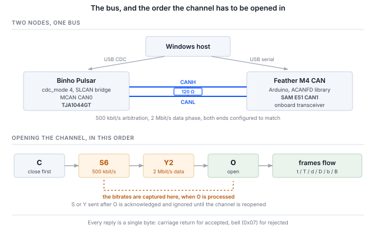

## 1 簡介

Binho Pulsar 是一款用於 I2C、SPI、UART 和 GPIO 的 USB 主機轉接器。它還內建一個 NXP MCAN 控制器和一個 TJA1044GT CAN-FD 收發器，並且從韌體 v4.4.0 起，其 USB 虛擬 COM 埠可以切換到一種模式，透過 **SLCAN** 將該收發器橋接到主機。SLCAN 是 ASCII 序列 CAN 協定，最初來自 Lawicel，如今被大量轉接器和工具所支援。

最後這一點正是值得為此撰寫一份文件的原因。Pulsar 的 Python SDK 完全沒有 CAN 指令，也不需要：在 CAN-FD 模式下，該裝置表現為一個一般的 SLCAN 轉接器，因此現有的 CAN 軟體生態系無需修改即可驅動它。

Table: CAN-FD 相對於傳統 CAN 增加了什麼

| 特性 | 為設計帶來什麼 |
|---|---|
| 64 位元組酬載 | 八位元組變為六十四位元組，因此傳統 CAN 必須跨訊框分段再重組的記錄可以放進一個訊框 |
| 位元率切換 | 仲裁階段維持在所有節點都能跟上的速率，而資料階段跑得更快，因為此時只有一個節點在驅動匯流排 |
| 更大的 DLC 編碼 | DLC 值 9 至 F 分別選擇 12、16、20、24、32、48 和 64 位元組，因此 8 位元組以上的酬載由階梯表而非位元組數決定 |
| 更強的訊框檢查 | CRC 長度與酬載相符，並附帶填充位元計數，而不是傳統 CAN 對所有長度都使用的單一 15 位元多項式 |
| 實體層不變 | 同樣的兩條線、同樣的收發器、同樣的 120 Ω 終端電阻 |
| 共存 | 傳統訊框與 FD 訊框可以共用一條匯流排，訊框是傳統或 FD 依訊框決定，而非依匯流排決定 |

此配置的三個特性決定了主機端的撰寫方式，而且這三點都與本系列中的其他轉接器不同。

Table: 與其他 Binho 主機轉接器的不同之處

| 特性 | 對主機的影響 |
|---|---|
| CAN-FD 是一種 CDC 模式，而不是 SDK 指令群組 | 該模式透過 HID 選擇並儲存在快閃記憶體中，之後裝置成為專用的 SLCAN 橋接器。在此期間，I2C、SPI、UART 和 GPIO 管理器不會執行 |
| 介面是序列線路協定 | 指令為以歸位字元結尾的 ASCII，裝置以 `\r` 表示接受、以 `\a` 表示拒絕。這可以用終端機診斷，中間不經過任何函式庫 |
| 主機是共用匯流排上的一個節點 | 與點對點匯流排不同，訊框會不請自來，需要有節點應答，並且會在主機忙於其他事務時到達。第 8.2 節與第 13 節都是這一點的結果 |

本筆記使用一個 Pulsar 和一個為此專門建構的第二個 CAN-FD 節點進行說明：將 Pulsar 切換到 CAN-FD 模式，介紹它使用的 SLCAN 協定，建構並啟動遠端節點，驗證雙向的傳統與 FD 通訊，然後從 python-can 及以它為基礎的協定堆疊驅動匯流排。

這裡的一切都不需要專屬 SDK。主機端的每一步，要麼是序列埠上的一行 ASCII，要麼是對現成軟體的一次呼叫。

### 1.1 範圍

讀完本文後，手邊有硬體的讀者將能夠：將 Pulsar 切換到 CAN-FD 模式，確認橋接器回應 SLCAN，建構第二個 CAN-FD 節點並使其位元時序與轉接器相符，雙向交換傳統訊框和帶位元率切換的 64 位元組 FD 訊框，透過 DBC 解碼即時流量，擷取並重播記錄，以及從 CANopen、J1939 和 ISO-TP 協定堆疊驅動匯流排。

範例將 Pulsar 與 Adafruit Feather M4 CAN Express 配對。兩者都在硬體上經過測試，本文中的每個輸出都是實際擷取。

本筆記涵蓋 Windows 原生主機工具。`can-utils` 和 SocketCAN 系列（在 Linux 上通常透過它們使用相同的工具）不在範圍內：在 Windows 上，它們需要 USB 直通層和 Linux 環境，而使用此轉接器並不需要這兩者。

### 1.2 適用裝置

CAN-FD 模式**僅適用於 Pulsar**。Binho Supernova 的微控制器沒有 MCAN 週邊，其韌體會拒絕該模式。主機端內容適用於任何 SLCAN 轉接器；節點韌體適用於任何以 SAM E51 為基礎並引出其 CAN1 接腳的電路板。

### 1.3 相關文件

Table: 相關文件

| 文件 | 位置 |
|---|---|
| CDC CAN-FD (SLCAN) mode | Binho 韌體文件，`docs/CDC-CANFD-Mode.md`；關於橋接器指令集與限制的權威說明 |
| Binho Pulsar 文件 | `https://support.binho.io` |
| python-can | `https://python-can.readthedocs.io` |
| cantools | `https://cantools.readthedocs.io` |
| ACANFD_FeatherM4CAN | `https://github.com/pierremolinaro/acanfd-featherM4can`，節點使用的 CAN-FD 驅動程式 |
| CAN FD 規格 | Robert Bosch GmbH，*CAN with Flexible Data-Rate*，v1.0 |
| ISO 11898-1 | CAN 資料鏈結層，包括 FD 訊框格式 |

## 2 所需設備與軟體

### 2.1 硬體

Table: 所需設備

| 項目 |
|---|
| Binho Pulsar，韌體 v4.4.0 或更新版本 |
| Adafruit Feather M4 CAN Express，或其他 CAN-FD 節點 |
| 兩者之間的雙線 CAN 連接，CANH 接 CANH，CANL 接 CANL |
| 120 Ω 終端電阻 |
| 兩條 USB-C 纜線 |

### 2.2 連接

Table: 使用的訊號

| 訊號 | 用途 |
|---|---|
| CANH | CAN 匯流排，顯性高電位線 |
| CANL | CAN 匯流排，顯性低電位線 |
| GND | 兩塊電路板之間的共同回路 |

Pulsar 的 CANH 和 CANL 來自其板載 TJA1044GT；Feather 的則來自該板上的收發器。不需要第三條線，兩塊電路板也不互相供電。

> **注意**：CAN 需要終端電阻，也需要第二個節點。一條只有發送者而沒有應答者的匯流排不會「部分運作」：發送者永遠收不到應答，會無限重試該訊框，其傳送佇列會堵塞在它送出的第一個訊框之後。第 14 節列出了從兩端看到的現象，因為該症狀會讓人懷疑轉接器而不是匯流排。

### 2.3 匯流排設定

Table: 使用的匯流排設定

| 設定 | 值 | 設定方式 |
|---|---|---|
| 仲裁位元率 | 500 kbit/s | SLCAN `S6`，節點端為 `DataBitRateFactor` 基準 |
| 資料階段位元率 | 2 Mbit/s | SLCAN `Y2`，節點端為 `DataBitRateFactor::x4` |
| 終端電阻 | 120 Ω | 硬體 |
| 序列埠速率 | 無關 | 見下文 |

COM 埠的鮑率無關緊要。該埠是 USB CDC 端點而非真正的 UART，因此這個數值會被捨棄；CAN 位元率僅由 `S` 和 `Y` 指令決定。

### 2.4 軟體

```
pip install python-can cantools
```

Python 3.12 加上 `python-can` 和 `cantools` 即可涵蓋第 8 節與第 9 節的全部內容。第 10 節另外需要 `canopen`、`can-j1939` 和 `can-isotp`。切換 CDC 模式需要 `hidapi`。

節點韌體需要 Arduino 工具鏈、Adafruit SAMD 核心以及一個函式庫：

```
arduino-cli core install adafruit:samd \
  --additional-urls https://adafruit.github.io/arduino-board-index/package_adafruit_index.json
arduino-cli lib install ACANFD_FeatherM4CAN
```

> **注意**：在 Windows 上，請將核心安裝到 Arduino 的預設位置。GCC 工具鏈本身的路徑深度就達到約 130 個字元，若將資料目錄放在較深的位置，會使 `cc1plus.exe` 超過 260 個字元的限制。此時的錯誤是 `cannot execute 'cc1plus'`，看起來並不像路徑問題。

## 3 將 Pulsar 切換到 CAN-FD 模式

CAN-FD 是 USB 虛擬 COM 埠的幾種功能模式之一。該模式透過 HID 設定並儲存在快閃記憶體中，因此在斷電重開後仍會保留，由韌體本身的工具進行設定：

```
python device_settings_cli.py --device pulsar show
```

```
Connected to Binho Pulsar
  webusb_enabled : 1  (on)
  cdc_enabled    : 1  (on)
  cdc_mode       : 0  (uart_passthrough)
```

模式 0 是預設模式，即透明的 USB 轉 UART 橋接器。在做任何其他事情之前了解這一點很有必要，因為處於預設模式的 Pulsar 會提供一個不回應任何 SLCAN 指令、也不產生任何輸出的 COM 埠。它沒有故障，也不是選錯了埠；它正在橋接一個 UART。

```
python device_settings_cli.py --device pulsar set --cdc-mode canfd
```

```
Settings updated:
  cdc_mode       : 4  (canfd)

Resetting device to persist settings to flash...
```

重設是預期行為：模式在開機時套用，因此該工具會重新啟動裝置使設定生效。接著 Pulsar 重新列舉，它重新出現的 COM 埠就是 SLCAN 介面。

模式的排他性帶來兩個結果。

當 Pulsar 處於 CAN-FD 模式時，**HID 協定管理器不會執行**。在切換回原模式之前，I2C、SPI、UART 和 GPIO 均無法使用；裝置是一個專用的 SLCAN 橋接器。設定指令仍可透過 HID 使用，切換回原模式就是透過它完成的：

```
python device_settings_cli.py --device pulsar set --cdc-mode uart_passthrough
```

而且由於該設定儲存在快閃記憶體中，處於 CAN-FD 模式的 Pulsar 重新上電後仍處於 CAN-FD 模式。如果某台裝置看起來失去了 I2C 和 SPI 功能，這是首先要檢查的地方。

## 4 SLCAN 協定

### 4.1 指令集

指令為 ASCII，每行一條，以歸位字元結尾。裝置接受指令時回覆 `\r` (0x0D)，不接受時回覆 `\a` (0x07，響鈴)。這使得整個介面都可以從終端機存取，而在出現問題時，終端機正是開始排查的合適位置。

Table: SLCAN 指令

| 指令 | 意義 | 備註 |
|---|---|---|
| `S0`–`S8` | 選擇仲裁位元率 | 在通道開啟時鎖定 |
| `Y1`, `Y2`, `Y5` | 選擇 CAN-FD 資料階段位元率 | 在通道開啟時鎖定 |
| `O` | 以正常模式開啟通道 | |
| `L` | 以僅監聽模式開啟通道 | 不發送應答；見第 13 節 |
| `C` | 關閉通道 | 收發器進入待機 |
| `t` / `T` | 傳送傳統訊框，標準 / 擴充 ID | |
| `d` / `D` | 傳送不帶位元率切換的 FD 訊框 | |
| `b` / `B` | 傳送帶位元率切換的 FD 訊框 | |
| `V`, `N`, `F` | 版本、序號、狀態旗標 | 在此韌體中為固定常數 |
| `s` | 自訂位元時序 | 接受但忽略；請使用 `S` |

在引入任何函式庫之前，先確認橋接器有回應：

```
python canfd_slcan.py probe --port COM12 --bitrate 500000 --data-bitrate 2000000
```

```
  V   -> b'V0101\r'   ok   version
  N   -> b'NFFFF\r'   ok   serial number
  F   -> b'F00\r'     ok   status flags
  S6  -> b'\r'        ok   nominal 500000
  Y2  -> b'\r'        ok   data phase 2000000
  Q   -> b'\x07'      ok   an unsupported command should bell
```

最後一行與其他各行同樣重要。一個對所有指令都作出相同回覆的裝置什麼也證明不了；對未知指令響鈴的裝置才是在剖析指令。

`V`、`N` 和 `F` 傳回的是常數而非即時值，因此它們只能證明橋接器在監聽，而不能證明它是哪台裝置或匯流排處於什麼狀態。

### 4.2 訊框格式

一個傳送訊框就是一個字串：

```
<letter><identifier><dlc><data bytes>
```

字母同時表達三項資訊：訊框是傳統訊框（`t`）還是 FD 訊框（`d`、`b`）；資料階段是否切換速率，`b` 和 `B` 會切換，`d` 和 `D` 不切換；以及識別碼是標準（小寫）還是擴充（大寫）。標準識別碼為三位十六進位數，擴充識別碼為八位，DLC 為一位十六進位數，資料隨後以位元組對的形式給出。

通道開啟後，接收到的訊框以相同格式主動送出。

```
t1238DEADBEEF00112233       classic, std 0x123, 8 bytes
b200F0102...                FD with BRS, std 0x200, DLC F = 64 bytes
```

### 4.3 位元率與 DLC 對應

Table: DLC 與酬載長度的對應關係

| DLC | 0–8 | 9 | A | B | C | D | E | F |
|---|---|---|---|---|---|---|---|---|
| 位元組數 | 0–8 | 12 | 16 | 20 | 24 | 32 | 48 | 64 |

超過 8 位元組時，酬載長度來自這張階梯表，而不能任意取值。20 位元組的酬載對應 DLC `B`；13 位元組的酬載不存在，必須填充到 16 位元組。隨附的工具會自動填充，這是一個值得在某處明確說明的決定，而不是讓呼叫者疑惑為什麼他們的 13 位元組變成了 16 位元組。

位元率在通道開啟時鎖定。**請在 `O` 之前送出 `S` 和 `Y`。** 之後再設定的話，指令會被接受並應答，但在關閉並重新開啟通道之前不會生效，這類故障看起來像位元時序問題，而不是順序問題。



## 5 遠端節點

CAN 匯流排需要第二個參與者，既用於應答訊框，也為了讓匯流排上有值得觀察的內容。這裡使用的節點是 Adafruit Feather M4 CAN Express，它將 SAM E51 與 CAN-FD 收發器配對，以 Arduino C++ 和 `ACANFD_FeatherM4CAN` 函式庫撰寫程式。

> **注意**：在這塊電路板上實測，CircuitPython 的 `canio` 模組**僅支援傳統 CAN**：`Message` 最多接受 8 位元組，建構函式拒絕 `fd`、`can_fd` 和 `data_bitrate`。MCAN 週邊本身支援 FD，`canio` 迴路測試也證實控制器運作正常，但 FD 沒有對外開放。因此，這塊電路板上的 CAN-FD 節點必須以 C++ 建構。

### 5.1 使用哪個 CAN 模組，以及決定其能否運作的兩支接腳

SAM E51 有兩個 CAN 模組，該電路板將 **CAN1** 連接到板載收發器。CAN1 是唯一一個其 CANH 和 CANL 引到排針的模組；CAN0 存在於 D12 和 D13 上，但後面沒有連接任何元件。

兩支接腳決定一個設定正確的節點能否驅動匯流排。收發器有一個待機輸入，必須驅動為低電位才能使其運作；還有一個升壓轉換器致能，必須驅動為高電位。若兩者都不處理，節點在設定時不會報錯，會回報傳送成功，卻不會在線路上輸出任何訊號。

該函式庫在 CAN1 的 `beginFD` 中處理了這兩點，將 PB12 驅動為低電位、PB13 驅動為高電位。這一點值得了解而不是想當然：在沒有處理這兩點的電路板上，這是首先要檢查的地方。

### 5.2 匹配位元時序

節點將其資料階段速率表示為仲裁速率的**倍數**，而不是絕對值：

```cpp
ACANFD_FeatherM4CAN_Settings settings(
    ACANFD_FeatherM4CAN_Settings::CLOCK_48MHz, 500 * 1000, DataBitRateFactor::x4);
settings.mModuleMode = ACANFD_FeatherM4CAN_Settings::NORMAL_FD;
const uint32_t errorCode = can1.beginFD(settings);
```

500 kbit/s 乘以四倍即 2 Mbit/s，對應 SLCAN 先送 `S6` 再送 `Y2`。兩端必須在任一方開啟通道之前達成一致。

如果 `beginFD` 無法為所要求的組合找到位元時序，它會傳回非零值，節點會回報這一點而不是繼續執行，因為一個以錯誤速率靜默執行的節點比一個拒絕執行的節點更難診斷。

### 5.3 重新傳送接收到的訊框

這是唯一一個值得記錄的不明顯缺陷。`CANFDMessage` 有一個屬於驅動程式的 `idx` 欄位，在接收到的訊框中，它保存的是該訊框到達時所用的索引。因此，複製一個接收到的訊框來回送時，會帶上一個非零的 `idx`，而傳送路徑會將其解讀為*使用編號為 idx 的專用傳送緩衝區*，而這個緩衝區並不存在：

```cpp
CANFDMessage reply = frame;   // carries frame.idx
reply.id  = RESPONSE_ID;
reply.idx = 0;                // without this, status 2 and nothing on the bus
```

症狀是傳送狀態為 2，即 `kTransmitBufferIndexTooLarge`，並且沒有訊框送出。零表示*使用傳送 FIFO*，這正是回送所需要的。

## 6 首次通訊

兩端速率相符後，節點本身的主控台會顯示其設定與傳送情況：

```
=== Feather M4 CAN :: CAN-FD test node ===
arbitration 500000 bit/s, data x4 = 2000000 bit/s   (SLCAN: S6 then Y2)
CAN1 configured, transceiver active
diagnostic: 0x100 heartbeat, 0x200 ramp, 0x123->0x321 echo
device:     0x110 environment, 0x210 trace, 0x600->0x601 cmd
```

在主機端，開啟通道並監聽：

```
python canfd_slcan.py listen --port COM12 --bitrate 500000 --data-bitrate 2000000
```

```
  channel open (normal), 500000 nominal, 2000000 data; collecting for 4 s
   id=0x100 classic len=8   x8
   id=0x110 classic len=8   x41
   id=0x200 fd+brs  len=64  x4
   id=0x210 fd+brs  len=48  x20
  73 frame string(s), 73 decoded, 4 distinct
```

這些計數值得與第 7 節中的週期核對，因為這是確認沒有遺失訊框最簡便的方法：在四秒內，500 ms 週期的 `0x100` 得到 8 個，100 ms 週期的 `0x110` 得到 41 個，1 s 週期的 `0x200` 得到 4 個，200 ms 週期的 `0x210` 得到 20 個。計數明顯低於其週期對應的值代表有遺失；計數相符則表示整個訊息目錄都在到達。

其中兩個訊息正是做這一切的原因。`0x200` 是帶位元率切換的 64 位元組訊框，`0x210` 是 48 位元組訊框；傳統 CAN 主機根本無法接收這兩種訊框。能顯示它們的工具確實在進行 FD 通訊，而不只是聲稱支援 FD。

反方向以及 FD 往返：

```
python canfd_slcan.py roundtrip --port COM12 --bitrate 500000 --data-bitrate 2000000
```

```
  --- classic ---
    drained 9 buffered frame(s) first
    reply id=0x321 classic dlc=8 len=8
    payload identical: True

  --- CAN-FD, 64 bytes, BRS ---
    drained 0 buffered frame(s) first
    reply id=0x321 fd+brs dlc=64 len=64
    payload identical: True
```

FD 請求得到的是 FD 回覆，位元率切換得以保留，酬載逐位元組相同。這是單純的傳送測試無法給出的結論：它證明遠端收到了所送出的內容，並且訊框在傳輸途中沒有被降級。

## 7 示範節點的訊息目錄

該節點刻意同時具有兩種身分，任何測試節點都值得保持這種劃分。

**診斷層**用於證明匯流排正常運作，並盡可能少做事情，以便在出現故障時原因範圍很小。

Table: 診斷訊息

| ID | 訊框 | 速率 | 內容 |
|---|---|---|---|
| `0x100` | 傳統訊框，8 位元組 | 500 ms | 序號與接收計數器 |
| `0x200` | 帶 BRS 的 FD 訊框，64 位元組 | 1 s | 位元組遞增序列 |
| `0x123` → `0x321` | 與請求一致 | 依需求 | 回送，保留訊框類型與 BRS |

**裝置層**位於其上，其存在是為了讓主機有值得解碼的內容。診斷匯流排不需要其中任何部分。

Table: 模擬裝置訊息

| ID | 訊框 | 速率 | 內容 |
|---|---|---|---|
| `0x110` | 傳統訊框，8 位元組 | 100 ms，可變更 | 溫度、濕度、氣壓、旗標、序號 |
| `0x210` | 帶 BRS 的 FD 訊框，48 位元組 | 200 ms | 附標頭的 16 取樣點波形記錄 |
| `0x600` → `0x601` | 傳統訊框，8 位元組 | 依需求 | `INFO`、`COUNTERS`、`SET_RATE` |

`0x210` 是*支持* CAN-FD 的論據，而不僅僅是對它的測試。十六個 16 位元取樣點加上一個 12 位元組標頭，一個訊框共 44 位元組。同樣的波形記錄以傳統 CAN 傳輸需要六個訊框外加一套重組機制，而且這六個訊框會與匯流排上的其他所有訊框交錯，因此接收方還需要處理它們亂序或不完整到達的情況。

從線路上解碼：

```
python canfd_slcan.py monitor --port COM12 --bitrate 500000 --data-bitrate 2000000
```

```
   0x100  heartbeat seq=11024 rx=10 echoes=0
   0x110  environment 19.7 C  49.1 %RH  1012.7 hPa  flags=0x01 seq=212
   0x200  fd ramp 64 bytes, first=0x88
   0x210  trace seq=27560 uptime=5515031 ms  16 samples peak=7998  [7331, 5548, 2921, -151, -3200, -5762, ...]
```

指令端點在 `0x601` 上應答，並在第一個位元組回送指令位元組，使回覆無需交易識別碼即可與其請求對應：

```
python canfd_slcan.py command info --port COM12 --bitrate 500000 --data-bitrate 2000000
```

```
  TX t600101   (info)
  RX 0x601  cmd INFO  id=BIN fw=1.0 features=0x07 trace_samples=16
```

`SET_RATE` 值得一提，因為它展示了唯讀訊息目錄無法展示的東西。請求 250 ms：

```
  TX t600303FA00   (set-rate)
  RX 0x601  cmd SET_RATE period=250 ms, accepted
```

再次監聽顯示，`0x110` 在四秒內為 16 個而不是 41 個，而其他所有識別碼的計數維持不變，因此該指令確實改變了裝置的行為，而不只是得到了應答：

```
   id=0x100 classic len=8   x8
   id=0x110 classic len=8   x16
   id=0x200 fd+brs  len=64  x4
   id=0x210 fd+brs  len=48  x20
```

超出範圍的請求會被**限制在範圍內而不是拒絕**，回覆中帶有實際生效的值。請求 5 ms，低於節點 10 ms 的下限：

```
  TX t6003030500   (set-rate)
  RX 0x601  cmd SET_RATE period=10 ms, accepted
```

裝置實際運作的週期以回覆為準，而不是以請求為準。假設二者一致的呼叫者一直是對的，直到它請求了超出範圍的值。

所有多位元組欄位均為**小端序**。CAN 本身不規定位元組順序，因此這是一個選擇，而且必須寫明，否則兩端會在不知不覺中產生分歧。

## 8 從 python-can 驅動匯流排

對 python-can 而言，該橋接器就是一個普通的 SLCAN 轉接器，透過其標準介面使用，無需任何 Binho 專屬程式碼：

```python
import can

bus = can.Bus(interface="slcan", channel="COM12", bitrate=500_000)
bus.set_bitrate(500_000, 2_000_000)      # nominal, then FD data phase

bus.send(can.Message(arbitration_id=0x123, is_extended_id=False,
                     data=bytes(range(64)), is_fd=True, bitrate_switch=True))
print(bus.recv(timeout=1.0))
bus.shutdown()
```

### 8.1 為什麼 `set_bitrate` 有效，而僅靠建構函式不行

FD 資料階段速率無法傳給建構函式。`set_bitrate` 是唯一途徑，而它之所以有效，是因為其內部操作：它會關閉通道，寫入 `S` 和 `Y`，然後重新開啟。這正是第 4.3 節所要求的順序。在已開啟的通道上設定速率會被接受但被忽略。

Table: python-can 位元率對應

| 要求值 | 送出 | 匯流排實際速率 |
|---|---|---|
| 500 000 | `S6` | 500 kbit/s |
| 1 000 000 | `S8` | 1 Mbit/s |
| 750 000 | `S7` | **800 kbit/s** |
| data 2 000 000 | `Y2` | 2 Mbit/s |
| data 5 000 000 | `Y5` | 5 Mbit/s |

第三列是一個陷阱。python-can 的對應表將 750 000 對應到 `S7`，而此韌體的 `S7` 是 800 kbit/s。要求 750 kbit/s 會使匯流排運作在 800 kbit/s，雙方都不會發出任何警告。該後端的資料階段也只提供 2 和 5 Mbit/s，因此 `Y1` 可以透過原始協定使用，但無法透過該介面使用。

### 8.2 積壓，以及為什麼請求/回應測試需要先清空

這一點會耗費實實在在的時間。節點持續傳送，而在主機花費兩秒等待埠穩定以及關閉並重新開啟通道的過程中，橋接器一直在緩衝。等到請求送出時，其回覆前面已經排著一列不相關的訊框。

一個送出後讀取接下來幾個訊框的迴圈，讀到的是*歷史*。回覆就在那裡，排在積壓之後，而一個正常運作的節點看起來就像從未應答。先清空才能使量測有意義：

```
  --- classic request/response ---
    drained 42 buffered frame(s) first
    reply id=0x321 classic dlc=8 len=8 data=DEADBEEF00010203
```

在該例中有四十二個歷史訊框。若不清空，同一測試會回報一個已正確應答的節點完全沒有回覆。

### 8.3 記錄與重播

python-can 會安裝涵蓋擷取與重播流程的命令列工具：

```
python -m can.logger -i slcan -c COM12 -b 500000 --fd --data-bitrate 2000000 -f capture.asc
python -m can.player -i slcan -c COM12 -b 500000 --fd --data-bitrate 2000000 capture.asc
```

記錄檔是 Vector ASC 檔案，FD 記錄正確，其中 `f 64` 代表 DLC F 及其位元組數：

```
 0.000000 1  100             Rx   d 8 00 00 07 6E 00 07 00 07
 0.000000 CANFD   1 Rx        200   1 0 f 64 B7 B8 B9 BA BB BC ...
```

重播會把這些訊框重新放到線路上，節點也收到了它們：17 份 `0x100` 和 13 份 `0x200`。

> **注意**：該擷取中的每個時間戳記都是 `0.000000`。韌體沒有實作 SLCAN 時間戳記指令（`Z0`/`Z1`），因此 python-can 沒有可記錄的內容。記錄檔在結構上是有效的，其 FD 記錄也正確，但不包含任何時序資訊。任何需要訊框間時序的應用都必須改從主機取得。

## 9 使用 DBC 解碼

DBC 將原始位元組轉換為具名且經過縮放的訊號，這是最常見的 CAN 工作流程。`cantools` 讀取 DBC 並解碼即時流量：

```python
import can, cantools

db = cantools.database.load_file("binho_canfd_demo.dbc")
bus = can.Bus(interface="slcan", channel="COM12", bitrate=500_000)
bus.set_bitrate(500_000, 2_000_000)

message = bus.recv(timeout=1.0)
print(db.decode_message(message.arbitration_id, message.data))
```

```
  0x100 Heartbeat        Seq=7787, RxCount=4, EchoCount=0
  0x110 Environment      Temperature=20.3, Humidity=42.4, Pressure=1014.2, Flags=1, EnvSeq=159
  0x200 FdRamp           FirstByte=53
  0x210 Telemetry        TraceSeq=19469, UptimeMs=3896831, SampleCount=16, Reserved=0, Sample00=-3434, ...
```

隨附的 DBC 描述了全部七個訊息和 35 個訊號。它由腳本產生而不是手寫，原因有兩個，值得再強調一次：波形記錄有十六個訊號，其位元偏移容易出現差一錯誤；而一個錯了一個位元的 DBC 會解碼出看似合理的錯誤資料，而不是直接失敗。

> **注意**：DBC 必須標記其 FD 訊息，否則讀取者會把 48 或 64 位元組的訊息當作格式錯誤的傳統訊框。該屬性為 `VFrameFormat`，設定為 `StandardCAN_FD`。`cantools` 會讀取它但不會寫入它，因此透過傾印資料庫產生的 DBC 會遺失該旗標；隨附的產生器會附加該屬性，然後重新載入檔案以確認它被保留。

`cantools` 命令列無需撰寫程式碼即可完成其餘流程：

Table: cantools 子指令

| 指令 | 作用 |
|---|---|
| `dump` | 印出每個訊息及其位元配置圖 |
| `decode` | 透過 DBC 解碼 candump 格式的文字 |
| `monitor` | 以 curses 為基礎的即時解碼檢視 |
| `plot` | 繪製解碼訊號隨時間的變化 |
| `convert` | 在 DBC、KCD、SYM、ARXML 之間轉換 |
| `generate_c_source` | 為嵌入式端產生 C 編碼器與解碼器 |

```
python -m cantools decode binho_canfd_demo.dbc < candump.log
```

```
  can0  210   [48]  0E 4C 00 00 C7 76 3B 00 10 00 00 00 03 F4 ... ::
Telemetry(
    TraceSeq: 19470,
    UptimeMs: 3897031 ms,
    SampleCount: 16,
    Sample00: -3069,
    Sample01: -8,
    ...
)
```

> **注意**：`decode` 和 `plot` 讀取的是 **candump** 文字，而 `can.logger` 寫出的是 **ASC**。這兩種格式無法直接互通，因此要供 `cantools` 使用的擷取必須以 candump 格式寫出。這是工具鏈中的一個銜接缺口，而不是轉接器的限制。

## 10 高階協定堆疊

由於該橋接器是一個普通的 SLCAN 轉接器，以 python-can 為基礎建構的協定堆疊無需修改即可在其上運作。以下每一項都是透過讓協定堆疊傳送資料、並在*節點*處確認訊框已到達線路來驗證的，而不是透過觀察函式庫接受了呼叫來驗證的。

Table: 在橋接器上驗證過的協定堆疊

| 協定堆疊 | 傳送的內容 | 節點處觀察到的 |
|---|---|---|
| `canopen` | NMT 重設，即 CANopen 主站啟動時發出的廣播 | `0x000` |
| `can-j1939` | 位址宣告，PGN `0xEE00`，攜帶 8 位元組 NAME | `0x18EEFF80`，擴充訊框 |
| `can-isotp` | 透過 CAN-FD 傳送的 60 位元組 ISO-TP 單一訊框 | `0x700` |

```python
import canopen
network = canopen.Network()
network.connect(interface="slcan", channel="COM12", bitrate=500_000)
network.nmt.state = "RESET"
network.disconnect()
```

ISO-TP 的情況最值得關注，它也是支持 FD 的另一個論據。設定為 64 位元組傳送長度時，ISO-TP 可以在一個**單一訊框**中承載最多 62 位元組的酬載，單一訊框不需要流量控制，因此也不需要配合的對端即可示範：

```python
import can, isotp
bus = can.Bus(interface="slcan", channel="COM12", bitrate=500_000)
bus.set_bitrate(500_000, 2_000_000)
stack = isotp.CanStack(
    bus=bus,
    address=isotp.Address(isotp.AddressingMode.Normal_11bits, txid=0x700, rxid=0x701),
    params={"tx_data_length": 64, "can_fd": True, "bitrate_switch": True})
stack.start()
stack.send(bytes(range(60)))
```

同樣的 60 位元組以傳統 CAN 傳輸，需要一個首訊框、八個連續訊框和一次流量控制交握。UDS 正是執行在這種傳輸層之上，因此 `udsoncan` 遵循同樣的路徑；完整的診斷工作階段需要一個實作 ISO-TP 伺服器的對端，而示範節點刻意沒有實作它。

## 11 量測結果

### 11.1 測試組態

Table: 測試組態

| 項目 | 值 |
|---|---|
| 轉接器 | Binho Pulsar，硬體版本 C，韌體 4.5.0，`cdc_mode` 4 |
| 節點 | Adafruit Feather M4 CAN Express，SAM E51，`ACANFD_FeatherM4CAN` 2.0.0 |
| 節點韌體大小 | 23,484 位元組，佔快閃記憶體的 4% |
| 匯流排 | 仲裁階段 500 kbit/s，資料階段 2 Mbit/s，120 Ω 終端 |
| 主機 | Windows 11，Python 3.12，python-can 4.6.1，cantools 43.0.2 |

### 11.2 橋接器實作了什麼

Table: 已驗證的行為

| 特性 | 結果 |
|---|---|
| 傳統訊框，標準 ID | 是，雙向 |
| CAN-FD 訊框，最多 64 位元組 | 是，雙向，酬載經驗證逐位元組相同 |
| 位元率切換 | 是，依訊框設定，並在回送中保留 |
| 擴充識別碼 | 是；在 J1939 位址宣告 `0x18EEFF80` 中觀察到 |
| 仲裁位元率 | `S0`–`S8` |
| 資料階段位元率 | `Y1`, `Y2`, `Y5` |
| 僅監聽模式 | 是，`L`；參見第 13 節中的警告 |
| 未知指令處理 | 響鈴，`0x07` |
| 接收時間戳記 | 未實作；記錄的所有時間戳記均為零 |
| 錯誤與匯流排狀態回報 | 未實作；`F` 傳回常數 |
| 遠端傳輸請求 | 不支援 |
| 主機端接受過濾 | 未實作；接收所有識別碼 |

### 11.3 已驗證的主機軟體

Table: 透過橋接器驅動的主機軟體

| 軟體 | 已驗證 |
|---|---|
| python-can 4.6.1，`slcan` | 傳統與 FD 傳送和接收，FD 往返 |
| `can.logger` | ASC 擷取，FD 記錄正確 |
| `can.player` | 重播到匯流排上，節點已接收 |
| cantools 43.0.2 | 對即時訊框進行 DBC 解碼；`dump`、`decode` |
| canopen 2.4.1 | 匯流排上的 NMT 廣播 |
| can-j1939 2.0.12 | 匯流排上的位址宣告 |
| can-isotp 2.0.7 | 透過 FD 傳送的 60 位元組單一訊框 |
| udsoncan 1.26.1 | 已安裝；以 can-isotp 為基礎，需要 ISO-TP 對端 |
| canmatrix 1.2 | 已安裝；資料庫轉換，不涉及匯流排 |

## 12 參考資料

Table: 提供的內容

| 檔案 | 用途 |
|---|---|
| `assets/canfd_node/canfd_node.ino` | CAN-FD 節點韌體 |
| `assets/tools/canfd_slcan.py` | 主機工具，八個子指令 |
| `assets/tools/device_settings_cli.py` | 切換 Pulsar 的 CDC 模式 |
| `assets/dbc/binho_canfd_demo.dbc` | 描述節點七個訊息的 DBC |
| `assets/dbc/generate_dbc.py` | 產生該 DBC 並進行自我檢查 |

此工具刻意將兩個層次分開。

`probe`、`listen`、`send`、`monitor` 和 `command` 透過序列埠直接使用 SLCAN，不涉及任何 CAN 函式庫。在這一層，問題是可以診斷的，因為送出的確切 ASCII 與傳回的確切 `\r` 或 `\a` 都是可見的。

`roundtrip` 則透過 python-can 的標準介面進行，這正是讀者實際使用此轉接器的方式。在同一硬體上執行這兩層可以定位故障：如果原始層正常而函式庫層不正常，故障就在於函式庫的驅動方式。

Table: 工具子指令

| 指令 | 作用 |
|---|---|
| `mode` | 如何切換 CDC 模式，以及這樣做的代價 |
| `probe` | 檢查橋接器是否回應 SLCAN |
| `rates` | 位元率表與 DLC 對應 |
| `listen` | 依識別碼解碼匯流排上的訊框 |
| `send` | 傳送一個訊框，傳統或 FD，可選 BRS |
| `monitor` | 將示範節點的訊息目錄解碼為工程單位 |
| `command` | 送出 `INFO`、`COUNTERS` 或 `SET_RATE` 並解碼回覆 |
| `roundtrip` | 透過 python-can 進行請求與回應，傳統與 FD |

## 13 實用說明

**請在 `O` 之前送出 `S` 和 `Y`。** 位元率在通道開啟時鎖定。之後再設定的話，指令會被接受、得到應答，但在關閉並重新開啟通道之前不會生效。

**在進行請求/回應量測之前先清空。** 在主機開啟埠以及循環開關通道期間，橋接器會緩衝匯流排流量，因此回覆會排在積壓之後。送出後讀取接下來的幾個訊框，讀到的是歷史。

**僅監聽模式不能作為唯一的其他節點。** `L` 開啟的通道從不發送應答。在雙節點匯流排上，這對對端是致命的：沒有任何節點應答其訊框，控制器會無限重試，永遠無法越過它送出的第一個訊框。症狀是同一個訊息出現成千上萬份，而沒有其他任何訊息。僅在有第三個節點負責應答時才使用 `L`。

**重新傳送接收到的訊框時清除 `idx`。** 在節點端，複製的接收描述元帶有驅動程式自己的索引，而傳送路徑會將其解讀為專用緩衝區編號。

**以防禦性方式剖析接收到的訊框字串。** 讀取視窗經常在訊框中間開啟，因此從緩衝區取出的第一個字串往往是一個訊框尾段，沒有開頭字母，或十六進位數字的位數為奇數。這是正常的，而一個遇到這種情況就拋出例外的解碼器會使原本正常運作的監視器停止。

**處於 CAN-FD 模式的 Pulsar 沒有 I2C、SPI、UART 或 GPIO，** 並且該設定在斷電重開後仍會保留。如果這些介面似乎消失了，請首先檢查 `cdc_mode`。

**超過 8 位元組時必須填充。** FD 長度來自階梯表，因此 13 位元組的酬載必須填充到 16 位元組。

## 14 疑難排解

Table: 疑難排解

| 症狀 | 可能原因 |
|---|---|
| COM 埠沒有任何回覆，沒有橫幅，也沒有響鈴 | Pulsar 處於 `uart_passthrough` 模式；它在橋接 UART，而不是使用 SLCAN |
| 每條指令都傳回響鈴 | 指令格式錯誤，或在通道關閉或處於僅監聽模式時嘗試傳送 |
| 指令被接受，但始終沒有訊框到達 | 通道未以 `O` 開啟、兩端位元率不相符、缺少終端電阻，或 CANH 與 CANL 接反 |
| 同一識別碼出現成千上萬份，沒有其他訊息 | 轉接器以 `L` 開啟；對端的訊框沒有被應答，正在被無限重試 |
| 節點回報傳送狀態 2 | 重新傳送接收到的訊框時未清除 `idx` |
| 節點回報傳送狀態 3 | 由於沒有節點應答，其佇列已滿：對端通道已關閉，或缺少終端電阻 |
| 位元率變更似乎被忽略 | 在 `O` 之後送出了 `S` 或 `Y`；請關閉並重新開啟 |
| 要求 750 kbit/s，匯流排運作在 800 | python-can 將 750 000 對應到 `S7`，而在此韌體中它是 800 kbit/s |
| 請求/回應回報無回覆，但節點記錄了回覆 | 回覆排在接收積壓之後；送出前請先清空 |
| 記錄的時間戳記全為零 | 韌體沒有實作 `Z0`/`Z1`；請從主機取得時序 |
| DBC 將 48 或 64 位元組的訊息解碼為格式錯誤 | DBC 中這些訊息缺少 `VFrameFormat` |
| 建構節點時出現 `cannot execute 'cc1plus'` | Windows 路徑長度問題；請將 Arduino 核心安裝在其預設位置 |
| 節點完成設定，但從不驅動匯流排 | 收發器待機未解除，或其升壓轉換器未致能 |

## 15 縮寫

Table: 縮寫

| 術語 | 意義 |
|---|---|
| BRS | 位元率切換（Bit-rate switch） |
| CAN | 控制器區域網路（Controller Area Network） |
| CAN-FD | 具彈性資料速率的 CAN（CAN with Flexible Data-rate） |
| CDC | 通訊裝置類別（Communications Device Class），USB 序列埠類別 |
| DBC | Vector 用於 CAN 網路的資料庫格式 |
| DLC | 資料長度碼（Data length code） |
| ECU | 電子控制單元（Electronic control unit） |
| FD | 彈性資料速率（Flexible Data-rate） |
| HID | 人機介面裝置（Human Interface Device），SDK 使用的 USB 類別 |
| ISO-TP | ISO 15765-2 傳輸協定 |
| MCAN | 授權整合到許多微控制器中的 Bosch M_CAN 控制器 |
| NMT | 網路管理（Network management），一種 CANopen 服務 |
| PGN | 參數群組編號（Parameter group number），一種 J1939 識別碼 |
| RTR | 遠端傳輸請求（Remote transmission request） |
| SLCAN | 序列線路 CAN（Serial line CAN），ASCII 轉接器協定 |
| UDS | 統一診斷服務（Unified Diagnostic Services），ISO 14229 |

## 16 關於本文中原始碼的說明

本文中展示以及隨附壓縮檔中提供的範例程式碼僅供評估與參考。這些程式碼依據 MIT 授權條款發布，授權條款全文包含在壓縮檔中。

`device_settings_cli.py` 是 Binho 本身的韌體工具，隨附於此，以便無需另行下載即可重現第 3 節中的模式切換。節點韌體依賴 Pierre Molinaro 撰寫的 `ACANFD_FeatherM4CAN` 函式庫，該函式庫透過 Arduino 函式庫管理員安裝，本文不重新散布。

Table: 資源壓縮檔的內容

| 檔案 | 說明 |
|---|---|
| `AN0012.md` | 本文的 Markdown 原始檔 |
| `assets/canfd_node/canfd_node.ino` | 用於 Feather M4 CAN Express 的 CAN-FD 節點韌體 |
| `assets/tools/canfd_slcan.py` | SLCAN 橋接器的主機工具 |
| `assets/tools/device_settings_cli.py` | 透過 HID 切換 CDC 模式 |
| `assets/dbc/binho_canfd_demo.dbc` | 描述節點訊息的 DBC |
| `assets/dbc/generate_dbc.py` | 該 DBC 的產生器 |
| `assets/LICENSE` | 適用於範例程式碼的 MIT 授權條款 |

## 17 修訂歷史

Table: 修訂歷史

| 修訂版本 | 日期 | 說明 |
|---|---|---|
| 0.1 | 9 September 2026 | 供內部審閱的草稿。最初以 AN0008 撰寫，並在審閱前重新編號為 AN0012；所有量測均未變更。所有結果均在韌體 4.5.0 的 Pulsar 上、針對專門建構的 CAN-FD 節點量測，主機工具僅限於可在 Windows 上原生執行的工具。 |
| 1.0 | 6 November 2026 | 正式發布。 |
