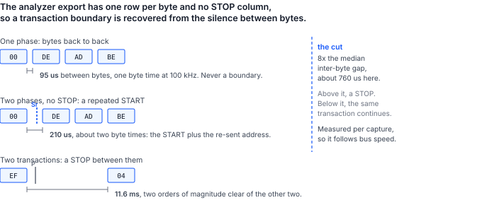

## 1 はじめに

動作するシステムとロジックアナライザを手元に持つエンジニアは、キャプチャファイルの中に、うまくいったバスのやり取りの正確な記録を持っていることになります。次に自然に浮かぶ疑問は、その記録をリプレイできるかどうかです。

本書は、I2C と Binho Pulsar についてこの疑問に答えます。リプレイを行うユーティリティ、以下のすべての数値を得た手順、そしてリプレイがキャプチャから正当に乖離する点の説明を提供します。この乖離こそが本書の本質であり、バイトを再送することは問題の前半にすぎません。

### 1.1 対象範囲

本書で扱う内容は次のとおりです。

- Saleae I2C アナライザの CSV エクスポートを読み込み、そこからトランザクションを復元すること
- それらのトランザクションを Pulsar から Python または C++ でリプレイすること
- ターゲットが拒否したときにアダプタが報告する内容と、報告しない内容
- アナライザで両方の実行を観測しながら、リプレイが一致することを信号線上で確認すること
- 2 台目のアダプタをエミュレートしたターゲットとして使い、意図的に拒否を発生させること
- 制約事項：読み出し、トランザクションのフレーミング、タイミング、暗黙の拒否、10 ビットアドレッシング

SPI、I3C、UART のキャプチャのリプレイ、Mission Control 3 からのリプレイの実行、アナライザのセッションファイルからのキャプチャの再構成は扱いません。このユーティリティが読み込むのはアナライザの CSV エクスポートであり、ネイティブのセッションファイルではありません。

### 1.2 対象デバイス

Table: 対象デバイス

| 役割 | 品名 | 識別情報 | 根拠 |
|---|---|---|---|
| リプレイコントローラ | Binho Pulsar | ハードウェアリビジョン C、ファームウェア 4.4.0 | 測定済み、本書 |
| リプレイコントローラ | Binho Supernova | ハードウェアリビジョン C、ファームウェア 4.5.0 | コードパスは Pulsar と共通。コントローラとしては個別に測定していない |
| エミュレートしたターゲット | I2C ターゲットとしての Binho Supernova | ハードウェアリビジョン C、ファームウェア 4.5.0 | 測定済み、本書 |
| キャプチャ機器 | Saleae Logic Pro 8 | Logic 2 v2.4.46、I2C アナライザ | 測定済み、本書 |
| キャプチャ機器 | Acute TravelBus | 8 チャネル | 同じバスをデコード可能。そのエクスポートはユーティリティでは読み込まない |

### 1.3 関連資料

Table: 関連資料

| 資料 | タイトル |
|---|---|
| AN0002 | Binho Pulsar による I2C 経由の STM32 マイクロコントローラのプログラミング |
| AN0008 | Binho Supernova による I2C 経由の CMIS 光モジュールの立ち上げ |

## 2 必要な機器とソフトウェア

### 2.1 ハードウェア

Table: 必要な機器

| 品目 |
|---|
| リプレイコントローラとしての Binho Pulsar USB ホストアダプタ |
| I2C デコーダを備えたロジックアナライザ |
| リプレイ対象の I2C ターゲット |
| 4.5 節でエミュレートしたターゲットとして使う 2 台目の Binho アダプタ |
| USB-C ケーブル |

1.2 節のどちらのアナライザでもこのバスをデコードできます。ここでの測定に Saleae Logic Pro 8 を使ったのは、ユーティリティがそのアナライザのエクスポートを直接読み込むためです。Acute TravelBus も同じ通信を解析し、独自のソフトウェアで I2C をデコードしますが、エクスポートは別形式のファイルであり、そのキャプチャをこのユーティリティで使うには、機器が出力するファイルから 4.2 節の 6 列を書き出す必要があります。本手順が Saleae を前提としている理由はこれだけです。

### 2.2 接続

Table: 使用する信号

| 信号 | 用途 |
|---|---|
| SCL | I2C クロック。コントローラからターゲットへ、およびアナライザのプローブへ |
| SDA | I2C データ。双方向、およびアナライザのプローブへ |
| 3.3 V | ターゲット電源。制御側のアダプタから供給 |
| GND | リターン。両アダプタとアナライザで共通 |

バスは 1 本で、**その上のコントローラは厳密に 1 台**です。2 台目のアダプタがエミュレートしたターゲットとして動作する場合、そのアダプタ自身の I2C コントローラは決して初期化しません。1 本のバス上で 2 台のコントローラが初期化されていると、両方が SCL と SDA を駆動し、両方が共有のターゲット電源レールに通電するため、スキャン結果の非対称や電圧の読み戻し値の誤りが生じ、ケーブルの誤配線のように見えます。

アナライザは同じ 2 本の信号をプローブします。チャネルの割り当ては任意ですが、デコーダに設定する必要があり、思い込まずに確認する価値があります。SCL と SDA を入れ替えたままデコードすると、エラーではなくもっともらしい出力が得られてしまうからです。

### 2.3 バス設定

Table: 使用したバス設定

| 設定 | 値 |
|---|---|
| バス | Pulsar のバス A（Qwiic ポート） |
| クロック | 100 kHz |
| プルアップ | 2.2 kOhm、制御側のアダプタのみから |
| バス電圧 | 3.3 V、読み戻し値 3299 mV |
| アナライザ | 6.25 MS/s、しきい値 3.3 V ロジック、チャネル 0 が SCL、チャネル 1 が SDA |

> **注**：プルアップが強すぎると、有効化したターゲットが見えなくなり、その症状はケーブルが外れている場合と区別できません。`0x50` のターゲットとして有効化した Supernova に対して Pulsar のプルアップを掃引すると、150、220、330 Ohm ではターゲットはまったく応答せず、470 Ohm から 4 kOhm までは毎回応答しました。失敗するケースでは、スキャンは `FW_I2C_BUS_WITH_NO_TARGETS_CONNECTED` を返し、直接の書き込みは `FW_I2C_NACK_ADDRESS` を返します。これはバスが接続されていない場合とまったく同じ戻り値です。配線よりも先にプルアップを疑ってください。

### 2.4 ソフトウェア

ユーティリティは SDK が提供する 2 つの言語の両方で提供されており、同じ処理を行います。リプレイを組み込むシステムに合う方を使用してください。

**Python（pyCosmicSDK 上）。** Python 3.11 以降：

```
pip install pycosmicsdk
python i2c_replay.py selfcheck
```

**C++（CosmicSDK 上）。** C++17 コンパイラとインストール済みの CosmicSDK：

```
cmake -B build -DCOSMICSDK_ROOT=/opt/cosmicsdk
cmake --build build
./build/i2c_replay selfcheck
```

どちらのセルフチェックもアダプタもバスも必要としないため、配線する前にビルドを確認できます。キャプチャにはアナライザ自身のソフトウェアが必要です。4.2 節では、Logic 2 をウィンドウなしで操作する方法を示します。

> **注**：C++ 版はキャプチャの読み込みとリプレイを対象としています。アダプタをエミュレートしたターゲットとして有効化する機能（4.5 節で意図的に拒否を発生させるために使用）は Python 版にのみあります。SDK レベルの理由が 2 つあります。CosmicSDK はバスの役割を返却する `i2cDeinit` を 1.5.0 で追加しましたが、ファームウェアがそれをサポートするのは 4.5.0 以降のみであり、古いアダプタではデバイスがリセットされるまでターゲットの役割が残ります。また、自分のターゲットに対してリプレイする読者には、エミュレートしたターゲットはまったく必要ありません。

## 3 キャプチャはリプレイ時にどう振る舞うか

### 3.1 キャプチャは記録であり、スクリプトではない

キャプチャ内のすべてのバイトは、その瞬間に存在し、その時点の状態にあったターゲットによってアクノリッジされたものです。キャプチャをリプレイすると、それらのバイトは状態が変わったバスに送出されます。ここから 4 つの帰結が生じ、以下のすべてを方向づけます。

**書き込みは再現できますが、読み出しは再現できません。** キャプチャした読み出しに記録されたバイトは、ターゲットが生成したものであり、ターゲットに送られたものではありません。リプレイでそれらを強制することはできません。ユーティリティは読み出しを再発行し、応答がまだ一致するかどうかを報告します。これはリプレイではなく測定です。

**拒否はそのトランザクション自体を終了させます。** ターゲットがアクノリッジしなかった場合、ファームウェアはペイロードの残りをクロック出力せず、その時点で転送を停止します。これはアダプタの動作であり、ユーティリティが実装しているものではありません。

**フレーミングは記録されたものではなく推定されたものです。** アナライザのエクスポートには START 列も STOP 列もありません。それでも境界を復元する方法は 3.3 節で説明します。

**キャプチャのアーティファクトはバストランザクションになります。** アナライザがエッジを誤ってデコードするとアドレスが作り出され、リプレイはそのアドレスに忠実にアクセスします。

### 3.2 2 種類の拒否と、拒否ではない 1 種類

アダプタは 2 種類の失敗を区別し、その違いがリプレイレポートの内容のすべてです。

Table: ターゲットの拒否の仕方と、アダプタが報告する内容

| バス上で起きたこと | ファームウェアのステータス | それによって確定すること |
|---|---|---|
| アドレスをアクノリッジしたものがない | `FW_I2C_NACK_ADDRESS` (0x0203) | データバイトは 1 つも送信されていない |
| ターゲットがアドレスを受け付けた後、データバイトを拒否した | `FW_I2C_NACK_BYTE` (0x0204) | 転送はそのバイトで停止し、残りは送信されていない |

どちらのステータスにも、拒否されたバイトのインデックスは含まれません。リプレイレポートは、どちらの拒否が起きたかは示せますが、ペイロードのどの位置で起きたかは示せません。そのインデックスを復元できる 2 つの情報源を 5.6 節で示します。

問題がないことを意味する NAK もあります。コントローラは読み出しの最後のバイト以外をすべてアクノリッジし、最後のバイトには NAK を返してターゲットに駆動を止めるよう伝えます。これはエクスポートでは読み出しの最終バイトの NAK として現れます。これを拒否として数えると正常なキャプチャを異常として報告してしまうため、ユーティリティはこれを明示的に除外します。

### 3.3 アナライザのエクスポートに含まれるもの、含まれないもの

エクスポートの 2 つの性質がユーティリティの設計を決めており、どちらも列見出しからは推測できません。

**Packet ID 列は何もグループ化しません。** このベンチでの 425 行のキャプチャでは、395 のデータ行すべてが Packet ID `0` を持ち、30 のアドレス NAK 行だけが値を持っていませんでした。そのため、Packet ID でトランザクションをグループ化すると無関係な転送が統合されてしまい、サブアドレス付き読み出しのポインタ書き込みと読み出しバイトが 1 つの 12 バイト書き込みに融合しました。ユーティリティは、この列が実際に変化する場合にのみこれを尊重します。

**トランザクションの境界は無信号区間から推定する必要があります。** START 列も STOP 列もないため、同じアドレスへの同じ方向の 2 つの書き込みを分けるのはバイト間のギャップだけです。そこでユーティリティは、キャプチャのバイト間ギャップの中央値を測定し、その倍数で区切ります。



Table: このキャプチャで測定した 3 つの間隔（100 kHz）

| 間隔の位置 | 測定値 | 意味 |
|---|---|---|
| 1 つのフェーズ内のバイト間 | 95 us | 1 バイト時間。境界になることはない |
| サブアドレス付き読み出しの 2 つのフェーズ間 | 209～210 us | リピーテッド START。バスは保持されている |
| あるトランザクションと次のトランザクションの間 | 11.6 ms | STOP |

デフォルトの区切りは中央値の 8 倍で約 760 us となり、2 行目と 3 行目の間に、どちら側にも 1 桁のマージンを持って位置します。係数を 3 にすると 287 us となり、リピーテッド START のギャップのわずか 1.4 倍にしかならないため、バスが少し遅くなるだけでリピーテッド START を STOP と読み違え始めます。`--gap-seconds` を使うと、このヒューリスティックを完全に上書きできます。

## 4 手順

### 4.1 配線する前にユーティリティを確認する

```
python i2c_replay.py selfcheck
```

```
i2c_replay.py 1.0 self-check: 18/18 OK
```

```
./build/i2c_replay selfcheck
```

```
i2c_replay 1.0 self-check: 11/11 OK
```

件数が異なるのは、Python のテストスイートがスタンドインのアダプタに対するリプレイループもカバーしているのに対し、C++ のテストスイートはその部分を実機ベンチに任せているためです。どちらもパーサをカバーしています。

### 4.2 キャプチャを取得する

アナライザの I2C デコーダを接続した状態で対象の通信を記録し、アナライザの結果を CSV にエクスポートします。ファイルの 1 行目は次のとおりです。

```
Time [s],Packet ID,Address,Data,Read/Write,ACK/NAK
```

数値はエクスポートで使われた基数のまま読み込まれるため、16 進数、10 進数、2 進数のいずれのエクスポートも解析できます。

> **注**：Logic 2 は 2 種類の異なる CSV を書き出し、ここで使えるのはそのうちの 1 つだけです。**アナライザエクスポート（analyzer export**）は 1 バイトにつき 1 行で、上記の列を持ちます。**データテーブルエクスポート（data table export**）はまったく別のファイルで、列は `name,type,start_time,duration,data,read,address,ack` であり、1 プロトコルフレームにつき 1 行、アドレスは数値ではなくラベルとして表現されます。データテーブルをユーティリティに渡すと、誤って解析されるのではなく名前で明示的に拒否され、代わりにどのファイルを使うべきかがエラーメッセージに示されます。

Logic 2 はウィンドウなしでもこれを実行できます。Preferences でオートメーションサーバを一度有効にすると、Saleae 自身の `logic2-automation` パッケージでキャプチャを実行し、同じファイルを書き出せます。

```python
from saleae import automation

with automation.Manager.connect(port=10430) as manager:
    device = automation.LogicDeviceConfiguration(
        enabled_digital_channels=[0, 1],      # 0 = SCL, 1 = SDA
        digital_sample_rate=6_250_000,
        digital_threshold_volts=3.3)
    timed = automation.CaptureConfiguration(
        capture_mode=automation.TimedCaptureMode(duration_seconds=2.0))
    with manager.start_capture(device_configuration=device,
                               capture_configuration=timed) as capture:
        capture.wait()
        i2c = capture.add_analyzer("I2C", settings={"SDA": 1, "SCL": 0})
        capture.legacy_export_analyzer("capture.csv", i2c,
                                       automation.RadixType.HEXADECIMAL)
```

`legacy_export_analyzer` が、このユーティリティが読み込むアナライザエクスポートです。同じオブジェクトの `export_data_table` はもう一方のファイルを書き出します。

### 4.3 リプレイする前にキャプチャを読み戻す

`parse` はバスに触れずにトランザクションを復元します。キャプチャが想定どおりの内容を示しているかを確認するステップです。

```
python i2c_replay.py parse capture.csv
```

```
capture.csv: 152 transactions (121 write, 31 read), 395 payload bytes, 30 refused in the
capture, 31 held by a repeated START
capture spans 2.028226 s

    0.007708s  write 0x50  00   [repeated START, bus held]
    0.007911s  read  0x50  DE AD BE EF
    0.019486s  write 0x62  -   [captured: address NAK]
    0.051084s  write 0x50  00 DE AD BE EF
    0.063084s  write 0x50  04 11 22
```

この出力には指摘しておくべき点が 3 つあります。レジスタポインタはペイロードとしてリプレイされます。`write 0x50 00 DE AD BE EF` はレジスタ `0x00` への `DE AD BE EF` の書き込みであり、エクスポートでも信号線上でもポインタバイトは区別されないため、ユーティリティはポインタバイトをペイロード内に保持します。サブアドレス付き読み出しは、ポインタを設定する書き込みとバイトを収集する読み出しの 2 つのフェーズとして表示されます。信号線上で実際にそうなっているためです。そして、その 2 つのフェーズのうち最初のフェーズは保持されているものとしてマークされます。これが 3.3 節のリピーテッド START です。

### 4.4 リプレイする

```
python i2c_replay.py replay capture.csv --serial <pulsar serial> --pullup KOHM_2_2
```

Table: リプレイオプション

| オプション | 効果 |
|---|---|
| `--pace` | USB の速度でリプレイするのではなく、キャプチャ自体のトランザクション間ギャップを待つ |
| `--stop-on-nak` | 最初に拒否されたトランザクションでリプレイ全体を停止する |
| `--include-captured-naks` | キャプチャ内ですでに拒否されていたトランザクションも再発行する |
| `--gap-factor`, `--gap-seconds` | 3.3 節のトランザクション境界の区切り位置を変更する |

### 4.5 意図的に拒否を発生させる

拒否は実演する価値があり、そのためには意図的に拒否を起こす必要があります。2 台目のアダプタを、ビジー時の動作として自身のアドレスに NACK を返すエミュレート EEPROM として有効化します。これは 24Cxx のデータシートに記載されているアクノリッジポーリングのハンドシェイクです。

```
python i2c_replay.py arm-target --serial <supernova serial> --write-cycle-us 5000
python i2c_replay.py replay capture.csv --serial <pulsar serial>
python i2c_replay.py release-target --serial <supernova serial>
```

以降、どの書き込みの後にも 5 ms のウィンドウがあり、その間ターゲットは自身のアドレスを拒否します。そのため、エミュレートしたデバイスが書き込みを確定するよりも速く書き込むリプレイは、アドレスフェーズで拒否されます。終了したら役割を解放してください。役割は返却されるまでデバイスに属し、その間にバスを要求したコントローラは `FW_I2C_ROLE_CONFLICT` で拒否されます。

## 5 測定結果

### 5.1 テスト構成

Table: テスト構成

| 項目 | 値 |
|---|---|
| コントローラ | Binho Pulsar、ハードウェアリビジョン C、ファームウェア 4.4.0、バス A |
| ターゲット | Binho Supernova、ハードウェアリビジョン C、ファームウェア 4.5.0、`0x50` の I2C ターゲットとして有効化、EEPROM モデル、256 B、ページ 8 B、書き込みサイクル 5 ms、ビジー時の動作は NACK |
| SDK | `pycosmicsdk`、Python 3.12、Ubuntu 26.04 |
| バス | 100 kHz、プルアップ 2.2 kOhm、3.3 V、読み戻し値 3299 mV |
| アナライザ | Saleae Logic Pro 8、Logic 2 v2.4.46、6.25 MS/s、チャネル 0 が SCL、チャネル 1 が SDA |
| 通信内容 | レジスタ `0x00` への 4 バイト書き込み、`0x04` への 2 バイト書き込み、`0x00` からの 4 バイトのサブアドレス付き読み出し、何も応答しない `0x62` への書き込み |

元のキャプチャとリプレイは同じ機器で記録しているため、以下の比較はすべて 2 つの測定の間で行われています。

### 5.2 リプレイはキャプチャしたバイトを運ぶ

キャプチャは 152 トランザクション（書き込み 121、読み出し 31）、拒否 30、リピーテッド START による保持 31 として解析されました。これは実際に送出した通信と完全に一致します。続いて、アナライザで 2 回目の記録を行いながら、`--pace` を指定してリプレイしました。

Table: トランザクションの形、元のキャプチャとリプレイの比較

| 形 | 元のキャプチャ | リプレイ |
|---|---|---|
| `write 0x50  00`（リピーテッド START で保持） | 31 | 16 |
| `read 0x50  DE AD BE EF` | 31 | 16 |
| `write 0x50  00 DE AD BE EF` | 30 | 14 |
| `write 0x50  04 11 22` | 30 | 15 |
| `write 0x62`（アドレス NAK） | 30 | 0 |

件数が異なるのは、2 つのキャプチャウィンドウの長さが同じではなく、2 回目のウィンドウが閉じた時点でリプレイがまだ実行中だったためです。バイトは異なりません。この実行に対するユーティリティ自身のレポートは次のとおりです。

```
122 replayed, 0 aborted on a NAK, 0 failed otherwise, 0 read(s) answered
differently than the capture
```

31 の読み出しはすべて、元のキャプチャに記録されたバイトを返しました。30 のアドレス NAK トランザクションはデフォルトでスキップされ、これが解析した 152 とリプレイした 122 の差です。

### 5.3 2 つの版はキャプチャを同一に読み込む

Python と C++ のパーサを同じ 425 行のエクスポートに対して実行し、その出力を 1 行ずつ比較しました。両者は**同一の 155 行**をバイト単位で一致して出力します。同じ 152 トランザクション、同じ書き込み 121 と読み出し 31 の内訳、同じ 30 の拒否、リピーテッド START で保持された同じ 31 のフェーズ、そしてすべてで同じペイロードです。

Table: 同じキャプチャを両方の版で処理した結果

| 版 | トランザクション | 書き込み | 読み出し | 拒否 | 保持 | 出力行数 |
|---|---|---|---|---|---|---|
| `i2c_replay.py`、pyCosmicSDK | 152 | 121 | 31 | 30 | 31 | 155 |
| `i2c_replay`、CosmicSDK C++ | 152 | 121 | 31 | 30 | 31 | 155 |

バスにリプレイすると、C++ 版は `122 replayed, 0 aborted on a NAK, 0 failed otherwise` と報告し、Python 版と同じ 122 件でした。解析した 152 件から、デフォルトでスキップされる 30 件のアドレス NAK トランザクションを差し引いた数です。

これは見た目の整合性以上の意味を持ちます。3.3 節の境界ヒューリスティックはツールの中で唯一判断を伴う部分であり、その独立した 2 つの実装が同じ 152 トランザクションに到達したことは、このルールが一方の言語の丸め方による産物ではなく、明確に定義されていることの証拠です。

### 5.4 リピーテッド START はリプレイ後も残るが、そのタイミングは残らない

キャプチャで保持として示されたフェーズは、STOP ではなくリピーテッド START でリプレイされます。これはフレーミングを見ることができないギャップヒューリスティックから推定したものではなく、`type` 列に明示的な `start` フレームと `stop` フレームを持つデータテーブルエクスポートから読み取ったものです。

Table: データテーブルエクスポートから数えたフレーミング

| キャプチャ | STOP の後のフェーズ | リピーテッド START の後のフェーズ | リピーテッド START をはさむギャップ |
|---|---|---|---|
| 元のキャプチャ | 121 | 31 | 209～210 us |
| リプレイ | 45 | 16 | 1511～1761 us |

リプレイは発行したすべての読み出しに対してリピーテッド START を生成し、ポインタ書き込みと読み出しの間に STOP はありませんでした。再現できなかったのは**タイミング**です。2 つのフェーズは別々の 2 つのホストコマンドであるため、バスは 1 バイト時間ではなく USB の往復時間だけ保持され、ギャップは約 210 us から約 1.6 ms に伸びます。

> **注**：この伸びたギャップは、ユーティリティ自身のヒューリスティックを無効にします。リプレイのキャプチャを再解析すると、1.6 ms の無信号区間がデフォルトの区切りを超えるため、それらのフェーズは保持されていないと報告されます。バスは実際に保持されており、データテーブルがそれを証明していますが、アナライザエクスポートにはその事実が含まれず、無信号区間ももはやそれを示しません。フレーミングが重要な場合は、データテーブルを読んでください。`--gap-seconds` をホストのレイテンシより大きく、トランザクション間の無信号区間より小さい値に上げることでも復元できます。

### 5.5 Binho ターゲットが生成できる拒否

エミュレートしたターゲットを、それが提供するすべてのアクセス制御機構で動作させ、信号線上に実際に何が現れるかを確認しました。

Table: エミュレートした Binho I2C ターゲットから拒否を引き出す

| 試行 | 結果 |
|---|---|
| 何も占有していないアドレスへの書き込み | `FW_I2C_NACK_ADDRESS` |
| EEPROM モデルの書き込みサイクルウィンドウ中の書き込み | `FW_I2C_NACK_ADDRESS` |
| 書き込みサイクル経過後の同じ書き込み | 成功 |
| EEPROM モデルの書き込み保護範囲への書き込み | 成功 |
| 読み取り専用として宣言した `REGISTER_MAP` 領域への書き込み | 成功 |
| 読み書き可能領域と読み取り専用領域の境界をまたぐ書き込み | 成功 |

`FW_I2C_NACK_BYTE` はコントローラのパスに存在し、到着すれば報告されますが、どちらの Binho ターゲットモデルでもそれを生成する構成は見つかりませんでした。アクセス制御は暗黙のうちに適用されます。ターゲットはすべてのバイトをアクノリッジし、格納しないバイトを破棄します。`0x40` の読み書き可能領域と読み取り専用領域の境界をまたいで 4 バイトを書き込むと成功が返り、同じ範囲を読み戻すと `00 01 00 00` が得られました。許可された 2 バイトは格納され、拒否された 2 バイトは変更されておらず、信号線上にはこの 2 つの半分を区別するものが何もありません。本物のデータフェーズ NAK を引き出すには、それを出すターゲットが必要です。

この結果は、リプレイの利用者が最初に抱く直感を覆します。危険なターゲットは、バイトを拒否するターゲットではありません。拒否は報告されるからです。危険なのは、書き込みをアクノリッジしたうえで破棄するターゲットです。リプレイは完全な成功を報告し、ターゲットは何も変わっていないからです。**書き込みのリプレイは、書き込みが反映されたことの証拠にはなりません。読み戻してください。**

### 5.6 拒否されたバイトのインデックスを復元できる場所

どちらの拒否ステータスにもバイトのインデックスは含まれませんが、別の 2 つの観測者はそれを持っています。

ターゲット自身のバスイベントがそれを持っています。`I2cTargetBusEvent` は、ターゲットハードウェアの転送カウントから得た `payload_length` を持っており、これはターゲットがデータフェーズで実際に転送したバイト数です。リプレイがターゲットとして有効化したアダプタを駆動する場合、このカウントがインデックスになります。

アナライザもそれを持っています。エクスポートにはバイトごとのアクノリッジ列があるため、拒否されたバイトはリプレイのキャプチャで直接確認できます。

### 5.7 キャプチャより速くリプレイすると結果が変わる

`--pace` は見た目のためのものではありません。エミュレートした EEPROM ターゲットを有効にした状態で、0.5 秒間隔の 1 バイト書き込み 3 回からなるキャプチャを、このフラグだけを変えて 2 回リプレイしました。

Table: 同じキャプチャを USB の速度とキャプチャの速度でリプレイした結果

| 実行 | 実時間 | レポート |
|---|---|---|
| デフォルト、USB が許す限り高速 | 0.743 s | 3 replayed, 2 aborted on a NAK |
| `--pace` | 1.728 s | 3 replayed, 0 aborted |

2 回の中断は、前の書き込みによる 5 ms の書き込みサイクルを完了する間、ターゲットが自身のアドレスを拒否したものであり、4.5 節のアクノリッジポーリングのハンドシェイクが予期せず現れたものです。キャプチャ自体のタイムスタンプではそれらの書き込みの間に 0.5 秒あるため、キャプチャの速度ではすべてのサイクルが完了し、何も拒否されません。実時間の差 0.985 s は、2 つの 0.5 秒のギャップが守られた分です。

この教訓はこのターゲットに限らず一般化できます。**キャプチャのタイミングは装飾ではなく内容です。** ビジー期間、内部サイクル、処理に時間がかかるコマンドを持つターゲットであれば、元のペースではシーケンスを受け付け、同じシーケンスをバス速度でリプレイすると拒否することがあり得ます。キャプチャでは中断しなかったのにリプレイが中断した場合は、バイトを疑う前に `--pace` を試してください。

## 6 リプレイで再現できないもの

### 6.1 リプレイのリプレイにおけるフレーミング

元のキャプチャにあるリピーテッド START は、5.4 節で確認したとおり再現されます。残らないのは、リプレイのキャプチャでそれを確認できることです。2 つのフェーズは 2 つのホストコマンドであるため、保持区間のギャップは約 210 us から約 1.6 ms に伸び、無信号区間はもはやフレーミングを示しません。つまり、リプレイは信号線上では忠実ですが、それ自体への入力としては情報を失います。リプレイのリプレイを連鎖させると、`--gap-seconds` を適切に引き上げるか、データテーブルを使ってフレーミングを確認しない限り、パスごとにフレーミングが劣化します。

### 6.2 バスのタイミング

`--pace` はキャプチャ自体のタイムスタンプからトランザクション間のギャップを再現します。5.7 節では、それがリプレイの成否を分けるケースを示しました。トランザクション内部のタイミング、クロックストレッチ、元のクロック周波数は再現しません。クロック周波数はキャプチャの内容ではなくバスの設定です。

### 6.3 読み出し

3.1 節で扱いました。リプレイした読み出しは、現在のターゲットへの新たな問い合わせです。

### 6.4 アナライザがデコードしなかったもの

しきい値が低すぎる、サンプルレートが低すぎる、あるいは SCL と SDA の割り当てが入れ替わった状態で取得したキャプチャは、もっともらしく見えても誤ったエクスポートを生成します。アクノリッジ列が `Missing ACK/NAK` となっているエクスポートは、アナライザが 9 番目のビットを確認できなかったことを示しています。ユーティリティはそれらの行にフラグを立てますが、キャプチャ品質の問題であるため拒否としては扱いません。

### 6.5 10 ビットアドレッシング

アナライザのエクスポートには 10 ビットアドレスの概念がありません。すべてのアドレス行は 7 ビット値としてフォーマットされるため、10 ビットのトランザクションは予約範囲 `0x78`～`0x7B` のアドレスとして現れ、アドレスの残りは最初のデータバイトとして現れます。それらの行をリプレイすると同じバイトが信号線上に戻るので忠実ではありますが、レポートには読者の見覚えのないアドレスが示されます。これは測定ではなくアナライザのソースから読み取ったものです。ベンチには 10 ビットのターゲットがありませんでした。

### 6.6 本書で確認していないこと

- **実際のファームウェアからのデータフェーズ NAK。** `FW_I2C_NACK_BYTE` は到着すれば報告されますが、Binho のターゲットはどれもそれを出さないため、その報告パスがデバイスによって実際に動作したことはありません。それを引き出すには、データバイトを拒否するサードパーティのターゲットが必要です。
- **リプレイコントローラとしての Supernova。** ここでリプレイを駆動したのは、両方の版とも Pulsar のみです。コードパスは共通ですが、共通であることは測定済みであることを意味しません。
- **Linux 以外での C++ 版。** Ubuntu 26.04 上で GCC により CosmicSDK 1.5.0 に対してビルドし、そこでベンチ上で実行しました。添付の CMake はポータブルになるように書かれていますが、Windows や macOS では動作確認していません。
- **このベンチでの `i2cDeinit`。** ここで使用した Pulsar はファームウェア 4.4.0 であり、このコマンドより前のものであるため、C++ から解放パスを動作させたことはありません。
- **10 ビットアドレッシング。** 6.5 節を参照。ベンチに 10 ビットのターゲットがない状態でアナライザのソースから読み取ったものです。
- **100 kHz を超える速度、またはバス上の 2 台目のターゲット。** 5 節のすべての測定は、100 kHz のバス上の `0x50` にある 1 台のターゲットに対するものです。

## 7 ユーティリティ

同じツールを SDK ごとに 1 つずつ、2 通り提供しています。パーサとリプレイのセマンティクスは 1 行単位で共通であり、5.3 節がそれを示す測定です。

Table: ユーティリティのコマンド

| コマンド | Python、pyCosmicSDK | C++、CosmicSDK | 目的 |
|---|---|---|---|
| `selfcheck` | あり | あり | アダプタもバスもなしでパーサをオフラインで確認する |
| `parse` | あり | あり | キャプチャからトランザクションを復元して表示する |
| `replay` | あり | あり | キャプチャをバスに戻し、各トランザクションの結果を報告する |
| `scan` | あり | あり | バス上で応答するアドレスを一覧表示する |
| `arm-target` | あり | なし | アダプタを、ビジー時に自身のアドレスに NACK を返すエミュレート EEPROM として有効化する |
| `release-target` | あり | なし | ターゲットの役割をデバイスに返却する |

どちらも `--serial` でアダプタを指定でき、これは 2 台のアダプタがあるベンチでは重要です。どちらの SDK の通常の接続も選択を行わず、最初に列挙されたアダプタがコントローラである可能性とターゲットである可能性は同程度だからです。

再利用する価値があるのはパーサです。エクスポートのレイアウトを知っている唯一の部分であり、3.3 節の 2 つのルール、すなわち Packet ID はそれが変化する場合にのみ尊重すること、そして境界はキャプチャ自体のバイトレートに対して測定した無信号区間であることを備えています。それ以外はすべて SDK の上の薄い層です。

## 8 トラブルシューティング

Table: トラブルシューティング

| 症状 | 確認事項 |
|---|---|
| スキャンで `FW_I2C_BUS_WITH_NO_TARGETS_CONNECTED` が返る | プルアップが強すぎる。2.3 節の注を参照 |
| すべてのトランザクションがアドレス NAK で中断する | ターゲットが別のバスにある、またはプルアップが 330 Ohm 以下 |
| ターゲットを有効化するときに `FW_I2C_ROLE_CONFLICT` が返る | そのデバイスのいずれかのバスで I2C コントローラが起動している。先に解放する |
| `FW_INTERFACE_ALREADY_INITIALIZED` が返り、プルアップが変わらない | すでに起動しているインタフェースは以前の設定を保持する。ユーティリティはこのために立ち上げ用の呼び出しを使っている |
| ユーティリティがキャプチャを名前で拒否する | アナライザの結果ではなくデータテーブルをエクスポートした。4.2 節の注を参照 |
| 3 つを想定していたところが 12 バイトの 1 トランザクションになる | このキャプチャに対して境界の区切りが広すぎる。`--gap-factor` を下げるか `--gap-seconds` を設定する |
| すべてのバイトがそれぞれ別のトランザクションとして解析される | 区切りがバスの 1 バイト時間を下回っている。引き上げる |
| サブアドレス付き読み出しが 1 つの書き込みとして解析される | Packet ID によるグループ化が原因だが、このユーティリティはそれを行わない。ファイルがアナライザエクスポートであることを確認する |
| キャプチャでは中断しなかったのにリプレイが中断する | `--pace` を試す。5.7 節のように、ターゲットが元の間隔を必要としている可能性がある |
| リプレイは完全な成功を報告するが、ターゲットが変化していない | ターゲットが書き込みを暗黙のうちに破棄している。読み戻し、5.5 節を参照 |
| システムが使ったことのないアドレスがレポートに現れる | キャプチャのアーティファクトが忠実にリプレイされたもの |
| 有効化したターゲットが udev の変更後に応答しなくなる | 再列挙によってアダプタのファームウェア状態がリセットされ、ターゲットの役割が失われる。再度有効化する |
| 一度も有効化していないバスで、C++ 版が `FW_I2C_ROLE_CONFLICT` を返す | 誤ったアダプタを開いている。通常の接続は最初に列挙されたアダプタを使うため、`--serial` を指定する |
| `i2cDeinit` が `FW_UNSUPPORTED_COMMAND` を返す | このコマンドはファームウェア 4.5.0 以降でサポートされる。古いファームウェアでは、アダプタをリセットして役割を解放する |
| CMake が `hidapi.h` を見つけられない | `CosmicSDK.hpp` がそれをインクルードしている。`COSMICSDK_ROOT` を、`include/` と `lib/` の両方を含むディレクトリに設定する |

## 9 略語

Table: 略語

| 用語 | 意味 |
|---|---|
| ACK | アクノリッジ（Acknowledge） |
| CSV | カンマ区切り値（Comma-separated values） |
| NAK, NACK | ノットアクノリッジ（Not acknowledge） |
| SCL | シリアルクロックライン（Serial clock line） |
| SDA | シリアルデータライン（Serial data line） |
| SDK | ソフトウェア開発キット（Software development kit） |
| START | I2C トランザクションを開始する条件 |
| STOP | I2C トランザクションを終了する条件 |
| VTARG | アダプタから供給されるターゲット電源レール |
| WP | 書き込み保護（Write protect） |

## 10 本書中のソースコードについて

本書に示し、付属のアーカイブで提供するサンプルコードは、評価および参考用として提供されます。これらは MIT ライセンスの下で公開されており、ライセンス本文はアーカイブに含まれています。

Table: アセットアーカイブの内容

| ファイル | 説明 |
|---|---|
| `AN0013.md` | 本書の Markdown ソース |
| `assets/i2c_replay.py` | リファレンスユーティリティ、pyCosmicSDK 上の Python 版 |
| `assets/i2c_replay.cpp` | リファレンスユーティリティ、CosmicSDK 上の C++ 版 |
| `assets/CMakeLists.txt` | C++ ユーティリティのビルドファイル |
| `assets/captures/original-analyzer-export.csv` | 5.2 節のアナライザエクスポート（キャプチャしたままのもの） |
| `assets/captures/replay-analyzer-export.csv` | そのファイルをリプレイしたときのアナライザエクスポート |
| `assets/LICENSE` | サンプルコードに適用される MIT ライセンス |

2 つのキャプチャを提供しているのは、ベンチなしで `parse` だけを使って 5.2 節の比較を再実行できるようにするためです。

## 11 改訂履歴

Table: 改訂履歴

| リビジョン | 日付 | 説明 |
|---|---|---|
| 0.1 | 10 September 2026 | 初版ドラフト。 |
| 1.0 | 6 November 2026 | 公開。 |
