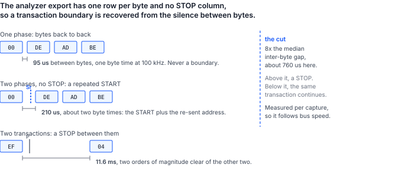

## 1 소개

동작하는 시스템과 로직 분석기를 가진 엔지니어는 캡처 파일 안에 성공한 버스 교환의 정확한 기록을 가지고 있습니다. 자연스럽게 이어지는 질문은 그 기록을 재생할 수 있는지입니다.

이 문서는 I2C와 Binho Pulsar에 대해 이 질문에 답합니다. 재생을 수행하는 유틸리티, 아래의 모든 수치를 얻은 절차, 그리고 재생이 캡처와 정당하게 달라지는 방식에 대한 설명을 제공합니다. 이 차이가 핵심입니다. 바이트를 다시 보내는 것은 문제의 전반부에 불과합니다.

### 1.1 범위

이 문서에서 다루는 내용은 다음과 같습니다.

- Saleae I2C 분석기 CSV 내보내기 파일을 읽고 그로부터 트랜잭션을 복원하기
- 해당 트랜잭션을 Pulsar에서 Python 또는 C++로 재생하기
- 타깃이 거부할 때 어댑터가 보고하는 것과 보고하지 않는 것
- 분석기로 두 실행을 모두 관찰하면서 재생이 일치함을 신호선 위에서 확인하기
- 두 번째 어댑터를 에뮬레이션 타깃으로 사용하여 의도적으로 거부를 유발하기
- 한계: 읽기, 트랜잭션 프레이밍, 타이밍, 조용한 거부, 10비트 주소 지정

SPI, I3C 또는 UART 캡처의 재생, Mission Control 3에서의 재생 구동, 분석기 세션 파일로부터의 캡처 재구성은 다루지 않습니다. 이 유틸리티는 분석기의 기본 세션 파일이 아니라 CSV 내보내기 파일을 읽습니다.

### 1.2 적용 디바이스

Table: 적용 디바이스

| 역할 | 부품 | 식별 정보 | 근거 |
|---|---|---|---|
| 재생 컨트롤러 | Binho Pulsar | 하드웨어 리비전 C, 펌웨어 4.4.0 | 측정됨, 이 문서 |
| 재생 컨트롤러 | Binho Supernova | 하드웨어 리비전 C, 펌웨어 4.5.0 | 코드 경로는 Pulsar와 공유됨. 컨트롤러로서 별도로 측정하지 않음 |
| 에뮬레이션 타깃 | I2C 타깃으로 동작하는 Binho Supernova | 하드웨어 리비전 C, 펌웨어 4.5.0 | 측정됨, 이 문서 |
| 캡처 장비 | Saleae Logic Pro 8 | Logic 2 v2.4.46, I2C 분석기 | 측정됨, 이 문서 |
| 캡처 장비 | Acute TravelBus | 8채널 | 같은 버스를 디코딩함. 유틸리티는 그 내보내기 파일을 읽지 않음 |

### 1.3 관련 문서

Table: 관련 문서

| 문서 | 제목 |
|---|---|
| AN0002 | Binho Pulsar를 사용한 I2C를 통한 STM32 마이크로컨트롤러 프로그래밍 |
| AN0008 | Binho Supernova를 사용한 I2C를 통한 CMIS 광 모듈 초기 구동 |

## 2 필요한 장비 및 소프트웨어

### 2.1 하드웨어

Table: 필요한 장비

| 항목 |
|---|
| 재생 컨트롤러로 사용할 Binho Pulsar USB 호스트 어댑터 |
| I2C 디코더가 있는 로직 분석기 |
| 재생 대상 I2C 타깃 |
| 4.5절에서 에뮬레이션 타깃으로 사용할 두 번째 Binho 어댑터 |
| USB-C 케이블 |

1.2절의 두 분석기 모두 이 버스를 디코딩합니다. 여기서의 측정은 유틸리티가 해당 분석기의 내보내기 파일을 직접 읽기 때문에 Saleae Logic Pro 8로 수행했습니다. Acute TravelBus도 같은 트래픽을 분석하고 자체 소프트웨어에서 I2C를 디코딩하지만, 내보내기 파일의 형식이 다르므로 그 캡처를 이 유틸리티에 넣으려면 장비가 생성하는 파일에서 4.2절의 여섯 개 열을 작성해야 합니다. 이 절차가 Saleae를 전제로 하는 이유는 오직 이것뿐입니다.

### 2.2 연결

Table: 사용하는 신호

| 신호 | 용도 |
|---|---|
| SCL | I2C 클록, 컨트롤러에서 타깃 및 분석기 프로브로 |
| SDA | I2C 데이터, 양방향, 분석기 프로브로도 연결 |
| 3.3 V | 타깃 전원, 제어 측 어댑터에서 공급 |
| GND | 리턴, 두 어댑터와 분석기에 공통 |

버스는 하나이며, **그 위의 컨트롤러는 정확히 하나**입니다. 두 번째 어댑터가 에뮬레이션 타깃으로 동작하는 경우 그 어댑터 자신의 I2C 컨트롤러는 절대 초기화하지 않습니다. 한 버스에서 초기화된 두 컨트롤러는 둘 다 SCL과 SDA를 구동하고 둘 다 공유 타깃 전원 레일에 전원을 공급하므로, 스캔 결과의 비대칭과 잘못된 전압 리드백이 발생하며 이는 케이블 배선 오류처럼 보입니다.

분석기는 같은 두 신호를 프로빙합니다. 채널 할당은 선택 사항이지만 디코더에 지정해야 하며, 가정하기보다 확인할 가치가 있습니다. SCL과 SDA가 뒤바뀐 상태로 디코딩하면 오류가 아니라 그럴듯한 출력이 나오기 때문입니다.

### 2.3 버스 설정

Table: 사용한 버스 설정

| 설정 | 값 |
|---|---|
| 버스 | Pulsar 버스 A, Qwiic 포트 |
| 클록 | 100 kHz |
| 풀업 | 2.2 kOhm, 제어 측 어댑터에서만 |
| 버스 전압 | 3.3 V, 리드백 3299 mV |
| 분석기 | 6.25 MS/s, 임계값 3.3 V 로직, 채널 0은 SCL, 채널 1은 SDA |

> **참고:** 풀업이 너무 강하면 활성화된 타깃이 보이지 않게 되며, 그 증상은 케이블이 분리된 경우와 구별할 수 없습니다. `0x50`에서 타깃으로 활성화된 Supernova에 대해 Pulsar의 풀업을 스윕하면, 150, 220 또는 330 Ohm에서는 타깃이 전혀 응답하지 않고 470 Ohm부터 4 kOhm까지는 매번 응답합니다. 실패하는 경우 스캔은 `FW_I2C_BUS_WITH_NO_TARGETS_CONNECTED`를 반환하고 직접 쓰기는 `FW_I2C_NACK_ADDRESS`를 반환하는데, 이는 버스가 연결되지 않았을 때 반환되는 값과 정확히 같습니다. 배선보다 풀업을 먼저 의심하십시오.

### 2.4 소프트웨어

유틸리티는 SDK가 제공하는 두 언어로 모두 제공되며 같은 작업을 수행합니다. 재생이 동작해야 하는 시스템에 맞는 쪽을 사용하십시오.

**Python, pyCosmicSDK 기반.** Python 3.11 이상:

```
pip install pycosmicsdk
python i2c_replay.py selfcheck
```

**C++, CosmicSDK 기반.** C++17 컴파일러와 설치된 CosmicSDK:

```
cmake -B build -DCOSMICSDK_ROOT=/opt/cosmicsdk
cmake --build build
./build/i2c_replay selfcheck
```

두 자체 점검 모두 어댑터나 버스가 필요하지 않으므로, 배선하기 전에 빌드를 확인할 수 있습니다. 캡처에는 분석기 자체의 소프트웨어가 필요하며, 4.2절에서 창 없이 Logic 2를 구동하는 방법을 보여 줍니다.

> **참고:** C++ 버전은 캡처를 읽고 재생하는 기능을 다룹니다. 어댑터를 에뮬레이션 타깃으로 활성화하는 기능(4.5절에서 의도적으로 거부를 유발하는 데 사용)은 Python 버전에만 있습니다. SDK 수준의 이유는 두 가지입니다. CosmicSDK는 버스 역할을 반환하는 `i2cDeinit`을 1.5.0에서 추가했지만 펌웨어는 4.5.0부터만 이를 지원하므로, 이전 어댑터에서는 디바이스가 리셋될 때까지 타깃 역할이 유지됩니다. 또한 자신의 타깃에 대해 재생하는 독자에게는 에뮬레이션 타깃이 전혀 필요하지 않습니다.

## 3 재생 시 캡처의 동작

### 3.1 캡처는 스크립트가 아니라 기록입니다

캡처의 모든 바이트는 그 순간에 존재했고 그때의 상태에 있던 타깃이 응답한 것입니다. 캡처를 재생하면 그 바이트들이 상태가 이미 바뀐 버스에 놓입니다. 여기서 네 가지 결과가 나오며, 이것들이 아래의 모든 내용을 결정합니다.

**쓰기는 재현할 수 있지만 읽기는 재현할 수 없습니다.** 캡처된 읽기에 기록된 바이트는 타깃이 생성한 것이지 타깃에 보낸 것이 아닙니다. 재생이 그 바이트들을 강제하는 것을 의미할 수는 없습니다. 유틸리티는 읽기를 다시 발행하고 응답이 여전히 일치하는지 보고하며, 이는 재생이 아니라 측정입니다.

**거부는 해당 트랜잭션 자체를 끝냅니다.** 타깃이 응답하지 않으면 펌웨어는 나머지 페이로드를 클록으로 내보내지 않고 그 지점에서 전송을 중단합니다. 이는 어댑터의 동작이며 유틸리티가 구현한 것이 아닙니다.

**프레이밍은 기록된 것이 아니라 추론된 것입니다.** 분석기 내보내기 파일에는 START 열이나 STOP 열이 없습니다. 그럼에도 경계를 복원하는 방법은 3.3절에서 설명합니다.

**캡처 아티팩트는 버스 트랜잭션이 됩니다.** 분석기가 에지를 잘못 디코딩하면 주소가 만들어지고, 재생은 그 주소를 충실하게 지정합니다.

### 3.2 두 가지 거부와 거부가 아닌 한 가지

어댑터는 두 가지 실패를 구별하며, 그 차이가 재생 보고서 내용의 전부입니다.

Table: 타깃이 거부하는 방식과 어댑터가 보고하는 내용

| 버스에서 일어난 일 | 펌웨어 상태 | 그것이 확정하는 것 |
|---|---|---|
| 아무것도 주소에 응답하지 않음 | `FW_I2C_NACK_ADDRESS` (0x0203) | 데이터 바이트가 하나도 전송되지 않음 |
| 타깃이 주소를 받은 후 데이터 바이트를 거부함 | `FW_I2C_NACK_BYTE` (0x0204) | 전송이 해당 바이트에서 중단되었고 나머지는 전송되지 않음 |

두 상태 모두 거부된 바이트의 인덱스를 담고 있지 않습니다. 재생 보고서는 어떤 거부가 일어났는지는 말할 수 있지만 페이로드의 어디에서 일어났는지는 말할 수 없습니다. 5.6절에서 그 인덱스를 복원할 수 있는 두 곳을 제시합니다.

아무 문제가 없음을 의미하는 NAK도 있습니다. 컨트롤러는 읽기의 마지막 바이트를 제외한 모든 바이트에 응답하고, 마지막 바이트에는 NAK를 보내 타깃에게 구동을 멈추라고 알립니다. 이는 내보내기 파일에서 읽기의 마지막 바이트에 대한 NAK로 나타납니다. 이를 거부로 세면 정상적인 캡처를 손상된 것으로 보고하게 되므로, 유틸리티는 이를 명시적으로 제외합니다.

### 3.3 분석기 내보내기 파일에 포함되는 것과 포함되지 않는 것

내보내기 파일의 두 가지 특성이 유틸리티의 형태를 결정하며, 둘 다 열 제목으로는 추측할 수 없습니다.

**Packet ID 열은 아무것도 그룹화하지 않습니다.** 이 벤치의 425행 캡처에서 395개의 데이터 행 모두가 Packet ID `0`을 가졌고, 30개의 주소 NAK 행만 값이 없었습니다. 따라서 Packet ID로 트랜잭션을 그룹화하면 관련 없는 전송이 합쳐집니다. 서브 주소 읽기의 포인터 쓰기와 읽기 바이트가 하나의 12바이트 쓰기로 합쳐졌습니다. 유틸리티는 이 열이 실제로 변하는 경우에만 이를 따릅니다.

**트랜잭션 경계는 무신호 구간으로부터 추론해야 합니다.** START 열이나 STOP 열이 없으므로, 한 주소에 대한 같은 방향의 두 쓰기를 구분하는 유일한 것은 바이트 사이의 간격입니다. 그래서 유틸리티는 캡처의 바이트 간 간격의 중앙값을 측정하고 그 배수에서 자릅니다.



Table: 이 캡처에서 측정한 세 가지 간격, 100 kHz

| 위치 | 측정값 | 의미 |
|---|---|---|
| 한 페이즈 내 바이트 사이 | 95 us | 1바이트 시간. 절대 경계가 아님 |
| 서브 주소 읽기의 두 페이즈 사이 | 209~210 us | 반복 START. 버스가 유지됨 |
| 한 트랜잭션과 다음 트랜잭션 사이 | 11.6 ms | STOP |

기본 절단점인 중앙값의 8배는 약 760 us로, 두 번째 행과 세 번째 행 사이에 양쪽으로 한 자릿수의 여유를 두고 놓입니다. 배수를 3으로 하면 287 us가 되어 반복 START 간격보다 1.4배밖에 크지 않으므로, 버스가 조금만 느려져도 반복 START를 STOP으로 읽기 시작합니다. `--gap-seconds`는 이 휴리스틱을 완전히 대체합니다.

## 4 절차

### 4.1 배선하기 전에 유틸리티 확인하기

```
python i2c_replay.py selfcheck
```

```
i2c_replay.py 1.0 self-check: 18/18 OK
```

```
./build/i2c_replay selfcheck
```

```
i2c_replay 1.0 self-check: 11/11 OK
```

개수가 다른 것은 Python 테스트 모음이 대역 어댑터에 대한 재생 루프도 다루는 반면, C++ 테스트 모음은 그 부분을 실제 벤치에 맡기기 때문입니다. 둘 다 파서를 다룹니다.

### 4.2 캡처하기

분석기의 I2C 디코더를 연결한 상태에서 관심 있는 트래픽을 기록한 다음, 분석기 결과를 CSV로 내보냅니다. 파일의 첫 줄은 다음과 같습니다.

```
Time [s],Packet ID,Address,Data,Read/Write,ACK/NAK
```

숫자는 내보내기에 사용된 진법 그대로 읽히므로, 16진수, 10진수 또는 2진수로 된 내보내기 파일 모두 파싱됩니다.

> **참고:** Logic 2는 두 가지 서로 다른 CSV를 작성하며, 여기서 사용할 수 있는 것은 그중 하나뿐입니다. **분석기 내보내기(analyzer export)** 파일은 바이트당 한 행이며 위의 열을 가집니다. **데이터 테이블 내보내기(data table export)** 파일은 완전히 다른 파일로, 열은 `name,type,start_time,duration,data,read,address,ack`이고 프로토콜 프레임당 한 행이며 주소가 숫자가 아닌 레이블로 표시됩니다. 데이터 테이블을 유틸리티에 넘기면 잘못 파싱되는 대신 이름으로 거부되며, 오류 메시지는 대신 어떤 파일을 사용해야 하는지 알려 줍니다.

Logic 2는 창 없이 이 작업을 수행할 수 있습니다. Preferences에서 자동화 서버를 한 번 활성화하면, Saleae의 `logic2-automation` 패키지가 캡처를 구동하고 같은 파일을 작성합니다.

```python
from saleae import automation

with automation.Manager.connect(port=10430) as manager:
    device = automation.LogicDeviceConfiguration(
        enabled_digital_channels=[0, 1],      # 0 = SCL, 1 = SDA
        digital_sample_rate=6_250_000,
        digital_threshold_volts=3.3)
    timed = automation.CaptureConfiguration(
        capture_mode=automation.TimedCaptureMode(duration_seconds=2.0))
    with manager.start_capture(device_configuration=device,
                               capture_configuration=timed) as capture:
        capture.wait()
        i2c = capture.add_analyzer("I2C", settings={"SDA": 1, "SCL": 0})
        capture.legacy_export_analyzer("capture.csv", i2c,
                                       automation.RadixType.HEXADECIMAL)
```

`legacy_export_analyzer`가 이 유틸리티가 읽는 분석기 내보내기 파일입니다. 같은 객체의 `export_data_table`은 다른 파일을 작성합니다.

### 4.3 재생하기 전에 캡처 다시 읽기

`parse`는 버스를 건드리지 않고 트랜잭션을 복원합니다. 이는 캡처가 가정한 내용을 실제로 담고 있는지 확인하는 단계입니다.

```
python i2c_replay.py parse capture.csv
```

```
capture.csv: 152 transactions (121 write, 31 read), 395 payload bytes, 30 refused in the
capture, 31 held by a repeated START
capture spans 2.028226 s

    0.007708s  write 0x50  00   [repeated START, bus held]
    0.007911s  read  0x50  DE AD BE EF
    0.019486s  write 0x62  -   [captured: address NAK]
    0.051084s  write 0x50  00 DE AD BE EF
    0.063084s  write 0x50  04 11 22
```

이 출력에서 짚어 둘 만한 세부 사항이 세 가지 있습니다. 레지스터 포인터는 페이로드로 재생됩니다. `write 0x50 00 DE AD BE EF`는 레지스터 `0x00`에 `DE AD BE EF`를 쓰는 것이며, 내보내기 파일도 신호선도 포인터 바이트를 구별하지 않기 때문에 유틸리티는 포인터 바이트를 페이로드 안에 유지합니다. 서브 주소 읽기는 포인터를 설정하는 쓰기와 바이트를 수집하는 읽기의 두 페이즈로 나타나는데, 신호선 위에서 실제로 그렇기 때문입니다. 그리고 두 페이즈 중 첫 번째는 유지된 것으로 표시되며, 이것이 3.3절의 반복 START입니다.

### 4.4 재생하기

```
python i2c_replay.py replay capture.csv --serial <pulsar serial> --pullup KOHM_2_2
```

Table: 재생 옵션

| 옵션 | 효과 |
|---|---|
| `--pace` | USB 속도로 재생하는 대신 캡처 자체의 트랜잭션 간 간격을 기다림 |
| `--stop-on-nak` | 처음 거부된 트랜잭션에서 전체 재생을 중단함 |
| `--include-captured-naks` | 캡처에서 이미 거부된 트랜잭션도 다시 발행함 |
| `--gap-factor`, `--gap-seconds` | 3.3절의 트랜잭션 경계 절단점을 이동함 |

### 4.5 의도적으로 거부 유발하기

거부는 시연할 가치가 있으며, 이는 의도적으로 거부를 일으킨다는 뜻입니다. 두 번째 어댑터를, 사용 중일 때 자신의 주소에 NACK를 보내는 동작을 하는 에뮬레이션 EEPROM으로 활성화합니다. 이는 24Cxx 데이터시트에 설명된 응답 폴링 핸드셰이크입니다.

```
python i2c_replay.py arm-target --serial <supernova serial> --write-cycle-us 5000
python i2c_replay.py replay capture.csv --serial <pulsar serial>
python i2c_replay.py release-target --serial <supernova serial>
```

이후 모든 쓰기 뒤에는 타깃이 자신의 주소를 거부하는 5 ms 구간이 따르므로, 에뮬레이션된 부품이 커밋하는 것보다 빠르게 쓰는 재생은 주소 페이즈에서 거부됩니다. 작업이 끝나면 역할을 해제하십시오. 역할은 반환될 때까지 디바이스에 속하며, 그동안 버스를 요청하는 컨트롤러는 `FW_I2C_ROLE_CONFLICT`로 거부됩니다.

## 5 측정 결과

### 5.1 테스트 구성

Table: 테스트 구성

| 항목 | 값 |
|---|---|
| 컨트롤러 | Binho Pulsar, 하드웨어 리비전 C, 펌웨어 4.4.0, 버스 A |
| 타깃 | Binho Supernova, 하드웨어 리비전 C, 펌웨어 4.5.0, `0x50`에서 I2C 타깃으로 활성화, EEPROM 모델, 256 B, 페이지 8 B, 쓰기 사이클 5 ms, 사용 중 동작 NACK |
| SDK | `pycosmicsdk`, Python 3.12, Ubuntu 26.04 |
| 버스 | 100 kHz, 풀업 2.2 kOhm, 3.3 V, 리드백 3299 mV |
| 분석기 | Saleae Logic Pro 8, Logic 2 v2.4.46, 6.25 MS/s, 채널 0은 SCL, 채널 1은 SDA |
| 트래픽 | 레지스터 `0x00`에 대한 4바이트 쓰기, `0x04`에 대한 2바이트 쓰기, `0x00`에서의 4바이트 서브 주소 읽기, 아무것도 응답하지 않는 `0x62`에 대한 쓰기 |

원본 캡처와 재생은 같은 장비로 기록했으므로, 아래의 모든 비교는 두 측정 사이에서 이루어집니다.

### 5.2 재생은 캡처된 바이트를 전달합니다

캡처는 152개 트랜잭션(쓰기 121개, 읽기 31개), 거부 30개, 반복 START로 유지된 것 31개로 파싱되었으며, 이는 실제로 구동한 트래픽과 정확히 일치합니다. 그런 다음 분석기가 두 번째로 기록하는 동안 `--pace`로 재생했습니다.

Table: 트랜잭션 형태, 원본 캡처 대 재생

| 형태 | 원본 | 재생 |
|---|---|---|
| `write 0x50  00` (반복 START로 유지됨) | 31 | 16 |
| `read 0x50  DE AD BE EF` | 31 | 16 |
| `write 0x50  00 DE AD BE EF` | 30 | 14 |
| `write 0x50  04 11 22` | 30 | 15 |
| `write 0x62` (주소 NAK) | 30 | 0 |

개수가 다른 것은 두 캡처 구간의 길이가 같지 않고, 두 번째 구간이 닫힐 때 재생이 아직 실행 중이었기 때문입니다. 바이트는 다르지 않습니다. 해당 실행에 대한 유틸리티 자체의 보고는 다음과 같습니다.

```
122 replayed, 0 aborted on a NAK, 0 failed otherwise, 0 read(s) answered
differently than the capture
```

31개의 읽기 모두가 원본 캡처에 기록된 바이트를 반환했습니다. 30개의 주소 NAK 트랜잭션은 기본적으로 건너뛰며, 이것이 파싱된 152개와 재생된 122개의 차이입니다.

### 5.3 두 버전은 캡처를 동일하게 읽습니다

Python 파서와 C++ 파서를 같은 425행 내보내기 파일에 대해 실행하고 그 출력을 한 줄씩 비교했습니다. 두 파서는 **동일한 155줄**을 바이트 단위까지 똑같이 출력합니다. 같은 152개 트랜잭션, 같은 쓰기 121개와 읽기 31개의 구성, 같은 30개의 거부, 반복 START로 유지된 같은 31개의 페이즈, 그리고 모든 트랜잭션에서 같은 페이로드입니다.

Table: 두 버전으로 처리한 같은 캡처

| 버전 | 트랜잭션 | 쓰기 | 읽기 | 거부 | 유지 | 출력 줄 수 |
|---|---|---|---|---|---|---|
| `i2c_replay.py`, pyCosmicSDK | 152 | 121 | 31 | 30 | 31 | 155 |
| `i2c_replay`, CosmicSDK C++ | 152 | 121 | 31 | 30 | 31 | 155 |

버스에 재생했을 때 C++ 버전은 `122 replayed, 0 aborted on a NAK, 0 failed otherwise`를 보고했으며, 이는 Python과 같은 122개입니다. 파싱된 152개에서 기본적으로 건너뛰는 30개의 주소 NAK 트랜잭션을 뺀 수입니다.

이는 깔끔함 이상의 의미가 있습니다. 3.3절의 경계 휴리스틱은 이 도구에서 판단이 개입되는 유일한 부분이며, 서로 독립적인 두 구현이 같은 152개 트랜잭션에 도달했다는 것은 이 규칙이 한 언어의 반올림 방식이 만든 산물이 아니라 명확하게 정의되어 있다는 증거입니다.

### 5.4 반복 START는 재생 후에도 남지만 타이밍은 남지 않습니다

캡처에서 유지된 것으로 표시된 페이즈는 STOP이 아니라 반복 START로 재생됩니다. 이는 프레이밍을 볼 수 없는 간격 휴리스틱에서 추론한 것이 아니라, `type` 열에 명시적인 `start` 및 `stop` 프레임을 담고 있는 데이터 테이블 내보내기 파일에서 읽은 것입니다.

Table: 데이터 테이블 내보내기 파일에서 집계한 프레이밍

| 캡처 | STOP 이후의 페이즈 | 반복 START 이후의 페이즈 | 반복 START 사이의 간격 |
|---|---|---|---|
| 원본 | 121 | 31 | 209~210 us |
| 재생 | 45 | 16 | 1511~1761 us |

재생은 발행한 모든 읽기에 대해 반복 START를 생성했으며, 포인터 쓰기와 읽기 사이에 STOP은 없었습니다. 재생이 재현하지 못한 것은 **타이밍**입니다. 두 페이즈는 별개의 두 호스트 명령이므로 버스는 1바이트 시간이 아니라 USB 왕복 시간 동안 유지되며, 간격은 약 210 us에서 약 1.6 ms로 늘어납니다.

> **참고:** 이렇게 늘어난 간격은 유틸리티 자체의 휴리스틱을 무력화합니다. 재생의 캡처를 다시 파싱하면 1.6 ms의 무신호 구간이 기본 절단점보다 크기 때문에 해당 페이즈들이 유지되지 않은 것으로 보고됩니다. 버스는 실제로 유지되었고 데이터 테이블이 이를 증명하지만, 분석기 내보내기 파일은 그 사실을 담고 있지 않으며 무신호 구간도 더 이상 그것을 의미하지 않습니다. 프레이밍이 중요할 때는 데이터 테이블을 읽으십시오. `--gap-seconds`를 호스트 지연보다 크고 트랜잭션 간 무신호 구간보다 작은 값으로 올려도 이를 복원할 수 있습니다.

### 5.5 Binho 타깃이 만들어 낼 수 있는 거부

에뮬레이션 타깃이 제공하는 모든 접근 제어 메커니즘을 동작시켜, 신호선 위에 실제로 무엇이 나타나는지 확인했습니다.

Table: 에뮬레이션 Binho I2C 타깃에서 거부 유발하기

| 시도 | 결과 |
|---|---|
| 아무것도 점유하지 않은 주소에 쓰기 | `FW_I2C_NACK_ADDRESS` |
| EEPROM 모델의 쓰기 사이클 구간 중 쓰기 | `FW_I2C_NACK_ADDRESS` |
| 쓰기 사이클이 지난 후 같은 쓰기 | 성공 |
| EEPROM 모델의 쓰기 보호 영역에 쓰기 | 성공 |
| 읽기 전용으로 선언된 `REGISTER_MAP` 영역에 쓰기 | 성공 |
| 읽기/쓰기 영역과 읽기 전용 영역의 경계를 걸치는 쓰기 | 성공 |

`FW_I2C_NACK_BYTE`는 컨트롤러 경로에 존재하며 도착하면 보고되지만, 두 Binho 타깃 모델 중 어떤 구성에서도 이를 만들어 내는 경우를 찾지 못했습니다. 접근 제어는 조용히 적용됩니다. 타깃은 모든 바이트에 응답하고 저장하지 않을 바이트는 버립니다. `0x40`의 읽기/쓰기 영역과 읽기 전용 영역 경계를 걸쳐 4바이트를 쓰면 성공이 반환되었고, 같은 영역을 다시 읽으면 `00 01 00 00`이 나왔습니다. 허용된 두 바이트는 저장되었고 거부된 두 바이트는 변경되지 않았으며, 신호선 위에는 두 절반을 구별할 수 있는 것이 아무것도 없었습니다. 진짜 데이터 페이즈 NAK를 유발하려면 그것을 내보내는 타깃이 필요합니다.

이 결과는 재생 사용자가 처음 갖는 직관을 뒤집습니다. 위험한 타깃은 바이트를 거부하는 타깃이 아닙니다. 거부는 보고되기 때문입니다. 위험한 것은 쓰기에 응답한 뒤 그것을 버리는 타깃입니다. 재생은 완전한 성공을 보고하지만 타깃은 바뀌지 않았기 때문입니다. **쓰기의 재생은 쓰기가 반영되었다는 증거가 아닙니다. 다시 읽어 확인하십시오.**

### 5.6 거부된 바이트 인덱스를 복원할 수 있는 곳

두 거부 상태 모두 바이트 인덱스를 담고 있지 않지만, 다른 두 관찰자는 이를 가지고 있습니다.

타깃 자신의 버스 이벤트가 이를 가지고 있습니다. `I2cTargetBusEvent`는 타깃 하드웨어의 전송 카운트에서 가져온 `payload_length`를 담고 있으며, 이는 타깃이 데이터 페이즈에서 실제로 전송한 바이트 수입니다. 재생이 타깃으로 활성화된 어댑터를 구동하는 경우 이 카운트가 곧 인덱스입니다.

분석기도 이를 가지고 있습니다. 내보내기 파일에는 바이트마다 응답 열이 있으므로, 거부된 바이트는 재생의 캡처에서 직접 보입니다.

### 5.7 캡처보다 빠르게 재생하면 결과가 바뀝니다

`--pace`는 겉치레가 아닙니다. 에뮬레이션 EEPROM 타깃을 활성화한 상태에서, 0.5초 간격으로 이루어진 단일 바이트 쓰기 세 번의 캡처를 이 플래그만 바꾸어 두 번 재생했습니다.

Table: 같은 캡처를 USB 속도와 캡처 속도로 재생한 결과

| 실행 | 실제 소요 시간 | 보고 |
|---|---|---|
| 기본값, USB가 허용하는 최대 속도 | 0.743 s | 3 replayed, 2 aborted on a NAK |
| `--pace` | 1.728 s | 3 replayed, 0 aborted |

두 번의 중단은 타깃이 이전 쓰기의 5 ms 쓰기 사이클을 완료하는 동안 자신의 주소를 거부한 것으로, 4.5절의 응답 폴링 핸드셰이크가 예기치 않게 나타난 것입니다. 캡처 자체의 타임스탬프는 그 쓰기들 사이에 0.5초를 두고 있으므로, 캡처 속도에서는 모든 사이클이 완료되고 아무것도 거부되지 않습니다. 실제 소요 시간의 차이 0.985 s는 두 번의 0.5초 간격이 지켜진 결과입니다.

이 교훈은 이 타깃을 넘어 일반화됩니다. **캡처의 타이밍은 장식이 아니라 내용입니다.** 사용 중 기간, 내부 사이클 또는 처리에 시간이 걸리는 명령이 있는 타깃은 원래 속도에서는 시퀀스를 받아들이고, 같은 시퀀스를 버스 속도로 재생하면 거부할 수 있습니다. 캡처에서는 중단되지 않았는데 재생이 중단된다면, 바이트를 의심하기 전에 `--pace`를 시도하십시오.

## 6 재생이 재현할 수 없는 것

### 6.1 재생의 재생에서의 프레이밍

원본 캡처의 반복 START는 5.4절에서 확인한 대로 재현됩니다. 남지 않는 것은 재생의 캡처에서 그것을 볼 수 있는 능력입니다. 두 페이즈가 두 개의 호스트 명령이기 때문에 유지 간격이 약 210 us에서 약 1.6 ms로 늘어나고, 무신호 구간은 더 이상 프레이밍을 의미하지 않습니다. 따라서 재생은 신호선 위에서는 충실하지만 자기 자신의 입력으로서는 정보를 잃습니다. 재생의 재생을 연쇄하면, `--gap-seconds`를 그에 맞게 올리거나 데이터 테이블로 프레이밍을 확인하지 않는 한 패스마다 프레이밍이 저하됩니다.

### 6.2 버스 타이밍

`--pace`는 캡처 자체의 타임스탬프로부터 트랜잭션 사이의 간격을 재현하며, 5.7절은 그것이 재생의 성공과 실패를 가르는 사례를 보여 줍니다. 트랜잭션 내부의 타이밍, 클록 스트레칭 또는 원래의 클록 주파수는 재현하지 않으며, 클록 주파수는 캡처 내용이 아니라 버스 설정입니다.

### 6.3 읽기

3.1절에서 다루었습니다. 재생된 읽기는 현재 타깃에 대한 새로운 질문입니다.

### 6.4 분석기가 디코딩하지 못한 모든 것

너무 낮은 임계값, 너무 낮은 샘플링 속도, 또는 뒤바뀐 SCL과 SDA 할당으로 얻은 캡처는 그럴듯해 보이지만 잘못된 내보내기 파일을 만듭니다. 응답 열이 `Missing ACK/NAK`로 표시된 내보내기 파일은 분석기가 아홉 번째 비트를 볼 수 없었다는 뜻입니다. 유틸리티는 그런 행을 표시하지만, 캡처 품질 문제이므로 거부로 취급하지 않습니다.

### 6.5 10비트 주소 지정

분석기의 내보내기 파일에는 10비트 주소 개념이 없습니다. 모든 주소 행은 7비트 값으로 형식화되므로, 10비트 트랜잭션은 예약된 `0x78`~`0x7B` 범위의 주소로 나타나고 주소의 나머지는 첫 번째 데이터 바이트로 나타납니다. 이 행들을 재생하면 같은 바이트가 신호선에 다시 놓이므로 충실하지만, 보고서에는 독자가 알아보지 못하는 주소가 표시됩니다. 이 내용은 측정한 것이 아니라 분석기 소스에서 읽어 낸 것이며, 벤치에는 10비트 타깃이 없었습니다.

### 6.6 이 문서에서 확인하지 않은 것

- **실제 펌웨어에서 발생하는 데이터 페이즈 NAK.** `FW_I2C_NACK_BYTE`는 도착하면 보고되지만, 어떤 Binho 타깃도 이를 내보내지 않기 때문에 그 보고 경로는 디바이스에 의해 실제로 동작한 적이 없습니다. 이를 유발하려면 데이터 바이트를 거부하는 서드파티 타깃이 필요합니다.
- **재생 컨트롤러로서의 Supernova.** 여기서는 두 버전 모두에서 Pulsar만 재생을 구동했습니다. 코드 경로는 공유되지만, 공유된다고 해서 측정된 것은 아닙니다.
- **Linux 이외의 환경에서의 C++ 버전.** Ubuntu 26.04에서 GCC로 CosmicSDK 1.5.0에 대해 빌드했고 그 환경의 벤치에서 실행했습니다. 함께 제공되는 CMake는 이식 가능하도록 작성되었지만 Windows나 macOS에서는 동작 확인을 하지 않았습니다.
- **이 벤치에서의 `i2cDeinit`.** 여기의 Pulsar는 이 명령보다 앞선 펌웨어 4.4.0을 사용하므로, C++에서 해제 경로를 동작시킨 적이 없습니다.
- **10비트 주소 지정.** 6.5절 참조. 벤치에 10비트 타깃이 없는 상태에서 분석기 소스로부터 읽어 낸 것입니다.
- **100 kHz를 초과하는 속도 또는 버스상의 두 번째 타깃.** 5절의 모든 측정은 100 kHz 버스에서 `0x50`에 있는 하나의 타깃에 대한 것입니다.

## 7 유틸리티

같은 도구를 SDK마다 하나씩, 두 가지로 제공합니다. 파서와 재생 의미 체계는 줄 단위로 공유되며, 5.3절이 이를 보여 주는 측정입니다.

Table: 유틸리티 명령

| 명령 | Python, pyCosmicSDK | C++, CosmicSDK | 용도 |
|---|---|---|---|
| `selfcheck` | 예 | 예 | 어댑터와 버스 없이 오프라인으로 파서를 점검 |
| `parse` | 예 | 예 | 캡처에서 트랜잭션을 복원하여 출력 |
| `replay` | 예 | 예 | 캡처를 버스에 다시 내보내고 각 트랜잭션의 결과를 보고 |
| `scan` | 예 | 예 | 버스에서 응답하는 주소를 나열 |
| `arm-target` | 예 | 아니요 | 어댑터를 사용 중일 때 자신의 주소에 NACK를 보내는 에뮬레이션 EEPROM으로 활성화 |
| `release-target` | 예 | 아니요 | 타깃 역할을 디바이스에 반환 |

둘 다 어댑터를 지정하는 `--serial`을 받으며, 이는 어댑터가 두 개인 벤치에서 중요합니다. 두 SDK의 일반 연결은 어느 것도 선택하지 않으며, 처음 열거된 어댑터가 컨트롤러일 가능성과 타깃일 가능성은 같습니다.

재사용할 가치가 있는 부분은 파서입니다. 파서는 내보내기 파일의 레이아웃을 아는 유일한 부분이며, 3.3절의 두 규칙을 담고 있습니다. Packet ID는 그것이 변하는 경우에만 따르고, 경계는 캡처 자체의 바이트 속도에 대해 측정한 무신호 구간이라는 것입니다. 나머지는 모두 SDK 위의 얇은 계층입니다.

## 8 문제 해결

Table: 문제 해결

| 증상 | 확인 사항 |
|---|---|
| 스캔에서 `FW_I2C_BUS_WITH_NO_TARGETS_CONNECTED`가 반환됨 | 풀업이 너무 강함. 2.3절의 참고 참조 |
| 모든 트랜잭션이 주소 NAK로 중단됨 | 타깃이 다른 버스에 있거나, 풀업이 330 Ohm 이하임 |
| 타깃 활성화 시 `FW_I2C_ROLE_CONFLICT` 발생 | 해당 디바이스의 버스 중 하나에서 I2C 컨트롤러가 활성화되어 있음. 먼저 해제할 것 |
| `FW_INTERFACE_ALREADY_INITIALIZED`가 반환되고 풀업이 바뀌지 않음 | 이미 활성화된 인터페이스는 이전 설정을 유지함. 유틸리티가 초기 구동 호출을 사용하는 이유가 이것임 |
| 유틸리티가 캡처를 이름으로 거부함 | 분석기 결과 대신 데이터 테이블을 내보냄. 4.2절의 참고 참조 |
| 세 개를 예상했는데 12바이트 트랜잭션 하나가 나옴 | 이 캡처에 비해 경계 절단점이 너무 넓음. `--gap-factor`를 낮추거나 `--gap-seconds`를 설정할 것 |
| 모든 바이트가 각각 별도의 트랜잭션으로 파싱됨 | 절단점이 버스 바이트 시간보다 낮음. 올릴 것 |
| 서브 주소 읽기가 하나의 쓰기로 파싱됨 | Packet ID 그룹화 때문이며, 이 유틸리티는 그렇게 하지 않음. 파일이 분석기 내보내기 파일인지 확인할 것 |
| 캡처에서는 중단되지 않았는데 재생이 중단됨 | `--pace`를 시도할 것. 5.7절처럼 타깃에 원래 간격이 필요할 수 있음 |
| 재생은 완전한 성공을 보고하지만 타깃이 변하지 않음 | 타깃이 쓰기를 조용히 버리고 있음. 다시 읽어 확인하고 5.5절 참조 |
| 시스템이 사용한 적 없는 주소가 보고서에 나타남 | 캡처 아티팩트가 충실하게 재생된 것임 |
| 활성화했던 타깃이 udev 변경 후 응답을 멈춤 | 재열거가 어댑터의 펌웨어 상태를 리셋하고 타깃 역할을 잃게 함. 다시 활성화할 것 |
| 한 번도 활성화하지 않은 버스에서 C++ 버전이 `FW_I2C_ROLE_CONFLICT`를 보고함 | 잘못된 어댑터를 열었음. 일반 연결은 처음 열거된 어댑터를 사용하므로 `--serial`을 지정할 것 |
| `i2cDeinit`이 `FW_UNSUPPORTED_COMMAND`를 반환함 | 이 명령은 펌웨어 4.5.0부터 지원됨. 이전 펌웨어에서는 어댑터를 리셋하여 역할을 해제함 |
| CMake가 `hidapi.h`를 찾지 못함 | `CosmicSDK.hpp`가 이를 포함함. `COSMICSDK_ROOT`를 `include/`와 `lib/`를 모두 담은 디렉터리로 지정할 것 |

## 9 약어

Table: 약어

| 용어 | 의미 |
|---|---|
| ACK | 응답(Acknowledge) |
| CSV | 쉼표로 구분된 값(Comma-separated values) |
| NAK, NACK | 비응답(Not acknowledge) |
| SCL | 직렬 클록 라인(Serial clock line) |
| SDA | 직렬 데이터 라인(Serial data line) |
| SDK | 소프트웨어 개발 키트(Software development kit) |
| START | I2C 트랜잭션을 시작하는 조건 |
| STOP | I2C 트랜잭션을 끝내는 조건 |
| VTARG | 어댑터가 공급하는 타깃 전원 레일 |
| WP | 쓰기 보호(Write protect) |

## 10 문서 내 소스 코드에 관한 참고

이 문서에 표시되고 함께 제공되는 아카이브에 포함된 예제 코드는 평가 및 참고용으로 제공됩니다. 이 코드는 MIT 라이선스로 배포되며, 라이선스 전문은 아카이브에 포함되어 있습니다.

Table: 에셋 아카이브의 내용

| 파일 | 설명 |
|---|---|
| `AN0013.md` | 이 문서의 Markdown 소스 |
| `assets/i2c_replay.py` | 참조 유틸리티, pyCosmicSDK 기반 Python 버전 |
| `assets/i2c_replay.cpp` | 참조 유틸리티, CosmicSDK 기반 C++ 버전 |
| `assets/CMakeLists.txt` | C++ 유틸리티용 빌드 파일 |
| `assets/captures/original-analyzer-export.csv` | 5.2절의 분석기 내보내기 파일, 캡처한 그대로 |
| `assets/captures/replay-analyzer-export.csv` | 해당 파일을 재생한 결과의 분석기 내보내기 파일 |
| `assets/LICENSE` | 예제 코드에 적용되는 MIT 라이선스 |

두 캡처를 제공하는 것은 벤치 없이 `parse`만으로 5.2절의 비교를 다시 실행할 수 있도록 하기 위함입니다.

## 11 개정 이력

Table: 개정 이력

| 리비전 | 날짜 | 설명 |
|---|---|---|
| 0.1 | 10 September 2026 | 초안. |
| 1.0 | 6 November 2026 | 공개. |
