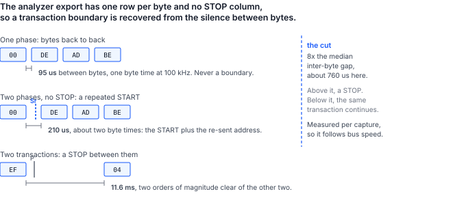

## 1 引言

一位手头有可工作系统和逻辑分析仪的工程师，在捕获文件中就拥有了一次成功总线交互的精确记录。接下来自然的问题是：这份记录能否被回放。

本文针对 I2C 和 Binho Pulsar 回答这个问题。本文提供执行回放的工具、得出下文所有数据的操作流程，以及对回放与其捕获之间合理差异的说明。这些差异才是本文的实质：重新发送字节只是问题的前一半。

### 1.1 范围

本文涵盖：

- 读取 Saleae I2C 分析器的 CSV 导出文件并从中恢复事务
- 使用 Python 或 C++ 从 Pulsar 回放这些事务
- 目标器件拒绝时适配器报告什么，以及不报告什么
- 在分析器监视两次运行的情况下，在线路上确认回放与捕获一致
- 使用第二个适配器作为仿真目标器件，有意引发拒绝
- 局限性：读操作、事务分帧、时序、静默拒绝和十位寻址

本文不涵盖回放 SPI、I3C 或 UART 捕获，不涵盖从 Mission Control 3 驱动回放，也不涵盖从分析器会话文件重建捕获。该工具读取分析器的 CSV 导出文件，而不是其原生会话文件。

### 1.2 适用器件

Table: 适用器件

| 角色 | 器件 | 标识 | 依据 |
|---|---|---|---|
| 回放控制器 | Binho Pulsar | 硬件版本 C，固件 4.4.0 | 已测量，本文 |
| 回放控制器 | Binho Supernova | 硬件版本 C，固件 4.5.0 | 代码路径与 Pulsar 共用；未单独作为控制器进行测量 |
| 仿真目标器件 | 作为 I2C 目标器件的 Binho Supernova | 硬件版本 C，固件 4.5.0 | 已测量，本文 |
| 捕获仪器 | Saleae Logic Pro 8 | Logic 2 v2.4.46，I2C 分析器 | 已测量，本文 |
| 捕获仪器 | Acute TravelBus | 8 通道 | 可解码同一总线；该工具不读取其导出文件 |

### 1.3 相关文档

Table: 相关文档

| 文档 | 标题 |
|---|---|
| AN0002 | 使用 Binho Pulsar 通过 I2C 对 STM32 微控制器编程 |
| AN0008 | 使用 Binho Supernova 通过 I2C 启动 CMIS 光模块 |

## 2 所需设备和软件

### 2.1 硬件

Table: 所需设备

| 项目 |
|---|
| Binho Pulsar USB 主机适配器，作为回放控制器 |
| 带 I2C 解码器的逻辑分析仪 |
| 作为回放对象的 I2C 目标器件 |
| 第二个 Binho 适配器，在第 4.5 节中用作仿真目标器件 |
| USB-C 线缆 |

第 1.2 节中的任一分析器都可以解码这条总线。本文的测量使用 Saleae Logic Pro 8 进行，因为该工具直接读取该分析器的导出文件；Acute TravelBus 能解析同样的流量，并在其自身软件中解码 I2C，但其导出文件格式不同，要将其捕获导入此工具，需要从该仪器生成的文件中写出第 4.2 节所述的六列。本流程假定使用 Saleae，原因仅在于此。

### 2.2 连接

Table: 使用的信号

| 信号 | 用途 |
|---|---|
| SCL | I2C 时钟，从控制器到目标器件以及分析器探头 |
| SDA | I2C 数据，双向，并连接到分析器探头 |
| 3.3 V | 目标器件电源，由主控适配器提供 |
| GND | 回路，两个适配器和分析器共用 |

一条总线，并且**总线上只有一个控制器**。当第二个适配器充当仿真目标器件时，其自身的 I2C 控制器从不初始化：一条总线上有两个已初始化的控制器时，二者都会驱动 SCL 和 SDA，并且都会为共享的目标器件电源轨供电，这会产生扫描结果不对称和电压回读错误，看起来就像线缆接错一样。

分析器探测的是同样的两个信号。通道分配可以自行选择，但必须告知解码器，并且值得确认而不是假定：在 SCL 和 SDA 互换的情况下解码，产生的是看似合理的输出，而不是错误。

### 2.3 总线设置

Table: 使用的总线设置

| 设置 | 值 |
|---|---|
| 总线 | Pulsar 总线 A，即 Qwiic 端口 |
| 时钟 | 100 kHz |
| 上拉电阻 | 2.2 kOhm，仅由主控适配器提供 |
| 总线电压 | 3.3 V，回读为 3299 mV |
| 分析器 | 6.25 MS/s，阈值 3.3 V 逻辑，通道 0 为 SCL，通道 1 为 SDA |

> **注意**：上拉电阻过强会使已启用的目标器件不可见，其症状与线缆断开无法区分。将 Pulsar 的上拉电阻在一个作为目标器件启用于 `0x50` 的 Supernova 上进行扫描测试，在 150、220 或 330 Ohm 时目标器件完全不应答，而从 470 Ohm 到 4 kOhm 每次都应答。在失败的情况下，扫描返回 `FW_I2C_BUS_WITH_NO_TARGETS_CONNECTED`，直接写入返回 `FW_I2C_NACK_ADDRESS`，这与总线未连接时的返回完全相同。先怀疑上拉电阻，再怀疑接线。

### 2.4 软件

该工具以 SDK 提供的两种语言提供，功能相同。请选择与回放所在系统相匹配的版本。

**Python，基于 pyCosmicSDK。** Python 3.11 或更高版本：

```
pip install pycosmicsdk
python i2c_replay.py selfcheck
```

**C++，基于 CosmicSDK。** C++17 编译器和已安装的 CosmicSDK：

```
cmake -B build -DCOSMICSDK_ROOT=/opt/cosmicsdk
cmake --build build
./build/i2c_replay selfcheck
```

两种自检都既不需要适配器也不需要总线，因此可以在接线之前确认构建无误。捕获需要分析器自身的软件；第 4.2 节说明如何在不打开 Logic 2 窗口的情况下驱动它。

> **注意**：C++ 版本涵盖读取捕获并进行回放。将适配器启用为仿真目标器件（第 4.5 节用它有意引发拒绝）的功能仅在 Python 版本中提供。这有两个 SDK 层面的原因：CosmicSDK 在 1.5.0 中新增了用于交还总线角色的 `i2cDeinit`，但固件从 4.5.0 起才支持该命令，因此在较旧的适配器上，目标器件角色会一直保留，直到设备复位；此外，针对自己的目标器件进行回放的读者根本不需要仿真目标器件。

## 3 捕获在回放时的表现

### 3.1 捕获是记录，而不是脚本

捕获中的每个字节都是由当时存在、并处于当时所处状态的目标器件应答的。回放捕获是将这些字节放到一条状态已经改变的总线上。由此产生四个结果，它们决定了下文的全部内容。

**写操作可以复现；读操作不能。** 捕获的读操作中记录的字节是由目标器件产生的，而不是发送给它的。回放不可能意味着强行输出这些字节。该工具会重新发出读操作，并报告应答是否仍然一致，这是一次测量而不是一次回放。

**拒绝会结束其自身所在的事务。** 当目标器件不应答时，固件会在该处停止传输，而不是继续时钟输出剩余的有效载荷。这是适配器的行为，而不是该工具实现的功能。

**分帧是推断出来的，而不是记录下来的。** 分析器导出文件中没有 START 或 STOP 列。第 3.3 节说明了如何仍然恢复出边界。

**捕获伪影会变成总线事务。** 分析器错误解码一个边沿时会凭空产生一个地址，而回放会如实地对其寻址。

### 3.2 两种拒绝，以及一种并非拒绝的情况

适配器区分两种失败，而这种区别就是回放报告的全部内容。

Table: 目标器件如何拒绝，以及适配器报告什么

| 总线上发生了什么 | 固件状态 | 它能确定什么 |
|---|---|---|
| 没有任何器件应答该地址 | `FW_I2C_NACK_ADDRESS` (0x0203) | 根本没有发送任何数据字节 |
| 目标器件接受了地址，然后拒绝了一个数据字节 | `FW_I2C_NACK_BYTE` (0x0204) | 传输在该字节处停止；其余部分未发送 |

两种状态都不包含被拒绝字节的索引。回放报告可以说明发生了哪种拒绝，但无法说明它发生在有效载荷中的哪个位置。第 5.6 节给出了可以恢复该索引的两个来源。

还有一种 NAK 并不表示出了问题。控制器会应答读操作中除最后一个字节以外的每个字节，并对最后一个字节发出 NAK，以告知目标器件停止驱动。在导出文件中，它表现为读操作最后一个字节上的 NAK。如果将其计为拒绝，就会把一份正常的捕获报告为有问题的捕获，因此该工具会明确排除这种情况。

### 3.3 分析器导出文件包含和不包含的内容

导出文件的两个特性决定了该工具的设计，而且二者都无法从列标题中推测出来。

**Packet ID 列不起任何分组作用。** 在本测试台的一份 425 行的捕获中，395 个数据行全部带有 Packet ID `0`，只有 30 个地址 NAK 行没有该值。因此按 Packet ID 对事务分组会把不相关的传输合并在一起：它把一次带子地址读操作的指针写入和读取字节合并成了一次十二字节的写入。该工具仅在该列确实有变化时才采用它。

**事务边界必须从静默中推断。** 由于没有 START 或 STOP 列，区分对同一地址的两次同方向写入的唯一依据就是字节之间的间隔，因此该工具会测量捕获中字节间隔的中位数，并在其某个倍数处进行切分。



Table: 在本捕获中测得的三种间隔，100 kHz

| 位于 | 测量值 | 含义 |
|---|---|---|
| 同一阶段的字节之间 | 95 us | 一个字节时间；从不是边界 |
| 带子地址读操作的两个阶段之间 | 209 至 210 us | 重复 START；总线保持占用 |
| 一个事务与下一个事务之间 | 11.6 ms | STOP |

默认切分点为中位数的八倍，约为 760 us，位于第二行和第三行之间，两侧各有一个数量级的余量。若取三倍，切分点将为 287 us，仅比重复 START 间隔高 1.4 倍，因此总线稍慢一些就会开始把重复 START 误读为 STOP。`--gap-seconds` 可直接覆盖该启发式规则。

## 4 操作流程

### 4.1 接线之前先检查工具

```
python i2c_replay.py selfcheck
```

```
i2c_replay.py 1.0 self-check: 18/18 OK
```

```
./build/i2c_replay selfcheck
```

```
i2c_replay 1.0 self-check: 11/11 OK
```

计数不同，是因为 Python 测试套件还针对替身适配器覆盖了其回放循环，而 C++ 测试套件将这部分留给实际测试台。两者都覆盖了解析器。

### 4.2 进行捕获

在连接分析器 I2C 解码器的情况下记录所关注的流量，然后将分析器结果导出为 CSV。文件的第一行是

```
Time [s],Packet ID,Address,Data,Read/Write,ACK/NAK
```

数字按导出时所用的进制读取，因此十六进制、十进制或二进制的导出文件都能解析。

> **注意**：Logic 2 会写出两种不同的 CSV，其中只有一种可在此使用。**分析器导出文件（analyzer export**）每个字节一行，包含上述各列。**数据表导出文件（data table export**）是完全不同的文件，其列为 `name,type,start_time,duration,data,read,address,ack`，每个协议帧一行，并且地址以标签而非数字形式呈现。如果将数据表交给该工具，它会按名称明确拒绝，而不是错误解析，并且错误信息会说明应改用哪个文件。

Logic 2 可以在不打开窗口的情况下完成此操作。在 Preferences 中启用一次自动化服务器，然后 Saleae 自己的 `logic2-automation` 软件包即可驱动捕获并写出同样的文件：

```python
from saleae import automation

with automation.Manager.connect(port=10430) as manager:
    device = automation.LogicDeviceConfiguration(
        enabled_digital_channels=[0, 1],      # 0 = SCL, 1 = SDA
        digital_sample_rate=6_250_000,
        digital_threshold_volts=3.3)
    timed = automation.CaptureConfiguration(
        capture_mode=automation.TimedCaptureMode(duration_seconds=2.0))
    with manager.start_capture(device_configuration=device,
                               capture_configuration=timed) as capture:
        capture.wait()
        i2c = capture.add_analyzer("I2C", settings={"SDA": 1, "SCL": 0})
        capture.legacy_export_analyzer("capture.csv", i2c,
                                       automation.RadixType.HEXADECIMAL)
```

`legacy_export_analyzer` 就是该工具读取的分析器导出文件。同一对象上的 `export_data_table` 写出的是另一种文件。

### 4.3 回放之前先读回捕获

`parse` 在不接触总线的情况下恢复事务。这一步用于确认捕获的内容是否与假定的一致：

```
python i2c_replay.py parse capture.csv
```

```
capture.csv: 152 transactions (121 write, 31 read), 395 payload bytes, 30 refused in the
capture, 31 held by a repeated START
capture spans 2.028226 s

    0.007708s  write 0x50  00   [repeated START, bus held]
    0.007911s  read  0x50  DE AD BE EF
    0.019486s  write 0x62  -   [captured: address NAK]
    0.051084s  write 0x50  00 DE AD BE EF
    0.063084s  write 0x50  04 11 22
```

该输出中有三个细节值得指出。寄存器指针作为有效载荷被回放：`write 0x50 00 DE AD BE EF` 是向寄存器 `0x00` 写入 `DE AD BE EF`，该工具将指针字节保留在有效载荷中，因为导出文件不区分它，线路上也不区分它。带子地址的读操作显示为两个阶段，一个设置指针的写操作和一个收集字节的读操作，因为它在线路上就是这样。并且这两个阶段中的第一个被标记为保持占用，这就是第 3.3 节中的重复 START。

### 4.4 回放

```
python i2c_replay.py replay capture.csv --serial <pulsar serial> --pullup KOHM_2_2
```

Table: 回放选项

| 选项 | 作用 |
|---|---|
| `--pace` | 等待捕获自身的事务间间隔，而不是以 USB 速度回放 |
| `--stop-on-nak` | 在第一个被拒绝的事务处停止整个回放 |
| `--include-captured-naks` | 同时重新发出在捕获中已被拒绝的事务 |
| `--gap-factor`, `--gap-seconds` | 移动第 3.3 节中的事务边界切分点 |

### 4.5 有意引发拒绝

拒绝值得演示，这意味着要有意地引发一次。将第二个适配器启用为仿真 EEPROM，其忙碌行为是对自身地址发出 NACK，即 24Cxx 数据手册中描述的应答轮询握手：

```
python i2c_replay.py arm-target --serial <supernova serial> --write-cycle-us 5000
python i2c_replay.py replay capture.csv --serial <pulsar serial>
python i2c_replay.py release-target --serial <supernova serial>
```

此后任何写操作之后都有一个 5 ms 的窗口，在此期间目标器件拒绝其自身地址，因此写入速度快于仿真器件提交速度的回放会在地址阶段被拒绝。完成后请释放该角色；在交还之前该角色一直归属于该设备，而在此期间请求总线的控制器会被以 `FW_I2C_ROLE_CONFLICT` 拒绝。

## 5 测量结果

### 5.1 测试配置

Table: 测试配置

| 项目 | 值 |
|---|---|
| 控制器 | Binho Pulsar，硬件版本 C，固件 4.4.0，总线 A |
| 目标器件 | Binho Supernova，硬件版本 C，固件 4.5.0，作为 I2C 目标器件启用于 `0x50`，EEPROM 模型，256 B，页 8 B，5 ms 写周期，忙碌行为为 NACK |
| SDK | `pycosmicsdk`，Python 3.12，Ubuntu 26.04 |
| 总线 | 100 kHz，上拉电阻 2.2 kOhm，3.3 V，回读 3299 mV |
| 分析器 | Saleae Logic Pro 8，Logic 2 v2.4.46，6.25 MS/s，通道 0 为 SCL，通道 1 为 SDA |
| 流量 | 向寄存器 `0x00` 写入四个字节，向 `0x04` 写入两个字节，从 `0x00` 进行四个字节的带子地址读操作，以及向无器件应答的 `0x62` 写入 |

原始捕获和回放由同一台仪器记录，因此下文的每一项比较都是在两次测量之间进行的。

### 5.2 回放承载了捕获的字节

该捕获被解析为 152 个事务，其中 121 个写操作和 31 个读操作，30 个被拒绝，31 个由重复 START 保持占用，这与实际驱动的流量完全一致。然后在分析器第二次记录的同时，使用 `--pace` 对其进行了回放。

Table: 事务形态，原始捕获与回放对比

| 形态 | 原始 | 回放 |
|---|---|---|
| `write 0x50  00`（由重复 START 保持占用） | 31 | 16 |
| `read 0x50  DE AD BE EF` | 31 | 16 |
| `write 0x50  00 DE AD BE EF` | 30 | 14 |
| `write 0x50  04 11 22` | 30 | 15 |
| `write 0x62`（地址 NAK） | 30 | 0 |

计数不同，是因为两次捕获窗口的长度不同，并且第二个窗口关闭时回放仍在运行。字节没有差异。该工具对这次运行的报告：

```
122 replayed, 0 aborted on a NAK, 0 failed otherwise, 0 read(s) answered
differently than the capture
```

全部 31 个读操作都返回了原始捕获所记录的字节。30 个地址 NAK 事务默认被跳过，这就是解析的 152 个与回放的 122 个之间的差值。

### 5.3 两个版本对捕获的读取完全一致

用 Python 和 C++ 解析器处理同一份 425 行的导出文件，并逐行比较其输出。二者打印出**完全相同的 155 行**，逐字节一致：相同的 152 个事务，相同的 121 个写操作和 31 个读操作的划分，相同的 30 次拒绝，相同的 31 个由重复 START 保持占用的阶段，并且每个事务的有效载荷都相同。

Table: 同一捕获经过两个版本的结果

| 版本 | 事务 | 写 | 读 | 被拒绝 | 保持占用 | 输出行数 |
|---|---|---|---|---|---|---|
| `i2c_replay.py`，pyCosmicSDK | 152 | 121 | 31 | 30 | 31 | 155 |
| `i2c_replay`，CosmicSDK C++ | 152 | 121 | 31 | 30 | 31 | 155 |

回放到总线上时，C++ 版本报告 `122 replayed, 0 aborted on a NAK, 0 failed otherwise`，与 Python 版本相同的 122 个：解析出的 152 个减去默认跳过的 30 个地址 NAK 事务。

这一点的意义不止于整齐。第 3.3 节的边界启发式规则是该工具中唯一需要判断的部分，而它的两个独立实现得出相同的 152 个事务，证明该规则定义明确，而不是某一种语言舍入方式的产物。

### 5.4 重复 START 在回放中得以保留，但其时序没有

捕获中显示为保持占用的阶段，在回放时使用重复 START 而不是 STOP。这一点并非从间隔启发式规则推断而来（该规则无法看到分帧），而是从数据表导出文件中读取的，其 `type` 列包含明确的 `start` 和 `stop` 帧。

Table: 分帧，根据数据表导出文件统计

| 捕获 | STOP 之后的阶段 | 重复 START 之后的阶段 | 跨越重复 START 的间隔 |
|---|---|---|---|
| 原始 | 121 | 31 | 209 至 210 us |
| 回放 | 45 | 16 | 1511 至 1761 us |

回放为它发出的每个读操作都产生了重复 START，在指针写入和读取之间没有 STOP。它无法复现的是**时序**：两个阶段是两条独立的主机命令，因此总线保持占用的时间是一次 USB 往返而不是一个字节时间，间隔从约 210 us 增加到约 1.6 ms。

> **注意**：这个被拉长的间隔会使该工具自身的启发式规则失效。重新解析回放的捕获时，这些阶段会被报告为未保持占用，因为 1.6 ms 的静默超过了默认切分点。总线确实保持占用，数据表也证明了这一点，但分析器导出文件不包含这一事实，而静默也不再意味着这一点。当分帧很重要时，请读取数据表。将 `--gap-seconds` 提高到高于主机延迟且低于事务间静默的值，也可以恢复这一信息。

### 5.5 Binho 目标器件能产生哪些拒绝

对仿真目标器件逐一测试了其提供的每一种访问控制机制，以确定线路上实际会出现什么。

Table: 从仿真 Binho I2C 目标器件引发拒绝

| 尝试 | 结果 |
|---|---|
| 向无器件占用的地址写入 | `FW_I2C_NACK_ADDRESS` |
| 在 EEPROM 模型的写周期窗口内写入 | `FW_I2C_NACK_ADDRESS` |
| 写周期结束后进行相同的写入 | 成功 |
| 写入 EEPROM 模型的写保护区域 | 成功 |
| 写入声明为只读的 `REGISTER_MAP` 区域 | 成功 |
| 跨越读写区与只读区边界的写入 | 成功 |

`FW_I2C_NACK_BYTE` 存在于控制器路径中，并会在出现时被报告，但没有发现任何一种 Binho 目标器件模型的配置能产生它。访问控制是静默执行的：目标器件应答每个字节，并丢弃它不会存储的字节。在 `0x40` 处跨越读写区与只读区边界写入四个字节返回成功，而读回同一区域得到 `00 01 00 00`，即两个允许的字节已存储，两个被拒绝的字节未改变，而线路上没有任何信息可以区分这两半。要引发真正的数据阶段 NAK，需要一个会发出这种 NAK 的目标器件。

这一结果颠覆了回放用户最初的直觉。危险的目标器件不是拒绝某个字节的那种，因为拒绝会被报告。危险的是应答了写入却将其丢弃的那种，因为回放报告完全成功，而目标器件并没有改变。**写操作的回放并不能证明写入已经生效。请读回确认。**

### 5.6 被拒绝字节索引可以从哪里恢复

两种拒绝状态都不包含字节索引，但另外两个观察者包含。

目标器件自身的总线事件包含它。`I2cTargetBusEvent` 带有一个 `payload_length`，取自目标器件硬件的已传输计数，即目标器件在数据阶段实际传输的字节数。当回放驱动的是一个被启用为目标器件的适配器时，该计数就是索引。

分析器包含它。导出文件中每个字节都有一个应答列，因此在回放的捕获中可以直接看到被拒绝的字节。

### 5.7 以快于捕获的速度回放会改变结果

`--pace` 并非装饰性选项。在启用仿真 EEPROM 目标器件的情况下，将一份包含三次相隔半秒的单字节写入的捕获回放了两次，唯一的改变就是这个选项。

Table: 同一捕获分别以 USB 速度和捕获速度回放

| 运行 | 实际耗时 | 报告 |
|---|---|---|
| 默认，以 USB 允许的最快速度 | 0.743 s | 3 replayed, 2 aborted on a NAK |
| `--pace` | 1.728 s | 3 replayed, 0 aborted |

两次中止是目标器件在完成上一次写入的 5 ms 写周期期间拒绝其自身地址，即第 4.5 节的应答轮询握手不请自来。捕获自身的时间戳显示这些写入之间相隔半秒，因此以捕获速度回放时每个周期都能完成，没有任何拒绝。实际耗时相差的 0.985 s，就是遵守了两个半秒间隔的结果。

这一教训的适用范围不限于这个目标器件：**捕获的时序是内容，而不是装饰。** 任何具有忙碌期、内部周期或需要时间处理的命令的目标器件，都可能在原始节奏下接受一个序列，而在以总线速度回放同一序列时拒绝它。当回放中止而捕获中没有中止时，请先尝试 `--pace`，再去怀疑字节。

## 6 回放无法复现的内容

### 6.1 回放的回放的分帧

如第 5.4 节所确认的，原始捕获中的重复 START 会被复现。无法保留的是在回放的捕获中看到它的能力：由于两个阶段是两条主机命令，保持占用的间隔从约 210 us 拉长到约 1.6 ms，静默不再意味着该分帧。因此，回放在线路上是忠实的，但作为自身的输入则会丢失信息。对回放再进行回放，每一轮都会使分帧退化，除非相应提高 `--gap-seconds`，或使用数据表来确认分帧。

### 6.2 总线时序

`--pace` 根据捕获自身的时间戳复现事务之间的间隔，第 5.7 节展示了一个例子，其中这正是回放成功与失败的区别所在。它不复现事务内部的时序、时钟延展或原始时钟频率，后者是总线设置而不是捕获内容。

### 6.3 读操作

见第 3.1 节。回放的读操作是向当前目标器件提出的一个新问题。

### 6.4 分析器未能解码的任何内容

使用过低的阈值、过低的采样率或 SCL 与 SDA 分配互换进行的捕获，会产生一份看似合理但实际错误的导出文件。应答列显示为 `Missing ACK/NAK` 的导出文件，表示分析器无法看到第九位；该工具会标记这些行，但不将其视为拒绝，因为它们属于捕获质量问题。

### 6.5 十位寻址

分析器的导出文件没有十位地址的概念：每个地址行都被格式化为七位值，因此十位事务会显示为保留范围 `0x78` 至 `0x7B` 中的一个地址，地址的其余部分作为第一个数据字节出现。回放这些行会把相同的字节放回线路上，这是忠实的，但报告中会出现一个读者不认识的地址。这一点是从分析器源代码中读出的，而不是测量得到的；测试台上没有十位地址的目标器件。

### 6.6 本文尚未确认的内容

- **来自真实固件的数据阶段 NAK。** `FW_I2C_NACK_BYTE` 会在出现时被报告，但其报告路径从未被任何器件实际触发过，因为没有任何 Binho 目标器件会发出它。要引发它，需要一个会拒绝数据字节的第三方目标器件。
- **Supernova 作为回放控制器。** 本文中只有 Pulsar 驱动过回放，两个版本均是如此。代码路径是共用的，但共用不等于已测量。
- **C++ 版本在 Linux 以外的平台上。** 它在 Ubuntu 26.04 上使用 GCC 针对 CosmicSDK 1.5.0 构建，并在该环境的测试台上运行。随附的 CMake 按可移植的方式编写，但尚未在 Windows 或 macOS 上测试。
- **本测试台上的 `i2cDeinit`。** 此处的 Pulsar 使用固件 4.4.0，早于该命令的引入，因此从未从 C++ 测试过释放路径。
- **十位寻址。** 见第 6.5 节，从分析器源代码中读出，测试台上没有十位地址的目标器件。
- **高于 100 kHz 的任何速率，或总线上有第二个目标器件的情况。** 第 5 节中的每项测量都是在 100 kHz 总线上对位于 `0x50` 的单个目标器件进行的。

## 7 工具

同一个工具提供了两份，每个 SDK 一份。解析器和回放语义逐行共用，第 5.3 节就是证明这一点的测量。

Table: 工具命令

| 命令 | Python，pyCosmicSDK | C++，CosmicSDK | 用途 |
|---|---|---|---|
| `selfcheck` | 是 | 是 | 离线检查解析器，无需适配器和总线 |
| `parse` | 是 | 是 | 从捕获中恢复事务并打印 |
| `replay` | 是 | 是 | 将捕获放回总线，并报告每个事务的结果 |
| `scan` | 是 | 是 | 列出总线上应答的地址 |
| `arm-target` | 是 | 否 | 将适配器启用为忙碌时对其地址发出 NACK 的仿真 EEPROM |
| `release-target` | 是 | 否 | 将目标器件角色交还给设备 |

两者都接受 `--serial` 来指定适配器，这在有两个适配器的测试台上很重要：两个 SDK 的普通连接都不做选择，而首先枚举到的适配器既可能是目标器件，也可能是控制器。

解析器是值得复用的部分。它是唯一了解导出文件布局的部分，并包含第 3.3 节的两条规则：仅在 Packet ID 有变化时才采用它，以及边界是相对于捕获自身字节速率测量的静默。其余部分都只是 SDK 之上的薄层。

## 8 故障排除

Table: 故障排除

| 症状 | 检查 |
|---|---|
| 扫描返回 `FW_I2C_BUS_WITH_NO_TARGETS_CONNECTED` | 上拉电阻过强；参见第 2.3 节中的注意事项 |
| 每个事务都因地址 NAK 而中止 | 目标器件在另一条总线上，或上拉电阻为 330 Ohm 或更小 |
| 启用目标器件时出现 `FW_I2C_ROLE_CONFLICT` | 该设备的某条总线上已启用 I2C 控制器；请先释放它 |
| `FW_INTERFACE_ALREADY_INITIALIZED`，并且上拉电阻没有改变 | 已启用的接口会保留其之前的设置；该工具正是因此使用启动调用 |
| 该工具按名称拒绝捕获文件 | 导出的是数据表而不是分析器结果；参见第 4.2 节中的注意事项 |
| 预期三个事务，却得到一个十二字节的事务 | 边界切分点对该捕获而言过宽；降低 `--gap-factor` 或设置 `--gap-seconds` |
| 每个字节都被解析为一个独立事务 | 切分点低于总线字节时间；请提高它 |
| 带子地址的读操作被解析为一次写操作 | 这是 Packet ID 分组造成的，而该工具不进行这种分组；请检查文件是否为分析器导出文件 |
| 回放中止，而捕获中没有中止 | 尝试 `--pace`；目标器件可能需要原始间隔，如第 5.7 节所示 |
| 回放报告完全成功，但目标器件没有变化 | 目标器件正在静默丢弃写入；请读回确认，并参见第 5.5 节 |
| 报告中出现系统从未使用过的地址 | 捕获伪影，被如实回放 |
| 已启用的目标器件在 udev 变更后停止应答 | 重新枚举会复位适配器的固件状态并丢失目标器件角色；请重新启用 |
| 在从未启用过的总线上，C++ 版本报告 `FW_I2C_ROLE_CONFLICT` | 它打开了错误的适配器；请传入 `--serial`，因为普通连接会选取首先枚举到的适配器 |
| `i2cDeinit` 返回 `FW_UNSUPPORTED_COMMAND` | 固件从 4.5.0 起才支持该命令；在较旧的固件上，通过复位适配器来释放角色 |
| CMake 找不到 `hidapi.h` | `CosmicSDK.hpp` 包含了它；请将 `COSMICSDK_ROOT` 指向同时包含 `include/` 和 `lib/` 的目录 |

## 9 缩略语

Table: 缩略语

| 术语 | 含义 |
|---|---|
| ACK | 应答（Acknowledge） |
| CSV | 逗号分隔值（Comma-separated values） |
| NAK, NACK | 非应答（Not acknowledge） |
| SCL | 串行时钟线（Serial clock line） |
| SDA | 串行数据线（Serial data line） |
| SDK | 软件开发工具包（Software development kit） |
| START | 开始一个 I2C 事务的条件 |
| STOP | 结束一个 I2C 事务的条件 |
| VTARG | 由适配器提供的目标器件电源轨 |
| WP | 写保护（Write protect） |

## 10 关于本文中源代码的说明

本文中展示以及随附归档中提供的示例代码仅供评估和参考。这些代码依据 MIT 许可证发布，许可证文本包含在归档中。

Table: 资源归档的内容

| 文件 | 说明 |
|---|---|
| `AN0013.md` | 本文的 Markdown 源文件 |
| `assets/i2c_replay.py` | 参考工具，基于 pyCosmicSDK 的 Python 版本 |
| `assets/i2c_replay.cpp` | 参考工具，基于 CosmicSDK 的 C++ 版本 |
| `assets/CMakeLists.txt` | C++ 工具的构建文件 |
| `assets/captures/original-analyzer-export.csv` | 第 5.2 节的分析器导出文件，即原始捕获 |
| `assets/captures/replay-analyzer-export.csv` | 对该文件进行回放所得的分析器导出文件 |
| `assets/LICENSE` | 适用于示例代码的 MIT 许可证 |

提供这两份捕获，是为了无需测试台，仅用 `parse` 即可重新进行第 5.2 节中的比较。

## 11 修订历史

Table: 修订历史

| 修订版本 | 日期 | 说明 |
|---|---|---|
| 0.1 | 10 September 2026 | 初稿。 |
| 1.0 | 6 November 2026 | 正式发布。 |
