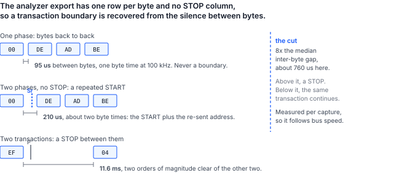

## 1 簡介

一位手邊有可運作系統和邏輯分析儀的工程師，在擷取檔中就擁有了一次成功匯流排交換的精確記錄。接下來自然的問題是：這份記錄能否被重播。

本文針對 I2C 和 Binho Pulsar 回答這個問題。本文提供執行重播的工具、得出下文所有數據的操作程序，以及對重播與其擷取之間合理差異的說明。這些差異才是本文的實質：重新傳送位元組只是問題的前一半。

### 1.1 範圍

本文涵蓋：

- 讀取 Saleae I2C 分析器的 CSV 匯出檔並從中還原交易
- 使用 Python 或 C++ 從 Pulsar 重播這些交易
- 目標裝置拒絕時轉接器回報什麼，以及不回報什麼
- 在分析器監看兩次執行的情況下，在線路上確認重播與擷取一致
- 使用第二個轉接器作為模擬目標裝置，刻意引發拒絕
- 限制：讀取、交易分框、時序、靜默拒絕以及十位元定址

本文不涵蓋重播 SPI、I3C 或 UART 擷取，不涵蓋從 Mission Control 3 驅動重播，也不涵蓋從分析器工作階段檔重建擷取。此工具讀取的是分析器的 CSV 匯出檔，而不是其原生工作階段檔。

### 1.2 適用裝置

Table: 適用裝置

| 角色 | 元件 | 識別資訊 | 依據 |
|---|---|---|---|
| 重播控制器 | Binho Pulsar | 硬體版本 C，韌體 4.4.0 | 已量測，本文 |
| 重播控制器 | Binho Supernova | 硬體版本 C，韌體 4.5.0 | 程式碼路徑與 Pulsar 共用；未單獨作為控制器量測 |
| 模擬目標裝置 | 作為 I2C 目標裝置的 Binho Supernova | 硬體版本 C，韌體 4.5.0 | 已量測，本文 |
| 擷取儀器 | Saleae Logic Pro 8 | Logic 2 v2.4.46，I2C 分析器 | 已量測，本文 |
| 擷取儀器 | Acute TravelBus | 8 通道 | 可解碼同一匯流排；此工具不讀取其匯出檔 |

### 1.3 相關文件

Table: 相關文件

| 文件 | 標題 |
|---|---|
| AN0002 | 使用 Binho Pulsar 透過 I2C 燒錄 STM32 微控制器 |
| AN0008 | 使用 Binho Supernova 透過 I2C 啟動 CMIS 光模組 |

## 2 所需設備與軟體

### 2.1 硬體

Table: 所需設備

| 項目 |
|---|
| Binho Pulsar USB 主機轉接器，作為重播控制器 |
| 具備 I2C 解碼器的邏輯分析儀 |
| 作為重播對象的 I2C 目標裝置 |
| 第二個 Binho 轉接器，在第 4.5 節中作為模擬目標裝置 |
| USB-C 纜線 |

第 1.2 節中的任一分析器都能解碼這條匯流排。本文的量測使用 Saleae Logic Pro 8 進行，因為此工具直接讀取該分析器的匯出檔；Acute TravelBus 能解析相同的流量，並在其本身軟體中解碼 I2C，但其匯出檔格式不同，要將其擷取匯入此工具，必須從該儀器產生的檔案中寫出第 4.2 節所述的六個欄位。本程序假設使用 Saleae，原因僅在於此。

### 2.2 連接

Table: 使用的訊號

| 訊號 | 用途 |
|---|---|
| SCL | I2C 時脈，從控制器到目標裝置以及分析器探棒 |
| SDA | I2C 資料，雙向，並連接到分析器探棒 |
| 3.3 V | 目標裝置電源，由主控轉接器提供 |
| GND | 回路，兩個轉接器與分析器共用 |

一條匯流排，並且**匯流排上只有一個控制器**。當第二個轉接器作為模擬目標裝置時，其本身的 I2C 控制器從不初始化：一條匯流排上有兩個已初始化的控制器時，兩者都會驅動 SCL 和 SDA，並且都會對共用的目標裝置電源軌供電，這會造成掃描結果不對稱以及電壓讀回錯誤，看起來就像纜線接錯一樣。

分析器探測的是相同的兩個訊號。通道指派可以自行選擇，但必須告知解碼器，而且值得確認而非假設：在 SCL 和 SDA 對調的情況下解碼，產生的是看似合理的輸出，而不是錯誤。

### 2.3 匯流排設定

Table: 使用的匯流排設定

| 設定 | 值 |
|---|---|
| 匯流排 | Pulsar 匯流排 A，即 Qwiic 埠 |
| 時脈 | 100 kHz |
| 上拉電阻 | 2.2 kOhm，僅由主控轉接器提供 |
| 匯流排電壓 | 3.3 V，讀回為 3299 mV |
| 分析器 | 6.25 MS/s，臨界值 3.3 V 邏輯，通道 0 為 SCL，通道 1 為 SDA |

> **注意**：上拉電阻過強會使已啟用的目標裝置不可見，其症狀與纜線未連接無法區分。在一個以目標裝置身分啟用於 `0x50` 的 Supernova 上掃描 Pulsar 的上拉電阻，在 150、220 或 330 Ohm 時目標裝置完全不應答，而從 470 Ohm 到 4 kOhm 每次都應答。在失敗的情況下，掃描傳回 `FW_I2C_BUS_WITH_NO_TARGETS_CONNECTED`，直接寫入傳回 `FW_I2C_NACK_ADDRESS`，這與匯流排未連接時的傳回值完全相同。請先懷疑上拉電阻，再懷疑接線。

### 2.4 軟體

此工具以 SDK 提供的兩種語言提供，功能相同。請選擇與重播所在系統相符的版本。

**Python，基於 pyCosmicSDK。** Python 3.11 或更新版本：

```
pip install pycosmicsdk
python i2c_replay.py selfcheck
```

**C++，基於 CosmicSDK。** C++17 編譯器以及已安裝的 CosmicSDK：

```
cmake -B build -DCOSMICSDK_ROOT=/opt/cosmicsdk
cmake --build build
./build/i2c_replay selfcheck
```

兩種自我檢查都既不需要轉接器也不需要匯流排，因此可以在接線之前確認建置無誤。擷取需要分析器本身的軟體；第 4.2 節說明如何在不開啟 Logic 2 視窗的情況下驅動它。

> **注意**：C++ 版本涵蓋讀取擷取並加以重播。將轉接器啟用為模擬目標裝置（第 4.5 節以此刻意引發拒絕）的功能僅在 Python 版本中提供。這有兩個 SDK 層面的原因：CosmicSDK 在 1.5.0 中新增了用於交還匯流排角色的 `i2cDeinit`，但韌體從 4.5.0 起才支援該指令，因此在較舊的轉接器上，目標裝置角色會一直保留，直到裝置重設為止；此外，針對自己的目標裝置進行重播的讀者根本不需要模擬目標裝置。

## 3 擷取在重播時的表現

### 3.1 擷取是記錄，而不是腳本

擷取中的每個位元組，都是由當時存在、並處於當時所處狀態的目標裝置所應答的。重播擷取是將這些位元組放到一條狀態已經改變的匯流排上。由此產生四個結果，它們決定了下文的所有內容。

**寫入可以重現；讀取不能。** 擷取的讀取中所記錄的位元組是由目標裝置產生的，而不是傳送給它的。重播不可能意味著強行送出這些位元組。此工具會重新發出讀取，並回報應答是否仍然相符，這是一次量測而不是一次重播。

**拒絕會結束其本身所在的交易。** 當目標裝置不應答時，韌體會在該處停止傳輸，而不是繼續以時脈送出其餘的酬載。這是轉接器的行為，而不是此工具實作的功能。

**分框是推斷出來的，而不是記錄下來的。** 分析器匯出檔中沒有 START 或 STOP 欄位。第 3.3 節說明了如何仍然還原出邊界。

**擷取假影會變成匯流排交易。** 分析器錯誤解碼一個邊緣時會憑空產生一個位址，而重播會如實地對其定址。

### 3.2 兩種拒絕，以及一種並非拒絕的情況

轉接器區分兩種失敗，而這種區別就是重播報告的全部內容。

Table: 目標裝置如何拒絕，以及轉接器回報什麼

| 匯流排上發生了什麼 | 韌體狀態 | 它能確定什麼 |
|---|---|---|
| 沒有任何裝置應答該位址 | `FW_I2C_NACK_ADDRESS` (0x0203) | 完全沒有傳送任何資料位元組 |
| 目標裝置接受了位址，接著拒絕了一個資料位元組 | `FW_I2C_NACK_BYTE` (0x0204) | 傳輸在該位元組處停止；其餘部分未傳送 |

兩種狀態都不包含被拒絕位元組的索引。重播報告可以說明發生了哪一種拒絕，但無法說明它發生在酬載中的哪個位置。第 5.6 節列出了可以還原該索引的兩個來源。

另外還有一種 NAK 並不代表出了問題。控制器會應答讀取中除了最後一個位元組以外的每個位元組，並對最後一個位元組發出 NAK，以告知目標裝置停止驅動。在匯出檔中，它表現為讀取最後一個位元組上的 NAK。若將其計為拒絕，就會把一份正常的擷取回報為有問題的擷取，因此此工具會明確排除這種情況。

### 3.3 分析器匯出檔包含與不包含的內容

匯出檔的兩個特性決定了此工具的設計，而且兩者都無法從欄位標題推測出來。

**Packet ID 欄位不具任何分組作用。** 在本測試台一份 425 行的擷取中，395 個資料列全部帶有 Packet ID `0`，只有 30 個位址 NAK 列沒有該值。因此依 Packet ID 對交易分組會把不相關的傳輸合併在一起：它把一次帶子位址讀取的指標寫入與讀取位元組合併成了一次十二位元組的寫入。此工具僅在該欄位確實有變化時才採用它。

**交易邊界必須從靜默中推斷。** 由於沒有 START 或 STOP 欄位，區分對同一位址的兩次同方向寫入的唯一依據就是位元組之間的間隔，因此此工具會量測擷取中位元組間隔的中位數，並在其某個倍數處切分。



Table: 在本擷取中量測到的三種間隔，100 kHz

| 位於 | 量測值 | 意義 |
|---|---|---|
| 同一階段的位元組之間 | 95 us | 一個位元組時間；從來不是邊界 |
| 帶子位址讀取的兩個階段之間 | 209 至 210 us | 重複 START；匯流排保持佔用 |
| 一個交易與下一個交易之間 | 11.6 ms | STOP |

預設切分點為中位數的八倍，約為 760 us，位於第二列與第三列之間，兩側各有一個數量級的餘裕。若取三倍，切分點將為 287 us，僅比重複 START 間隔高 1.4 倍，因此匯流排稍慢一些就會開始把重複 START 誤讀為 STOP。`--gap-seconds` 可直接覆寫此啟發式規則。

## 4 操作程序

### 4.1 接線之前先檢查工具

```
python i2c_replay.py selfcheck
```

```
i2c_replay.py 1.0 self-check: 18/18 OK
```

```
./build/i2c_replay selfcheck
```

```
i2c_replay 1.0 self-check: 11/11 OK
```

計數不同，是因為 Python 測試套件還針對替身轉接器涵蓋了其重播迴圈，而 C++ 測試套件將這部分留給實際測試台。兩者都涵蓋了剖析器。

### 4.2 進行擷取

在連接分析器 I2C 解碼器的情況下記錄所關注的流量，然後將分析器結果匯出為 CSV。檔案的第一行是

```
Time [s],Packet ID,Address,Data,Read/Write,ACK/NAK
```

數字依匯出時所用的進位制讀取，因此十六進位、十進位或二進位的匯出檔都能剖析。

> **注意**：Logic 2 會寫出兩種不同的 CSV，其中只有一種可在此使用。**分析器匯出檔（analyzer export**）每個位元組一列，包含上述欄位。**資料表匯出檔（data table export**）是完全不同的檔案，其欄位為 `name,type,start_time,duration,data,read,address,ack`，每個協定訊框一列，且位址以標籤而非數字呈現。若將資料表交給此工具，它會依名稱明確拒絕，而不是錯誤剖析，並且錯誤訊息會說明應改用哪個檔案。

Logic 2 可以在不開啟視窗的情況下完成此操作。在 Preferences 中啟用一次自動化伺服器，之後 Saleae 本身的 `logic2-automation` 套件即可驅動擷取並寫出相同的檔案：

```python
from saleae import automation

with automation.Manager.connect(port=10430) as manager:
    device = automation.LogicDeviceConfiguration(
        enabled_digital_channels=[0, 1],      # 0 = SCL, 1 = SDA
        digital_sample_rate=6_250_000,
        digital_threshold_volts=3.3)
    timed = automation.CaptureConfiguration(
        capture_mode=automation.TimedCaptureMode(duration_seconds=2.0))
    with manager.start_capture(device_configuration=device,
                               capture_configuration=timed) as capture:
        capture.wait()
        i2c = capture.add_analyzer("I2C", settings={"SDA": 1, "SCL": 0})
        capture.legacy_export_analyzer("capture.csv", i2c,
                                       automation.RadixType.HEXADECIMAL)
```

`legacy_export_analyzer` 就是此工具讀取的分析器匯出檔。同一物件上的 `export_data_table` 寫出的是另一種檔案。

### 4.3 重播之前先讀回擷取

`parse` 在不接觸匯流排的情況下還原交易。這一步用於確認擷取的內容是否與假設的相符：

```
python i2c_replay.py parse capture.csv
```

```
capture.csv: 152 transactions (121 write, 31 read), 395 payload bytes, 30 refused in the
capture, 31 held by a repeated START
capture spans 2.028226 s

    0.007708s  write 0x50  00   [repeated START, bus held]
    0.007911s  read  0x50  DE AD BE EF
    0.019486s  write 0x62  -   [captured: address NAK]
    0.051084s  write 0x50  00 DE AD BE EF
    0.063084s  write 0x50  04 11 22
```

該輸出中有三個細節值得指出。暫存器指標以酬載的形式重播：`write 0x50 00 DE AD BE EF` 是向暫存器 `0x00` 寫入 `DE AD BE EF`，此工具將指標位元組保留在酬載中，因為匯出檔不區分它，線路上也不區分它。帶子位址的讀取顯示為兩個階段，一個設定指標的寫入以及一個收集位元組的讀取，因為它在線路上就是如此。並且這兩個階段中的第一個被標記為保持佔用，這就是第 3.3 節中的重複 START。

### 4.4 重播

```
python i2c_replay.py replay capture.csv --serial <pulsar serial> --pullup KOHM_2_2
```

Table: 重播選項

| 選項 | 作用 |
|---|---|
| `--pace` | 等待擷取本身的交易間間隔，而不是以 USB 速度重播 |
| `--stop-on-nak` | 在第一個被拒絕的交易處停止整個重播 |
| `--include-captured-naks` | 同時重新發出在擷取中已被拒絕的交易 |
| `--gap-factor`, `--gap-seconds` | 移動第 3.3 節中的交易邊界切分點 |

### 4.5 刻意引發拒絕

拒絕值得示範，這意味著要刻意引發一次。將第二個轉接器啟用為模擬 EEPROM，其忙碌行為是對本身位址發出 NACK，也就是 24Cxx 資料手冊中描述的應答輪詢交握：

```
python i2c_replay.py arm-target --serial <supernova serial> --write-cycle-us 5000
python i2c_replay.py replay capture.csv --serial <pulsar serial>
python i2c_replay.py release-target --serial <supernova serial>
```

此後任何寫入之後都有一個 5 ms 的視窗，在此期間目標裝置會拒絕其本身位址，因此寫入速度快於模擬元件提交速度的重播會在位址階段被拒絕。完成後請釋放該角色；在交還之前該角色一直屬於該裝置，而在此期間要求匯流排的控制器會被以 `FW_I2C_ROLE_CONFLICT` 拒絕。

## 5 量測結果

### 5.1 測試組態

Table: 測試組態

| 項目 | 值 |
|---|---|
| 控制器 | Binho Pulsar，硬體版本 C，韌體 4.4.0，匯流排 A |
| 目標裝置 | Binho Supernova，硬體版本 C，韌體 4.5.0，以 I2C 目標裝置身分啟用於 `0x50`，EEPROM 模型，256 B，頁 8 B，5 ms 寫入週期，忙碌行為為 NACK |
| SDK | `pycosmicsdk`，Python 3.12，Ubuntu 26.04 |
| 匯流排 | 100 kHz，上拉電阻 2.2 kOhm，3.3 V，讀回 3299 mV |
| 分析器 | Saleae Logic Pro 8，Logic 2 v2.4.46，6.25 MS/s，通道 0 為 SCL，通道 1 為 SDA |
| 流量 | 向暫存器 `0x00` 寫入四個位元組，向 `0x04` 寫入兩個位元組，從 `0x00` 進行四個位元組的帶子位址讀取，以及向無裝置應答的 `0x62` 寫入 |

原始擷取與重播由同一台儀器記錄，因此下文的每一項比較都是在兩次量測之間進行的。

### 5.2 重播承載了擷取的位元組

該擷取被剖析為 152 個交易，其中 121 個寫入與 31 個讀取，30 個被拒絕，31 個由重複 START 保持佔用，這與實際驅動的流量完全一致。接著在分析器第二次記錄的同時，使用 `--pace` 對其進行重播。

Table: 交易形態，原始擷取與重播比較

| 形態 | 原始 | 重播 |
|---|---|---|
| `write 0x50  00`（由重複 START 保持佔用） | 31 | 16 |
| `read 0x50  DE AD BE EF` | 31 | 16 |
| `write 0x50  00 DE AD BE EF` | 30 | 14 |
| `write 0x50  04 11 22` | 30 | 15 |
| `write 0x62`（位址 NAK） | 30 | 0 |

計數不同，是因為兩次擷取視窗的長度不同，而且第二個視窗關閉時重播仍在執行。位元組沒有差異。此工具對這次執行的報告：

```
122 replayed, 0 aborted on a NAK, 0 failed otherwise, 0 read(s) answered
differently than the capture
```

全部 31 個讀取都傳回了原始擷取所記錄的位元組。30 個位址 NAK 交易預設會被略過，這就是剖析出的 152 個與重播的 122 個之間的差值。

### 5.3 兩個版本對擷取的讀取完全一致

以 Python 和 C++ 剖析器處理同一份 425 行的匯出檔，並逐行比較其輸出。兩者印出**完全相同的 155 行**，逐位元組一致：相同的 152 個交易，相同的 121 個寫入與 31 個讀取的劃分，相同的 30 次拒絕，相同的 31 個由重複 START 保持佔用的階段，而且每個交易的酬載都相同。

Table: 同一擷取經過兩個版本的結果

| 版本 | 交易 | 寫入 | 讀取 | 被拒絕 | 保持佔用 | 輸出行數 |
|---|---|---|---|---|---|---|
| `i2c_replay.py`，pyCosmicSDK | 152 | 121 | 31 | 30 | 31 | 155 |
| `i2c_replay`，CosmicSDK C++ | 152 | 121 | 31 | 30 | 31 | 155 |

重播到匯流排上時，C++ 版本回報 `122 replayed, 0 aborted on a NAK, 0 failed otherwise`，與 Python 版本相同的 122 個：剖析出的 152 個減去預設略過的 30 個位址 NAK 交易。

這一點的意義不只在於整齊。第 3.3 節的邊界啟發式規則是此工具中唯一需要判斷的部分，而它的兩個獨立實作得出相同的 152 個交易，證明該規則定義明確，而不是某一種語言捨入方式的產物。

### 5.4 重複 START 在重播中得以保留，但其時序沒有

擷取中顯示為保持佔用的階段，在重播時使用重複 START 而非 STOP。這一點並非從間隔啟發式規則推斷而來（該規則看不到分框），而是從資料表匯出檔中讀取的，其 `type` 欄位包含明確的 `start` 和 `stop` 訊框。

Table: 分框，依資料表匯出檔統計

| 擷取 | STOP 之後的階段 | 重複 START 之後的階段 | 跨越重複 START 的間隔 |
|---|---|---|---|
| 原始 | 121 | 31 | 209 至 210 us |
| 重播 | 45 | 16 | 1511 至 1761 us |

重播為它發出的每個讀取都產生了重複 START，在指標寫入與讀取之間沒有 STOP。它無法重現的是**時序**：兩個階段是兩道獨立的主機指令，因此匯流排保持佔用的時間是一次 USB 往返而非一個位元組時間，間隔從約 210 us 增加到約 1.6 ms。

> **注意**：這個被拉長的間隔會使此工具本身的啟發式規則失效。重新剖析重播的擷取時，這些階段會被回報為未保持佔用，因為 1.6 ms 的靜默超過了預設切分點。匯流排確實保持佔用，資料表也證明了這一點，但分析器匯出檔不包含這項事實，而靜默也不再隱含這一點。當分框很重要時，請讀取資料表。將 `--gap-seconds` 提高到高於主機延遲且低於交易間靜默的值，也可以還原這項資訊。

### 5.5 Binho 目標裝置能產生哪些拒絕

對模擬目標裝置逐一測試了其提供的每一種存取控制機制，以確定線路上實際會出現什麼。

Table: 從模擬 Binho I2C 目標裝置引發拒絕

| 嘗試 | 結果 |
|---|---|
| 寫入無裝置佔用的位址 | `FW_I2C_NACK_ADDRESS` |
| 在 EEPROM 模型的寫入週期視窗內寫入 | `FW_I2C_NACK_ADDRESS` |
| 寫入週期結束後進行相同的寫入 | 成功 |
| 寫入 EEPROM 模型的寫入保護區段 | 成功 |
| 寫入宣告為唯讀的 `REGISTER_MAP` 區域 | 成功 |
| 跨越讀寫區與唯讀區邊界的寫入 | 成功 |

`FW_I2C_NACK_BYTE` 存在於控制器路徑中，並會在出現時被回報，但沒有發現任何一種 Binho 目標裝置模型的組態能產生它。存取控制是靜默執行的：目標裝置應答每個位元組，並捨棄它不會儲存的位元組。在 `0x40` 處跨越讀寫區與唯讀區邊界寫入四個位元組傳回成功，而讀回同一區段得到 `00 01 00 00`，即兩個允許的位元組已儲存，兩個被拒絕的位元組未改變，而線路上沒有任何資訊可以區分這兩半。要引發真正的資料階段 NAK，需要一個會發出這種 NAK 的目標裝置。

這個結果顛覆了重播使用者最初的直覺。危險的目標裝置不是拒絕某個位元組的那種，因為拒絕會被回報。危險的是應答了寫入卻將其捨棄的那種，因為重播回報完全成功，而目標裝置並沒有改變。**寫入的重播並不能證明寫入已經生效。請讀回確認。**

### 5.6 被拒絕位元組的索引可以從哪裡還原

兩種拒絕狀態都不包含位元組索引，但另外兩個觀察者包含。

目標裝置本身的匯流排事件包含它。`I2cTargetBusEvent` 帶有一個 `payload_length`，取自目標裝置硬體的已傳輸計數，也就是目標裝置在資料階段實際傳輸的位元組數。當重播驅動的是一個被啟用為目標裝置的轉接器時，該計數就是索引。

分析器包含它。匯出檔中每個位元組都有一個應答欄位，因此在重播的擷取中可以直接看到被拒絕的位元組。

### 5.7 以快於擷取的速度重播會改變結果

`--pace` 並非裝飾性選項。在啟用模擬 EEPROM 目標裝置的情況下，將一份包含三次相隔半秒的單位元組寫入的擷取重播了兩次，唯一的改變就是這個選項。

Table: 同一擷取分別以 USB 速度與擷取速度重播

| 執行 | 實際耗時 | 報告 |
|---|---|---|
| 預設，以 USB 允許的最快速度 | 0.743 s | 3 replayed, 2 aborted on a NAK |
| `--pace` | 1.728 s | 3 replayed, 0 aborted |

兩次中止是目標裝置在完成上一次寫入的 5 ms 寫入週期期間拒絕其本身位址，也就是第 4.5 節的應答輪詢交握不請自來。擷取本身的時間戳記顯示這些寫入之間相隔半秒，因此以擷取速度重播時每個週期都能完成，沒有任何拒絕。實際耗時相差的 0.985 s，就是遵守了兩個半秒間隔的結果。

這個教訓的適用範圍不限於這個目標裝置：**擷取的時序是內容，而不是裝飾。** 任何具有忙碌期、內部週期或需要時間處理之指令的目標裝置，都可能在原始節奏下接受一個序列，而在以匯流排速度重播同一序列時拒絕它。當重播中止而擷取中沒有中止時，請先嘗試 `--pace`，再去懷疑位元組。

## 6 重播無法重現的內容

### 6.1 重播之重播的分框

如第 5.4 節所確認，原始擷取中的重複 START 會被重現。無法保留的是在重播的擷取中看到它的能力：由於兩個階段是兩道主機指令，保持佔用的間隔從約 210 us 拉長到約 1.6 ms，靜默不再隱含該分框。因此，重播在線路上是忠實的，但作為其本身的輸入則會遺失資訊。對重播再進行重播，每一輪都會使分框退化，除非相應提高 `--gap-seconds`，或使用資料表來確認分框。

### 6.2 匯流排時序

`--pace` 依據擷取本身的時間戳記重現交易之間的間隔，第 5.7 節展示了一個例子，其中這正是重播成功與失敗的差別所在。它不重現交易內部的時序、時脈延展或原始時脈頻率，後者是匯流排設定而不是擷取內容。

### 6.3 讀取

見第 3.1 節。重播的讀取是向目前目標裝置提出的一個新問題。

### 6.4 分析器未能解碼的任何內容

以過低的臨界值、過低的取樣率或 SCL 與 SDA 指派對調進行的擷取，會產生一份看似合理但實際錯誤的匯出檔。應答欄位顯示為 `Missing ACK/NAK` 的匯出檔，表示分析器無法看到第九個位元；此工具會標記這些列，但不將其視為拒絕，因為它們屬於擷取品質問題。

### 6.5 十位元定址

分析器的匯出檔沒有十位元位址的概念：每個位址列都被格式化為七位元值，因此十位元交易會顯示為保留範圍 `0x78` 至 `0x7B` 中的一個位址，位址的其餘部分則作為第一個資料位元組出現。重播這些列會把相同的位元組放回線路上，這是忠實的，但報告中會出現一個讀者不認得的位址。這一點是從分析器原始碼中讀出的，而不是量測得到的；測試台上沒有十位元位址的目標裝置。

### 6.6 本文尚未確認的內容

- **來自實際韌體的資料階段 NAK。** `FW_I2C_NACK_BYTE` 會在出現時被回報，但其回報路徑從未被任何裝置實際觸發過，因為沒有任何 Binho 目標裝置會發出它。要引發它，需要一個會拒絕資料位元組的第三方目標裝置。
- **Supernova 作為重播控制器。** 本文中只有 Pulsar 驅動過重播，兩個版本皆是如此。程式碼路徑是共用的，但共用不等於已量測。
- **C++ 版本在 Linux 以外的平台上。** 它在 Ubuntu 26.04 上以 GCC 針對 CosmicSDK 1.5.0 建置，並在該環境的測試台上執行。隨附的 CMake 以可攜的方式撰寫，但尚未在 Windows 或 macOS 上測試。
- **本測試台上的 `i2cDeinit`。** 此處的 Pulsar 使用韌體 4.4.0，早於該指令的推出，因此從未從 C++ 測試過釋放路徑。
- **十位元定址。** 見第 6.5 節，從分析器原始碼中讀出，測試台上沒有十位元位址的目標裝置。
- **高於 100 kHz 的任何速率，或匯流排上有第二個目標裝置的情況。** 第 5 節中的每項量測都是在 100 kHz 匯流排上對位於 `0x50` 的單一目標裝置進行的。

## 7 工具

同一個工具提供了兩份，每個 SDK 一份。剖析器與重播語意逐行共用，第 5.3 節就是證明這一點的量測。

Table: 工具指令

| 指令 | Python，pyCosmicSDK | C++，CosmicSDK | 用途 |
|---|---|---|---|
| `selfcheck` | 是 | 是 | 離線檢查剖析器，無需轉接器與匯流排 |
| `parse` | 是 | 是 | 從擷取中還原交易並印出 |
| `replay` | 是 | 是 | 將擷取放回匯流排，並回報每個交易的結果 |
| `scan` | 是 | 是 | 列出匯流排上應答的位址 |
| `arm-target` | 是 | 否 | 將轉接器啟用為忙碌時對其位址發出 NACK 的模擬 EEPROM |
| `release-target` | 是 | 否 | 將目標裝置角色交還給裝置 |

兩者都接受 `--serial` 來指定轉接器，這在有兩個轉接器的測試台上很重要：兩個 SDK 的一般連線都不做選擇，而最先列舉到的轉接器既可能是目標裝置，也可能是控制器。

剖析器是值得重複使用的部分。它是唯一了解匯出檔版面的部分，並包含第 3.3 節的兩條規則：僅在 Packet ID 有變化時才採用它，以及邊界是相對於擷取本身位元組速率量測的靜默。其餘部分都只是 SDK 之上的薄層。

## 8 疑難排解

Table: 疑難排解

| 症狀 | 檢查 |
|---|---|
| 掃描傳回 `FW_I2C_BUS_WITH_NO_TARGETS_CONNECTED` | 上拉電阻過強；參見第 2.3 節中的注意事項 |
| 每個交易都因位址 NAK 而中止 | 目標裝置在另一條匯流排上，或上拉電阻為 330 Ohm 以下 |
| 啟用目標裝置時出現 `FW_I2C_ROLE_CONFLICT` | 該裝置的某條匯流排上已啟用 I2C 控制器；請先釋放它 |
| `FW_INTERFACE_ALREADY_INITIALIZED`，且上拉電阻沒有改變 | 已啟用的介面會保留其先前的設定；此工具正是因此使用啟動呼叫 |
| 此工具依名稱拒絕擷取檔 | 匯出的是資料表而非分析器結果；參見第 4.2 節中的注意事項 |
| 預期三個交易，卻得到一個十二位元組的交易 | 邊界切分點對此擷取而言過寬；降低 `--gap-factor` 或設定 `--gap-seconds` |
| 每個位元組都被剖析為一個獨立交易 | 切分點低於匯流排位元組時間；請提高它 |
| 帶子位址的讀取被剖析為一次寫入 | 這是 Packet ID 分組造成的，而此工具不做這種分組；請檢查檔案是否為分析器匯出檔 |
| 重播中止，而擷取中沒有中止 | 嘗試 `--pace`；目標裝置可能需要原始間隔，如第 5.7 節所示 |
| 重播回報完全成功，但目標裝置沒有變化 | 目標裝置正在靜默捨棄寫入；請讀回確認，並參見第 5.5 節 |
| 報告中出現系統從未使用過的位址 | 擷取假影，被如實重播 |
| 已啟用的目標裝置在 udev 變更後停止應答 | 重新列舉會重設轉接器的韌體狀態並遺失目標裝置角色；請重新啟用 |
| 在從未啟用過的匯流排上，C++ 版本回報 `FW_I2C_ROLE_CONFLICT` | 它開啟了錯誤的轉接器；請傳入 `--serial`，因為一般連線會選取最先列舉到的轉接器 |
| `i2cDeinit` 傳回 `FW_UNSUPPORTED_COMMAND` | 韌體從 4.5.0 起才支援該指令；在較舊的韌體上，透過重設轉接器來釋放角色 |
| CMake 找不到 `hidapi.h` | `CosmicSDK.hpp` 引入了它；請將 `COSMICSDK_ROOT` 指向同時包含 `include/` 與 `lib/` 的目錄 |

## 9 縮寫

Table: 縮寫

| 術語 | 意義 |
|---|---|
| ACK | 應答（Acknowledge） |
| CSV | 逗號分隔值（Comma-separated values） |
| NAK, NACK | 非應答（Not acknowledge） |
| SCL | 串列時脈線（Serial clock line） |
| SDA | 串列資料線（Serial data line） |
| SDK | 軟體開發套件（Software development kit） |
| START | 開始一個 I2C 交易的條件 |
| STOP | 結束一個 I2C 交易的條件 |
| VTARG | 由轉接器提供的目標裝置電源軌 |
| WP | 寫入保護（Write protect） |

## 10 關於本文中原始碼的說明

本文中展示以及隨附壓縮檔中提供的範例程式碼僅供評估與參考。這些程式碼依據 MIT 授權條款發布，授權條款全文包含在壓縮檔中。

Table: 資源壓縮檔的內容

| 檔案 | 說明 |
|---|---|
| `AN0013.md` | 本文的 Markdown 原始檔 |
| `assets/i2c_replay.py` | 參考工具，基於 pyCosmicSDK 的 Python 版本 |
| `assets/i2c_replay.cpp` | 參考工具，基於 CosmicSDK 的 C++ 版本 |
| `assets/CMakeLists.txt` | C++ 工具的建置檔 |
| `assets/captures/original-analyzer-export.csv` | 第 5.2 節的分析器匯出檔，即原始擷取 |
| `assets/captures/replay-analyzer-export.csv` | 對該檔案進行重播所得的分析器匯出檔 |
| `assets/LICENSE` | 適用於範例程式碼的 MIT 授權條款 |

提供這兩份擷取，是為了無需測試台，僅用 `parse` 即可重新進行第 5.2 節中的比較。

## 11 修訂歷史

Table: 修訂歷史

| 修訂版本 | 日期 | 說明 |
|---|---|---|
| 0.1 | 10 September 2026 | 初稿。 |
| 1.0 | 6 November 2026 | 正式發布。 |
