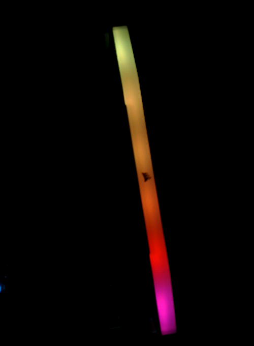
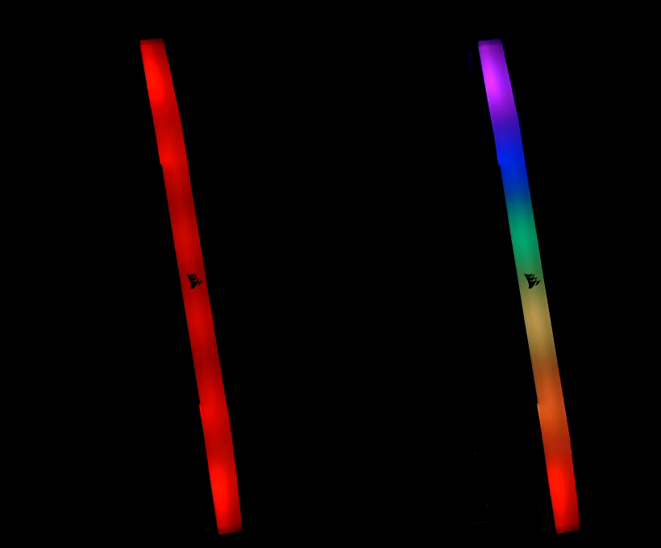

> **検証範囲**。本ドキュメントのすべての数値は、2026 年 10 月 6 日の 1 回の
> ベンチセッションで、1 枚のモジュールを用いて得たものです。付属のスクリプトはベンチで使用した
> スクリプトを統合したもので、その後同じベンチで実行しました（第 12 章）。

## 1 はじめに

DDR5 DIMM は、メモリバスとは別に 2 線式のサイドバンド（HSCL、HSDA）を備えています。このバス上で
最初に応答するのは SPD5118 ハブです。ハブはモジュールの SPD データを保持し、温度を報告し、PMIC や、
ライティング付きモジュールでは RGB コントローラなど、モジュールのローカルバス上にある他のデバイスへ
トラフィックを転送します。ハブは I2C モードで起動し、I3C に切り替えることができます。

本ノートでは、マザーボードを使わずに、ホストアダプタからハブとそれらのデバイスを読み出す方法を説明します。

### 1.1 範囲

本ドキュメントで扱う内容は次のとおりです。

- SPD5118 ハブの識別、温度センサの読み出し、および 1 KB の SPD NVM の読み出し
- PMIC ステータスの読み出し（読み出しのみ）
- SETAASA によるハブの I3C への切り替え、SDR での読み出し、および RSTDAA による I2C への復帰
- 本ベンチで正しいデータが得られた I3C レートと、得られなかった 1 つのレート
- ハブの背後にある Corsair RGB コントローラ：ファームウェア更新モードからの離脱、LED ごとの色の設定、
  およびハードウェアエフェクトの開始

SPD NVM への書き込み、I3C によるハブレジスタへの書き込み（理由は第 5.3 節で説明します）、ハブからの
インバンド割り込み（IBI）（試行しましたが受信しませんでした）、PEC、およびハブが I3C モードのときの
RGB コントローラへのアクセス（未試行）は扱いません。

### 1.2 対象デバイス

Table: 対象デバイス

| 役割 | 部品 | 識別情報 | 根拠 |
|---|---|---|---|
| ホストアダプタ | Binho Supernova | ハードウェアリビジョン C、ファームウェア 4.6.1 | 実測、本ドキュメント |
| SPD ハブ | 下記モジュール上の SPD5118 | MR0-1 `51 18`、MR2 リビジョン `0x14` | 実測、本ドキュメント |
| PMIC | 下記モジュール上の PMIC | アドレス `0x48` | 読み出し専用のステータス、実測 |
| RGB コントローラ | Corsair Vengeance RGB RS DDR5、LED 6 個 | VID `0x1B1C`、PID はファームウェア更新モードで `0x0B00`、通常モードで `0x0B01` | 実測、本ドキュメント |
| モジュール | Corsair `CMG16GX5M2E6000Z36`（キットのうち DIMM 1 枚） | SPD バイト 2 `0x12`（DDR5）、バイト 3 `0x02`（UDIMM） | 実測、本ドキュメント |
| その他の SPD5118 モジュール | 任意の DDR5 UDIMM または SODIMM | MR0-1 `51 18` | 第 5.1 節および第 5.2 節は JESD300-5 に従います。1 枚のモジュール以外では未テスト |
| その他の Corsair DDR5 RGB モジュール | | その他の PID | 未テスト |

### 1.3 関連資料

Table: 関連資料

| ドキュメント | タイトル |
|---|---|
| JESD300-5 | SPD5118 Hub and Serial Presence Detect Device Standard（JEDEC） |
| JESD400-5 | DDR5 Serial Presence Detect (SPD) Contents（JEDEC） |
| MIPI I3C Basic | Improved Inter Integrated Circuit Basic 仕様 |
| OpenRGB | Corsair DRAM コントローラのソースコード。第 5.4 節の RGB レジスタマップの出典 |

## 2 システム概要

Table: サイドバンド上で確認されたデバイス（ハブは I2C モード、100 kHz）

| アドレス | デバイス | 応答のしかた |
|---|---|---|
| `0x50` | SPD5118 ハブ | レジスタポインタ + 読み出し。単純な読み出しにも応答 |
| `0x48` | PMIC | レジスタポインタ + 読み出し |
| `0x18` | Corsair RGB コントローラ | **レジスタポインタ + 読み出しのみ**。単純な読み出しには ACK を返さない |

このモジュールは HSA = 0 にストラップされており、ハブは `0x50` に配置されます。ハブは、モジュールの
ローカルバス上のデバイス宛てのトランザクションをホスト側へ転送します。JESD300-5 では、この 2 つの
アドレスフィールドをローカル ID とホスト ID と呼びます。I2C モードでは、この転送に設定は不要でした。
PMIC と RGB コントローラにはこの転送を介してアクセスします。

以下の 2 つの事実が、本ドキュメントの内容全体を左右します。

- **単純な読み出しによるスキャンでは RGB コントローラは見つかりません。** `0x08` から `0x77` を
  1 バイト読み出しでスキャンすると、`0x48` と `0x50` だけが返りました。レジスタポインタを書き込んで
  から読み出すと、`0x18` に見つかります。
- **本ベンチでは、ハブは ENTDAA で検出されない I3C ターゲットです。** SETAASA を受けるとスタティック
  アドレスをダイナミックアドレスとして採用し、RSTDAA を受けると I2C に戻ります。

## 3 ハードウェアのセットアップ

### 3.1 必要な機器

Table: 必要な機器

| 項目 | 備考 |
|---|---|
| Binho Supernova | ここではファームウェア 4.6.1 を使用 |
| DDR5 モジュール | 第 1.2 節のモジュール |
| DIMM ブレークアウト | HSCL、HSDA、GND を引き出し、HSA をストラップし、自身の 5 V 入力から VIN_BULK を供給 |
| ブレークアウト用 5 V 電源 | ここではブレークアウト上の USB-C を使用 |
| 4 線ケーブル | Supernova の I3C LV コネクタからブレークアウトへ |

### 3.2 接続

Table: Supernova と DIMM ブレークアウトの接続

| Supernova I3C LV コネクタ | DIMM ブレークアウト | 必須 |
|---|---|---|
| SCL | HSCL | はい |
| SDA | HSDA | はい |
| GND | GND | はい |

### 3.3 バスに関する考慮事項

バスは **1.1 V**（設定 1100 mV、読み戻し 1106 mV）で動作させました。Supernova は電圧だけで I3C
コネクタを選択します。

Table: Supernova の I3C コネクタ選択

| 要求電圧 | コネクタ |
|---|---|
| 800 から 1199 mV | LV |
| 1200 から 3300 mV | HV |

> **注意：** 1200 mV を要求するとバスは HV コネクタに移ります。モジュールが LV コネクタに接続されて
> いる場合、何も応答しません。1100 mV を要求してください。

> **注意：** モジュールには VIN_BULK に 5 V が必要です。これはブレークアウトが供給し、アダプタは
> 供給しません。バスを立ち上げる前にモジュールに電源を投入してください。第 5.3 節のハングを解除する
> には、アダプタではなくモジュールの電源を再投入してください。

## 4 ソフトウェアのセットアップ

必要なもの：Python 3 と pycosmicsdk（最新リリース）。

```
pip install --upgrade pycosmicsdk
python ddr5_spd.py --help
python ddr5_rgb.py --help
```

どちらのスクリプトも、pycosmicsdk の公開 API のみを使用します：`Device.open`、
`I3cController.set_voltage`、`bring_up`、`legacy_i2c_read`、`legacy_i2c_write`、`sdr_read`、
`ccc.setaasa`、`ccc.rstdaa`。どちらもアダプタを選択する `--serial` と `--voltage-mv`（デフォルト
1100）を受け付けます。ベンチでは Ubuntu 22.04 ホスト、pycosmicsdk 1.6.0、Python 3.10 を使用しました。

## 5 レジスタとプロトコル

### 5.1 I2C モードの SPD5118 ハブ

すべてのアクセスは、1 バイトのレジスタポインタに続く読み出しです。

Table: 使用したハブレジスタ

| レジスタ | このモジュールでの読み出し値 | 意味 |
|---|---|---|
| MR0-1 | `51 18` | デバイスタイプ、SPD5118 |
| MR2 | `0x14` | デバイスリビジョン |
| MR5 | `0x03` | 機能：ハブと温度センサ |
| MR11 | `0x00` | I2C レガシーモード：ビット 2:0 で NVM ページを選択、ビット 3 で 2 バイトアドレッシングを選択 |
| MR12-13 | `FF 7F` | NVM 書き込み保護、64 バイトブロックごとに 1 ビット |
| MR18 | I2C では `0x00`、I3C では `0x20` | ビット 5 = I3C モード |
| MR49-50 | 2 バイト | 温度 |

**温度。** MR50 のビット 4:0 と MR49 のビット 7:0 で 13 ビットのフィールドを構成し、そのうちビット
1:0 は使用しません。残りの 11 ビットは 2 の補数で、1 LSB あたり 0.25 °C です。

```python
raw = (((mr50 & 0x1F) << 8) | mr49) >> 2
if raw & 0x400:
    raw -= 0x800
celsius = raw * 0.25
```

ベンチでのこのモジュールの読み出し値は 27 から 29 °C でした。リミットレジスタの読み出し値は
55 °C（高）と 85 °C（クリティカル）でした。

**NVM。** 1024 バイトの NVM は 128 バイトのページ 8 つで構成されます。1 バイトアドレッシングでは、
ビット 7 がセットされたポインタが NVM を指し、ビット 6:0 がページ内オフセット、MR11 のビット 2:0 が
ページを示します。全体を読み出す手順：MR11 を保存し、ページ 0 から 7 を順に MR11 に書き込み、
それぞれでポインタ `0x80` から 128 バイトを読み出し、最後に保存した値を書き戻します。書き込むレジスタは
MR11 だけです。このモジュールのダンプはバイト 2 = `0x12`（DDR5）、バイト 3 = `0x02`（UDIMM）と
デコードされ、バイト 0 から 509 に対する CRC-16（多項式 `0x1021`、初期値 0）はバイト 510 と 511 に
格納された値と一致しました。

**PMIC。** レジスタ R32 の読み出し値は `0x80`（レギュレータ有効）で、フォールトビットはセットされて
いませんでした。PMIC は読み出しのみ行いました。

### 5.2 I3C モードの SPD5118 ハブ

1. コントローラを I3C として立ち上げます。
2. デバイステーブルに `0x50` を入れて SETAASA をブロードキャストします。MR18 が `0x00` から `0x20` に
   変わります。
3. レジスタポインタを付けて SDR で読み出します：`sdr_read(0x50, n, subaddress=bytes([reg]))`。
4. RSTDAA をブロードキャストします。I2C で MR18 を読むと再び `0x00` になります。

`init_bus()` は ENTDAA でターゲットを検出するため、本ベンチではハブを立ち上げられませんでした。
SETAASA を使用してください。

Table: 1.1 V でのハブからの I3C SDR 読み出し（プッシュプルレート別）

| プッシュプルレート | 結果 |
|---|---|
| 1 MHz | 20/20 |
| 5 MHz | 50/50（最初の実行では 20/20） |
| 6.25 MHz | 50/50 |
| 7.5 MHz | 50/50 |
| 10 MHz | 50/50 |
| 12.5 MHz | 9/50 が正しい。残りの 41 回は成功ステータスのまま誤ったデータを返した |

12.5 MHz での失敗はエラーとして報告されませんでした。読み出しは完了し、データが誤っていました。
1.1 V でのブレークアウトの配線が制限要因である可能性が高いと考えられます。**長いサイドバンド配線では
4 MHz 以下を使用してください。** 1 MHz（20/20）と 5 から 10 MHz は測定しましたが、その間のレートは
測定していません。`ddr5_spd.py --i3c` のデフォルトは 1 MHz です。

### 5.3 I3C によるレジスタ書き込み

> **注意：** I3C SDR モードでのハブへのレジスタ書き込みは書いた値どおりに反映されず、その後バスが
> ハングしました。26.5 °C として書き込んだ温度リミットは 48 °C として読み戻され、MR27 に書き込んだ
> `0x01` は `0x10` として読み戻されました。その後、すべての I3C 操作が `FW_I3C_ENGINE_BUSY` を
> 返しました。Supernova の再起動でも、LV コネクタの電源再投入でも解除されず、モジュールの電源再投入で
> のみ解除されました。原因（ハブの I3C 書き込みフォーマットかホスト側か）は特定できていません。
> I3C モードでは読み出しのみ行ってください。書き込みが必要な場合は I2C モードで行うか、まず無害な
> レジスタに書き込み、読み戻しで確認してください。

### 5.4 Corsair RGB コントローラ

以下のレジスタマップとパケットフォーマットは、OpenRGB の Corsair DRAM コントローラ（GPL-2.0）に
基づいています。本ドキュメントのスクリプトはその記述から再実装したもので、OpenRGB のコードは
コピーしていません。コントローラには、ハブが I2C モードのときに `0x18` でアクセスします。

すべてのアクセスは `[register, value]` の書き込み、またはレジスタポインタに続く 1 バイト読み出しです。
**コントローラがアイドル状態だった後の最初のアクセスは 1 回拒否されることがあります。リトライして
ください。**

Table: 使用した RGB コントローラのレジスタ

| レジスタ | アクセス | 用途 |
|---|---|---|
| `0x0B`, `0x21` | `0x00` を書き込み | パケットバッファとその CRC をリセット |
| `0x20` | 書き込み、1 アクセスにつき 1 バイト | パケットバッファ |
| `0x42` | 読み出し | リセット以降にロードしたバイトの CRC-8 |
| `0x82` | 書き込み | 適用：`0x01` エフェクトパケット、`0x02` カラーバッファ |
| `0x30` | 読み出し | 適用中はビット 3 がセット |
| `0x61` の後に `0x21` | `0x00` を書き込み | デバイス情報ブロックを選択 |
| `0x40` | 読み出し、32 回 | デバイス情報ブロック |
| `0x23` | `0x01` を書き込み | ファームウェア更新モードから離脱 |

CRC は CRC-8、多項式 `0x07`、初期値 0 です。適用前に `0x42` と比較してください。不一致は、バイトの
欠落または重複（リトライした書き込みで起こりえます）を意味し、そのパケットは適用してはなりません。

**デバイス情報ブロック。** バイト 0-1 が VID（リトルエンディアン）、バイト 2-3 が PID、バイト 28 が
プロトコルバージョンです。

**ファームウェア更新モード。** 両端の LED が赤く点灯するのは、Corsair が文書化しているファーム
ウェア更新（ブートローダ）モードの表示です。この状態でモジュールは PID `0x0B00` とプロトコル 1 を
報告し、エフェクトパケットを受け付けました（CRC 一致）が、LED は変化しませんでした。`0x23` に `0x01`
を 1 回書き込むと PID `0x0B01`、プロトコル 4 に変わり、工場出荷時のレインボーが点灯しました（図 1）。
モジュールがどのようにしてこのモードに入ったかは特定できていません。電源投入直後にプローブされて
いました。

> **注意：** レジスタ `0x23` に `0x00` を書き込まないでください。



**カラーバッファ。** LED ごとに 1 つ、`R, G, B, 0xFF` のエントリ 6 個、計 24 バイトを、リセット後に
`0x20` へロードし、CRC を確認して、`0x82` = `0x02` で適用します。これで単色と LED ごとの色を設定
できます（図 2）。バッファはスタティックモードでのみ表示されます。アニメーションエフェクト中は、
CRC を含めて受け付けられますが無視されます。そのため `ddr5_rgb.py color` は最初にスタティック
エフェクト（モード `0x10`）を送信します。



**エフェクトパケット。** 20 バイトで、`0x82` = `0x01` で適用します。

```
mode, speed, 0x01, direction, R1, G1, B1, brightness, R2, G2, B2, brightness, 0 x 8
```

Table: エフェクトモード

| モード | コード | このモジュールでの観察 |
|---|---|---|
| レインボーウェーブ（rainbow wave） | `0x03` | あり |
| スタティック（static） | `0x10` | 適用されたが以前の色のまま。代わりにカラーバッファを使用 |
| レインボー（rainbow） | `0x08` | 観察されず |
| パルス（pulse） | `0x01` | 観察されず |

## 6 手順

### 6.1 電源投入と接続

ブレークアウトからモジュールに電源を供給します。ケーブルを Supernova の I3C LV コネクタに接続します。

### 6.2 ハブの識別と温度の読み出し


```
python ddr5_spd.py --serial <serial>
```

ベンチでの出力：

```
MR0-1 5118  (SPD5118 reads 5118)
MR2 revision 0x14  MR18 0x00  (bit 5 = I3C mode)
MR49-50 CC 01 = 28.75 C
```

### 6.3 NVM の保存（任意）

NVM を任意のファイルに保存します。このファイルはモジュールを識別できる情報として扱ってください。
モジュールのシリアル番号が含まれています。

```
python ddr5_spd.py --serial <serial> --nvm my_module_spd.bin
```

スクリプトは MR11 を復元し、SPD CRC が一致するかどうかを報告します。

```
MR0-1 5118  (SPD5118 reads 5118)
MR2 revision 0x14  MR18 0x00  (bit 5 = I3C mode)
MR49-50 CC 01 = 28.75 C
NVM: 1024 bytes to my_module_spd.bin, MR11 restored to 0x00
SPD byte 2 0x12 (0x12 = DDR5), byte 3 0x02, CRC 0-509 calc 0x45BF stored 0x45BF OK
```

### 6.4 I3C モードでのハブの読み出し（任意）

スクリプトは SETAASA で I3C モードに入り、SDR で読み出し、RSTDAA でハブを I2C に戻します。

```
python ddr5_spd.py --serial <serial> --i3c --i3c-mhz 1
```

MR18 は I3C 読み出し中は `0x20`、RSTDAA 後は `0x00` を示します。

```
MR0-1 5118  (SPD5118 reads 5118)
MR2 revision 0x14  MR18 0x00  (bit 5 = I3C mode)
MR49-50 CC 01 = 28.75 C
I3C SDR: MR18 0x20  MR0-1 5118  temperature 29.00 C
after RSTDAA (I2C): MR18 0x00
```

アダプタファームウェア 4.6.1 では、これはアダプタのリセット 1 回につき 11 回動作します。第 9 章を
参照してください。

### 6.5 RGB コントローラのデバイス情報の読み出し


```
python ddr5_rgb.py --serial <serial> info
```

ベンチでの出力（コントローラは通常モード）：

```
VID 0x1B1C PID 0x0B01 protocol 4
```

### 6.6 ファームウェア更新モードからの離脱

PID が `0x0B00`（両端が赤）の場合は、ファームウェア更新モードから離脱させます。スクリプトは PID が
`0x0B00` の場合にのみ書き込みます。

```
python ddr5_rgb.py --serial <serial> leave-bootloader
```

コントローラがファームウェア更新モードのときの出力：

```
before: PID 0x0B00 protocol 1
after:  PID 0x0B01 protocol 4
```

すでに通常モードのときの出力：

```
before: PID 0x0B01 protocol 4
not in firmware-update mode; nothing written
```

### 6.7 色またはエフェクトの設定


```
python ddr5_rgb.py --serial <serial> color 255,0,0
python ddr5_rgb.py --serial <serial> color 255,0,0 255,80,0 255,220,0 0,255,0 0,0,255 160,0,255
python ddr5_rgb.py --serial <serial> effect wave 255,0,0 0,0,255 --speed 2
python ddr5_rgb.py --serial <serial> demo
```

これらのコマンドは成功時には何も出力せず、コントローラの CRC が一致しない場合はエラーで終了します。

デモシーケンスは `figures/an0016-video1-rgb-demo.mp4`（42 s）にあり、このスクリプトの統合元である
ベンチスクリプトで録画したものです。

## 7 リファレンス

Table: ddr5_spd.py のオプション

| オプション | 動作 |
|---|---|
| `--serial` | アダプタのシリアル番号。デフォルトは最初に見つかったアダプタ |
| `--voltage-mv` | バス電圧、デフォルト 1100（LV コネクタ） |
| `--nvm FILE` | MR11 を介して 1024 バイトの NVM を FILE に読み出し、その後 MR11 を復元 |
| `--i3c` | SETAASA、MR18、MR0-1、温度の SDR 読み出し、RSTDAA |
| `--i3c-mhz` | `--i3c` のプッシュプルレート：1、3.125 または 5。デフォルト 1 |

Table: ddr5_rgb.py のコマンド

| コマンド | 動作 |
|---|---|
| `info` | ブロックの CRC を確認した後、VID、PID、プロトコルを表示 |
| `leave-bootloader` | PID が `0x0B00` の場合に `0x23` = `0x01` を書き込み、前後の PID を表示 |
| `color R,G,B` | カラーバッファを介して 6 個の LED すべてを 1 色に |
| 6 個の `R,G,B` を指定した `color` | LED ごとに 1 色 |
| `effect MODE C1 [C2]` | エフェクトパケット。MODE は static、rainbow、wave、pulse のいずれか。`--speed` は 0 から 2 |
| `demo` | 赤、緑、青、白、LED ごとのレインボー、チェイス、最後にレインボーウェーブ |

どちらのスクリプトも、各アクセスを最大 3 回（`ddr5_spd.py`）または 5 回（`ddr5_rgb.py`）リトライします。

## 8 測定結果

### 8.1 テスト構成

Table: テスト構成

| 項目 | 値 |
|---|---|
| アダプタ | Binho Supernova、ハードウェアリビジョン C、ファームウェア 4.6.1 |
| バス | I3C LV コネクタ、要求 1100 mV、読み戻し 1106 mV |
| I2C モード | 100 kHz オープンドレイン |
| I3C モード | SETAASA、SDR、プッシュプルレートは第 5.2 節 |
| モジュール | Corsair `CMG16GX5M2E6000Z36`、DIMM 1 枚、独自の 5 V 電源付き DIMM ブレークアウト上 |
| ホスト | Ubuntu 22.04、pycosmicsdk 1.6.0、Python 3.10 |
| 日付 | 2026 年 10 月 6 日 |

### 8.2 結果

Table: 結果

| 測定項目 | 結果 |
|---|---|
| ハブの識別、MR0-1 | `51 18` |
| 温度、MR49-50 | 27 から 29 °C |
| MR11 を介した NVM 読み出し | 1024 バイト、バイト 0-509 の SPD CRC 一致。3/3 でバイト単位で同一 |
| SETAASA、MR18 | `0x00` から `0x20`。RSTDAA で `0x00` に戻る |
| I3C SDR 読み出し、1 から 10 MHz | 1 MHz で 20/20。5、6.25、7.5、10 MHz でそれぞれ 50/50 |
| I3C SDR 読み出し、12.5 MHz | 9/50 が正しく、41 回は成功ステータスのまま誤り |
| I3C レジスタ書き込み | 書いた値どおりに反映されず、モジュールの電源を再投入するまでバスがハング |
| ハブからのインバンド割り込み | 試行したが受信せず |
| `0x18` での RGB コントローラの検出 | レジスタポインタ + 読み出しのみ |
| ファームウェア更新モードからの離脱 | PID `0x0B00` から `0x0B01`、プロトコル 1 から 4。2 日間で 2 回（ベンチスクリプトで 1 回、`ddr5_rgb.py` で 1 回）、いずれもコントローラがファームウェア更新モードで見つかったとき |
| カラーバッファ、単色および LED ごと | それぞれ 10/10、CRC 一致。実行中のエフェクトからの単色はカメラで 9/9 |
| エフェクトパケット、レインボーウェーブ | 10/10 |

これらは 1 台のベンチ上の 1 枚のモジュールでの結果であり、仕様ではありません。付属スクリプトの回数は
第 12 章にあります。電源再投入後のブートローダ離脱の実行は行っていません。

## 9 トラブルシューティング

Table: トラブルシューティング

| 症状 | 原因 | 対処 |
|---|---|---|
| スキャンで `0x48` と `0x50` は見つかるが `0x18` には何もない | RGB コントローラは単純な読み出しに ACK を返さない | `ddr5_rgb.py info` と同様に、レジスタポインタを書き込んでから読み出す |
| `0x18` への最初のアクセスが拒否され、次は成功する | コントローラがアイドル状態だった | リトライする。スクリプトはリトライする |
| 両端の LED が赤で、エフェクトパケットは受け付けられるが何も変わらない | コントローラがファームウェア更新モード、PID `0x0B00` | `ddr5_rgb.py leave-bootloader` |
| 電源再投入なしに、後でコントローラがファームウェア更新モードに戻る | ブロードキャスト CCC トラフィック（RSTDAA/ENTDAA）とアダプタのリセットの後に確認。原因は未特定 | `ddr5_rgb.py info` を実行し、PID が `0x0B00` なら再度 `leave-bootloader` |
| ハブへの I2C 読み出しがレジスタに関係なくすべて `51 FF` を返す | 以前の SETAASA によりハブが I3C モード（MR18 ビット 5 がセット）のまま残っている | RSTDAA を送信するか、モジュールの電源を再投入する |
| 何回かの I3C セッションの後に SETAASA が拒否される：ターゲットテーブルが満杯（下記参照） | アダプタファームウェア 4.6.1 は RSTDAA 後の SETAASA ごとにターゲットテーブルのエントリを追加し、12 回目が失敗する（3/3 回の実行） | アダプタをリセットする（`reboot` または再接続）。アダプタファームウェアで追跡中 |
| 色は受け付けられる（CRC 一致）が LED がアニメーションを続ける | コントローラがアニメーションエフェクトを実行中。カラーバッファはスタティックモードでのみ表示される | `ddr5_rgb.py color` は最初にスタティックを選択する。直接書き込む場合は、色の前にスタティックエフェクトを送信する |
| `0x42` で CRC が不一致 | ロード中にバイトが欠落または重複した | パケット全体を再送する。適用しない |
| `init_bus()` でハブが見つからない | 本ベンチではハブは ENTDAA で検出されない | `ccc.setaasa([0x50])` を使用する |
| 何も応答しない | 1200 mV 以上では HV コネクタが選択される | 1100 mV を要求する |
| I3C モードで、成功ステータスなのにデータが誤っている | プッシュプルレートが配線に対して高すぎる | 4 MHz 以下 |
| I3C 書き込みの後、すべての I3C 操作が `FW_I3C_ENGINE_BUSY` を返す | ハブがハングした（第 5.3 節） | モジュールの電源を再投入する。Supernova の再起動では解除されない |
| NVM ダンプの CRC が不一致 | MR11 が変更されたか、ダンプ途中で読み出しが失敗した | 再実行する。MR11 のビット 3 が 0 であることを確認する |

テーブル満杯による拒否は `FW_NOT_ENOUGH_SPACE_IN_TARGET_DEVICES_TABLE` として報告されます。

## 10 略語

Table: 略語

| 用語 | 意味 |
|---|---|
| CCC | Common Command Code、共通コマンドコード（I3C） |
| CRC | Cyclic redundancy check、巡回冗長検査 |
| DIMM | Dual in-line memory module、デュアルインラインメモリモジュール |
| ENTDAA | Enter Dynamic Address Assignment（I3C CCC） |
| HSA | Host sideband address strap、ホストサイドバンドアドレスストラップ |
| HSCL, HSDA | Host sideband clock and data、ホストサイドバンドのクロックとデータ |
| LED | Light-emitting diode、発光ダイオード |
| LV, HV | Supernova の低電圧および高電圧 I3C コネクタ |
| MR | SPD5118 のモードレジスタ（Mode register） |
| NVM | Non-volatile memory、不揮発性メモリ |
| PEC | Packet error check、パケットエラーチェック |
| PID, VID | Product ID、vendor ID（プロダクト ID、ベンダ ID） |
| PMIC | Power management integrated circuit、電源管理 IC |
| RSTDAA | Reset Dynamic Address Assignment（I3C CCC） |
| SDR | Single data rate、シングルデータレート（I3C） |
| SETAASA | Set All Addresses to Static Address（I3C CCC） |
| SPD | Serial presence detect、シリアルプレゼンス検出 |
| UDIMM | Unbuffered DIMM、アンバッファード DIMM |
| VIN_BULK | DIMM の 5 V 入力電源 |

## 11 本ドキュメント中のソースコードについて

本ドキュメントに示し、付属アーカイブで提供するサンプルコードは、評価および参照用です。MIT
ライセンスの下で公開しており、ライセンス本文はアーカイブに含まれています。

Table: アセットアーカイブの内容

| ファイル | 説明 |
|---|---|
| `AN0016.md` | 本ドキュメントの Markdown ソース |
| `assets/ddr5_spd.py` | ハブの識別、温度、NVM 読み出し、I3C 読み出しチェック |
| `assets/ddr5_rgb.py` | RGB コントローラ：デバイス情報、ファームウェア更新モードからの離脱、色、エフェクト、デモ |
| `assets/LICENSE` | サンプルコードに適用される MIT ライセンス |
| `figures/an0016-video1-rgb-demo.mp4` | デモシーケンスの 42 s の動画 |

SPD ダンプは提供しません。ダンプは 1 枚の物理モジュールを識別できるためです。

## 12 改訂履歴

Table: 改訂履歴

| リビジョン | 日付 | 説明 |
|---|---|---|
| 0.1 | 2026 年 10 月 7 日 | 初版ドラフト。第 8 章の最初の測定には、それ以前の別のスクリプトを使用しました。付属スクリプトを同じベンチで実行した結果：`ddr5_spd.py` は I2C モードで 10/10。`--nvm` は 3/3、バイト単位で同一、SPD CRC 一致。`--i3c` は 1 MHz で 10/10、5 MHz で 10/10（バッチ間でアダプタをリセット、第 9 章参照）、ハブは毎回 I2C モードに復帰。`ddr5_rgb.py` は `info` 10/10、`color` は単色 10/10、LED ごと 10/10、`effect wave` 10/10、`demo` 1/1、`leave-bootloader` 1/1（コントローラがファームウェア更新モードだったのは 1 回）。実行中のエフェクトから送信した単色：カメラで 9/9 一致。記録した出力：`_shared/tools/documented/ddr5-*.txt`。 |
| 1.0 | 2026 年 11 月 6 日 | 公開。 |
