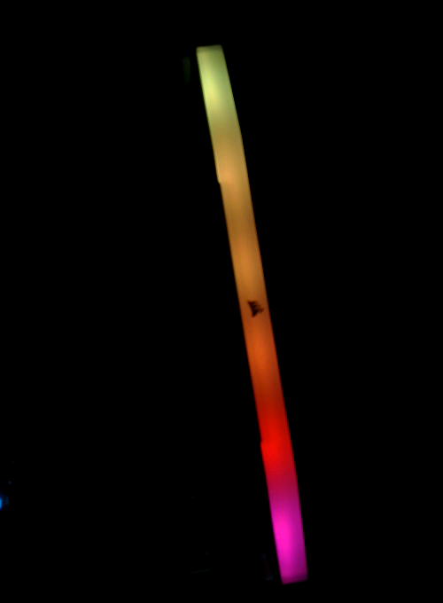

> **검증 범위**. 이 문서의 모든 수치는 2026년 10월 6일 한 번의 벤치 세션에서 모듈 하나로
> 얻은 것입니다. 제공되는 스크립트는 벤치에서 사용한 스크립트를 통합한 것이며, 이후 같은 벤치에서
> 실행했습니다(12절).

## 1 소개

DDR5 DIMM은 메모리 버스와 별도로 2선식 사이드밴드(HSCL, HSDA)를 제공합니다. 이 버스에서 가장 먼저
응답하는 것은 SPD5118 허브입니다. 허브는 모듈의 SPD 데이터를 보관하고, 온도를 보고하며, PMIC와
조명 모듈의 경우 RGB 컨트롤러처럼 모듈 로컬 버스에 있는 다른 디바이스로 트래픽을 전달합니다. 허브는
I2C 모드로 시작하며 I3C로 전환할 수 있습니다.

이 노트는 메인보드 없이 호스트 어댑터에서 허브와 이러한 디바이스를 읽는 방법을 다룹니다.

### 1.1 범위

이 문서에서 다루는 내용은 다음과 같습니다.

- SPD5118 허브 식별, 온도 센서 읽기, 1 KB SPD NVM 읽기
- PMIC 상태 읽기(읽기 전용)
- SETAASA로 허브를 I3C로 전환하고, SDR로 읽고, RSTDAA로 I2C로 되돌리기
- 이 벤치에서 올바른 데이터를 반환한 I3C 속도와 그렇지 않은 하나의 속도
- 허브 뒤의 Corsair RGB 컨트롤러: 펌웨어 업데이트 모드에서 빠져나오기, LED별 색상 설정, 하드웨어
  효과 시작

SPD NVM 쓰기, I3C를 통한 허브 레지스터 쓰기(이유는 5.3절에서 설명합니다), 허브의 인밴드
인터럽트(IBI)(시도했으나 수신되지 않음), PEC, 허브가 I3C 모드일 때의 RGB 컨트롤러 접근(시도하지
않음)은 다루지 않습니다.

### 1.2 적용 디바이스

Table: 적용 디바이스

| 역할 | 부품 | 식별 정보 | 근거 |
|---|---|---|---|
| 호스트 어댑터 | Binho Supernova | 하드웨어 리비전 C, 펌웨어 4.6.1 | 측정, 이 문서 |
| SPD 허브 | 아래 모듈의 SPD5118 | MR0-1 `51 18`, MR2 리비전 `0x14` | 측정, 이 문서 |
| PMIC | 아래 모듈의 PMIC | 주소 `0x48` | 읽기 전용 상태, 측정 |
| RGB 컨트롤러 | Corsair Vengeance RGB RS DDR5, LED 6개 | VID `0x1B1C`, PID는 펌웨어 업데이트 모드에서 `0x0B00`, 일반 모드에서 `0x0B01` | 측정, 이 문서 |
| 모듈 | Corsair `CMG16GX5M2E6000Z36`(키트 중 DIMM 1개) | SPD 바이트 2 `0x12`(DDR5), 바이트 3 `0x02`(UDIMM) | 측정, 이 문서 |
| 기타 SPD5118 모듈 | 모든 DDR5 UDIMM 또는 SODIMM | MR0-1 `51 18` | 5.1절과 5.2절은 JESD300-5를 따름. 모듈 하나 외에는 테스트하지 않음 |
| 기타 Corsair DDR5 RGB 모듈 | | 다른 PID | 테스트하지 않음 |

### 1.3 관련 문서

Table: 관련 문서

| 문서 | 제목 |
|---|---|
| JESD300-5 | SPD5118 Hub and Serial Presence Detect Device Standard (JEDEC) |
| JESD400-5 | DDR5 Serial Presence Detect (SPD) Contents (JEDEC) |
| MIPI I3C Basic | Improved Inter Integrated Circuit Basic 사양 |
| OpenRGB | Corsair DRAM 컨트롤러 소스 코드, 5.4절 RGB 레지스터 맵의 출처 |

## 2 시스템 개요

Table: 사이드밴드에서 확인된 디바이스, 허브는 I2C 모드, 100 kHz

| 주소 | 디바이스 | 응답 방식 |
|---|---|---|
| `0x50` | SPD5118 허브 | 레지스터 포인터 + 읽기. 단순 읽기에도 응답 |
| `0x48` | PMIC | 레지스터 포인터 + 읽기 |
| `0x18` | Corsair RGB 컨트롤러 | **레지스터 포인터 + 읽기만**. 단순 읽기에는 ACK하지 않음 |

이 모듈은 HSA = 0으로 스트랩되어 허브가 `0x50`에 위치합니다. 허브는 모듈 로컬 버스의 디바이스로 가는
트랜잭션을 호스트 측으로 전달합니다. JESD300-5는 이 두 주소 필드를 로컬 ID와 호스트 ID라고 부릅니다.
I2C 모드에서는 이 전달에 별도 설정이 필요하지 않았습니다. PMIC와 RGB 컨트롤러는 이를 통해 접근합니다.

아래 내용 전체를 결정하는 두 가지 사실이 있습니다.

- **단순 읽기 스캔으로는 RGB 컨트롤러를 찾을 수 없습니다.** `0x08`부터 `0x77`까지 1바이트 읽기로
  스캔하면 `0x48`과 `0x50`만 반환되었습니다. 레지스터 포인터를 쓴 다음 읽으면 `0x18`에서 찾을 수
  있습니다.
- **이 벤치에서 허브는 ENTDAA로 발견되지 않는 I3C 타깃입니다.** SETAASA를 받으면 정적 주소를 동적
  주소로 사용하고, RSTDAA를 받으면 I2C로 돌아갑니다.

## 3 하드웨어 설정

### 3.1 필요 장비

Table: 필요 장비

| 항목 | 비고 |
|---|---|
| Binho Supernova | 여기서는 펌웨어 4.6.1 사용 |
| DDR5 모듈 | 1.2절의 모듈 |
| DIMM 브레이크아웃 | HSCL, HSDA, GND를 인출하고, HSA를 스트랩하며, 자체 5 V 입력에서 VIN_BULK 공급 |
| 브레이크아웃용 5 V 전원 | 여기서는 브레이크아웃의 USB-C 사용 |
| 4선 케이블 | Supernova I3C LV 커넥터에서 브레이크아웃으로 |

### 3.2 연결

Table: Supernova와 DIMM 브레이크아웃 간 연결

| Supernova I3C LV 커넥터 | DIMM 브레이크아웃 | 필수 |
|---|---|---|
| SCL | HSCL | 예 |
| SDA | HSDA | 예 |
| GND | GND | 예 |

### 3.3 버스 고려 사항

버스는 **1.1 V**(설정 1100 mV, 읽기값 1106 mV)에서 동작했습니다. Supernova는 전압만으로 I3C
커넥터를 선택합니다.

Table: Supernova I3C 커넥터 선택

| 요청 전압 | 커넥터 |
|---|---|
| 800 ~ 1199 mV | LV |
| 1200 ~ 3300 mV | HV |

> **주의:** 1200 mV를 요청하면 버스가 HV 커넥터로 이동합니다. 모듈이 LV 커넥터에 연결되어 있으면
> 아무것도 응답하지 않습니다. 1100 mV를 요청하십시오.

> **주의:** 모듈에는 VIN_BULK에 5 V가 필요합니다. 이 전압은 브레이크아웃이 공급하며 어댑터는 공급하지
> 않습니다. 버스를 올리기 전에 모듈에 전원을 인가하십시오. 5.3절의 멈춤을 해제하려면 어댑터가 아니라
> 모듈의 전원을 재인가하십시오.

## 4 소프트웨어 설정

요구 사항: Python 3 및 pycosmicsdk(최신 릴리스).

```
pip install --upgrade pycosmicsdk
python ddr5_spd.py --help
python ddr5_rgb.py --help
```

두 스크립트 모두 pycosmicsdk의 공개 호출만 사용합니다: `Device.open`, `I3cController.set_voltage`,
`bring_up`, `legacy_i2c_read`, `legacy_i2c_write`, `sdr_read`, `ccc.setaasa`, `ccc.rstdaa`.
두 스크립트 모두 어댑터를 선택하는 `--serial`과 `--voltage-mv`(기본값 1100)를 받습니다. 벤치에서는
Ubuntu 22.04 호스트, pycosmicsdk 1.6.0, Python 3.10을 사용했습니다.

## 5 레지스터와 프로토콜

### 5.1 I2C 모드의 SPD5118 허브

모든 접근은 1바이트 레지스터 포인터 다음에 읽기가 이어지는 형태입니다.

Table: 사용한 허브 레지스터

| 레지스터 | 이 모듈에서 읽은 값 | 의미 |
|---|---|---|
| MR0-1 | `51 18` | 디바이스 유형, SPD5118 |
| MR2 | `0x14` | 디바이스 리비전 |
| MR5 | `0x03` | 기능: 허브 및 온도 센서 |
| MR11 | `0x00` | I2C 레거시 모드: 비트 2:0은 NVM 페이지 선택, 비트 3은 2바이트 주소 지정 선택 |
| MR12-13 | `FF 7F` | NVM 쓰기 보호, 64바이트 블록당 1비트 |
| MR18 | I2C에서 `0x00`, I3C에서 `0x20` | 비트 5 = I3C 모드 |
| MR49-50 | 2바이트 | 온도 |

**온도.** MR50 비트 4:0과 MR49 비트 7:0이 13비트 필드를 이루며, 그중 비트 1:0은 사용하지 않습니다.
나머지 11비트는 2의 보수이며 LSB당 0.25 °C입니다.

```python
raw = (((mr50 & 0x1F) << 8) | mr49) >> 2
if raw & 0x400:
    raw -= 0x800
celsius = raw * 0.25
```

벤치에서 이 모듈은 27 ~ 29 °C를 나타냈습니다. 한계 레지스터는 55 °C(상한)와 85 °C(임계)를
나타냈습니다.

**NVM.** 1024바이트 NVM은 128바이트 페이지 8개로 구성됩니다. 1바이트 주소 지정에서는 비트 7이 설정된
포인터가 NVM을 가리키고, 비트 6:0은 페이지 내 오프셋, MR11 비트 2:0은 페이지를 나타냅니다. 전체를
읽는 방법: MR11을 저장하고, 페이지 0부터 7까지 차례로 MR11에 쓰고, 각 페이지에서 포인터 `0x80`부터
128바이트를 읽은 다음, 저장해 둔 값을 다시 씁니다. 쓰는 레지스터는 MR11뿐입니다. 이 모듈의 덤프는
바이트 2 = `0x12`(DDR5), 바이트 3 = `0x02`(UDIMM)로 디코딩되었고, 바이트 0 ~ 509에 대한
CRC-16(다항식 `0x1021`, 초기값 0)은 바이트 510과 511에 저장된 값과 일치했습니다.

**PMIC.** 레지스터 R32는 `0x80`(레귤레이터 활성)을 나타냈고 폴트 비트는 설정되지 않았습니다. PMIC는
읽기만 했습니다.

### 5.2 I3C 모드의 SPD5118 허브

1. 컨트롤러를 I3C로 올립니다.
2. 디바이스 테이블에 `0x50`을 넣고 SETAASA를 브로드캐스트합니다. MR18이 `0x00`에서 `0x20`으로
   바뀝니다.
3. 레지스터 포인터와 함께 SDR로 읽습니다: `sdr_read(0x50, n, subaddress=bytes([reg]))`.
4. RSTDAA를 브로드캐스트합니다. I2C로 읽으면 MR18이 다시 `0x00`입니다.

`init_bus()`는 ENTDAA로 타깃을 발견하며, 이 벤치에서는 허브를 올리지 못했습니다. SETAASA를
사용하십시오.

Table: 1.1 V에서 허브의 I3C SDR 읽기, 푸시풀 속도별

| 푸시풀 속도 | 결과 |
|---|---|
| 1 MHz | 20/20 |
| 5 MHz | 50/50(첫 실행에서는 20/20) |
| 6.25 MHz | 50/50 |
| 7.5 MHz | 50/50 |
| 10 MHz | 50/50 |
| 12.5 MHz | 9/50 정상. 나머지 41회는 성공 상태로 잘못된 데이터를 반환 |

12.5 MHz에서의 실패는 오류로 보고되지 않았습니다. 읽기는 완료되었지만 데이터가 잘못되었습니다.
1.1 V에서 브레이크아웃 배선이 한계 요인일 가능성이 높습니다. **긴 사이드밴드 배선에서는 4 MHz 이하를
사용하십시오.** 1 MHz(20/20)와 5 ~ 10 MHz는 측정했으며, 그 사이의 속도는 측정하지 않았습니다.
`ddr5_spd.py --i3c`의 기본값은 1 MHz입니다.

### 5.3 I3C를 통한 레지스터 쓰기

> **주의:** I3C SDR 모드에서 허브에 대한 레지스터 쓰기는 쓴 값대로 반영되지 않았고, 그 후 버스가
> 멈췄습니다. 26.5 °C로 쓴 온도 한계는 48 °C로 읽혔고, MR27에 쓴 `0x01`은 `0x10`으로 읽혔습니다.
> 그 후 모든 I3C 동작이 `FW_I3C_ENGINE_BUSY`를 반환했습니다. Supernova 재부팅으로도, LV 커넥터의
> 전원 재인가로도 해제되지 않았습니다. 모듈의 전원 재인가로만 해제되었습니다. 원인(허브의 I3C 쓰기
> 형식인지 호스트 측인지)은 밝혀지지 않았습니다. I3C 모드에서는 읽기만 하십시오. 쓰기가 필요하면
> I2C 모드에서 하거나, 먼저 무해한 레지스터에 쓰고 다시 읽어 확인하십시오.

### 5.4 Corsair RGB 컨트롤러

아래의 레지스터 맵과 패킷 형식은 OpenRGB의 Corsair DRAM 컨트롤러(GPL-2.0)에서 가져왔습니다. 이
문서의 스크립트는 그 설명을 바탕으로 다시 구현한 것이며, OpenRGB 코드는 복사하지 않았습니다.
컨트롤러는 허브가 I2C 모드일 때 `0x18`에서 접근합니다.

모든 접근은 `[register, value]` 쓰기 또는 레지스터 포인터 다음의 1바이트 읽기입니다. **컨트롤러가
유휴 상태였던 후의 첫 접근은 한 번 거부될 수 있습니다. 재시도하십시오.**

Table: 사용한 RGB 컨트롤러 레지스터

| 레지스터 | 접근 | 용도 |
|---|---|---|
| `0x0B`, `0x21` | `0x00` 쓰기 | 패킷 버퍼와 CRC 리셋 |
| `0x20` | 쓰기, 접근당 1바이트 | 패킷 버퍼 |
| `0x42` | 읽기 | 리셋 이후 로드한 바이트의 CRC-8 |
| `0x82` | 쓰기 | 적용: `0x01` 효과 패킷, `0x02` 색상 버퍼 |
| `0x30` | 읽기 | 적용 중에는 비트 3 설정 |
| `0x61` 다음 `0x21` | `0x00` 쓰기 | 디바이스 정보 블록 선택 |
| `0x40` | 읽기, 32회 | 디바이스 정보 블록 |
| `0x23` | `0x01` 쓰기 | 펌웨어 업데이트 모드에서 빠져나오기 |

CRC는 CRC-8, 다항식 `0x07`, 초기값 0입니다. 적용하기 전에 `0x42`와 비교하십시오. 불일치는 바이트가
손실되었거나 중복되었음(재시도한 쓰기에서 발생할 수 있음)을 의미하며, 해당 패킷은 적용하면 안 됩니다.

**디바이스 정보 블록.** 바이트 0-1은 VID(리틀 엔디언), 바이트 2-3은 PID, 바이트 28은 프로토콜
버전입니다.

**펌웨어 업데이트 모드.** 양 끝 LED가 모두 빨간색으로 켜지는 것은 Corsair가 문서화한 펌웨어
업데이트(부트로더) 모드 표시입니다. 이 상태에서 모듈은 PID `0x0B00`과 프로토콜 1을 보고했고, 효과
패킷을 수락했지만(CRC 일치) LED는 바뀌지 않았습니다. `0x23`에 `0x01`을 한 번 쓰자 PID `0x0B01`,
프로토콜 4로 바뀌었고 공장 출하 시 무지개 효과가 켜졌습니다(그림 1). 모듈이 어떻게 이 모드에
들어갔는지는 밝혀지지 않았습니다. 전원 인가 직후에 프로빙된 적이 있었습니다.

> **주의:** 레지스터 `0x23`에 `0x00`을 절대 쓰지 마십시오.



**색상 버퍼.** LED마다 하나씩 `R, G, B, 0xFF` 항목 6개, 총 24바이트를 리셋 후 `0x20`에 로드하고,
CRC를 확인한 다음 `0x82` = `0x02`로 적용합니다. 이렇게 단색과 LED별 색상을 설정합니다(그림 2).
버퍼는 정적 모드에서만 표시됩니다. 애니메이션 효과 중에는 CRC를 포함해 수락되지만 무시됩니다. 따라서
`ddr5_rgb.py color`는 정적 효과(모드 `0x10`)를 먼저 보냅니다.


**효과 패킷.** 20바이트이며 `0x82` = `0x01`로 적용합니다.

```
mode, speed, 0x01, direction, R1, G1, B1, brightness, R2, G2, B2, brightness, 0 x 8
```

Table: 효과 모드

| 모드 | 코드 | 이 모듈에서 관찰 여부 |
|---|---|---|
| 무지개 웨이브(rainbow wave) | `0x03` | 예 |
| 정적(static) | `0x10` | 적용되었으나 이전 색상이 유지됨. 대신 색상 버퍼 사용 |
| 무지개(rainbow) | `0x08` | 관찰되지 않음 |
| 펄스(pulse) | `0x01` | 관찰되지 않음 |

## 6 절차

### 6.1 전원 인가 및 연결

브레이크아웃으로 모듈에 전원을 공급합니다. 케이블을 Supernova I3C LV 커넥터에 연결합니다.

### 6.2 허브 식별 및 온도 읽기


```
python ddr5_spd.py --serial <serial>
```

벤치에서의 출력:

```
MR0-1 5118  (SPD5118 reads 5118)
MR2 revision 0x14  MR18 0x00  (bit 5 = I3C mode)
MR49-50 CC 01 = 28.75 C
```

### 6.3 NVM 저장(선택 사항)

NVM을 원하는 파일에 저장합니다. 이 파일은 모듈을 식별할 수 있는 정보로 취급하십시오. 모듈의 일련
번호가 들어 있습니다.

```
python ddr5_spd.py --serial <serial> --nvm my_module_spd.bin
```

스크립트는 MR11을 복원하고 SPD CRC가 일치하는지 보고합니다.

```
MR0-1 5118  (SPD5118 reads 5118)
MR2 revision 0x14  MR18 0x00  (bit 5 = I3C mode)
MR49-50 CC 01 = 28.75 C
NVM: 1024 bytes to my_module_spd.bin, MR11 restored to 0x00
SPD byte 2 0x12 (0x12 = DDR5), byte 3 0x02, CRC 0-509 calc 0x45BF stored 0x45BF OK
```

### 6.4 I3C 모드로 허브 읽기(선택 사항)

스크립트는 SETAASA로 I3C 모드에 들어가 SDR로 읽은 다음, RSTDAA로 허브를 I2C로 되돌립니다.

```
python ddr5_spd.py --serial <serial> --i3c --i3c-mhz 1
```

MR18은 I3C 읽기 중에는 `0x20`, RSTDAA 후에는 `0x00`을 나타냅니다.

```
MR0-1 5118  (SPD5118 reads 5118)
MR2 revision 0x14  MR18 0x00  (bit 5 = I3C mode)
MR49-50 CC 01 = 28.75 C
I3C SDR: MR18 0x20  MR0-1 5118  temperature 29.00 C
after RSTDAA (I2C): MR18 0x00
```

어댑터 펌웨어 4.6.1에서는 어댑터 리셋 한 번당 11회 동작합니다. 9절을 참조하십시오.

### 6.5 RGB 컨트롤러의 디바이스 정보 읽기


```
python ddr5_rgb.py --serial <serial> info
```

벤치에서의 출력, 컨트롤러는 일반 모드:

```
VID 0x1B1C PID 0x0B01 protocol 4
```

### 6.6 펌웨어 업데이트 모드에서 빠져나오기

PID가 `0x0B00`(양 끝이 빨간색)이면 펌웨어 업데이트 모드에서 빠져나오십시오. 스크립트는 PID가
`0x0B00`일 때만 씁니다.

```
python ddr5_rgb.py --serial <serial> leave-bootloader
```

컨트롤러가 펌웨어 업데이트 모드일 때의 출력:

```
before: PID 0x0B00 protocol 1
after:  PID 0x0B01 protocol 4
```

이미 일반 모드일 때의 출력:

```
before: PID 0x0B01 protocol 4
not in firmware-update mode; nothing written
```

### 6.7 색상 또는 효과 설정


```
python ddr5_rgb.py --serial <serial> color 255,0,0
python ddr5_rgb.py --serial <serial> color 255,0,0 255,80,0 255,220,0 0,255,0 0,0,255 160,0,255
python ddr5_rgb.py --serial <serial> effect wave 255,0,0 0,0,255 --speed 2
python ddr5_rgb.py --serial <serial> demo
```

이 명령들은 성공 시 아무것도 출력하지 않으며, 컨트롤러의 CRC가 일치하지 않으면 오류로 종료합니다.

데모 시퀀스는 `figures/an0016-video1-rgb-demo.mp4`(42 s)에 있으며, 이 스크립트의 통합 원본인 벤치
스크립트로 녹화했습니다.

## 7 참조

Table: ddr5_spd.py 옵션

| 옵션 | 동작 |
|---|---|
| `--serial` | 어댑터 일련 번호. 기본값은 처음 발견된 어댑터 |
| `--voltage-mv` | 버스 전압, 기본값 1100(LV 커넥터) |
| `--nvm FILE` | MR11을 통해 1024바이트 NVM을 FILE로 읽은 다음 MR11 복원 |
| `--i3c` | SETAASA, MR18, MR0-1 및 온도의 SDR 읽기, RSTDAA |
| `--i3c-mhz` | `--i3c`의 푸시풀 속도: 1, 3.125 또는 5. 기본값 1 |

Table: ddr5_rgb.py 명령

| 명령 | 동작 |
|---|---|
| `info` | 블록의 CRC를 확인한 후 VID, PID, 프로토콜 출력 |
| `leave-bootloader` | PID가 `0x0B00`이면 `0x23` = `0x01` 쓰기. 전후 PID 출력 |
| `color R,G,B` | 색상 버퍼를 통해 LED 6개 모두 한 가지 색 |
| `R,G,B` 6개를 지정한 `color` | LED마다 한 가지 색 |
| `effect MODE C1 [C2]` | 효과 패킷. MODE는 static, rainbow, wave 또는 pulse. `--speed`는 0 ~ 2 |
| `demo` | 빨강, 초록, 파랑, 흰색, LED별 무지개, 체이스, 마지막으로 무지개 웨이브 |

두 스크립트는 각 접근을 최대 3회(`ddr5_spd.py`) 또는 5회(`ddr5_rgb.py`) 재시도합니다.

## 8 측정 결과

### 8.1 테스트 구성

Table: 테스트 구성

| 항목 | 값 |
|---|---|
| 어댑터 | Binho Supernova, 하드웨어 리비전 C, 펌웨어 4.6.1 |
| 버스 | I3C LV 커넥터, 1100 mV 요청, 1106 mV 읽기값 |
| I2C 모드 | 100 kHz 오픈 드레인 |
| I3C 모드 | SETAASA, SDR, 푸시풀 속도는 5.2절 참조 |
| 모듈 | Corsair `CMG16GX5M2E6000Z36`, DIMM 1개, 자체 5 V 전원이 있는 DIMM 브레이크아웃에 장착 |
| 호스트 | Ubuntu 22.04, pycosmicsdk 1.6.0, Python 3.10 |
| 날짜 | 2026년 10월 6일 |

### 8.2 결과

Table: 결과

| 측정 항목 | 결과 |
|---|---|
| 허브 식별, MR0-1 | `51 18` |
| 온도, MR49-50 | 27 ~ 29 °C |
| MR11을 통한 NVM 읽기 | 1024바이트, 바이트 0-509에 대한 SPD CRC 일치. 3/3 바이트 단위로 동일 |
| SETAASA, MR18 | `0x00`에서 `0x20`. RSTDAA로 `0x00`으로 복귀 |
| I3C SDR 읽기, 1 ~ 10 MHz | 1 MHz에서 20/20. 5, 6.25, 7.5, 10 MHz에서 각각 50/50 |
| I3C SDR 읽기, 12.5 MHz | 9/50 정상, 41회는 성공 상태로 잘못된 데이터 |
| I3C 레지스터 쓰기 | 쓴 값대로 반영되지 않음. 모듈 전원을 재인가할 때까지 버스가 멈춤 |
| 허브의 인밴드 인터럽트 | 시도했으나 수신되지 않음 |
| `0x18`에서 RGB 컨트롤러 발견 | 레지스터 포인터 + 읽기로만 |
| 펌웨어 업데이트 모드에서 빠져나오기 | PID `0x0B00`에서 `0x0B01`, 프로토콜 1에서 4. 이틀에 걸쳐 2회(벤치 스크립트로 1회, `ddr5_rgb.py`로 1회), 매번 컨트롤러가 펌웨어 업데이트 모드로 발견됨 |
| 색상 버퍼, 단색 및 LED별 | 각각 10/10, CRC 일치. 실행 중인 효과에서 단색으로 전환 시 카메라로 9/9 |
| 효과 패킷, 무지개 웨이브 | 10/10 |

이는 한 벤치의 모듈 하나에서 얻은 결과이며 사양이 아닙니다. 제공 스크립트의 횟수는 12절에 있습니다.
전원 재인가 후의 부트로더 빠져나오기 실행은 아직 하지 않았습니다.

## 9 문제 해결

Table: 문제 해결

| 증상 | 원인 | 조치 |
|---|---|---|
| 스캔에서 `0x48`과 `0x50`은 찾지만 `0x18`에는 아무것도 없음 | RGB 컨트롤러는 단순 읽기에 ACK하지 않음 | `ddr5_rgb.py info`처럼 레지스터 포인터를 쓰고 읽기 |
| `0x18`에 대한 첫 접근이 거부되고 다음 접근은 성공 | 컨트롤러가 유휴 상태였음 | 재시도. 스크립트는 재시도함 |
| 양 끝 LED가 빨간색, 효과 패킷은 수락되지만 아무것도 바뀌지 않음 | 컨트롤러가 펌웨어 업데이트 모드, PID `0x0B00` | `ddr5_rgb.py leave-bootloader` |
| 전원 재인가 없이 나중에 컨트롤러가 다시 펌웨어 업데이트 모드로 돌아감 | 브로드캐스트 CCC 트래픽(RSTDAA/ENTDAA)과 어댑터 리셋 후에 확인됨. 원인은 밝혀지지 않음 | `ddr5_rgb.py info` 실행. PID가 `0x0B00`이면 다시 `leave-bootloader` |
| 허브에 대한 모든 I2C 읽기가 레지스터와 관계없이 `51 FF`를 반환 | 이전의 SETAASA로 허브가 I3C 모드(MR18 비트 5 설정)에 남아 있음 | RSTDAA를 보내거나 모듈 전원 재인가 |
| 여러 I3C 세션 후 SETAASA 거부: 타깃 테이블 가득 참(아래 참조) | 어댑터 펌웨어 4.6.1은 RSTDAA 후 SETAASA마다 타깃 테이블 항목을 추가하며, 12번째가 실패함(3/3회 실행) | 어댑터 리셋(`reboot` 또는 재연결). 어댑터 펌웨어에서 추적 중 |
| 색상은 수락되지만(CRC 일치) LED가 계속 애니메이션 | 컨트롤러가 애니메이션 효과를 실행 중. 색상 버퍼는 정적 모드에서만 표시됨 | `ddr5_rgb.py color`는 먼저 정적을 선택함. 직접 쓰는 경우 색상 전에 정적 효과를 보내기 |
| `0x42`에서 CRC 불일치 | 로드 중 바이트가 손실되거나 중복됨 | 패킷 전체를 다시 보내기. 적용하지 않기 |
| `init_bus()`가 허브를 찾지 못함 | 이 벤치에서 허브는 ENTDAA로 발견되지 않음 | `ccc.setaasa([0x50])` 사용 |
| 아무것도 응답하지 않음 | 1200 mV 이상은 HV 커넥터를 선택함 | 1100 mV 요청 |
| I3C 모드에서 성공 상태인데 데이터가 잘못됨 | 푸시풀 속도가 배선에 비해 너무 높음 | 4 MHz 이하 |
| I3C 쓰기 후 모든 I3C 동작이 `FW_I3C_ENGINE_BUSY` 반환 | 허브가 멈춤(5.3절) | 모듈 전원 재인가. Supernova 재부팅으로는 해제되지 않음 |
| NVM 덤프 CRC 불일치 | MR11이 변경되었거나 덤프 중 읽기가 실패함 | 다시 실행. MR11 비트 3이 0인지 확인 |

테이블이 가득 차서 거부되면 `FW_NOT_ENOUGH_SPACE_IN_TARGET_DEVICES_TABLE`로 보고됩니다.

## 10 약어

Table: 약어

| 용어 | 의미 |
|---|---|
| CCC | Common Command Code, 공통 명령 코드(I3C) |
| CRC | Cyclic redundancy check, 순환 중복 검사 |
| DIMM | Dual in-line memory module, 듀얼 인라인 메모리 모듈 |
| ENTDAA | Enter Dynamic Address Assignment(I3C CCC) |
| HSA | Host sideband address strap, 호스트 사이드밴드 주소 스트랩 |
| HSCL, HSDA | Host sideband clock and data, 호스트 사이드밴드 클록 및 데이터 |
| LED | Light-emitting diode, 발광 다이오드 |
| LV, HV | Supernova의 저전압 및 고전압 I3C 커넥터 |
| MR | SPD5118의 모드 레지스터(Mode register) |
| NVM | Non-volatile memory, 비휘발성 메모리 |
| PEC | Packet error check, 패킷 오류 검사 |
| PID, VID | Product ID, vendor ID(제품 ID, 벤더 ID) |
| PMIC | Power management integrated circuit, 전원 관리 집적 회로 |
| RSTDAA | Reset Dynamic Address Assignment(I3C CCC) |
| SDR | Single data rate, 단일 데이터 속도(I3C) |
| SETAASA | Set All Addresses to Static Address(I3C CCC) |
| SPD | Serial presence detect, 직렬 존재 감지 |
| UDIMM | Unbuffered DIMM, 비버퍼 DIMM |
| VIN_BULK | DIMM의 5 V 입력 전원 |

## 11 문서의 소스 코드에 관한 참고

이 문서에 표시되고 함께 제공되는 아카이브에 포함된 예제 코드는 평가 및 참조용으로 제공됩니다. MIT
라이선스로 배포되며, 라이선스 전문은 아카이브에 포함되어 있습니다.

Table: 에셋 아카이브의 내용

| 파일 | 설명 |
|---|---|
| `AN0016.md` | 이 문서의 Markdown 소스 |
| `assets/ddr5_spd.py` | 허브 식별, 온도, NVM 읽기, I3C 읽기 확인 |
| `assets/ddr5_rgb.py` | RGB 컨트롤러: 디바이스 정보, 펌웨어 업데이트 모드에서 빠져나오기, 색상, 효과, 데모 |
| `assets/LICENSE` | 예제 코드에 적용되는 MIT 라이선스 |
| `figures/an0016-video1-rgb-demo.mp4` | 데모 시퀀스의 42 s 동영상 |

SPD 덤프는 제공하지 않습니다. 덤프는 하나의 물리적 모듈을 식별하기 때문입니다.

## 12 개정 이력

Table: 개정 이력

| 리비전 | 날짜 | 설명 |
|---|---|---|
| 0.1 | 2026년 10월 7일 | 최초 초안. 8절의 첫 측정에는 이전의 별도 스크립트를 사용했습니다. 제공 스크립트를 같은 벤치에서 실행한 결과: `ddr5_spd.py` I2C 모드에서 10/10. `--nvm` 3/3, 바이트 단위로 동일, SPD CRC 일치. `--i3c` 1 MHz에서 10/10, 5 MHz에서 10/10(배치 사이에 어댑터 리셋, 9절 참조), 매번 허브가 I2C 모드로 복귀. `ddr5_rgb.py` `info` 10/10, `color` 단색 10/10 및 LED별 10/10, `effect wave` 10/10, `demo` 1/1, `leave-bootloader` 1/1(컨트롤러가 펌웨어 업데이트 모드였던 것은 1회). 실행 중인 효과에서 보낸 단색: 카메라로 9/9 일치. 기록된 출력: `_shared/tools/documented/ddr5-*.txt`. |
| 1.0 | 2026년 11월 6일 | 공개. |
