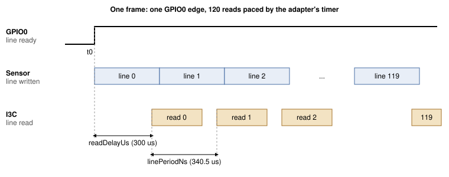

## 1 はじめに

イメージセンサは通常、MIPI CSI-2 を介してピクセルを送信するため、ホストにカメラレシーバが必要です。
VD55G1 は、自身の設定に使用するのと同じ 2 線式バスである I3C を介して画像を送信することもできます。
これにより、USB ホストアダプタを含め、I3C を扱えるあらゆる機器からカメラにアクセスでき、ホスト側に
カメラインタフェースは必要ありません。

問題はタイミングです。センサはレジスタウィンドウに 1 度に 1 ラインのみを公開し、約 340 マイクロ秒後に
次のラインがそれを置き換えます。当社のベンチで PC からこのウィンドウに対して 160 バイトの読み出しを
200 回発行したところ、最短で 3.64 ms、中央値で 4.00 ms かかったため、ほとんどのラインは PC が要求する
前に失われます。読み出しはバスの近くにあるものが発行する必要があります。本ノートでは、それを Supernova
自身のファームウェアが担います。

### 1.1 対象範囲

本ドキュメントでは次の内容を扱います。

- PC からの VD55G1 のブート：リセット、エニュメレーション、パッチのダウンロード、設定
- フレームの読み出しを開始する GPIO0 エッジ
- Supernova のコマンド `I3C_CONTROLLER_CAPTURE_LINES`。アダプタ上でフレームの全ラインを読み出し、そのフレームを USB 経由で返します
- 静止フレームの PNG ファイルへのキャプチャ、および毎秒 9.8 フレームのライブビュー
- 実測したラインタイミングウィンドウ

センサの MIPI CSI-2 出力、カラーセンサ、160x120 を超える解像度、および GPIO ではなくインバンド
割り込み（IBI）でフレーム開始を通知するセンサは扱いません。

### 1.2 対象デバイス

Table: 対象デバイス

| ファミリ | 部品の例 | 識別子 | 根拠 |
|---|---|---|---|
| STMicroelectronics VD55G1 | Gilisymo LS-CAM-I3C ボード上の VD55G1 cut 2.0 | レジスタ 0x0000 のモデル `S5G1`、0x0004 の cut 0x20 | テスト済み |

### 1.3 関連資料

Table: 関連資料

| ドキュメント | タイトル |
|---|---|
| VD55G1 データシート | STMicroelectronics DS13604 |
| Gilisymo VD55G1 リファレンスコード | `https://github.com/gilisymo/vd55g1_stm32h533`。`Drivers/LS55G1/ls55g1_driver.c` 内のパッチ配列と、表 6 のレジスタ書き込みの出典 |
| MIPI I3C Specification | MIPI Alliance |
| Binho Supernova ドキュメント | `https://support.binho.io` |

## 2 システム概要

PC は通常の I3C 読み出しと書き込みでセンサをブートおよび設定します。その後、フレームごとに
`I3C_CONTROLLER_CAPTURE_LINES` コマンドを 1 つ送信します。Supernova のファームウェアがフレーム全体を
単独で処理し、そのフレームを応答として返します。

Table: 役割分担

| ステップ | 実行するもの | 経路 |
|---|---|---|
| リセット、エニュメレーション、パッチのダウンロード、設定 | PC | HID コマンド、pycosmicsdk |
| ストリーミング開始、フレーム開始の待機、120 ラインの RAM への読み込み | Supernova ファームウェア | I3C、GPIO 入力 |
| フレームの返送 | Supernova ファームウェア | USB ベンダーバルク IN（vendor bulk IN） |
| フレームの表示または保存 | PC | |

設計を決定づけた事実は次のとおりです。「ライン準備完了」に設定したセンサの GPIO0 は、ラインごとに
パルスを出しません。ストリーミングを開始してラインを読み出さない状態では、300 ms のトレースの間に
1 度だけ立ち上がり、残りの期間はハイのままでした。

```
python capture_vd55g1.py <SERIAL> <path>/ls55g1_driver.c --trigger trace --frame-length 300
```

```
trace: result=0x0000 fsm after=ff level@0=0 transitions=1 rises=1
first 12 events (us, level): [(27675, 1)]
1/1 runs passed
```

`fsm after=ff` は、ラインが読み出されないまま過ぎた後にセンサが報告した状態です。当社の実行では、
センサはストリーミングを抜けてその状態に留まりました。ユーティリティは実行のたびに、開始時にセンサを
再度ブートします。

そのため、ファームウェアは立ち上がりエッジをライン 0 の開始とみなし、ライン N をそのエッジから
N ライン周期後にタイマで読み出します。このとき固定の遅延を加え、各読み出しがセンサによるラインの
書き込み後になるようにします。キャプチャ 1 回につきエッジは 1 つで十分です。表 14 の動作範囲内では、
すべてのフレームの 120 ラインがすべて返され、繰り返されたラインはありませんでした。



ファームウェアはスケジューラを停止した状態でキャプチャを実行するため、スケジュールされた時刻と
その読み出しの間に他のファームウェアタスクが実行されることはありません。キャプチャ 1 回の上限は
5 秒です。

## 3 ハードウェアのセットアップ

### 3.1 必要な機器

Table: 必要な機器

| 品目 |
|---|
| Binho Supernova USB ホストアダプタ |
| Gilisymo LS-CAM-I3C ボード（VD55G1） |
| センサボード用 3.3 V 電源 |
| 短いジャンパワイヤ |
| USB-C ケーブル |

### 3.2 接続

Table: Supernova と LS-CAM-I3C ボード間の接続

| Supernova | LS-CAM-I3C | 必須 |
|---|---|---|
| I3C HV ポート SCL | SCL | はい |
| I3C HV ポート SDA | SDA | はい |
| GND | GND | はい |
| GPIO PIN_1 | NRST | はい |
| GPIO PIN_3 | GPIO0（ライン準備完了） | はい |
| GPIO PIN_5 | GPIO1 | いいえ、本ノートでは使用しません |
| | VIN、3.3 V | はい、セクション 3.3 を参照 |

### 3.3 バスに関する考慮事項

ユーティリティは I3C HV ポートと GPIO ポートを 3300 mV に設定します。本ドキュメントのすべての測定で、
VIN は Supernova とグランドを共有する別の 3.3 V 電源から供給しました。

> **注意：** ジャンパは短くし、しっかりと差し込んでください。キャプチャ中に接続が動くと、センサは
> 再度ブートされるまで自身のアドレスに応答しなくなります。

> **補足：** センサのブート中は GPIO0 にロジックアナライザのプローブを接続したままにしないでください。
> 当社のベンチでは、それによってセンサがソフトウェアスタンバイに到達しませんでした。

## 4 ソフトウェアのセットアップ

ユーティリティには pycosmicsdk（最新リリース）、hidapi、pyusb、pillow が必要です。

```
pip install --upgrade pycosmicsdk hidapi pyusb pillow
```

ライブビューアは、ほとんどの Python 環境に含まれている `tkinter` と、オプションの録画用に `ffmpeg` も
使用します。

Linux では、ユーザーに Supernova の USB デバイスとその HID インタフェースへの読み書き権限が必要です。
当社のベンチにインストールしている次の udev ルールで権限を付与できます。

```
SUBSYSTEM=="hidraw", ATTRS{idVendor}=="1fc9", ATTRS{idProduct}=="82fc", MODE="0666"
SUBSYSTEM=="usb", ATTRS{idVendor}=="1fc9", ATTRS{idProduct}=="82fc", MODE="0666"
```

ユーティリティにはアダプタのシリアル番号を指定します。接続されている Supernova は次のコマンドで一覧表示
できます。

```
python -c "import hid; print({d['serial_number'] for d in hid.enumerate(0x1FC9, 0x82FC)})"
```

> **補足：** 本ドキュメントのすべての手順は Linux でのみ実行しました。フレームは `pyusb` を介して
> ベンダーバルクエンドポイント（vendor bulk endpoint）から読み出されますが、Windows と macOS では
> libusb バックエンドが必要です。これらのホストはテストしていません。

アダプタのファームウェアは `I3C_CONTROLLER_CAPTURE_LINES` を提供している必要があります。

> **補足：** このコマンドはまだリリース済みの Supernova ファームウェアに含まれていません。本ドキュメントの
> 測定には開発ビルド `4.6.1-1da26d5f` を使用しました。リリースに含まれるまでは、そのビルドと書き込み手順に
> ついて Binho にお問い合わせください。本ドキュメントの今後の改訂でリリース名を記載します。そのリリースは
> 通常の Supernova ファームウェアアップデートと同じ方法でインストールできます。

センサは電源投入のたびにパッチのダウンロードが必要です。パッチ配列は STMicroelectronics のものであり、
本ノートとともに再配布はしていません。表 2 の Gilisymo リポジトリから `Drivers/LS55G1/ls55g1_driver.c`
をダウンロードし、そのパスをユーティリティに渡してください。ユーティリティはそこから配列を読み込みます。

## 5 キャプチャコマンド

### 5.1 関係する VD55G1 レジスタ

表 6 に、ユーティリティが使用するレジスタを、Gilisymo のリファレンスコードに記載された意味とともに
示します。これらの意味はデータシートの該当セクションと照合していません。

Table: ユーティリティが使用する VD55G1 レジスタ

| レジスタ | 名前 | 用途 |
|---|---|---|
| 0x0000 | Model ID | `S5G1` を読み出す、リトルエンディアン |
| 0x001C | System FSM | 0x01 ブート準備完了、0x02 ソフトウェアスタンバイ、0x03 ストリーミング |
| 0x0200 | Boot command | 0x02 パッチ適用とブート |
| 0x0201 | Standby command | 0x01 ストリーミング開始 |
| 0x0324 | I3C frame readout control | 0x03、I3C 画像読み出し有効 |
| 0x0500 | Exposure mode | 0x00 自動、0x02 手動 |
| 0x050C | Frame length | ライン単位。フレームレートを決定 |
| 0x051D | GPIO0 control | 0x0C、ライン準備完了 |
| 0x2000 | Line window | 1 ライン分のピクセル。2 バイトのレジスタアドレスで読み出す |

本ノートで使用するウィンドウは行 174、列 200 から始まる 160x120 の RAW8 です。

### 5.2 リクエスト

`I3C_CONTROLLER_CAPTURE_LINES` のコマンドコードは 0x190E です。リクエストパラメータはコマンドヘッダの
後に、リトルエンディアンでパディングなしに続きます。

Table: リクエストパラメータ

| オフセット | フィールド | サイズ | 本ノートでの値 |
|---|---|---|---|
| 0 | ターゲットのダイナミックアドレス | 1 | ENTDAA で取得 |
| 1 | レジスタアドレス長 | 1 | 2 |
| 2 | レジスタアドレス | 4 | 0x20 0x00 |
| 6 | ライン長、バイト | 2 | 160 |
| 8 | ライン数 | 2 | 120 |
| 10 | トリガモード | 1 | 2、タイマ |
| 11 | トリガピン | 1 | 2、PIN_3 |
| 12 | タイムアウト、ms | 2 | `capture_vd55g1.py` からは 4000、`view_vd55g1.py` からは 1000。上限 5000 |
| 14 | 開始レジスタアドレス長 | 1 | 2 |
| 15 | 開始レジスタアドレス | 4 | 0x02 0x01 |
| 19 | 開始データ長 | 1 | 1 |
| 20 | 開始データ | 8 | 0x01、ストリーミング開始 |
| 28 | 読み出し遅延、us | 2 | 300、最大 1000 |
| 30 | ライン周期、ns | 4 | 340500 |

Table: トリガモード

| 値 | モード | ライン N を読み出すタイミング |
|---|---|---|
| 0 | GPIO 立ち上がり | トリガピンの N 番目の立ち上がりエッジに読み出し遅延を加えた時点。GPIO0 がフレームごとに 1 度しか立ち上がらない VD55G1 には不向き |
| 1 | GPIO 立ち下がり | N 番目の立ち下がりエッジに読み出し遅延を加えた時点。VD55G1 には不向き |
| 2 | タイマ | 最初の立ち上がりエッジにライン周期の N 倍と読み出し遅延を加えた時点 |
| 3 | トレース | 読み出さない。診断用に、タイムアウトまでトリガピンのすべての遷移を記録 |

開始書き込みはファームウェアが最初のエッジを待つ直前に発行するため、ストリーミング開始から最初のライン
までの間に USB の往復は入りません。キャプチャはアダプタの 32768 バイトのバルクステージングプールに
収まる必要があります。160x120、8 ビットでは 19200 バイトです。

### 5.3 レスポンス

Table: レスポンスパラメータ

| オフセット | フィールド | サイズ |
|---|---|---|
| 0 | キャプチャしたライン数 | 2 |
| 2 | ペイロード長、ベンダーバルク IN から読み出すバイト数 | 4 |
| 6 | 失敗したラインのドライバエラー、なければ 0 | 2 |
| 8 | ライン間の最小周期、us | 2 |
| 10 | ライン間の最大周期、us | 2 |
| 12 | ラインのスケジュール時刻から読み出し完了までの最長時間、us | 2 |
| 14 | 最初のラインから最後の読み出し完了まで、us | 4 |

フレームはベンダーバルク IN で続いて送られます。失敗前にキャプチャしたラインも返されます。

## 6 手順

1. セクション 4 に記載したアダプタファームウェアを書き込みます。
2. 表 5 のとおりにボードを配線し、3.3 V 電源をオンにします。
3. センサのリセットとブートをそのつど新たに行いながら、5 フレームをキャプチャします。`assets/` から
   実行します。

```
python capture_vd55g1.py <SERIAL> <path>/ls55g1_driver.c --runs 5 --out frames
```

```
run 0: result=0x0000 got 19200/19200 B in 95 ms, fsm after=03 {'lines': 120, 'bytes': 19200, 'driverError': 0, 'minPeriodUs': 340, 'maxPeriodUs': 340, 'maxReadUs': 469, 'totalUs': 40985}
run 1: result=0x0000 got 19200/19200 B in 95 ms, fsm after=03 {'lines': 120, 'bytes': 19200, 'driverError': 0, 'minPeriodUs': 340, 'maxPeriodUs': 340, 'maxReadUs': 469, 'totalUs': 40986}
run 2: result=0x0000 got 19200/19200 B in 94 ms, fsm after=03 {'lines': 120, 'bytes': 19200, 'driverError': 0, 'minPeriodUs': 340, 'maxPeriodUs': 340, 'maxReadUs': 469, 'totalUs': 40985}
run 3: result=0x0000 got 19200/19200 B in 95 ms, fsm after=03 {'lines': 120, 'bytes': 19200, 'driverError': 0, 'minPeriodUs': 340, 'maxPeriodUs': 340, 'maxReadUs': 469, 'totalUs': 40985}
run 4: result=0x0000 got 19200/19200 B in 94 ms, fsm after=03 {'lines': 120, 'bytes': 19200, 'driverError': 0, 'minPeriodUs': 340, 'maxPeriodUs': 340, 'maxReadUs': 469, 'totalUs': 40985}
5/5 runs passed
```

   各実行で `frames/runNN_f0.png` が書き出されます。ブート後の最初のフレームは自動露出が安定する前の
   ものであるため暗くなります。静止画を得るには、露出を手動で設定します。

```
python capture_vd55g1.py <SERIAL> <path>/ls55g1_driver.c --again 0 --exposure 60 --runs 3 --out frames
```

```
run 0: result=0x0000 got 19200/19200 B in 106 ms, fsm after=03 {'lines': 120, 'bytes': 19200, 'driverError': 0, 'minPeriodUs': 340, 'maxPeriodUs': 340, 'maxReadUs': 469, 'totalUs': 40984}
run 1: result=0x0000 got 19200/19200 B in 107 ms, fsm after=03 {'lines': 120, 'bytes': 19200, 'driverError': 0, 'minPeriodUs': 340, 'maxPeriodUs': 340, 'maxReadUs': 469, 'totalUs': 40985}
run 2: result=0x0000 got 19200/19200 B in 107 ms, fsm after=03 {'lines': 120, 'bytes': 19200, 'driverError': 0, 'minPeriodUs': 340, 'maxPeriodUs': 340, 'maxReadUs': 469, 'totalUs': 40985}
3/3 runs passed
```


4. ライブビューを開始します。センサを 1 度ブートした後、自動露出でフレームを連続してキャプチャします。
   ウィンドウを閉じるか Ctrl+C を押すと停止し、サマリーを表示します。

```
python view_vd55g1.py <SERIAL> <path>/ls55g1_driver.c
```

```
590 frames ok, 0 bad, 0 reboots in 60.2 s (9.8 fps)
```

   `--record out.mp4` を追加すると、ストリームを動画として保存します。

## 7 リファレンス

Table: capture_vd55g1.py のオプション

| オプション | デフォルト | 意味 |
|---|---|---|
| `--runs N` | 1 | リセット、ブート、キャプチャを N 回行い、成功の比率を表示 |
| `--out DIR` | `frames` | PNG ファイルの書き出し先 |
| `--trigger` | `gpio-timed` | `gpio-timed`、またはキャプチャの代わりに GPIO0 の遷移を表示する `trace`。`gpio` と `gpio-falling` は表 8 に記載していますが、VD55G1 には適しません |
| `--line-period-ns` | 340500 | タイマトリガのライン周期 |
| `--post-delay-us` | 300 | 各ラインのスケジュール時刻後の読み出し遅延、0 から 1000 |
| `--again CODE` | 自動露出 | このアナログゲインコードで手動露出、0 から 28 |
| `--exposure LINES` | 500 | ライン単位の露出、手動モードのみ |
| `--dgain` | 1.1 | デジタルゲイン |
| `--frame-length LINES` | 700 | センサのフレーム長 |
| `--frames N` | 1 | 1 回のキャプチャでの連続フレーム数、ステージングプールに収まる範囲 |
| `--width`, `--height` | 160, 120 | ウィンドウサイズ |

Table: view_vd55g1.py のオプション

| オプション | デフォルト | 意味 |
|---|---|---|
| `--frame-length LINES` | 300 | センサのフレーム長。フレームレートを決定（表 13） |
| `--again CODE` | 自動露出 | このアナログゲインコードで手動露出 |
| `--exposure LINES` | 60 | ライン単位の露出、`--again` と併用した場合のみ |
| `--dgain` | 1.1 | デジタルゲイン |
| `--scale N` | 4 | ウィンドウの拡大率 |
| `--record FILE` | なし | ffmpeg でフレームを動画ファイルにも書き出す、10 fps としてタグ付け |
| `--width`, `--height` | 160, 120 | ウィンドウサイズ |
| `--line-period-ns`, `--post-delay-us` | 340500, 300 | `capture_vd55g1.py` と同じ |

ビューアは、キャプチャが 3 回続けて失敗するとセンサを再度ブートします。

## 8 測定結果

### 8.1 テスト構成

Table: テスト構成

| 項目 | バージョン |
|---|---|
| アダプタ | Binho Supernova、ファームウェア `4.6.1-1da26d5f`（開発ビルド） |
| センサ | Gilisymo LS-CAM-I3C ボード上の VD55G1 cut 2.0、VIN 3.3 V は別電源から供給 |
| バス | I3C SDR、10 MHz プッシュプル、デューティ 40 %、3300 mV |
| ホスト | Linux 7.2.5、Python 3.14.7、pycosmicsdk 1.6.0、hidapi 0.15.0、pyusb 1.3.1、pillow 12.3.0 |
| ウィンドウ | 160x120 RAW8、行 174、列 200 から |

### 8.2 フレームレート

フレームレートは、センサのフレーム長（ライン数）とライン周期の積で決まります。表 13 の各行は、
`view_vd55g1.py --frame-length N` を約 32 秒間実行した 1 回分です。

Table: フレーム長に対するフレームレート

| フレーム長、ライン | 正常フレーム数 | キャプチャ失敗数 | センサ再ブート回数 | フレームレート、fps |
|---|---|---|---|---|
| 700 | 136 | 0 | 0 | 4.2 |
| 400 | 238 | 0 | 0 | 7.4 |
| 300 | 317 | 0 | 0 | 9.8 |
| 280 | 339 | 0 | 0 | 10.5 |
| 260 | 66 | 15 | 5 | 1.9 |

260 ラインではキャプチャが失敗し、センサを再度ブートする必要があります。このウィンドウでは読み出しは
行 294（174 + 120）で終了しますが、それが原因かどうかは確認していません。ビューアのデフォルトは
300 ラインです。

### 8.3 ライン周期と読み出し遅延

センサがラインを書き込む前に読み出しが届くと、センサは再度ブートされるまで自身のアドレスに応答しなく
なります（結果 0x060B）。表 14 ではこれを「センサ喪失」と呼びます。読み出しが遅すぎると、繰り返された
ラインが返されるか、キャプチャが結果 0x0009（「late」）で失敗します。表 14 は、フレーム長 300、手動露出
（`--again 0 --exposure 60`）で、各測定点で 5 回キャプチャした中での両者を数えたものです。失敗のたびに
センサを再度ブートしました。繰り返されたラインは、フレームの各ラインを直前のラインと比較して数えました。
これには `capture_vd55g1.py` の `capture()` 関数をもとにしたスクリプトを使用しました。

Table: ライン周期に対する、繰り返しライン 0 のキャプチャ数（5 回中）

| ライン周期、us | 読み出し遅延 300 us | 読み出し遅延 250 us |
|---|---|---|
| 336.8 | 0、センサ喪失 5/5 | 0、センサ喪失 5/5 |
| 337.7 | 0、センサ喪失 5/5 | 0、センサ喪失 5/5 |
| 338.5 | 2、センサ喪失 3/5 | 未測定 |
| 339.0 | 5 | 未測定 |
| 340.5 | 5 | 5 |
| 343.0 | 5 | 未測定 |
| 345.0 | 5 | 5 |
| 347.0 | 5 | 未測定 |
| 348.0 | 1、late 4/5 | 1、late 4/5 |

300 us の遅延での使用可能範囲は 339.0 から 347.0 us です。デフォルトの 340.5 us はその下限より 1.5 us
上にあります。120 ラインにわたると、この差によって最後の読み出しは 180 us ずれます。

ビューアのデフォルトである自動露出で同じスイープを行うと、339.0、339.5、343.0、345.0、347.0 us では
5 回中 5 回で繰り返しライン 0、338.5 と 340.5 us では 5 回中 4 回で、残る 1 回のキャプチャでセンサを
喪失しました。接続の緩みでも同じ結果コードになるため、この 2 回の失敗をライン周期によるものとは
していません。

### 8.4 連続キャプチャ

同じ配線で、ライン周期を交互に切り替えながらビューアを 60 秒間ずつ 4 回実行し、各回で 439 から 591
フレームをキャプチャしました。

Table: 連続キャプチャ、1 回あたり 60 秒

| ライン周期、us | 正常フレーム数 | キャプチャ失敗数 | センサ再ブート回数 | フレームレート、fps |
|---|---|---|---|---|
| 340.5 | 439 | 18 | 6 | 7.3 |
| 343.0 | 460 | 12 | 4 | 7.6 |
| 340.5 | 591 | 0 | 0 | 9.8 |
| 343.0 | 537 | 3 | 1 | 8.9 |

失敗はライン周期とは関係しませんでした。フレームレートの列は正常フレームのみを数えるため、失敗が
あった実行では 9.8 未満になります。

## 9 トラブルシューティング

Table: トラブルシューティング

| 症状 | 考えられる原因と対処 |
|---|---|
| `result=0x060B` となり、その後の読み出しも失敗する | センサが自身のアドレスに応答しなくなっています。ジャンパを差し直してから再度実行してください。ユーティリティは開始時にセンサをブートします |
| `not SW_STBY after boot` | ブート中の GPIO0 上のプローブ、または接続の緩み。プローブを外して差し直してください |
| `not a VD55G1 cut 2.0` | 異なるセンサまたは cut、あるいは応答するセンサがありません。VIN と I3C の配線を確認してください |
| 短いフレーム長でキャプチャが失敗する | このウィンドウでは 260 ラインで失敗し、280 以上では動作しました（表 13） |
| すべてのキャプチャがタイムアウトする | GPIO0 が PIN_3 に配線されていません |
| 最初のフレームが暗い | 自動露出が安定していません。ビューアを使用するか、`--again 0 --exposure 60` を使用してください |
| `result=0x0004` | パラメータが範囲外です。テスト済み：3 を超えるトリガモード、1000 を超える読み出し遅延、タイマモードでのライン周期 0、入力として設定されていないトリガピン、不明なピン。ファームウェアのソースによる、未テスト：ライン長またはライン数 0、4 バイトを超えるレジスタアドレス、8 バイトを超える開始データ |
| `result=0x0003` | ファームウェアのソースによる、未テスト：キャプチャがステージングプールに収まらない、またはプールが使用中 |

## 10 略語

Table: 略語

| 用語 | 意味 |
|---|---|
| CSI-2 | Camera Serial Interface 2、MIPI Alliance の仕様 |
| ENTDAA | Enter Dynamic Address Assignment、I3C の共通コマンド |
| FSM | 有限状態機械（Finite state machine） |
| I3C | MIPI I3C、改良型の Inter-Integrated Circuit バス |
| RAW8 | 未処理のピクセルデータ、1 ピクセルあたり 8 ビット |
| SDR | シングルデータレート（Single data rate）、I3C の基本転送モード |

## 11 本ドキュメント内のソースコードについて

本ドキュメントに示し、付属のアーカイブで提供するサンプルコードは、評価および参照を目的としています。
MIT ライセンスのもとで公開しており、その条文はアーカイブに含まれています。

アーカイブ `AN0017-assets.zip` には、`capture_vd55g1.py`（ブート、設定、PNG へのキャプチャ、および GPIO0
トレース）、`view_vd55g1.py`（ライブビューと録画）、`raw_link.py`（キャプチャコマンド用の HID および
ベンダーバルクのトランスポート）、`LICENSE` が含まれています。センサのパッチは含まれていません。
セクション 4 を参照してください。

## 12 改訂履歴

Table: 改訂履歴

| リビジョン | 日付 | 説明 |
|---|---|---|
| 0.1 | 14 October 2026 | 社内レビュー用のドラフト。開発版ファームウェアビルドで測定。 |
| 1.0 | 6 November 2026 | 公開。 |
