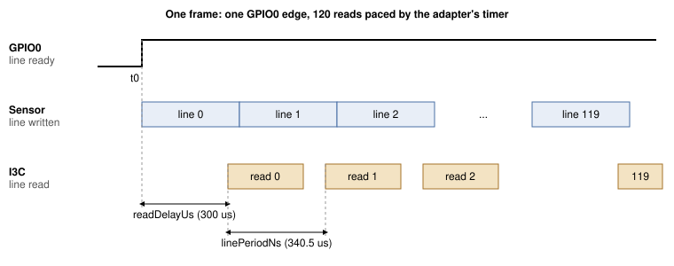
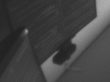

## 1 소개

이미지 센서는 일반적으로 MIPI CSI-2를 통해 픽셀을 전송하며, 이를 위해서는 호스트에 카메라 수신기가
필요합니다. VD55G1은 자신을 설정하는 데 쓰이는 것과 같은 2선 버스인 I3C를 통해서도 이미지를 전송할 수
있습니다. 따라서 USB 호스트 어댑터를 포함하여 I3C를 지원하는 모든 장치에서 카메라에 접근할 수 있으며,
호스트 측에는 카메라 인터페이스가 필요하지 않습니다.

문제는 타이밍입니다. 센서는 레지스터 윈도우에 한 번에 한 라인만 노출하며, 약 340마이크로초 후에 다음
라인이 이를 대체합니다. 당사 벤치에서 PC가 이 윈도우에 대해 발행한 160바이트 읽기는 200회 중 최소
3.64 ms, 중앙값 4.00 ms가 걸렸으므로, 대부분의 라인은 PC가 요청하기 전에 사라집니다. 읽기는 버스 가까이에
있는 무언가가 발행해야 합니다. 이 노트에서는 Supernova 자체의 펌웨어가 그 역할을 합니다.

### 1.1 범위

이 문서에서 다루는 내용은 다음과 같습니다.

- PC에서 VD55G1 부팅: 리셋, 열거, 패치 다운로드 및 설정
- 프레임 판독을 시작하는 GPIO0 에지
- 어댑터에서 프레임의 모든 라인을 읽고 USB를 통해 프레임을 반환하는 Supernova 명령 `I3C_CONTROLLER_CAPTURE_LINES`
- 정지 프레임을 PNG 파일로 캡처하기, 그리고 초당 9.8프레임의 라이브 뷰
- 측정된 라인 타이밍 윈도우

센서의 MIPI CSI-2 출력, 컬러 센서, 160x120을 초과하는 해상도, 그리고 GPIO 대신 인밴드 인터럽트(IBI)로
프레임 시작을 알리는 센서는 다루지 않습니다.

### 1.2 적용 디바이스

Table: 적용 디바이스

| 제품군 | 부품 예 | 식별자 | 근거 |
|---|---|---|---|
| STMicroelectronics VD55G1 | Gilisymo LS-CAM-I3C 보드의 VD55G1 cut 2.0 | 레지스터 0x0000의 모델 `S5G1`, 0x0004의 cut 0x20 | 테스트됨 |

### 1.3 관련 문서

Table: 관련 문서

| 문서 | 제목 |
|---|---|
| VD55G1 데이터시트 | STMicroelectronics DS13604 |
| Gilisymo VD55G1 레퍼런스 코드 | `https://github.com/gilisymo/vd55g1_stm32h533`, `Drivers/LS55G1/ls55g1_driver.c`의 패치 배열과 표 6의 레지스터 쓰기의 출처 |
| MIPI I3C Specification | MIPI Alliance |
| Binho Supernova 문서 | `https://support.binho.io` |

## 2 시스템 개요

PC는 일반적인 I3C 읽기와 쓰기로 센서를 부팅하고 설정합니다. 그런 다음 프레임마다
`I3C_CONTROLLER_CAPTURE_LINES` 명령을 하나씩 전송합니다. Supernova 펌웨어가 전체 프레임을 단독으로
처리하고 그 프레임으로 응답합니다.

Table: 역할 분담

| 단계 | 수행 주체 | 경로 |
|---|---|---|
| 리셋, 열거, 패치 다운로드, 설정 | PC | HID 명령, pycosmicsdk |
| 스트리밍 시작, 프레임 시작 대기, 120 라인을 RAM으로 읽기 | Supernova 펌웨어 | I3C, GPIO 입력 |
| 프레임 반환 | Supernova 펌웨어 | USB 벤더 벌크 IN(vendor bulk IN) |
| 프레임 표시 또는 저장 | PC | |

설계를 결정한 사실은 다음과 같습니다. "라인 준비"로 설정된 센서의 GPIO0은 라인마다 펄스를 내지
않습니다. 스트리밍을 시작하고 라인을 읽지 않은 상태에서, 300 ms 트레이스 동안 한 번 상승한 후 나머지
기간 내내 하이를 유지했습니다.

```
python capture_vd55g1.py <SERIAL> <path>/ls55g1_driver.c --trigger trace --frame-length 300
```

```
trace: result=0x0000 fsm after=ff level@0=0 transitions=1 rises=1
first 12 events (us, level): [(27675, 1)]
1/1 runs passed
```

`fsm after=ff`는 라인이 읽히지 않고 지나간 후 센서가 보고한 상태입니다. 당사의 실행에서 센서는
스트리밍을 벗어나 그 상태에 머물렀습니다. 유틸리티는 실행할 때마다 시작 시 센서를 다시 부팅합니다.

따라서 펌웨어는 상승 에지를 라인 0의 시작으로 간주하고, 라인 N을 그 에지에서 N 라인 주기 후에 타이머로
읽습니다. 이때 고정 지연을 더하여 각 읽기가 센서가 라인을 쓴 후에 이루어지도록 합니다. 캡처당 에지
하나면 충분합니다. 표 14의 동작 범위 내에서 모든 프레임의 120 라인이 모두 반환되었으며 반복된 행은
없었습니다.



펌웨어는 스케줄러를 일시 중지한 상태로 캡처를 실행하므로, 스케줄된 시각과 해당 읽기 사이에 다른
펌웨어 태스크가 실행되지 않습니다. 캡처 한 번의 상한은 5초입니다.

## 3 하드웨어 설정

### 3.1 필요한 장비

Table: 필요한 장비

| 품목 |
|---|
| Binho Supernova USB 호스트 어댑터 |
| Gilisymo LS-CAM-I3C 보드(VD55G1) |
| 센서 보드용 3.3 V 전원 |
| 짧은 점퍼 와이어 |
| USB-C 케이블 |

### 3.2 연결

Table: Supernova와 LS-CAM-I3C 보드 간 연결

| Supernova | LS-CAM-I3C | 필수 여부 |
|---|---|---|
| I3C HV 포트 SCL | SCL | 예 |
| I3C HV 포트 SDA | SDA | 예 |
| GND | GND | 예 |
| GPIO PIN_1 | NRST | 예 |
| GPIO PIN_3 | GPIO0(라인 준비) | 예 |
| GPIO PIN_5 | GPIO1 | 아니요, 이 노트에서는 사용하지 않음 |
| | VIN, 3.3 V | 예, 섹션 3.3 참조 |

### 3.3 버스 고려 사항

유틸리티는 I3C HV 포트와 GPIO 포트를 3300 mV로 설정합니다. 이 문서의 모든 측정에서 VIN은 Supernova와
접지를 공유하는 별도의 3.3 V 전원에서 공급했습니다.

> **주의:** 점퍼는 짧게 하고 단단히 꽂으십시오. 캡처 중에 연결이 움직이면 센서는 다시 부팅될 때까지
> 자신의 주소에 응답하지 않습니다.

> **참고:** 센서가 부팅하는 동안 GPIO0에 로직 분석기 프로브를 연결해 두지 마십시오. 당사 벤치에서는
> 이로 인해 센서가 소프트웨어 대기 상태에 도달하지 못했습니다.

## 4 소프트웨어 설정

유틸리티에는 pycosmicsdk(최신 릴리스), hidapi, pyusb, pillow가 필요합니다.

```
pip install --upgrade pycosmicsdk hidapi pyusb pillow
```

라이브 뷰어는 대부분의 Python 설치에 포함된 `tkinter`와, 선택적 녹화를 위한 `ffmpeg`도 사용합니다.

Linux에서는 사용자에게 Supernova의 USB 장치와 HID 인터페이스에 대한 읽기 및 쓰기 권한이 필요합니다.
당사 벤치에 설치된 다음 udev 규칙으로 권한을 부여할 수 있습니다.

```
SUBSYSTEM=="hidraw", ATTRS{idVendor}=="1fc9", ATTRS{idProduct}=="82fc", MODE="0666"
SUBSYSTEM=="usb", ATTRS{idVendor}=="1fc9", ATTRS{idProduct}=="82fc", MODE="0666"
```

유틸리티에는 어댑터의 일련번호를 지정합니다. 연결된 Supernova 목록은 다음 명령으로 확인합니다.

```
python -c "import hid; print({d['serial_number'] for d in hid.enumerate(0x1FC9, 0x82FC)})"
```

> **참고:** 이 문서의 모든 절차는 Linux에서만 실행했습니다. 프레임은 `pyusb`를 통해 벤더 벌크
> 엔드포인트(vendor bulk endpoint)에서 읽으며, Windows와 macOS에서는 libusb 백엔드가 필요합니다.
> 이러한 호스트는 테스트하지 않았습니다.

어댑터 펌웨어는 `I3C_CONTROLLER_CAPTURE_LINES`를 제공해야 합니다.

> **참고:** 이 명령은 아직 릴리스된 Supernova 펌웨어에 포함되어 있지 않습니다. 이 문서의 측정에는
> 개발 빌드 `4.6.1-1da26d5f`를 사용했습니다. 릴리스에 포함될 때까지는 해당 빌드와 플래싱 방법을
> Binho에 문의하십시오. 이 문서의 이후 개정판에서 릴리스 이름을 명시할 예정이며, 해당 릴리스는 일반적인
> Supernova 펌웨어 업데이트와 같은 방법으로 설치합니다.

센서는 전원을 켤 때마다 패치를 다운로드해야 합니다. 패치 배열은 STMicroelectronics의 것이며 이 노트와
함께 재배포하지 않습니다. 표 2의 Gilisymo 저장소에서 `Drivers/LS55G1/ls55g1_driver.c`를 다운로드하고
그 경로를 유틸리티에 전달하십시오. 유틸리티가 그 파일에서 배열을 읽습니다.

## 5 캡처 명령

### 5.1 관련 VD55G1 레지스터

표 6은 유틸리티가 사용하는 레지스터를 Gilisymo 레퍼런스 코드에 적힌 의미와 함께 나열합니다. 이 의미는
데이터시트의 해당 섹션과 대조하여 확인하지 않았습니다.

Table: 유틸리티가 사용하는 VD55G1 레지스터

| 레지스터 | 이름 | 용도 |
|---|---|---|
| 0x0000 | Model ID | `S5G1`을 읽음, 리틀 엔디언 |
| 0x001C | System FSM | 0x01 부팅 준비, 0x02 소프트웨어 대기, 0x03 스트리밍 |
| 0x0200 | Boot command | 0x02 패치 및 부팅 |
| 0x0201 | Standby command | 0x01 스트리밍 시작 |
| 0x0324 | I3C frame readout control | 0x03, I3C 이미지 판독 켜짐 |
| 0x0500 | Exposure mode | 0x00 자동, 0x02 수동 |
| 0x050C | Frame length | 라인 단위, 프레임 레이트를 결정 |
| 0x051D | GPIO0 control | 0x0C, 라인 준비 |
| 0x2000 | Line window | 한 라인의 픽셀, 2바이트 레지스터 주소로 읽음 |

이 노트에서 사용하는 윈도우는 행 174, 열 200에서 시작하는 160x120 RAW8입니다.

### 5.2 요청

`I3C_CONTROLLER_CAPTURE_LINES`의 명령 코드는 0x190E입니다. 요청 파라미터는 명령 헤더 뒤에 리틀 엔디언으로
패딩 없이 이어집니다.

Table: 요청 파라미터

| 오프셋 | 필드 | 크기 | 이 노트에서의 값 |
|---|---|---|---|
| 0 | 타깃 동적 주소 | 1 | ENTDAA에서 할당 |
| 1 | 레지스터 주소 길이 | 1 | 2 |
| 2 | 레지스터 주소 | 4 | 0x20 0x00 |
| 6 | 라인 길이, 바이트 | 2 | 160 |
| 8 | 라인 수 | 2 | 120 |
| 10 | 트리거 모드 | 1 | 2, 타이머 |
| 11 | 트리거 핀 | 1 | 2, PIN_3 |
| 12 | 타임아웃, ms | 2 | `capture_vd55g1.py`에서 4000, `view_vd55g1.py`에서 1000, 상한 5000 |
| 14 | 시작 레지스터 주소 길이 | 1 | 2 |
| 15 | 시작 레지스터 주소 | 4 | 0x02 0x01 |
| 19 | 시작 데이터 길이 | 1 | 1 |
| 20 | 시작 데이터 | 8 | 0x01, 스트리밍 시작 |
| 28 | 읽기 지연, us | 2 | 300, 최대 1000 |
| 30 | 라인 주기, ns | 4 | 340500 |

Table: 트리거 모드

| 값 | 모드 | 라인 N을 읽는 시점 |
|---|---|---|
| 0 | GPIO 상승 | 트리거 핀의 N번째 상승 에지에 읽기 지연을 더한 시점. GPIO0이 프레임당 한 번만 상승하는 VD55G1에는 적합하지 않음 |
| 1 | GPIO 하강 | N번째 하강 에지에 읽기 지연을 더한 시점. VD55G1에는 적합하지 않음 |
| 2 | 타이머 | 첫 번째 상승 에지에 라인 주기의 N배와 읽기 지연을 더한 시점 |
| 3 | 트레이스 | 읽지 않음. 진단용으로 타임아웃까지 트리거 핀의 모든 전이를 기록 |

시작 쓰기는 펌웨어가 첫 번째 에지를 기다리기 직전에 발행하므로, 스트리밍 시작과 첫 번째 라인 사이에
USB 왕복이 들어가지 않습니다. 캡처는 어댑터의 32768바이트 벌크 스테이징 풀에 들어가야 합니다.
160x120, 8비트는 19200바이트입니다.

### 5.3 응답

Table: 응답 파라미터

| 오프셋 | 필드 | 크기 |
|---|---|---|
| 0 | 캡처된 라인 수 | 2 |
| 2 | 페이로드 길이, 벤더 벌크 IN에서 읽을 바이트 수 | 4 |
| 6 | 실패한 라인의 드라이버 오류, 없으면 0 | 2 |
| 8 | 최소 라인 간 주기, us | 2 |
| 10 | 최대 라인 간 주기, us | 2 |
| 12 | 라인의 스케줄 시각부터 읽기 완료까지의 최장 시간, us | 2 |
| 14 | 첫 번째 라인부터 마지막 읽기 완료까지, us | 4 |

프레임은 이어서 벤더 벌크 IN으로 전송됩니다. 실패 전에 캡처된 라인도 반환됩니다.

## 6 절차

1. 섹션 4에 명시된 어댑터 펌웨어를 플래싱합니다.
2. 표 5와 같이 보드를 배선하고 3.3 V 전원을 켭니다.
3. 매번 센서를 새로 리셋하고 부팅하면서 다섯 프레임을 캡처합니다. `assets/`에서 실행합니다.

```
python capture_vd55g1.py <SERIAL> <path>/ls55g1_driver.c --runs 5 --out frames
```

```
run 0: result=0x0000 got 19200/19200 B in 95 ms, fsm after=03 {'lines': 120, 'bytes': 19200, 'driverError': 0, 'minPeriodUs': 340, 'maxPeriodUs': 340, 'maxReadUs': 469, 'totalUs': 40985}
run 1: result=0x0000 got 19200/19200 B in 95 ms, fsm after=03 {'lines': 120, 'bytes': 19200, 'driverError': 0, 'minPeriodUs': 340, 'maxPeriodUs': 340, 'maxReadUs': 469, 'totalUs': 40986}
run 2: result=0x0000 got 19200/19200 B in 94 ms, fsm after=03 {'lines': 120, 'bytes': 19200, 'driverError': 0, 'minPeriodUs': 340, 'maxPeriodUs': 340, 'maxReadUs': 469, 'totalUs': 40985}
run 3: result=0x0000 got 19200/19200 B in 95 ms, fsm after=03 {'lines': 120, 'bytes': 19200, 'driverError': 0, 'minPeriodUs': 340, 'maxPeriodUs': 340, 'maxReadUs': 469, 'totalUs': 40985}
run 4: result=0x0000 got 19200/19200 B in 94 ms, fsm after=03 {'lines': 120, 'bytes': 19200, 'driverError': 0, 'minPeriodUs': 340, 'maxPeriodUs': 340, 'maxReadUs': 469, 'totalUs': 40985}
5/5 runs passed
```

   각 실행은 `frames/runNN_f0.png`를 기록합니다. 부팅 후 첫 번째 프레임은 자동 노출이 안정되기 전의
   것이므로 어둡습니다. 정지 이미지를 얻으려면 노출을 수동으로 설정합니다.

```
python capture_vd55g1.py <SERIAL> <path>/ls55g1_driver.c --again 0 --exposure 60 --runs 3 --out frames
```

```
run 0: result=0x0000 got 19200/19200 B in 106 ms, fsm after=03 {'lines': 120, 'bytes': 19200, 'driverError': 0, 'minPeriodUs': 340, 'maxPeriodUs': 340, 'maxReadUs': 469, 'totalUs': 40984}
run 1: result=0x0000 got 19200/19200 B in 107 ms, fsm after=03 {'lines': 120, 'bytes': 19200, 'driverError': 0, 'minPeriodUs': 340, 'maxPeriodUs': 340, 'maxReadUs': 469, 'totalUs': 40985}
run 2: result=0x0000 got 19200/19200 B in 107 ms, fsm after=03 {'lines': 120, 'bytes': 19200, 'driverError': 0, 'minPeriodUs': 340, 'maxPeriodUs': 340, 'maxReadUs': 469, 'totalUs': 40985}
3/3 runs passed
```



4. 라이브 뷰를 시작합니다. 센서를 한 번 부팅한 후 자동 노출로 프레임을 연속 캡처합니다. 창을 닫거나
   Ctrl+C를 누르면 중지되며 요약을 출력합니다.

```
python view_vd55g1.py <SERIAL> <path>/ls55g1_driver.c
```

```
590 frames ok, 0 bad, 0 reboots in 60.2 s (9.8 fps)
```

   `--record out.mp4`를 추가하면 스트림을 동영상으로 저장합니다.

## 7 참조

Table: capture_vd55g1.py 옵션

| 옵션 | 기본값 | 의미 |
|---|---|---|
| `--runs N` | 1 | 리셋, 부팅, 캡처를 N회 수행하고 성공 비율을 출력 |
| `--out DIR` | `frames` | PNG 파일을 기록할 위치 |
| `--trigger` | `gpio-timed` | `gpio-timed`, 또는 캡처 대신 GPIO0 전이를 출력하는 `trace`. `gpio`와 `gpio-falling`은 표 8에 나와 있으며 VD55G1에는 적합하지 않음 |
| `--line-period-ns` | 340500 | 타이머 트리거의 라인 주기 |
| `--post-delay-us` | 300 | 각 라인의 스케줄 시각 이후의 읽기 지연, 0~1000 |
| `--again CODE` | 자동 노출 | 이 아날로그 게인 코드로 수동 노출, 0~28 |
| `--exposure LINES` | 500 | 라인 단위 노출, 수동 모드 전용 |
| `--dgain` | 1.1 | 디지털 게인 |
| `--frame-length LINES` | 700 | 센서 프레임 길이 |
| `--frames N` | 1 | 한 번의 캡처에 포함되는 연속 프레임 수, 스테이징 풀 범위 내 |
| `--width`, `--height` | 160, 120 | 윈도우 크기 |

Table: view_vd55g1.py 옵션

| 옵션 | 기본값 | 의미 |
|---|---|---|
| `--frame-length LINES` | 300 | 센서 프레임 길이, 프레임 레이트를 결정(표 13) |
| `--again CODE` | 자동 노출 | 이 아날로그 게인 코드로 수동 노출 |
| `--exposure LINES` | 60 | 라인 단위 노출, `--again`과 함께 사용할 때만 |
| `--dgain` | 1.1 | 디지털 게인 |
| `--scale N` | 4 | 창 확대 배율 |
| `--record FILE` | 없음 | ffmpeg로 프레임을 동영상 파일에도 기록, 10 fps로 태그 |
| `--width`, `--height` | 160, 120 | 윈도우 크기 |
| `--line-period-ns`, `--post-delay-us` | 340500, 300 | `capture_vd55g1.py`와 동일 |

뷰어는 캡처가 연속으로 세 번 실패하면 센서를 다시 부팅합니다.

## 8 측정 결과

### 8.1 테스트 구성

Table: 테스트 구성

| 항목 | 버전 |
|---|---|
| 어댑터 | Binho Supernova, 펌웨어 `4.6.1-1da26d5f`(개발 빌드) |
| 센서 | Gilisymo LS-CAM-I3C 보드의 VD55G1 cut 2.0, VIN 3.3 V는 별도 전원에서 공급 |
| 버스 | I3C SDR, 10 MHz 푸시풀, 듀티 40 %, 3300 mV |
| 호스트 | Linux 7.2.5, Python 3.14.7, pycosmicsdk 1.6.0, hidapi 0.15.0, pyusb 1.3.1, pillow 12.3.0 |
| 윈도우 | 160x120 RAW8, 행 174, 열 200부터 |

### 8.2 프레임 레이트

프레임 레이트는 센서의 프레임 길이(라인 수)와 라인 주기의 곱으로 결정됩니다. 표 13의 각 행은
`view_vd55g1.py --frame-length N`을 약 32초 동안 실행한 1회분입니다.

Table: 프레임 길이에 따른 프레임 레이트

| 프레임 길이, 라인 | 정상 프레임 | 캡처 실패 | 센서 재부팅 | 프레임 레이트, fps |
|---|---|---|---|---|
| 700 | 136 | 0 | 0 | 4.2 |
| 400 | 238 | 0 | 0 | 7.4 |
| 300 | 317 | 0 | 0 | 9.8 |
| 280 | 339 | 0 | 0 | 10.5 |
| 260 | 66 | 15 | 5 | 1.9 |

260 라인에서는 캡처가 실패하고 센서를 다시 부팅해야 합니다. 이 윈도우에서 판독은 행 294(174 더하기 120)에서
끝나며, 이것이 원인인지는 확인하지 않았습니다. 300 라인이 뷰어의 기본값입니다.

### 8.3 라인 주기와 읽기 지연

센서가 라인을 쓰기 전에 읽기가 도착하면 센서는 다시 부팅될 때까지 자신의 주소에 응답하지 않습니다
(결과 0x060B). 표 14에서는 이를 "센서 손실"이라고 합니다. 읽기가 너무 늦게 도착하면 반복된 행이
반환되거나, 캡처가 결과 0x0009("late")로 실패합니다. 표 14는 프레임 길이 300, 수동 노출
(`--again 0 --exposure 60`)로 각 지점에서 다섯 번 캡처하여 두 경우를 모두 집계한 것이며, 실패할 때마다
센서를 다시 부팅했습니다. 반복된 행은 프레임의 각 행을 바로 앞의 행과 비교하여 집계했으며, 이를 위해
`capture_vd55g1.py`의 `capture()` 함수를 기반으로 작성한 스크립트를 사용했습니다.

Table: 라인 주기에 따른, 반복된 행이 0인 캡처 수(5회 중)

| 라인 주기, us | 읽기 지연 300 us | 읽기 지연 250 us |
|---|---|---|
| 336.8 | 0, 센서 손실 5/5 | 0, 센서 손실 5/5 |
| 337.7 | 0, 센서 손실 5/5 | 0, 센서 손실 5/5 |
| 338.5 | 2, 센서 손실 3/5 | 측정하지 않음 |
| 339.0 | 5 | 측정하지 않음 |
| 340.5 | 5 | 5 |
| 343.0 | 5 | 측정하지 않음 |
| 345.0 | 5 | 5 |
| 347.0 | 5 | 측정하지 않음 |
| 348.0 | 1, late 4/5 | 1, late 4/5 |

300 us 지연에서 사용 가능한 범위는 339.0~347.0 us입니다. 기본값 340.5 us는 그 하한보다 1.5 us 위에
있으며, 120 라인에 걸쳐 이 차이는 마지막 읽기를 180 us 이동시킵니다.

뷰어의 기본값인 자동 노출로 같은 스윕을 수행한 결과, 339.0, 339.5, 343.0, 345.0, 347.0 us에서는 5회 중
5회 반복된 행이 0이었고, 338.5와 340.5 us에서는 5회 중 4회였으며 나머지 한 번의 캡처에서 센서를
잃었습니다. 느슨한 연결도 같은 결과 코드를 내므로, 이 두 번의 실패를 라인 주기 탓으로 보지 않습니다.

### 8.4 연속 캡처

같은 배선에서 라인 주기를 번갈아 바꾸며 60초 뷰어 실행을 네 번 수행했으며, 각 실행에서 439~591
프레임을 캡처했습니다.

Table: 연속 캡처, 실행당 60초

| 라인 주기, us | 정상 프레임 | 캡처 실패 | 센서 재부팅 | 프레임 레이트, fps |
|---|---|---|---|---|
| 340.5 | 439 | 18 | 6 | 7.3 |
| 343.0 | 460 | 12 | 4 | 7.6 |
| 340.5 | 591 | 0 | 0 | 9.8 |
| 343.0 | 537 | 3 | 1 | 8.9 |

실패는 라인 주기와 관련이 없었습니다. 프레임 레이트 열은 정상 프레임만 집계하므로, 실패가 있었던
실행은 9.8보다 낮게 보고됩니다.

## 9 문제 해결

Table: 문제 해결

| 증상 | 예상 원인 및 조치 |
|---|---|
| `result=0x060B`이고 이후 읽기도 실패 | 센서가 자신의 주소에 응답하지 않게 되었습니다. 점퍼를 다시 꽂은 후 다시 실행하십시오. 유틸리티는 시작 시 센서를 부팅합니다 |
| `not SW_STBY after boot` | 부팅 중 GPIO0에 연결된 프로브, 또는 느슨한 연결. 프로브를 제거하고 다시 꽂으십시오 |
| `not a VD55G1 cut 2.0` | 다른 센서 또는 cut이거나, 응답하는 센서가 없습니다. VIN과 I3C 배선을 확인하십시오 |
| 짧은 프레임 길이에서 캡처 실패 | 이 윈도우에서 260 라인은 실패했고, 280 이상은 동작했습니다(표 13) |
| 모든 캡처가 타임아웃 | GPIO0이 PIN_3에 배선되지 않았습니다 |
| 첫 번째 프레임이 어두움 | 자동 노출이 아직 안정되지 않았습니다. 뷰어를 사용하거나 `--again 0 --exposure 60`을 사용하십시오 |
| `result=0x0004` | 파라미터가 범위를 벗어났습니다. 테스트됨: 3보다 큰 트리거 모드, 1000보다 큰 읽기 지연, 타이머 모드에서 라인 주기 0, 입력으로 설정되지 않은 트리거 핀, 알 수 없는 핀. 펌웨어 소스 기준, 테스트되지 않음: 라인 길이 또는 라인 수 0, 4바이트보다 긴 레지스터 주소, 8바이트보다 긴 시작 데이터 |
| `result=0x0003` | 펌웨어 소스 기준, 테스트되지 않음: 캡처가 스테이징 풀에 들어가지 않거나 풀이 사용 중 |

## 10 약어

Table: 약어

| 용어 | 의미 |
|---|---|
| CSI-2 | Camera Serial Interface 2, MIPI Alliance 사양 |
| ENTDAA | Enter Dynamic Address Assignment, I3C 공통 명령 |
| FSM | 유한 상태 기계(Finite state machine) |
| I3C | MIPI I3C, 개선된 Inter-Integrated Circuit 버스 |
| RAW8 | 처리되지 않은 픽셀 데이터, 픽셀당 8비트 |
| SDR | 단일 데이터 레이트(Single data rate), I3C의 기본 전송 모드 |

## 11 문서 내 소스 코드에 관한 참고

이 문서에 표시되고 첨부 아카이브로 제공되는 예제 코드는 평가 및 참고용입니다. 이 코드는 MIT 라이선스로
배포되며, 라이선스 전문은 아카이브에 포함되어 있습니다.

아카이브 `AN0017-assets.zip`에는 `capture_vd55g1.py`(부팅, 설정, PNG로 캡처, GPIO0 트레이스),
`view_vd55g1.py`(라이브 뷰 및 녹화), `raw_link.py`(캡처 명령을 위한 HID 및 벤더 벌크 전송 계층),
`LICENSE`가 포함되어 있습니다. 센서 패치는 포함되어 있지 않습니다. 섹션 4를 참조하십시오.

## 12 개정 이력

Table: 개정 이력

| 개정 | 날짜 | 설명 |
|---|---|---|
| 0.1 | 14 October 2026 | 내부 검토용 초안. 개발 펌웨어 빌드에서 측정. |
| 1.0 | 6 November 2026 | 공개. |
