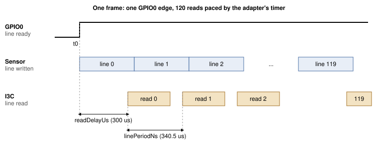
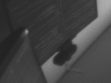

## 1 Introduction

An image sensor normally sends pixels over MIPI CSI-2, which needs a host with a camera
receiver. The VD55G1 can also send its image over I3C, the same two-wire bus that configures
it. That makes a camera reachable from anything that speaks I3C, including a USB host adapter,
with no camera interface on the host side.

The catch is timing. The sensor exposes one line at a time in a register window, and the next
line replaces it about 340 microseconds later. A 160-byte read of that window issued from a PC
took 3.64 ms at best and 4.00 ms at the median over 200 reads on our bench, so most lines are
gone before the PC can ask for them. The reads have to be issued by something close to the bus.
In this note that is the Supernova's own firmware.

### 1.1 Scope

This document covers:

- booting the VD55G1 from a PC: reset, enumeration, patch download and configuration
- the GPIO0 edge that starts a frame's readout
- the Supernova command `I3C_CONTROLLER_CAPTURE_LINES`, which reads every line of a frame on the
  adapter and returns the frame over USB
- capturing still frames to PNG files, and a live view at 9.8 frames per second
- the line timing window, as measured

It does not cover the sensor's MIPI CSI-2 output, color sensors, resolutions above 160x120, or
sensors that signal frame start with an in-band interrupt instead of a GPIO.

### 1.2 Applicable devices

Table: Applicable devices

| Family | Example parts | Identifier | Basis |
|---|---|---|---|
| STMicroelectronics VD55G1 | VD55G1 cut 2.0 on a Gilisymo LS-CAM-I3C board | Model `S5G1` at register 0x0000, cut 0x20 at 0x0004 | Tested |

### 1.3 Related documents

Table: Related documents

| Document | Title |
|---|---|
| VD55G1 datasheet | STMicroelectronics DS13604 |
| Gilisymo VD55G1 reference code | `https://github.com/gilisymo/vd55g1_stm32h533`, source of the patch arrays in `Drivers/LS55G1/ls55g1_driver.c` and of the register writes in Table 6 |
| MIPI I3C Specification | MIPI Alliance |
| Binho Supernova documentation | `https://support.binho.io` |

## 2 System overview

The PC boots and configures the sensor with ordinary I3C reads and writes. It then sends one
`I3C_CONTROLLER_CAPTURE_LINES` command per frame. The Supernova firmware carries out the whole
frame on its own and answers with the frame.

Table: Who does what

| Step | Done by | Over |
|---|---|---|
| Reset, enumeration, patch download, configuration | PC | HID commands, pycosmicsdk |
| Start streaming, wait for frame start, read 120 lines into RAM | Supernova firmware | I3C, GPIO input |
| Return the frame | Supernova firmware | USB vendor bulk IN |
| Display or save the frame | PC | |

The fact that shapes the design: the sensor's GPIO0, configured as "line ready", does not pulse
for every line. With streaming started and no line read, it rose once and stayed high for the
rest of a 300 ms trace:

```
python capture_vd55g1.py <SERIAL> <path>/ls55g1_driver.c --trigger trace --frame-length 300
```

```
trace: result=0x0000 fsm after=ff level@0=0 transitions=1 rises=1
first 12 events (us, level): [(27675, 1)]
1/1 runs passed
```

`fsm after=ff` is the state the sensor reported once a line had gone unread; in our runs it left
streaming and stayed there. Every run of the utilities boots the sensor again at its start.

The firmware therefore takes the rising edge as the start of line 0 and reads line N at that
edge plus N line periods, on a timer, with a fixed delay so each read lands after the sensor has
written the line. One edge per capture is enough: within the working range of Table 14, all 120
lines of every frame came back with no row repeated.



The firmware runs a capture with the scheduler suspended, so no other firmware task runs
between a scheduled time and its read. A capture is capped at 5 seconds.

## 3 Hardware setup

### 3.1 Required equipment

Table: Required equipment

| Item |
|---|
| Binho Supernova USB host adapter |
| Gilisymo LS-CAM-I3C board (VD55G1) |
| 3.3 V supply for the sensor board |
| Short jumper wires |
| USB-C cable |

### 3.2 Connections

Table: Connections between the Supernova and the LS-CAM-I3C board

| Supernova | LS-CAM-I3C | Required |
|---|---|---|
| I3C HV port SCL | SCL | Yes |
| I3C HV port SDA | SDA | Yes |
| GND | GND | Yes |
| GPIO PIN_1 | NRST | Yes |
| GPIO PIN_3 | GPIO0 (line ready) | Yes |
| GPIO PIN_5 | GPIO1 | No, not used by this note |
| | VIN, 3.3 V | Yes, see Section 3.3 |

### 3.3 Bus considerations

The utilities set the I3C HV port and the GPIO port to 3300 mV. In every measurement in this
document VIN came from a separate 3.3 V supply sharing ground with the Supernova.

> **Caution:** keep the jumpers short and seated firmly. A connection that moves during a
> capture makes the sensor stop acknowledging its address until it is booted again.

> **Note:** do not leave a logic analyzer probe on GPIO0 while the sensor boots; on our bench it
> stopped the sensor reaching software standby.

## 4 Software setup

```
pip install pycosmicsdk hidapi pyusb pillow
```

The live viewer also uses `tkinter`, part of most Python installations, and `ffmpeg` for its
optional recording.

On Linux the user needs read and write access to the Supernova's USB device and its HID
interface. These udev rules, as installed on our bench, grant it:

```
SUBSYSTEM=="hidraw", ATTRS{idVendor}=="1fc9", ATTRS{idProduct}=="82fc", MODE="0666"
SUBSYSTEM=="usb", ATTRS{idVendor}=="1fc9", ATTRS{idProduct}=="82fc", MODE="0666"
```

The utilities take the adapter's serial number. List the connected Supernovas with:

```
python -c "import hid; print({d['serial_number'] for d in hid.enumerate(0x1FC9, 0x82FC)})"
```

> **Note:** every procedure in this document was run on Linux only. The frame arrives on a
> vendor bulk endpoint read through `pyusb`, which on Windows and macOS needs a libusb backend.
> Those hosts have not been tested.

The adapter firmware must provide `I3C_CONTROLLER_CAPTURE_LINES`.

> **Note:** the command is not in a released Supernova firmware yet. The measurements in this
> document used development build `4.6.1-1da26d5f`. Until a release carries it, contact Binho
> for that build and the instructions to flash it. A later revision of this document will name
> the release, which installs like any Supernova firmware update.

The sensor needs a patch downloaded at every power-up. The patch arrays are STMicroelectronics'
and are not redistributed with this note. Download `Drivers/LS55G1/ls55g1_driver.c` from the
Gilisymo repository in Table 2 and pass its path to the utilities, which read the arrays from it.

## 5 The capture command

### 5.1 The VD55G1 registers involved

Table 6 lists the registers the utilities use, with the meanings as written in the Gilisymo
reference code. We have not checked them against a section of the datasheet.

Table: VD55G1 registers used by the utilities

| Register | Name | Use |
|---|---|---|
| 0x0000 | Model ID | Reads `S5G1`, little endian |
| 0x001C | System FSM | 0x01 ready to boot, 0x02 software standby, 0x03 streaming |
| 0x0200 | Boot command | 0x02 patch and boot |
| 0x0201 | Standby command | 0x01 start streaming |
| 0x0324 | I3C frame readout control | 0x03, I3C image readout on |
| 0x0500 | Exposure mode | 0x00 automatic, 0x02 manual |
| 0x050C | Frame length | In lines; sets the frame rate |
| 0x051D | GPIO0 control | 0x0C, line ready |
| 0x2000 | Line window | One line of pixels, read with a 2-byte register address |

The window used in this note starts at row 174 and column 200 and is 160x120, RAW8.

### 5.2 Request

`I3C_CONTROLLER_CAPTURE_LINES` is command code 0x190E. The request parameters follow the
command header, little endian, packed.

Table: Request parameters

| Offset | Field | Size | Value in this note |
|---|---|---|---|
| 0 | Target dynamic address | 1 | From ENTDAA |
| 1 | Register address length | 1 | 2 |
| 2 | Register address | 4 | 0x20 0x00 |
| 6 | Line length, bytes | 2 | 160 |
| 8 | Line count | 2 | 120 |
| 10 | Trigger mode | 1 | 2, timed |
| 11 | Trigger pin | 1 | 2, PIN_3 |
| 12 | Timeout, ms | 2 | 4000 from `capture_vd55g1.py`, 1000 from `view_vd55g1.py`; capped at 5000 |
| 14 | Start register address length | 1 | 2 |
| 15 | Start register address | 4 | 0x02 0x01 |
| 19 | Start data length | 1 | 1 |
| 20 | Start data | 8 | 0x01, start streaming |
| 28 | Read delay, us | 2 | 300, at most 1000 |
| 30 | Line period, ns | 4 | 340500 |

Table: Trigger modes

| Value | Mode | Line N is read |
|---|---|---|
| 0 | GPIO rising | On the Nth rising edge of the trigger pin, plus the read delay. Not for the VD55G1, whose GPIO0 rises once per frame |
| 1 | GPIO falling | On the Nth falling edge, plus the read delay. Not for the VD55G1 |
| 2 | Timed | At the first rising edge plus N times the line period, plus the read delay |
| 3 | Trace | Never. Logs every trigger pin transition until the timeout, for diagnostics |

The start write is issued by the firmware just before it waits for the first edge, so no USB
round trip falls between starting the stream and the first line. The capture must fit the
adapter's 32768-byte bulk staging pool: 160x120 at 8 bits is 19200 bytes.

### 5.3 Response

Table: Response parameters

| Offset | Field | Size |
|---|---|---|
| 0 | Lines captured | 2 |
| 2 | Payload length, bytes to read from vendor bulk IN | 4 |
| 6 | Driver error of the failing line, 0 if none | 2 |
| 8 | Minimum line-to-line period, us | 2 |
| 10 | Maximum line-to-line period, us | 2 |
| 12 | Longest time from a line's scheduled time to its read completing, us | 2 |
| 14 | First line to last read complete, us | 4 |

The frame follows on vendor bulk IN. Lines captured before a failure are returned too.

## 6 Procedure

1. Flash the adapter firmware named in Section 4.
2. Wire the board as in Table 5 and turn on the 3.3 V supply.
3. Capture five frames, each after a fresh reset and boot of the sensor. Run from `assets/`:

```
python capture_vd55g1.py <SERIAL> <path>/ls55g1_driver.c --runs 5 --out frames
```

```
run 0: result=0x0000 got 19200/19200 B in 95 ms, fsm after=03 {'lines': 120, 'bytes': 19200, 'driverError': 0, 'minPeriodUs': 340, 'maxPeriodUs': 340, 'maxReadUs': 469, 'totalUs': 40985}
run 1: result=0x0000 got 19200/19200 B in 95 ms, fsm after=03 {'lines': 120, 'bytes': 19200, 'driverError': 0, 'minPeriodUs': 340, 'maxPeriodUs': 340, 'maxReadUs': 469, 'totalUs': 40986}
run 2: result=0x0000 got 19200/19200 B in 94 ms, fsm after=03 {'lines': 120, 'bytes': 19200, 'driverError': 0, 'minPeriodUs': 340, 'maxPeriodUs': 340, 'maxReadUs': 469, 'totalUs': 40985}
run 3: result=0x0000 got 19200/19200 B in 95 ms, fsm after=03 {'lines': 120, 'bytes': 19200, 'driverError': 0, 'minPeriodUs': 340, 'maxPeriodUs': 340, 'maxReadUs': 469, 'totalUs': 40985}
run 4: result=0x0000 got 19200/19200 B in 94 ms, fsm after=03 {'lines': 120, 'bytes': 19200, 'driverError': 0, 'minPeriodUs': 340, 'maxPeriodUs': 340, 'maxReadUs': 469, 'totalUs': 40985}
5/5 runs passed
```

   Each run writes `frames/runNN_f0.png`. The first frame after a boot uses automatic exposure
   before it has settled, so it is dark. For a still image, set the exposure by hand:

```
python capture_vd55g1.py <SERIAL> <path>/ls55g1_driver.c --again 0 --exposure 60 --runs 3 --out frames
```

```
run 0: result=0x0000 got 19200/19200 B in 106 ms, fsm after=03 {'lines': 120, 'bytes': 19200, 'driverError': 0, 'minPeriodUs': 340, 'maxPeriodUs': 340, 'maxReadUs': 469, 'totalUs': 40984}
run 1: result=0x0000 got 19200/19200 B in 107 ms, fsm after=03 {'lines': 120, 'bytes': 19200, 'driverError': 0, 'minPeriodUs': 340, 'maxPeriodUs': 340, 'maxReadUs': 469, 'totalUs': 40985}
run 2: result=0x0000 got 19200/19200 B in 107 ms, fsm after=03 {'lines': 120, 'bytes': 19200, 'driverError': 0, 'minPeriodUs': 340, 'maxPeriodUs': 340, 'maxReadUs': 469, 'totalUs': 40985}
3/3 runs passed
```



4. Start the live view. It boots the sensor once, then captures frames back to back with
   automatic exposure. Close the window or press Ctrl+C to stop; it prints a summary:

```
python view_vd55g1.py <SERIAL> <path>/ls55g1_driver.c
```

```
590 frames ok, 0 bad, 0 reboots in 60.2 s (9.8 fps)
```

   Add `--record out.mp4` to save the stream as a video.

## 7 Reference

Table: capture_vd55g1.py options

| Option | Default | Meaning |
|---|---|---|
| `--runs N` | 1 | Reset, boot and capture N times; prints the pass ratio |
| `--out DIR` | `frames` | Where PNG files are written |
| `--trigger` | `gpio-timed` | `gpio-timed`, or `trace` to print the GPIO0 transitions instead of capturing. `gpio` and `gpio-falling` are listed in Table 8 and do not suit the VD55G1 |
| `--line-period-ns` | 340500 | Line period for the timed trigger |
| `--post-delay-us` | 300 | Read delay after each line's scheduled time, 0 to 1000 |
| `--again CODE` | automatic exposure | Manual exposure with this analog gain code, 0 to 28 |
| `--exposure LINES` | 500 | Exposure in lines, manual mode only |
| `--dgain` | 1.1 | Digital gain |
| `--frame-length LINES` | 700 | Sensor frame length |
| `--frames N` | 1 | Consecutive frames in one capture, within the staging pool |
| `--width`, `--height` | 160, 120 | Window size |

Table: view_vd55g1.py options

| Option | Default | Meaning |
|---|---|---|
| `--frame-length LINES` | 300 | Sensor frame length; sets the frame rate (Table 13) |
| `--again CODE` | automatic exposure | Manual exposure with this analog gain code |
| `--exposure LINES` | 60 | Exposure in lines, used only with `--again` |
| `--dgain` | 1.1 | Digital gain |
| `--scale N` | 4 | Window magnification |
| `--record FILE` | none | Also write the frames to a video file with ffmpeg, tagged 10 fps |
| `--width`, `--height` | 160, 120 | Window size |
| `--line-period-ns`, `--post-delay-us` | 340500, 300 | As for `capture_vd55g1.py` |

The viewer boots the sensor again after three failed captures in a row.

## 8 Measured results

### 8.1 Test configuration

Table: Test configuration

| Item | Version |
|---|---|
| Adapter | Binho Supernova, firmware `4.6.1-1da26d5f` (development build) |
| Sensor | VD55G1 cut 2.0 on a Gilisymo LS-CAM-I3C board, VIN 3.3 V from a separate supply |
| Bus | I3C SDR, 10 MHz push-pull, 40 % duty, 3300 mV |
| Host | Linux 7.2.5, Python 3.14.7, pycosmicsdk 1.6.0, hidapi 0.15.0, pyusb 1.3.1, pillow 12.3.0 |
| Window | 160x120 RAW8 at row 174, column 200 |

### 8.2 Frame rate

The frame rate is set by the sensor's frame length, in lines, times the line period. Each row
of Table 13 is one run of `view_vd55g1.py --frame-length N` for about 32 seconds.

Table: Frame rate against frame length

| Frame length, lines | Frames ok | Failed captures | Sensor reboots | Frame rate, fps |
|---|---|---|---|---|
| 700 | 136 | 0 | 0 | 4.2 |
| 400 | 238 | 0 | 0 | 7.4 |
| 300 | 317 | 0 | 0 | 9.8 |
| 280 | 339 | 0 | 0 | 10.5 |
| 260 | 66 | 15 | 5 | 1.9 |

At 260 lines captures fail and the sensor has to be booted again. With this window the readout
ends at row 294 (174 plus 120); we have not established whether that is the cause. 300 lines is
the viewer's default.

### 8.3 Line period and read delay

A read that arrives before the sensor has written its line makes the sensor stop acknowledging
its address (result 0x060B) until it is booted again; Table 14 calls this "sensor lost". A read
that arrives too late returns a repeated row, or the capture fails with result 0x0009 ("late").
Table 14 counts both over five captures at each point, with frame length 300 and manual
exposure (`--again 0 --exposure 60`), booting the sensor again after each failure. Repeated rows
were counted by comparing each row of a frame with the row before it, in a script built on the
`capture()` function of `capture_vd55g1.py`.

Table: Captures with 0 repeated rows, out of 5, against the line period

| Line period, us | Read delay 300 us | Read delay 250 us |
|---|---|---|
| 336.8 | 0, sensor lost 5/5 | 0, sensor lost 5/5 |
| 337.7 | 0, sensor lost 5/5 | 0, sensor lost 5/5 |
| 338.5 | 2, sensor lost 3/5 | not measured |
| 339.0 | 5 | not measured |
| 340.5 | 5 | 5 |
| 343.0 | 5 | not measured |
| 345.0 | 5 | 5 |
| 347.0 | 5 | not measured |
| 348.0 | 1, late 4/5 | 1, late 4/5 |

The usable range at a 300 us delay runs from 339.0 to 347.0 us. The default of 340.5 us sits
1.5 us above its lower edge; over 120 lines that edge moves the last read by 180 us.

The same sweep with automatic exposure, the viewer's default, gave 0 repeated rows in 5 of 5
captures at 339.0, 339.5, 343.0, 345.0 and 347.0 us, and in 4 of 5 at 338.5 and 340.5 us, where
one capture lost the sensor. A loose connection gives the same result code, so we do not
attribute those two failures to the line period.

### 8.4 Sustained capture

Four 60-second viewer runs on the same wiring, alternating the line period, captured 439 to 591
frames each.

Table: Sustained capture, 60 seconds per run

| Line period, us | Frames ok | Failed captures | Sensor reboots | Frame rate, fps |
|---|---|---|---|---|
| 340.5 | 439 | 18 | 6 | 7.3 |
| 343.0 | 460 | 12 | 4 | 7.6 |
| 340.5 | 591 | 0 | 0 | 9.8 |
| 343.0 | 537 | 3 | 1 | 8.9 |

The failures did not follow the line period. The frame rate column counts only good frames, so a
run with failures reports less than 9.8.

## 9 Troubleshooting

Table: Troubleshooting

| Symptom | Probable cause and action |
|---|---|
| `result=0x060B`, and later reads fail too | The sensor stopped acknowledging its address. Reseat the jumpers, then run again; the utilities boot the sensor at start |
| `not SW_STBY after boot` | A probe on GPIO0 during boot, or a loose connection. Remove the probe and reseat |
| `not a VD55G1 cut 2.0` | A different sensor or cut, or no sensor answering. Check VIN and the I3C wires |
| Captures fail at a short frame length | 260 lines failed with this window; 280 and above worked (Table 13) |
| Every capture times out | GPIO0 not wired to PIN_3 |
| Dark first frame | Automatic exposure has not settled. Use the viewer, or `--again 0 --exposure 60` |
| `result=0x0004` | A parameter out of range. Tested: trigger mode above 3, read delay above 1000, a line period of 0 in timed mode, a trigger pin not configured as an input, an unknown pin. From the firmware source, not tested: a line length or count of 0, a register address longer than 4 bytes, start data longer than 8 bytes |
| `result=0x0003` | From the firmware source, not tested: the capture does not fit the staging pool, or the pool is in use |

## 10 Acronyms

Table: Acronyms

| Term | Meaning |
|---|---|
| CSI-2 | Camera Serial Interface 2, a MIPI Alliance specification |
| ENTDAA | Enter Dynamic Address Assignment, an I3C common command |
| FSM | Finite state machine |
| I3C | MIPI I3C, an improved inter-integrated circuit bus |
| RAW8 | Unprocessed pixel data, 8 bits per pixel |
| SDR | Single data rate, the base I3C transfer mode |

## 11 Note about the source code in the document

Example code shown in this document and supplied in the accompanying archive is provided for
evaluation and reference. It is released under the MIT license, the text of which is included
in the archive.

The archive `AN0017-assets.zip` contains `capture_vd55g1.py` (boot, configure, capture to PNG,
and the GPIO0 trace), `view_vd55g1.py` (live view and recording), `raw_link.py` (the HID and
vendor bulk transport for the capture command) and `LICENSE`. It does not contain the sensor
patch; see Section 4.

## 12 Revision history

Table: Revision history

| Revision | Date | Description |
|---|---|---|
| 0.1 | 14 October 2026 | Draft for internal review. Measured on a development firmware build. |
