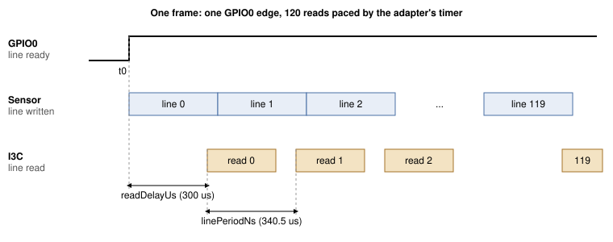

## 1 引言

图像传感器通常通过 MIPI CSI-2 发送像素，这需要主机具备摄像头接收器。VD55G1 也可以通过 I3C
发送图像，而 I3C 正是用于配置它的那条两线总线。这样一来，任何支持 I3C 的设备（包括 USB 主机适配器）
都能访问摄像头，主机端无需任何摄像头接口。

难点在于时序。传感器在一个寄存器窗口中每次只提供一行，约 340 微秒后下一行就会取代它。在我们的
测试台上，从 PC 发出的对该窗口的 160 字节读取，在 200 次读取中最快为 3.64 ms，中位数为 4.00 ms，
因此大多数行在 PC 能够请求之前就已消失。这些读取必须由靠近总线的器件发出。在本笔记中，这一角色由
Supernova 自身的固件承担。

### 1.1 范围

本文档涵盖：

- 从 PC 引导 VD55G1：复位、枚举、补丁下载和配置
- 启动一帧读出的 GPIO0 边沿
- Supernova 命令 `I3C_CONTROLLER_CAPTURE_LINES`，它在适配器上读取一帧的每一行，并经 USB 返回该帧
- 将静态帧捕获为 PNG 文件，以及每秒 9.8 帧的实时查看
- 实测的行时序窗口

本文档不涉及传感器的 MIPI CSI-2 输出、彩色传感器、高于 160x120 的分辨率，以及使用带内中断（IBI）
而非 GPIO 来指示帧开始的传感器。

### 1.2 适用器件

Table: 适用器件

| 系列 | 示例器件 | 标识 | 依据 |
|---|---|---|---|
| STMicroelectronics VD55G1 | Gilisymo LS-CAM-I3C 板上的 VD55G1 cut 2.0 | 寄存器 0x0000 处的型号 `S5G1`，0x0004 处的 cut 0x20 | 已测试 |

### 1.3 相关文档

Table: 相关文档

| 文档 | 标题 |
|---|---|
| VD55G1 数据手册 | STMicroelectronics DS13604 |
| Gilisymo VD55G1 参考代码 | `https://github.com/gilisymo/vd55g1_stm32h533`，`Drivers/LS55G1/ls55g1_driver.c` 中补丁数组以及表 6 中寄存器写入的来源 |
| MIPI I3C Specification | MIPI Alliance |
| Binho Supernova 文档 | `https://support.binho.io` |

## 2 系统概述

PC 使用普通的 I3C 读写来引导和配置传感器。然后，它每帧发送一条
`I3C_CONTROLLER_CAPTURE_LINES` 命令。Supernova 固件独立完成整帧的处理，并以该帧作为应答。

Table: 分工

| 步骤 | 执行者 | 途径 |
|---|---|---|
| 复位、枚举、补丁下载、配置 | PC | HID 命令，pycosmicsdk |
| 启动流传输、等待帧开始、将 120 行读入 RAM | Supernova 固件 | I3C，GPIO 输入 |
| 返回该帧 | Supernova 固件 | USB 厂商批量 IN（vendor bulk IN） |
| 显示或保存该帧 | PC | |

决定设计的事实是：传感器的 GPIO0 配置为“行就绪”时，并不会为每一行产生脉冲。在启动流传输且不读取
任何行的情况下，它在一次 300 ms 的跟踪中只上升一次，之后一直保持高电平：

```
python capture_vd55g1.py <SERIAL> <path>/ls55g1_driver.c --trigger trace --frame-length 300
```

```
trace: result=0x0000 fsm after=ff level@0=0 transitions=1 rises=1
first 12 events (us, level): [(27675, 1)]
1/1 runs passed
```

`fsm after=ff` 是某一行未被读取之后传感器报告的状态；在我们的运行中，传感器退出了流传输并停留在该状态。
每次运行工具时，都会在开始时重新引导传感器。

因此，固件将上升沿作为第 0 行的开始，并在该边沿之后再经过 N 个行周期时读取第 N 行。这一时刻由定时器
控制，并加上一个固定延迟，使每次读取都发生在传感器写入该行之后。每次捕获只需一个边沿：在表 14 的
工作范围内，每一帧的全部 120 行都已返回，且没有任何行重复。



固件在挂起调度器的情况下执行捕获，因此在预定时刻与对应读取之间不会运行任何其他固件任务。一次捕获的
时长上限为 5 秒。

## 3 硬件设置

### 3.1 所需设备

Table: 所需设备

| 项目 |
|---|
| Binho Supernova USB 主机适配器 |
| Gilisymo LS-CAM-I3C 板（VD55G1） |
| 传感器板用 3.3 V 电源 |
| 短跳线 |
| USB-C 线缆 |

### 3.2 连接

Table: Supernova 与 LS-CAM-I3C 板之间的连接

| Supernova | LS-CAM-I3C | 是否必需 |
|---|---|---|
| I3C HV 端口 SCL | SCL | 是 |
| I3C HV 端口 SDA | SDA | 是 |
| GND | GND | 是 |
| GPIO PIN_1 | NRST | 是 |
| GPIO PIN_3 | GPIO0（行就绪） | 是 |
| GPIO PIN_5 | GPIO1 | 否，本笔记未使用 |
| | VIN，3.3 V | 是，参见第 3.3 节 |

### 3.3 总线注意事项

工具将 I3C HV 端口和 GPIO 端口设置为 3300 mV。在本文档的所有测量中，VIN 均来自一个独立的 3.3 V
电源，该电源与 Supernova 共地。

> **注意：** 跳线要短并且插接牢固。如果连接在捕获过程中发生移动，传感器将停止应答其地址，直到再次引导。

> **说明：** 传感器引导期间，不要在 GPIO0 上连接逻辑分析仪探头；在我们的测试台上，这会使传感器无法
> 进入软件待机状态。

## 4 软件设置

工具需要 pycosmicsdk（最新版本）、hidapi、pyusb 和 pillow：

```
pip install --upgrade pycosmicsdk hidapi pyusb pillow
```

实时查看器还使用 `tkinter`（大多数 Python 安装都包含它），并使用 `ffmpeg` 实现可选的录制功能。

在 Linux 上，用户需要对 Supernova 的 USB 设备及其 HID 接口具有读写权限。以下 udev 规则（与我们
测试台上安装的相同）可授予该权限：

```
SUBSYSTEM=="hidraw", ATTRS{idVendor}=="1fc9", ATTRS{idProduct}=="82fc", MODE="0666"
SUBSYSTEM=="usb", ATTRS{idVendor}=="1fc9", ATTRS{idProduct}=="82fc", MODE="0666"
```

工具需要提供适配器的序列号。使用以下命令列出已连接的 Supernova：

```
python -c "import hid; print({d['serial_number'] for d in hid.enumerate(0x1FC9, 0x82FC)})"
```

> **说明：** 本文档中的所有步骤仅在 Linux 上运行过。帧数据通过 `pyusb` 从厂商批量端点（vendor bulk
> endpoint）读取，而在 Windows 和 macOS 上这需要 libusb 后端。这些主机尚未经过测试。

适配器固件必须提供 `I3C_CONTROLLER_CAPTURE_LINES`。

> **说明：** 该命令尚未包含在已发布的 Supernova 固件中。本文档中的测量使用的是开发版本
> `4.6.1-1da26d5f`。在正式版本包含该命令之前，请联系 Binho 获取该版本及其烧写说明。本文档的后续
> 修订版将注明对应的正式版本，其安装方式与任何 Supernova 固件更新相同。

传感器每次上电时都需要下载补丁。补丁数组归 STMicroelectronics 所有，不随本笔记再分发。请从表 2 中
的 Gilisymo 仓库下载 `Drivers/LS55G1/ls55g1_driver.c`，并将其路径传给工具，工具会从中读取这些数组。

## 5 捕获命令

### 5.1 涉及的 VD55G1 寄存器

表 6 列出了工具使用的寄存器，其含义按 Gilisymo 参考代码中的写法给出。我们尚未对照数据手册的相应
章节核实这些含义。

Table: 工具使用的 VD55G1 寄存器

| 寄存器 | 名称 | 用途 |
|---|---|---|
| 0x0000 | Model ID | 读出 `S5G1`，小端序 |
| 0x001C | System FSM | 0x01 准备引导，0x02 软件待机，0x03 流传输 |
| 0x0200 | Boot command | 0x02 打补丁并引导 |
| 0x0201 | Standby command | 0x01 开始流传输 |
| 0x0324 | I3C frame readout control | 0x03，开启 I3C 图像读出 |
| 0x0500 | Exposure mode | 0x00 自动，0x02 手动 |
| 0x050C | Frame length | 以行为单位；决定帧率 |
| 0x051D | GPIO0 control | 0x0C，行就绪 |
| 0x2000 | Line window | 一行像素，使用 2 字节寄存器地址读取 |

本笔记使用的窗口从第 174 行、第 200 列开始，大小为 160x120，RAW8 格式。

### 5.2 请求

`I3C_CONTROLLER_CAPTURE_LINES` 的命令代码为 0x190E。请求参数紧跟在命令头之后，采用小端序、紧凑排列。

Table: 请求参数

| 偏移 | 字段 | 大小 | 本笔记中的值 |
|---|---|---|---|
| 0 | 目标器件动态地址 | 1 | 来自 ENTDAA |
| 1 | 寄存器地址长度 | 1 | 2 |
| 2 | 寄存器地址 | 4 | 0x20 0x00 |
| 6 | 行长度，字节 | 2 | 160 |
| 8 | 行数 | 2 | 120 |
| 10 | 触发模式 | 1 | 2，定时 |
| 11 | 触发引脚 | 1 | 2，PIN_3 |
| 12 | 超时，ms | 2 | `capture_vd55g1.py` 为 4000，`view_vd55g1.py` 为 1000；上限 5000 |
| 14 | 启动寄存器地址长度 | 1 | 2 |
| 15 | 启动寄存器地址 | 4 | 0x02 0x01 |
| 19 | 启动数据长度 | 1 | 1 |
| 20 | 启动数据 | 8 | 0x01，开始流传输 |
| 28 | 读取延迟，us | 2 | 300，最大 1000 |
| 30 | 行周期，ns | 4 | 340500 |

Table: 触发模式

| 值 | 模式 | 第 N 行的读取时刻 |
|---|---|---|
| 0 | GPIO 上升沿 | 触发引脚的第 N 个上升沿，加上读取延迟。不适用于 VD55G1，其 GPIO0 每帧只上升一次 |
| 1 | GPIO 下降沿 | 第 N 个下降沿，加上读取延迟。不适用于 VD55G1 |
| 2 | 定时 | 第一个上升沿加上 N 倍行周期，再加上读取延迟 |
| 3 | 跟踪 | 从不读取。记录触发引脚的每次电平跳变直至超时，用于诊断 |

启动写入由固件在等待第一个边沿之前发出，因此在启动流传输与第一行之间不存在 USB 往返。捕获必须能
放入适配器 32768 字节的批量暂存池：160x120、8 位时为 19200 字节。

### 5.3 响应

Table: 响应参数

| 偏移 | 字段 | 大小 |
|---|---|---|
| 0 | 已捕获的行数 | 2 |
| 2 | 负载长度，即需从厂商批量 IN 读取的字节数 | 4 |
| 6 | 失败行的驱动错误，无错误时为 0 | 2 |
| 8 | 最小行间周期，us | 2 |
| 10 | 最大行间周期，us | 2 |
| 12 | 从某行的预定时刻到其读取完成的最长时间，us | 2 |
| 14 | 从第一行到最后一次读取完成，us | 4 |

帧数据随后通过厂商批量 IN 传输。失败之前已捕获的行也会返回。

## 6 操作步骤

1. 烧写第 4 节中指定的适配器固件。
2. 按表 5 连接电路板，并打开 3.3 V 电源。
3. 捕获五帧，每帧之前都对传感器进行一次新的复位和引导。在 `assets/` 目录下运行：

```
python capture_vd55g1.py <SERIAL> <path>/ls55g1_driver.c --runs 5 --out frames
```

```
run 0: result=0x0000 got 19200/19200 B in 95 ms, fsm after=03 {'lines': 120, 'bytes': 19200, 'driverError': 0, 'minPeriodUs': 340, 'maxPeriodUs': 340, 'maxReadUs': 469, 'totalUs': 40985}
run 1: result=0x0000 got 19200/19200 B in 95 ms, fsm after=03 {'lines': 120, 'bytes': 19200, 'driverError': 0, 'minPeriodUs': 340, 'maxPeriodUs': 340, 'maxReadUs': 469, 'totalUs': 40986}
run 2: result=0x0000 got 19200/19200 B in 94 ms, fsm after=03 {'lines': 120, 'bytes': 19200, 'driverError': 0, 'minPeriodUs': 340, 'maxPeriodUs': 340, 'maxReadUs': 469, 'totalUs': 40985}
run 3: result=0x0000 got 19200/19200 B in 95 ms, fsm after=03 {'lines': 120, 'bytes': 19200, 'driverError': 0, 'minPeriodUs': 340, 'maxPeriodUs': 340, 'maxReadUs': 469, 'totalUs': 40985}
run 4: result=0x0000 got 19200/19200 B in 94 ms, fsm after=03 {'lines': 120, 'bytes': 19200, 'driverError': 0, 'minPeriodUs': 340, 'maxPeriodUs': 340, 'maxReadUs': 469, 'totalUs': 40985}
5/5 runs passed
```

   每次运行都会写入 `frames/runNN_f0.png`。引导后的第一帧使用尚未稳定的自动曝光，因此画面较暗。
   如需获取静态图像，请手动设置曝光：

```
python capture_vd55g1.py <SERIAL> <path>/ls55g1_driver.c --again 0 --exposure 60 --runs 3 --out frames
```

```
run 0: result=0x0000 got 19200/19200 B in 106 ms, fsm after=03 {'lines': 120, 'bytes': 19200, 'driverError': 0, 'minPeriodUs': 340, 'maxPeriodUs': 340, 'maxReadUs': 469, 'totalUs': 40984}
run 1: result=0x0000 got 19200/19200 B in 107 ms, fsm after=03 {'lines': 120, 'bytes': 19200, 'driverError': 0, 'minPeriodUs': 340, 'maxPeriodUs': 340, 'maxReadUs': 469, 'totalUs': 40985}
run 2: result=0x0000 got 19200/19200 B in 107 ms, fsm after=03 {'lines': 120, 'bytes': 19200, 'driverError': 0, 'minPeriodUs': 340, 'maxPeriodUs': 340, 'maxReadUs': 469, 'totalUs': 40985}
3/3 runs passed
```


4. 启动实时查看。它先引导传感器一次，然后在自动曝光下连续捕获帧。关闭窗口或按 Ctrl+C 停止；它会
   打印一份摘要：

```
python view_vd55g1.py <SERIAL> <path>/ls55g1_driver.c
```

```
590 frames ok, 0 bad, 0 reboots in 60.2 s (9.8 fps)
```

   添加 `--record out.mp4` 可将流保存为视频。

## 7 参考

Table: capture_vd55g1.py 选项

| 选项 | 默认值 | 含义 |
|---|---|---|
| `--runs N` | 1 | 复位、引导并捕获 N 次；打印通过比例 |
| `--out DIR` | `frames` | PNG 文件的写入位置 |
| `--trigger` | `gpio-timed` | `gpio-timed`，或使用 `trace` 打印 GPIO0 的电平跳变而不进行捕获。`gpio` 和 `gpio-falling` 列于表 8 中，不适用于 VD55G1 |
| `--line-period-ns` | 340500 | 定时触发的行周期 |
| `--post-delay-us` | 300 | 每行预定时刻之后的读取延迟，0 至 1000 |
| `--again CODE` | 自动曝光 | 使用该模拟增益代码进行手动曝光，0 至 28 |
| `--exposure LINES` | 500 | 曝光时间（以行为单位），仅限手动模式 |
| `--dgain` | 1.1 | 数字增益 |
| `--frame-length LINES` | 700 | 传感器帧长度 |
| `--frames N` | 1 | 一次捕获中的连续帧数，不超出暂存池 |
| `--width`, `--height` | 160, 120 | 窗口大小 |

Table: view_vd55g1.py 选项

| 选项 | 默认值 | 含义 |
|---|---|---|
| `--frame-length LINES` | 300 | 传感器帧长度；决定帧率（表 13） |
| `--again CODE` | 自动曝光 | 使用该模拟增益代码进行手动曝光 |
| `--exposure LINES` | 60 | 曝光时间（以行为单位），仅与 `--again` 一起使用 |
| `--dgain` | 1.1 | 数字增益 |
| `--scale N` | 4 | 窗口放大倍数 |
| `--record FILE` | 无 | 同时使用 ffmpeg 将帧写入视频文件，标记为 10 fps |
| `--width`, `--height` | 160, 120 | 窗口大小 |
| `--line-period-ns`, `--post-delay-us` | 340500, 300 | 与 `capture_vd55g1.py` 相同 |

查看器在连续三次捕获失败后会重新引导传感器。

## 8 测量结果

### 8.1 测试配置

Table: 测试配置

| 项目 | 版本 |
|---|---|
| 适配器 | Binho Supernova，固件 `4.6.1-1da26d5f`（开发版本） |
| 传感器 | Gilisymo LS-CAM-I3C 板上的 VD55G1 cut 2.0，VIN 3.3 V 来自独立电源 |
| 总线 | I3C SDR，10 MHz 推挽，40 % 占空比，3300 mV |
| 主机 | Linux 7.2.5，Python 3.14.7，pycosmicsdk 1.6.0，hidapi 0.15.0，pyusb 1.3.1，pillow 12.3.0 |
| 窗口 | 160x120 RAW8，起始于第 174 行、第 200 列 |

### 8.2 帧率

帧率由传感器的帧长度（以行为单位）乘以行周期决定。表 13 的每一行对应一次约 32 秒的
`view_vd55g1.py --frame-length N` 运行。

Table: 帧率与帧长度的关系

| 帧长度，行 | 成功帧数 | 失败捕获数 | 传感器重新引导次数 | 帧率，fps |
|---|---|---|---|---|
| 700 | 136 | 0 | 0 | 4.2 |
| 400 | 238 | 0 | 0 | 7.4 |
| 300 | 317 | 0 | 0 | 9.8 |
| 280 | 339 | 0 | 0 | 10.5 |
| 260 | 66 | 15 | 5 | 1.9 |

在 260 行时捕获失败，传感器必须重新引导。在此窗口下，读出在第 294 行（174 加 120）结束；我们尚未
确定这是否是原因。300 行是查看器的默认值。

### 8.3 行周期与读取延迟

如果读取在传感器写入该行之前到达，传感器将停止应答其地址（结果 0x060B），直到再次引导；表 14 将这种
情况称为“传感器丢失”。如果读取到达过晚，则会返回重复的行，或者捕获以结果 0x0009（“late”）失败。
表 14 统计了每个测量点五次捕获中的这两种情况，帧长度为 300，使用手动曝光
（`--again 0 --exposure 60`），每次失败后都重新引导传感器。重复行的统计方法是将帧中的每一行与前一行
进行比较，所用脚本基于 `capture_vd55g1.py` 的 `capture()` 函数编写。

Table: 5 次捕获中重复行为 0 的次数与行周期的关系

| 行周期，us | 读取延迟 300 us | 读取延迟 250 us |
|---|---|---|
| 336.8 | 0，传感器丢失 5/5 | 0，传感器丢失 5/5 |
| 337.7 | 0，传感器丢失 5/5 | 0，传感器丢失 5/5 |
| 338.5 | 2，传感器丢失 3/5 | 未测量 |
| 339.0 | 5 | 未测量 |
| 340.5 | 5 | 5 |
| 343.0 | 5 | 未测量 |
| 345.0 | 5 | 5 |
| 347.0 | 5 | 未测量 |
| 348.0 | 1，late 4/5 | 1，late 4/5 |

在 300 us 延迟下，可用范围为 339.0 至 347.0 us。默认值 340.5 us 比其下限高 1.5 us；在 120 行中，
这一差值会使最后一次读取移动 180 us。

在查看器默认的自动曝光下进行同样的扫描，在 339.0、339.5、343.0、345.0 和 347.0 us 时，5 次捕获中
有 5 次重复行为 0；在 338.5 和 340.5 us 时为 5 次中的 4 次，其中有一次捕获丢失了传感器。松动的连接
也会产生相同的结果代码，因此我们不将这两次失败归因于行周期。

### 8.4 持续捕获

在相同接线上进行了四次 60 秒的查看器运行，交替使用不同的行周期，每次捕获 439 至 591 帧。

Table: 持续捕获，每次运行 60 秒

| 行周期，us | 成功帧数 | 失败捕获数 | 传感器重新引导次数 | 帧率，fps |
|---|---|---|---|---|
| 340.5 | 439 | 18 | 6 | 7.3 |
| 343.0 | 460 | 12 | 4 | 7.6 |
| 340.5 | 591 | 0 | 0 | 9.8 |
| 343.0 | 537 | 3 | 1 | 8.9 |

失败与行周期无关。帧率一列只统计成功的帧，因此有失败的运行报告的帧率低于 9.8。

## 9 故障排除

Table: 故障排除

| 现象 | 可能原因及处理方法 |
|---|---|
| `result=0x060B`，且之后的读取也失败 | 传感器停止应答其地址。重新插好跳线，然后再次运行；工具会在开始时引导传感器 |
| `not SW_STBY after boot` | 引导期间 GPIO0 上连有探头，或连接松动。移除探头并重新插好 |
| `not a VD55G1 cut 2.0` | 传感器型号或 cut 不同，或没有传感器应答。检查 VIN 和 I3C 连线 |
| 帧长度较短时捕获失败 | 在此窗口下 260 行失败；280 行及以上正常（表 13） |
| 每次捕获都超时 | GPIO0 未连接到 PIN_3 |
| 第一帧较暗 | 自动曝光尚未稳定。使用查看器，或使用 `--again 0 --exposure 60` |
| `result=0x0004` | 参数超出范围。已测试：触发模式大于 3、读取延迟大于 1000、定时模式下行周期为 0、触发引脚未配置为输入、未知引脚。根据固件源代码，未测试：行长度或行数为 0、寄存器地址长于 4 字节、启动数据长于 8 字节 |
| `result=0x0003` | 根据固件源代码，未测试：捕获无法放入暂存池，或暂存池正在使用中 |

## 10 缩略语

Table: 缩略语

| 术语 | 含义 |
|---|---|
| CSI-2 | Camera Serial Interface 2，MIPI Alliance 的一项规范 |
| ENTDAA | Enter Dynamic Address Assignment，一种 I3C 通用命令 |
| FSM | 有限状态机（Finite state machine） |
| I3C | MIPI I3C，一种改进的内部集成电路总线 |
| RAW8 | 未经处理的像素数据，每像素 8 位 |
| SDR | 单倍数据速率（Single data rate），I3C 的基本传输模式 |

## 11 关于文档中源代码的说明

本文档中展示以及随附归档文件中提供的示例代码仅供评估和参考。这些代码依据 MIT 许可证发布，许可证
文本包含在归档文件中。

归档文件 `AN0017-assets.zip` 包含 `capture_vd55g1.py`（引导、配置、捕获为 PNG，以及 GPIO0 跟踪）、
`view_vd55g1.py`（实时查看和录制）、`raw_link.py`（捕获命令所用的 HID 和厂商批量传输层）以及
`LICENSE`。它不包含传感器补丁；参见第 4 节。

## 12 修订历史

Table: 修订历史

| 修订版 | 日期 | 说明 |
|---|---|---|
| 0.1 | 14 October 2026 | 供内部评审的草稿。在开发版固件上测量。 |
| 1.0 | 6 November 2026 | 正式发布。 |
